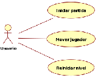
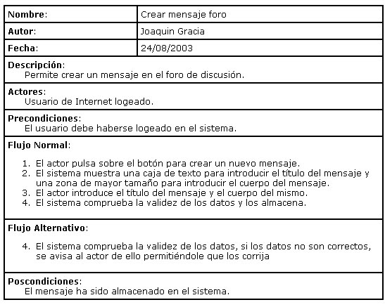
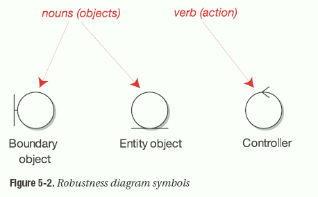
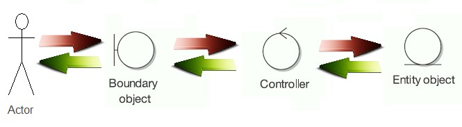
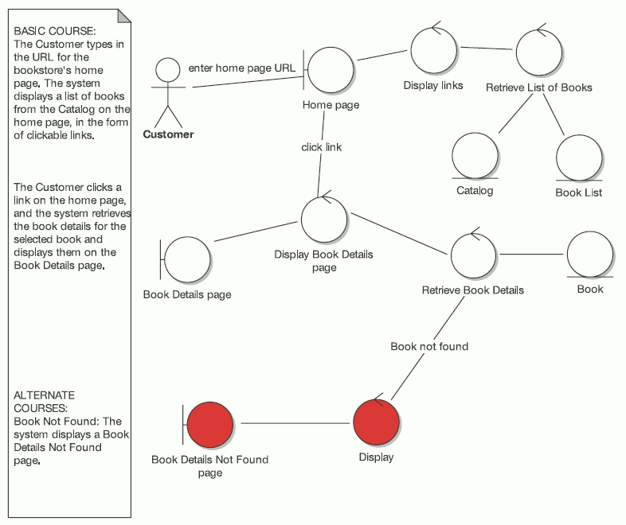
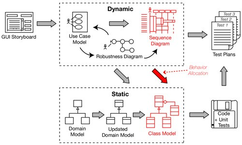

# Manual introductorio de ICONIX

> Transcripción revisada del PDF original de cinco páginas. Se han corregido detalles evidentes de escritura, acentuación y formato para facilitar la lectura. Se conservan el contenido, la organización y los ejemplos del documento. Las ilustraciones relevantes se incluyen en la carpeta `MetodoPesadesICONIX_recursos`.

## 1. ¿Qué es ICONIX?

ICONIX es una metodología de desarrollo de software denominada *pesada-ligera*, situada a medio camino entre RUP (*Rational Unified Process*) y XP (*eXtreme Programming*).

ICONIX deriva directamente de RUP. Su fundamento es que un 80 % de los casos pueden resolverse utilizando tan solo el 20 % de UML. De esta manera, se simplifica considerablemente el proceso sin perder documentación, al conservar únicamente aquello que es necesario. Esto implica un uso dinámico de UML, de forma que siempre se pueden utilizar otros diagramas además de los estipulados si se considera conveniente.

ICONIX se guía a través de casos de uso y sigue un ciclo de vida iterativo e incremental. El objetivo es obtener el sistema final a partir de los casos de uso.

### Esquema de entrada y salida del proceso

```text
Requisitos nuevos o modificados
              |
              v
      Proceso de desarrollo
        de software ICONIX
              |
              v
Sistema nuevo o modificado
```

El documento original también muestra un pequeño ejemplo de casos de uso:



**Nota:** la representación anterior es puramente orientativa; los casos de uso pertenecen al proceso ICONIX.

El objetivo es que cada requisito se identifique con algún caso de uso. Así se puede verificar en cualquier momento que el sistema satisface ese requisito y que su funcionalidad es correcta. Esta relación se denomina **trazabilidad** y permite obtener una medida tangible de calidad.

La calidad de un sistema se determina por la proporción de requisitos que satisface. Por lo tanto, un sistema será de calidad si satisface sus requisitos.

## 2. Las fases de ICONIX

ICONIX se estructura en cuatro fases: análisis de requisitos, análisis y diseño preliminar, diseño e implementación.

Antes de estas fases, se debe realizar un pequeño *storyboard* de la interfaz gráfica, con dibujos de las pantallas principales del sistema elaborados a partir de las reuniones con el cliente.

### 2.1. Análisis de requisitos

En esta primera fase se realiza un **modelo de dominio**, que es un diagrama de clases extremadamente simplificado. Este modelo contiene únicamente los objetos de la vida real cuyo comportamiento o datos deban almacenarse en el sistema.

A partir de este modelo, se realiza un prototipo basado en el *storyboard* de la interfaz gráfica obtenido previamente. El prototipo se muestra al cliente y se refina en reuniones sucesivas. Normalmente, suele converger en dos o tres iteraciones.

Cuando el prototipo es definitivo y se han obtenido todos los requisitos del sistema por parte del cliente, se procede a realizar los casos de uso. Estos diagramas se agrupan en diagramas de paquetes —es decir, utilizan referencias entre diagramas de casos de uso para simplificar su lectura— y se asocia cada requisito a un caso de uso para mantener la trazabilidad.

### 2.2. Análisis y diseño preliminar

A partir de cada caso de uso se obtienen sus correspondientes **fichas de caso de uso**. Estas fichas no pertenecen a UML. A continuación se transcribe el ejemplo que aparece en el documento.

#### Ejemplo de ficha de caso de uso: «Crear mensaje foro»

| Campo | Contenido |
|---|---|
| **Nombre** | Crear mensaje foro |
| **Autor** | Joaquín Gracia |
| **Fecha** | 24/08/2003 |
| **Descripción** | Permite crear un mensaje en el foro de discusión. |
| **Actores** | Usuario de Internet con sesión iniciada. |
| **Precondiciones** | El usuario debe haber iniciado sesión en el sistema. |
| **Postcondiciones** | El mensaje ha sido almacenado en el sistema. |



**Flujo normal**

1. El actor pulsa el botón para crear un nuevo mensaje.
2. El sistema muestra una caja de texto para introducir el título del mensaje y una zona de mayor tamaño para introducir el cuerpo del mensaje.
3. El actor introduce el título del mensaje y el cuerpo del mismo.
4. El sistema comprueba la validez de los datos y los almacena.

**Flujo alternativo**

4. El sistema comprueba la validez de los datos. Si no son correctos, se avisa al actor para que pueda corregirlos.

La ficha de caso de uso está formada por un nombre, que suele ser el del caso de uso; una breve descripción —generalmente desde el punto de vista del usuario, es decir, qué hace de forma intuitiva y no cómo lo hace—; una precondición que debe cumplirse antes de iniciarse; una postcondición que debe cumplirse al terminar correctamente; un flujo normal que sigue el sistema cuando todo va bien; y un flujo alternativo para los casos en que se produce algún problema. El resto de los campos son opcionales.

Después es necesario realizar el **diagrama de robustez**, que pertenece al proceso ICONIX y tampoco forma parte de UML. A continuación se describe cómo se realiza este tipo de diagrama.

#### Elementos y relaciones del diagrama de robustez

Los elementos de un diagrama de robustez son los **objetos frontera**, los **objetos entidad** y los **objetos controlador**. Los dos primeros se relacionan con sustantivos y el último con verbos.

La relación funciona como una frase: los sustantivos se relacionan a través de verbos. Por ejemplo: **«Índice muestra enlace, libro»**. El primero es frontera, el segundo controlador y el tercero entidad.



El flujo representado en el documento es:



Existe una excepción: los objetos de tipo controlador pueden comunicarse entre ellos.

A continuación se incluye el ejemplo de diagrama de robustez que aparece en el documento original. El ejemplo representa la consulta de libros de una librería en línea, incluida la ruta alternativa cuando no se encuentra un libro.



El objetivo del diagrama de robustez es añadir nuevas relaciones a los diagramas de clases, de forma que se obtenga un esqueleto aceptable de la arquitectura y del diseño para continuar el proceso. Con este diagrama y las fichas, se refina el diagrama de clases tanto como sea necesario y se obtiene una nueva versión preparada para la siguiente fase.

### 2.3. Diseño

En esta fase se realizan los **diagramas de secuencia**, que derivan directamente de las fichas de caso de uso. Los diagramas de secuencia se relacionan con las fichas de caso de uso; estas se relacionan con los casos de uso, y estos, a su vez, con los requisitos.

Una vez finalizado el diseño y refinado nuevamente el diagrama de clases, se puede verificar el resultado gracias a la trazabilidad y preparar el paso a la siguiente fase.

Si el resultado no es satisfactorio, es necesario revisar el proceso hasta que sea correcto. Es vital que los requisitos se satisfagan correctamente para el éxito del proyecto.

### 2.4. Implementación

Para distribuir correctamente el software, puede ser adecuado realizar un **diagrama de componentes** en algunos casos, aunque no siempre es necesario. En esta fase se escribe el código tal y como fue especificado en las fases anteriores y se planifican las pruebas basándose en los requisitos iniciales, con el nivel de detalle necesario.

Aquí se utiliza la trazabilidad para poner en práctica la garantía de calidad mencionada anteriormente. Después de tener un buen diseño, se crea el software a partir de ese diseño. Mediante pruebas adecuadas se puede verificar que el sistema final cumple los requisitos iniciales y, por tanto, proceder a su entrega.

## 3. Resumen del proceso

El diagrama siguiente resume el proceso ICONIX y distingue entre actividades dinámicas y estáticas.



A través de reuniones con el cliente se genera un *storyboard* de la interfaz. Mediante prototipos y un modelo de dominio se obtiene la aprobación para la recopilación final de requisitos. Estos se representan como casos de uso y sus respectivas fichas asociadas. Con ello se realiza un diagrama de robustez que refina el diagrama de clases.

Las fichas de caso de uso dan lugar a diagramas de secuencia y a un nuevo y último refinamiento del diagrama de clases. A partir de este diseño completo se obtiene el código y, mediante la trazabilidad con los requisitos iniciales, se planifican y crean las pruebas necesarias.

Una vez terminado este proceso, repitiendo cada paso tantas veces como sea necesario, se dispone de un software de calidad —es decir, que satisface los requisitos— listo para entregar al cliente.

## 4. Referencias

1. [Imagen de ejemplo de diagrama de robustez](http://iconixprocess.files.wordpress.com/2007/01/showbookdetails-robustness.png)
2. [Metodología ICONIX (PDF)](http://www.portalhuarpe.com.ar/Seminario09/archivos/MetodologiaICONIX.pdf)
3. [Uso de ICONIX (PDF)](http://www.portalhuarpe.com.ar/Seminario09/archivos/UsodeICONIX.pdf)

---

**Nota de transcripción:** se mantuvieron los conceptos y ejemplos que aparecen en el documento. Se corrigieron errores evidentes de escritura y se reconstruyeron en texto las partes gráficas relevantes para que el archivo sea más legible y útil.
