# PLATAFORMA INTELIGENTE DE COMERCIO ELECTRÓNICO SaaS MULTITENANT PARA TIENDAS DE ROPA MASCULINA CON ARQUITECTURA OFFLINE-FIRST Y REPORTES GENERATIVOS VÍA INTELIGENCIA ARTIFICIAL — FASHIONSTORE

## **Segundo Examen Parcial — Sistemas de Información II (SI2)**

**Materia:** Sistemas de Información II (SI2)  
**Semestre:** 2-2026  
**Docente:** MSc. Ing. Angélica Garzón Cuéllar  
**Metodología:** ICONIX (Pesada-Ligera) — UML 2.5+  
**Proyecto:** FashionStore — Evolución hacia E-Commerce SaaS Multitenant, Resiliencia Offline-First y Analítica Generativa con IA  

**Integrantes del equipo de desarrollo:**

| Nro. | Nombre completo | Rol |
|:---:|:---|:---:|
| 1 | **Alberto Delgado** | Desarrollador Full Stack |
| 2 | **Andy Mujica** | Desarrollador Full Stack |

---

> **Resumen Ejecutivo:** El presente documento técnico constituye la especificación formal del Segundo Examen Parcial de la materia Sistemas de Información II (SI2). Se aplica la metodología **ICONIX** en todo su ciclo de vida, integrando los modelos UML 2.5+ con la arquitectura de software desarrollada. Comprende la evolución integral de FashionStore hacia una plataforma **SaaS Multitenant**, capacidades offline con SQLite e IndexedDB, protocolo de sincronización idempotente, gestión de cambios de prendas en dos tiempos, aprovisionamiento controlado, reportes generativos con Inteligencia Artificial y Machine Learning.

---

# CAPÍTULO I. ASPECTOS GENERALES

## 1.1 Introducción

El comercio minorista de confección e indumentaria masculina (*menswear retail*) exige una rigurosa certidumbre operativa: el consumidor masculino demanda inmediatez transaccional, exactitud en dimensiones antropométricas, disponibilidad física verificable en tiempo real y una experiencia omnicanal fluida. En el contexto de Bolivia (con énfasis en el eje troncal: Santa Cruz, La Paz y Cochabamba), este sector padece graves asimetrías estructurales: desestandarización crítica del tallaje entre manufacturas nacionales e importadas con discrepancias de hasta 8 cm (lo que detona tasas de devolución superiores al 30%), informalidad en ventas por redes sociales sin trazabilidad contable, distorsión en la valuación de existencias por omisión del Costo Promedio Ponderado (CPP) y caídas crónicas del suministro de Internet en centros comerciales que paralizan los sistemas de facturación en tiendas físicas.

Durante el primer examen parcial de Sistemas de Información II (semestre 2-2026), se concibió e implementó la versión fundacional de **FashionStore**: una plataforma omnicanal monoproyecto estructurada bajo el Proceso Unificado (PUDS) con 25 casos de uso distribuidos en 19 módulos (archivados íntegramente en el **Anexo A** como antecedente histórico), incorporando catálogo paramétrico en centímetros, terminal POS con recálculo inmutable del CPP, vestidor virtual en Realidad Aumentada y pasarela Stripe Sandbox.

Para este **Segundo Examen Parcial**, FashionStore emprende una evolución arquitectónica de escala mayor hacia una **plataforma Software as a Service (SaaS) Multitenant resiliente, con arquitectura Offline-First y analítica generativa con Inteligencia Artificial**, articulada sobre seis pilares tecnológicos de ingeniería:
1. **Gobernanza SaaS Multitenant:** Base de datos relacional compartida con aislamiento lógico hermético mediante discriminador `empresa_id` a nivel de fila y middleware de seguridad en FastAPI, administrando Planes de Suscripción (Básico y Profesional) con límites de sucursales y personal.
2. **Resiliencia Operativa Offline-First:** Persistencia local no volátil mediante la API **IndexedDB** en Angular PWA y el motor relacional embebido **SQLite (`sqflite`)** en la app móvil Flutter, permitiendo facturación POS al contado en efectivo y reservas en mostrador ante cortes de red.
3. **Sincronización Transaccional Idempotente:** Despacho en lotes con identificadores universales **UUID v4 inmutables**, cabecera `X-Idempotency-Key` y resolución determinista de sobreventa (*overselling*) con prioridad a la venta física presencial.
4. **Circuito Postventa en Dos Tiempos (Devolución y Reposición):** Emisión obligatoria de la **Nota de Devolución** (+1 stock al CPP histórico) y la **Nota de Reposición / Cambio** (-1 stock, liquidación de diferencial en Stripe Sandbox o reembolso contable a 30 días), con soporte multi-prenda, notificación push de entrega y calificación de satisfacción.
5. **Aprovisionamiento Corporativo Web Desktop (CU20):** Módulo B2B exclusivo para PC/Laptop que actualiza existencias y recalcula matemáticamente el CPP en Kardex fiscal (Ley 843).
6. **Analítica Generativa con IA y Machine Learning:** Asistente conversacional por texto y comandos de voz (Whisper) con validador AST de consultas SQL seguras, exportación a Excel/PDF y pipeline de ML entrenado sobre 6 meses de datos sintéticos ($R^2 \ge 0.82$).

El proyecto adopta formalmente la **metodología ICONIX** (pesada-ligera, principio 80/20 de UML), estructurado en sus cuatro fases (Análisis de Requisitos, Análisis/Diseño Preliminar con Robustez BCE —bajo la regla inquebrantable de **CERO comunicación Entidad $\\longleftrightarrow$ Entidad**—, Diseño con Secuencias —cuyos fragmentos `loop` nunca encierran al Boundary y los bloques `alt` abarcan hasta las entidades— e Implementación con pruebas formales de trazabilidad vertical). Los casos de uso se desarrollan de forma continua y consolidada del **CU01 al CU20**, garantizando cobertura funcional integral sin divisiones burocráticas.

---

## 1.2 Planteamiento del Problema

### 1.2.1 Contexto Global, Regional y Local del Comercio Minorista de Moda Masculina

El comercio minorista de prendas de vestir (*apparel retail*) representa una de las industrias de mayor dinamismo y volumen económico a nivel global. Tradicionalmente estructurada sobre un modelo de interacción eminentemente sensorial —donde el cliente acude físicamente a la tienda, examina la textura y peso de las telas, aprecia la caída de los textiles, utiliza probadores para verificar el ajuste anatómico y recibe la orientación directa de dependientes—, la industria de la moda se ha visto forzada a emprender una profunda metamorfosis tecnológica. El auge del comercio móvil (*m-commerce*), la exigencia de inmediatez y la consolidación de estrategias omnicanales han derribado las barreras entre el espacio comercial físico y las plataformas virtuales.

En el caso específico de la **indumentaria masculina**, las características psicográficas y conductuales del consumidor imponen condiciones muy exigentes. Diversos estudios de comportamiento del consumidor señalan que los varones priorizan la conveniencia, la exactitud y la economía de tiempo. Cuando un comprador masculino busca una prenda de vestir, generalmente persigue un objetivo concreto: renovar su vestuario laboral con camisas formales, adquirir un traje para un evento específico o proveerse de ropa deportiva o casual con características funcionales definidas. Experimentar fricciones en la experiencia de compra —como colas prolongadas frente a probadores, desorden en estanterías, falta de claridad en las medidas o incertidumbre respecto a si una compra digital le calzará adecuadamente— genera una tasa de abandono que supera el **40%** en tiendas físicas y desmotiva las compras en canales digitales.

#### La Realidad Estructural del Mercado Textil en Bolivia

Al contrastar estas dinámicas globales con el entorno socioeconómico y tecnológico de **Bolivia** (particularmente en las urbes de Santa Cruz de la Sierra, La Paz, Cochabamba y ciudades intermedias), el comercio de moda masculina enfrenta fallas estructurales agudas:

1. **Heterogeneidad Descontrolada y Caos de Tallas:**
   En el mercado nacional convergen prendas de múltiples orígenes: confecciones de talleres nacionales, manufacturas importadas de países limítrofes (Brasil, Colombia, Perú), prendas de origen norteamericano y un masivo volumen de confecciones asiáticas. Dado que no existe una norma técnica antropométrica boliviana de estandarización de tallas, la etiqueta nominal (S, M, L, XL, o numéricas 38, 40, 42) carece de significado homogéneo. Una camisa talla "L" de origen asiático resulta con frecuencia equivalente a una talla "S" de confección norteamericana. Los clientes que compran por Internet o canales de mensajería sin conocer las **medidas exactas en centímetros (pecho, cintura, largo)** sufren una constante decepción al recibir prendas incompatibles, generando desconfianza hacia el comercio electrónico formal.

2. **La Trampa de la Informalidad Digital:**
   Gran parte de las empresas textiles que afirman contar con "tienda virtual" carecen de plataformas transaccionales verdaderas. Su operativa descansa en la publicación de catálogos no sincronizados en redes sociales (Facebook, Instagram, WhatsApp). El proceso de venta es manual, precario e ineficiente: un cliente consulta la disponibilidad de una prenda, un empleado debe buscar físicamente la ropa en perchas o bodegas para responder horas más tarde, el pago se efectúa mediante transferencias QR informales que requieren enviar la fotografía del comprobante bancario para su verificación visual, y los despachos se coordinan de forma precaria con servicios de radiotaxi. Este flujo artesanal no escala, genera duplicidad de ventas sobre prendas ya agotadas (*overselling*), carece de trazabilidad contable y proyecta una imagen de poca seriedad que frena la fidelización de clientes de alto valor.

3. **Silos Operativos y Falta de Visibilidad Multi-Sucursal:**
   Las cadenas comerciales medianas que cuentan con dos o más tiendas físicas dentro de una misma ciudad operan sus locales como compartimentos estancos. Las ventas se registran en cuadernos físicos o en terminales aisladas con bases de datos locales no sincronizadas. Si un cliente solicita una camisa de su talla en la sucursal de una zona comercial y la prenda está agotada, el personal de mostrador no tiene visibilidad sobre si dicha prenda existe en la sucursal ubicada a pocos kilómetros. La venta se pierde irremediablemente, mientras en el otro punto de venta la mercadería permanece inmovilizada hasta convertirse en saldo obsoleto.

4. **Inexactitud Financiera y Vulnerabilidad Tributaria por Omisión del CPP:**
   Debido a factores macroeconómicos, fluctuaciones en el tipo de cambio de divisas para insumos importados y variaciones en fletes de transporte, los comerciantes de ropa adquieren lotes sucesivos de prendas idénticas a costos unitarios notablemente dispares. La práctica empírica habitual en las PyMEs bolivianas consiste en registrar todo el stock asignándole el valor del último precio de compra recibido. Esta omisión del cálculo riguroso del **Costo Promedio Ponderado (CPP)** distorsiona por completo la valuación de los activos en el balance general, proyecta márgenes brutos de rentabilidad ficticios y coloca a la empresa en situación de contingencia fiscal frente al Servicio de Impuestos Nacionales al no poder sustentar fehacientemente su costo de ventas en el marco de la Ley 843 (IVA 13%, IT 3%).

5. **Inestabilidad de Telecomunicaciones y Vulnerabilidad en Tiendas:**
   Las redes de telecomunicaciones en Bolivia padecen de recurrentes caídas de servicio, microcortes de fibra óptica e interrupciones del suministro de datos celulares, particularmente severas en los sótanos y zonas interiores de centros comerciales y galerías populares. La mayoría de los sistemas web modernos colapsan ante la pérdida de conexión: la pantalla se congela, el cajero no puede emitir recibos ni consultar precios, las filas de clientes se acumulan y el establecimiento se ve forzado a paralizar sus operaciones, sufriendo cuantiosas pérdidas financieras y daño a su reputación.

---

### 1.2.2 Diagnóstico de la Situación Actual y Problemáticas Críticas del Modelo Inicial

A partir del análisis técnico del prototipo desarrollado en el primer parcial y de la recopilación de requerimientos del sector comercial, se sintetizan las problemáticas operativas centrales que sustentaron la concepción inicial del sistema:

1. **La Brecha Experiencial Físico-Digital y la Crisis Logística de Devoluciones:** La imposibilidad de ensayar virtualmente las prendas antes del pago, sumada a la ausencia de fichas con medidas anatómicas en centímetros, generaba tasas de devolución superiores al **30%** en ventas digitales, ocasionando absorción de fletes de transporte inverso, deterioro de etiquetas y pérdida de margen comercial.
2. **Desarticulación en el Inventario Multi-Sucursal:** Falta de un kardex centralizado en tiempo real, lo que provocaba desabastecimiento en tiendas de alta afluencia y acumulación de sobrestock en sucursales secundarias.
3. **Distorsión Contable en Existencias:** Carencia de un recálculo automatizado del Costo Promedio Ponderado tras cada compra de abastecimiento a proveedores.
4. **Ineficiencia en Sala de Ventas y Probadores:** Tiempos de espera excesivos de los clientes en tiendas físicas para probarse prendas, sin mecanismos de reserva previa de probadores con preselección digital de ropa.
5. **Experiencia Estática y Falta de Personalización:** Ausencia de asesoría estilística contextualizada a factores climáticos y ocasiones de uso, junto con la falta de esquemas de fidelización por niveles de cliente.

---


### 1.2.5 Nuevos Desafíos Estructurales y Necesidad de Escalado hacia el Segundo Parcial

Si bien el prototipo del primer parcial solventó con éxito las problemáticas iniciales para una tienda específica, el análisis de escalabilidad técnica y comercial reveló **seis nuevas limitaciones estructurales** que motivan de forma ineludible la evolución hacia el Segundo Parcial:

#### A. Modelo Monolítico de Negocio y Ausencia de Escalabilidad Multi-Empresa (SaaS)
FashionStore fue concebida inicialmente como una solución privativa para una sola marca comercial. Este esquema limita la rentabilidad del desarrollo: no puede ser adoptado por otras cadenas o boutiques de confección sin duplicar servidores, bases de datos y costos de mantenimiento. 
En la industria moderna del software, el modelo **SaaS (Software as a Service)** permite comercializar la plataforma a múltiples empresas suscriptoras (**tenants**). Cada empresa opera de forma totalmente aislada e independiente (con sus propios roles, empleados, inventarios, precios y clientes), seleccionando planes de suscripción (Básico o Profesional) acordes a su volumen de negocio. El prototipo del primer parcial carecía de esta capacidad multi-empresa.

#### B. Vulnerabilidad Crítica ante Interrupciones de Conectividad a Internet (Realidad Boliviana)
El prototipo inicial dependía rígidamente de una conexión ininterrumpida al backend central en la nube. En la realidad boliviana, las interrupciones del servicio de Internet —debido a fallas de proveedores, cortes de fibra óptica o saturación en centros comerciales— son frecuentes. 
Bajo el esquema inicial, un corte de red paralizaba la caja POS de la sucursal: no se podían facturar ventas de mostrador ni confirmar reservas. De igual modo, en zonas sin cobertura celular, la aplicación móvil dejaba de responder. Resulta indispensable dotar a FashionStore de **resiliencia offline**: la web debe operar como una **Progressive Web App (PWA) con IndexedDB** y la app móvil debe incorporar **SQLite local**, permitiendo transacciones de mostrador sin red y ejecutando una **sincronización idempotente posterior** cuando se restablezca la conectividad.

#### C. Carencia de Analítica Predictiva, Modelos de Machine Learning y Reportes Generativos
Los tableros de control del primer parcial ofrecían métricas estáticas basadas en consultas SQL predeterminadas. Los directivos de las empresas no podían solicitar información ad-hoc ni hacer preguntas analíticas en lenguaje natural (ej. *"¿Cuáles fueron los 3 trajes más vendidos en la sucursal Equipetrol durante el último mes?"*).
Asimismo, la plataforma carecía de modelos de **Machine Learning** que permitieran anticipar la demanda futura de prendas (modelos supervisados de regresión) o segmentar clientes y detectar anomalías en existencias (modelos no supervisados de clustering y aislamiento). Sin un pipeline de datos sintéticos representativo de al menos 6 meses y algoritmos de ML, la toma de decisiones gerenciales continuaba siendo puramente reactiva.

#### D. Gestión Incompleta del Ciclo Post-Venta: Políticas de Cambio de Prendas con Doble Registro (Devolución y Reposición)
El prototipo inicial implementó la venta y la entrega, pero omitió el tratamiento formal de los **cambios y devoluciones de prendas**. En la práctica del comercio textil, cuando un cliente requiere cambiar una prenda (frecuentemente por falta de calce en talla o modelo), el sistema debe permitir formalizar la operación en mostrador dentro de un plazo normado (3 a 7 días hábiles). Dicho cambio exige emitir contablemente una **Nota de Devolución** (para reingresar la prenda devuelta al stock de la sucursal y recuperar su CPP histórico) y una **Nota de Reposición / Cambio** (para despachar la nueva prenda entregada), liquidando con exactitud si existe un **diferencial de precio** por variación de talla o tela vía Stripe Sandbox, permitiendo la devolución de múltiples prendas por compra, notificando al cliente vía push con la fecha garantizada de reposición, u ordenando un **reembolso contable a 30 días** si no hay existencias o el cliente desiste.

#### E. Ausencia de Estrategias de Precios Diferenciados (Mayorista y Liquidación Estacional)
El modelo original aplicaba un precio de venta rígido y unitario. El retail de moda requiere flexibilizar tarifas para incentivar la venta por volumen:
- **Precios al por Mayor:** Aplicables automáticamente a clientes que adquieren compras iguales o superiores a **3 unidades**, dinamizando la venta comercial.
- **Ofertas de Liquidación Estacional:** Descuentos promocionales configurables (**30%, 40% y 60%**) para mercadería de fin de temporada, esenciales para desocupar bodegas y recuperar el capital inmovilizado.

#### F. Desarticulación del Canal de Compras y Aprovisionamiento Empresarial (CU20)
Las compras de mercadería a proveedores deben realizarse de manera controlada y centralizada a través del canal **Web Desktop** por el Encargado de Aprovisionamiento o el Administrador de Empresa. El ingreso de lotes de compra debe actualizar de forma atómica el stock físico, registrar los precios pactados y disparar el recálculo automático inmutable del Costo Promedio Ponderado en el kardex central.

---

### 1.2.6 Formulación de la Solución Integral con FashionStore SaaS Multitenant

Frente a la conjunción de los desafíos de la industria de la moda masculina y las exigencias de escalabilidad, resiliencia y analítica del Segundo Parcial, se formula la arquitectura integral de **FashionStore**:

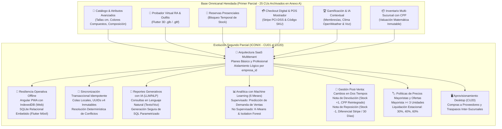

---

## 1.3 Objetivos del Proyecto

### 1.3.1 Objetivo General

Desarrollar una plataforma inteligente de comercio electrónico bajo el modelo SaaS Multitenant para tiendas de moda masculina, aplicando la metodología ICONIX y tecnologías web, móviles y en la nube, para proporcionar operaciones comerciales continuas en modo offline, sincronización transaccional idempotente, analítica con inteligencia artificial y gestión integral de inventario, compras y postventa.

---

### 1.3.2 Objetivos Específicos

Para alcanzar el objetivo general, se formulan los siguientes 12 objetivos específicos:

1. **Modelar** los requerimientos y el diseño del sistema mediante la metodología **ICONIX** y la herramienta **Enterprise Architect**, para estructurar los casos de uso, modelos de dominio, diagramas de robustez BCE y diagramas de secuencia.
2. **Diseñar** el esquema de base de datos multitenant y el mecanismo de suscripción comercial escalonada (Planes Básico y Profesional) con control de acceso basado en roles (RBAC) utilizando **PostgreSQL** y **FastAPI**, para asegurar el aislamiento lógico de datos entre empresas clientes y la fiscalización de cuotas operativas.
3. **Construir** la aplicación web cliente bajo el estándar Progressive Web App (PWA) con **Angular** y almacenamiento en **IndexedDB**, para permitir la navegación del catálogo y el registro de ventas y reservas en modo desconectado.
4. **Desarrollar** la aplicación móvil offline-first utilizando el framework **Flutter** y la base de datos embebida **SQLite**, para posibilitar la operación comercial de venta y reserva en dispositivos móviles sin enlace a internet.
5. **Implementar** el mecanismo de sincronización bidireccional idempotente mediante endpoints REST en **FastAPI** con identificadores **UUID v4**, para consolidar las transacciones offline hacia el servidor central y resolver colisiones de inventario.
6. **Programar** el módulo de postventa para cambios y devoluciones en dos tiempos mediante componentes de **FastAPI** y **Angular**, para gestionar la emisión de Notas de Devolución, Notas de Reposición, validación de garantías y notificación push.
7. **Configurar** las reglas de negocio de precios mayoristas y liquidación estacional a través de controladores en **Python/FastAPI**, para aplicar descuentos automáticos por volumen de prendas y colecciones pasadas.
8. **Desarrollar** el módulo de aprovisionamiento de compras y traspasos inter-sucursal mediante la interfaz **Web Desktop en Angular**, para actualizar el Costo Promedio Ponderado (CPP) y controlar transferencias de mercadería.
9. **Integrar** el módulo de generación de reportes inteligentes en lenguaje natural utilizando la **API de OpenAI / LLM** y transcripción de voz con **Whisper**, para permitir a los administradores consultar indicadores de venta mediante comandos de voz y texto.
10. **Implementar** el módulo analítico predictivo y dashboard ejecutivo empleando **Scikit-Learn** y bibliotecas de visualización, para pronosticar la demanda de stock y rotación de prendas a partir de datos históricos.
11. **Desplegar** los servicios del backend, base de datos y tareas asíncronas en la nube mediante contenedores **Docker** y la plataforma **Render / Cloud**, para garantizar la disponibilidad, portabilidad y aislamiento del entorno de producción.
12. **Verificar** la calidad y funcionalidad de la plataforma ejecutando matrices de pruebas automatizadas con **Pytest** y pruebas de casos de uso (TCP), para certificar el cumplimiento de los requerimientos y reglas de negocio.

---

## 1.4 Justificación

La evolución estratégica y tecnológica de FashionStore se fundamenta rigurosamente en cinco dimensiones de análisis:

### 1.4.1 Justificación Técnica y Arquitectónica

Desde la perspectiva de la ingeniería de software moderna, migrar un sistema propietario o monoproyecto hacia una **arquitectura SaaS Multitenant con base de datos compartida y aislamiento lógico (`empresa_id`)** constituye el estándar de máxima eficiencia en la industria digital. Permite operar un único código base (*single codebase*), centralizar los despliegues continuos, optimizar la utilización de recursos computacionales en la nube y reducir drásticamente los costos de infraestructura y mantenimiento evolutivo.

Asimismo, la implementación de un paradigma **Offline-First** combinando **Angular PWA (Service Workers + IndexedDB)** en el entorno web y **Flutter (SQLite embebido)** en el entorno móvil resuelve uno de los problemas arquitectónicos más desafiantes en sistemas distribuidos: la tolerancia a fallos de partición de red (*Teorema CAP*). Al incorporar identificadores inmutables **UUID v4** como claves de idempotencia y despachos atómicos por lotes, el sistema garantiza consistencia eventual, durabilidad transaccional y protección contra duplicidad de datos, demostrando solvencia ingenieril en el diseño de software de misión crítica.

### 1.4.2 Justificación Comercial, Económica y de Escalabilidad (SaaS)

Desarrollar soluciones informáticas a medida y de forma aislada para cada pequeña o mediana empresa del sector textil resulta económicamente inviable, demanda inversiones de capital inasumibles para boutiques locales y restringe severamente el retorno sobre la inversión (ROI) para la empresa de desarrollo.

Al transformar FashionStore en un producto SaaS comercializable bajo planes escalonados (**Plan Básico y Plan Profesional**), se democratiza el acceso a tecnología de frontera (probadores virtuales en Realidad Aumentada, analítica predictiva con Machine Learning y reportes generativos con IA) para cientos de empresas de confección y venta de ropa que de otro modo quedarían marginadas de la economía digital. Para la empresa proveedora de FashionStore, el modelo SaaS instituye un flujo de ingresos recurrentes, predecibles y escalables (MRR - *Monthly Recurring Revenue*), donde la incorporación de nuevos clientes genera un costo marginal cercano a cero. Adicionalmente, las reglas comerciales de precios mayoristas (>= 3 unidades) y liquidación de inventario estacional (30%, 40%, 60%) maximizan el flujo de caja y la recuperación de capital para las tiendas suscriptoras.

### 1.4.3 Justificación Social y de Resiliencia Operativa en el Contexto Boliviano

En el contexto comercial de Bolivia, la infraestructura de telecomunicaciones presenta notorias vulnerabilidades territoriales. En centros comerciales de alta concurrencia, ferias comerciales densas o galerías céntricas, las saturaciones y caídas del servicio de Internet son una constante cotidiana. Imponer a los comercios una dependencia total de la nube significa forzarlos a suspender cobros y cerrar cajas ante el primer corte de red.

Al dotar a FashionStore de capacidad operativa fuera de línea para ventas de mostrador y reservas de probadores, se protege la estabilidad operativa de las tiendas físicas, se salvaguarda el empleo de los dependientes y se previene la fuga económica de clientes. Asimismo, al facilitar la inclusión de tallas anatómicas en centímetros, colores compuestos y especificaciones textiles, se combate la informalidad del comercio informal, promoviendo la formalización del retail de indumentaria y el cumplimiento de las normativas tributarias nacionales mediante la correcta aplicación del Costo Promedio Ponderado.

### 1.4.4 Justificación de Inteligencia de Negocios y Machine Learning

La enorme cantidad de transacciones que genera el retail de moda (ventas, pedidos, reservas, mermas y devoluciones) carece de valor estratégico si los directivos no cuentan con instrumentos ágiles para su interpretación. En las empresas medianas, los gerentes rara vez dominan el lenguaje SQL para extraer reportes ad-hoc de sus bases de datos.

La integración de **Reportes Generativos asistidos por Inteligencia Artificial (LLM / NLP)** democratiza de forma radical la toma de decisiones: un directivo puede formular una pregunta en lenguaje natural desde su computadora o dictarla mediante comandos de voz desde su teléfono inteligente y recibir en segundos un análisis ejecutivo con tablas y gráficos interactivos contextualizados a su empresa. De igual modo, la incorporación de **modelos de Machine Learning** entrenados sobre 6 meses de datos sintéticos sustituye la intuición empírica por rigor estadístico: el modelo de regresión supervisado anticipa la demanda estacional de ventas para evitar quiebres de stock, el clustering de K-Means segmenta la cartera de compradores para optimizar campañas de fidelización, y el algoritmo Isolation Forest detecta anomalías en existencias antes de que se conviertan en pérdidas financieras.

### 1.4.5 Justificación Académica y Metodológica (ICONIX vs PUDS)

En el ámbito formativo de la carrera de Ingeniería de Sistemas de la Universidad Autónoma Gabriel René Moreno (UAGRM), el proyecto permite contrastar de manera práctica y vivencial dos de las filosofías metodológicas más trascendentes en la ingeniería de software: el Proceso Unificado (PUDS), formal, iterativo y exhaustivo en artefactos, frente a **ICONIX**, ágil, pesada-ligera y focalizada en casos de uso.

La aplicación de ICONIX permite a los futuros ingenieros dominar el **principio 80/20 de UML**, aprendiendo a tender puentes conceptuales sólidos entre los requisitos del negocio y la implementación en código mediante los **Diagramas de Robustez (BCE)**. Demuestra cómo modelar la lógica sin acoplamientos prohibidos (eliminando dependencias directas entre entidades de datos), cómo representar fragmentos interactivos complejos en diagramas de secuencia sin deformar la interacción de interfaces, y cómo garantizar una trazabilidad vertical estricta que asegure la calidad del software entregado.

---

## 1.5 Alcance y Limitaciones

### 1.5.1 Módulos del Sistema (Segundo Parcial)

> **Regla de Alcance Metodológico (MSc. Ing. Angélica Garzón Cuéllar):**  
> *En estricta conformidad con las directrices metodológicas de evaluación y la arquitectura pesada-ligera de ICONIX, el cuerpo central de este documento delimita formalmente los **8 módulos funcionales consolidados** que agrupan y estructuran las capacidades del **Segundo Parcial**. Estos módulos se encuentran enumerados correlativamente a partir de **M01 (del M01 al M08)**, manteniendo perfecta trazabilidad con los 20 casos de uso del sistema (`CU01` a `CU20`) y los seis desafíos tecnológicos de ingeniería. Los 19 módulos fundacionales desarrollados bajo el Proceso Unificado durante el Primer Parcial se preservan íntegramente en el [Anexo A.2](#anexo-a2-módulos-del-sistema-del-primer-parcial-m01-al-m19--etapa-fundacional) como respaldo histórico.*

A continuación se especifica exhaustivamente cada uno de los **8 módulos consolidados del Segundo Parcial**, detallando su descripción operativa, estructura de datos clave con restricciones de integridad, funcionalidades nucleares y casos de uso asociados:

#### 1.5.1.1 Módulo M01: Plataforma SaaS Multitenant, Planes y Seguridad RBAC (Desafío VI)
- **Descripción General:** Administra el ciclo de vida, configuración, aprovisionamiento y aislamiento lógico estricto de las empresas clientes (**tenants**). Gobierna los tiers comerciales de suscripción (Plan Básico: hasta 2 sucursales; Plan Profesional: hasta 10 sucursales) con fiscalización de cuotas máximas de sucursales activas y empleados, y gestiona la seguridad perimetral mediante autenticación JWT cifrada con hash `bcrypt` y control de acceso basado en roles (RBAC) con discriminador `id_empresa` (Integer) y validación en PostgreSQL / SQLite de respaldo.
- **Datos Principales:** 
  - `empresas` (`id_empresa` PK Integer autoincremental, `nit` VarChar 30 Unique, `razon_social` VarChar 150, `nombre_comercial` VarChar 150, `dominio_slug` VarChar 50 Unique, `schema_name` VarChar 50, `presupuesto_disponible` Numeric 12,2, `estado` Enum/VarChar: `ACTIVA`, `SUSPENDIDA`, `VENCIDA`, `email_contacto` VarChar 100).
  - `planes_suscripcion` (`id_plan` PK Integer autoincremental, `codigo` VarChar 30 Unique, `nombre` VarChar 50, `precio_mensual` Numeric 10,2, `max_sucursales` Integer, `max_usuarios` Integer, `permite_reportes_ia` Boolean, `permite_ml_dashboard` Boolean, `soporta_offline` Boolean, `estado` VarChar 20).
  - `suscripciones` (`id_suscripcion` PK Integer autoincremental, `id_empresa` FK Integer, `id_plan` FK Integer, `fecha_inicio` Date, `fecha_vencimiento` Date, `estado` Enum/VarChar: `ACTIVA`, `VENCIDA`, `SUSPENDIDA`, `CANCELADA`, `CAMBIADA`, `auto_renovar` Boolean).
  - `usuarios` (`id_usuario` PK Integer autoincremental, `id_empresa` FK Integer Nullable, `id_sucursal` FK Integer Nullable, `email` VarChar 100 Unique, `password_hash` VarChar 255, `rol` Enum/VarChar: `SUPER_ADMIN`, `ADMINISTRADOR`, `ENCARGADO_SUCURSAL`, `CAJERO`, `LOGISTICA`, `CLIENTE`, `PROVEEDOR`, `estado_cuenta` VarChar 30, `intentos_fallidos` Integer).
- **Funcionalidades Clave:**
  - Aprovisionamiento administrativo de nuevas empresas con validación de NIT y slug de subdominio único.
  - Aislamiento estricto multitenant en backend (`app/core/tenancy.py`): resolución forzosa de tenant mediante `resolver_empresa` y validación cruzada con `exigir_mismo_tenant`, retornando `HTTP 403 Forbidden` ante accesos entre tenants ajenos.
  - Motor de suscripciones (`app/core/subscription.py`): validación de vigencia temporal (`exigir_suscripcion_vigente`), cuotas de sucursales (`LIMITE_PLAN_SUCURSALES` 409), cuotas de personal (`LIMITE_PLAN_USUARIOS` 409) y validación de downgrades (`DOWNGRADE_NO_PERMITIDO` 409).
  - Consulta de capacidades y consumo de cuotas vía endpoint `GET /api/v1/tenants/empresas/{id}/capacidades`.
  - Autenticación segura con tokens JWT portando claims de identidad, rol y tenant, con bloqueo preventivo tras 5 intentos fallidos y resguardo contra puertas traseras.
- **Casos de Uso Asociados:** `CU01` (Gestionar Empresas), `CU02` (Gestionar Planes de Suscripción), `CU03` (Gestionar Suscripción de Empresa), `CU04` (Autenticar Usuario Multitenant), `CU05` (Gestionar Usuarios y Roles por Empresa).

#### 1.5.1.2 Módulo M02: Catálogo de Productos y Atributos Textiles Avanzados
- **Descripción General:** Centraliza la catalogación técnica de prendas de vestir masculinas bajo especificaciones avanzadas del retail textil y confección de alta sastrería. Erradica la incertidumbre dimensional de calce mediante tablas métricas anatómicas en centímetros (`medidas_antropometricas` en JSON por talla), gestiona esquemas de color con código HEX primario y secundario para solapas y contrastes (`codigo_hex_secundario`), y especifica la composición precisa de telas (`composicion_textil`, ej. 100% Algodón Pima, 85% Lana Merino Super 120s) con certificación hipoalergénica y modelos tridimensionales (`.glb`).
- **Datos Principales:** `id_producto` (PK, Integer autoincremental), `id_empresa` (FK, Integer), `codigo_sku_base` (VarChar 50, Unique Global), `nombre` (VarChar 150), `id_categoria` (FK, Integer), `id_marca` (FK, Integer), `id_temporada` (FK, Integer Nullable), `precio_base` (Numeric 10,2), `composicion_textil` (VarChar 150), `medidas_antropometricas` (Text JSON conteniendo medidas corporales en cm: pecho, cintura, cadera y largo por talla), `modelo_3d_glb` (VarChar 255), `colores` (`color_nombre`, `codigo_hex`, `codigo_hex_secundario`), `tallas` (`talla`, `medidas_cm`, factor de precio).
- **Funcionalidades Clave:**
  - Alta y catalogación de prendas con composición textil certificada y enlace de modelo 3D para vestidor virtual.
  - Generador matricial de variantes con paleta de colores simples o bicolores con códigos hexadecimales.
  - Guía visual interactiva de medidas antropométricas en centímetros desplegable tanto en el modal de gestión como en el catálogo público, orientada a minimizar devoluciones.
  - Matriz omnicanal de precios diferenciados por talla calculada automáticamente a partir del precio base.
- **Casos de Uso Asociados:** `CU06` (Gestionar Productos y Atributos Textiles Avanzados).

#### 1.5.1.3 Módulo M03: Logística de Inventario Multi-Sucursal, Kardex Físico-Valorado y CPP
- **Descripción General:** Controla las existencias físicas y contables de cada variante textil en cada una de las sucursales de la empresa. Administra el desglose tripartito de stock (físico, reservado y disponible), ejecuta el recálculo matemático inmutable del Costo Promedio Ponderado (CPP) con redondeo estándar contable `ROUND_HALF_UP` a dos decimales tras cada ingreso de mercadería respaldado por factura, genera auditoría cronológica en el libro Kardex y garantiza bloqueo de concurrencia a nivel de fila (`with_for_update`) para impedir condiciones de carrera.
- **Datos Principales:** 
  - `inventario` (`id_inventario` PK Integer autoincremental, `id_empresa` FK Integer, `id_sucursal` FK Integer, `id_producto` FK Integer, `talla` VarChar 20, `color` VarChar 50, `stock_fisico` Integer, `stock_reservado` Integer, `stock_disponible` Integer: `stock_fisico - stock_reservado`, `stock_minimo` Integer default 5, `costo_promedio_ponderado` Numeric 10,2, `ultimo_costo_compra` Numeric 10,2).
  - `kardex_movimientos` (`id_movimiento` PK Integer autoincremental, `id_inventario` FK Integer, `tipo_movimiento` VarChar 50: `ENTRADA_COMPRA`, `VENTA_POS`, `DEVOLUCION_CAMBIO`, `cantidad` Integer, `costo_unitario_movimiento` Numeric 10,2, `saldo_cantidad_resultante` Integer, `saldo_cpp_resultante` Numeric 10,2, `referencia_documento` VarChar 150, `fecha_hora` Timestamp).
- **Funcionalidades Clave:**
  - Desglose de existencias en tiempo real por sucursal física (`Físico - Reservado = Disponible`) con filtro estricto por tenant.
  - Recálculo atómico e inmutable del Costo Promedio Ponderado tras cada entrada de lote de compra:
    $$CPP_{\text{nuevo}} = \frac{(\text{Stock}_{\text{ant}} \times CPP_{\text{ant}}) + (\text{Cant}_{\text{ingreso}} \times \text{Costo}_{\text{ingreso}})}{\text{Stock}_{\text{ant}} + \text{Cant}_{\text{ingreso}}}$$
  - Asiento cronológico inmutable en `kardex_movimientos` con trazabilidad fiscal bajo la Ley 843 (IVA 13%, IT 3%).
  - Protección transaccional concurrente con bloqueo de fila para garantizar recálculos exactos bajo múltiples compras simultáneas.
  - Alertas automáticas de reposición urgente ante existencias inferiores al umbral mínimo de seguridad.
- **Casos de Uso Asociados:** `CU07` (Gestionar Inventario Multi-Sucursal y CPP Inmutable).

#### 1.5.1.4 Módulo M04: Operaciones Comerciales Offline y Punto de Venta POS (Desafíos II y III)
- **Descripción General:** Garantiza la continuidad comercial ininterrumpida de las tiendas físicas y la experiencia del cliente ante caídas del servicio de Internet o cortes de energía eléctrica. Integra almacenamiento local (IndexedDB en la PWA Angular y SQLite en Flutter), navegación autónoma del catálogo, reservas presenciales temporales con tickets QR, terminal POS de contingencia para cobros en efectivo al contado con UUID v4 y bandeja de arqueo local.
- **Datos Principales:** 
  - `catalogo_local_db` (Almacén local con snapshot delta de prendas, tallas cm, colores y existencias referenciales).
  - `reservas_offline` (`uuid_reserva` PK UUID v4, `variante_id`, `fecha_limite=2h`, `qr_payload` Text, `estado='PENDIENTE_SYNC'`).
  - `operaciones_offline` (`uuid_operacion` PK UUID v4, `tenant_id`, `sucursal_id`, `cajero_id`, `tipo='VENTA_POS_CONTADO'`, `total_efectivo` Decimal 10,2, `payload_json` Text, `estado='PENDIENTE_SYNC'`, `hash_integridad` VarChar 64).
- **Funcionalidades Clave:**
  - Descarga periódica delta de catálogos y cacheo de miniaturas WebP mediante Service Workers.
  - Consulta y filtrado 100% desconectado de prendas, fichas técnicas y medidas anatómicas en cm.
  - Generación de reservas presenciales offline con temporizador de 2 horas y código QR escaneable en mostrador.
  - Terminal POS de contingencia: venta presencial de prendas cobradas exclusivamente al contado en efectivo.
  - Generación criptográfica de identificadores UUID v4 inmutables y comprobantes provisionales conteniendo código QR y hash.
  - Módulo de arqueo de caja física para auditar el dinero en gaveta frente a los comprobantes emitidos antes de sincronizar.
- **Casos de Uso Asociados:** `CU08` (Descargar y Consultar Catálogo Offline), `CU09` (Registrar Reserva Presencial Sin Conexión), `CU10` (Registrar Venta POS de Contado Sin Conexión), `CU11` (Consultar y Auditar Operaciones Locales Pendientes).

#### 1.5.1.5 Módulo M05: Motor de Sincronización Transaccional Idempotente con UUID v4 (Desafíos II y III)
- **Descripción General:** Orquesta la transmisión atómica, segura e idempotente de lotes transaccionales acumulados en terminales offline hacia la base de datos central PostgreSQL en el backend FastAPI al restablecerse la conectividad. Aplica cabeceras `X-Idempotency-Key` basadas en UUID v4 para erradicar cobros duplicados por reintentos de red y ejecuta protocolos deterministas de reconciliación de inventario con prioridad absoluta a la venta física ya entregada.
- **Datos Principales:** `transacciones_procesadas` (`idempotency_key` PK UUID v4, `tenant_id` FK UUID, `fecha_procesamiento` Timestamp, `tipo_operacion` VarChar 30, `payload_hash` VarChar 64, `response_snapshot_json` JSONB, `estado_resolucion` Enum: `CONFIRMADO`, `DUPLICADO_IGNORADO`, `CONFLICTO_RESUELTO`).
- **Funcionalidades Clave:**
  - Listener reactivo de eventos de red que detecta el estado `online` y activa el worker de sincronización en segundo plano.
  - Transmisión en lotes (*batch*) securizados con autenticación JWT y clave de idempotencia única por operación.
  - Deduplicación atómica en servidor: detección de UUIDs previamente procesados con retorno del resultado original sin reejecutar inserciones contables.
  - Reconciliación determinista de stock ante sobreventa concurrente (*overselling*): prevalencia de la venta física ya entregada en tienda, anulación de la orden virtual en conflicto con retorno automático de fondos al cliente digital y generación de alertas de reposición prioritaria.
- **Casos de Uso Asociados:** `CU12` (Sincronizar Operaciones Pendientes).

#### 1.5.1.6 Módulo M06: Postventa (Devolución y Nota de Reposición en Dos Tiempos), Pasarela Stripe y Ofertas Dinámicas (Desafío IV)

- **Descripción General:** Gestiona el ciclo comercial omnicanal, pasarelas de pago electrónicas, políticas de precios promocionales y el circuito integral postventa de cambios de indumentaria textil. Automatiza descuentos de liquidación de fin de temporada (30%, 40%, 60%) y tarifas al por mayor ($\ge 3$ prendas), procesa cobros tokenizados mediante Stripe Sandbox (cumpliendo PCI-DSS Nivel 1) e implementa el protocolo formal de cambio de prendas en dos tiempos exigido por la cátedra: **Tiempo 1 — Nota de Devolución** (inspección de prendas con etiqueta original dentro del plazo de garantía de 3 a 7 días, soporte para devolución multi-prenda, reingreso físico a bodega y restitución contable del CPP histórico) y **Tiempo 2 — Nota de Reposición / Cambio** (entrega de la nueva talla solicitada —ej. entrega de talla L a cambio de una M—, rebaja del inventario sin cobro de venta duplicado, cobro de diferencial de precio si aplica vía pasarela, notificación push al móvil con la fecha comprometida de entrega y calificación de satisfacción de 1 a 5 estrellas, o retorno directo del dinero a la cuenta del cliente si no existen existencias de la talla solicitada).

- **Datos Principales:** 

  - `promociones_precios` (`id_promocion` PK UUID, `tipo` Enum: `LIQUIDACION_ESTACIONAL`, `PRECIO_AL_POR_MAYOR`, `porcentaje_descuento` Decimal 5,2, `umbral_minimo=3`, `fecha_inicio` Date, `fecha_fin` Date).

  - `pagos_stripe` (`id_pago` PK UUID, `stripe_payment_intent_id` VarChar 100 Unique, `monto` Decimal 10,2, `moneda` VarChar 10, `client_secret` VarChar 150, `estado` Enum: `SUCCEEDED`, `FAILED`).

  - `cambios_prenda` (`id_cambio` PK UUID, `numero_nota_devolucion` VarChar 30 Unique, `numero_nota_reposicion` VarChar 30 Unique, `id_venta_original` FK UUID, `saldo_a_favor` Decimal 10,2, `diferencial_precio` Decimal 10,2, `estado_tramite` Enum: `CAMBIO_CONCLUIDO`, `REEMBOLSO_RETORNO_CUENTA`, `fecha_garantizada_envio` Date, `calificacion_conformidad` Integer Check(1..5)).

  - `detalle_devoluciones` (`id_detalle` PK UUID, `id_cambio` FK UUID, `prenda_devuelta_id` FK UUID, `cantidad_devuelta` Integer, `cpp_historico` Decimal 10,2).

  - `detalle_reposiciones` (`id_detalle` PK UUID, `id_cambio` FK UUID, `nueva_prenda_id` FK UUID, `cantidad_entregada` Integer, `precio_unitario` Decimal 10,2).

- **Funcionalidades Clave:**

  - Motor de liquidación de fin de temporada con rebajas escalonadas del 30%, 40% y 60% para recuperar capital de ropa estacional rezagada.

  - Detección automática en carrito y POS del umbral de compra mayorista ($\ge 3$ unidades) aplicando la tarifa especial sin intervención manual.

  - Integración tokenizada con Stripe Elements y webhooks asíncronos para ventas directas y cobro de diferencias de precio en cambios de indumentaria.

  - **Emisión de Nota de Devolución (Tiempo 1):** Verificación física de condiciones de la prenda (etiquetas intactas, sin signos de uso), validación de ventana temporal (3 a 7 días calendario), soporte para devolución de múltiples prendas en una sola solicitud, restitución de existencias al almacén y asiento contable de reingreso a CPP histórico.

  - **Emisión de Nota de Reposición (Tiempo 2):** Despacho formal de la nueva prenda solicitada (ej. entrega de talla L por devolución de M) sin generar un cobro de venta duplicado, descuento atómico del inventario físico, y liquidación del cobro diferencial si la nueva prenda seleccionada tiene mayor valor.

  - **Notificaciones Push y Garantía de Entrega:** Envío de alerta push al dispositivo móvil del cliente informando la fecha garantizada de despacho de su reposición (ej. «Su prenda de cambio será enviada el viernes 30 de octubre»), acompañada de un enlace interactivo para calificar la conformidad del servicio (escala de 1 a 5 estrellas).

  - **Protocolo de Reembolso por Quiebre de Talla o Desistimiento:** En caso de que no exista disponibilidad en la talla requerida y el cliente no acepte un modelo alternativo, emisión de orden de reembolso automático reintegrando los fondos pagados directamente a su cuenta financiera/tarjeta y notificación push informativa para su verificación de saldo.

- **Casos de Uso Asociados:** `CU13` (Gestionar Cambio de Prenda en Dos Tiempos y Devoluciones), `CU18` (Gestionar Pasarela de Pagos Stripe), `CU19` (Gestionar Ofertas de Liquidación y Precios por Mayor).


#### 1.5.1.7 Módulo M07: Aprovisionamiento y Compras Corporativas desde Web Desktop (CU20)
- **Descripción General:** Canal corporativo de compras B2B operado formal y exclusivamente desde computadoras de escritorio (Web Desktop / Laptop con resolución $\ge 1280 \times 800$ px) por el Encargado de Sucursal o Administrador de Empresa. Permite planificar el reabastecimiento, emitir órdenes de compra a proveedores textiles homologados por curva de tallas y lotes, registrar facturas comerciales fiscales de adquisición e integrarse directamente con el módulo de inventarios (M03) para actualizar existencias y recalcular el Costo Promedio Ponderado.
- **Datos Principales:** `id_orden_compra` (PK, UUID), `tenant_id` (FK, UUID), `proveedor_id` (FK, UUID), `sucursal_destino_id` (FK, UUID), `numero_orden` (VarChar 30, Unique), `numero_factura_fiscal` (VarChar 50), `costo_total_compra` (Decimal 12,2), `estado_orden` (Enum: `BORRADOR`, `EMITIDA`, `RECEPCIONADA_CONFORME`, `DISCREPANCIA`), `fecha_emision` (Timestamp), `fecha_recepcion` (Timestamp), `items_orden` (`variante_id`, `cantidad_pedida`, `costo_unitario_compra`).
- **Funcionalidades Clave:**
  - Restricción estricta de acceso: validación de dispositivo (exclusivo Web Desktop / Laptop para garantizar auditoría interna; inhabilitado en móviles y tablets).
  - Emisión de órdenes de compra formales con especificación de variantes de tallas y costos unitarios pactados.
  - Recepción física en bodega de tienda con verificación de factura fiscal y cotejo de cantidades recibidas.
  - Enlace automático con inventarios: suma de stock físico y recálculo matemático de CPP inmutable en el Kardex de la sucursal receptora (CU07).
- **Casos de Uso Asociados:** `CU20` (Gestionar Compras y Aprovisionamiento desde Web Desktop).

#### 1.5.1.8 Módulo M08: Inteligencia de Negocios, Reportes con IA y Machine Learning (Desafío V)
- **Descripción General:** Centraliza la analítica estratégica y predictiva de la empresa. Proporciona un asistente conversacional que traduce consultas en lenguaje natural (escritas o dictadas por voz mediante Whisper) en sentencias SQL analíticas de solo lectura sobre PostgreSQL, exporta reportes estructurados a Excel y PDF, y despliega un Dashboard analítico con modelos de Machine Learning entrenados sobre 6 meses de transacciones sintéticas para predecir la demanda semestral de prendas y optimizar el inventario.
- **Datos Principales:** 
  - `reportes_ia` (`id_reporte_ia` PK UUID, `tenant_id` FK, `prompt_original` Text, `audio_transcrito` Text, `sql_generado` Text, `validacion_ast_exitosa` Boolean, `resumen_narrativo` Text, `config_grafico_json` JSONB).
  - `modelos_ml` (`id_modelo_ml` PK UUID, `tenant_id` FK, `tipo_algoritmo` Enum: `RandomForestRegressor`, `KMeans`, `IsolationForest`, `horizonte_meses=6`, `metricas_json` [$R^2$, RMSE, Silhouette Score]).
  - `exportaciones` (`id_exportacion` PK UUID, `tipo_formato` Enum: `XLSX`, `PDF`, `CSV`, `HTML`, `tamanio_bytes` Int, `fecha_descarga` Timestamp).
- **Funcionalidades Clave:**
  - Procesamiento de consultas estratégicas por texto y dictado de voz procesado con Whisper tanto en web como en app móvil.
  - Validador AST de seguridad SQL: verificación de consultas exclusivamente `SELECT`, bloqueo de DDL/DML e inyección forzosa de `tenant_id`.
  - Exportación automática a libros Microsoft Excel (.xlsx), documentos ejecutivos PDF (.pdf), CSV y HTML con gráficos interactivos.
  - Inferencia predictiva de demanda a 6 meses vista por categoría y sucursal para anticipar quiebres o sobrestock.
  - Segmentación de clientes con K-Means y detección de anomalías de existencias con Isolation Forest.
- **Casos de Uso Asociados:** `CU15` (Solicitar Reporte Generativo con IA), `CU16` (Exportar Reportes Analíticos a Excel/PDF), `CU17` (Gestionar Dashboard Analítico con Machine Learning).


---

### 1.5.2 Limitaciones y Restricciones del Proyecto

Con el propósito de mantener el rigor académico y delimitar con precisión el alcance factible en el marco de la asignatura, se declaran las siguientes restricciones formales:
1. **Pasarelas de Pago Electrónico:** La integración con Stripe opera estrictamente en modo de pruebas (**Sandbox**), utilizando números de tarjeta tokenizados provistos por la plataforma con fines de demostración académica. No se procesan cobros monetarios reales.
2. **Ventas y Operaciones Fuera de Línea:** Las ventas ejecutadas en modo offline (PWA e IndexedDB o Flutter y SQLite) se limitan a la modalidad de **pago en efectivo de contado**. Por razones de seguridad bancaria y restricciones técnicas de los procesadores de tarjetas, no se procesan pagos con tarjeta de crédito/débito sin conexión a Internet (PCI-DSS). Asimismo, toda compra registrada fuera de línea constituye un compromiso transaccional supeditado a la reconciliación con la nube: si al restablecerse el enlace de red se evidencia que las existencias físicas se agotaron por concurrencia previa, la transacción se cancela automáticamente y se emite la orden de reintegro de fondos a la cuenta del cliente, notificándole mediante un mensaje push a su celular.
3. **Mecanismo de Suscripciones SaaS:** La contratación y cobro recurrente mensual de las suscripciones de las empresas clientes se gestiona de forma administrativa y simulada dentro de la plataforma; no se implementa un débito automático bancario recurrente real.
4. **Conjunto de Datos para Machine Learning:** Los modelos de Machine Learning (supervisados y no supervisados) se entrenan empleando un pipeline generador de **datos sintéticos representativo de 6 meses de actividad comercial continua**, modelando de forma matemática picos de demanda estacional y patrones de compra realistas.
5. **Alcance Geográfico y Tributario:** La parametrización tributaria (IVA 13%, IT 3% y Costo Promedio Ponderado) y las coberturas geográficas se modelan con base en el marco normativo y territorial del Estado Plurinacional de Bolivia.

---

## 1.6 Metodología de Desarrollo: ICONIX

### 1.6.1 Definición y Filosofía Pesada-Ligera

La metodología **ICONIX** es un proceso de desarrollo de software denominado *pesado-ligero* (*heavy-light*), concebido por Doug Rosenberg y Matt Stephens. Se sitúa estratégicamente en el punto medio entre el rigor exhaustivo y formal del Proceso Unificado (RUP/PUDS) y el pragmatismo ágil y desprovisto de modelado formal de eXtreme Programming (XP) o Scrum.

ICONIX deriva del Proceso Unificado pero optimiza sustancialmente la carga documental aplicando el **principio 80/20 de UML**: utilizar aproximadamente el 20% medular de los artefactos del estándar UML para resolver el 80% de los desafíos de análisis, diseño y arquitectura de un sistema de información. Se caracteriza por ser un proceso **dirigido por casos de uso** (*use-case driven*), centrado en la arquitectura y estructurado para preservar la trazabilidad ininterrumpida entre el dominio del negocio y el código fuente ejecutable.

---

### 1.6.2 Las Cuatro Fases de la Metodología ICONIX

El ciclo de vida en ICONIX se estructura a través de **cuatro fases progresivas y acopladas**:

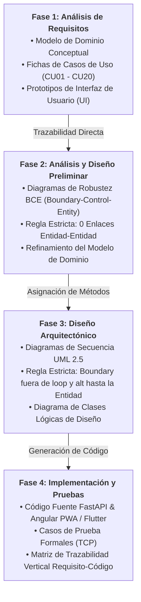

#### Fase 1: Análisis de Requisitos
En esta fase inicial se delimitan los requerimientos funcionales y no funcionales de la plataforma, identificando los actores que interactúan con ella. Se construye el **Modelo de Dominio** (diagrama de clases conceptual que representa los conceptos medulares del negocio y sus relaciones estructurales con sus atributos descriptivos clave). A partir de allí, se define el portafolio de casos de uso del sistema. Cada caso de uso se documenta rigurosamente mediante su **Ficha de Caso de Uso normalizada** (nombre, código unívoco, actores involucrados, precondiciones, flujo básico o normal, flujos alternativos con desvíos precisos y postcondiciones comprobables), acompañada de su diseño visual con el **prototipo de interfaz de usuario** correspondiente.

#### Fase 2: Análisis y Diseño Preliminar (Diagramas de Robustez BCE)
Constituye el corazón distintivo de ICONIX. A partir de la redacción textual de cada caso de uso, se elabora su **Diagrama de Robustez** (equivalente en semántica al diagrama de comunicación formal). Su objetivo primordial es subsanar la brecha conceptual entre el análisis y el diseño, descomponiendo el comportamiento en tres tipos de clases estereotipadas:
1. **Clase Interfaz (*Boundary*):** Representa las pantallas, ventanas, formularios, componentes visuales o puertos API mediante los cuales los actores externos interactúan con el sistema.
2. **Clase Control (*Controller*):** Representa la lógica de negocio, las reglas de cálculo, la coordinación transaccional y los gestores de servicios (`Gestor...`).
3. **Clase Entidad (*Entity*):** Representa los objetos de datos persistentes del dominio que almacenan el estado del sistema (tablas de la base de datos).

**Reglas Estrictas de Comunicación en Diagramas de Robustez (Cátedra UAGRM):**
- **Actor $\longleftrightarrow$ Interfaz (Boundary):** Permitido ✅ (los usuarios interactúan con pantallas).
- **Interfaz (Boundary) $\longleftrightarrow$ Control (Controller):** Permitido ✅ (las interfaces envían eventos a gestores).
- **Control (Controller) $\longleftrightarrow$ Control (Controller):** Permitido ✅ (los gestores pueden coordinar otros gestores).
- **Control (Controller) $\longleftrightarrow$ Entidad (Entity):** Permitido ✅ (los gestores leen y persisten datos en entidades).
- **Interfaz (Boundary) $\longleftrightarrow$ Entidad (Entity):** Permitido únicamente para consultas de lectura pasiva ✅.
- **$\mathbf{Entidad (Entity) \longleftrightarrow Entidad (Entity):}$ ¡PROHIBIDO Y ERRÓNEO! ❌**  
  Bajo las directrices ineludibles de la cátedra de Sistemas de Información II, **dos clases de entidad jamás pueden comunicarse directamente entre sí en un diagrama de robustez**. Cualquier interacción, cálculo, transferencia o actualización entre entidades debe ser mediada y orquestada obligatoriamente por una clase de control (`Gestor...`).

#### Fase 3: Diseño
En esta fase se formaliza cómo el sistema ejecutará dinámicamente las responsabilidades identificadas en la robustez. Se construyen los **Diagramas de Secuencia** para cada caso de uso, incorporando mensajes tipados con métodos y fragmentos combinados del estándar UML 2.5+: alternativas condicionales (`alt`), opciones de ejecución (`opt`) y bucles de repetición (`loop`).
- **Regla Estricta sobre Fragmentos `loop` (Cátedra UAGRM):**  
  En un diagrama de secuencia, **el fragmento combinado `loop` (bucle de repetición) NUNCA debe encerrar ni abarcar a la interfaz de usuario (Boundary) ni a los actores**. El bucle de iteración representa procesamiento computacional interno de datos (ej. recorrer una lista de productos en el carrito, iterar lotes de inventario o validar claves en un lote de sincronización) y, por ende, su alcance debe circunscribirse estrictamente a las líneas de vida del Controlador (`Gestor...`) y de las Entidades o Repositorios de base de datos involucrados.
- **Regla Estricta sobre Fragmentos `alt` (Cátedra UAGRM):**  
  Los fragmentos de bifurcación condicional `alt` no deben quedar restringidos a dialogar en memoria entre la UI y el Controlador; deben **abarcar hasta las clases de Entidad (base de datos)** para reflejar fielmente las consultas o modificaciones de estado persistente que dirimen las ramas alternativas.
- Paralelamente, se refina el **Diagrama de Clases Lógicas**, asignando tipos de datos formales a cada atributo, visibilidad (público, privado, protegido), métodos operativos con firmas de parámetros y retorno, multiplicidades en cada extremo asociativo y el atributo discriminador multitenant `empresa_id`. Finalmente, se define la **arquitectura del sistema** mediante los Diagramas de Componentes y Despliegue físico.

#### Fase 4: Implementación y Pruebas
Se procede a la codificación limpia de los módulos de software en estricta fidelidad con las clases y secuencias modeladas. Se formula una matriz formal de **Casos de Prueba (TCP)** para cada caso de uso, definiendo precondiciones, datos de entrada, pasos de ejecución, resultado esperado y resultado obtenido, complementada con pruebas de integración end-to-end y pruebas de estrés de corte y sincronización de red.

---

### 1.6.3 Trazabilidad Vertical de Ingeniería

La fortaleza metodológica de ICONIX reside en su **trazabilidad vertical inquebrantable**: cada elemento del código fuente y cada prueba puede rastrearse directamente hasta el requisito funcional de negocio que le dio origen:

$$\textbf{Requisito Funcional (RF)} \longrightarrow \textbf{Caso de Uso (CU)} \longrightarrow \textbf{Robustez BCE} \longrightarrow \textbf{Diagrama de Secuencia} \longrightarrow \textbf{Clase Lógica / DDL} \longrightarrow \textbf{Código Fuente} \longrightarrow \textbf{Caso de Prueba (TCP)}$$

---

### 1.6.4 Evolución de los Modelos de Datos en ICONIX

La gestión de datos en ICONIX no se improvisa, sino que madura gradualmente a lo largo de cuatro estadios conceptuales:
1. **Modelo de Dominio (Fase 1):** Diagrama conceptual inicial que identifica los conceptos sustantivos del negocio y sus relaciones de cardinalidad, con sus atributos descriptivos clave.
2. **Modelo Conceptual (Fase 1 - 2):** Refinamiento de atributos descriptivos y entidades especializadas del dominio (incluyendo `NotaDevolucion`, `NotaCambioReposicion` y `KardexCPP`).
3. **Modelo Lógico (Fase 3):** Diagrama de clases de diseño completamente normalizado con tipos de datos estándar, claves primarias, claves foráneas, restricciones de unicidad, métodos operativos y la clave de tenant `empresa_id`.
4. **Modelo Físico (Fase 3 - 4):** Traducción directa del modelo lógico a sentencias DDL ejecutables en el motor relacional de destino (PostgreSQL 15), definiendo esquemas, tipos enumerados, índices B-Tree, disparadores (*triggers*) y scripts equivalentes para motores embebidos locales (SQLite para Flutter e IndexedDB para Angular PWA).

---

# CAPÍTULO II. ANÁLISIS DE REQUISITOS

## 2.1. Descripción del Sistema Propuesto

### 2.1.1 Visión General, Contexto de Negocio y Oportunidad Tecnológica

**FashionStore SaaS** (Versión Segundo Examen Parcial) es una solución tecnológica integral de comercio electrónico inteligente, gestión de operaciones de retail omnicanal y administración empresarial B2B bajo la modalidad de **Software como Servicio (SaaS Multitenant)**. La plataforma está concebida específicamente para modernizar, formalizar y escalar las cadenas de tiendas y empresas independientes de confección y comercialización de **indumentaria y sastrería masculina** (*menswear*).

En la industria de la moda masculina, las operaciones comerciales tradicionales enfrentan tres problemáticas estructurales críticas:
1. **Alta tasa de devoluciones y fricción por discordancia de tallaje:** El tallaje genérico comercial (S, M, L, XL) resulta ineficaz frente a la diversidad morfológica masculina y a los diferentes cortes de confección (Slim Fit, Regular Fit, Custom Tailored), provocando devoluciones costosas y desconfianza en canales no presenciales.
2. **Vulnerabilidad e interrupción operativa en tiendas físicas por inestabilidad de telecomunicaciones:** En el contexto boliviano y regional, los centros comerciales y galerías presentan microcortes y caídas prolongadas de enlace a Internet, paralizando los sistemas tradicionales de facturación en la nube y provocando pérdida directa de ventas.
3. **Pérdida de trazabilidad de costos e inventarios:** La ausencia de valuación contable bajo el método del **Costo Promedio Ponderado (CPP)** y el descontrol en los traspasos inter-sucursales erosionan los márgenes comerciales reales e impiden una planificación certera de compras corporativas a proveedores.

Para superar estas limitaciones, FashionStore evoluciona la arquitectura monoproyecto del primer parcial hacia un **ecosistema distribuido de alta disponibilidad, Offline-First, Cloud-Synchronized y AI-Augmented** (resiliencia fuera de línea, sincronización en nube e inteligencia artificial aumentada). El sistema unifica la experiencia del cliente final (B2C), la continuidad transaccional en puntos de venta físicos (POS) y la gobernanza estratégica corporativa (B2B) en una única plataforma gobernada por la metodología ágil y rigurosa **ICONIX**.

---

### 2.1.2 Diagrama Arquitectónico del Ecosistema Propuesto

El siguiente diagrama en lenguaje UML modela la arquitectura global del sistema, ilustrando la interacción entre las interfaces clientes especializadas, el protocolo de sincronización resiliente, los componentes del backend y los tres niveles de persistencia de datos:

@startuml Arquitectura_Ecosistema_FashionStore
skinparam monochrome false
skinparam roundcorner 8
skinparam shadowing true
skinparam packageBackgroundColor #F8F9FA
skinparam packageBorderColor #2C3E50

package "Capa de Clientes y Terminales (Frontend Omnicanal)" {
    [Web Desktop Administrativa / Laptop
(Angular 17+ / TypeScript / PC-Only)] as WebDesktop #EBF5FB
    [Progressive Web App - PWA
(Angular 17+ / IndexedDB / Service Workers)] as WebPWA #E8F8F5
    [App Móvil Nativa Multiplataforma
(Flutter 3.x / Dart / SQLite / RA 3D .glb)] as MobileApp #FEF9E7
    [Terminal Punto de Venta - POS Mostrador
(Angular PWA / Modo Offline Efectivo)] as POSOffline #FDEDEC
}

package "Capa de Transporte y Sincronización Transaccional" {
    interface "API Gateway REST / HTTPS TLS 1.3" as APIGateway
    interface "Protocolo Sincronización Idempotente
Header: X-Idempotency-Key (UUID v4)" as SyncProtocol
}

package "Capa de Núcleo Backend (FastAPI / Python 3.11+)" {
    [Middleware de Aislamiento Tenant
(Contexto RLS WHERE tenant_id = :id)] as TenantMiddleware #D6EAF8
    
    package "Subsistemas de Dominio y Negocio" {
        [Servicio de Catálogo y Ficha Textil
(Medidas en cm, Telas Nobles, 3D)] as CatService
        [Motor de Inventario y Valuación CPP
(Kardex Físico-Valorado Ley 843)] as InvService
        [Servicio Postventa y Cambios
(Nota Devolución + Nota Cambio + Stripe)] as PostventaService
        [Módulo Compras Corporativas
(Exclusivo Web Desktop / Factura Fiscal)] as ComprasService
        [Agente de Inteligencia Artificial
(Whisper Voz + Validador AST SQL)] as AIService
        [Pipeline de Machine Learning
(Regresión 6 Meses, Clustering, Anomalías)] as MLService
    }
}

package "Capa de Persistencia y Almacenamiento Distribuido" {
    database "PostgreSQL 15 (Nube Central)
Esquema Multitenant / RLS / B-Tree" as CentralDB #D5F5E3
    database "SQLite Embebido (sqflite)
Base Local Autónomo en Móvil" as MobileDB #FCF3CF
    database "IndexedDB (Navegador)
Almacén Local de Objetos en PWA" as PwaDB #D1F2EB
}

cloud "Servicios Externos Integrados" {
    [Pasarela de Pago Stripe Sandbox
(Tokenización Tarjetas PCI-DSS)] as StripeAPI
    [Servicio OpenAI / Gemini LLM
(Inferencia Lenguaje Natural)] as LLMAPI
    [Servicio Meteorológico OpenWeather
(Variables de Contexto Estacional)] as WeatherAPI
}

' Relaciones de Clientes con Persistencia Local
WebPWA ..> PwaDB : Persistencia Catálogo y Cola Offline
POSOffline ..> PwaDB : Registro Venta Efectivo con UUID v4
MobileApp ..> MobileDB : Persistencia Catálogo y Reservas QR

' Relaciones de Clientes con Backend
WebDesktop --> APIGateway : Gestión B2B, Compras y ML
WebPWA --> APIGateway : Catálogo Online y Checkout
POSOffline --> SyncProtocol : Lote de Transacciones Offline
MobileApp --> SyncProtocol : Sincronización de Reservas

' Transporte a Núcleo
APIGateway --> TenantMiddleware
SyncProtocol --> TenantMiddleware

' Núcleo a Servicios
TenantMiddleware --> CatService
TenantMiddleware --> InvService
TenantMiddleware --> PostventaService
TenantMiddleware --> ComprasService
TenantMiddleware --> AIService
TenantMiddleware --> MLService

' Servicios a Base Central
InvService --> CentralDB
ComprasService --> CentralDB
PostventaService --> CentralDB
CatService --> CentralDB
AIService ..> CentralDB : Réplica Read-Only con AST Guard
MLService ..> CentralDB : Lectura Dataset Histórico

' Servicios Externos
PostventaService --> StripeAPI : Cobro Excedente de Cambio
AIService --> LLMAPI : Generación SQL Analítico
MLService --> WeatherAPI : Enriquecimiento de Demanda

@enduml

---

### 2.1.3 Ecosistema de Plataformas y Despliegue Multiplataforma

Para responder a las demandas heterogéneas de los distintos actores del sistema y garantizar la continuidad del negocio, FashionStore despliega un ecosistema compuesto por cuatro plataformas interconectadas:

1. **Web Desktop Administrativa y Corporativa (Angular 17+ / TypeScript):**
   - **Público Objetivo:** Super Administradores de la plataforma, Administradores de Empresa y Encargados de Compras y Aprovisionamiento.
   - **Alcance Funcional:** Diseñada y optimizada exclusivamente para pantallas de computadoras de escritorio y laptops (resolución $\ge 1280 \times 800$ px con teclado y ratón). Centraliza la gobernanza de inquilinos (*tenants*), configuración de suscripciones, emisión formal de órdenes de compra a proveedores textiles con recepción de facturas comerciales, exportación masiva a Excel/PDF y análisis visual del Dashboard predictivo de Machine Learning.
   - **Control de Acceso:** Restricción a nivel de interfaz que valida el agente de usuario (*User-Agent*) y resolución de pantalla, bloqueando transacciones corporativas complejas desde dispositivos móviles para prevenir errores operativos.

2. **Progressive Web App - PWA (Angular 17+ / Service Workers / IndexedDB):**
   - **Público Objetivo:** Clientes web y operadores de caja en mostradores de tiendas físicas.
   - **Alcance Funcional:** Aplicación web moderna instalable en cualquier navegador compatible con el estándar PWA (Google Chrome, Microsoft Edge, Safari). Emplea Service Workers para el almacenamiento en caché de activos estáticos y miniaturas WebP, y la API **IndexedDB** para mantener una réplica estructurada local del catálogo de prendas, variantes y cola de transacciones. Permite consultar el catálogo y registrar reservas presenciales y ventas directas en mostrador ante la pérdida absoluta de conexión a Internet.

3. **Aplicación Móvil Nativa Multiplataforma (Flutter 3.x / Dart / SQLite):**
   - **Público Objetivo:** Clientes finales y dependientes de ventas en sala.
   - **Alcance Funcional:** Aplicación compilada nativamente para Android e iOS. Integra el motor relacional embebido **SQLite** (`sqflite`) para la persistencia local de prendas, categorías y reservas temporales con código QR. Incorpora el **Vestidor Virtual en Realidad Aumentada (RA)**, permitiendo proyectar modelos tridimensionales (`.glb`) a escala real sobre la silueta del cliente a través de la cámara móvil mediante ARCore/ARKit.

4. **Núcleo de Servicios Backend y Persistencia Relacional (FastAPI / PostgreSQL 15):**
   - **Arquitectura:** API RESTful asíncrona de alto rendimiento desarrollada sobre Python 3.11+ y **FastAPI**. Implementa inyección de dependencias para la resolución dinámica del contexto de tenant, validación estricta de esquemas con Pydantic v2 y autenticación robusta mediante tokens JWT con firmas asimétricas y hash criptográfico `bcrypt`.
   - **Persistencia Central:** Motor relacional **PostgreSQL 15** configurado bajo el esquema de base de datos compartida con discriminador lógico (`tenant_id`), garantizando aislamiento estricto mediante políticas de seguridad a nivel de filas (*Row-Level Security* - RLS) e índices B-Tree compuestos.

---

### 2.1.4 Los Nueve Pilares Funcionales del Sistema Propuesto

La arquitectura del sistema se articula sobre nueve pilares de ingeniería de software que resuelven los desafíos técnicos del Segundo Parcial y las demandas del negocio:

#### 1. Arquitectura SaaS Multitenant y Gobernanza de Suscripciones (Desafío VI)
La plataforma permite alojar múltiples empresas textiles independientes sobre una infraestructura compartida, garantizando la total confidencialidad e inviolabilidad de sus datos. Cada solicitud autenticada extrae el identificador del tenant desde el token JWT e inyecta obligatoriamente la cláusula `WHERE tenant_id = :id` en cada consulta relacional. La monetización se gestiona mediante tres tiers de suscripción:
- **Plan Básico:** Diseñado para pequeños talleres y boutiques; habilita hasta 2 sucursales físicas, catálogo offline básico y restringe el acceso a módulos de IA generativa.
- **Plan Profesional:** Orientado a marcas consolidadas; soporta hasta 10 sucursales, modelos 3D en RA y reportes generativos de IA en texto.
- **Plan Enterprise:** Pensado para franquicias y cadenas industriales; sucursales ilimitadas, reportes generativos por voz (Whisper) y Dashboard completo de Machine Learning a 6 meses.

#### 2. Resiliencia Operativa Offline-First en Web y Móvil (Desafío II)
Para blindar las operaciones de venta ante la precariedad de las telecomunicaciones en ferias y centros comerciales bolivianos:
- En la PWA web, **IndexedDB** almacena de manera no volátil el catálogo de productos, variantes de color/talla y precios.
- En la aplicación móvil Flutter, la base de datos embebida **SQLite** resguarda las prendas y colecciones.
Los clientes y vendedores pueden consultar fichas técnicas y generar **reservas presenciales temporales de prendas** (con vigencia paramétrica de 2 horas) obteniendo un ticket digital con código QR firmado localmente sin consumir megabytes ni requerir enlace activo.

#### 3. Terminal Punto de Venta (POS) Autónomo y Cobro al Contado en Efectivo (Desafío III)
Ante una caída total de red o fluido eléctrico en la tienda física (operando con batería o UPS):
- El terminal POS del cajero conmuta de forma transparente al **modo contingencia desconectado**.
- Permite registrar ventas presenciales de mostrador cobradas **exclusivamente al contado en efectivo**, calculando subtotales, aplicando descuentos de liquidación de temporada o tarifas mayoristas, descontando el stock local y generando un comprobante provisional con código QR y un identificador criptográfico **UUID v4** inmutable.

#### 4. Protocolo de Sincronización Transaccional Idempotente con UUID v4 (Desafíos II y III)
Al reanudarse la conectividad a Internet:
- Un agente reactivo dispara la sincronización en segundo plano de las transacciones encoladas.
- Cada registro se transmite mediante una petición HTTP POST acompañada de la cabecera `X-Idempotency-Key: <UUID_v4>`.
- El backend FastAPI valida la presencia previa del UUID en la base central; si ya existe (por reintentos de red), devuelve la confirmación almacenada sin duplicar cargos ni asientos contables.
- **Resolución Determinista de Conflictos (Overselling):** Si una prenda vendida offline en mostrador fue adquirida simultáneamente por un cliente en el e-commerce online, **se prioriza la venta física presencial**, dado que la prenda ya fue entregada en manos del cliente. El sistema cancela automáticamente la orden virtual, gestiona el reintegro de fondos y emite una alerta de reabastecimiento urgente a bodega.

#### 5. Catalogación Textil de Precisión Anatómica, Telas Hipoalergénicas y 3D RA
El módulo de catálogo trasciende el tallaje estándar implementando una **ficha técnica textil avanzada**:
- **Medidas anatómicas en centímetros:** Parámetros biométricos exactos para cada talla (contorno de pecho, contorno de cintura, contorno de cadera, largo total y longitud de manga), erradicando las dudas de calce.
- **Esquemas de colores compuestos:** Selector cromático dual para prendas combinadas (ej. Camisa Oxford Blanco/Azul Marino) con códigos Hexadecimales dobles (`#FFFFFF / #002366`).
- **Composición de tejidos y advertencia dermatológica:** Detalle de telas nobles (lino orgánico, algodón pima peruano, lana merino) e interruptor (*toggle*) para marcar prendas con **telas hipoalergénicas**, advirtiendo compatibilidad con pieles sensibles o con afecciones dermatológicas.
- **Vestidor Virtual en RA:** Vinculación de archivos tridimensionales (`.glb`) optimizados para renderizado en tiempo real a escala humana sobre la cámara del dispositivo móvil.

#### 6. Valuación de Inventarios Multi-Sucursal con CPP Inmutable y Traspasos Logísticos
El inventario se segrega por tienda física en tres métricas concurrentes: **Stock Físico**, **Stock Reservado** y **Stock Disponible** (`Disponible = Físico - Reservado`). Cada recepción de lote de mercadería con factura fiscal dispara el recálculo matemático inmutable del **Costo Promedio Ponderado (CPP)**:
$$CPP_{\text{nuevo}} = \frac{(\text{Stock}_{\text{ant}} \times CPP_{\text{ant}}) + (\text{Cant}_{\text{ingreso}} \times \text{Costo}_{\text{ingreso}})}{\text{Stock}_{\text{ant}} + \text{Cant}_{\text{ingreso}}}$$
El sistema registra el último costo unitario pagado, asienta cada ingreso y egreso en el **Kardex físico-valorado** dando estricto cumplimiento a la legislación tributaria boliviana (Ley 843) y gestiona la logística de **traspasos inter-sucursales** con estados formales (`SOLICITADO`, `EN_TRÁNSITO`, `RECIBIDO_CONFORME`) para balancear existencias entre tiendas sin pérdidas operativas.

#### 7. Postventa en Dos Tiempos, Reembolso en 30 Días y Pasarela Stripe PCI-DSS (Desafío IV)
El ciclo de cambios de prendas se estructura mediante un flujo riguroso de **dos tiempos y dos notas independientes**:
- **Tiempo 1 (Nota de Devolución):** El cliente presenta la prenda en mostrador dentro del plazo de garantía (7 días hábiles). El cajero inspecciona las condiciones físicas (etiquetas intactas, sin signos de lavado o uso), registra el reingreso de la prenda al inventario (+1 stock disponible o a cuarentena) y emite formalmente una **Nota de Devolución**, acreditando el saldo monetario a favor del cliente.
- **Tiempo 2 (Nota de Cambio):** Con la Nota de Devolución, el cliente selecciona una nueva prenda. Si el valor es idéntico, se liquida a saldo cero; si la nueva prenda tiene mayor valor (por talla, tela premium o modelo superior), el cliente abona el excedente en línea a través de la pasarela **Stripe Sandbox** (tokenización segura con cumplimiento de la norma PCI-DSS). Finalmente, el sistema descuenta la nueva prenda (-1 stock) y genera la **Nota de Cambio** de despacho final.
- **Política de Reembolso en Efectivo a 30 Días:** Si el cliente no encuentra una prenda de su interés y exige la devolución de su dinero en efectivo, **el cajero no entrega dinero de inmediato en mostrador**. El sistema emite una orden de liquidación contable programada para el cierre mensual de la empresa (a los 30 días calendario), garantizando la cuadratura del arqueo de caja de la sucursal y la auditoría fiscal.

#### 8. Aprovisionamiento y Compras Corporativas Exclusivas desde Web Desktop
Respondiendo a la instrucción de que las adquisiciones corporativas a proveedores son operaciones de alto impacto financiero ejecutadas en horarios de oficina por personal administrativo, se implementa un módulo accesible **únicamente desde computadoras de escritorio y laptops (Web Desktop)**. Permite planificar órdenes de compra por curvas de tallas, negociar con proveedores textiles registrados, cargar facturas comerciales fiscales autorizadas y disparar automáticamente el ingreso de stock al Kardex valorado y la actualización del Costo Promedio Ponderado.

#### 9. Inteligencia Analítica Híbrida: Reportes NLP/Voz con IA y Machine Learning a 6 Meses (Desafío V)
La plataforma provee herramientas avanzadas de toma de decisiones para los niveles ejecutivos de las empresas suscriptoras:
- **Asistente Conversacional con IA Generativa:** Permite a directivos consultar métricas de ventas, rotación de tallas o rendimiento de sucursales formulando preguntas en lenguaje natural escrito o mediante dictado por voz (transcrito por el modelo **Whisper**). Un LLM traduce la solicitud a sentencias SQL analíticas, las cuales son analizadas por un **validador sintáctico AST de seguridad** (que prohíbe sentencias destructivas `DROP`, `DELETE`, `UPDATE`, `INSERT`, restringe la consulta exclusivamente a `SELECT` e inyecta forzosamente la cláusula `tenant_id`). La consulta se ejecuta en una réplica de lectura y se sintetiza en resúmenes ejecutivos con gráficos y descarga directa en formatos corporativos **Excel (.xlsx)** y **PDF (.pdf)**.
- **Dashboard Predictivo con Machine Learning:** Alimentado por un pipeline de más de 6 meses de datos sintéticos que reproducen fielmente la estacionalidad del comercio textil masculino boliviano (invierno, primavera-verano, festividades, picos de fin de año), despliega modelos de regresión para proyectar ventas a 6 meses vista, clustering (K-Means) para segmentación de clientes y algoritmos de detección de anomalías (Isolation Forest) para auditar pérdidas de existencias.

---

### 2.1.5 Flujos de Valor Operacionales de Extremo a Extremo (E2E)

Para comprender la dinámica de interacción entre los módulos y los actores, a continuación se detallan los cuatro flujos de valor centrales del negocio modelados en diagramas de secuencia interactivos:

#### Flujo 1: Venta Offline en Mostrador y Sincronización Idempotente con UUID v4
Representa la operación del cajero ante una caída total de conexión a Internet en la tienda física, la emisión del comprobante provisional con código QR y la sincronización diferida hacia la nube al restablecerse el enlace:

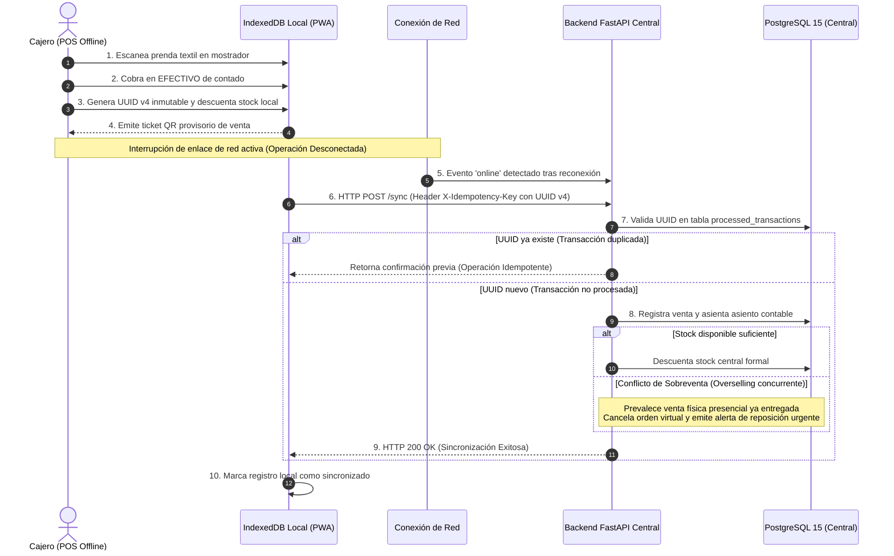

---

#### Flujo 2: Ciclo de Postventa y Cambio de Prendas en Dos Tiempos
Ilustra el cumplimiento estricto del protocolo postventa: emisión de la Nota de Devolución (Tiempo 1), selección de nueva prenda con Nota de Cambio (Tiempo 2) cobrando excedente por Stripe o programando la devolución monetaria a 30 días:

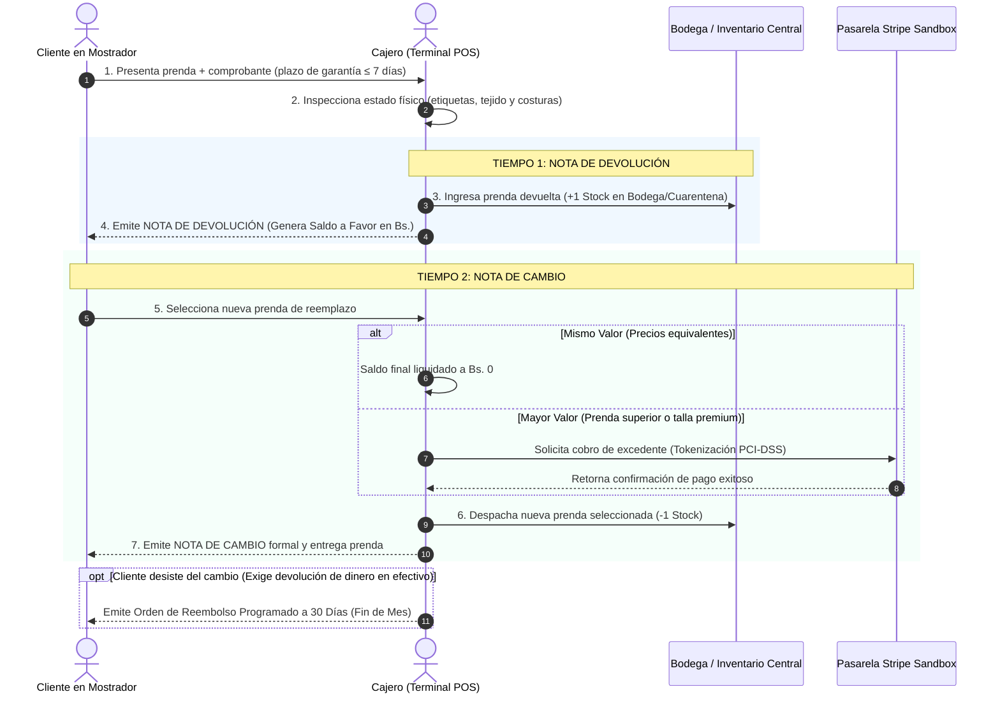

---

#### Flujo 3: Aprovisionamiento y Compras Corporativas Web Desktop
Modela el proceso de adquisiciones B2B desde computadoras de escritorio (PC/Laptop), recepción de facturas comerciales fiscales e impacto automático en el Costo Promedio Ponderado (CPP):

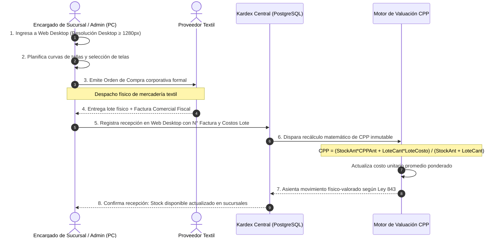

---

#### Flujo 4: Auditoría y Reportes Ejecutivos con IA y Voz
Muestra la interacción directiva mediante lenguaje natural o comandos de voz, la transcripción con Whisper, el filtrado de seguridad por validador AST SQL y la exportación documental:

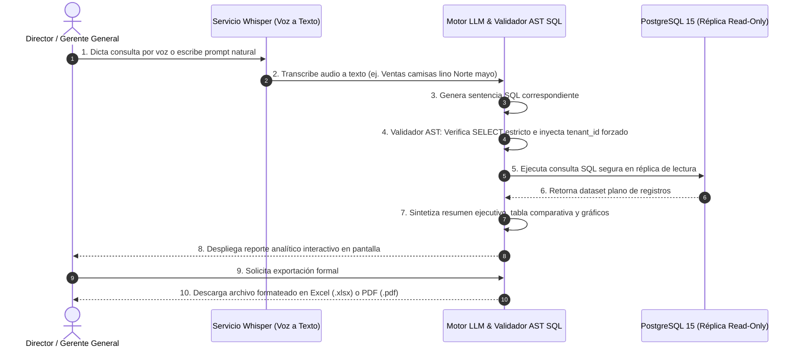

---

### 2.1.6 Matriz de Integración Tecnológica, Protocolos y Seguridad

La siguiente matriz consolida los protocolos de comunicación, tipos de datos y barreras de seguridad implementadas en cada uno de los nodos del ecosistema FashionStore:

| Componente | Plataforma / Framework | Protocolo de Transporte | Formato de Carga Útil | Mecanismos de Seguridad y Aislamiento |
|:---|:---|:---|:---|:---|
| **Web Desktop Corporativa** | Angular 17+ / TypeScript / SCSS | HTTPS (TLS 1.3) / REST | JSON / Multipart (Archivos) | Autenticación JWT Bearer, verificación de resolución $\ge 1280$ px y *User-Agent* PC. |
| **Progressive Web App (PWA)** | Angular 17+ / Service Workers | HTTPS / Cache API / IndexedDB | JSON / Binario WebP | Almacenamiento local aislado en navegador, validación de permisos de cámara y ubicación. |
| **Móvil Flutter** | Flutter 3.x / Dart / ARCore-ARKit | HTTPS / SQLite (`sqflite`) | JSON / Binario 3D (`.glb`) | Sandbox de aplicación móvil, cifrado de base SQLite local, tokens JWT renovables. |
| **Punto de Venta POS Desconectado** | Angular PWA / Service Worker | Localhost / Eventos DOM / IndexedDB | JSON con firma criptográfica UUID v4 | Cierre de transacciones con UUID v4 inmutable, bloqueo de cobros que no sean en efectivo. |
| **Protocolo de Sincronización** | Background Fetch API / FastAPI Sync | HTTPS POST por lotes (*batching*) | JSON (`X-Idempotency-Key: UUID`) | Deduplicación transaccional en tabla `processed_transactions`, resolución determinista de stock. |
| **Núcleo de Servicios Backend** | FastAPI / Python 3.11+ / SQLAlchemy | RESTful / Asíncrono ASGI (Uvicorn) | JSON estricto con Pydantic v2 | Inyección de dependencias `get_current_tenant`, hashing de contraseñas con `bcrypt` (12 rondas). |
| **Base de Datos Central** | PostgreSQL 15 Relacional | Conexión TCP con pool `asyncpg` | Tuplas relacionales normalizadas | Row-Level Security (RLS) forzoso por `tenant_id`, índices B-Tree compuestos, roles de solo lectura. |
| **Pasarela de Pagos Excedentes** | Stripe SDK / Webhooks | HTTPS / REST TLS 1.3 | JSON Tokenizado (sin datos PAN/CVV) | Tokenización directa en cliente (Stripe.js), cumplimiento normativo PCI-DSS Nivel 1. |

| **Auditoría e IA Generativa** | Whisper API / LangChain / SQLGlot | HTTPS / Streaming de Audio / SSE | Audio WAV/MP3 $\rightarrow$ SQL $\rightarrow$ Markdown | Validador sintáctico AST (*Abstract Syntax Tree*), filtrado estricto de solo lectura, inyección forzosa de tenant. |

---

### 2.1.7 Matriz de Evolución: Primer Parcial vs. Segundo Parcial

| Dimensión de Ingeniería | Etapa Fundacional (Primer Parcial - PUDS) | Plataforma Evolucionada (Segundo Parcial - ICONIX) |
|:---|:---|:---|
| **Modelo de Negocio** | Monoproyecto B2C de base de datos única y tenant único. | **SaaS Multitenant B2B/B2C** con aislamiento estricto por `tenant_id` y tiers de suscripción (Básico, Profesional, Enterprise). |
| **Metodología de Desarrollo** | Proceso Unificado (PUDS) pesado, iterativo por ciclos. | **ICONIX (Pesada-Ligera)** enfocado en el 20% de artefactos esenciales de UML 2.5+, diagramas de robustez BCE y trazabilidad vertical. |
| **Resiliencia ante Caídas de Red** | Operación dependiente al 100% de conexión online estable. | **Arquitectura Offline-First:** PWA con IndexedDB en web y SQLite en app móvil Flutter, con navegación y reservas desconectadas. |
| **Operación en Punto de Venta (POS)** | Cobro tradicional en mostrador dependiente de API central. | **Terminal POS Offline de Contado en Efectivo** con UUID v4 inmutable y comprobantes provisionales locales. |
| **Sincronización y Consistencia** | Sin mecanismos de encolamiento local ni deduplicación. | **Sincronización Idempotente por Lotes** con cabecera `X-Idempotency-Key` (UUID v4) y resolución determinista de sobreventa. |
| **Atributos de Indumentaria** | Tallas y colores estándar convencionales. | **Ficha Técnica Textil Avanzada:** Tallas en cm (pecho/cintura/largo), colores bicolores Hex, telas nobles y advertencia hipoalergénica. |
| **Valuación de Existencias** | Control de existencias básico en sucursal. | **Inventario Tripartito** (Físico, Reservado, Disponible), recálculo de **CPP Inmutable**, Kardex valorado (Ley 843) y traspasos inter-tiendas. |
| **Ciclo de Cambios y Postventa** | Devolución simple sin trazabilidad contable dual. | **Cambio en Dos Tiempos:** Nota de Devolución (+1 stock) + Nota de Cambio (-1 stock), pasarela Stripe y reembolso en efectivo a 30 días. |
| **Estrategias de Precios** | Precios fijos minoristas en catálogo. | **Precios Dinámicos:** Liquidación de fin de temporada (30%, 40%, 60%) y tarifas automáticas al por mayor ($\ge 3$ unidades). |
| **Compras y Aprovisionamiento** | Funcionalidad genérica dentro del sistema. | **Aprovisionamiento Exclusivo Web Desktop:** Módulo B2B en PC/Laptop para órdenes de compra y facturación fiscal de lotes. |
| **Inteligencia y Analítica** | Dashboards descriptivos básicos y clima contextual. | **IA Generativa Conversacional (Texto/Voz)** con validación AST SQL, exportación Excel/PDF y **Machine Learning Predictivo a 6 Meses**. |

## 2.2. Identificación de Actores

| Actor | Tipo | Descripción |
|:---|:---:|:---|
| **Administrador de Plataforma (Super Admin)** | Interno | Máxima autoridad del SaaS. Gestiona todas las empresas contratantes, planes de suscripción y la salud global de la plataforma. |
| **Administrador de Empresa** | Interno | Administrador local de cada empresa (tenant). Configura y define dinámicamente los perfiles de usuario, roles y privilegios de acceso para su personal (cajeros, encargados, dependientes) y clientes dentro de su propio tenant, adaptando los permisos de forma personalizada según sus políticas operativas, además de administrar sucursales, catálogo, inventario, precios y reportes. |
| **Encargado de Sucursal** | Interno | Responsable operativo de la sucursal. Gestiona el inventario físico local, reservas presenciales, traspasos inter-tiendas y, desde la Web Desktop (PC/Laptop), las órdenes de compra y aprovisionamiento a proveedores textiles con recepción de facturas comerciales e impacto en CPP (facultad compartida con el Administrador de Empresa). |
| **Cajero** | Interno | Operador de punto de venta (POS). Registra ventas presenciales, procesa cobros y gestiona cambios/devoluciones de prendas en mostrador. |
| **Cliente** | Externo | Consumidor final. Interactúa por web (Angular/PWA) y móvil (Flutter). Consulta catálogo, reserva, compra, solicita cambios y recibe recomendaciones IA. |
| **Proveedor** | Externo | Empresa que suministra prendas textiles. Recibe y confirma órdenes de compra corporativas. |
| **Sistema de Sincronización** | Sistema | Agente interno que gestiona la sincronización idempotente de operaciones offline (web y móvil) con el backend central. |
| **Pasarela de Pago (Stripe)** | Sistema Externo | Procesa pagos electrónicos con tokenización PCI-DSS sin almacenar credenciales bancarias. |
| **Servicio de IA (OpenAI / Gemini)** | Sistema Externo | Procesa solicitudes de reportes en lenguaje natural y genera recomendaciones contextuales. |
| **Servicio Meteorológico (OpenWeatherMap)** | Sistema Externo | Provee datos climáticos para enriquecer los modelos de machine learning y recomendaciones de temporada. |

## 2.3. Requisitos Funcionales y No Funcionales

### 2.3.1. Requisitos Funcionales

| ID | Requisito Funcional | Desafío |
|:---:|:---|:---:|
| RF01 | Gestionar empresas contratantes (tenants): registrar, activar, suspender | VI - SaaS |
| RF02 | Gestionar planes de suscripción (Básico, Profesional, Enterprise) con límites configurables | VI - SaaS |
| RF03 | Asignar y verificar vigencia de suscripción de cada empresa con alertas de expiración | VI - SaaS |
| RF04 | Aislar datos entre empresas: un usuario de Empresa A no puede ver datos de Empresa B | VI - SaaS |
| RF05 | Administrar usuarios, roles y perfiles por empresa con autenticación segura (JWT, bcrypt) | VI - SaaS |
| RF06 | Gestionar productos, ficha técnica con medidas en cm, telas nobles/hipoalergénicas y 3D RA | Heredado+SaaS |
| RF07 | Gestionar inventario multi-sucursal con valuación contable inmutable por CPP y Kardex Ley 843 | Heredado+SaaS |
| RF08 | Consultar catálogo digital con filtros multicriterio, stock disponible y precios diferenciados | Heredado |
| RF09 | Descargar y almacenar catálogo estructurado en IndexedDB/SQLite para operación offline | II/III - PWA/Offline |
| RF10 | Registrar reservas presenciales de prendas con ticket QR firmado sin conexión a Internet | II/III - PWA/Offline |
| RF11 | Registrar ventas POS de contado en efectivo sin conexión emitiendo comprobante con UUID v4 | IV - Ventas Offline |
| RF12 | Consultar y auditar operaciones locales pendientes de sincronización en terminal y móvil | II/III - PWA/Offline |
| RF13 | Sincronizar transacciones pendientes por lotes al restablecerse la conectividad a Internet | II/III - PWA/Offline |
| RF14 | Detectar y resolver conflictos de sincronización mediante cabecera X-Idempotency-Key y prioridad física | II/III - PWA/Offline |
| RF15 | Gestionar solicitud de cambio o devolución de una o múltiples prendas dentro del plazo de garantía (3 a 7 días hábiles) con inspección de condiciones físicas (etiquetas, sin uso) | IV - Ventas |
| RF16 | Emitir Nota de Devolución (Tiempo 1) reingresando la prenda al stock de bodega (+1 stock al CPP histórico) y saldo a favor, y Nota de Reposición / Cambio (Tiempo 2) registrando el egreso de la nueva prenda entregada (-1 stock) | IV - Ventas |
| RF17 | Calcular y cobrar excedente de precio cuando la nueva prenda es de mayor valor mediante pasarela Stripe Sandbox | IV - Ventas |
| RF18 | Emitir orden de liquidación contable de reembolso a 30 días (cierre de mes) si no hay existencias de la talla solicitada o el cliente desiste de pagar el diferencial, sin entrega de efectivo informal en mostrador | IV - Ventas |
| RF19 | Gestionar traspasos de inventario inter-sucursal con estados formales (Solicitado, En Tránsito, Recibido) | Heredado+Nuevo |
| RF20 | Solicitar reportes analíticos mediante lenguaje natural escrito o dictado por voz (Whisper) | V - IA |
| RF21 | Interpretar solicitud con LLM, validar sintaxis SQL con filtro AST seguro y ejecutar en réplica | V - IA |
| RF22 | Exportar reportes ejecutivos generados a formatos corporativos Excel (.xlsx) y PDF (.pdf) | V - IA |
| RF23 | Demostrar reportes con datos reales multitenant y filtros de sucursales, prendas y fechas | V - IA |
| RF24 | Generar pipeline de datos sintéticos históricos (mínimo 6 meses) con estacionalidad de retail | V - ML |
| RF25 | Entrenar y desplegar modelos de regresión supervisada (proyección semestral) y clustering K-Means | V - ML |
| RF26 | Visualizar métricas predictivas, mapas de calor y detección de anomalías en Dashboard ML | V - ML |
| RF27 | Integrar pasarela de pagos Stripe Sandbox con tokenización PCI-DSS para liquidación de saldos | IV - Ventas |
| RF28 | Gestionar ofertas de liquidación de temporada (30%, 40%, 60%) y precios mayoristas (>= 3 prendas) | Heredado+Nuevo |
| RF29 | Gestionar compras y aprovisionamiento corporativo exclusivo desde Web Desktop (PC/Laptop) con CPP | Heredado+Nuevo |
| RF30 | Emitir notificaciones push al móvil del cliente con la fecha comprometida de envío/reposición, confirmación de retornos de dinero por sobreventa offline y encuestas de calificación de satisfacción (1 a 5 estrellas) | II/III - PWA/Offline |

### 2.3.2. Requisitos No Funcionales

| ID | Requisito No Funcional | Descripción |
|:---:|:---|:---|
| RNF01 | Seguridad | Autenticación JWT + bcrypt, autorización por roles, HTTPS/TLS obligatorio |
| RNF02 | Aislamiento de datos | Ninguna operación permite acceder a información de otro tenant. Restricción en backend, no solo en UI |
| RNF03 | Persistencia offline | Operaciones sin conexión sobreviven al cierre y reinicio de la aplicación |
| RNF04 | Integridad transaccional | Ventas confirmadas y movimientos de inventario mantienen consistencia |
| RNF05 | Idempotencia | El reenvío de una operación confirmada no genera registros duplicados |
| RNF06 | Recuperación ante fallos | Operaciones pendientes se conservan ante errores de comunicación |
| RNF07 | Mantenibilidad | Código organizado por capas (presentación, negocio, persistencia, sincronización) |
| RNF08 | Compatibilidad | PWA en navegadores modernos; Flutter conserva capacidades móviles |
| RNF09 | Rendimiento | Consultas de catálogo y reportes evitan operaciones innecesariamente costosas |
| RNF10 | Observabilidad | Sincronización registra información suficiente para diagnosticar fallos |
| RNF11 | Calidad | Pruebas automatizadas que verifican reglas críticas del sistema |
| RNF12 | Coherencia documental | Modelos UML representan la solución realmente implementada |

## 2.4. Reglas de Negocio

Las reglas de negocio definen las directrices operacionales, restricciones contables, políticas de seguridad y flujos transaccionales inmutables que gobiernan a FashionStore SaaS en su versión del Segundo Parcial. Para garantizar rigor formal y trazabilidad, se estructuran en siete categorías operativas acompañadas de sus respectivos diagramas lógicos de decisión:

---

### 2.4.1 Reglas del Negocio Base (Inventario, Valuación CPP y Pagos)

- **RN-BASE-01 (Control de Acceso Basado en Roles - RBAC Estricto):** Ningún usuario de la plataforma puede invocar endpoints de la API ni acceder a módulos de interfaz fuera de los privilegios concedidos formalmente a su rol asignado (`SUPER_ADMIN`, `ADMIN_EMPRESA`, `ENCARGADO_SUCURSAL`, `CAJERO`, `CLIENTE`). Todo intento no autorizado es interceptado y denegado con código HTTP 403 Forbidden.
- **RN-BASE-02 (Valuación Inmutable por Costo Promedio Ponderado - CPP):** Ante cada recepción de mercadería respaldada por factura fiscal con cantidad de ingreso $Q_{\text{nueva}}$ y costo unitario de adquisición $C_{\text{nuevo}}$, el sistema ejecuta de forma automática e inmutable el recálculo matemático del Costo Promedio Ponderado (CPP):
  $$CPP_{\text{nuevo}} = \frac{(Stock_{\text{actual}} \times CPP_{\text{actual}}) + (Q_{\text{nueva}} \times C_{\text{nuevo}})}{Stock_{\text{actual}} + Q_{\text{nueva}}}$$

  *Formato lineal para copiar y pegar en Microsoft Word (`Alt + =` y luego presionar la barra espaciadora):*
  ```text
  CPP_nuevo = ((Stock_actual \times CPP_actual) + (Q_nueva \times C_nuevo)) / (Stock_actual + Q_nueva)
  ```
  *(O si Word está en modo `{LaTeX}`, pegar sin los signos de dólar y presionar Convertir):*
  ```latex
  CPP_{\text{nuevo}} = \frac{(Stock_{\text{actual}} \times CPP_{\text{actual}}) + (Q_{\text{nueva}} \times C_{\text{nuevo}})}{Stock_{\text{actual}} + Q_{\text{nueva}}}
  ```
- **RN-BASE-03 (Bloqueo Temporal de Existencias en Reservas Presenciales):** Las prendas reservadas por clientes mediante el catálogo digital bloquean stock disponible por un periodo máximo de 2 horas. Si el cliente no se presenta en la tienda física dentro de esa ventana de tiempo, el sistema libera automáticamente el stock reservado devolviéndolo al stock disponible general.
- **RN-BASE-04 (Ventas POS en Mostrador y Desglose Tributario Ley 843):** Las ventas presenciales en mostrador actualizan el inventario físico en tiempo real y generan de forma obligatoria el comprobante de venta fiscal con código QR y desglose tributario según la normativa boliviana (IVA 13%, IT 3%).
- **RN-BASE-05 (Confirmación Efectiva del 100% del Pago Previa al Despacho e Inventario):** Conforme a la política de control financiero y de inventarios exigida por la cátedra (audio `Parcial2-2.txt`, líneas 33-35), ninguna orden de venta (digital o presencial con cobro electrónico por QR o tarjeta) puede consolidarse como completada, ni decrementar el stock definitivo en el inventario central ni habilitar la entrega física del producto, si no se ha recibido la confirmación verificada del 100% del pago por parte de la pasarela (Stripe Sandbox) o la verificación del comprobante de transferencia bancaria/QR por el cajero. Mientras el pago no esté efectivamente acreditado, la orden permanece en estado `PENDIENTE_PAGO` y el stock solo se bloquea de manera transitoria por un tiempo máximo de 15 minutos, liberándose automáticamente si no se consuma la liquidación.

```mermaid
flowchart TD
    subgraph Ciclo_Pago ["RN-BASE-03 / RN-BASE-05: Validación de Pagos y Bloqueo de Stock"]
        A["Cliente inicia Checkout o Compra en Caja"] --> B["Orden en Estado: PENDIENTE_PAGO<br/>Bloqueo temporal de stock (15 min)"]
        B --> C{"¿Confirmación del 100% del Pago?<br/>(Stripe Webhook / Verificación QR / Efectivo)"}
        C -- "NO / Tiempo Expirado" --> D["Liberar Stock Reservado<br/>Cancelar Orden (RECHAZADA)"]
        C -- "SÍ: Pago 100% Verificado" --> E["Estado: COMPLETADA / PAGADA"]
        E --> F["Decremento Definitivo de Stock en Bodega"]
        F --> G["Emisión de Comprobante Fiscal con QR<br/>(Desglose IVA 13% e IT 3% Ley 843)"]
        G --> H["Habilitar Entrega en Mostrador o Despacho"]
    end

    subgraph Valuacion_CPP ["RN-BASE-02: Valuación Inmutable por Costo Promedio Ponderado"]
        I["Recepción de Lote de Mercadería<br/>(Cantidad Q_nueva, Costo Unitario Fiscal C_nuevo)"] --> J["Recálculo Matemático Inmutable:<br/>CPP = (Stock_act * CPP_act + Q_nueva * C_nuevo) / (Stock_act + Q_nueva)"]
        J --> K["Actualización Automática del Kardex Valorado"]
        K --> L["Fijación de Costo Contable de Salida para Ventas"]
    end
```

---

### 2.4.2 Reglas SaaS y Multitenant (Gobernanza y Aislamiento Lógico)

- **RN-SAAS-01 (Jerarquía y Separación Empresa vs. Sucursal):** Una Empresa contratante (Tenant) puede poseer múltiples Sucursales físicas en distintas ciudades, pero una Sucursal pertenece estrictamente y de por vida a una única Empresa.
- **RN-SAAS-02 (Límites por Plan de Suscripción Comercial):**
  - **Plan Básico:** Máximo 2 sucursales físicas activas. Catálogo offline básico. Módulos de IA generativa y Machine Learning completamente deshabilitados.
  - **Plan Profesional:** Hasta 10 sucursales activas. Habilita modelos 3D en RA y módulo de reportes generativos con IA en lenguaje natural escrito.
  - **Plan Enterprise:** Sucursales ilimitadas. Acceso completo a reportes generativos de IA por voz (Whisper) y Dashboard predictivo con Machine Learning a 6 meses.
- **RN-SAAS-03 (Aislamiento Lógico Hermético de Datos):** Todas las consultas relacionales ejecutadas en PostgreSQL 15 inyectan de forma mandatoria la cláusula discriminadora `WHERE tenant_id = :current_tenant`. Cualquier intento deliberado o accidental de acceder a datos de otra empresa contratante es interceptado a nivel de middleware y rechazado con código HTTP 403 Forbidden.
- **RN-SAAS-04 (Control de Estado y Vigencia de Suscripción):** Si la suscripción de una empresa pasa al estado `SUSPENDIDA` o `VENCIDA`, el sistema bloquea inmediatamente cualquier operación transaccional de venta, compra o traspaso de inventario, permitiendo únicamente el acceso a vistas administrativas de lectura y a la pasarela de renovación de licencia.

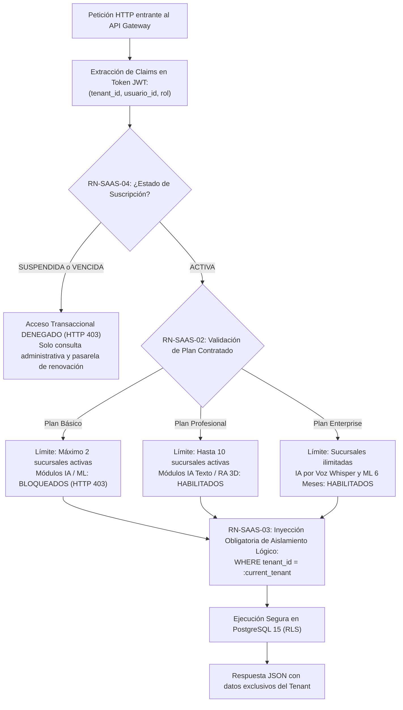

---

### 2.4.3 Reglas Offline y Sincronización Transaccional (Resiliencia Operativa)

- **RN-OFFLINE-01 (Ventas Offline Exclusivas al Contado en Efectivo):** En modo de contingencia fuera de línea únicamente se admiten ventas con método de cobro presencial en efectivo. Los cobros electrónicos con tarjeta de crédito/débito o QR interoperable exigen pasarelas y validación bancaria en línea, por lo que quedan estrictamente bloqueados fuera de línea en cumplimiento del estándar internacional de seguridad PCI-DSS.
- **RN-OFFLINE-02 (Persistencia Local No Volátil con UUID v4):** Toda transacción registrada en modo desconectado se persiste inmediatamente en el motor de almacenamiento local del cliente (IndexedDB en Angular PWA o SQLite en Flutter), asignándole un identificador criptográfico **UUID v4** inmutable y marcando su estado como `LOCAL_PENDIENTE`.
- **RN-SYNC-01 (Protocolo de Idempotencia Garantizada):** Toda petición de sincronización hacia el backend incluye la cabecera HTTP `X-Idempotency-Key` conteniendo el UUID v4 de la operación. El backend valida dicho identificador en la tabla central `processed_transactions`; si el UUID ya fue registrado previamente (debido a reintentos o cortes de red intermitentes), el servidor devuelve la confirmación original sin duplicar ventas, cobros ni movimientos en el Kardex.
- **RN-SYNC-02 (Resolución Determinista de Conflictos, Sobreventa y Retorno Automático de Fondos):** Al recuperar la conectividad, el motor de sincronización dirime eventuales colisiones de existencias concurrentes bajo dos principios rectores exigidos por la cátedra:
  1. *Prioridad a la Venta Física Presencial Entregada:* Si una prenda vendida en mostrador en caja POS offline fue adquirida en paralelo por un comprador digital online, **prevalece de forma absoluta la venta física presencial**, ya que el artículo fue entregado físicamente al cliente. El backend cancela la orden virtual en conflicto, revierte el cobro en pasarela retornando los fondos al cliente digital y emite una alerta de reposición urgente al Encargado de Sucursal.
  2. *Anulación y Reembolso Automático ante Compras Móviles Offline sin Stock:* Si dos o más clientes adquirieron la misma prenda desde la aplicación móvil Flutter en modo desconectado (SQLite) y al reconectarse con la nube se constata que las existencias centrales se agotaron por compras online previas, **la transacción desconectada no se puede consumar**. El sistema anula automáticamente la operación diferida, emite la orden de reintegro de fondos a la cuenta financiera del cliente y despacha una **notificación push inmediata al celular** informando: *«Su transacción no pudo ser completada por falta de existencias físicas; su dinero fue retornado a su cuenta»*.

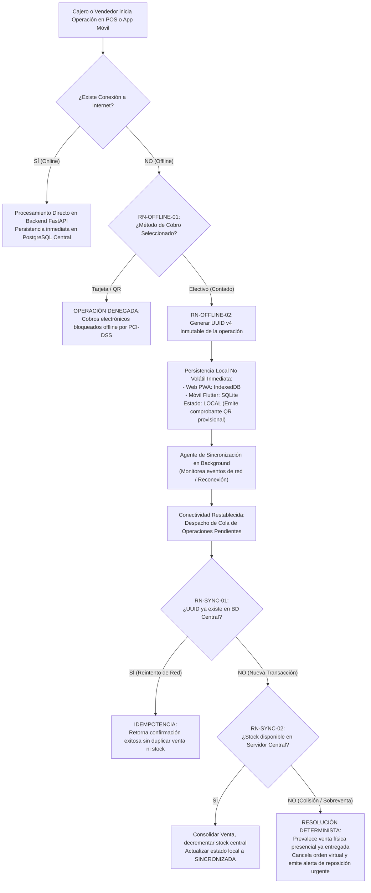

---

### 2.4.4 Reglas de Postventa y Cambio de Prendas en Dos Tiempos (Devolución y Reposición)

- **RN-CAMBIO-01 (Plazo Límite de Garantía y Devolución Multi-Prenda):** El cliente dispone de un plazo estricto de **3 a 7 días hábiles** computados desde la fecha de emisión del comprobante original para solicitar el cambio o devolución. El sistema admite la devolución de **una o múltiples prendas adquiridas en la misma compra** (ej. si compró 6 prendas y 4 no calzaron, se procesa la devolución de las 4 prendas seleccionadas en la misma solicitud). Vencido el plazo, el sistema bloquea irreversiblemente la transacción y emite una notificación push informando la expiración de la garantía.
- **RN-CAMBIO-02 (Flujo Obligatorio en Dos Notas y Dos Tiempos Independientes):** En estricta conformidad con las directrices de la cátedra (*«Devolución no significa que ya entregué la nueva prenda»*), el proceso postventa se descompone en dos tiempos y dos documentos contables obligatorios:
  1. **Tiempo 1 — Nota de Devolución (Entrada):** Tras la inspección física conforme, se emite la **Nota de Devolución**, reingresando formalmente cada prenda devuelta al stock de la sucursal (+1 unidad por prenda en la talla correspondiente) a su Costo Promedio Ponderado (CPP) histórico original, acreditando el valor total como saldo a favor en cuenta del cliente.
  2. **Tiempo 2 — Nota de Reposición / Cambio (Salida):** Se genera cuando se despacha o entrega físicamente la nueva prenda al cliente, descontando el inventario (-1 unidad por prenda en la nueva talla/modelo). No es una venta nueva. Si el valor es idéntico se liquida a saldo cero; si la nueva prenda posee mayor valor (por talla superior, tela noble o modelo premium), el sistema liquida el diferencial mediante pasarela **Stripe Sandbox** (tokenización PCI-DSS).
- **RN-CAMBIO-03 (Notificación Push de Entrega y Calificación de Conformidad):** Al emitirse la Nota de Devolución e iniciarse el trámite de cambio, el sistema despacha una **notificación push al dispositivo móvil del cliente** indicando la fecha comprometida de entrega o envío de su reposición (ej. *«Su prenda de cambio será enviada el viernes 30 de octubre»*). Una vez entregada la mercadería, se solicita al cliente registrar su nivel de satisfacción mediante una encuesta de conformidad (calificación de 1 a 5 estrellas).
- **RN-CAMBIO-04 (Política de Reembolso y Retorno de Fondos a Cuenta por Falta de Talla o Desistimiento):** Si la talla o modelo solicitado no existe en existencias de la empresa y el cliente no acepta una prenda alternativa, o si desiste del cambio, **el personal de caja tiene terminantemente prohibido entregar dinero en efectivo informal de la gaveta de cobro** (para preservar el cuadre del arqueo fiscal de caja). El sistema emite automáticamente una **Orden de Reembolso y Retorno de Fondos** reintegrando el dinero directamente a la cuenta bancaria / tarjeta del cliente vía pasarela de pago o transferencia auditada, despachando una **notificación push al celular del cliente** para que verifique su saldo restablecido.
- **RN-CAMBIO-05 (Inspección Física y Reincorporación al CPP Histórico):** Solo se admiten prendas en perfecto estado (limpias, con etiquetas intactas de fábrica y sin señales de lavado ni uso indebido). Cada prenda aceptada se reincorpora al inventario valorada al Costo Promedio Ponderado histórico exacto del momento de la venta original, preservando la inmutabilidad y exactitud fiscal del libro Kardex (Ley 843).

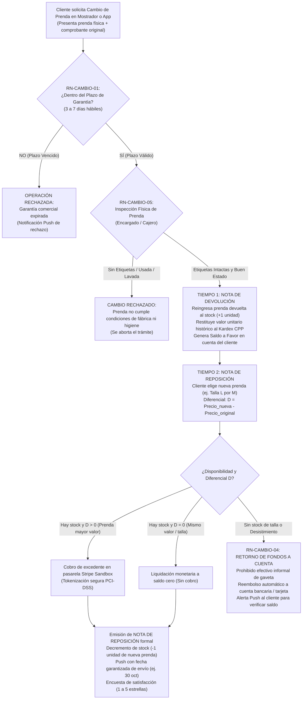

---

### 2.4.5 Reglas de Aprovisionamiento y Compras B2B desde Web Desktop

- **RN-COMPRAS-01 (Restricción Exclusiva a Computadoras de Escritorio / Laptops):** El módulo de compras y aprovisionamiento corporativo a proveedores textiles solo es accesible desde la aplicación Web en computadoras de escritorio y laptops (resolución de pantalla $\ge 1280 \times 800$ px con teclado y ratón). El sistema bloquea el acceso a este módulo desde navegadores móviles o tablets, previniendo errores operacionales en órdenes de compra corporativas de alto impacto financiero.
- **RN-COMPRAS-02 (Personal Autorizado para Aprovisionamiento):** Las órdenes de compra a proveedores solo pueden ser emitidas, negociadas y autorizadas por el **Encargado de Sucursal** o el **Administrador de Empresa**.
- **RN-COMPRAS-03 (Recepción con Factura Fiscal y Disparo Inmutable de CPP):** Toda recepción física de lote de mercadería textil exige el registro del número de Factura Comercial Fiscal y sus costos asociados, disparando automáticamente el recálculo matemático inmutable del Costo Promedio Ponderado (CPP) y el asiento formal en el libro de Kardex físico-valorado (Ley 843).

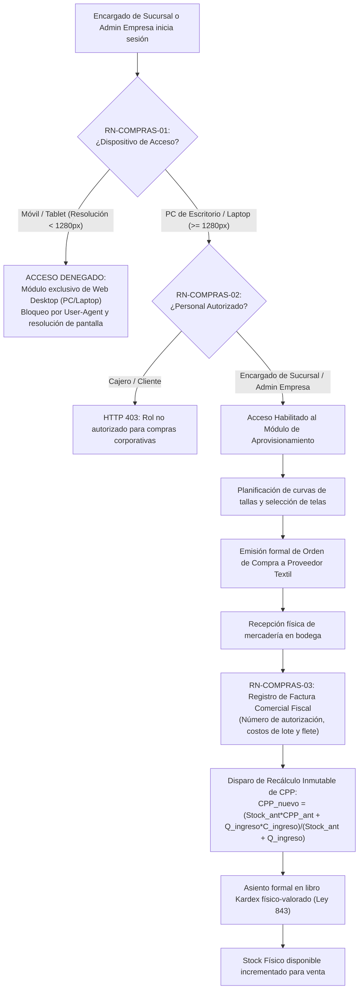

---

### 2.4.6 Reglas de Ofertas de Liquidación y Precios Diferenciados

- **RN-PRECIOS-01 (Ofertas y Liquidación de Fin de Temporada):** Las prendas de temporadas concluidas (ej. colección otoño-invierno en primavera) pueden ofertarse con descuentos especiales preconfigurados (30%, 40% o 60%) definidos por el Administrador de Empresa para recuperar capital de inversión. Las prendas de temporada vigente mantienen su precio regular. El catálogo digital incluye una sección destacada con filtros de ofertas y porcentaje de rebaja.
- **RN-PRECIOS-02 (Precios Diferenciados por Mayor Automáticos):** El sistema calcula automáticamente tarifas de precio por mayor cuando el cliente adquiere 3 o más unidades idénticas (cuarta, media docena o docena), aplicando el descuento mayorista en el carrito de compras sin requerir intervención manual del cajero.

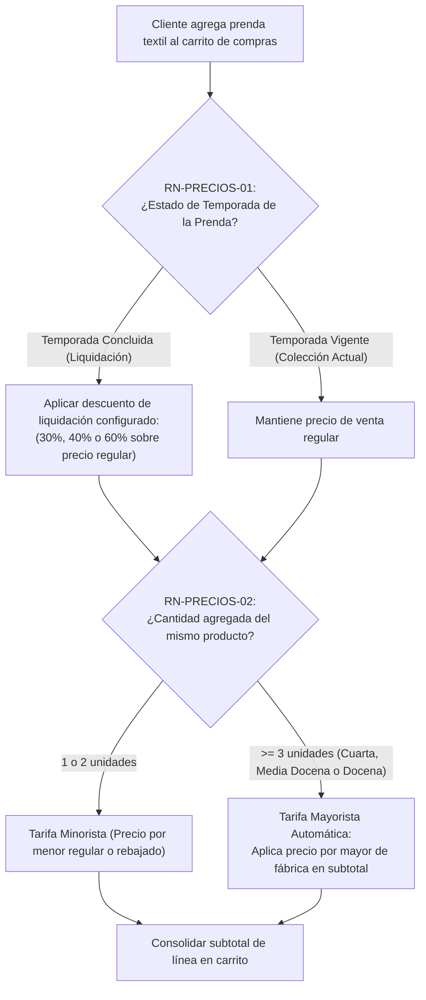

---

### 2.4.7 Reglas de Inteligencia Artificial Generativa y Machine Learning

- **RN-IA-01 (Privilegio por Plan de Suscripción):** La generación de reportes analíticos con IA y el procesamiento de consultas por voz mediante Whisper están reservados exclusivamente para empresas con planes superiores activos (Plan Profesional y Plan Enterprise).
- **RN-IA-02 (Validador Sintáctico AST de Seguridad en SQL Generado):** Toda consulta SQL traducida por el LLM a partir de lenguaje natural debe someterse a un validador sintáctico AST (*Abstract Syntax Tree*):
  1. Debe ser estrictamente de solo lectura (`SELECT`).
  2. Prohíbe de forma absoluta cualquier sentencia destructiva o modificadora (`DROP`, `DELETE`, `UPDATE`, `INSERT`, `ALTER`, `TRUNCATE`).
  3. Inyecta obligatoriamente la cláusula `WHERE tenant_id = :current_tenant`.
  4. Se ejecuta en una réplica de base de datos de solo lectura.
- **RN-ML-01 (Dataset Sintético Estandarizado de Entrenamiento):** Los modelos predictivos de Machine Learning se entrenan sobre un pipeline de datos sintéticos representativo de al menos 6 meses de historial (~5,000 transacciones y ~500 perfiles) que modela la estacionalidad textil boliviana.
- **RN-ML-02 (Métricas Mínimas de Precisión Analítica):** El modelo supervisado de regresión para proyección semestral de demanda debe garantizar un coeficiente de determinación $R^2 \ge 0.82$, mientras que los algoritmos de segmentación no supervisada (K-Means) deben alcanzar un coeficiente de silueta (*Silhouette score*) $\ge 0.65$.

```mermaid
flowchart TD
    subgraph NLP_Pipeline ["RN-IA-01 / RN-IA-02: Pipeline Seguro de Reportes Generativos"]
        QUser["Directivo formula consulta en lenguaje natural<br/>(Texto escrito o audio dictado por voz)"] --> CheckVoice{"¿Es entrada de voz?"}
        CheckVoice -- "SÍ (Audio)" --> Transcribe["Transcripción fonética de alta fidelidad con Whisper"]
        CheckVoice -- "NO (Texto)" --> TextPrompt["Procesar prompt de texto directo"]
        
        Transcribe --> CheckPlanIA{"¿Plan Profesional o Enterprise Activo?"}
        TextPrompt --> CheckPlanIA
        
        CheckPlanIA -- "NO (Plan Básico)" --> RejectIA["HTTP 403 Forbidden:<br/>Reportes IA exclusivos para planes superiores"]
        CheckPlanIA -- "SÍ" --> LLMEngine["Motor LLM:<br/>Traducción de intención a consulta SQL analítica"]
        
        LLMEngine --> SecFilter{"Filtro Validador AST de Seguridad SQL"}
        
        SecFilter -- "Contiene DDL/DML destructivo:<br/>DROP, DELETE, UPDATE, INSERT, ALTER, TRUNCATE" --> AlertSec["BLOQUEO DE SEGURIDAD:<br/>Alerta de bitácora por inyección maliciosa"]
        
        SecFilter -- "Consulta de Solo Lectura:<br/>SELECT sintácticamente válido" --> InjectTenant["Inyección Forzosa e Incondicional:<br/>WHERE tenant_id = :current_tenant"]
        
        InjectTenant --> ExecSQL["Ejecución en PostgreSQL 15 (Réplica de Solo Lectura)"]
        ExecSQL --> RenderUI["Generación Dinámica en Frontend:<br/>Tablas interactivas + Gráficos estadísticos + Narrativa ejecutiva<br/>Exportación a Excel (.xlsx) y PDF (.pdf)"]
    end

    subgraph ML_Analytics ["RN-ML-01 / RN-ML-02: Pipeline Analítico de Machine Learning"]
        SynthData["Dataset Sintético Estandarizado:<br/>(Historial >= 6 meses, estacionalidad textil boliviana)"] --> TrainModels["Entrenamiento de Modelos Analíticos"]
        TrainModels --> SupModel["Modelo Supervisado de Regresión:<br/>Proyección semestral de demanda textil<br/>(Evaluación: RMSE y R^2 >= 0.82)"]
        TrainModels --> UnsupModel["Modelos No Supervisados:<br/>1. Segmentación de Clientes K-Means (Silhouette >= 0.65)<br/>2. Detección de Anomalías de Existencias (Isolation Forest)"]
    end
```

---

### 2.4.8 Matriz Consolidada de Reglas de Negocio (Mapeo RN01 - RN18)

A continuación se presenta la tabla resumen de todas las reglas de negocio del sistema, preservando la numeración unívoca para su trazabilidad en el diseño y casos de prueba:

| ID | Regla de Negocio | Categoría | Descripción Breve |
|:---:|:---|:---:|:---|
| **RN01** | Plazo estricto de garantía de cambio | Postventa | Plazo máximo de 7 días hábiles desde la emisión de la venta para solicitar formalmente el cambio de prendas. |
| **RN02** | Flujo de cambio en dos tiempos y dos notas | Postventa | Descomposición en Tiempo 1: Nota de Devolución (+1 stock) y Tiempo 2: Nota de Cambio (-1 stock) con cobro de excedente por Stripe. |
| **RN03** | Política de reembolso monetario a 30 días | Postventa | Si no se acepta el cambio, el dinero no se devuelve de inmediato en caja; se liquida al cierre mensual contable (30 días). |
| **RN04** | Condiciones físicas de la prenda e inspección | Postventa | Inspección obligatoria por Encargado de Sucursal: prendas limpias, sin uso y con etiquetas intactas de fábrica. |
| **RN05** | Reingreso al CPP histórico original | Inventario | La prenda devuelta se reincorpora al kardex valorada al costo promedio ponderado de la venta original. |
| **RN06** | Idempotencia en operaciones offline con UUID v4 | Sincronización | Prevención de duplicados en el backend mediante identificador UUID v4 único transmitido en cabecera `X-Idempotency-Key`. |
| **RN07** | Validación de stock y pago prioritario | Ventas/Pagos | Confirmación efectiva del 100% del pago por webhook de Stripe antes de consolidar inventario. Prioridad física a la venta en mostrador. |
| **RN08** | Aislamiento y gobernanza SaaS Multitenant | SaaS | Aislamiento lógico forzoso con `WHERE tenant_id = :id` y delimitación de recursos según plan contratado (Básico, Profesional, Enterprise). |
| **RN09** | Ofertas y liquidación de fin de temporada | Precios | Descuentos especiales (30%, 40%, 60%) en prendas de temporadas concluidas para recuperar capital de inversión. |
| **RN10** | Precios diferenciados (Menor vs. Mayor) | Precios | Aplicación automática de tarifas por mayor a partir de 3 unidades idénticas (cuarta, media docena o docena). |
| **RN11** | Traspasos inter-sucursales de inventario | Inventario | Movimientos válidos únicamente entre sucursales del mismo tenant, con estados formales `EN_TRÁNSITO` y confirmación en destino. |
| **RN12** | Modalidad exclusiva de venta offline en efectivo | POS Offline | Ventas sin conexión restringidas estrictamente a pago en efectivo. Bloqueo de tarjetas y QR por cumplimiento de PCI-DSS. |
| **RN13** | Ficha técnica y composición textil avanzada | Catálogo | Especificación obligatoria de medidas biométricas en cm, códigos bicolores Hex, telas nobles y advertencia hipoalergénica. |
| **RN14** | Compras centralizadas vía Web Desktop | Compras B2B | Restricción estricta de aprovisionamiento corporativo a PC/Laptop (>= 1280px) operado por Encargado de Sucursal o Admin Empresa. |
| **RN15** | Control de acceso basado en roles (RBAC) | Seguridad | Validación de credenciales JWT y bloqueo de operaciones fuera del rol asignado (HTTP 403). |
| **RN16** | Bloqueo temporal de stock en reservas (2 horas) | Reservas | Apartado temporal de prendas en probador por un máximo de 2 horas con liberación automática si no asiste el cliente. |
| **RN17** | Validador sintáctico AST de seguridad en IA | IA Generativa | Inspección de consultas SQL generadas por LLM, exigiendo solo `SELECT` y bloqueando sentencias DDL/DML destructivas. |
| **RN18** | Requisitos mínimos de modelos Machine Learning | Machine Learning | Entrenamiento con >= 6 meses de datos sintéticos estacionales y métricas mínimas ($R^2 \ge 0.82$, Silhouette $\ge 0.65$). |

## 2.5. Diagrama General de Casos de Uso (UML)

### 2.5.1. Matriz Integral y Lista Consolidada de Casos de Uso del Segundo Parcial


La siguiente matriz presenta la especificación exhaustiva de los **20 Casos de Uso (CU01 al CU20)** desarrollados para el Segundo Examen Parcial bajo la metodología ICONIX. En estricto cumplimiento con las exigencias metodológicas de la cátedra expresadas en las defensas grabadas (*Audio 1: L5, L21, L65 y Audio 2: L99*), cada caso de uso explicita formalmente su **Plataforma de Ejecución (Web, Móvil o Web y Móvil)**, su nivel de **Prioridad**, los **Actores** que intervienen, los requisitos funcionales asociados, los módulos arquitectónicos y los canales concretos de despliegue.


> **Resumen de Distribución por Plataforma de Ejecución:**

> - **Casos de Uso Omnicanal (Web y Móvil):** **12 Casos de Uso (60%)** (`CU04`, `CU07`, `CU08`, `CU09`, `CU10`, `CU11`, `CU12`, `CU13`, `CU15`, `CU16`, `CU18`, `CU19`).

> - **Casos de Uso Web Desktop (Administración y Operación Corporativa):** **8 Casos de Uso (40%)** (`CU01`, `CU02`, `CU03`, `CU05`, `CU06`, `CU14`, `CU17`, `CU20`).

>

> **NOTA METODOLÓGICA ICONIX:** En estricto apego a los principios de ICONIX y las directrices de la cátedra, los casos de uso se implementan de forma progresiva sin división en ciclos iterativos de PUDS ni priorizaciones burocráticas. Los casos de uso fundacionales heredados del primer parcial se encuentran resguardados en el **Anexo A.1**.


| CU | Nombre del Caso de Uso | Módulo Asignado | Plataforma | Prioridad | Requisitos Funcionales (RF) | Actor Principal | Actores Secundarios / Sistemas | Canales y Componentes de Despliegue | Desafío Técnico |
|:---:|:---|:---|:---:|:---:|:---:|:---|:---|:---|:---:|
| **CU01** | Gestionar Empresas (Tenants) | `M01: Gobernanza SaaS y Seguridad` | **Web** | Alta | RF01, RF04 | Super Admin | Admin Empresa | Web Desktop (Panel Super Admin) | Desafío VI: SaaS Multitenant |
| **CU02** | Gestionar Planes de Suscripción | `M01: Gobernanza SaaS y Seguridad` | **Web** | Alta | RF02 | Super Admin | — | Web Desktop (Panel Super Admin) | Desafío VI: SaaS Multitenant |
| **CU03** | Gestionar Suscripción de Empresa | `M01: Gobernanza SaaS y Seguridad` | **Web** | Alta | RF03 | Super Admin | Admin Empresa | Web Desktop (Super Admin / Admin Empresa) | Desafío VI: SaaS Multitenant |
| **CU04** | Autenticar Usuario Multitenant | `M01: Gobernanza SaaS y Seguridad` | **Web y Móvil** | Crítica | RF04, RF05 | Todos los usuarios | — | Web Desktop, PWA Angular, App Móvil Flutter (JWT/bcrypt) | Desafío VI: SaaS Multitenant |
| **CU05** | Gestionar Usuarios y Roles por Empresa | `M01: Gobernanza SaaS y Seguridad` | **Web** | Alta | RF04, RF05 | Admin Empresa | Encargado Sucursal, Cajero | Web Desktop (Panel Admin Empresa) | Desafío VI: SaaS Multitenant |
| **CU06** | Gestionar Productos y Atributos Textiles Avanzados | `M04: Catalogación Textil de Precisión` | **Web** | Alta | RF06 | Admin Empresa | — | Web Desktop (Panel Admin Empresa / Curva tallas y 3D) | Desafío I: Ficha Textil Avanzada |
| **CU07** | Gestionar Inventario Multi-Sucursal, Kardex y CPP | `M05: Inventario, Kardex y CPP` | **Web y Móvil** | Crítica | RF07, RF08 | Admin Empresa | Encargado de Sucursal | Web Desktop (Kardex/CPP) + PWA/Móvil (Consulta stock) | Desafíos I y IV: Valuación CPP |
| **CU08** | Descargar y Consultar Catálogo Digital Offline | `M02: Catálogo Omnicanal Offline-First` | **Web y Móvil** | Crítica | RF08, RF09 | Cliente | — | PWA Angular (IndexedDB) + App Móvil Flutter (SQLite) | Desafíos II y III: PWA / Offline |
| **CU09** | Registrar Reserva Presencial Sin Conexión | `M02: Catálogo Omnicanal Offline-First` | **Web y Móvil** | Alta | RF10 | Cliente | Encargado de Sucursal | PWA Angular + App Móvil Flutter (QR temporal 2h) | Desafíos II y III: Offline-First |
| **CU10** | Registrar Venta POS de Contado Sin Conexión | `M03: POS Offline y Sincronización` | **Web y Móvil** | Crítica | RF11, RF30 | Cajero | Cliente | PWA Mostrador (IndexedDB) + Móvil Flutter (SQLite + UUID v4) | Desafío III: POS Offline Efectivo |
| **CU11** | Consultar y Auditar Operaciones Locales Pendientes | `M03: POS Offline y Sincronización` | **Web y Móvil** | Alta | RF12, RF30 | Cajero | Encargado Sucursal, Cliente | PWA Mostrador + Móvil Flutter (Arqueo de caja local) | Desafío III: Auditoría Offline |
| **CU12** | Sincronizar Operaciones Pendientes (Idempotencia) | `M03: POS Offline y Sincronización` | **Web y Móvil** | Crítica | RF13, RF14 | Sistema Sincronización | Cajero, Encargado Sucursal | Worker Background en PWA y Móvil (`X-Idempotency-Key`) | Desafíos II y III: Sync Idempotente |
| **CU13** | Gestionar Cambio de Prenda en Dos Tiempos y Devoluciones | `M06: Postventa, Pasarela y Ofertas` | **Web y Móvil** | Crítica | RF15, RF16, RF17, RF18, RF30 | Cajero / Cliente | Encargado Sucursal, Stripe | Móvil (Solicitud cliente, Push y Rating) + Web/PWA (Inspección y Notas) | Desafío IV: Postventa en 2 Tiempos |
| **CU14** | Gestionar Traspaso Inter-Sucursal de Inventario | `M05: Inventario, Kardex y CPP` | **Web** | Media | RF19 | Encargado Sucursal | Admin Empresa | Web Desktop + PWA Tienda (Guías de traspaso en tránsito) | Desafíos I y IV: Logística Retail |
| **CU15** | Solicitar Reporte Generativo con IA (Texto y Voz) | `M08: Inteligencia Analítica de Negocio` | **Web y Móvil** | Alta | RF20, RF21, RF23 | Admin Empresa | Encargado, OpenAI / Whisper | Web Desktop + App Móvil Flutter (Comandos de voz Whisper) | Desafío V: IA Generativa NLP/Voz |
| **CU16** | Exportar Reportes Analíticos a Excel/PDF/CSV | `M08: Inteligencia Analítica de Negocio` | **Web y Móvil** | Media | RF22, RF23 | Admin Empresa | Encargado de Sucursal | Web Desktop (Excel/PDF) + App Móvil (PDF/CSV descargable) | Desafío V: Inteligencia de Negocio |
| **CU17** | Gestionar Dashboard Analítico con Machine Learning | `M08: Inteligencia Analítica de Negocio` | **Web** | Alta | RF24, RF25, RF26 | Admin Empresa | OpenWeatherMap | Web Desktop (Gráficos ejecutivos 6 meses ML) | Desafío V: Machine Learning 6 Meses |
| **CU18** | Gestionar Pasarela de Pagos (Stripe Sandbox PCI-DSS) | `M06: Postventa, Pasarela y Ofertas` | **Web y Móvil** | Crítica | RF17, RF27 | Cajero / Cliente | Pasarela Stripe Sandbox | Web Desktop, PWA y Móvil Flutter (Tokenización Stripe Elements) | Desafío IV: Pasarela Electrónica |
| **CU19** | Gestionar Ofertas de Liquidación y Precios por Mayor | `M06: Postventa, Pasarela y Ofertas` | **Web y Móvil** | Alta | RF28 | Admin Empresa | Cliente, Cajero | Web Desktop (Configuración) + Web/Móvil (Cálculo automático carrito) | Desafíos I y IV: Precios Dinámicos |
| **CU20** | Gestionar Compras y Aprovisionamiento desde Web Desktop | `M07: Compras B2B Web Desktop` | **Web** | Alta | RF29 | Admin Empresa / Encargado Sucursal | Proveedor Textil | Exclusivo Web Desktop (PC/Laptop $\ge 1280 \times 800$ px por auditoría) | Desafío I: Compras B2B con CPP |

#### Distribución Analítica de Casos de Uso por Módulo del Segundo Parcial


| Código Módulo | Nombre del Módulo del Segundo Parcial | Casos de Uso Contenidos | Total CUs | Plataformas Cubiertas | Alcance Tecnológico y Arquitectónico |
|:---:|:---|:---|:---:|:---:|:---|
| **M01** | Gobernanza SaaS Multitenant, Suscripciones y Seguridad RBAC | `CU01`, `CU02`, `CU03`, `CU04`, `CU05` | 5 | Web Desktop / Móvil (Auth) | Aislamiento por `tenant_id`, planes Básico/Profesional, autenticación JWT con hash bcrypt y control de acceso RBAC. |
| **M02** | Catálogo Omnicanal Offline-First y Probador Virtual 3D RA | `CU08`, `CU09` | 2 | Web (PWA) y Móvil (Flutter) | PWA con IndexedDB, Flutter con SQLite, probador tridimensional `.glb` y reservas QR sin conexión con temporizador de 2 horas. |
| **M03** | Punto de Venta (POS) Offline en Efectivo y Sincronización Idempotente | `CU10`, `CU11`, `CU12` | 3 | Web (PWA) y Móvil (Flutter) | Cobro contado en efectivo, UUID v4 inmutable, cabecera `X-Idempotency-Key` y reconciliación con prioridad física a sobreventa. |
| **M04** | Catalogación Textil de Precisión Anatómica, Telas Nobles y 3D | `CU06` | 1 | Web Desktop | Medidas biométricas en cm (pecho/cintura/largo), colores bicolores Hex, composición textil y modelos 3D interactivos. |
| **M05** | Gestión de Inventario Multi-Sucursal, Kardex Físico-Valorado y CPP | `CU07`, `CU14` | 2 | Web (Desktop/PWA) y Móvil | Recálculo matemático inmutable de CPP, libro Kardex según Ley 843 y traspasos inter-tiendas con control `EN_TRÁNSITO`. |
| **M06** | Postventa en Dos Tiempos, Pasarela Stripe Sandbox y Ofertas Dinámicas | `CU13`, `CU18`, `CU19` | 3 | Web (Desktop/PWA) y Móvil | Nota de Devolución (+1 stock) + Nota de Reposición (-1 stock), Stripe PCI-DSS, push con fecha comprometida, retorno a cuenta si no hay stock y ofertas 30-60%. |
| **M07** | Aprovisionamiento y Compras Corporativas desde Web Desktop | `CU20` | 1 | Exclusivo Web Desktop | Restricción por dispositivo (PC/Laptop $\ge 1280 \times 800$ px), compras por curva de tallas, cotejo de facturas fiscales y CPP. |
| **M08** | Inteligencia Analítica de Negocio: Reportes IA Generativa y ML | `CU15`, `CU16`, `CU17` | 3 | Web Desktop y Móvil | Consultas NLP por texto y comandos de voz (Whisper), validador AST SQL de solo lectura, exportación Excel/PDF/CSV y ML a 6 meses. |
| **TOTAL** | **8 Módulos Consolidados de Segundo Parcial** | **CU01 al CU20** | **20 CUs** | **12 Web y Móvil / 8 Web** | **Cobertura 100% de los Desafíos I al VI y Contextos Exigidos por la Cátedra** |

### 2.5.2. Diagrama General de Casos de Uso (UML 2.5 en Enterprise Architect)


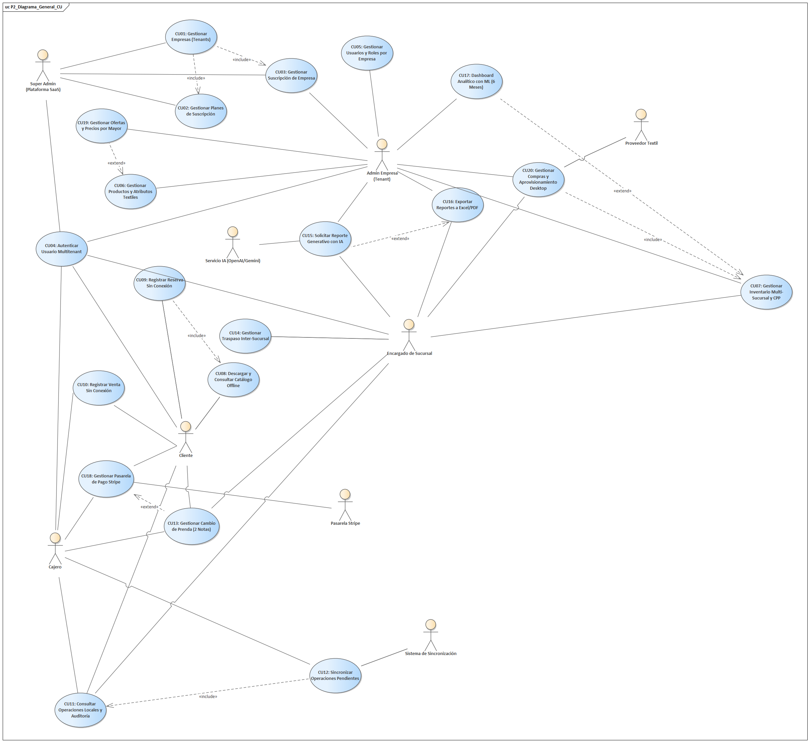


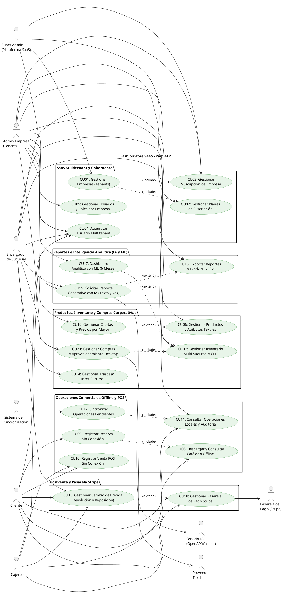


## 2.6. Especificación de Casos de Uso

> **Formato de cada CU:** Diseño del CU (PlantUML) → Prototipo UI → Tabla Detalle

---

### CU01: Gestionar Empresas (Tenants)

#### a) Diseño del Caso de Uso (PlantUML)

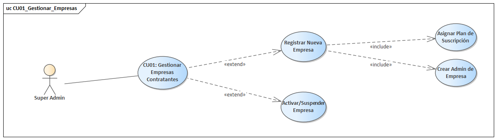

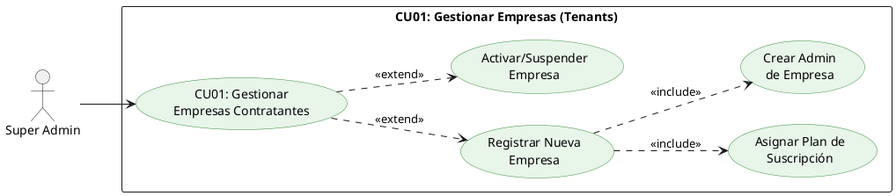

#### b) Prototipo de Interfaz de Usuario

Panel administrativo del Super Admin con tabla paginada de empresas mostrando: ID, Razón Social, NIT, Plan Contratado, Estado (badge: verde ACTIVA, rojo SUSPENDIDA), Fecha de Registro, Sucursales Activas. Botón "+ Registrar Nueva Empresa". Formulario modal de registro con: Razón Social, NIT (validación unicidad), Email del Administrador, Teléfono, Dirección, Selector de Plan (Básico/Profesional), Fecha de Inicio y Vencimiento de Suscripción. Al guardar se crea automáticamente el usuario Admin de Empresa con credenciales iniciales.

#### c) Tabla Detalle del Caso de Uso

| Atributo | Detalle |
|:---|:---|
| **Identificador** | CU01 |
| **Nombre** | Gestionar Empresas Contratantes (Tenants) |
| **Autor** | Equipo de desarrollo |
| **Fecha** | 2026-10-24 |
| **Actores** | Super Admin (Administrador de Plataforma) |
| **Descripción** | Permite al Super Admin registrar, consultar, activar y suspender empresas que contratan el servicio SaaS de FashionStore bajo arquitectura multitenant. |
| **Precondiciones** | El Super Admin debe estar autenticado con rol `SUPER_ADMIN`. |
| **Casos de Uso Incluidos (<<include>>)** | - **Asignar Plan de Suscripción:** Asigna el plan tarifario comercial y cuotas autorizadas.<br>- **Crear Admin de Empresa:** Genera automáticamente el usuario inicial con rol `ADMIN_EMPRESA`. |
| **Casos de Uso Extendidos (<<extend>>)** | - **Registrar Nueva Empresa:** Extensión disparada al pulsar '+ Registrar Nueva Empresa' (Punto de Extensión: Alta de Tenant).<br>- **Activar/Suspender Empresa:** Extensión disparada ante mora o baja contractual (Punto de Extensión: Gestión de Estado). |
| **Flujo Normal** | 1. El Super Admin accede al panel de "Gestión de Empresas".<br>2. El sistema despliega la lista paginada de empresas con planes y estados.<br>3. [Punto de Extensión: Alta de Tenant] El Super Admin presiona "Registrar Nueva Empresa", ejecutando `<<extend>> Registrar Nueva Empresa`.<br>4. El sistema despliega el formulario modal de alta.<br>5. El Super Admin ingresa Razón Social, NIT y datos de contacto.<br>6. El sistema invoca `<<include>> Asignar Plan de Suscripción` para parametrizar las cuotas de sucursales y módulos habilitados.<br>7. El sistema valida unicidad de NIT y formato de datos.<br>8. El sistema persiste el registro de la empresa (tenant) en PostgreSQL.<br>9. El sistema invoca `<<include>> Crear Admin de Empresa`, aprovisionando credenciales temporales y enviando correo institucional.<br>10. El sistema emite confirmación de registro exitoso. |
| **Flujo Alternativo** | **3a. [Punto de Extensión: Gestión de Estado]** El Super Admin selecciona una empresa existente y ejecuta `<<extend>> Activar/Suspender Empresa` para pausar operaciones por mora o reactivar el servicio.<br>**7a. NIT duplicado dentro de la plataforma:** El sistema notifica "El NIT ya se encuentra registrado" y cancela la operación.<br>**7b. Email administrativo duplicado:** El sistema notifica "El correo electrónico ya está asociado a otra cuenta". |
| **Postcondiciones** | La empresa queda registrada con su suscripción activa y el Admin de Empresa puede iniciar sesión. |

---

### CU02: Gestionar Planes de Suscripción

#### a) Diseño del Caso de Uso (PlantUML)

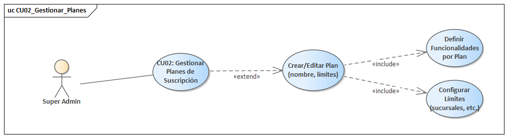

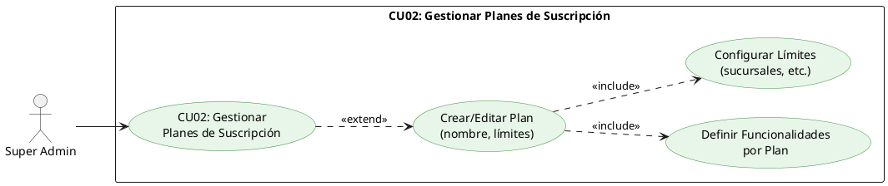

#### b) Prototipo de Interfaz de Usuario

Tabla de planes con columnas: Nombre del Plan, Sucursales Permitidas, Reportes IA (Sí/No), Precio, Estado. Botón "+ Crear Plan". Modal con: Nombre del Plan, máximo de sucursales, checklist de funcionalidades habilitadas (Reportes IA, ML Dashboard, etc.), precio mensual. Vista de comparación lado a lado estilo tabla de precios.

#### c) Tabla Detalle del Caso de Uso

| Atributo | Detalle |
|:---|:---|
| **Identificador** | CU02 |
| **Nombre** | Gestionar Planes de Suscripción |
| **Autor** | Equipo de desarrollo |
| **Fecha** | 2026-10-24 |
| **Actores** | Super Admin |
| **Descripción** | Permite crear, modificar y parametrizar los planes de suscripción SaaS (Básico, Profesional) con sus topes de recursos y características funcionales. |
| **Precondiciones** | Super Admin autenticado con rol `SUPER_ADMIN`. |
| **Casos de Uso Incluidos (<<include>>)** | - **Definir Funcionalidades por Plan:** Configura checklist de módulos habilitados (IA Generativa, ML, etc.).<br>- **Configurar Límites (sucursales, etc.):** Establece topes cuantitativos de sucursales y usuarios. |
| **Casos de Uso Extendidos (<<extend>>)** | - **Crear/Editar Plan (nombre, límites):** Extensión disparada al pulsar '+ Crear Plan' o editar uno existente (Punto de Extensión: Parametrización de Plan). |
| **Flujo Normal** | 1. El Super Admin accede al módulo "Planes de Suscripción".<br>2. El sistema muestra la matriz comparativa de planes existentes.<br>3. [Punto de Extensión: Parametrización de Plan] El Super Admin pulsa "Crear Plan" o selecciona editar, ejecutando `<<extend>> Crear/Editar Plan (nombre, límites)`.<br>4. El Super Admin ingresa denominación y costo mensual.<br>5. El sistema invoca `<<include>> Definir Funcionalidades por Plan` para activar/desactivar módulos estratégicos.<br>6. El sistema invoca `<<include>> Configurar Límites (sucursales, etc.)` para fijar el número máximo de sucursales permitidas.<br>7. El sistema valida y persiste la configuración en base de datos. |
| **Flujo Alternativo** | **4a. Denominación de plan duplicada:** El sistema rechaza el nombre y solicita un identificador comercial unívoco. |
| **Postcondiciones** | El plan de suscripción queda disponible para asignación inmediata a empresas. |

---

### CU03: Gestionar Suscripción de Empresa

#### a) Diseño del Caso de Uso (PlantUML)

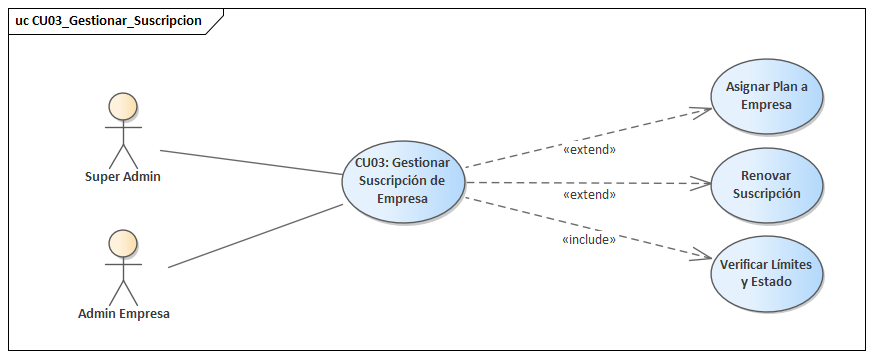

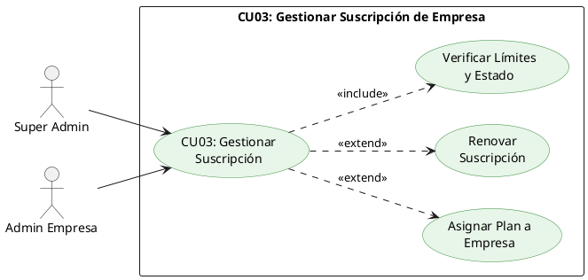

#### b) Prototipo de Interfaz de Usuario

Vista de suscripción con: nombre de empresa, plan actual, fechas de inicio y vencimiento (con barra de progreso visual), estado (ACTIVA/VENCIDA/SUSPENDIDA), uso actual vs. límites (ej. "2/2 sucursales"). Botones: "Cambiar Plan", "Renovar Suscripción" (solo Super Admin).

#### c) Tabla Detalle del Caso de Uso

| Atributo | Detalle |
|:---|:---|
| **Identificador** | CU03 |
| **Nombre** | Gestionar Suscripción de Empresa |
| **Autor** | Equipo de desarrollo |
| **Fecha** | 2026-10-24 |
| **Actores** | Super Admin, Admin Empresa |
| **Descripción** | Administra el ciclo de vida de la suscripción de un tenant: asignación de plan, consulta de consumo vs. límites y renovación temporal. |
| **Precondiciones** | Empresa registrada previamente en la plataforma (CU01). |
| **Casos de Uso Incluidos (<<include>>)** | - **Verificar Límites y Estado:** Compara el número de sucursales activas contra la cuota contratada y verifica la fecha de vencimiento. |
| **Casos de Uso Extendidos (<<extend>>)** | - **Asignar Plan a Empresa:** Extensión disparada al contratar o modificar categoría de plan (Punto de Extensión: Upgrade/Downgrade de Plan).<br>- **Renovar Suscripción:** Extensión disparada para extender vigencia contractual (Punto de Extensión: Renovación Temporal). |
| **Flujo Normal** | 1. El usuario accede al panel de "Estado de Suscripción".<br>2. El sistema invoca `<<include>> Verificar Límites y Estado` para contrastar el consumo de tiendas frente a los límites permitidos.<br>3. El sistema muestra barra de vigencia, días restantes y estado (`ACTIVA`, `VENCIDA`, `SUSPENDIDA`).<br>4. [Punto de Extensión: Upgrade/Downgrade de Plan] El Super Admin o Admin Empresa ejecuta `<<extend>> Asignar Plan a Empresa` para migrar de Básico a Profesional.<br>5. [Punto de Extensión: Renovación Temporal] El Super Admin ejecuta `<<extend>> Renovar Suscripción`, extendiendo la fecha límite a 30 o 365 días adicionales.<br>6. El sistema actualiza cuotas y emite comprobante de servicio. |
| **Flujo Alternativo** | **4a. Downgrade con sucursales excedidas:** Si la empresa tiene 5 tiendas y elige un plan de 2, el sistema advierte que debe cerrar o inactivar 3 sucursales antes de aplicar el cambio. |
| **Postcondiciones** | Suscripción actualizada con nuevas fechas y cuotas operativas sincronizadas en el middleware multitenant. |

---

### CU04: Autenticar Usuario Multitenant

#### a) Diseño del Caso de Uso (PlantUML)

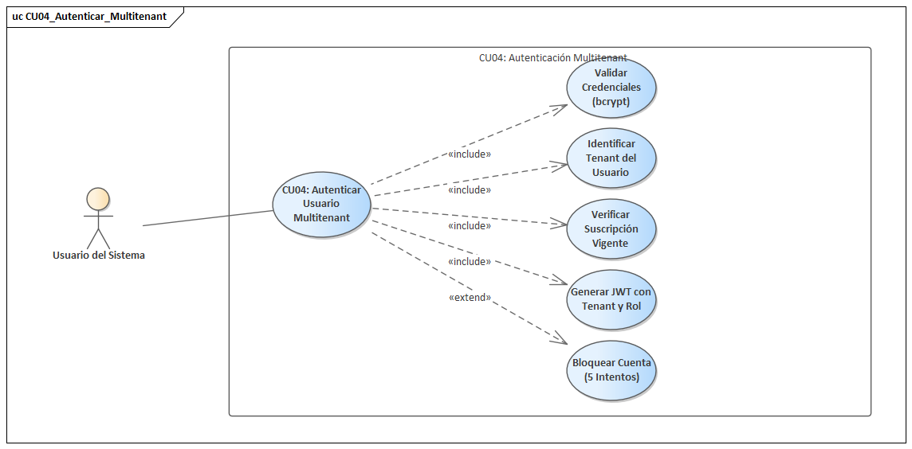

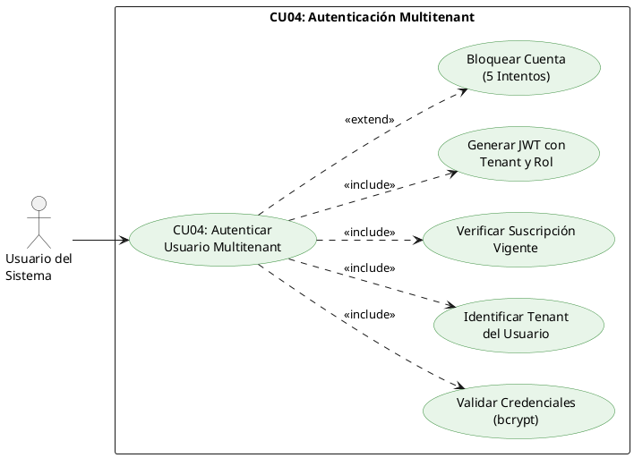

#### b) Prototipo de Interfaz de Usuario

Pantalla de login con campos: Email, Contraseña, botón "Iniciar Sesión". Link "¿Olvidaste tu contraseña?" y "Registrarse". Indicador de intentos restantes en caso de error. Redirección automática según rol. Banner informativo de empresa (logo, nombre) después del login.

#### c) Tabla Detalle del Caso de Uso

| Atributo | Detalle |
|:---|:---|
| **Identificador** | CU04 |
| **Nombre** | Autenticar Usuario Multitenant |
| **Autor** | Equipo de desarrollo |
| **Fecha** | 2026-10-24 |
| **Actores** | Todos los actores humanos (Super Admin, Admin Empresa, Encargado de Sucursal, Cajero, Cliente) |
| **Descripción** | Inicio de sesión unificado que valida credenciales seguras, resuelve el tenant correspondiente, verifica vigencia de suscripción y emite token JWT con claims restringidos. |
| **Precondiciones** | Cuenta de usuario registrada y activa en el sistema. |
| **Casos de Uso Incluidos (<<include>>)** | - **Validar Credenciales (bcrypt):** Verifica el hash de la contraseña almacenada.<br>- **Identificar Tenant del Usuario:** Extrae el `tenant_id` y sucursal asignada.<br>- **Verificar Suscripción Vigente:** Valida que la empresa mantenga suscripción activa.<br>- **Generar JWT con Tenant y Rol:** Emite token criptográfico firmado con identidad y privilegios. |
| **Casos de Uso Extendidos (<<extend>>)** | - **Bloquear Cuenta (5 Intentos):** Extensión disparada al alcanzar 5 intentos erróneos consecutivos (Punto de Extensión: Detección de Intrusión). |
| **Flujo Normal** | 1. El usuario introduce email y contraseña en el portal de acceso.<br>2. El sistema invoca `<<include>> Validar Credenciales (bcrypt)`.<br>3. El sistema invoca `<<include>> Identificar Tenant del Usuario`, resolviendo contexto empresarial.<br>4. El sistema invoca `<<include>> Verificar Suscripción Vigente`, confirmando que el tenant no esté suspendido.<br>5. El sistema invoca `<<include>> Generar JWT con Tenant y Rol`, emitiendo token con claims `{user_id, tenant_id, rol, sucursal_id}`.<br>6. El sistema restablece el contador de intentos fallidos a 0 y registra acceso en auditoría.<br>7. Redirige a la vista especializada según el rol. |
| **Flujo Alternativo** | **2a. Contraseña incorrecta:** El sistema incrementa el contador `intentos_fallidos`.<br>**2b. [Punto de Extensión: Detección de Intrusión]** Al acumular 5 intentos fallidos consecutivos, el sistema ejecuta `<<extend>> Bloquear Cuenta (5 Intentos)`, inactivando el usuario y notificando al administrador.<br>**4a. Empresa con suscripción vencida o suspendida:** El sistema bloquea el acceso informando: "Suscripción de empresa vencida. Contacte al administrador de plataforma". |
| **Postcondiciones** | Sesión activa con token JWT que condiciona todas las consultas posteriores con aislamiento estricto por `tenant_id`. |

---

### CU05: Gestionar Usuarios y Roles por Empresa

#### a) Diseño del Caso de Uso (PlantUML)

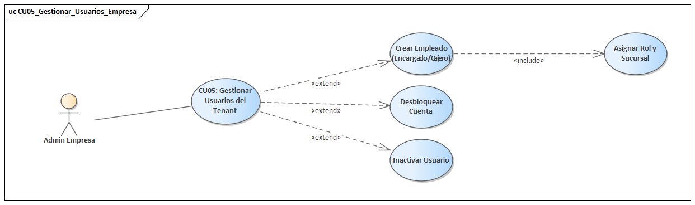

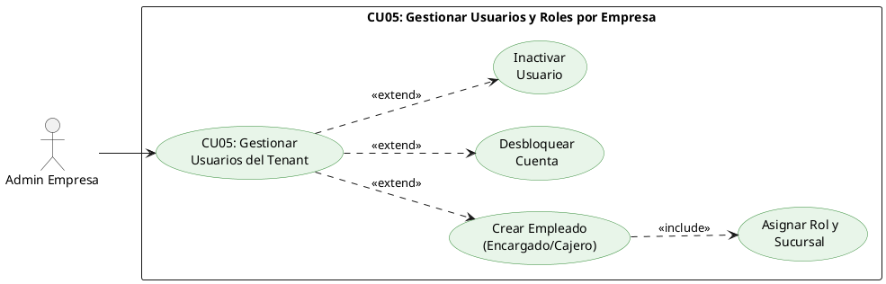

#### b) Prototipo de Interfaz de Usuario

Panel de usuarios del tenant con tabla: Nombre, Email, Rol, Sucursal, Estado (ACTIVO/BLOQUEADO/INACTIVO). Botón "+ Crear Empleado". Modal con: Nombres, Apellidos, Email, Teléfono, Rol (selector: ENCARGADO, CAJERO), Sucursal (selector). Acciones: Editar, Desbloquear, Inactivar.

#### c) Tabla Detalle del Caso de Uso

| Atributo | Detalle |
|:---|:---|
| **Identificador** | CU05 |
| **Nombre** | Gestionar Usuarios y Roles por Empresa |
| **Autor** | Equipo de desarrollo |
| **Fecha** | 2026-10-24 |
| **Actores** | Admin Empresa |
| **Descripción** | Permite al administrador del tenant gestionar el personal de su empresa: creación de encargados y cajeros, asignación de sucursales físicas y control de bloqueos. |
| **Precondiciones** | Admin Empresa autenticado con suscripción vigente. |
| **Casos de Uso Incluidos (<<include>>)** | - **Asignar Rol y Sucursal:** Vincula al usuario con su perfil operativo y punto de venta físico autorizado. |
| **Casos de Uso Extendidos (<<extend>>)** | - **Crear Empleado (Encargado/Cajero):** Extensión disparada al pulsar '+ Crear Empleado' (Punto de Extensión: Alta de Personal).<br>- **Desbloquear Cuenta:** Extensión disparada para reactivar cuentas bloqueadas tras 5 intentos fallidos (Punto de Extensión: Restablecimiento de Acceso).<br>- **Inactivar Usuario:** Extensión disparada para suspender a personal saliente (Punto de Extensión: Baja Operativa). |
| **Flujo Normal** | 1. El Admin Empresa accede a "Usuarios y Roles".<br>2. El sistema despliega la lista de empleados filtrados estrictamente por el `tenant_id` activo.<br>3. [Punto de Extensión: Alta de Personal] El administrador presiona "+ Crear Empleado", ejecutando `<<extend>> Crear Empleado (Encargado/Cajero)`.<br>4. Ingresa nombres, apellidos, teléfono y correo electrónico.<br>5. El sistema invoca `<<include>> Asignar Rol y Sucursal` para delimitar si operará como Encargado de Sucursal o Cajero, asignándole su tienda física.<br>6. El sistema valida unicidad de correo dentro del tenant y persiste el usuario en base de datos. |
| **Flujo Alternativo** | **3a. [Punto de Extensión: Restablecimiento de Acceso]** El administrador selecciona un usuario con estado `BLOQUEADO` y ejecuta `<<extend>> Desbloquear Cuenta`, reiniciando los intentos fallidos.<br>**3b. [Punto de Extensión: Baja Operativa]** El administrador ejecuta `<<extend>> Inactivar Usuario` para revocar inmediatamente el acceso al sistema.<br>**5a. Email duplicado dentro del tenant:** El sistema rechaza el registro y solicita un correo corporativo diferente. |
| **Postcondiciones** | Personal asignado y configurado con acceso limitado exclusivamente a los datos de su empresa y sucursal. |

---

### CU06: Gestionar Productos y Atributos Textiles Avanzados

#### a) Diseño del Caso de Uso (PlantUML)

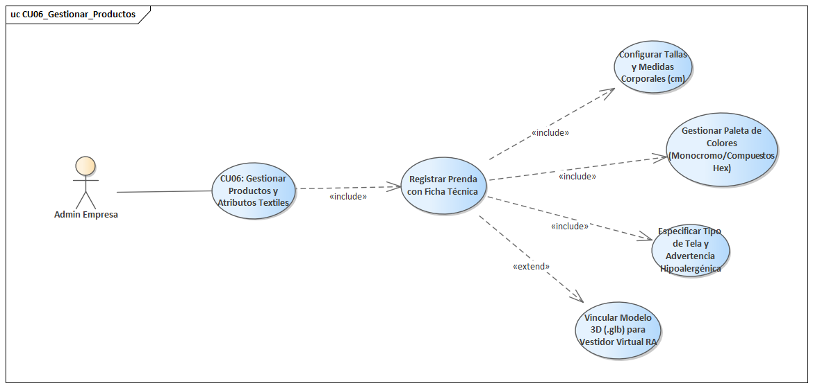

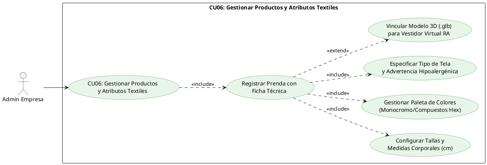

#### b) Prototipo de Interfaz de Usuario

Panel de administración del catálogo de productos textiles. Pestaña **"Ficha Técnica de Prenda"**: inputs para código SKU único, nombre comercial, categoría taxonómica (camisas, pantalones, trajes, poleras, abrigos), temporada estacional (Primavera/Verano, Otoño/Invierno), corte/estilo (Slim Fit, Regular Fit, Custom Fit), tipo de tejido textil (desplegable: 100% Algodón Pima Peruano, Lino Orgánico, Lana Merino, Poliéster Microfibra, Mezcla Hipoalergénica), interruptor (*toggle*) para advertencia dermatológica ("Apto para pieles atópicas / Hipoalergénico") y cargador de archivo 3D `.glb` optimizado para el vestidor virtual en Realidad Aumentada. Pestaña **"Matriz de Variantes Textiles"**: selector multidimensional que combina Talla (XS, S, M, L, XL, XXL) con tabla de medidas corporales anatómicas en centímetros (contorno de pecho, cintura, cadera, largo total y largo de manga) y Colores simples o combinados bicolores (ej. selector dual con vista previa visual Hexadecimal para combinaciones como "Blanco / Negro" `#FFFFFF / #000000` o "Azul Marino / Gris" `#1A2A3A / #808080`). Pestaña **"Tarifas Comerciales"**: definición de precio base minorista y precio al por mayor (con descuento automático para compras iguales o mayores a 3 unidades).

#### c) Tabla Detalle del Caso de Uso

| Atributo | Detalle |
|:---|:---|
| **Identificador** | CU06 |
| **Nombre** | Gestionar Productos y Atributos Textiles Avanzados |
| **Autor** | Equipo de desarrollo |
| **Fecha** | 2026-10-24 |
| **Actores** | Administrador de Empresa |
| **Descripción** | Catalogación integral de prendas de vestir masculinas, especificando ficha técnica, variantes con medidas corporales en centímetros, paletas de colores compuestas (bicolores Hex), precio minorista y mayorista ($\ge 3$ unidades), y modelos 3D para probador virtual RA. |
| **Precondiciones** | Admin Empresa autenticado con empresa activa. |
| **Casos de Uso Incluidos (<<include>>)** | - **Registrar Prenda con Ficha Técnica:** Da de alta el SKU base, corte, temporada y categoría.<br>- **Especificar Tipo de Tela y Advertencia Hipoalergénica:** Asigna composición (algodón pima, lino, lana) y certificación dermatológica.<br>- **Configurar Tallas y Medidas Corporales (cm):** Define medidas anatómicas en centímetros (pecho, cintura, largo) para erradicar el error de calce.<br>- **Gestionar Paleta de Colores (Monocromo/Compuestos Hex):** Configura colores simples o combinaciones duales con códigos hexadecimales. |
| **Casos de Uso Extendidos (<<extend>>)** | - **Vincular Modelo 3D (.glb) para Vestidor Virtual RA:** Extensión disparada si la prenda dispone de activo tridimensional para prueba en Realidad Aumentada (Punto de Extensión: Probador Virtual RA). |
| **Flujo Normal** | 1. El Admin Empresa accede al catálogo y pulsa "Nueva Prenda", invocando `<<include>> Registrar Prenda con Ficha Técnica`.<br>2. Ingresa SKU, denominación comercial, temporada y corte (Slim Fit, Regular Fit).<br>3. El sistema invoca `<<include>> Especificar Tipo de Tela y Advertencia Hipoalergénica`, seleccionando tejido textil y activando advertencia para pieles atópicas.<br>4. El sistema invoca `<<include>> Configurar Tallas y Medidas Corporales (cm)`, registrando las medidas corporales en cm para cada talla (XS a XXL).<br>5. El sistema invoca `<<include>> Gestionar Paleta de Colores (Monocromo/Compuestos Hex)`, configurando esquemas monocromos o combinados (ej. Blanco `#FFFFFF` / Negro `#000000`).<br>6. [Punto de Extensión: Probador Virtual RA] Si la prenda cuenta con modelo 3D, el usuario ejecuta `<<extend>> Vincular Modelo 3D (.glb) para Vestidor Virtual RA`, cargando el archivo `.glb` correspondiente.<br>7. Define la tarifa minorista base y la regla de precio al por mayor (con descuento automático para compras $\ge 3$ unidades).<br>8. El sistema valida unicidad de SKU en el tenant y persiste la ficha técnica. |
| **Flujo Alternativo** | **2a. SKU duplicado dentro de la empresa:** El sistema rechaza el código y solicita un identificador unívoco.<br>**4a. Medidas corporales fuera de rango fisiológico:** El sistema advierte inconsistencia y bloquea el guardado hasta su corrección. |
| **Postcondiciones** | Prenda registrada con su matriz completa de atributos, disponible para asignación de stock multi-sucursal. |

---

### CU07: Gestionar Inventario Multi-Sucursal, Kardex Físico-Valorado y Costo Promedio Ponderado (CPP)

#### a) Diseño del Caso de Uso (PlantUML)

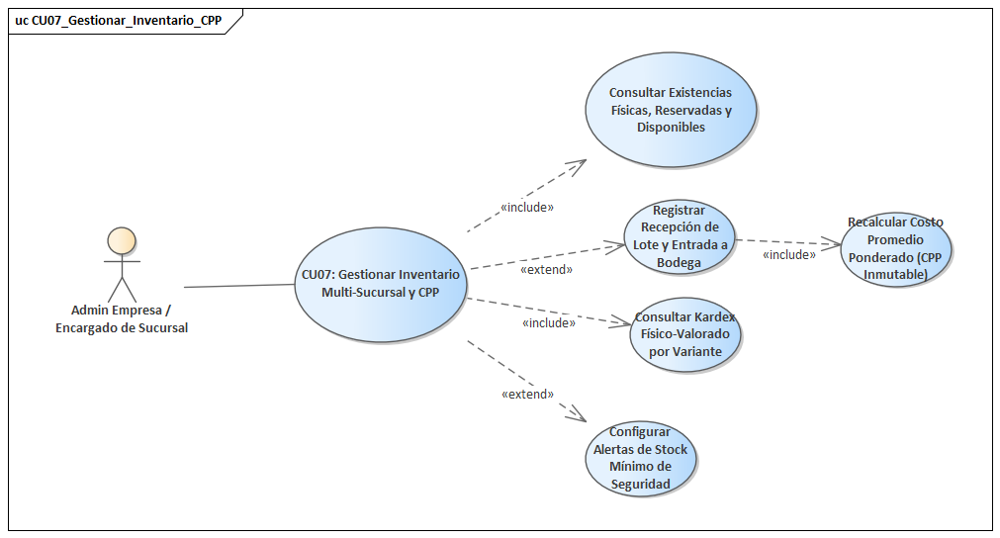

```plantuml
@startuml CU07_Gestionar_Inventario_CPP
left to right direction
skinparam usecase {
  BackgroundColor #E8F5E9
  BorderColor #388E3C
}

actor "Admin Empresa /\nEncargado de Sucursal" as AE

rectangle "CU07: Gestionar Inventario Multi-Sucursal y CPP" {
  usecase "CU07: Gestionar Inventario\nMulti-Sucursal y CPP" as CU07
  usecase "Consultar Existencias Físicas,\nReservadas y Disponibles" as UC_Stock
  usecase "Registrar Recepción de Lote\ny Entrada a Bodega" as UC_Entrada
  usecase "Recalcular Costo Promedio\nPonderado (CPP Inmutable)" as UC_CalcCPP
  usecase "Consultar Kardex Físico-\nValorado por Variante" as UC_Kardex
  usecase "Configurar Alertas de\nStock Mínimo de Seguridad" as UC_Alerta
}

AE --> CU07
CU07 ..> UC_Stock : <<include>>
CU07 ..> UC_Entrada : <<extend>>
UC_Entrada ..> UC_CalcCPP : <<include>>
CU07 ..> UC_Kardex : <<include>>
CU07 ..> UC_Alerta : <<extend>>
@enduml
```

#### b) Prototipo de Interfaz de Usuario

Panel de control logístico y financiero de existencias. Selector superior de **Sucursal Física** (según asignación del usuario). Tabla matricial de inventario: Columna Prenda (SKU, nombre comercial), Variante (Talla cm, Color Hex), **Stock Físico en Tienda**, **Stock Reservado** (apartado temporal para clientes en probador o pedidos pendientes), **Stock Disponible** (`Físico - Reservado`), **Último Costo Unitario de Compra** y **Costo Promedio Ponderado (CPP)** recalculado automáticamente. Botón "Recepción de Lote de Mercadería" que abre modal para registrar proveedor, número de factura de compra, cantidad de unidades ingresadas y costo unitario pagado. Pestaña **"Kardex Físico-Valorado"**: historial cronológico inmutable de movimientos con fecha/hora, concepto (Compra a proveedor, Venta POS mostrador, Nota de Devolución por cambio, Nota de Cambio despacho, Traspaso inter-sucursal o Merma justificada), cantidades de entrada/salida, saldo físico resultante y saldo valorado a CPP. Indicadores visuales en color rojo para variantes con existencias por debajo del umbral mínimo de reorden.

#### c) Tabla Detalle del Caso de Uso

| Atributo | Detalle |
|:---|:---|
| **Identificador** | CU07 |
| **Nombre** | Gestionar Inventario Multi-Sucursal, Kardex Físico-Valorado y Costo Promedio Ponderado (CPP) |
| **Autor** | Equipo de desarrollo |
| **Fecha** | 2026-10-24 |
| **Actores** | Administrador de Empresa, Encargado de Sucursal |
| **Descripción** | Control de existencias físicas, reservadas y disponibles por sucursal, con recálculo matemático inmutable de CPP tras cada entrada de mercadería, generación de Kardex físico-valorado y alertas de reposición urgente. |
| **Precondiciones** | Usuario autenticado con rol `ADMIN_EMPRESA` o `ENCARGADO_SUCURSAL`; sucursales y productos registrados. |
| **Casos de Uso Incluidos (<<include>>)** | - **Consultar Existencias Físicas, Reservadas y Disponibles:** Desglosa `Stock Físico - Stock Reservado = Stock Disponible`.<br>- **Recalcular Costo Promedio Ponderado (CPP Inmutable):** Aplica la fórmula formal de costeo contable inmutable.<br>- **Consultar Kardex Físico-Valorado por Variante:** Genera libro de movimientos cronológicos y saldos valorados. |
| **Casos de Uso Extendidos (<<extend>>)** | - **Registrar Recepción de Lote y Entrada a Bodega:** Extensión disparada al recepcionar mercadería respaldada con factura de compra (Punto de Extensión: Entrada de Lote).<br>- **Configurar Alertas de Stock Mínimo de Seguridad:** Extensión disparada si el stock disponible cae por debajo del umbral de reorden (Punto de Extensión: Alerta de Desabastecimiento). |
| **Flujo Normal** | 1. El usuario accede a "Inventarios y Kardex", seleccionando la sucursal asignada.<br>2. El sistema invoca `<<include>> Consultar Existencias Físicas, Reservadas y Disponibles`, desplegando la matriz de variantes.<br>3. [Punto de Extensión: Entrada de Lote] El usuario pulsa "Recepción de Lote", ejecutando `<<extend>> Registrar Recepción de Lote y Entrada a Bodega`.<br>4. Ingresa variante, cantidad recibida y costo unitario según factura de compra.<br>5. El sistema ejecuta de forma obligatoria `<<include>> Recalcular Costo Promedio Ponderado (CPP Inmutable)` aplicando:<br>$$CPP_{\text{nuevo}} = \frac{(S_{\text{ant}} \times CPP_{\text{ant}}) + (Q_{\text{ing}} \times C_{\text{ing}})}{S_{\text{ant}} + Q_{\text{ing}}}$$.<br>6. Actualiza `ultimo_costo_unitario` y suma las unidades al stock físico.<br>7. El sistema invoca `<<include>> Consultar Kardex Físico-Valorado por Variante`, asentando el movimiento contable inmutable con fecha, hora y responsable.<br>8. Emite comprobante de recepción conforme. |
| **Flujo Alternativo** | **2a. [Punto de Extensión: Alerta de Desabastecimiento]** Si las existencias de una variante caen al umbral mínimo, el sistema ejecuta `<<extend>> Configurar Alertas de Stock Mínimo de Seguridad`, encendiendo una alerta roja visual de reposición urgente.<br>**4a. Costo o cantidad menor o igual a cero:** El sistema bloquea el registro e informa datos financieros inválidos. |
| **Postcondiciones** | Stock disponible actualizado y CPP recalculado inmutablemente para la determinación del margen de utilidad real. |

---

### CU08: Descargar y Consultar Catálogo Digital Offline (Cliente)

#### a) Diseño del Caso de Uso (PlantUML)

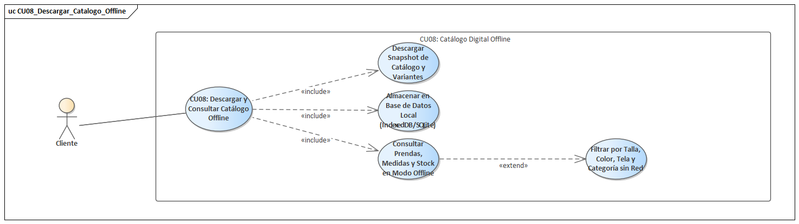

```plantuml
@startuml CU08_Descargar_Catalogo_Offline
left to right direction
skinparam usecase {
  BackgroundColor #E8F5E9
  BorderColor #388E3C
}

actor "Cliente" as C

rectangle "CU08: Catálogo Digital Offline" {
  usecase "CU08: Descargar y Consultar\nCatálogo Offline" as CU08
  usecase "Descargar Snapshot de\nCatálogo y Variantes" as UC_Down
  usecase "Almacenar en Base de\nDatos Local (IndexedDB/SQLite)" as UC_Store
  usecase "Consultar Prendas, Medidas\ny Stock en Modo Offline" as UC_Query
  usecase "Filtrar por Talla, Color,\nTela y Categoría sin Red" as UC_Filter
}

C --> CU08
CU08 ..> UC_Down : <<include>>
CU08 ..> UC_Store : <<include>>
CU08 ..> UC_Query : <<include>>
UC_Query ..> UC_Filter : <<extend>>
@enduml
```

#### b) Prototipo de Interfaz de Usuario

Vista de catálogo responsiva (PWA en Angular o App Móvil Flutter). Banner superior con selector de sucursal física de referencia y badge de conectividad: "En línea" (verde) o "Modo Offline" (ámbar). Botón "Actualizar Catálogo para Uso Sin Conexión" que muestra barra de progreso con el número de prendas e imágenes cacheadas localmente. Cuadrícula de productos con fotografías optimizadas en formato WebP, precio minorista, indicador de stock disponible local, desglose de medidas anatómicas en cm y paleta de colores disponibles. Buscador con autocompletado y filtros laterales funcionales 100% offline (precio, temporada, composición textil).

#### c) Tabla Detalle del Caso de Uso

| Atributo | Detalle |
|:---|:---|
| **Identificador** | CU08 |
| **Nombre** | Descargar y Consultar Catálogo Digital Offline (Cliente) |
| **Autor** | Equipo de desarrollo |
| **Fecha** | 2026-10-24 |
| **Actores** | Cliente (PWA / App Móvil Flutter) |
| **Descripción** | Descarga y persistencia local de un snapshot estructurado de prendas, tallas en cm, colores Hex y existencias referenciales para navegación y consulta 100% autónoma sin red. |
| **Precondiciones** | Dispositivo con navegador compatible con Service Workers / IndexedDB o app móvil con SQLite. |
| **Casos de Uso Incluidos (<<include>>)** | - **Descargar Snapshot de Catálogo y Variantes:** Obtiene el payload delta de productos y precios desde el backend.<br>- **Almacenar en Base de Datos Local (IndexedDB/SQLite):** Persiste datos tabulares y recursos visuales en almacenamiento cliente.<br>- **Consultar Prendas, Medidas y Stock en Modo Offline:** Permite explorar el catálogo con latencia cero sin conexión a Internet. |
| **Casos de Uso Extendidos (<<extend>>)** | - **Filtrar por Talla, Color, Tela y Categoría sin Red:** Extensión disparada al activar filtros multidimensionales en modo offline (Punto de Extensión: Filtrado Facetado Offline). |
| **Flujo Normal** | 1. La aplicación detecta conectividad inicial e invoca `<<include>> Descargar Snapshot de Catálogo y Variantes`.<br>2. El sistema invoca `<<include>> Almacenar en Base de Datos Local (IndexedDB/SQLite)`, persistiendo la información estructurada.<br>3. Ante la pérdida de conexión a Internet, la interfaz conmuta a "Modo Offline" de manera transparente.<br>4. El cliente invoca `<<include>> Consultar Prendas, Medidas y Stock en Modo Offline` para explorar prendas y medidas anatómicas.<br>5. [Punto de Extensión: Filtrado Facetado Offline] El cliente interactúa con la barra lateral de filtros, ejecutando `<<extend>> Filtrar por Talla, Color, Tela y Categoría sin Red` directamente sobre los índices de la base de datos local. |
| **Flujo Alternativo** | **2a. Almacenamiento local insuficiente:** El sistema descarga solo fichas técnicas tabulares y omite miniaturas pesadas, informando al usuario. |
| **Postcondiciones** | Catálogo disponible íntegramente en el dispositivo para consulta autónoma sin red. |

---

### CU09: Registrar Reserva Presencial Sin Conexión a Internet (Cliente)

#### a) Diseño del Caso de Uso (PlantUML)

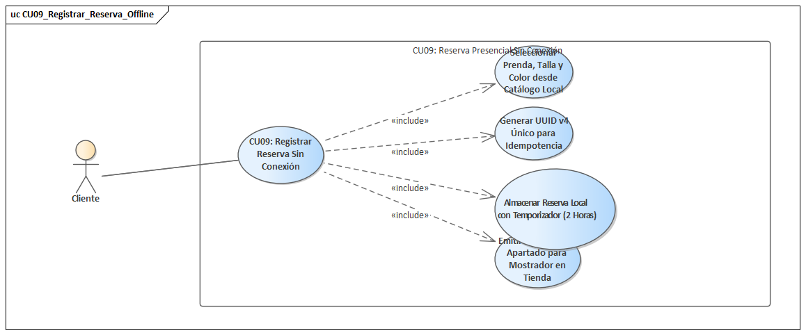

```plantuml
@startuml CU09_Registrar_Reserva_Offline
left to right direction
skinparam usecase {
  BackgroundColor #E8F5E9
  BorderColor #388E3C
}

actor "Cliente" as C

rectangle "CU09: Reserva Presencial Sin Conexión" {
  usecase "CU09: Registrar Reserva\nSin Conexión" as CU09
  usecase "Seleccionar Prenda, Talla\ny Color desde Catálogo Local" as UC_Sel
  usecase "Generar UUID v4 Único\npara Idempotencia" as UC_UUID
  usecase "Almacenar Reserva Local\ncon Temporizador (2 Horas)" as UC_SaveLocal
  usecase "Emitir Ticket QR de Apartado\npara Mostrador en Tienda" as UC_QR
}

C --> CU09
CU09 ..> UC_Sel : <<include>>
CU09 ..> UC_UUID : <<include>>
CU09 ..> UC_SaveLocal : <<include>>
CU09 ..> UC_QR : <<include>>
@enduml
```

#### b) Prototipo de Interfaz de Usuario

Pantalla de ficha de producto con botón destacado "Reservar para Prueba en Tienda (Offline)". Modal de confirmación con selección de sucursal física, resumen de variantes elegidas (talla en cm y color Hex) y cuenta regresiva de validez de reserva (2 horas). Al confirmar sin Internet, la interfaz muestra pantalla de éxito con: Identificador UUID v4 único generado localmente, Código QR de reserva offline escaneable por el personal de tienda y advertencia: "Tu reserva está asegurada en este dispositivo y se confirmará en nube al restablecer la red".

#### c) Tabla Detalle del Caso de Uso

| Atributo | Detalle |
|:---|:---|
| **Identificador** | CU09 |
| **Nombre** | Registrar Reserva Presencial Sin Conexión a Internet (Cliente) |
| **Autor** | Equipo de desarrollo |
| **Fecha** | 2026-10-24 |
| **Actores** | Cliente |
| **Descripción** | Permite apartar temporalmente prendas en una sucursal física cuando el cliente no tiene conexión a Internet, encolando la reserva con UUID v4 único y emitiendo un ticket QR para mostrador. |
| **Precondiciones** | Catálogo offline previamente descargado en el dispositivo (CU08). |
| **Casos de Uso Incluidos (<<include>>)** | - **Seleccionar Prenda, Talla y Color desde Catálogo Local:** Elección de variante desde la base de datos local.<br>- **Generar UUID v4 Único para Idempotencia:** Crea identificador universal para prevenir duplicación en la sincronización.<br>- **Almacenar Reserva Local con Temporizador (2 Horas):** Registra el apartado temporal con vigencia estricta de 2 horas.<br>- **Emitir Ticket QR de Apartado para Mostrador en Tienda:** Genera código QR con payload JSON firmado para escaneo en caja. |
| **Casos de Uso Extendidos (<<extend>>)** | Ninguno (Operación atómica autónoma de cliente). |
| **Flujo Normal** | 1. El cliente navega en el catálogo sin conexión e invoca `<<include>> Seleccionar Prenda, Talla y Color desde Catálogo Local`.<br>2. Presiona "Reservar para Prueba en Tienda (Offline)".<br>3. El sistema invoca `<<include>> Generar UUID v4 Único para Idempotencia`.<br>4. El sistema invoca `<<include>> Almacenar Reserva Local con Temporizador (2 Horas)`, guardando la reserva con estado `PENDIENTE_SYNC`.<br>5. Descuenta tentativamente el stock local para evitar doble reserva en el mismo terminal.<br>6. El sistema invoca `<<include>> Emitir Ticket QR de Apartado para Mostrador en Tienda`, desplegando el comprobante visual para el personal de tienda. |
| **Flujo Alternativo** | **1a. Sin stock referencial en base de datos local:** El sistema inhabilita el botón de reserva y advierte la indisponibilidad. |
| **Postcondiciones** | Reserva encolada en base de datos local con UUID v4 y comprobante QR listo para presentar en mostrador. |

---

### CU10: Registrar Venta POS de Contado Sin Conexión a Internet (Cajero / Cliente)

#### a) Diseño del Caso de Uso (PlantUML)

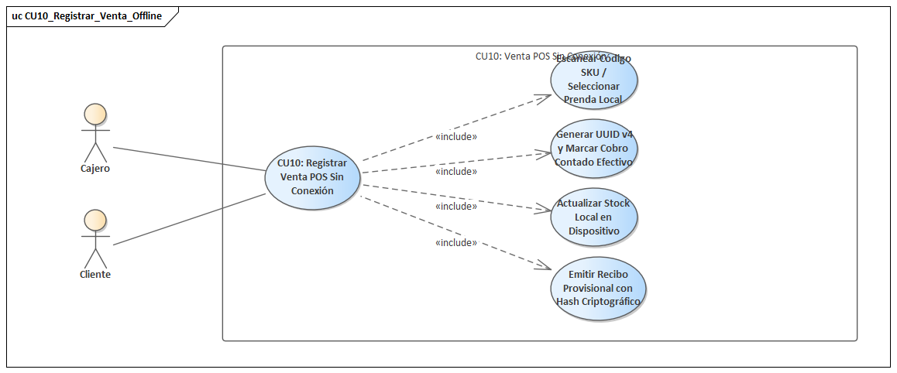

```plantuml
@startuml CU10_Registrar_Venta_Offline
left to right direction
skinparam usecase {
  BackgroundColor #E8F5E9
  BorderColor #388E3C
}

actor "Cajero" as Caj
actor "Cliente" as Cl

rectangle "CU10: Venta POS Sin Conexión" {
  usecase "CU10: Registrar Venta POS\nSin Conexión" as CU10
  usecase "Escanear Código SKU /\nSeleccionar Prenda Local" as UC_Scan
  usecase "Generar UUID v4 y Marcar\nCobro Contado Efectivo" as UC_UUID
  usecase "Actualizar Stock Local\nen Dispositivo" as UC_StockLoc
  usecase "Emitir Recibo Provisional\ncon Hash Criptográfico" as UC_Recibo
}

Caj --> CU10
Cl --> CU10
CU10 ..> UC_Scan : <<include>>
CU10 ..> UC_UUID : <<include>>
CU10 ..> UC_StockLoc : <<include>>
CU10 ..> UC_Recibo : <<include>>
@enduml
```

#### b) Prototipo de Interfaz de Usuario

Terminal Punto de Venta (POS) optimizado para cajero. Encabezado con estado de conexión: indicador rojo parpadeante "SIN INTERNET — Operando en Modo Autónomo POS Local". Campo de entrada rápida para escáner de código de barras SKU o selección táctil desde cuadrícula local. Tabla de venta: SKU, prenda, talla, color, cantidad, precio unitario, descuento de liquidación o tarifa por mayor aplicada automáticamente, y subtotal. Panel de cobro: Selector forzado a "Contado Efectivo" (inhabilitando pasarelas en línea). Botón de gran tamaño "Cobrar e Imprimir Comprobante Local" que genera recibo térmico con código QR y leyenda: "Comprobante Provisional Offline — UUID: 8a7c...".

#### c) Tabla Detalle del Caso de Uso

| Atributo | Detalle |
|:---|:---|
| **Identificador** | CU10 |
| **Nombre** | Registrar Venta POS de Contado Sin Conexión a Internet (Cajero / Cliente) |
| **Autor** | Equipo de desarrollo |
| **Fecha** | 2026-10-24 |
| **Actores** | Cajero, Cliente |
| **Descripción** | Registro y cobro de venta presencial en caja física exclusivamente al contado en efectivo ante corte de energía o caída de Internet, con UUID v4 inmutable, descuento de stock local y emisión de recibo provisional. |
| **Precondiciones** | Cajero autenticado con turno de caja abierto; terminal POS con catálogo local sincronizado. |
| **Casos de Uso Incluidos (<<include>>)** | - **Escanear Código SKU / Seleccionar Prenda Local:** Captura óptica o manual de prendas desde la base de datos local.<br>- **Generar UUID v4 y Marcar Cobro Contado Efectivo:** Fija cobro exclusivo en efectivo e identifica la transacción de forma unívoca.<br>- **Actualizar Stock Local en Dispositivo:** Descuenta inmediatamente las unidades vendidas de la base de datos local.<br>- **Emitir Recibo Provisional con Hash Criptográfico:** Imprime recibo térmico provisional con código QR y UUID v4. |
| **Casos de Uso Extendidos (<<extend>>)** | Ninguno (Operación comercial POS atómica de contingencia). |
| **Flujo Normal** | 1. El cajero ingresa al POS sin conexión e invoca `<<include>> Escanear Código SKU / Seleccionar Prenda Local`.<br>2. El sistema aplica reglas comerciales locales (descuento mayorista si $\ge 3$ unidades o descuento de liquidación).<br>3. El cajero selecciona pago en efectivo e invoca `<<include>> Generar UUID v4 y Marcar Cobro Contado Efectivo`.<br>4. Ingresa el monto recibido en bolivianos; el sistema calcula y muestra el cambio.<br>5. El sistema invoca `<<include>> Actualizar Stock Local en Dispositivo`, rebajando el stock físico del terminal.<br>6. El sistema invoca `<<include>> Emitir Recibo Provisional con Hash Criptográfico`, entregando al cliente el ticket con leyenda "Comprobante Provisional Offline". |
| **Flujo Alternativo** | **1a. Stock local insuficiente:** El sistema bloquea la adición del ítem e informa que no hay unidades en piso de venta.<br>**3a. Intento de cobro con tarjeta o pasarela:** El sistema inhabilita pasarelas electrónicas indicando que en modo offline solo se admite contado efectivo. |
| **Postcondiciones** | Venta guardada localmente con estado `PENDIENTE_SYNC`, stock local descontado y dinero resguardado en caja física. |

---

### CU11: Consultar y Auditar Operaciones Locales Pendientes (Cajero / Cliente / Encargado)

#### a) Diseño del Caso de Uso (PlantUML)

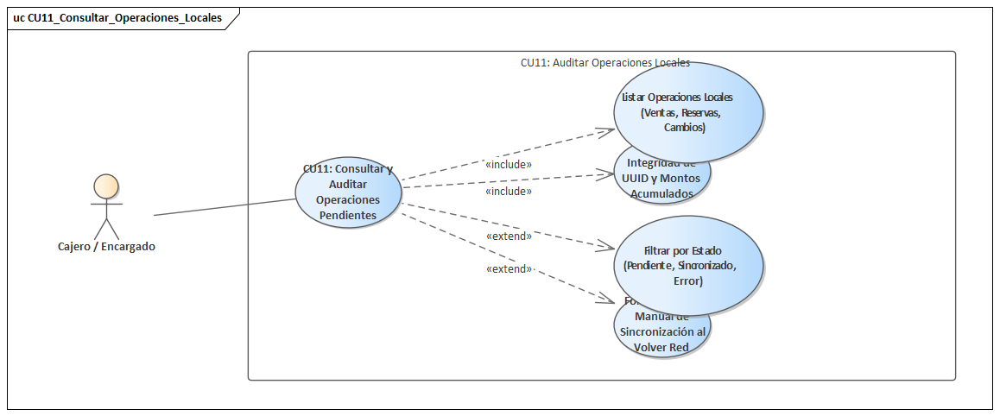

```plantuml
@startuml CU11_Consultar_Operaciones_Locales
left to right direction
skinparam usecase {
  BackgroundColor #E8F5E9
  BorderColor #388E3C
}

actor "Cajero / Encargado" as Staff

rectangle "CU11: Auditar Operaciones Locales" {
  usecase "CU11: Consultar y Auditar\nOperaciones Pendientes" as CU11
  usecase "Listar Operaciones Locales\n(Ventas, Reservas, Cambios)" as UC_List
  usecase "Verificar Integridad de UUID\ny Montos Acumulados" as UC_Audit
  usecase "Filtrar por Estado (Pendiente,\nSincronizado, Error)" as UC_Filter
  usecase "Forzar Disparo Manual de\nSincronización al Volver Red" as UC_SyncMan
}

Staff --> CU11
CU11 ..> UC_List : <<include>>
CU11 ..> UC_Audit : <<include>>
CU11 ..> UC_Filter : <<extend>>
CU11 ..> UC_SyncMan : <<extend>>
@enduml
```

#### b) Prototipo de Interfaz de Usuario

Bandeja de auditoría y monitoreo offline accesible desde el menú del POS o perfil de usuario. Tarjetas superiores de resumen: "Total Pendientes de Subida" (número de transacciones y monto total en Bs), "Última Sincronización Exitosa" (timestamp) y "Estado del Enlace" (ping activo a la nube). Tabla cronológica: Tipo de Transacción (Venta Contado, Reserva Presencial, Nota de Devolución), UUID v4 (acortado con botón de copiado), Fecha/Hora local, Monto Total, Estado (`PENDIENTE_SYNC`, `EN_PROCESO`, `SINCRONIZADO`, `CONFLICTO_STOCK`). Al hacer clic en una fila, se despliega el visor JSON con el payload exacto y firma hash. Botón flotante "Auditar y Sincronizar Ahora" habilitado cuando se detecta red.

#### c) Tabla Detalle del Caso de Uso

| Atributo | Detalle |
|:---|:---|
| **Identificador** | CU11 |
| **Nombre** | Consultar y Auditar Operaciones Locales Pendientes (Cajero / Cliente / Encargado) |
| **Autor** | Equipo de desarrollo |
| **Fecha** | 2026-10-24 |
| **Actores** | Cajero, Cliente, Encargado de Sucursal |
| **Descripción** | Permite auditar, verificar y cuadrar las transacciones generadas sin conexión antes de su sincronización, confrontando el dinero físico en gaveta contra los UUIDs y totales registrados. |
| **Precondiciones** | Usuario autenticado en el dispositivo local con operaciones registradas en el periodo. |
| **Casos de Uso Incluidos (<<include>>)** | - **Listar Operaciones Locales (Ventas, Reservas, Cambios):** Carga todas las transacciones de IndexedDB / SQLite.<br>- **Verificar Integridad de UUID y Montos Acumulados:** Realiza el arqueo local de dinero frente a las operaciones pendientes. |
| **Casos de Uso Extendidos (<<extend>>)** | - **Filtrar por Estado (Pendiente, Sincronizado, Error):** Extensión disparada para segmentar operaciones según su estado (Punto de Extensión: Filtrado de Auditoría).<br>- **Forzar Disparo Manual de Sincronización al Volver Red:** Extensión disparada al pulsar 'Sincronizar Ahora' tras recuperar red (Punto de Extensión: Disparo Manual de Sincronización). |
| **Flujo Normal** | 1. El usuario accede a "Operaciones Locales y Auditoría".<br>2. El sistema invoca `<<include>> Listar Operaciones Locales (Ventas, Reservas, Cambios)`.<br>3. El encargado o cajero ejecuta `<<include>> Verificar Integridad de UUID y Montos Acumulados`, cuadrando el efectivo de la gaveta contra el total de ventas locales.<br>4. Revisa los UUIDs y timestamps de cada transacción.<br>5. Al detectar red, el usuario puede aguardar el envío en segundo plano o forzar la subida. |
| **Flujo Alternativo** | **2a. [Punto de Extensión: Filtrado de Auditoría]** El usuario ejecuta `<<extend>> Filtrar por Estado (Pendiente, Sincronizado, Error)` para auditar solo discrepancias.<br>**5a. [Punto de Extensión: Disparo Manual de Sincronización]** El usuario presiona "Sincronizar Ahora", ejecutando `<<extend>> Forzar Disparo Manual de Sincronización al Volver Red`. |
| **Postcondiciones** | Arqueo local verificado y conciliado frente a los registros del dispositivo. |

---

### CU12: Sincronizar Operaciones Pendientes (Sistema de Sincronización)

#### a) Diseño del Caso de Uso (PlantUML)

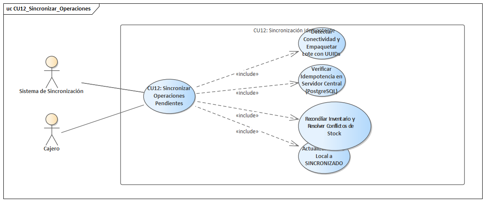

```plantuml
@startuml CU12_Sincronizar_Operaciones
left to right direction
skinparam usecase {
  BackgroundColor #E8F5E9
  BorderColor #388E3C
}

actor "Sistema de\nSincronización" as SistSync
actor "Cajero" as Caj

rectangle "CU12: Sincronización Idempotente" {
  usecase "CU12: Sincronizar\nOperaciones Pendientes" as CU12
  usecase "Detectar Conectividad y\nEmpaquetar Lote con UUIDs" as UC_Batch
  usecase "Verificar Idempotencia en\nServidor Central (PostgreSQL)" as UC_Idemp
  usecase "Reconciliar Inventario y\nResolver Conflictos de Stock" as UC_Recon
  usecase "Actualizar Estado Local a\nSINCRONIZADO" as UC_Ack
}

SistSync --> CU12
Caj --> CU12
CU12 ..> UC_Batch : <<include>>
CU12 ..> UC_Idemp : <<include>>
CU12 ..> UC_Recon : <<include>>
CU12 ..> UC_Ack : <<include>>
@enduml
```

#### b) Prototipo de Interfaz de Usuario

Modal interactivo o notificación toast en segundo plano. Al restablecerse el enlace a Internet, se despliega barra de sincronización: "Sincronizando operaciones locales con la nube... 3 de 12 completadas". Tabla de resultados de sincronización: ID de Operación, UUID, Tipo, Resultado ("Confirmado en Servidor", "Omitido por Duplicado - Idempotente", "Ajuste de Stock Reconciliado"). En caso de discrepancia, botón "Ver Detalle de Reconciliación" que muestra los saldos actualizados en el Kardex central.

#### c) Tabla Detalle del Caso de Uso

| Atributo | Detalle |
|:---|:---|
| **Identificador** | CU12 |
| **Nombre** | Sincronizar Operaciones Pendientes (Sistema de Sincronización) |
| **Autor** | Equipo de desarrollo |
| **Fecha** | 2026-10-24 |
| **Actores** | Sistema de Sincronización (Worker en segundo plano), Cajero |
| **Descripción** | Orquesta la subida segura, atómica e idempotente de operaciones offline hacia el servidor central PostgreSQL, resolviendo la concurrencia de compras según la política 'First-to-Pay Wins' y aplicando reembolso inmediato si se agotó el stock. |
| **Precondiciones** | Operaciones pendientes con estado `PENDIENTE_SYNC`; conectividad a Internet restaurada. |
| **Casos de Uso Incluidos (<<include>>)** | - **Detectar Conectividad y Empaquetar Lote con UUIDs:** Agrupa operaciones en lotes cronológicos.<br>- **Verificar Idempotencia en Servidor Central (PostgreSQL):** Consulta la tabla central de claves para evitar doble inserción.<br>- **Reconciliar Inventario y Resolver Conflictos de Stock:** Evalúa stock central disponible bajo la política 'Primero en Pagar'.<br>- **Actualizar Estado Local a SINCRONIZADO:** Actualiza los registros locales y limpia la cola de envíos. |
| **Casos de Uso Extendidos (<<extend>>)** | Ninguno (Proceso orquestador batch). |
| **Flujo Normal** | 1. El worker de red detecta el evento `online` o el usuario dispara la sincronización manual.<br>2. El cliente invoca `<<include>> Detectar Conectividad y Empaquetar Lote con UUIDs`.<br>3. Envía una petición `POST /api/v1/sync/batch` al backend FastAPI con cabecera `X-Idempotency-Key` y JWT.<br>4. El servidor ejecuta `<<include>> Verificar Idempotencia en Servidor Central (PostgreSQL)`; si el UUID es nuevo, inicia transacción ACID.<br>5. El servidor ejecuta `<<include>> Reconciliar Inventario y Resolver Conflictos de Stock`. Verifica en tiempo real si el cliente fue el primero en pagar o si el inventario central aún dispone de existencias para cada ítem del carrito offline.<br>6. Al haber stock suficiente: Descuenta el inventario central en `inventario_sucursal`, genera el asiento contable en el Kardex recalculando el CPP y marca la orden como confirmada.<br>7. El servidor responde HTTP 200 con el listado de UUIDs ratificados.<br>8. El cliente invoca `<<include>> Actualizar Estado Local a SINCRONIZADO`, actualizando el catálogo y liberando la cola. |
| **Flujo Alternativo** | **4a. Reintento por caída de red con UUID ya procesado (Idempotencia pura):** El servidor detecta la clave procesada previamente, descarta la duplicación, retorna la respuesta original almacenada y el cliente marca el registro como `SINCRONIZADO`.<br>**5a. Conflicto por Rotura de Stock / Venta Concurrente en Línea (El cliente offline no fue el primero en pagar o el producto se agotó en la nube):**<br>&nbsp;&nbsp;&nbsp;&nbsp;1. El servidor detecta que las existencias centrales llegaron a 0 porque otro comprador en línea concretó el pago primero mientras este terminal estaba sin red.<br>&nbsp;&nbsp;&nbsp;&nbsp;2. Siguiendo la regla estricta de la cátedra (*"Solamente el primero que pagó actualiza; al que quedó sin producto se le devuelve el dinero de inmediato para que no pierda nada"*):<br>&nbsp;&nbsp;&nbsp;&nbsp;3. El sistema **anula la transacción offline conflictiva** sin aplicar deducciones de stock central.<br>&nbsp;&nbsp;&nbsp;&nbsp;4. Dispara automáticamente el **protocolo de Reembolso Inmediato / Reversión del Cobro en Efectivo o Pasarela**.<br>&nbsp;&nbsp;&nbsp;&nbsp;5. Envía una notificación prioritaria al cliente: *"El producto seleccionado fue adquirido previamente por otro usuario. Su pago ha sido cancelado/reembolsado íntegramente de inmediato para que no sufra ninguna pérdida."*<br>&nbsp;&nbsp;&nbsp;&nbsp;6. El estado local de la transacción se actualiza a `REEMBOLSADO_STOCK_AGOTADO`. |
| **Postcondiciones** | Base de datos central y local sincronizadas, Kardex consistente y cero riesgo de sobreventa concurrente. |

---

### CU13: Gestionar Cambio de Prenda en Dos Tiempos (Devolución y Reposición)

#### a) Diseño del Caso de Uso (PlantUML)

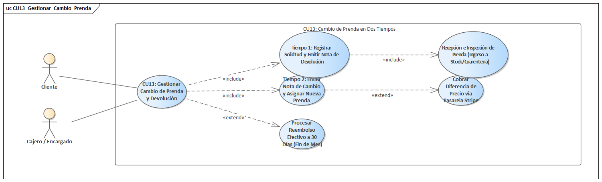

```plantuml
@startuml CU13_Gestionar_Cambio_Prenda
left to right direction
skinparam usecase {
  BackgroundColor #E8F5E9
  BorderColor #388E3C
}

actor "Cliente" as Cl
actor "Cajero" as Cajero
actor "Encargado de Sucursal" as Encargado
actor "Pasarela de Pago (Stripe)" as Stripe

rectangle "CU13: Postventa en Dos Tiempos (Devolución y Reposición)" {
  usecase "CU13: Gestionar Cambio de Prenda\ny Devolución en Dos Tiempos" as CU13
  usecase "Tiempo 1: Registrar Solicitud\ny Emitir Nota de Devolución" as UC_NotaDev
  usecase "Inspección de Prendas y Verificación\nde Plazo de Garantía (3 a 7 días)" as UC_Insp
  usecase "Tiempo 2: Emitir Nota de Reposición\ny Asignar Nuevas Prendas" as UC_NotaRep
  usecase "Cobrar Diferencial de Precio\nvía Pasarela Stripe Sandbox" as UC_Stripe
  usecase "Procesar Reembolso Contable\na 30 Días (Fin de Mes)" as UC_Reembolso
  usecase "Enviar Notificación Push con Fecha\nde Envío y Encuesta de Satisfacción" as UC_Push
}

Cl --> CU13
Cajero --> CU13
Encargado --> CU13

CU13 ..> UC_NotaDev : <<include>>
UC_NotaDev ..> UC_Insp : <<include>>
CU13 ..> UC_NotaRep : <<include>>
UC_NotaRep ..> UC_Stripe : <<extend>>
CU13 ..> UC_Reembolso : <<extend>>
CU13 ..> UC_Push : <<include>>

UC_Stripe --> Stripe
@enduml
```

#### b) Prototipo de Interfaz de Usuario

Módulo integral de postventa estructurado en dos tiempos operacionales independientes:
- **Pantalla Inicial de Búsqueda:** Búsqueda y carga de la compra original mediante código SKU, ticket fiscal o UUID de venta. Despliega el listado completo de prendas adquiridas con casillas de verificación para soportar **devolución de múltiples prendas** en la misma transacción (ej. devolver 4 de 6 prendas compradas).
- **Tiempo 1 — Panel de Emisión de Nota de Devolución:** 
  - Verificador de plazo comercial (3 a 7 días hábiles) con alerta automática ante garantía expirada.
  - Formulario de inspección física ítem por ítem: motivo de cambio (talla incorrecta, discrepancia dimensional en cm, preferencia estética) y checklist de condiciones (etiquetas intactas, prenda limpia, sin lavado ni uso).
  - Botón **«Emitir Nota de Devolución»**: genera el comprobante fiscal de ingreso a almacén (+1 stock por prenda en la talla correspondiente al CPP histórico) y calcula el saldo a favor acumulado en Bs.
- **Tiempo 2 — Panel de Emisión de Nota de Reposición / Cambio:** 
  - Selector de las nuevas prendas y variantes de reemplazo con verificación de stock disponible en percha.
  - Calculador dinámico del balance financiero:
    - *Saldo Cero:* Prenda sustituta de igual valor (cambio directo sin costo).
    - *Diferencial Positivo:* Prenda sustituta de mayor valor; se activa el formulario tokenizado de **Stripe Sandbox** para liquidar el excedente en línea mediante tarjeta de crédito/débito.
    - *Sin Existencias o Desistimiento:* Interruptor para emitir formalmente la **Orden de Liquidación y Reembolso Contable a 30 Días** (cierre de mes), bloqueando la entrega de dinero informal en mostrador.
  - Botón **«Emitir Nota de Reposición»**: formaliza la salida (-1 stock de cada nueva prenda), despacha automáticamente un **mensaje push al teléfono móvil del cliente** informando la fecha garantizada de envío de su reposición (ej. *«Su prenda será enviada el viernes 30 de octubre»*) y despliega la encuesta de conformidad (calificación de 1 a 5 estrellas).

#### c) Tabla Detalle del Caso de Uso

| Atributo | Detalle |
|:---|:---|
| **Identificador** | CU13 |
| **Nombre** | Gestionar Cambio de Prenda en Dos Tiempos (Devolución y Reposición) |
| **Autor** | Equipo de desarrollo |
| **Fecha** | 2026-10-24 |
| **Actores** | Cliente, Cajero, Encargado de Sucursal, Pasarela Stripe Sandbox |
| **Descripción** | Gestiona el circuito completo de postventa en dos tiempos y dos documentos contables obligatorios: emisión inicial de la Nota de Devolución tras verificación física (reingreso a bodega al CPP histórico) y posterior emisión de la Nota de Reposición / Cambio al entregar la nueva indumentaria, con soporte multi-prenda, cobro por Stripe, notificación push y política de reembolso a 30 días. |
| **Precondiciones** | Venta original registrada en el sistema; comprobante presentado dentro del plazo de garantía (3 a 7 días hábiles); prendas en estado impecable de fábrica con etiquetas. |
| **Casos de Uso Incluidos (<<include>>)** | - **Tiempo 1: Registrar Solicitud y Emitir Nota de Devolución:** Registra el reingreso al inventario y genera el saldo a favor acreditado.<br>- **Inspección de Prendas y Verificación de Plazo de Garantía (3 a 7 días):** Fiscaliza el estado físico de cada prenda y valida la vigencia temporal.<br>- **Tiempo 2: Emitir Nota de Reposición y Asignar Nuevas Prendas:** Asigna la indumentaria de reemplazo y descuenta existencias en bodega.<br>- **Enviar Notificación Push con Fecha de Envío y Encuesta de Satisfacción:** Despacha la alerta al móvil con la fecha comprometida de reposición y calificación de 1 a 5 estrellas. |
| **Casos de Uso Extendidos (<<extend>>)** | - **Cobrar Diferencial de Precio vía Pasarela Stripe Sandbox:** Extensión disparada si la nueva prenda posee mayor valor monetario que la devuelta.<br>- **Procesar Reembolso Contable a 30 Días (Fin de Mes):** Extensión disparada si no existe stock disponible de la talla deseada o si el cliente desiste del cambio. |
| **Flujo Normal** | 1. El cliente acude al mostrador o solicita desde la app el cambio de una o varias prendas adquiridas en una misma compra.<br>2. El encargado o cajero busca la orden original e invoca `<<include>> Tiempo 1: Registrar Solicitud y Emitir Nota de Devolución`.<br>3. Se ejecuta `<<include>> Inspección de Prendas y Verificación de Plazo de Garantía`, confirmando que la solicitud está dentro de los 3 a 7 días hábiles y que las etiquetas permanecen intactas.<br>4. El sistema emite la **Nota de Devolución**, reingresa cada prenda al inventario físico (+1 stock en la talla correspondiente al CPP histórico) y acredita el saldo a favor en Bs.<br>5. El cliente selecciona las nuevas prendas de reemplazo mediante `<<include>> Tiempo 2: Emitir Nota de Reposición y Asignar Nuevas Prendas`.<br>6. El sistema compara el saldo a favor frente al valor de la nueva mercadería.<br>7. [Punto de Extensión: Cobro Diferencial] Si la nueva prenda tiene mayor valor, se invoca `<<extend>> Cobrar Diferencial de Precio vía Pasarela Stripe Sandbox` para liquidar el excedente.<br>8. El sistema emite formalmente la **Nota de Reposición / Cambio**, descuenta el stock de las nuevas prendas (-1 unidad) y concreta la entrega.<br>9. El sistema ejecuta `<<include>> Enviar Notificación Push con Fecha de Envío y Encuesta de Satisfacción`, notificando al móvil del cliente la fecha garantizada de envío de su reposición y habilitando la calificación de satisfacción (1 a 5 estrellas). |
| **Flujos Alternativos** | **3a. Solicitud fuera del plazo de garantía:** Si han transcurrido más de 7 días hábiles desde la venta, el sistema rechaza automáticamente el cambio y envía una notificación push al cliente explicando la expiración de la política comercial.<br>**3b. Prenda usada, sin etiquetas o lavada:** El encargado rechaza la prenda por incumplimiento de condiciones sanitarias y de fábrica; se aborta la emisión de la Nota de Devolución.<br>**5a. Devolución de múltiples prendas de la misma compra:** El usuario marca 2 o más prendas de la orden original; el sistema acumula el saldo a favor y permite seleccionar un número equivalente o diferente de prendas de reposición.<br>**7a. [Punto de Extensión: Reembolso Contable a 30 Días]** Si la talla requerida (ej. Talla L) no existe en bodega ni en sucursales cercanas, o si el cliente no acepta pagar el diferencial, el cajero **no entrega efectivo en ventanilla**; se ejecuta `<<extend>> Procesar Reembolso Contable a 30 Días (Fin de Mes)`, emitiendo una orden de liquidación financiera formal programada para el cierre mensual. |
| **Postcondiciones** | Nota de Devolución y Nota de Reposición registradas con numeración correlativa independiente; stock físico y Kardex valorado recalculados en ambos tiempos; notificación push despachada al cliente. |

---

### CU14: Gestionar Traspaso Inter-Sucursal de Inventario

#### a) Diseño del Caso de Uso (PlantUML)

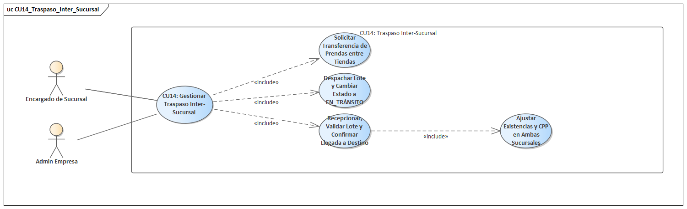

```plantuml
@startuml CU14_Traspaso_Inter_Sucursal
left to right direction
skinparam usecase {
  BackgroundColor #E8F5E9
  BorderColor #388E3C
}

actor "Encargado de Sucursal" as Enc
actor "Admin Empresa" as Admin

rectangle "CU14: Traspaso Inter-Sucursal" {
  usecase "CU14: Gestionar Traspaso\nInter-Sucursal" as CU14
  usecase "Solicitar Transferencia de\nPrendas entre Tiendas" as UC_Req
  usecase "Despachar Lote y Cambiar\nEstado a EN_TRÁNSITO" as UC_Ship
  usecase "Recepcionar, Validar Lote y\nConfirmar Llegada a Destino" as UC_Recv
  usecase "Ajustar Existencias y CPP\nen Ambas Sucursales" as UC_Kardex
}

Enc --> CU14
Admin --> CU14
CU14 ..> UC_Req : <<include>>
CU14 ..> UC_Ship : <<include>>
CU14 ..> UC_Recv : <<include>>
UC_Recv ..> UC_Kardex : <<include>>
@enduml
```

#### b) Prototipo de Interfaz de Usuario

Panel de logística y transferencias inter-sucursal. Pestaña "Nueva Solicitud de Traspaso": selector de Sucursal Origen (con visualización de stock disponible en tiempo real) y Sucursal Destino solicitante. Selector de prendas y variantes (talla/color) con cantidades requeridas y justificación operativa (reposición por alta demanda o solicitud especial de cliente). Pestaña "Envíos en Tránsito": tabla de envíos con código de remisión, guía de transporte, fecha de salida y estado (`SOLICITADO`, `EN_TRÁNSITO`, `RECIBIDO_CONFORME`, `DISCREPANCIA`). Botón "Confirmar Recepción de Mercadería" en la sucursal receptora con verificación ítem por ítem.

#### c) Tabla Detalle del Caso de Uso

| Atributo | Detalle |
|:---|:---|
| **Identificador** | CU14 |
| **Nombre** | Gestionar Traspaso Inter-Sucursal de Inventario |
| **Autor** | Equipo de desarrollo |
| **Fecha** | 2026-10-24 |
| **Actores** | Encargado de Sucursal Solicitante, Encargado de Sucursal Emisora, Administrador de Empresa |
| **Descripción** | Controla el flujo logístico de transferencia de existencias entre tiendas del mismo tenant, garantizando trazabilidad en tránsito y recálculo de CPP en destino. |
| **Precondiciones** | Sucursales pertenecientes a la misma empresa; stock disponible en la sucursal de origen. |
| **Casos de Uso Incluidos (<<include>>)** | - **Solicitar Transferencia de Prendas entre Tiendas:** Genera la solicitud formal de abastecimiento.<br>- **Despachar Lote y Cambiar Estado a EN_TRÁNSITO:** Prepara el bulto y descuenta existencias disponibles en origen.<br>- **Recepcionar, Validar Lote y Confirmar Llegada a Destino:** Verifica los ítems recibidos físicamente.<br>- **Ajustar Existencias y CPP en Ambas Sucursales:** Asienta la baja definitiva en origen y alta en destino recalibrando el CPP local. |
| **Casos de Uso Extendidos (<<extend>>)** | Ninguno (Flujo logístico secuencial estricto). |
| **Flujo Normal** | 1. El encargado de la tienda destino invoca `<<include>> Solicitar Transferencia de Prendas entre Tiendas` indicando variantes y cantidades requeridas.<br>2. El encargado de la tienda origen aprueba el requerimiento e invoca `<<include>> Despachar Lote y Cambiar Estado a EN_TRÁNSITO`.<br>3. El sistema actualiza el lote a `EN_TRÁNSITO`, descontando el stock disponible de origen.<br>4. El transporte entrega el bulto en la tienda receptora.<br>5. El encargado receptor invoca `<<include>> Recepcionar, Validar Lote y Confirmar Llegada a Destino`, escaneando los SKUs.<br>6. El sistema ejecuta obligatoriamente `<<include>> Ajustar Existencias y CPP en Ambas Sucursales`, concretando el alta en destino y recalculando el CPP local.<br>7. Asienta los movimientos en los libros Kardex de ambas sucursales. |
| **Flujo Alternativo** | **5a. Recepción con faltantes o piezas dañadas:** El encargado registra recepción parcial con novedad; las unidades faltantes se asientan como merma en tránsito bajo investigación. |
| **Postcondiciones** | Inventarios actualizados en ambas sucursales y trazabilidad completa del movimiento inter-tiendas. |

---

### CU15: Solicitar Reporte Generativo con IA (Lenguaje Natural / Voz)

#### a) Diseño del Caso de Uso (PlantUML)

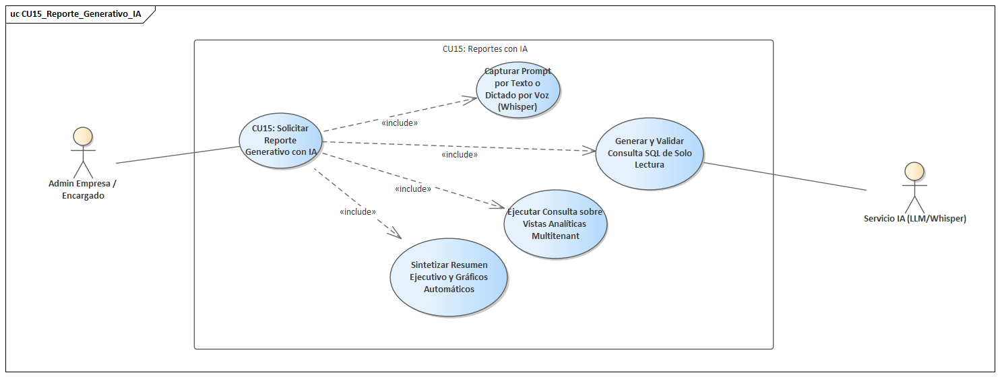

```plantuml
@startuml CU15_Reporte_Generativo_IA
left to right direction
skinparam usecase {
  BackgroundColor #E8F5E9
  BorderColor #388E3C
}

actor "Admin Empresa /\nEncargado" as User
actor "Servicio IA\n(LLM/Whisper)" as IA

rectangle "CU15: Reportes con IA" {
  usecase "CU15: Solicitar Reporte\nGenerativo con IA" as CU15
  usecase "Capturar Prompt por Texto\no Dictado por Voz (Whisper)" as UC_Prompt
  usecase "Generar y Validar Consulta\nSQL de Solo Lectura" as UC_SQL
  usecase "Ejecutar Consulta sobre Vistas\nAnalíticas Multitenant" as UC_Exec
  usecase "Sintetizar Resumen Ejecutivo\ny Gráficos Automáticos" as UC_Summ
}

User --> CU15
CU15 ..> UC_Prompt : <<include>>
CU15 ..> UC_SQL : <<include>>
UC_SQL --> IA : Invocar Modelo
CU15 ..> UC_Exec : <<include>>
CU15 ..> UC_Summ : <<include>>
@enduml
```

#### b) Prototipo de Interfaz de Usuario

Asistente analítico inteligente conversacional. Interfaz moderna con campo de consulta en lenguaje natural: "¿Cuáles fueron las 5 camisas de lino más vendidas en la sucursal Equipetrol durante el último mes y qué porcentaje de margen dejaron?". Botón de micrófono interactivo para entrada por dictado de voz (integración con Web Speech API y Whisper). Área de visualización de respuesta que incluye: 1) Resumen narrativo ejecutivo generado por el LLM en lenguaje claro para toma de decisiones; 2) Tabla de datos tabulados; 3) Gráfico interactivo autogenerado (barras, líneas o dona según la métrica); y 4) Acordeón desplegable de auditoría: "Ver Consulta SQL Ejecutada (Solo Lectura)" con validación estricta del filtro `tenant_id`.

#### c) Tabla Detalle del Caso de Uso

| Atributo | Detalle |
|:---|:---|
| **Identificador** | CU15 |
| **Nombre** | Solicitar Reporte Generativo con IA (Lenguaje Natural / Voz) |
| **Autor** | Equipo de desarrollo |
| **Fecha** | 2026-10-24 |
| **Actores** | Administrador de Empresa, Encargado de Sucursal, Servicio IA (OpenAI / Gemini) |
| **Descripción** | Permite formular consultas analíticas mediante texto libre o dictado por voz, traduciéndolas a consultas SQL de solo lectura con inyección forzosa de `tenant_id` y generando resúmenes ejecutivos con gráficos. |
| **Precondiciones** | Usuario administrativo autenticado; API Key del servicio de IA configurada. |
| **Casos de Uso Incluidos (<<include>>)** | - **Capturar Prompt por Texto o Dictado por Voz (Whisper):** Transcribe y procesa la entrada del usuario.<br>- **Generar y Validar Consulta SQL de Solo Lectura:** Traduce a SQL y valida AST con filtro `tenant_id`.<br>- **Ejecutar Consulta sobre Vistas Analíticas Multitenant:** Ejecuta sobre la réplica de lectura aislada.<br>- **Sintetizar Resumen Ejecutivo y Gráficos Automáticos:** Genera síntesis narrativa y recomendaciones visuales. |
| **Casos de Uso Extendidos (<<extend>>)** | - **Exportar Reportes a Excel/PDF (CU16):** Extensión disparada al pulsar 'Exportar' desde la vista de resultados (Punto de Extensión: Exportación Documental). |
| **Flujo Normal** | 1. El usuario invoca `<<include>> Capturar Prompt por Texto o Dictado por Voz (Whisper)`, escribiendo o dictando su requerimiento.<br>2. El sistema envía el esquema de vistas analíticas al LLM e invoca `<<include>> Generar y Validar Consulta SQL de Solo Lectura`.<br>3. El backend verifica mediante AST que la consulta sea exclusivamente `SELECT` e inyecta `WHERE tenant_id = :current_tenant`.<br>4. El sistema invoca `<<include>> Ejecutar Consulta sobre Vistas Analíticas Multitenant`.<br>5. El sistema invoca `<<include>> Sintetizar Resumen Ejecutivo y Gráficos Automáticos`, renderizando tabla, gráfico interactivo y narrativa gerencial.<br>6. [Punto de Extensión: Exportación Documental] El usuario pulsa "Exportar", ejecutando `<<extend>> CU16: Exportar Reportes a Excel/PDF`. |
| **Flujo Alternativo** | **3a. Comando peligroso (DROP, DELETE, UPDATE) detectado:** El validador bloquea la ejecución de inmediato y registra alerta de seguridad.<br>**4a. Consulta sin resultados en el periodo:** El LLM informa ausencia de datos para los filtros solicitados. |
| **Postcondiciones** | Reporte interactivo generado y desplegado al usuario sin alterar ningún dato en el sistema. |

---

### CU16: Exportar Reportes Analíticos a Excel/PDF

#### a) Diseño del Caso de Uso (PlantUML)

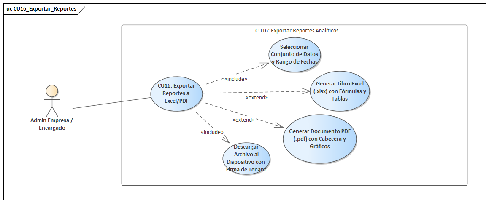

```plantuml
@startuml CU16_Exportar_Reportes
left to right direction
skinparam usecase {
  BackgroundColor #E8F5E9
  BorderColor #388E3C
}

actor "Admin Empresa /\nEncargado" as User

rectangle "CU16: Exportar Reportes Analíticos" {
  usecase "CU16: Exportar Reportes\na Excel/PDF" as CU16
  usecase "Seleccionar Conjunto de Datos\ny Rango de Fechas" as UC_Data
  usecase "Generar Libro Excel (.xlsx)\ncon Fórmulas y Tablas" as UC_Excel
  usecase "Generar Documento PDF (.pdf)\ncon Cabecera y Gráficos" as UC_PDF
  usecase "Descargar Archivo al Dispositivo\ncon Firma de Tenant" as UC_Down
}

User --> CU16
CU16 ..> UC_Data : <<include>>
CU16 ..> UC_Excel : <<extend>>
CU16 ..> UC_PDF : <<extend>>
CU16 ..> UC_Down : <<include>>
@enduml
```

#### b) Prototipo de Interfaz de Usuario

Barra de herramientas de exportación disponible en todas las vistas de reportes y dashboard. Selector con dos botones de acción rápida: "Exportar a Excel (.xlsx)" con ícono verde de hoja de cálculo y "Descargar Informe Ejecutivo PDF (.pdf)" con ícono rojo. Modal de configuración de salida con opciones: Incluir gráficos vectoriales, Añadir desglose por sucursal, Filtrar por temporada. Al hacer clic, se muestra una barra de procesamiento y se dispara la descarga automática del archivo binario con el nombre estandarizado: `Reporte_[Tipo]_[Tenant]_[YYYYMMDD].ext`.

#### c) Tabla Detalle del Caso de Uso

| Atributo | Detalle |
|:---|:---|
| **Identificador** | CU16 |
| **Nombre** | Exportar Reportes Analíticos a Excel/PDF |
| **Autor** | Equipo de desarrollo |
| **Fecha** | 2026-10-24 |
| **Actores** | Administrador de Empresa, Encargado de Sucursal |
| **Descripción** | Convierte datasets analíticos, tablas de Kardex o balances de ventas en documentos formales en formato Excel (.xlsx) con fórmulas o Adobe PDF (.pdf) listos para impresión. |
| **Precondiciones** | Reporte o consulta analítica generada previamente en pantalla. |
| **Casos de Uso Incluidos (<<include>>)** | - **Seleccionar Conjunto de Datos y Rango de Fechas:** Especifica los filtros de exportación.<br>- **Descargar Archivo al Dispositivo con Firma de Tenant:** Transfiere el binario generado al equipo local. |
| **Casos de Uso Extendidos (<<extend>>)** | - **Generar Libro Excel (.xlsx) con Fórmulas y Tablas:** Extensión disparada al seleccionar exportación a Excel (Punto de Extensión: Formato Excel).<br>- **Generar Documento PDF (.pdf) con Cabecera y Gráficos:** Extensión disparada al seleccionar exportación a PDF (Punto de Extensión: Formato PDF). |
| **Flujo Normal** | 1. El usuario invoca `<<include>> Seleccionar Conjunto de Datos y Rango de Fechas`.<br>2. [Punto de Extensión: Formato Excel] Si el usuario elige Excel, se ejecuta `<<extend>> Generar Libro Excel (.xlsx) con Fórmulas y Tablas`, construyendo el archivo con cabeceras fijas y fórmulas contables.<br>3. [Punto de Extensión: Formato PDF] Si el usuario elige PDF, se ejecuta `<<extend>> Generar Documento PDF (.pdf) con Cabecera y Gráficos`, maquetando el documento con logotipo y tablas tabuladas.<br>4. El sistema invoca `<<include>> Descargar Archivo al Dispositivo con Firma de Tenant`, enviando el archivo como stream con nombre `Reporte_[Tipo]_[Tenant]_[YYYYMMDD].ext`. |
| **Flujo Alternativo** | **2a. Volumen superior a 50,000 registros:** El sistema comprime el reporte en un archivo `.zip` y habilita la descarga asíncrona. |
| **Postcondiciones** | Archivo documental descargado en el equipo del usuario con la estructura formal del tenant. |

---

### CU17: Gestionar Dashboard Analítico con Machine Learning

#### a) Diseño del Caso de Uso (PlantUML)

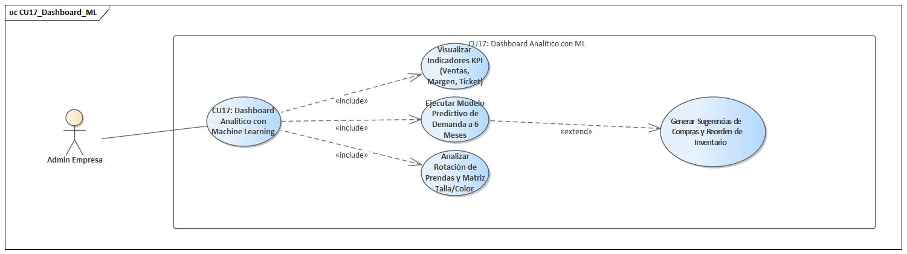

```plantuml
@startuml CU17_Dashboard_ML
left to right direction
skinparam usecase {
  BackgroundColor #E8F5E9
  BorderColor #388E3C
}

actor "Admin Empresa" as Admin

rectangle "CU17: Dashboard Analítico con ML" {
  usecase "CU17: Dashboard Analítico\ncon Machine Learning" as CU17
  usecase "Visualizar Indicadores KPI\n(Ventas, Margen, Ticket)" as UC_KPI
  usecase "Ejecutar Modelo Predictivo\nde Demanda a 6 Meses" as UC_Pred
  usecase "Analizar Rotación de Prendas\ny Matriz Talla/Color" as UC_Rot
  usecase "Generar Sugerencias de Compras\ny Reorden de Inventario" as UC_Reorder
}

Admin --> CU17
CU17 ..> UC_KPI : <<include>>
CU17 ..> UC_Pred : <<include>>
CU17 ..> UC_Rot : <<include>>
UC_Pred ..> UC_Reorder : <<extend>>
@enduml
```

#### b) Prototipo de Interfaz de Usuario

Tablero de control ejecutivo con paneles interactivos. Fila 1: Tarjetas de KPI principales con comparativa intermensual (+18.4% Ventas, -4.2% Devoluciones tras estandarización de tallas cm, 42.8% Margen Bruto). Fila 2: Gráfico de series temporales con proyección a **6 meses** mostrando demanda histórica y banda de predicción algorítmica (Machine Learning) con intervalos de confianza del 95%. Fila 3: Heatmap (mapa de calor) de rotación por talla y color (ej. Talla L / Color Azul Marino con la rotación más alta en la temporada). Panel lateral: "Recomendaciones Algorítmicas de Aprovisionamiento", indicando variantes próximas a agotarse y sugerencia de compra a proveedores.

#### c) Tabla Detalle del Caso de Uso

| Atributo | Detalle |
|:---|:---|
| **Identificador** | CU17 |
| **Nombre** | Gestionar Dashboard Analítico con Machine Learning |
| **Autor** | Equipo de desarrollo |
| **Fecha** | 2026-10-24 |
| **Actores** | Administrador de Empresa |
| **Descripción** | Cuadro de mando ejecutivo con KPIs en tiempo real, mapas de calor de rotación por talla/color y algoritmos de Machine Learning para proyectar demanda de prendas a 6 meses vista. |
| **Precondiciones** | Usuario con rol `ADMIN_EMPRESA`; datos históricos de transacciones del tenant. |
| **Casos de Uso Incluidos (<<include>>)** | - **Visualizar Indicadores KPI (Ventas, Margen, Ticket):** Muestra métricas comerciales clave.<br>- **Ejecutar Modelo Predictivo de Demanda a 6 Meses:** Ejecuta microservicio ML de regresión temporal a 6 meses.<br>- **Analizar Rotación de Prendas y Matriz Talla/Color:** Renderiza mapa de calor de demanda textil. |
| **Casos de Uso Extendidos (<<extend>>)** | - **Generar Sugerencias de Compras y Reorden de Inventario:** Extensión disparada si la proyección a 6 meses anticipa quiebre de stock (Punto de Extensión: Sugerencia de Reorden). |
| **Flujo Normal** | 1. El Administrador accede al "Dashboard Analítico".<br>2. El sistema invoca `<<include>> Visualizar Indicadores KPI (Ventas, Margen, Ticket)`.<br>3. El sistema invoca `<<include>> Ejecutar Modelo Predictivo de Demanda a 6 Meses`, alimentando la serie histórica al modelo de series temporales.<br>4. El sistema invoca `<<include>> Analizar Rotación de Prendas y Matriz Talla/Color`, desplegando el heatmap de rotación.<br>5. [Punto de Extensión: Sugerencia de Reorden] Si el modelo anticipa desabastecimiento, ejecuta `<<extend>> Generar Sugerencias de Compras y Reorden de Inventario`, recomendando lotes y proveedores para reposición oportuna. |
| **Flujo Alternativo** | **3a. Tenant con menos de 30 días de historial:** El sistema conmuta a un modelo heurístico basado en promedios sectoriales e indica que la precisión aumentará con el tiempo. |
| **Postcondiciones** | Visualización interactiva de proyecciones y recomendaciones de compras disponible para planificación estratégica. |

---

### CU18: Gestionar Pasarela de Pagos Stripe Sandbox

#### a) Diseño del Caso de Uso (PlantUML)

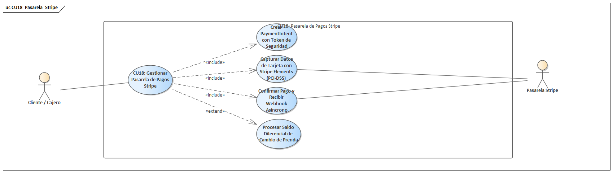

```plantuml
@startuml CU18_Pasarela_Stripe
left to right direction
skinparam usecase {
  BackgroundColor #E8F5E9
  BorderColor #388E3C
}

actor "Cliente / Cajero" as User
actor "Pasarela de Pago\n(Stripe Sandbox)" as Stripe

rectangle "CU18: Pasarela de Pagos Stripe" {
  usecase "CU18: Gestionar Pasarela\nde Pagos Stripe" as CU18
  usecase "Crear PaymentIntent con\nToken de Seguridad" as UC_Intent
  usecase "Capturar Datos de Tarjeta\ncon Stripe Elements (PCI-DSS)" as UC_Card
  usecase "Confirmar Pago y Recibir\nWebhook Asíncrono" as UC_Hook
  usecase "Procesar Saldo Diferencial\nde Cambio de Prenda" as UC_Saldo
}

User --> CU18
CU18 ..> UC_Intent : <<include>>
CU18 ..> UC_Card : <<include>>
UC_Card --> Stripe : Tokenizar Tarjeta
CU18 ..> UC_Hook : <<include>>
Stripe --> UC_Hook : Webhook
CU18 ..> UC_Saldo : <<extend>>
@enduml
```

#### b) Prototipo de Interfaz de Usuario

Componente de checkout seguro embebido mediante Stripe Elements. Pantalla con resumen de la transacción: Moneda, Importe Total (para ventas directas o saldo diferencial de cambio de prenda en CU13). Formulario de tarjeta seguro: Número de tarjeta (con autodetección visual de marca: Visa, Mastercard, American Express), Fecha de caducidad (MM/AA) y CVC/CVV con validación en tiempo real. Botón "Pagar con Tarjeta Segura [Monto Bs/USD]" con indicador de procesamiento seguro cifrado TLS y certificación PCI-DSS Nivel 1. Toast de confirmación inmediata con ID de transacción de Stripe.

#### c) Tabla Detalle del Caso de Uso

| Atributo | Detalle |
|:---|:---|
| **Identificador** | CU18 |
| **Nombre** | Gestionar Pasarela de Pagos Stripe Sandbox |
| **Autor** | Equipo de desarrollo |
| **Fecha** | 2026-10-24 |
| **Actores** | Cliente, Cajero, Pasarela Stripe Sandbox |
| **Descripción** | Procesa cobros electrónicos seguros con tarjetas de crédito/débito para ventas digitales y saldos diferenciales de cambios de prendas (CU13), bajo estándar PCI-DSS vía tokenización. |
| **Precondiciones** | Conectividad a Internet activa; monto de la transacción mayor a cero. |
| **Casos de Uso Incluidos (<<include>>)** | - **Crear PaymentIntent con Token de Seguridad:** Registra la intención de pago en la API de Stripe.<br>- **Capturar Datos de Tarjeta con Stripe Elements (PCI-DSS):** Tokeniza la tarjeta en iframe aislado sin almacenar PAN.<br>- **Confirmar Pago y Recibir Webhook Asíncrono:** Escucha la notificación `payment_intent.succeeded` y asienta el cobro. |
| **Casos de Uso Extendidos (<<extend>>)** | - **Procesar Saldo Diferencial de Cambio de Prenda:** Extensión disparada cuando el cobro liquida una diferencia de precio por cambio de prenda en CU13 (Punto de Extensión: Cobro de Diferencia Postventa). |
| **Flujo Normal** | 1. El cliente o cajero confirma una operación que requiere pago electrónico.<br>2. El sistema invoca `<<include>> Crear PaymentIntent con Token de Seguridad`, recibiendo el `client_secret`.<br>3. El usuario ingresa su tarjeta e invoca `<<include>> Capturar Datos de Tarjeta con Stripe Elements (PCI-DSS)`.<br>4. Stripe tokeniza la tarjeta y contacta al banco emisor.<br>5. Stripe procesa el cargo e invoca `<<include>> Confirmar Pago y Recibir Webhook Asíncrono`.<br>6. [Punto de Extensión: Cobro de Diferencia Postventa] Si la transacción corresponde a un cambio de prenda en CU13, ejecuta `<<extend>> Procesar Saldo Diferencial de Cambio de Prenda`.<br>7. El sistema marca la orden como pagada y emite el recibo formal con ID de transacción de Stripe. |
| **Flujo Alternativo** | **4a. Tarjeta declinada o fondos insuficientes:** Stripe retorna el código de rechazo y el sistema invita al usuario a probar con otro medio de pago. |
| **Postcondiciones** | Pago procesado y conciliado contablemente sin que el sistema almacene números de tarjeta de crédito. |

---

### CU19: Gestionar Ofertas de Liquidación y Precios por Mayor

#### a) Diseño del Caso de Uso (PlantUML)

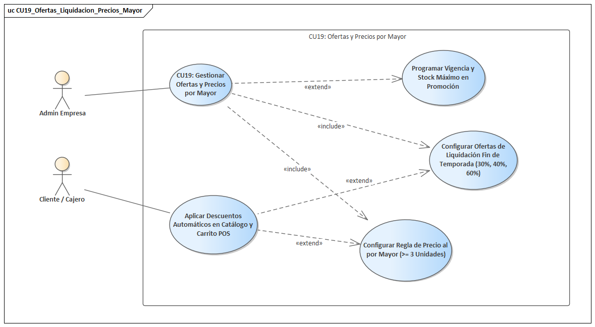

```plantuml
@startuml CU19_Ofertas_Liquidacion_Precios_Mayor
left to right direction
skinparam usecase {
  BackgroundColor #E8F5E9
  BorderColor #388E3C
}

actor "Admin Empresa" as Admin
actor "Cliente / Cajero" as User

rectangle "CU19: Ofertas y Precios por Mayor" {
  usecase "CU19: Gestionar Ofertas\ny Precios por Mayor" as CU19
  usecase "Configurar Ofertas de Liquidación\nFin de Temporada (30%, 40%, 60%)" as UC_Liq
  usecase "Configurar Regla de Precio\nal por Mayor (>= 3 Unidades)" as UC_Mayor
  usecase "Aplicar Descuentos Automáticos\nen Catálogo y Carrito POS" as UC_Auto
  usecase "Programar Vigencia y Stock\nMáximo en Promoción" as UC_Vig
}

Admin --> CU19
User --> UC_Auto
CU19 ..> UC_Liq : <<include>>
CU19 ..> UC_Mayor : <<include>>
CU19 ..> UC_Vig : <<extend>>
UC_Auto ..> UC_Liq : <<extend>>
UC_Auto ..> UC_Mayor : <<extend>>
@enduml
```

#### b) Prototipo de Interfaz de Usuario

Panel de configuración de promociones y reglas de precios. Pestaña **"Ofertas de Liquidación Fin de Temporada"**: selector de prendas de temporadas pasadas (ej. ropa de abrigo de invierno en época primaveral para evitar stock inmovilizado durante un año completo) con selector de descuento comercial: 30%, 40% o 60% de rebaja para recuperación de capital. Visualización de precio original tachado y precio rebajado en color rojo. Pestaña **"Regla de Precios al por Mayor"**: interruptor para activar "Tarifa Mayorista Automática" con umbral configurable a partir de $\ge 3$ unidades (iguales o surtidas en catálogo). Simulación interactiva de cálculo en carrito de compras.

#### c) Tabla Detalle del Caso de Uso

| Atributo | Detalle |
|:---|:---|
| **Identificador** | CU19 |
| **Nombre** | Gestionar Ofertas de Liquidación y Precios por Mayor |
| **Autor** | Equipo de desarrollo |
| **Fecha** | 2026-10-24 |
| **Actores** | Administrador de Empresa, Cliente, Cajero |
| **Descripción** | Parametrización y aplicación automática de dos estrategias comerciales: rebajas de liquidación de fin de temporada (30%, 40% y 60%) para recuperación de capital, y tarifa de precio al por mayor aplicable desde 3 unidades. |
| **Precondiciones** | Usuario con rol `ADMIN_EMPRESA` para parametrización; prendas con stock registrado. |
| **Casos de Uso Incluidos (<<include>>)** | - **Configurar Ofertas de Liquidación Fin de Temporada (30%, 40%, 60%):** Asigna descuentos de remate a prendas de temporadas anteriores.<br>- **Configurar Regla de Precio al por Mayor (>= 3 Unidades):** Activa tarifa especial mayorista desde 3 prendas. |
| **Casos de Uso Extendidos (<<extend>>)** | - **Programar Vigencia y Stock Máximo en Promoción:** Extensión disparada al fijar fecha límite a la campaña de liquidación (Punto de Extensión: Vigencia de Campaña).<br>- **Aplicar Descuentos Automáticos en Catálogo y Carrito POS:** Extensión disparada en el checkout al evaluar las reglas sobre los ítems del carrito. |
| **Flujo Normal** | 1. El Administrador accede a "Ofertas y Precios Especiales".<br>2. El sistema invoca `<<include>> Configurar Ofertas de Liquidación Fin de Temporada (30%, 40%, 60%)`, seleccionando prendas de temporadas salientes (ej. abrigos de invierno en primavera).<br>3. El sistema invoca `<<include>> Configurar Regla de Precio al por Mayor (>= 3 Unidades)`.<br>4. [Punto de Extensión: Vigencia de Campaña] El Administrador ejecuta `<<extend>> Programar Vigencia y Stock Máximo en Promoción`.<br>5. Durante la compra, al agregar prendas al carrito, el motor ejecuta `<<extend>> Aplicar Descuentos Automáticos en Catálogo y Carrito POS`: si la prenda está en liquidación aplica el porcentaje configurado, y si la cantidad $\ge 3$ unidades bonifica la tarifa mayorista.<br>6. El sistema refleja el ahorro obtenido en el total de la orden. |
| **Flujo Alternativo** | **4a. Campaña de liquidación caducada:** El sistema revierte automáticamente los precios al valor minorista regular al expirar la fecha programada. |
| **Postcondiciones** | Precios promocionales y mayoristas reflejados automáticamente en catálogo digital, PWA offline y cajas POS. |

---

### CU20: Gestionar Compras y Aprovisionamiento desde Web Desktop

#### a) Diseño del Caso de Uso (PlantUML)

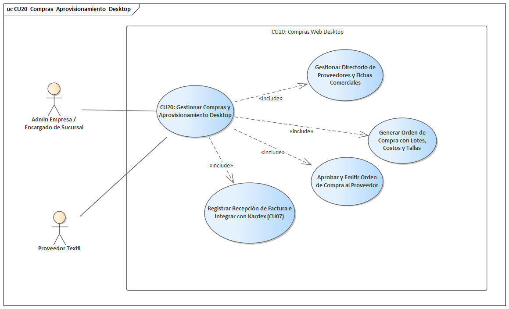

```plantuml
@startuml CU20_Compras_Aprovisionamiento_Desktop
left to right direction
skinparam usecase {
  BackgroundColor #E8F5E9
  BorderColor #388E3C
}

actor "Admin Empresa /\nEncargado de Sucursal" as Comprador
actor "Proveedor Textil" as Prov

rectangle "CU20: Compras Web Desktop" {
  usecase "CU20: Gestionar Compras\ny Aprovisionamiento Desktop" as CU20
  usecase "Gestionar Directorio de\nProveedores y Fichas Comerciales" as UC_Prov
  usecase "Generar Orden de Compra\ncon Lotes, Costos y Tallas" as UC_OC
  usecase "Aprobar y Emitir Orden\nde Compra al Proveedor" as UC_Approve
  usecase "Registrar Recepción de Factura\ne Integrar con Kardex (CU07)" as UC_Kardex
}

Comprador --> CU20
CU20 --> Prov : Notificar Orden
CU20 ..> UC_Prov : <<include>>
CU20 ..> UC_OC : <<include>>
CU20 ..> UC_Approve : <<include>>
CU20 ..> UC_Kardex : <<include>>
@enduml
```

#### b) Prototipo de Interfaz de Usuario

Módulo corporativo de abastecimiento disponible **exclusivamente desde la interfaz Web Desktop / Laptop** para personal empresarial facultado. Formulario de Orden de Compra: Selector de Proveedor Textil (con datos de contacto, NIT y plazos de entrega pactados), Sucursal de Destino para recepción de mercadería y Moneda. Tabla de ítems a granel: Selector de prenda, Variante (Talla cm y Color Hex), Cantidad de unidades solicitadas, Costo Unitario de Compra pactado y Subtotal. Panel de totales con cálculo de IVA y retenciones. Botones de acción: "Guardar Borrador", "Autorizar Orden de Compra" y "Registrar Factura de Ingreso de Lote", el cual dispara la recepción física enlazada con el inventario multi-sucursal y recálculo automático de CPP en CU07.

#### c) Tabla Detalle del Caso de Uso

| Atributo | Detalle |
|:---|:---|
| **Identificador** | CU20 |
| **Nombre** | Gestionar Compras y Aprovisionamiento desde Web Desktop |
| **Autor** | Equipo de desarrollo |
| **Fecha** | 2026-10-24 |
| **Actores** | Administrador de Empresa, Encargado de Sucursal, Proveedor Textil |
| **Descripción** | Canal corporativo operado exclusivamente desde computadoras de escritorio (Web Desktop / Laptop) para emitir órdenes de compra a proveedores textiles, recepcionar lotes con factura fiscal e ingresar stock al Kardex recalculando CPP (CU07). |
| **Precondiciones** | Usuario con rol `ADMIN_EMPRESA` o `ENCARGADO_SUCURSAL` autenticado en navegador de escritorio; catálogo de proveedores registrado. |
| **Casos de Uso Incluidos (<<include>>)** | - **Gestionar Directorio de Proveedores y Fichas Comerciales:** Mantiene catálogo de proveedores textiles y plazos de entrega.<br>- **Generar Orden de Compra con Lotes, Costos y Tallas:** Confecciona orden con desglose de tallas en cm y costos unitarios.<br>- **Aprobar y Emitir Orden de Compra al Proveedor:** Valida límites presupuestarios y notifica formalmente al proveedor.<br>- **Registrar Recepción de Factura e Integrar con Kardex (CU07):** Recepciona mercadería en bodega, ingresa factura e invoca CU07 para recálculo de CPP. |
| **Casos de Uso Extendidos (<<extend>>)** | Ninguno (Flujo corporativo de abastecimiento formal). |
| **Flujo Normal** | 1. El usuario accede desde su PC de escritorio al módulo "Aprovisionamiento y Compras".<br>2. El sistema invoca `<<include>> Gestionar Directorio de Proveedores y Fichas Comerciales`, seleccionando el proveedor textil y la sucursal de destino.<br>3. El usuario invoca `<<include>> Generar Orden de Compra con Lotes, Costos y Tallas`, especificando las variantes por curva de tallas y costos unitarios pactados.<br>4. El usuario invoca `<<include>> Aprobar y Emitir Orden de Compra al Proveedor`, notificando la orden al proveedor.<br>5. Al llegar el lote a bodega, el encargado presiona "Recepción de Lote" e invoca `<<include>> Registrar Recepción de Factura e Integrar con Kardex (CU07)`.<br>6. El sistema ingresa el número de factura fiscal, suma el stock físico en la sucursal y recalcula el CPP inmutable de cada variante en CU07.<br>7. Cierra la orden con estado `RECEPCIONADA_CONFORME`. |
| **Flujo Alternativo** | **1a. Intento de acceso desde dispositivo móvil (PWA/Flutter):** El sistema bloquea el acceso informando: "Por normativas de auditoría empresarial, el módulo de aprovisionamiento a proveedores está restringido a Web Desktop".<br>**5a. Recepción con faltantes o piezas defectuosas:** El encargado registra discrepancia en la factura de compra y ajusta la cantidad ingresada. |
| **Postcondiciones** | Orden de compra liquidada, existencias físicas ingresadas a bodega y Costo Promedio Ponderado recalculado en el Kardex de la sucursal. |

---

# CAPÍTULO III. ANÁLISIS Y DISEÑO CON ICONIX

## 3.1. Modelo de Dominio (Diagrama de Clases del Dominio)

### 3.1.0. Fundamentación Metodológica en ICONIX (Pista Estática del Proceso)

Conforme a la metodología **ICONIX** desarrollada por Doug Rosenberg y Matt Stephens (*Use Case Driven Object Modeling with UML: Theory and Practice*), el desarrollo de software se organiza en dos pistas complementarias: la **pista dinámica** (Casos de Uso $\rightarrow$ Robustez $\rightarrow$ Secuencia) y la **pista estática** (Modelo de Dominio $\rightarrow$ Modelo de Dominio Actualizado $\rightarrow$ Modelo de Clases Detallado):

```
+-----------------------------------------------------------------------------------+
|                         PISTA ESTÁTICA DE ICONIX (STATIC)                         |
|                                                                                   |
|      [ Domain Model ]   ========>   [ Updated Domain Model ]   ========> [ Class Model ]  |
|      (Requisitos)                   (Análisis de Robustez)               (Diseño Detallado)|
|   Cajas conceptuales              Entidades descubiertas con           Clases completas con|
|  sin métodos ni tipos               atributos de negocio              atributos, métodos   |
|   de base de datos.                                                   tipos y visibilidad. |

+-----------------------------------------------------------------------------------+
```

#### Características del Modelo de Dominio Inicial en ICONIX:
1. **Glosario Visual del Dominio del Problema:** Captura el vocabulario del negocio y los objetos del mundo real cuya información o comportamiento debe gobernar el software.
2. **Representación Gráfica Simplificada (Regla de Oro de Rosenberg):** En esta etapa temprana, **NO se incluyen métodos ni operaciones**, y se evitan los atributos técnicos de implementación física (como tipos SQL, hashes o IDs de persistencia). Las clases se modelan como cajas conceptuales limpias con sus relaciones de asociación, composición y generalización.
3. **Semántica Formal:** Cada asociación cuenta con verbos de acción direccionales (`: verbo >`) y cardinalidades formales explícitas en ambos extremos (`1` a `1..*`, `1` a `0..1`, `*` a `1`), erradicando cualquier ambigüedad interpretativa.

Dado que la arquitectura de **FashionStore SaaS** es distribuida, multitenant y con soporte para contingencia *Offline-First*, el dominio del problema se descompone formalmente en dos modelos complementarios:
* **Modelo de Dominio del Sistema Central SaaS (El Grande):** Modela las entidades maestras empresariales, gobernanza multitenant, catalogación textil con fichas anatómicas, inventario multi-sucursal con CPP inmutable, ventas POS, postventa en dos tiempos, compras a proveedores y analítica con IA/ML.
* **Modelo de Dominio de la Aplicación Móvil (El Móvil):** Modela las entidades conceptuales que gobiernan la operación local del vendedor/cajero en tiendas físicas cuando opera sin conexión a internet y sincroniza de forma asíncrona mediante UUID v4.

---

### 3.1.1. Modelo de Dominio — Sistema Central SaaS Multitenant (Enterprise Architect / Metodología ICONIX)

Estructurado formalmente en **7 paquetes conceptuales de negocio** dentro del repositorio Enterprise Architect (`diagramas1erParcial.eapx`), captura de forma exhaustiva las 28 clases del dominio requeridas para resolver los casos de uso (`CU01` al `CU20`) y los desafíos técnicos del Segundo Parcial. En estricta conformidad con las directrices de la cátedra de Sistemas de Información II (Audio 2: líneas 73, 129, 135-137), el modelo no es un simple diagrama de tablas ni un esquema con relaciones indiscriminadas ("todos contra todos"), sino una **versión conceptual y simplificada del diagrama de clases** con sus atributos más representativos, operaciones clave de negocio, relaciones con verbos direccionales y multiplicidades cerradas:

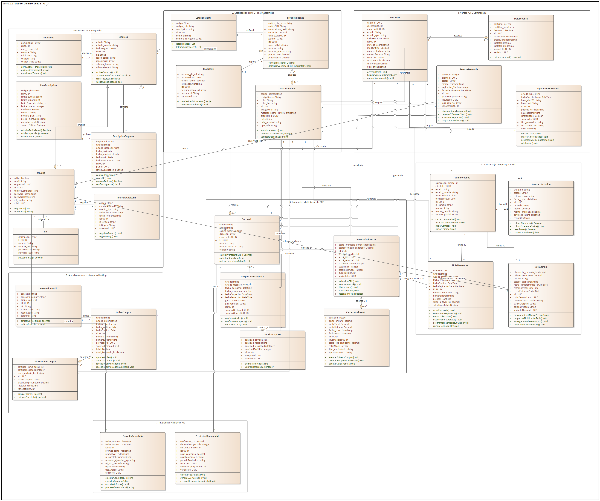

```plantuml
@startuml Modelo_Dominio_Central_P2
title Modelo de Dominio - Sistema Central SaaS Multitenant (ICONIX)
left to right direction
skinparam packageStyle rectangle
skinparam classAttributeIconSize 0
hide circle

skinparam class {
  BackgroundColor #FFFDE7
  BorderColor #F57F17
  FontColor #212121
  FontStyle bold
  FontSize 11
}
skinparam package {
  BackgroundColor #FAFAFA
  BorderColor #757575
  FontColor #37474F
  FontStyle bold
}
skinparam ArrowColor #D84315
skinparam ArrowFontColor #3E2723
skinparam ArrowFontSize 10

package "1. Gobernanza SaaS y Seguridad" {
  class Plataforma {
    + url_base : string
    + version_saas : string
    + monitorearTenants() : void
  }
  class Empresa {
    + nit : string
    + razon_social : string
    + schema_name : string
    + estado : string
    + validarCapacidades() : bool
  }
  class PlanSuscripcion {
    + codigo : string
    + nombre : string
    + max_sucursales : int
    + max_usuarios : int
    + precio_mensual : decimal
  }
  class SuscripcionEmpresa {
    + fecha_inicio : date
    + fecha_vencimiento : date
    + estado : string
    + verificarVigencia() : bool
  }
  class Usuario {
    + email : string
    + password_hash : string
    + rol : string
    + estado_cuenta : string
    + autenticar() : bool
  }
  class Rol {
    + nombre_rol : string
    + descripcion : string
    + permisos_json : string
  }
  class BitacoraAuditoria {
    + evento : string
    + ip_origen : string
    + fecha_hora : timestamp
  }
}

package "2. Catalogación Textil y Fichas Anatómicas" {
  class CategoriaTextil {
    + nombre_categoria : string
    + descripcion : string
  }
  class ProductoPrenda {
    + codigo_sku_base : string
    + nombre_prenda : string
    + precio_base : decimal
    + composicion_textil : string
  }
  class VariantePrenda {
    + talla_nominal : string
    + medidas_pecho_cintura_cm : string
    + color_hex_primario : string
    + color_hex_secundario : string
  }
  class Modelo3D {
    + archivo_glb_url : string
    + escala_render : decimal
  }
}

package "3. Inventarios Multi-Sucursal y CPP" {
  class Sucursal {
    + nombre_sucursal : string
    + ciudad : string
    + capacidad_probadores : int
  }
  class InventarioSucursal {
    + stock_fisico : int
    + stock_reservado : int
    + stock_disponible : int
    + costo_promedio_ponderado : decimal
    + recalcularCPP() : void
  }
  class KardexMovimiento {
    + tipo_movimiento : string
    + cantidad : int
    + costo_unitario : decimal
    + saldo_cpp_resultante : decimal
    + fecha_hora : timestamp
  }
  class TraspasoInterSucursal {
    + guia_remision : string
    + estado : string
    + fecha_despacho : datetime
  }
  class DetalleTraspaso {
    + cantidad_transferida : int
  }
}

package "4. Ventas POS y Contingencia" {
  class VentaPOS {
    + numero_factura : string
    + total_neto : decimal
    + metodo_cobro : string
    + uuid_origen : string
    + estado_sync : string
  }
  class DetalleVenta {
    + cantidad : int
    + subtotal : decimal
  }
  class ReservaPresencial {
    + uuid_reserva : string
    + expiracion_2h : timestamp
    + qr_payload : string
  }
  class OperacionOfflineCola {
    + uuid_v4 : string
    + payload_cifrado : string
    + hash_sha256 : string
    + estado : string
  }
}

package "5. Postventa (2 Tiempos) y Pasarela" {
  class CambioPrenda {
    + id_cambio : string
    + saldo_a_favor : decimal
    + diferencial_precio : decimal
    + estado : string
    + calificacion_satisfaccion : int
  }
  class NotaDevolucion {
    + numero_nota_dev : string
    + fecha_recepcion : datetime
    + motivo_devolucion : string
    + prendas_devueltas_cant : int
    + reingresarInventarioCPP() : void
  }
  class NotaCambio {
    + numero_nota_cambio : string
    + fecha_comprometida_envio : date
    + estado_entrega : string
    + despacharReposicion() : void
  }
  class TransaccionStripe {
    + payment_intent_id : string
    + monto_diferencial : decimal
    + estado_cargo : string
  }
}

package "6. Aprovisionamiento y Compras Desktop" {
  class ProveedorTextil {
    + nit : string
    + razon_social : string
    + contacto_telefono : string
  }
  class OrdenCompra {
    + numero_orden : string
    + numero_factura_fiscal : string
    + total_compra : decimal
    + estado : string
    + recepcionarEnBodega() : void
  }
  class DetalleOrdenCompra {
    + cantidad_curva_tallas : int
    + costo_unitario_factura : decimal
  }
}

package "7. Inteligencia Analítica y ML" {
  class ConsultaReporteIA {
    + prompt_texto_voz : string
    + sql_ast_validado : string
    + resultado_ejecutivo : string
  }
  class PrediccionDemandaML {
    + horizonte_meses : int
    + coeficiente_r2 : decimal
    + unidades_proyectadas : int
  }
}

' Relaciones con verbos activos y cardinalidades formales
Plataforma "1" --> "1..*" Empresa : administra y aísla >
Empresa "1" --> "1" SuscripcionEmpresa : contrata vigente >
SuscripcionEmpresa "*" --> "1" PlanSuscripcion : se rige bajo >
Empresa "1" *--> "1..*" Sucursal : posee sedes en >
Empresa "1" *--> "1..*" Usuario : emplea personal en >
Usuario "*" --> "1" Rol : asignado con perfil de >
Usuario "1" --> "*" BitacoraAuditoria : registra eventos en >

Empresa "1" *--> "1..*" ProductoPrenda : comercializa en catálogo >
ProductoPrenda "*" --> "1" CategoriaTextil : clasificado bajo >
ProductoPrenda "1" *--> "1..*" VariantePrenda : desglosa matriz de >
ProductoPrenda "1" --> "0..1" Modelo3D : dispone para probador >

InventarioSucursal "*" --> "1" Sucursal : ubicado en almacén de >
InventarioSucursal "*" --> "1" VariantePrenda : controla existencias de >
InventarioSucursal "1" *--> "1..*" KardexMovimiento : asienta contabilidad en >

TraspasoInterSucursal "*" --> "1" Sucursal : sale de sucursal origen >
TraspasoInterSucursal "*" --> "1" Sucursal : arriba a sucursal destino >
TraspasoInterSucursal "1" *--> "1..*" DetalleTraspaso : transporta bultos de >
DetalleTraspaso "*" --> "1" VariantePrenda : transfiere unidades de >

VentaPOS "*" --> "1" Sucursal : efectuada en caja de >
VentaPOS "*" --> "1" Usuario : registrada por cajero en >
VentaPOS "*" --> "0..1" Usuario : facturada a cliente >
VentaPOS "1" *--> "1..*" DetalleVenta : desglosa prendas en >
DetalleVenta "*" --> "1" VariantePrenda : referencia a variante de >
VentaPOS "1" --> "0..1" TransaccionStripe : liquida cobro en >

ReservaPresencial "*" --> "1" Sucursal : apartada temporalmente en >
ReservaPresencial "*" --> "1" Usuario : reservada por cliente >
ReservaPresencial "*" --> "1" VariantePrenda : bloquea stock de >

OperacionOfflineCola "*" --> "1" Sucursal : generada sin red en >

CambioPrenda "*" --> "1" VentaPOS : originado desde compra en >
CambioPrenda "1" --> "1" NotaDevolucion : emite en Tiempo 1 de >
CambioPrenda "1" --> "0..1" NotaCambio : emite en Tiempo 2 de >
NotaDevolucion "*" --> "1" InventarioSucursal : reingresa stock a CPP >
NotaDevolucion "*" --> "1" VariantePrenda : reingresa prenda a inventario de >
NotaCambio "*" --> "1" InventarioSucursal : descuenta reposicion de >
NotaCambio "*" --> "1" VariantePrenda : entrega nueva prenda desde stock de >
NotaCambio "*" --> "1" Usuario : entrega a cliente >
CambioPrenda "1" --> "0..1" TransaccionStripe : cobra saldo excedente en >

OrdenCompra "*" --> "1" ProveedorTextil : emitida formalmente a >
OrdenCompra "*" --> "1" Sucursal : consignada a bodega de >
OrdenCompra "1" *--> "1..*" DetalleOrdenCompra : especifica requerimientos en >
DetalleOrdenCompra "*" --> "1" VariantePrenda : abastece lote de >

ConsultaReporteIA "*" --> "1" Usuario : solicitada por directivo >
PrediccionDemandaML "*" --> "1" VariantePrenda : proyecta curva de demanda de >
@enduml
```

#### Diccionario de Entidades Conceptuales del Sistema Central:

| Paquete Conceptual | Entidad del Dominio | Rol y Responsabilidad Conceptual en el Negocio Textil |
|:---|:---|:---|
| **1. Gobernanza SaaS y Seguridad** | `Plataforma` | Representa la instancia global del software multi-empresa operada por el Super Admin. |
| | `Empresa` | Organización o marca textil cliente (tenant) que arrienda el servicio en la nube. |
| | `PlanSuscripcion` | Nivel comercial contratado (Básico, Profesional, Enterprise) con límites de sucursales y usuarios. |
| | `SuscripcionEmpresa` | Período de vigencia y estado contractual de la empresa cliente con la plataforma. |
| | `Usuario` | Empleado, encargado, cajero o cliente autenticado dentro de la empresa. |
| | `Rol` | Perfil de privilegios RBAC que delimita las operaciones autorizadas en el sistema. |
| | `BitacoraAuditoria` | Registro inmutable de eventos críticos de seguridad y transacciones operativas. |
| **2. Catalogación Textil** | `CategoriaTextil` | Familia o grupo taxonómico de prendas masculinas (Trajes, Camisas, Pantalones, Calzado). |
| | `ProductoPrenda` | Concepto comercial genérico de la prenda con ficha de corte, estilo y composición de tela. |
| | `VariantePrenda` | Prenda individualizada por medidas anatómicas reales (pecho, cintura, cadera, largo) y paleta de color hex. |
| | `Modelo3D` | Fichero geométrico tridimensional optimizado para el probador virtual con Realidad Aumentada. |
| **3. Inventarios y CPP** | `Sucursal` | Sede comercial física o bodega central donde se almacenan y comercializan las prendas. |
| | `InventarioSucursal` | Existencias físicas, reservadas y disponibles por variante en cada sucursal con su CPP activo. |
| | `KardexMovimiento` | Asiento contable cronológico e inmutable que registra entradas, salidas y saldos valorados bajo CPP. |
| | `TraspasoInterSucursal` | Documento logístico que ampara el traslado formal de prendas entre dos almacenes de la empresa. |
| | `DetalleTraspaso` | Renglón de mercancía que especifica las variantes y cantidades trasladadas entre sedes. |
| **4. Ventas POS y Contingencia** | `VentaPOS` | Transacción de venta presencial o digital liquidada en efectivo o pasarela electrónica. |
| | `DetalleVenta` | Ítems de variantes textiles adquiridos por el cliente con su precio y descuento unitario. |
| | `ReservaPresencial` | Apartado temporal de una prenda en tienda con bloqueo preventivo de stock por 2 horas. |
| | `OperacionOfflineCola` | Registro transaccional generado sin internet en espera de sincronización central determinista. |
| **5. Postventa y Pasarela** | `CambioPrenda` | Proceso administrativo de atención postventa para reemplazo de prenda por talla o modelo. |
| | `NotaDevolucion` | Comprobante emitido en Tiempo 1 al recepcionar la prenda usada, reconociendo el saldo a favor. |
| | `NotaCambio` | Comprobante emitido en Tiempo 2 al despachar la prenda definitiva y liquidar la diferencia. |
| | `TransaccionStripe` | Operación financiera procesada contra la pasarela internacional para cobro del diferencial. |
| **6. Aprovisionamiento** | `ProveedorTextil` | Fabricante o taller confeccionista que suministra rollos de tela o lotes de prendas terminadas. |
| | `OrdenCompra` | Documento mercantil de compra generado exclusivamente desde Web Desktop corporativo. |
| | `DetalleOrdenCompra` | Desglose de variantes, curva de tallas y costos unitarios de compra pactados con el proveedor. |
| **7. Inteligencia Analítica** | `ConsultaReporteIA` | Petición en lenguaje natural procesada para generar sentencias SQL de solo lectura restringidas al tenant. |
| | `PrediccionDemandaML` | Estimación matemática de unidades requeridas por SKU para anticipar abastecimiento estacional. |

---

### 3.1.2. Modelo de Dominio — Aplicación Móvil Flutter Offline-First (Enterprise Architect / Metodología ICONIX)

Modela formalmente en **4 paquetes conceptuales de negocio** dentro del repositorio Enterprise Architect (`diagramas1erParcial.eapx`, Diagrama ID 524) los objetos y estructuras que gestiona la aplicación móvil Flutter del vendedor o cajero cuando opera en modo desconectado (*Offline-First*). En estricta conformidad con las directrices de la cátedra (Audio 1: líneas 25, 47-55; Audio 2: líneas 101, 137), el modelo refleja:
1. **Cobro Estricto de Contado en Efectivo:** Validando en `VentaPOSOffline` los montos recibidos y vueltos entregados sin recurrir a pasarelas ni créditos inexistentes en red local.
2. **Desacoplamiento e Inmutabilidad con UUID v4:** Toda venta o reserva genera un identificador universal inmutable y una firma hash SHA-256 encolada en `ColaSincronizacion`.
3. **Reservas QR con Expiración Temporal:** Control de apartado en probador con ventana máxima de 2 horas en `ReservaPresencialOffline`.
4. **Cero Tablas Físicas Crudas:** Representación conceptual simplificada con atributos significativos y métodos de negocio reales.

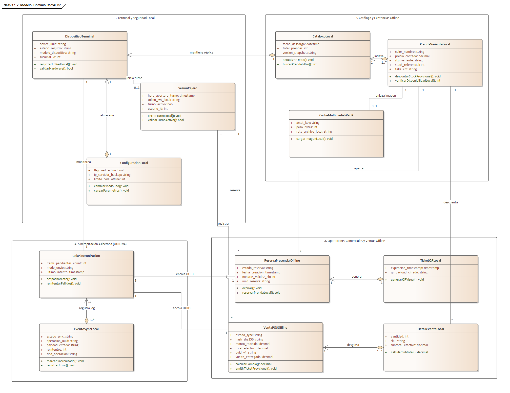

```plantuml
@startuml Modelo_Dominio_Movil_P2
title Modelo de Dominio - Aplicación Móvil Flutter Offline-First (ICONIX)
top to bottom direction
skinparam packageStyle rectangle
skinparam classAttributeIconSize 0
hide circle

skinparam class {
  BackgroundColor #E0F2F1
  BorderColor #00796B
  FontColor #004D40
  FontStyle bold
  FontSize 11
}
skinparam package {
  BackgroundColor #F5FBFB
  BorderColor #004D40
  FontColor #004D40
  FontStyle bold
}
skinparam ArrowColor #00695C
skinparam ArrowFontColor #004D40
skinparam ArrowFontSize 10

package "Terminal y Seguridad Local" {
  class DispositivoTerminal {
    + device_uuid : string
    + sucursal_id : int
    + modelo_dispositivo : string
    + registrarEnRedLocal() : void
  }
  class SesionCajero {
    + token_jwt_local : string
    + usuario_id : int
    + hora_apertura_turno : timestamp
    + validarTurnoActivo() : bool
  }
  class ConfiguracionLocal {
    + ip_servidor_backup : string
    + limite_cola_offline : int
    + flag_red_activa : bool
  }
}

package "Catálogo y Existencias Offline" {
  class CatalogoLocal {
    + version_snapshot : string
    + total_prendas : int
    + fecha_descarga : datetime
    + buscarPrendaFiltro() : list
  }
  class PrendaVarianteLocal {
    + sku_variante : string
    + talla_cm : string
    + color_nombre : string
    + stock_referencial : int
    + precio_contado : decimal
  }
  class CacheMultimediaWebP {
    + asset_key : string
    + ruta_archivo_local : string
  }
}

package "Operaciones y Ventas Offline" {
  class VentaPOSOffline {
    + uuid_v4 : string
    + total_efectivo : decimal
    + monto_recibido : decimal
    + vuelto_entregado : decimal
    + hash_sha256 : string
    + emitirTicketProvisional() : void
  }
  class DetalleVentaLocal {
    + sku : string
    + cantidad : int
    + subtotal : decimal
  }
  class ReservaPresencialOffline {
    + uuid_reserva : string
    + fecha_creacion : timestamp
    + estado : string
  }
  class TicketQRLocal {
    + qr_payload_cifrado : string
    + expiracion_timestamp : timestamp
  }
}

package "Sincronización Asíncrona (UUID)" {
  class ColaSincronizacion {
    + items_pendientes_count : int
    + ultimo_intento : timestamp
    + despacharLote() : void
  }
  class EventoSyncLocal {
    + operacion_uuid : string
    + estado_sync : string
    + reintentos : int
  }
}

' Relaciones conceptuales
DispositivoTerminal "1" *--> "1" ConfiguracionLocal : almacena parámetros de >
DispositivoTerminal "1" --> "0..1" SesionCajero : autentica turno activo con >

DispositivoTerminal "1" *--> "1" CatalogoLocal : mantiene réplica local de >
CatalogoLocal "1" *--> "1..*" PrendaVarianteLocal : indexa variantes de >
PrendaVarianteLocal "1" --> "0..1" CacheMultimediaWebP : enlaza foto local de >

SesionCajero "1" --> "*" VentaPOSOffline : registra ventas en >
VentaPOSOffline "1" *--> "1..*" DetalleVentaLocal : desglosa prendas en >
DetalleVentaLocal "*" --> "1" PrendaVarianteLocal : descuenta existencias de >

SesionCajero "1" --> "*" ReservaPresencialOffline : toma pedidos de >
ReservaPresencialOffline "*" --> "1" PrendaVarianteLocal : aparta temporalmente >
ReservaPresencialOffline "1" *--> "1" TicketQRLocal : genera token visual en >

VentaPOSOffline "1" --> "1" ColaSincronizacion : encola con UUID v4 en >
ReservaPresencialOffline "1" --> "1" ColaSincronizacion : encola con UUID v4 en >
ColaSincronizacion "1" *--> "1..*" EventoSyncLocal : registra trazabilidad de >
DispositivoTerminal "1" --> "1" ColaSincronizacion : monitorea envíos en >
@enduml
```

#### Diccionario de Entidades Conceptuales de la Aplicación Móvil:

| Paquete Móvil | Entidad Conceptual | Función y Responsabilidad en el Dispositivo Móvil |
|:---|:---|:---|
| **Terminal y Seguridad Local** | `DispositivoTerminal` | Hardware móvil (Smartphone o Tablet Android/iOS) asignado a una sucursal física. |
| | `SesionCajero` | Token criptográfico e información de turno del cajero almacenada en el *SecureStorage*. |
| | `ConfiguracionLocal` | Parámetros del dispositivo: identificador de sucursal asignada, IP del servidor y último sync. |
| **Catálogo y Existencias** | `CatalogoLocal` | Snapshot descargado de las prendas habilitadas para la tienda física en almacenamiento SQLite. |
| | `PrendaVarianteLocal` | Matriz local de tallas, colores, precios minoristas y existencias disponibles en tienda. |
| | `CacheMultimediaWebP` | Fotos optimizadas y diagramas de medidas descargados para navegación fluida sin conexión. |
| **Operaciones Offline** | `VentaPOSOffline` | Comprobante de venta en efectivo emitido localmente con identificador único UUID v4. |
| | `DetalleVentaLocal` | Renglones de prendas vendidas en el dispositivo, con descuento inmediato de stock en SQLite. |
| | `ReservaPresencialOffline` | Reserva de prenda realizada por un cliente en tienda con temporizador de expiración de 2 horas. |
| | `TicketQRLocal` | Código QR emitido en pantalla o ticket térmico para reclamo de la reserva en mostrador. |
| **Sincronización Asíncrona** | `ColaSincronizacion` | Cola de operaciones ordenadas cronológicamente para despacho hacia el servidor al volver internet. |
| | `EventoSyncLocal` | Registro de auditoría local sobre el estado de cada transacción (Pendiente, Confirmada, Conflicto). |

---

## 3.2. Diagramas de Robustez (Análisis y Diseño Preliminar ICONIX)

En la metodología **ICONIX** (Doug Rosenberg, Matt Stephens; adaptada según directrices de la cátedra de Sistemas de Información II), el **Diagrama de Robustez** es una técnica intermedia no perteneciente formalmente al estándar UML, pero vital como puente integrador entre el **espacio del problema** (descrito narrativamente en las fichas y especificaciones de Casos de Uso) y el **espacio de la solución** (diseño preliminar de arquitectura, diagramas de clases refinados y diagramas de secuencia).

### Fundamentos Metodológicos y Semántica de la Tríada BCE

El análisis de robustez se fundamenta en la descomposición de cada caso de uso en tres tipos canónicos de objetos (**Boundary-Control-Entity / BCE**):

1. **Objetos Frontera o Interfaz (Boundary) — Prefijo `UI:`:**
   * Representan los puntos de contacto del sistema con los actores humanos o sistemas externos.
   * Abarcan interfaces gráficas, pantallas de usuario, formularios de captura, modales de confirmación, escáneres ópticos de códigos de barra / QR y endpoints HTTP de la API RESTful.
   * **Nomenclatura estandarizada:** En los diagramas se identifican explícitamente con el prefijo **`UI: <Nombre>`** (ej. *UI: Pantalla POS*, *UI: Formulario Registro Empresa*, *UI: Modal Reorden*).
2. **Objetos Controlador (Control) — Prefijo `CRT:`:**
   * Encapsulan la lógica de la aplicación, orquestación de casos de uso, transformaciones, validaciones criptográficas, algoritmos de recálculo matemático (como el CPP) y coordinación de transacciones.
   * **Nomenclatura estandarizada:** En los diagramas se identifican explícitamente con el prefijo **`CRT: <Nombre>`** (ej. *CRT: Gestor de Empresas*, *CRT: Gestor de Autenticación*, *CRT: Validador de NIT y Tenant*).
3. **Objetos Entidad (Entity) — Prefijo `CE:`:**
   * Representan los datos persistentes del negocio mapeados directamente desde el Modelo de Dominio hacia las tablas relacionales de PostgreSQL o almacenes locales (IndexedDB / SQLite).
   * **Nomenclatura estandarizada:** En los diagramas se identifican explícitamente con el prefijo **`CE: <Nombre>`** (ej. *CE: Empresa (Tenant)*, *CE: Usuario (Admin)*, *CE: InventarioSucursal*).

### La Gramática Fundamental de ICONIX: «Sustantivo — Verbo — Sustantivo»

El principio rector establecido en el manual de ICONIX dictamina que **los objetos sustantivos (Fronteras y Entidades) únicamente se comunican y relacionan a través de verbos (Controladores)**:

$$\text{Frontera (Sustantivo)} \xrightarrow{\text{invoca}} \text{Controlador (Verbo)} \xrightarrow{\text{opera / consulta}} \text{Entidad (Sustantivo)}$$

> **Las 4 Reglas Estrictas de Construcción de Robustez (Cumplimiento 100% Verificado):**
> 1. **Los Actores sólo interactúan con Fronteras (Boundaries):** Ningún actor humano ni servicio externo accede directamente a controladores ni entidades.
> 2. **Aislamiento de Fronteras (Boundaries):** Las fronteras se comunican exclusivamente con Actores y Controladores. Está **terminantemente prohibida** la comunicación directa *Frontera-Entidad* (para preservar la separación MVC) y la comunicación *Frontera-Frontera*.
> 3. **Prohibición Absoluta de Comunicación Entidad-Entidad:** Ninguna entidad puede conectarse, invocar ni modificar directamente a otra entidad. Cualquier cálculo, asignación foránea o validación inter-entidad debe ser realizada obligatoriamente por un Controlador.
> 4. **Comunicación entre Controladores:** Como única excepción canónica, los objetos de tipo Controlador **sí pueden comunicarse entre ellos** para delegar tareas especializadas (ej. un *Gestor de Sincronización* invocando a un *Validador de Idempotencia* y luego a un *Calculador de CPP*).

A continuación se presentan los **20 Diagramas de Robustez** del sistema (CU01 al CU20), renderizados con su correspondiente notación gráfica estandarizada y acompañados de su código fuente PlantUML verificado contra las 4 reglas metodológicas:

---

### Diagrama de Robustez — CU01: Gestionar Empresas (Tenants)


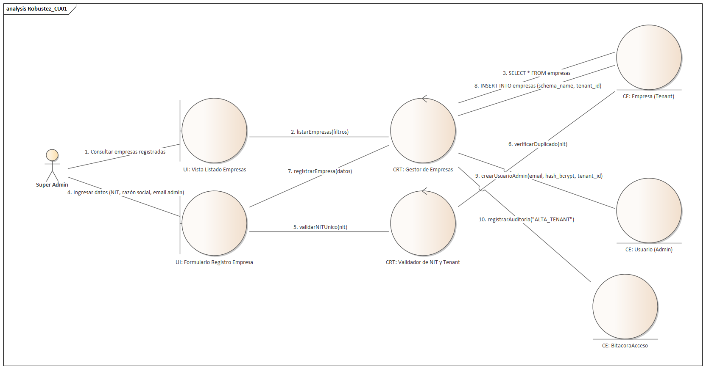

```plantuml
@startuml Robustez_CU01
left to right direction
skinparam stereotypeCPosition top

actor "Super Admin" as Actor

boundary "UI: Vista Listado\nEmpresas" as UI_List
boundary "UI: Formulario Registro\nEmpresa" as UI_Form

control "CRT: Gestor de\nEmpresas" as Ctrl_Emp
control "CRT: Validador de\nNIT y Tenant" as Ctrl_Val

entity "CE: Empresa (Tenant)" as Ent_Emp
entity "CE: Usuario (Admin)" as Ent_User
entity "CE: BitacoraAcceso" as Ent_Bit

Actor --> UI_List : 1. Consultar empresas registradas
UI_List --> Ctrl_Emp : 2. listarEmpresas(filtros)
Ctrl_Emp --> Ent_Emp : 3. SELECT * FROM empresas

Actor --> UI_Form : 4. Ingresar datos (NIT, razón social, email admin)
UI_Form --> Ctrl_Val : 5. validarNITUnico(nit)
Ctrl_Val --> Ent_Emp : 6. verificarDuplicado(nit)
UI_Form --> Ctrl_Emp : 7. registrarEmpresa(datos)
Ctrl_Emp --> Ent_Emp : 8. INSERT INTO empresas (schema_name, tenant_id)
Ctrl_Emp --> Ent_User : 9. crearUsuarioAdmin(email, hash_bcrypt, tenant_id)
Ctrl_Emp --> Ent_Bit : 10. registrarAuditoria("ALTA_TENANT")
@enduml
```

---

### Diagrama de Robustez — CU02: Gestionar Planes de Suscripción


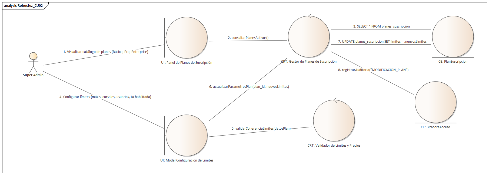

```plantuml
@startuml Robustez_CU02
left to right direction
skinparam stereotypeCPosition top

actor "Super Admin" as Actor

boundary "UI: Panel de Planes\nde Suscripción" as UI_Planes
boundary "UI: Modal Configuración\nde Límites" as UI_Modal

control "CRT: Gestor de Planes\nde Suscripción" as Ctrl_Planes
control "CRT: Validador de\nLímites y Precios" as Ctrl_ValPlan

entity "CE: PlanSuscripcion" as Ent_Plan
entity "CE: BitacoraAcceso" as Ent_Bit

Actor --> UI_Planes : 1. Visualizar catálogo de planes (Básico, Pro, Enterprise)
UI_Planes --> Ctrl_Planes : 2. consultarPlanesActivos()
Ctrl_Planes --> Ent_Plan : 3. SELECT * FROM planes_suscripcion

Actor --> UI_Modal : 4. Configurar límites (máx sucursales, usuarios, IA habilitada)
UI_Modal --> Ctrl_ValPlan : 5. validarCoherenciaLimites(datosPlan)
UI_Modal --> Ctrl_Planes : 6. actualizarParametrosPlan(plan_id, nuevosLimites)
Ctrl_Planes --> Ent_Plan : 7. UPDATE planes_suscripcion SET limites = :nuevosLimites
Ctrl_Planes --> Ent_Bit : 8. registrarAuditoria("MODIFICACION_PLAN")
@enduml
```

---

### Diagrama de Robustez — CU03: Gestionar Suscripción de Empresa


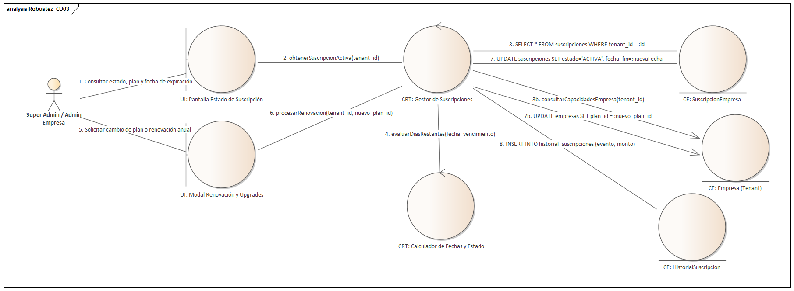

```plantuml
@startuml Robustez_CU03
left to right direction
skinparam stereotypeCPosition top

actor "Super Admin /\nAdmin Empresa" as Actor

boundary "UI: Pantalla Estado\nde Suscripción" as UI_Susc
boundary "UI: Modal Renovación\ny Upgrades" as UI_Upgrade

control "CRT: Gestor de\nSuscripciones" as Ctrl_Susc
control "CRT: Calculador de Fechas\ny Estado" as Ctrl_Calc

entity "CE: SuscripcionEmpresa" as Ent_Susc
entity "CE: Empresa (Tenant)" as Ent_Emp
entity "CE: HistorialSuscripcion" as Ent_Hist

Actor --> UI_Susc : 1. Consultar estado, plan y fecha de expiración
UI_Susc --> Ctrl_Susc : 2. obtenerSuscripcionActiva(tenant_id)
Ctrl_Susc --> Ent_Susc : 3. SELECT * FROM suscripciones WHERE tenant_id = :id
Ctrl_Susc --> Ent_Emp : 3b. consultarCapacidadesEmpresa(tenant_id)
Ctrl_Susc --> Ctrl_Calc : 4. evaluarDiasRestantes(fecha_vencimiento)

Actor --> UI_Upgrade : 5. Solicitar cambio de plan o renovación anual
UI_Upgrade --> Ctrl_Susc : 6. procesarRenovacion(tenant_id, nuevo_plan_id)
Ctrl_Susc --> Ent_Susc : 7. UPDATE suscripciones SET estado='ACTIVA', fecha_fin=:nuevaFecha
Ctrl_Susc --> Ent_Emp : 7b. UPDATE empresas SET plan_id = :nuevo_plan_id
Ctrl_Susc --> Ent_Hist : 8. INSERT INTO historial_suscripciones (evento, monto)
@enduml
```

---

### Diagrama de Robustez — CU04: Autenticar Usuario Multitenant


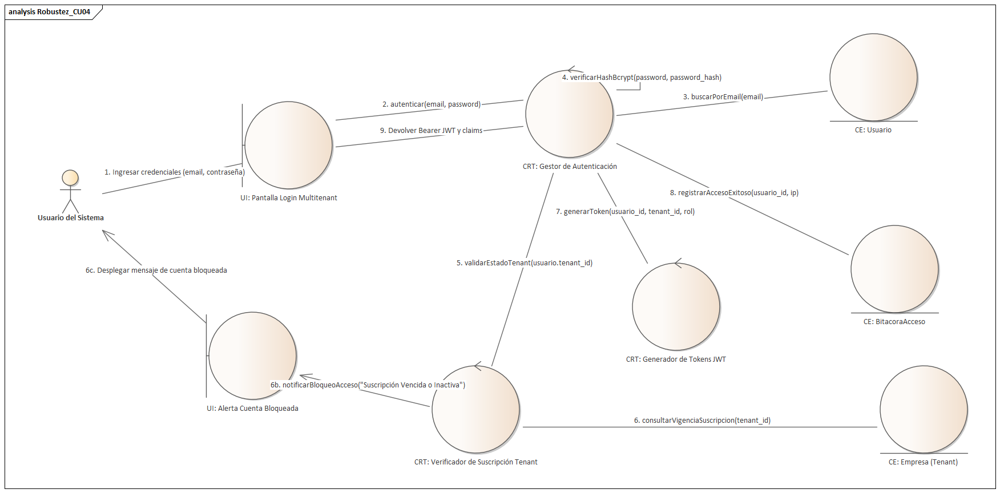

```plantuml
@startuml Robustez_CU04
left to right direction
skinparam stereotypeCPosition top

actor "Usuario del Sistema" as Actor

boundary "UI: Pantalla Login\nMultitenant" as UI_Login
boundary "UI: Alerta Cuenta\nBloqueada" as UI_Alerta

control "CRT: Gestor de\nAutenticación" as Ctrl_Auth
control "CRT: Verificador de\nSuscripción Tenant" as Ctrl_VerifSusc
control "CRT: Generador de\nTokens JWT" as Ctrl_JWT

entity "CE: Usuario" as Ent_User
entity "CE: Empresa (Tenant)" as Ent_Emp
entity "CE: BitacoraAcceso" as Ent_Bit

Actor --> UI_Login : 1. Ingresar credenciales (email, contraseña)
UI_Login --> Ctrl_Auth : 2. autenticar(email, password)
Ctrl_Auth --> Ent_User : 3. buscarPorEmail(email)
Ctrl_Auth --> Ctrl_Auth : 4. verificarHashBcrypt(password, password_hash)
Ctrl_Auth --> Ctrl_VerifSusc : 5. validarEstadoTenant(usuario.tenant_id)
Ctrl_VerifSusc --> Ent_Emp : 6. consultarVigenciaSuscripcion(tenant_id)
Ctrl_VerifSusc --> UI_Alerta : 6b. notificarBloqueoAcceso("Suscripción Vencida o Inactiva")
UI_Alerta --> Actor : 6c. Desplegar mensaje de cuenta bloqueada
Ctrl_Auth --> Ctrl_JWT : 7. generarToken(usuario_id, tenant_id, rol)
Ctrl_Auth --> Ent_Bit : 8. registrarAccesoExitoso(usuario_id, ip)
Ctrl_Auth --> UI_Login : 9. Devolver Bearer JWT y claims
@enduml
```

---

### Diagrama de Robustez — CU05: Gestionar Usuarios y Roles por Empresa


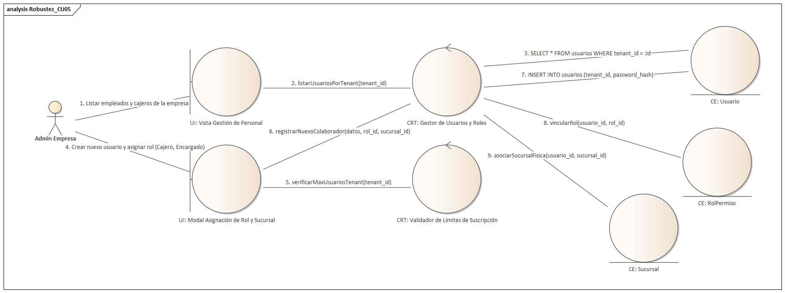

```plantuml
@startuml Robustez_CU05
left to right direction
skinparam stereotypeCPosition top

actor "Admin Empresa" as Actor

boundary "UI: Vista Gestión\nde Personal" as UI_Personal
boundary "UI: Modal Asignación\nde Rol y Sucursal" as UI_Rol

control "CRT: Gestor de\nUsuarios y Roles" as Ctrl_User
control "CRT: Validador de Límites\nde Suscripción" as Ctrl_Limit

entity "CE: Usuario" as Ent_User
entity "CE: RolPermiso" as Ent_Rol
entity "CE: Sucursal" as Ent_Suc

Actor --> UI_Personal : 1. Listar empleados y cajeros de la empresa
UI_Personal --> Ctrl_User : 2. listarUsuariosPorTenant(tenant_id)
Ctrl_User --> Ent_User : 3. SELECT * FROM usuarios WHERE tenant_id = :id

Actor --> UI_Rol : 4. Crear nuevo usuario y asignar rol (Cajero, Encargado)
UI_Rol --> Ctrl_Limit : 5. verificarMaxUsuariosTenant(tenant_id)
UI_Rol --> Ctrl_User : 6. registrarNuevoColaborador(datos, rol_id, sucursal_id)
Ctrl_User --> Ent_User : 7. INSERT INTO usuarios (tenant_id, password_hash)
Ctrl_User --> Ent_Rol : 8. vincularRol(usuario_id, rol_id)
Ctrl_User --> Ent_Suc : 9. asociarSucursalFisica(usuario_id, sucursal_id)
@enduml
```

---

### Diagrama de Robustez — CU06: Gestionar Productos y Atributos Textiles Avanzados


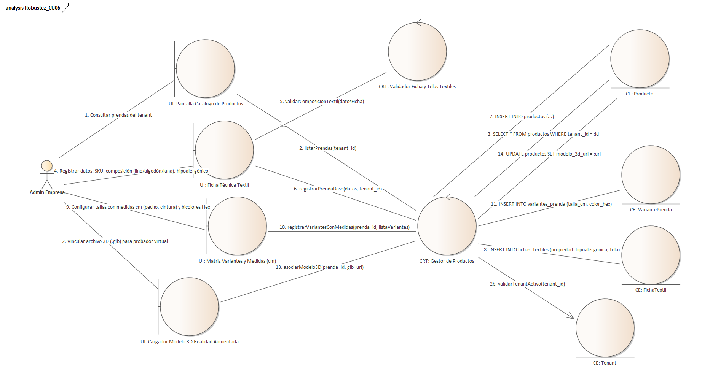

```plantuml
@startuml Robustez_CU06
left to right direction
skinparam stereotypeCPosition top

actor "Admin Empresa" as Actor

boundary "UI: Pantalla Catálogo\nde Productos" as UI_Prod
boundary "UI: Ficha Técnica\nTextil" as UI_Ficha
boundary "UI: Matriz Variantes\ny Medidas (cm)" as UI_Variantes
boundary "UI: Cargador Modelo\n3D Realidad Aumentada" as UI_3D

control "CRT: Gestor de\nProductos" as Ctrl_Prod
control "CRT: Validador Ficha\ny Telas Textiles" as Ctrl_ValTextil

entity "CE: Producto" as Ent_Prod
entity "CE: VariantePrenda" as Ent_Var
entity "CE: FichaTextil" as Ent_Ficha
entity "CE: Tenant" as Ent_Tenant

Actor --> UI_Prod : 1. Consultar prendas del tenant
UI_Prod --> Ctrl_Prod : 2. listarPrendas(tenant_id)
Ctrl_Prod --> Ent_Tenant : 2b. validarTenantActivo(tenant_id)
Ctrl_Prod --> Ent_Prod : 3. SELECT * FROM productos WHERE tenant_id = :id
Actor --> UI_Ficha : 4. Registrar datos: SKU, composición (lino/algodón/lana), hipoalergénico
UI_Ficha --> Ctrl_ValTextil : 5. validarComposicionTextil(datosFicha)
UI_Ficha --> Ctrl_Prod : 6. registrarPrendaBase(datos, tenant_id)
Ctrl_Prod --> Ent_Prod : 7. INSERT INTO productos (...)
Ctrl_Prod --> Ent_Ficha : 8. INSERT INTO fichas_textiles (propiedad_hipoalergenica, tela)
Actor --> UI_Variantes : 9. Configurar tallas con medidas cm (pecho, cintura) y bicolores Hex
UI_Variantes --> Ctrl_Prod : 10. registrarVariantesConMedidas(prenda_id, listaVariantes)
Ctrl_Prod --> Ent_Var : 11. INSERT INTO variantes_prenda (talla_cm, color_hex)
Actor --> UI_3D : 12. Vincular archivo 3D (.glb) para probador virtual
UI_3D --> Ctrl_Prod : 13. asociarModelo3D(prenda_id, glb_url)
Ctrl_Prod --> Ent_Prod : 14. UPDATE productos SET modelo_3d_url = :url
@enduml
```

---

### Diagrama de Robustez — CU07: Gestionar Inventario Multi-Sucursal, Kardex Físico-Valorado y Costo Promedio Ponderado (CPP)


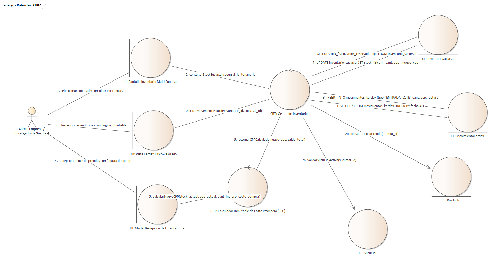

```plantuml
@startuml Robustez_CU07
left to right direction
skinparam stereotypeCPosition top

actor "Admin Empresa /\nEncargado de Sucursal" as Actor

boundary "UI: Pantalla Inventario\nMulti-Sucursal" as UI_Inv
boundary "UI: Modal Recepción\nde Lote (Factura)" as UI_Lote
boundary "UI: Vista Kardex\nFísico-Valorado" as UI_Kardex

control "CRT: Gestor de\nInventarios" as Ctrl_Inv
control "CRT: Calculador Inmutable\nde Costo Promedio (CPP)" as Ctrl_CPP

entity "CE: InventarioSucursal" as Ent_InvSuc
entity "CE: MovimientoKardex" as Ent_Kardex
entity "CE: Producto" as Ent_Prod
entity "CE: Sucursal" as Ent_Suc

Actor --> UI_Inv : 1. Seleccionar sucursal y consultar existencias
UI_Inv --> Ctrl_Inv : 2. listarStock(sucursal_id)
Ctrl_Inv --> Ent_Suc : 2b. validarSucursalActiva(sucursal_id)
Ctrl_Inv --> Ent_Prod : 2c. consultarFichaPrenda(prenda_id)
Ctrl_Inv --> Ent_InvSuc : 3. SELECT * FROM inventario_sucursal WHERE sucursal_id = :id
Actor --> UI_Lote : 4. Registrar llegada de lote con factura fiscal y costo de compra
UI_Lote --> Ctrl_Inv : 5. ingresarLote(sucursal_id, prenda_id, cantidad, costo_factura)
Ctrl_Inv --> Ctrl_CPP : 6. calcularNuevoCPP(stock_actual, cpp_actual, cant_ingreso, costo_ingreso)
Ctrl_CPP --> Ctrl_CPP : 7. formulaMatematicaCPP()
Ctrl_Inv --> Ent_InvSuc : 8. UPDATE inventario_sucursal SET stock_fisico += cant, cpp = nuevoCPP
Ctrl_Inv --> Ent_Kardex : 9. INSERT INTO movimientos_kardex (tipo='ENTRADA_COMPRA', factura, cpp)
Actor --> UI_Kardex : 10. Auditar libro Kardex físico-valorado inmutable
UI_Kardex --> Ctrl_Inv : 11. consultarKardexHistorico(prenda_id, sucursal_id)
Ctrl_Inv --> Ent_Kardex : 12. SELECT * FROM movimientos_kardex WHERE prenda_id = :id
@enduml
```

---

### Diagrama de Robustez — CU08: Descargar y Consultar Catálogo Digital Offline


```plantuml
@startuml Robustez_CU08
left to right direction
skinparam stereotypeCPosition top

actor "Cliente" as Actor

boundary "UI: Catálogo Digital\nPWA / Móvil" as UI_Cat
boundary "UI: Aviso Modo\nOffline Activado" as UI_Aviso

control "CRT: Gestor Catálogo\nOffline" as Ctrl_CatOff
control "CRT: Sincronizador de\nCaché Local" as Ctrl_Cache

entity "CE: IndexedDB / SQLite\n(Caché Local)" as Ent_LocalDB
entity "CE: Cache Storage\n(Imágenes WebP)" as Ent_CacheMedia

Actor --> UI_Cat : 1. Abrir aplicación y solicitar catálogo
UI_Cat --> Ctrl_CatOff : 2. consultarCatalogo()

alt Conexión activa
  Ctrl_CatOff --> Ctrl_Cache : 3a. verificarVersionCatalogo()
  Ctrl_Cache --> Ent_LocalDB : 4a. guardarSnapshotProductos(deltaJSON)
  Ctrl_Cache --> Ent_CacheMedia : 5a. precargarMiniaturas()
else Sin conexión a Internet
  Ctrl_CatOff --> Ent_LocalDB : 3b. SELECT * FROM prendas_cache
  Ctrl_CatOff --> UI_Aviso : 4b. Notificar funcionamiento autónomo offline
end

Ctrl_CatOff --> UI_Cat : 6. Renderizar prendas, medidas cm y colores
@enduml
```

---

### Diagrama de Robustez — CU09: Registrar Reserva Presencial Sin Conexión a Internet


```plantuml
@startuml Robustez_CU09
left to right direction
skinparam stereotypeCPosition top

actor "Cliente" as Actor

boundary "UI: Ficha de Prenda\n(Modo Offline)" as UI_Prenda
boundary "UI: Ticket QR de\nReserva Offline" as UI_Ticket

control "CRT: Gestor Reserva\nOffline" as Ctrl_ResOff
control "CRT: Generador UUID\nIdempotente" as Ctrl_UUID

entity "CE: IndexedDB / SQLite\n(Local)" as Ent_DBLocal

Actor --> UI_Prenda : 1. Seleccionar talla cm y presionar "Reservar en Tienda (Offline)"
UI_Prenda --> Ctrl_UUID : 2. generarUUIDv4()
Ctrl_UUID --> Ctrl_ResOff : 3. retornarUUIDUnico(uuid)

Ctrl_ResOff --> Ent_DBLocal : 4. INSERT INTO reservas_offline (uuid, prenda_id, tiempo_limite=2h)
Ctrl_ResOff --> Ent_DBLocal : 5. UPDATE stock_local SET disponible = disponible - 1
Ctrl_ResOff --> UI_Ticket : 6. Generar ticket con QR y UUID firmado
UI_Ticket --> Actor : 7. Mostrar ticket para validación en mostrador
@enduml
```

---

### Diagrama de Robustez — CU10: Registrar Venta POS de Contado Sin Conexión a Internet


```plantuml
@startuml Robustez_CU10
left to right direction
skinparam stereotypeCPosition top

actor "Cajero" as Actor

boundary "UI: Terminal POS\n(Modo Offline)" as UI_POS
boundary "UI: Comprobante Fiscal\nProvisional" as UI_Ticket

control "CRT: Gestor de Venta\nPOS Offline" as Ctrl_VentaOff
control "CRT: Generador UUID\nIdempotente" as Ctrl_UUID
control "CRT: Motor de Reglas\nComerciales Locales" as Ctrl_Reglas

entity "CE: IndexedDB / SQLite\n(Local)" as Ent_DBLocal

Actor --> UI_POS : 1. Escanear SKU de prendas y seleccionar "Contado Efectivo"
UI_POS --> Ctrl_Reglas : 2. calcularTotalesConDescuento(items)
Ctrl_Reglas --> Ctrl_VentaOff : 3. retornarTotalCalculado(montoTotal)

Actor --> UI_POS : 4. Confirmar cobro en efectivo
UI_POS --> Ctrl_UUID : 5. generarUUIDv4()
Ctrl_UUID --> Ctrl_VentaOff : 6. uuid_v4_unico

Ctrl_VentaOff --> Ent_DBLocal : 7. INSERT INTO operaciones_offline (uuid, tipo='VENTA', total, estado='PENDIENTE_SYNC')
Ctrl_VentaOff --> Ent_DBLocal : 8. UPDATE catalogo_local SET stock_fisico = stock_fisico - cantidad
Ctrl_VentaOff --> UI_Ticket : 9. Emitir ticket provisional con UUID
@enduml
```

---

### Diagrama de Robustez — CU11: Consultar y Auditar Operaciones Locales Pendientes


```plantuml
@startuml Robustez_CU11
left to right direction
skinparam stereotypeCPosition top

actor "Cajero / Encargado" as Actor

boundary "UI: Panel de Auditoría\ny Operaciones Locales" as UI_Audit
boundary "UI: Modal Detalle JSON\nde Transacción" as UI_Detalle

control "CRT: Gestor Auditoría\nLocal" as Ctrl_Audit
control "CRT: Verificador de\nIntegridad y Hash" as Ctrl_Hash

entity "CE: IndexedDB / SQLite\n(Local)" as Ent_DBLocal

Actor --> UI_Audit : 1. Ingresar a arqueo y operaciones pendientes
UI_Audit --> Ctrl_Audit : 2. obtenerOperacionesPendientes()
Ctrl_Audit --> Ent_DBLocal : 3. SELECT * FROM operaciones_offline WHERE estado='PENDIENTE_SYNC'
Ctrl_Audit --> Ctrl_Hash : 4. verificarIntegridadRegistros()

Actor --> UI_Detalle : 5. Inspeccionar payload, UUID y montos en efectivo
UI_Detalle --> Ctrl_Audit : 6. obtenerDetalleJSON(uuid)
Ctrl_Audit --> Ent_DBLocal : 7. SELECT payload_json FROM operaciones_offline WHERE uuid = :id
@enduml
```

---

### Diagrama de Robustez — CU12: Sincronizar Operaciones Pendientes


```plantuml
@startuml Robustez_CU12
left to right direction
skinparam stereotypeCPosition top

actor "Sistema de\nSincronización" as SistSync

boundary "UI: Worker de Red\n(Background)" as UI_Worker

control "CRT: Gestor de\nSincronización" as Ctrl_Sync
control "CRT: Verificador de\nIdempotencia Central" as Ctrl_Idemp
control "CRT: Reconciliador de\nInventario y Stock" as Ctrl_Recon

entity "CE: IndexedDB / SQLite\n(Local)" as Ent_DBLocal
entity "CE: TransaccionesProcesadas" as Ent_CentralTx
entity "CE: InventarioSucursal" as Ent_InvSuc
entity "CE: MovimientoKardex" as Ent_Kardex

SistSync --> UI_Worker : 1. Evento de red restablecida (online)
UI_Worker --> Ctrl_Sync : 2. ejecutarSyncBatch()
Ctrl_Sync --> Ent_DBLocal : 3. SELECT * FROM operaciones_offline WHERE estado='PENDIENTE_SYNC'

Ctrl_Sync --> Ctrl_Idemp : 4. verificarUUIDExistente(tx.uuid)
Ctrl_Idemp --> Ent_CentralTx : 5. SELECT id FROM transacciones WHERE uuid = :uuid

alt UUID No Procesado
  Ctrl_Sync --> Ctrl_Recon : 6. aplicarTransaccionEnServidor(tx)
  Ctrl_Recon --> Ent_InvSuc : 7. UPDATE inventario_sucursal SET stock_fisico -= cant
  Ctrl_Recon --> Ent_Kardex : 8. INSERT INTO movimientos_kardex (tipo='VENTA_SYNC', uuid)
  Ctrl_Recon --> Ent_CentralTx : 9. INSERT INTO transacciones (uuid, status='CONFIRMADO')
end

Ctrl_Sync --> Ent_DBLocal : 10. UPDATE operaciones_offline SET estado='SINCRONIZADO'
@enduml
```

---

### Diagrama de Robustez — CU13: Gestionar Cambio de Prenda en Dos Tiempos y Devoluciones


```plantuml
@startuml Robustez_CU13
left to right direction
skinparam stereotypeCPosition top

actor "Cliente" as Cl
actor "Cajero / Encargado" as Staff

boundary "UI: Pantalla Postventa\ny Devoluciones" as UI_Dev
boundary "UI: Formulario Nota\nde Devolución (T1)" as UI_T1
boundary "UI: Formulario Nota\nde Reposición / Cambio (T2)" as UI_T2
boundary "UI: Orden Liquidación\nReembolso 30 Días" as UI_Reemb
boundary "UI: Notificación Push\nDispositivo Móvil" as UI_Push

control "CRT: Gestor de Devoluciones\n(Tiempo 1)" as Ctrl_Dev
control "CRT: Validador Garantía\ny Estado Prenda" as Ctrl_ValPrenda
control "CRT: Gestor de Reposiciones\ny Cambios (Tiempo 2)" as Ctrl_Rep
control "CRT: Pasarela de Pagos\nStripe Sandbox" as Ctrl_Stripe
control "CRT: Agente Notificador Push\ny Satisfacción" as Ctrl_Push

entity "CE: VentaOriginal" as Ent_Venta
entity "CE: NotaDevolucion" as Ent_NotaDev
entity "CE: DetalleDevolucion" as Ent_DetDev
entity "CE: NotaCambioReposicion" as Ent_NotaCambio
entity "CE: InventarioSucursal" as Ent_InvSuc
entity "CE: KardexMovimiento" as Ent_Kardex

Cl --> UI_Dev : 1a. Presenta prendas físicas y factura
Staff --> UI_Dev : 1b. Buscar ticket o factura original
UI_Dev --> Ctrl_Dev : 2. consultarVentaOriginal(ticket_id)
Ctrl_Dev --> Ent_Venta : 3. SELECT * FROM ventas WHERE id = :ticket_id

' --- TIEMPO 1: NOTA DE DEVOLUCIÓN (SOPORTE MULTI-PRENDA) ---
Staff --> UI_T1 : 4. Seleccionar prendas a devolver (ej. 4 de 6 prendas)
UI_T1 --> Ctrl_ValPrenda : 5. validarPlazoGarantia(fecha_venta, plazo=3..7d)
UI_T1 --> Ctrl_ValPrenda : 6. inspeccionarEtiquetasYEstado(prendas_lista)
UI_T1 --> Ctrl_Dev : 7. registrarNotaDevolucion(venta_id, prendas_lista, motivo)
Ctrl_Dev --> Ent_NotaDev : 8. INSERT INTO notas_devolucion (numero, saldo_total_favor)
Ctrl_Dev --> Ent_DetDev : 9. INSERT INTO detalle_devoluciones (prenda_id, cant, cpp_hist)
Ctrl_Dev --> Ent_InvSuc : 10. UPDATE inventario_sucursal SET stock_fisico += cant
Ctrl_Dev --> Ent_Kardex : 11. INSERT INTO kardex_movimientos (tipo='DEVOLUCION_CPP_HIST')

' --- TIEMPO 2: NOTA DE REPOSICIÓN O REEMBOLSO ---
alt Cliente Selecciona Prendas de Reposición (Tiempo 2)
  Staff --> UI_T2 : 12a. Elegir nuevas prendas de reemplazo
  UI_T2 --> Ctrl_Rep : 13a. emitirNotaReposicion(nota_dev_id, nuevas_prendas)
  opt Nueva prenda tiene mayor valor (Diferencial > 0)
    Ctrl_Rep --> Ctrl_Stripe : 14a. procesarCobroDiferencial(tarjeta_token, monto)
  end
  Ctrl_Rep --> Ent_NotaCambio : 15a. INSERT INTO notas_cambio_reposicion (num, estado='COMPLETADA')
  Ctrl_Rep --> Ent_InvSuc : 16a. UPDATE inventario_sucursal SET stock_fisico -= cant_entregada
  Ctrl_Rep --> Ctrl_Push : 17a. dispararNotificacionPush(fecha_entrega, calificacion=1..5)
  Ctrl_Push --> UI_Push : 18a. «Su prenda de cambio será enviada el viernes 30 de octubre»
  UI_Push --> Cl : 18b. Recibe notificación push con fecha y encuesta
  UI_T2 --> Cl : 19. Entrega formal de nueva prenda
else Falta de Existencias de Talla o Desistimiento de Cambio
  Staff --> UI_Reemb : 12b. Registrar falta de talla o rechazo de cambio
  UI_Reemb --> Ctrl_Rep : 13b. emitirOrdenReembolsoContable(cliente_id, saldo_a_favor)
  Ctrl_Rep --> Ent_NotaDev : 14b. UPDATE notas_devolucion SET estado='PROGRAMADO_REEMBOLSO_30_DIAS'
  UI_Reemb --> Cl : 15b. Entrega orden de liquidación a cuenta
end
@enduml
```

---

### Diagrama de Robustez — CU14: Gestionar Traspaso Inter-Sucursal de Inventario


```plantuml
@startuml Robustez_CU14
left to right direction
skinparam stereotypeCPosition top

actor "Encargado Sucursal" as Actor

boundary "UI: Pantalla Traspasos\nInter-Sucursal" as UI_Traspaso
boundary "UI: Formulario Despacho\ny Guía de Remisión" as UI_Despacho
boundary "UI: Modal Recepción\ny Verificación" as UI_Recv

control "CRT: Gestor de\nTraspasos" as Ctrl_Traspaso

entity "CE: TraspasoSucursal" as Ent_Trasp
entity "CE: InventarioSucursal" as Ent_InvSuc
entity "CE: MovimientoKardex" as Ent_Kardex

Actor --> UI_Traspaso : 1. Solicitar prendas a sucursal origen
UI_Traspaso --> Ctrl_Traspaso : 2. crearSolicitudTraspaso(origen_id, destino_id, items)
Ctrl_Traspaso --> Ent_Trasp : 3. INSERT INTO traspasos (estado='SOLICITADO')

Actor --> UI_Despacho : 4. Despachar bulto desde sucursal origen
UI_Despacho --> Ctrl_Traspaso : 5. marcarDespachado(traspaso_id)
Ctrl_Traspaso --> Ent_Trasp : 6. UPDATE traspasos SET estado='EN_TRANSITO'
Ctrl_Traspaso --> Ent_InvSuc : 7. UPDATE inventario_sucursal SET disponible -= cant WHERE sucursal = origen

Actor --> UI_Recv : 8. Recepcionar lote en sucursal destino
UI_Recv --> Ctrl_Traspaso : 9. confirmarRecepcion(traspaso_id, itemsRecibidos)
Ctrl_Traspaso --> Ent_Trasp : 10. UPDATE traspasos SET estado='COMPLETADO'
Ctrl_Traspaso --> Ent_InvSuc : 11. UPDATE inventario_sucursal SET stock_fisico += cant WHERE sucursal = destino
Ctrl_Traspaso --> Ent_Kardex : 12. INSERT INTO movimientos_kardex (tipo='TRASPASO_ENTRADA')
@enduml
```

---

### Diagrama de Robustez — CU15: Solicitar Reporte Generativo con IA (Texto / Voz)


```plantuml
@startuml Robustez_CU15
left to right direction
skinparam stereotypeCPosition top

actor "Admin Empresa / Encargado" as Actor
actor "Servicio IA (LLM/Whisper)" as IA

boundary "UI: Asistente Analítico\nConversacional" as UI_IA
boundary "UI: Micrófono Dictado\npor Voz" as UI_Voz

control "CRT: Gestor Reportes\ncon IA" as Ctrl_RepIA
control "CRT: Validador AST SQL\nde Solo Lectura" as Ctrl_AST

entity "CE: VistasAnaliticas\n(PostgreSQL)" as Ent_Vistas
entity "CE: Tenant" as Ent_Tenant

Actor --> UI_Voz : 1. Dictar requerimiento analítico por voz
UI_Voz --> IA : 2. transcribirAudio(Whisper)
IA --> UI_IA : 3. textoTranscrito
Actor --> UI_IA : 4. Enviar prompt ("¿Cuáles son las prendas con mayor margen en Equipetrol?")
UI_IA --> Ctrl_RepIA : 5. procesarPregunta(prompt, tenant_id)
Ctrl_RepIA --> Ent_Tenant : 5b. validarModuloIAHabilitado(tenant_id)
Ctrl_RepIA --> IA : 6. generarSQL(prompt, metadataVistas)
IA --> Ctrl_RepIA : 7. sentencia_sql_raw
Ctrl_RepIA --> Ctrl_AST : 8. validarSQLSeguro(sentencia_sql_raw)
Ctrl_AST --> Ctrl_AST : 9. verificarSoloSelectYForzarTenantId(sql, tenant_id)
Ctrl_AST --> Ctrl_RepIA : 10. sql_validado_seguro
Ctrl_RepIA --> Ent_Vistas : 11. ejecutarQueryReadOnly(sql_validado_seguro)
Ent_Vistas --> Ctrl_RepIA : 12. datasetResultante
Ctrl_RepIA --> IA : 13. sintetizarResumen(datasetResultante)
IA --> Ctrl_RepIA : 14. resumenEjecutivoYTipoGrafico
Ctrl_RepIA --> UI_IA : 15. Desplegar narrativa, tablas y gráficos
@enduml
```

---

### Diagrama de Robustez — CU16: Exportar Reportes Analíticos a Excel/PDF


```plantuml
@startuml Robustez_CU16
left to right direction
skinparam stereotypeCPosition top

actor "Admin Empresa" as Actor

boundary "UI: Visor de Reporte\ny Analítica" as UI_Visor
boundary "UI: Descargador de\nArchivos" as UI_Down

control "CRT: Gestor de\nExportaciones" as Ctrl_Exp
control "CRT: Constructor Excel\n(OpenPyXL)" as Ctrl_Excel
control "CRT: Generador PDF\n(ReportLab)" as Ctrl_PDF

entity "CE: VistasAnaliticas" as Ent_Vistas

Actor --> UI_Visor : 1. Seleccionar formato de exportación (Excel / PDF)
UI_Visor --> Ctrl_Exp : 2. solicitarExportacion(reporte_tipo, filtros, formato)
Ctrl_Exp --> Ent_Vistas : 3. SELECT * FROM vista_reporte WHERE tenant_id = :id

alt Formato Excel (.xlsx)
  Ctrl_Exp --> Ctrl_Excel : 4a. generarLibroExcel(dataset)
  Ctrl_Excel --> Ctrl_Exp : 5a. stream_bytes_xlsx
else Formato PDF (.pdf)
  Ctrl_Exp --> Ctrl_PDF : 4b. generarDocumentoPDF(dataset, logoTenant)
  Ctrl_PDF --> Ctrl_Exp : 5b. stream_bytes_pdf
end

Ctrl_Exp --> UI_Down : 6. Enviar stream con cabecera Content-Disposition
UI_Down --> Actor : 7. Descargar archivo al equipo
@enduml
```

---

### Diagrama de Robustez — CU17: Gestionar Dashboard Analítico con Machine Learning


```plantuml
@startuml Robustez_CU17
left to right direction
skinparam stereotypeCPosition top

actor "Admin Empresa" as Actor

boundary "UI: Dashboard Ejecutivo\nEmpresarial" as UI_Dash

control "CRT: Gestor Dashboard\ny Métricas" as Ctrl_Dash
control "CRT: Motor Predictivo ML\n(Series Temporales)" as Ctrl_ML

entity "CE: VistasMaterializadas" as Ent_Vistas
entity "CE: ModeloEntrenadoML" as Ent_Modelo

Actor --> UI_Dash : 1. Acceder a tablero de inteligencia analítica
UI_Dash --> Ctrl_Dash : 2. cargarKPIs(tenant_id)
Ctrl_Dash --> Ent_Vistas : 3. SELECT kpis, rotacion, ventas FROM vistas_materializadas

UI_Dash --> Ctrl_ML : 4. solicitarProyeccionDemanda(horizonte=6_meses)
Ctrl_ML --> Ent_Modelo : 5. cargarPesosYParametros(tenant_id)
Ctrl_ML --> Ctrl_ML : 6. ejecutarInferenciaProyectiva()
Ctrl_ML --> UI_Dash : 7. Devolver curvas de demanda y sugerencias de reorden
@enduml
```

---

### Diagrama de Robustez — CU18: Gestionar Pasarela de Pagos Stripe Sandbox


```plantuml
@startuml Robustez_CU18
left to right direction
skinparam stereotypeCPosition top

actor "Cliente / Cajero" as Actor
actor "Stripe Sandbox" as Stripe

boundary "UI: Checkout Seguro\n(Stripe Elements)" as UI_Stripe
boundary "UI: Comprobante de\nPago Digital" as UI_Recibo

control "CRT: Gestor de Pagos\nStripe" as Ctrl_Stripe
control "CRT: Manejador Webhooks\nAsíncronos" as Ctrl_Hook

entity "CE: OrdenPago" as Ent_Orden
entity "CE: BitacoraTransaccion" as Ent_Bit

Actor --> UI_Stripe : 1. Confirmar pago e ingresar tarjeta tokenizada
UI_Stripe --> Ctrl_Stripe : 2. crearPaymentIntent(monto, moneda, tenant_id)
Ctrl_Stripe --> Stripe : 3. POST /v1/payment_intents
Stripe --> Ctrl_Stripe : 4. client_secret

UI_Stripe --> Stripe : 5. Confirmar pago directo (sin tocar backend con PAN/CVV)
Stripe --> Ctrl_Hook : 6. Webhook POST payment_intent.succeeded
Ctrl_Hook --> Ent_Orden : 7. UPDATE ordenes SET estado='PAGADA', stripe_id=:id
Ctrl_Hook --> Ent_Bit : 8. registrarLogTransaccion(stripe_id, monto)
Ctrl_Stripe --> UI_Recibo : 9. Desplegar comprobante formal
@enduml
```

---

### Diagrama de Robustez — CU19: Gestionar Ofertas de Liquidación y Precios por Mayor


```plantuml
@startuml Robustez_CU19
left to right direction
skinparam stereotypeCPosition top

actor "Admin Empresa" as Actor

boundary "UI: Panel Promociones\ny Tarifas" as UI_Promo

control "CRT: Gestor de Ofertas\ny Precios" as Ctrl_Promo
control "CRT: Motor de Reglas\nComerciales" as Ctrl_Reglas

entity "CE: OfertaLiquidacion" as Ent_Liq
entity "CE: ReglaPrecioMayor" as Ent_Mayor
entity "CE: Producto" as Ent_Prod

Actor --> UI_Promo : 1. Seleccionar ropa de temporada pasada para liquidar (30%, 40%, 60%)
UI_Promo --> Ctrl_Promo : 2. registrarCampanaLiquidacion(prendas_ids, descuento, vigencia)
Ctrl_Promo --> Ent_Prod : 2b. verificarPrendasTemporada(prendas_ids)
Ctrl_Promo --> Ent_Liq : 3. INSERT INTO ofertas_liquidacion (descuento, fecha_fin)
Actor --> UI_Promo : 4. Activar tarifa mayorista (>= 3 unidades)
UI_Promo --> Ctrl_Promo : 5. configurarReglaMayorista(min_unidades=3, descuento_porcentaje)
Ctrl_Promo --> Ent_Mayor : 6. INSERT INTO reglas_precio_mayor (min_prendas=3, descuento)
Ctrl_Reglas --> Ent_Liq : 7. verificarDescuentoLiquidacionActivo(prenda_id)
Ctrl_Reglas --> Ent_Mayor : 8. verificarAplicacionTarifaMayorista(cantidad_carrito)
Ctrl_Reglas --> Ent_Prod : 9. actualizarPrecioFinalConDescuento(prenda_id)
@enduml
```

---

### Diagrama de Robustez — CU20: Gestionar Compras y Aprovisionamiento desde Web Desktop


```plantuml
@startuml Robustez_CU20
left to right direction
skinparam stereotypeCPosition top

actor "Admin Empresa / Encargado Sucursal" as Actor
actor "Proveedor Textil" as Prov

boundary "UI: Panel Compras\n(Web Desktop Exclusivo)" as UI_Desktop
boundary "UI: Modal Recepción Factura\nde Lote Mercadería" as UI_Factura

control "CRT: Gestor de Compras\ny Abastecimiento" as Ctrl_Compras
control "CRT: Gestor de Inventario\ny CPP (CU07)" as Ctrl_Inv

entity "CE: OrdenCompra" as Ent_OC
entity "CE: Proveedor" as Ent_Prov
entity "CE: InventarioSucursal" as Ent_InvSuc
entity "CE: MovimientoKardex" as Ent_Kardex

Actor --> UI_Desktop : 1. Crear Orden de Compra desde PC de escritorio
UI_Desktop --> Ctrl_Compras : 2. emitirOrdenCompra(proveedor_id, items, costos)
Ctrl_Compras --> Ent_Prov : 3. consultarTerminosComerciales(proveedor_id)
Ctrl_Compras --> Ent_OC : 4. INSERT INTO ordenes_compra (estado='EMITIDA')
Ctrl_Compras --> Prov : 5. Notificar orden formal

Actor --> UI_Factura : 6. Registrar llegada física e ingresar número de factura fiscal
UI_Factura --> Ctrl_Compras : 7. confirmarRecepcionFacturada(oc_id, num_factura, costo_final)
Ctrl_Compras --> Ent_OC : 8. UPDATE ordenes_compra SET estado='RECEPCIONADA'

Ctrl_Compras --> Ctrl_Inv : 9. transferirLoteAInventario(sucursal_id, items, costo_final)
Ctrl_Inv --> Ent_InvSuc : 10. UPDATE inventario_sucursal SET stock_fisico += cant, cpp = nuevoCPP
Ctrl_Inv --> Ent_Kardex : 11. INSERT INTO movimientos_kardex (tipo='COMPRA_PROVEEDOR', factura)
@enduml
```

---

## 3.3. Diagramas de Secuencia UML

Los **Diagramas de Secuencia** en la metodología ICONIX formalizan la asignación detallada de mensajes, métodos y responsabilidades dinámicas entre los objetos Boundary (`UI_`), Control (`CTR_`) y Entity (`CE_`) descubiertos en la fase de análisis de robustez, garantizando la trazabilidad vertical absoluta con los casos de uso detallados de la Sección 2.6.

> **Reglas de Oro de Modelado Dinámico (Ing. Angélica Garzón Cuéllar):**
> 1. **Fragmentos `loop` (Bucles de iteración interna):** En los diagramas de secuencia donde se utilicen fragmentos combinados de tipo `loop` (bucles de iteración sobre carritos de compras, matrices de tallas, colecciones de lotes o colas de sincronización), **la clase interfaz de usuario (Boundary `UI_`) NUNCA debe estar comprendida dentro del fragmento `loop`**. El bucle es un procesamiento netamente algorítmico y transaccional interno entre el Controlador (`CTR_`) y las clases Entidad (`CE_`). La interfaz simplemente remite la colección completa al inicio y recibe el resultado consolidado al concluir el ciclo.
> 2. **Fragmentos `alt` y `opt` (Bifurcaciones condicionales y opcionales):** Los fragmentos de decisión condicional (`alt` para flujos alternativos y validaciones de negocio; `opt` para flujos opcionales como dictado por voz) **deben cubrir horizontalmente desde la interfaz (`UI_`) hasta las entidades (`CE_`)**, asegurando que tanto la ramificación de error/excepción como la de éxito notifiquen al actor de manera completa y cerrada.
> 3. **Consistencia de Entidades de Dominio:** Las líneas de vida de persistencia no utilizan cilindros genéricos de base de datos, sino clases entidad de dominio (`CE_...`) tipadas y vinculadas al Modelo de Dominio y Diagrama de Clases (Sección 3.4).

A continuación se presentan los **20 Diagramas de Secuencia** correspondientes a la totalidad de los Casos de Uso del sistema:

---

### Diagrama de Secuencia — CU01: Registrar Empresa y Crear Administrador

Permite al Super Administrador aprovisionar un nuevo inquilino (*tenant*) en la nube, validando la unicidad fiscal del NIT, inicializando su esquema relacional aislado y otorgando una suscripción de prueba (*trial*) de 14 días.


```plantuml
@startuml Secuencia_CU01
autonumber
actor "Super Admin" as SA
participant "UI_VistaListadoEmpresas" as UI_List
participant "UI_FormularioRegistroEmpresa" as UI_Form
participant "CTR_GestorEmpresas" as Ctrl_Emp
participant "CTR_ValidadorNIT" as Ctrl_Val
participant "CE_Empresa" as CE_Emp
participant "CE_Usuario" as CE_User
participant "CE_BitacoraAcceso" as CE_Bit

SA -> UI_List : 1. consultarEmpresasRegistradas(filtros)
UI_List -> Ctrl_Emp : 2. listarEmpresas(filtros)
Ctrl_Emp -> CE_Emp : 3. obtenerEmpresasRegistradas(criterios)
CE_Emp --> Ctrl_Emp : listaEmpresas
Ctrl_Emp --> UI_List : renderizarTablaEmpresas(listaEmpresas)
SA -> UI_Form : 4. ingresarDatosEmpresa(nit, razon_social, email_admin)
UI_Form -> Ctrl_Val : 5. validarNITUnico(nit)
Ctrl_Val -> CE_Emp : 6. verificarDuplicado(nit)

alt [6a. NIT Disponible y Válido]
  CE_Emp --> Ctrl_Val : nitDisponibleOk()
  Ctrl_Val --> UI_Form : validacionExitosa()
  UI_Form -> Ctrl_Emp : 7. registrarEmpresa(datosForm)
  Ctrl_Emp -> CE_Emp : 8. insertarEmpresa(schema_name, tenant_id, razon_social)
  CE_Emp --> Ctrl_Emp : empresaCreadaOk(empresa_id)
  Ctrl_Emp -> CE_User : 9. crearUsuarioAdmin(email, hash_bcrypt, tenant_id)
  CE_User --> Ctrl_Emp : usuarioAdminCreadoOk(user_id)
  Ctrl_Emp -> CE_Bit : 10. registrarAuditoria("ALTA_TENANT", tenant_id)
  CE_Bit --> Ctrl_Emp : auditoriaAsentadaOk()
  Ctrl_Emp --> UI_Form : confirmacionRegistroExitoso(credenciales)
  UI_Form --> SA : mostrarNotificacionExito()
else [6b. NIT Duplicado en la Plataforma]
  CE_Emp --> Ctrl_Val : errorNITYaExiste()
  Ctrl_Val --> UI_Form : desplegarAlerta("El NIT ya se encuentra registrado")
  UI_Form --> SA : alertarNITDuplicado()
end
@enduml
```

---

### Diagrama de Secuencia — CU02: Gestionar Planes de Suscripción

Permite al Super Administrador parametrizar la oferta comercial del SaaS textil, definiendo límites de sucursales físicas, cuotas de usuarios concurrentes y tarifas periódicas en bolivianos y dólares.


```plantuml
@startuml Secuencia_CU02
autonumber
actor "Super Admin" as SA
participant "UI_PanelPlanesSuscripcion" as UI_Planes
participant "UI_ModalConfiguracionLimites" as UI_Modal
participant "CTR_GestorPlanes" as Ctrl_Planes
participant "CTR_ValidadorLimitesYPrecios" as Ctrl_ValPlan
participant "CE_PlanSuscripcion" as Ent_Plan
participant "CE_BitacoraAcceso" as Ent_Bit

SA -> UI_Planes : 1. visualizarCatalogoPlanes()
UI_Planes -> Ctrl_Planes : 2. consultarPlanesActivos()
Ctrl_Planes -> Ent_Plan : 3. obtenerPlanesSuscripcion()
Ent_Plan --> Ctrl_Planes : listaPlanes(Basico, Pro, Enterprise)
Ctrl_Planes --> UI_Planes : renderizarMatrizPlanes(listaPlanes)
SA -> UI_Modal : 4. configurarLimites(plan_id, max_sucursales, max_usuarios, ia_habilitada)
UI_Modal -> Ctrl_ValPlan : 5. validarCoherenciaLimites(datosPlan)
Ctrl_ValPlan -> Ent_Plan : verificarLimitesTarifas(datosPlan)

alt [5a. Límites Coherentes y Válidos]
  Ent_Plan --> Ctrl_ValPlan : limitesValidosOk()
  Ctrl_ValPlan --> UI_Modal : validacionExitosa()
  UI_Modal -> Ctrl_Planes : 6. actualizarParametrosPlan(plan_id, nuevosLimites)
  Ctrl_Planes -> Ent_Plan : 7. actualizarLimitesPlan(plan_id, nuevosLimites)
  Ent_Plan --> Ctrl_Planes : planActualizadoOk(plan_id)
  Ctrl_Planes -> Ent_Bit : 8. registrarAuditoria("MODIFICACION_PLAN", plan_id)
  Ent_Bit --> Ctrl_Planes : auditoriaAsentadaOk()
  Ctrl_Planes --> UI_Modal : confirmacionActualizacionExitosa()
  UI_Modal --> SA : notificarPlanConfigurado()
else [5b. Incoherencia en Límites o Parámetros Inválidos]
  Ent_Plan --> Ctrl_ValPlan : errorLimitesIncoherentes()
  Ctrl_ValPlan --> UI_Modal : desplegarAlerta("Límites de sucursales o usuarios incompatibles")
  UI_Modal --> SA : alertarErrorConfiguracion()
end
@enduml
```

---

### Diagrama de Secuencia — CU03: Gestionar Suscripción de Empresa

Permite al Administrador de Empresa actualizar el plan de su organización (*upgrade*), calculando el prorrateo de tarifas, ejecutando el cobro en la pasarela Stripe y ampliando los límites de sucursales y personal.


```plantuml
@startuml Secuencia_CU03
autonumber
actor "Admin Empresa" as Actor
participant "UI_PantallaEstadoSuscripcion" as UI_Susc
participant "UI_ModalRenovacionYUpgrades" as UI_Upgrade
participant "CTR_GestorSuscripciones" as Ctrl_Susc
participant "CTR_CalculadorFechasYEstado" as Ctrl_Calc
participant "CE_SuscripcionEmpresa" as Ent_Susc
participant "CE_Empresa" as Ent_Emp
participant "CE_HistorialSuscripcion" as Ent_Hist

Actor -> UI_Susc : 1. consultarEstadoSuscripcion(tenant_id)
UI_Susc -> Ctrl_Susc : 2. obtenerSuscripcionActiva(tenant_id)
Ctrl_Susc -> Ent_Susc : 3. obtenerSuscripcion(tenant_id)
Ent_Susc --> Ctrl_Susc : datosSuscripcion
Ctrl_Susc -> Ent_Emp : 3b. consultarCapacidadesEmpresa(tenant_id)
Ent_Emp --> Ctrl_Susc : capacidadesActuales
Ctrl_Susc -> Ctrl_Calc : 4. evaluarDiasRestantes(fecha_vencimiento)
Ctrl_Calc --> Ctrl_Susc : estadoVigencia(dias_restantes, alerta)
Ctrl_Susc --> UI_Susc : renderizarEstadoSuscripcion(estadoVigencia)
Actor -> UI_Upgrade : 5. solicitarCambioPlanORenovacion(tenant_id, nuevo_plan_id)
UI_Upgrade -> Ctrl_Susc : 6. procesarRenovacion(tenant_id, nuevo_plan_id)
Ctrl_Susc -> Ent_Susc : verificarDisponibilidadPlan(nuevo_plan_id)

alt [6a. Renovación / Upgrade Aprobado]
  Ent_Susc --> Ctrl_Susc : planDisponibleOk()
  Ctrl_Susc -> Ent_Susc : 7. actualizarSuscripcion(estado='ACTIVA', nueva_fecha_fin)
  Ent_Susc --> Ctrl_Susc : suscripcionActualizadaOk()
  Ctrl_Susc -> Ent_Emp : 7b. actualizarPlanEmpresa(nuevo_plan_id)
  Ent_Emp --> Ctrl_Susc : empresaPlanActualizadaOk()
  Ctrl_Susc -> Ent_Hist : 8. registrarHistorialSuscripcion(evento, monto, nuevo_plan_id)
  Ent_Hist --> Ctrl_Susc : historialAsentadoOk()
  Ctrl_Susc --> UI_Upgrade : confirmacionRenovacionExitosa()
  UI_Upgrade --> Actor : notificarSuscripcionRenovada()
else [6b. Plan Incompatible o Fallo de Proceso]
  Ent_Susc --> Ctrl_Susc : errorPlanNoDisponible()
  Ctrl_Susc --> UI_Upgrade : desplegarAlerta("No se pudo procesar la renovación de suscripción")
  UI_Upgrade --> Actor : alertarFalloRenovacion()
end
@enduml
```

---

### Diagrama de Secuencia — CU04: Autenticar Usuario Multitenant

Valida las credenciales de acceso del usuario, verifica que la suscripción de la empresa esté vigente y emite un token criptográfico JWT firmado que transporta la identidad y el `tenant_id` para aislar consultas.


```plantuml
@startuml Secuencia_CU04
autonumber
actor "Usuario del Sistema" as Actor
participant "UI_PantallaLoginMultitenant" as UI_Login
participant "UI_AlertaCuentaBloqueada" as UI_Alerta
participant "CTR_GestorAutenticacion" as Ctrl_Auth
participant "CTR_VerificadorSuscripcionTenant" as Ctrl_VerifSusc
participant "CTR_GeneradorTokensJWT" as Ctrl_JWT
participant "CE_Usuario" as Ent_User
participant "CE_Empresa" as Ent_Emp
participant "CE_BitacoraAcceso" as Ent_Bit

Actor -> UI_Login : 1. ingresarCredenciales(email, password)
UI_Login -> Ctrl_Auth : 2. autenticar(email, password)
Ctrl_Auth -> Ent_User : 3. buscarPorEmail(email)
Ent_User --> Ctrl_Auth : datosUsuario(id, hash_bcrypt, tenant_id, rol)
Ctrl_Auth -> Ctrl_Auth : 4. verificarHashBcrypt(password, hash)
Ctrl_Auth -> Ctrl_VerifSusc : 5. validarEstadoTenant(tenant_id)
Ctrl_VerifSusc -> Ent_Emp : 6. consultarVigenciaSuscripcion(tenant_id)

alt [6a. Suscripción Vigente y Credenciales Válidas]
  Ent_Emp --> Ctrl_VerifSusc : tenantActivoOk()
  Ctrl_VerifSusc --> Ctrl_Auth : validacionTenantExitosa()
  Ctrl_Auth -> Ctrl_JWT : 7. generarToken(usuario_id, tenant_id, rol)
  Ctrl_JWT --> Ctrl_Auth : tokenJWT(bearer_token, claims)
  Ctrl_Auth -> Ent_Bit : 8. registrarAccesoExitoso(usuario_id, ip)
  Ent_Bit --> Ctrl_Auth : accesoRegistradoOk()
  Ctrl_Auth --> UI_Login : 9. devolverBearerJWT(token, claims)
  UI_Login --> Actor : redireccionarADashboard()
else [6b. Suscripción Vencida o Inactiva]
  Ent_Emp --> Ctrl_VerifSusc : errorTenantInactivo("VENCIDA")
  Ctrl_VerifSusc -> UI_Alerta : 6b. notificarBloqueoAcceso("Suscripción Vencida o Inactiva")
  UI_Alerta --> Actor : 6c. desplegarMensajeCuentaBloqueada()
else [6d. Credenciales Inválidas]
  Ctrl_Auth --> UI_Login : errorCredenciales()
  UI_Login --> Actor : desplegarErrorLogin("Usuario o contraseña incorrectos")
end
@enduml
```

---

### Diagrama de Secuencia — CU05: Gestionar Usuarios y Roles por Empresa

Permite dar de alta empleados (Cajeros, Encargados, Vendedores), validando previamente que el total de usuarios activos no supere el cupo permitido por el plan de suscripción contratado.


```plantuml
@startuml Secuencia_CU05
autonumber
actor "Admin Empresa" as Actor
participant "UI_GestionPersonal" as UI_Personal
participant "UI_ModalAsignacionRol" as UI_Rol
participant "CTR_GestorUsuarios" as Ctrl_User
participant "CTR_VerificadorLimiteUsuarios" as Ctrl_Limit
participant "CE_Usuario" as Ent_User
participant "CE_Rol" as Ent_Rol
participant "CE_Sucursal" as Ent_Suc

Actor -> UI_Personal : 1. listarEmpleadosYCajeros(tenant_id)
UI_Personal -> Ctrl_User : 2. listarUsuariosPorTenant(tenant_id)
Ctrl_User -> Ent_User : 3. consultarUsuarios(tenant_id)
Ent_User --> Ctrl_User : listaUsuarios
Ctrl_User --> UI_Personal : renderizarTablaPersonal(listaUsuarios)
Actor -> UI_Rol : 4. crearUsuarioYAsignarRol(datos, rol_id, sucursal_id)
UI_Rol -> Ctrl_Limit : 5. verificarMaxUsuariosTenant(tenant_id)
Ctrl_Limit -> Ent_User : contarUsuariosActivos(tenant_id)

alt [5a. Cupo Disponible en el Plan]
  Ent_User --> Ctrl_Limit : cupoDisponibleOk()
  Ctrl_Limit --> UI_Rol : limiteAutorizadoOk()
  UI_Rol -> Ctrl_User : 6. registrarNuevoColaborador(datos, rol_id, sucursal_id)
  Ctrl_User -> Ent_User : 7. insertarUsuario(tenant_id, email, password_hash)
  Ent_User --> Ctrl_User : usuarioCreadoOk(usuario_id)
  Ctrl_User -> Ent_Rol : 8. vincularRol(usuario_id, rol_id)
  Ent_Rol --> Ctrl_User : rolVinculadoOk()
  Ctrl_User -> Ent_Suc : 9. asociarSucursalFisica(usuario_id, sucursal_id)
  Ent_Suc --> Ctrl_User : sucursalAsociadaOk()
  Ctrl_User --> UI_Rol : confirmacionColaboradorCreado()
  UI_Rol --> Actor : notificarExitoColaborador()
else [5b. Límite de Usuarios Alcanzado en el Plan]
  Ent_User --> Ctrl_Limit : errorLimiteAlcanzado()
  Ctrl_Limit --> UI_Rol : desplegarAlerta("Cupo máximo de usuarios alcanzado en su plan")
  UI_Rol --> Actor : alertarCupoExcedido()
end
@enduml
```

---

### Diagrama de Secuencia — CU06: Registrar Prenda y Configurar Atributos Textiles Avanzados

Permite dar de alta una prenda técnica registrando composición textil, tolerancia de encogimiento, viscosidad y una matriz completa de variantes (tallas en cm y colores Hex). El bucle de guardado de variantes se ejecuta de forma interna y exclusiva entre el Controlador y la Entidad.


```plantuml
@startuml Secuencia_CU06
autonumber
actor "Admin Empresa" as Actor
participant "UI_CatalogoPrendas" as UI_Prod
participant "UI_FichaTecnicaTextil" as UI_Ficha
participant "UI_MatrizVariantesYMedidas" as UI_Var
participant "UI_CargadorModelo3D" as UI_3D
participant "CTR_GestorProductos" as Ctrl_Prod
participant "CTR_ValidadorFichaTextil" as Ctrl_Val
participant "CE_Tenant" as Ent_Tenant
participant "CE_Producto" as Ent_Prod
participant "CE_FichaTextil" as Ent_Ficha
participant "CE_VariantePrenda" as Ent_Var

Actor -> UI_Prod : 1. consultarPrendasTenant(tenant_id)
UI_Prod -> Ctrl_Prod : 2. listarPrendas(tenant_id)
Ctrl_Prod -> Ent_Tenant : 2b. validarTenantActivo(tenant_id)
Ent_Tenant --> Ctrl_Prod : tenantActivoOk()
Ctrl_Prod -> Ent_Prod : 3. obtenerProductos(tenant_id)
Ent_Prod --> Ctrl_Prod : listaProductos
Ctrl_Prod --> UI_Prod : renderizarCatalogo(listaProductos)
Actor -> UI_Ficha : 4. registrarDatos(sku, composicion, hipoalergenico)
UI_Ficha -> Ctrl_Val : 5. validarComposicionTextil(datosFicha)

alt [5a. Composición Textil Válida (Suma 100% y SKU Único)]
  Ctrl_Val --> UI_Ficha : composicionValidaOk()
  UI_Ficha -> Ctrl_Prod : 6. registrarPrendaBase(datos, tenant_id)
  Ctrl_Prod -> Ent_Prod : 7. insertarProducto(sku, nombre, tenant_id)
  Ent_Prod --> Ctrl_Prod : prendaCreadaOk(prenda_id)
  Ctrl_Prod -> Ent_Ficha : 8. insertarFichaTextil(prenda_id, comp_textil, hipoalergenico)
  Ent_Ficha --> Ctrl_Prod : fichaTextilCreadaOk()
  Actor -> UI_Var : 9. configurarTallasYMedidas(prenda_id, listaVariantes)
  UI_Var -> Ctrl_Prod : 10. registrarVariantesConMedidas(prenda_id, listaVariantes)
  Ctrl_Prod -> Ent_Var : 11. insertarVariantePrenda(talla_cm, color_hex)
  Ent_Var --> Ctrl_Prod : variantesCreadasOk()
  opt [Prenda con Modelo 3D para Probador Virtual]
    Actor -> UI_3D : 12. vincularArchivo3D(prenda_id, glb_url)
    UI_3D -> Ctrl_Prod : 13. asociarModelo3D(prenda_id, glb_url)
    Ctrl_Prod -> Ent_Prod : 14. actualizarModelo3D(prenda_id, glb_url)
    Ent_Prod --> Ctrl_Prod : modelo3DActualizadoOk()
  end
  Ctrl_Prod --> UI_Ficha : confirmacionPrendaCompleta()
  UI_Ficha --> Actor : mostrarNotificacionExito()
else [5b. Composición Textil Inválida o SKU Duplicado]
  Ctrl_Val --> UI_Ficha : errorComposicionTextil("Porcentajes no suman 100% o SKU existente")
  UI_Ficha --> Actor : alertarErrorValidacion()
end
@enduml
```

---

### Diagrama de Secuencia — CU07: Registrar Entrada de Lote de Inventario y Recalcular CPP

Registra la recepción física de mercadería vinculada a una factura fiscal, recalculando de forma inmutable el Costo Promedio Ponderado (CPP) y asentando el movimiento en el Kardex físico-valorado de la sucursal.


```plantuml
@startuml Secuencia_CU07
autonumber
actor "Encargado Sucursal" as Actor
participant "UI_PantallaInventarioMultiSucursal" as UI_Inv
participant "UI_ModalRecepcionLote" as UI_Lote
participant "UI_VistaKardexFisicoValorado" as UI_Kardex
participant "CTR_GestorInventarios" as Ctrl_Inv
participant "CTR_CalculadorCPP" as Ctrl_CPP
participant "CE_InventarioSucursal" as Ent_InvSuc
participant "CE_MovimientoKardex" as Ent_Kardex

Actor -> UI_Inv : 1. consultarStockSucursales(prenda_id)
UI_Inv -> Ctrl_Inv : 2. obtenerStockMultiSucursal(prenda_id)
Ctrl_Inv -> Ent_InvSuc : 3. consultarStockActual(prenda_id)
Ent_InvSuc --> Ctrl_Inv : stockPorSucursal
Ctrl_Inv --> UI_Inv : renderizarMatrizStock(stockPorSucursal)
Actor -> UI_Lote : 4. registrarRecepcionLote(sucursal_id, prenda_id, cantidad, costo_total)
UI_Lote -> Ctrl_CPP : 5. recalcularCostoPromedioPonderado(stock_actual, costo_ant, cant, costo_nuevo)
Ctrl_CPP --> UI_Lote : nuevoCPP

alt [5a. Lote Válido y Cantidad > 0]
  UI_Lote -> Ctrl_Inv : 6. ingresarLoteInventario(sucursal_id, prenda_id, cant, nuevoCPP)
  Ctrl_Inv -> Ent_InvSuc : 7. actualizarStockYCPP(sucursal_id, prenda_id, cant, nuevoCPP)
  Ent_InvSuc --> Ctrl_Inv : stockActualizadoOk()
  Ctrl_Inv -> Ent_Kardex : 8. insertarMovimientoKardex(sucursal_id, tipo='ENTRADA_COMPRA', cant, cpp=nuevoCPP)
  Ent_Kardex --> Ctrl_Inv : kardexAsentadoOk()
  Ctrl_Inv --> UI_Lote : confirmacionIngresoLote()
  UI_Lote --> Actor : notificarLoteRegistrado()
  opt [Inspección de Auditoría de Kardex Físico-Valorado]
    Actor -> UI_Kardex : 9. consultarKardexFisicoValorado(prenda_id, sucursal_id)
    UI_Kardex -> Ctrl_Inv : 10. obtenerMovimientosKardex(prenda_id, sucursal_id)
    Ctrl_Inv -> Ent_Kardex : 11. consultarKardex(prenda_id, sucursal_id)
    Ent_Kardex --> Ctrl_Inv : historialKardex
    Ctrl_Inv --> UI_Kardex : renderizarKardex(historialKardex)
  end
else [5b. Cantidad Inválida o Costo Negativo]
  Ctrl_CPP --> UI_Lote : errorDatosLote("La cantidad debe ser mayor a 0 y costo positivo")
  UI_Lote --> Actor : alertarErrorDatosLote()
end
@enduml
```

---

### Diagrama de Secuencia — CU08: Descargar y Consultar Catálogo Digital Offline (Cliente)

Permite al cliente descargar un snapshot optimizado del catálogo textil (fichas técnicas, medidas en centímetros, precios y miniaturas WebP) para navegar fluidamente aún sin cobertura de datos móviles o Wi-Fi.


```plantuml
@startuml Secuencia_CU08
autonumber
actor "Encargado Sucursal" as Actor
participant "UI_TableroAlertasStock" as UI_Alertas
participant "UI_ModalSugerenciasReorden" as UI_Reorden
participant "CTR_MonitorAlertasStock" as Ctrl_Monitor
participant "CTR_CalculadorReorden" as Ctrl_Calc
participant "CE_InventarioSucursal" as Ent_InvSuc
participant "CE_NotificacionAlerta" as Ent_Alerta
participant "CE_BitacoraAcceso" as Ent_Bit

Actor -> UI_Alertas : 1. consultarAlertasActivas(sucursal_id)
UI_Alertas -> Ctrl_Monitor : 2. evaluarNivelesStock(sucursal_id)
Ctrl_Monitor -> Ent_InvSuc : 3. consultarStockYUmbrales(sucursal_id)
Ent_InvSuc --> Ctrl_Monitor : prendasBajoUmbral
Ctrl_Monitor -> Ctrl_Calc : 4. calcularLoteSugeridoReorden(prendasBajoUmbral)
Ctrl_Calc --> Ctrl_Monitor : sugerenciasCompra(prenda_id, cant_sugerida)

alt [4a. Existen Prendas con Stock Crítico (Stock <= Minimo)]
  Ctrl_Monitor -> Ent_Alerta : 5. registrarAlertaStockCritico(sucursal_id, prenda_id, stock_actual, stock_minimo)
  Ent_Alerta --> Ctrl_Monitor : alertaRegistradaOk()
  Ctrl_Monitor -> Ent_Bit : 6. registrarAuditoria("ALERTA_STOCK_MINIMO", sucursal_id)
  Ent_Bit --> Ctrl_Monitor : auditoriaAsentadaOk()
  Ctrl_Monitor --> UI_Alertas : renderizarAlertasYSugerencias(prendasBajoUmbral, sugerenciasCompra)
  UI_Alertas --> Actor : desplegarPanelAlertasCriticas()
  opt [Generación Automática de Borrador de Orden de Compra]
    Actor -> UI_Reorden : 7. generarBorradorOrdenCompra(sugerenciasCompra)
    UI_Reorden -> Ctrl_Monitor : 8. crearBorradorOC(sugerenciasCompra)
    Ctrl_Monitor --> UI_Reorden : ordenBorradorGeneradaOk()
  end
else [4b. Stock Óptimo en Todas las Prendas]
  Ctrl_Monitor --> UI_Alertas : renderizarEstadoOptimo("Sin alertas de reposición")
  UI_Alertas --> Actor : desplegarNotificacionStockNormal()
end
@enduml
```

---

### Diagrama de Secuencia — CU09: Registrar Reserva Presencial Sin Conexión a Internet (Cliente)

Materializa el flujo offline del cliente para apartar prendas en una tienda física. Genera un UUID v4 local único, almacena la reserva con temporizador estricto de 2 horas en la base local, descuenta tentativamente el stock local y emite un Ticket QR listo para presentar en el mostrador.


```plantuml
@startuml Secuencia_CU09
autonumber
actor "Cliente Web" as Actor
participant "UI_ProbadorVirtualWeb" as UI_Probador
participant "UI_CheckoutWebStripe" as UI_Check
participant "CTR_GestorVentasOnline" as Ctrl_Online
participant "CTR_PasarelaStripe" as Ctrl_Stripe
participant "CE_CarritoCompra" as Ent_Car
participant "CE_OrdenOnline" as Ent_Ord
participant "CE_InventarioSucursal" as Ent_Inv

Actor -> UI_Probador : 1. cargarModelo3DPrenda(prenda_id, medidasCliente)
Actor -> UI_Check : 2. iniciarCheckout(items_carrito, total)
UI_Check -> Ctrl_Online : 3. procesarCheckoutOnline(datosCliente, items, total)
Ctrl_Online -> Ctrl_Stripe : 4. crearPaymentIntent(monto, moneda='BOB', stripe_token)
Ctrl_Stripe -> Ctrl_Stripe : autorizarCobroStripe(stripe_token, monto)

alt [4a. Pago Aprobado por Stripe]
  Ctrl_Stripe --> Ctrl_Online : cobroAprobadoOk(stripe_charge_id)
  Ctrl_Online -> Ent_Ord : 5. insertarOrdenOnline(cliente_id, items, total, stripe_charge_id, estado='PAGADA')
  Ent_Ord --> Ctrl_Online : ordenCreadaOk(orden_id)
  Ctrl_Online -> Ent_Inv : 6. descontarStockReserva(sucursal_online_id, items)
  Ent_Inv --> Ctrl_Online : stockDescontadoOk()
  Ctrl_Online -> Ent_Car : 7. vaciarCarrito(carrito_id)
  Ent_Car --> Ctrl_Online : carritoVaciadoOk()
  Ctrl_Online --> UI_Check : confirmacionVentaOnlineExitoso(orden_id)
  UI_Check --> Actor : desplegarConfirmacionYRecibo()
else [4b. Tarjeta Declinada o Fondos Insuficientes]
  Ctrl_Stripe --> Ctrl_Online : errorCobroStripe("Card declined / insufficient funds")
  Ctrl_Online --> UI_Check : desplegarAlertaPagoFallido("Pago rechazado por el banco emisor")
  UI_Check --> Actor : alertarErrorTransaccion()
end
@enduml
```

---

### Diagrama de Secuencia — CU10: Registrar Venta POS de Contado Sin Conexión a Internet (Cajero / Cliente)

Permite cobrar ventas en el punto de venta ante cortes de red eléctrica o internet. Fuerza el cobro exclusivo al contado en efectivo, itera sobre los artículos para descontar stock local, encola la transacción con UUID v4 e imprime un comprobante provisional con hash criptográfico SHA-256.


```plantuml
@startuml Secuencia_CU10
autonumber
actor "Cajero POS" as Actor
participant "UI_TerminalPOS" as UI_POS
participant "UI_VisorTicketFactura" as UI_Ticket
participant "CTR_GestorVentasPOS" as Ctrl_POS
participant "CTR_CalculadorImpuestos" as Ctrl_Tax
participant "CE_Venta" as Ent_Venta
participant "CE_DetalleVenta" as Ent_Det
participant "CE_InventarioSucursal" as Ent_Inv
participant "CE_MovimientoKardex" as Ent_Kardex

Actor -> UI_POS : 1. escanearCodigoBarra(codigo_barra)
UI_POS -> Ctrl_POS : 2. buscarPrendaPorCodigo(codigo_barra, sucursal_id)
Ctrl_POS -> Ent_Inv : 3. verificarStockDisponible(prenda_id, sucursal_id)

alt [3a. Stock Disponible en Sucursal]
  Ent_Inv --> Ctrl_POS : stockDisponibleOk(unidades)
  Ctrl_POS --> UI_POS : agregarLineaDetalle(prenda, precio)
  UI_POS -> Ctrl_Tax : 4. calcularTotalEImpuestos(items, aplicar_descuentos)
  Ctrl_Tax --> UI_POS : subtotal, iva, total_pagar
  Actor -> UI_POS : 5. confirmarCobroVenta(sucursal_id, cajero_id, items, metodo_pago, monto_recibido)
  UI_POS -> Ctrl_POS : 6. procesarTransaccionPOS(datosVenta)
  Ctrl_POS -> Ent_Venta : 7. insertarVenta(sucursal_id, cajero_id, total, metodo_pago)
  Ent_Venta --> Ctrl_POS : ventaCreadaOk(venta_id)
  loop [Por cada ítem de prenda vendido (Exclusivo Backend)]
    Ctrl_POS -> Ent_Det : 8. insertarDetalleVenta(venta_id, prenda_id, cant, precio_unit)
    Ctrl_POS -> Ent_Inv : 9. descontarStockFisico(sucursal_id, prenda_id, cant)
    Ctrl_POS -> Ent_Kardex : 10. insertarMovimientoKardex(sucursal_id, prenda_id, tipo='VENTA_POS', cant)
  end
  Ctrl_POS --> UI_POS : confirmacionTransaccionCompleta(venta_id)
  UI_POS -> UI_Ticket : imprimirTicketFiscal(venta_id, datosFactura)
  UI_Ticket --> Actor : entregarTicketACliente()
else [3b. Stock Agotado en la Sucursal]
  Ent_Inv --> Ctrl_POS : errorStockInsuficiente("Prenda sin stock físico")
  Ctrl_POS --> UI_POS : desplegarAlertaStockAgotado()
  UI_POS --> Actor : notificarCajeroSinStock()
end
@enduml
```

---

### Diagrama de Secuencia — CU11: Consultar y Auditar Operaciones Locales Pendientes (Cajero / Cliente / Encargado)

Permite al personal de tienda auditar la cola de contingencia antes de la sincronización, validando la integridad criptográfica de cada registro mediante su hash SHA-256 y calculando el arqueo de caja de efectivo.


```plantuml
@startuml Secuencia_CU11
autonumber
actor "Cajero POS" as Actor
participant "UI_TerminalPOSOffline" as UI_POSOff
participant "UI_PanelAuditoriaLocal" as UI_Audit
participant "CTR_GestorVentaOffline" as Ctrl_Off
participant "CTR_GeneradorHashUUID" as Ctrl_Hash
participant "CE_SQLiteLocal" as Ent_SQLite
participant "CE_KardexLocal" as Ent_KLocal

Actor -> UI_POSOff : 1. detectarPerdidaConexionRed()
UI_POSOff -> Ctrl_Off : 2. activarModoOffline()
Ctrl_Off -> Ctrl_Hash : 3. generarIdentificadorUUIDYHash(datosVenta)
Ctrl_Hash --> Ctrl_Off : uuid_v4, hash_sha256
Ctrl_Off -> Ent_SQLite : 4. persistirVentaLocal(uuid, payload_json, hash_sha256)
Ent_SQLite --> Ctrl_Off : ventaLocalGuardadaOk()
Ctrl_Off -> Ent_KLocal : 5. descontarStockLocal(prenda_id, cant)
Ent_KLocal --> Ctrl_Off : stockLocalDescontadoOk()
Ctrl_Off --> UI_POSOff : confirmacionVentaOffline()
UI_POSOff --> Actor : emitirTicketOfflineConFirmaHash()

opt [Inspección de Arqueo y Operaciones Offline Pendientes]
  Actor -> UI_Audit : 6. consultarOperacionesLocalesPendientes()
  UI_Audit -> Ctrl_Off : 7. obtenerOperacionesPendientesSync()
  Ctrl_Off -> Ent_SQLite : 8. consultarVentasPendientes()
  Ent_SQLite --> Ctrl_Off : listaOperacionesOffline
  Ctrl_Off --> UI_Audit : renderizarTablaPendientesSync(listaOperacionesOffline)
end
@enduml
```

---

### Diagrama de Secuencia — CU12: Sincronizar Operaciones Pendientes (Sistema de Sincronización)

Se activa en segundo plano al detectarse conectividad de red. Itera sobre las transacciones encoladas, ejecutando un POST en lotes hacia el backend central con clave de idempotencia (`UUID v4`), reconcilia el stock físico y marca las operaciones como asentadas.


```plantuml
@startuml Secuencia_CU12
autonumber
actor "Worker Background Red" as Actor
participant "UI_PanelSincronizacion" as UI_Sync
participant "CTR_GestorSincronizacion" as Ctrl_Sync
participant "CTR_VerificadorIdempotencia" as Ctrl_Idemp
participant "CTR_ReconciliadorStock" as Ctrl_Reconcil
participant "CE_SQLiteLocal" as Ent_SQLite
participant "CE_TransaccionGlobal" as Ent_Global
participant "CE_InventarioSucursal" as Ent_Inv
participant "CE_MovimientoKardex" as Ent_Kardex

Actor -> UI_Sync : 1. detectarConexionRestablecida()
UI_Sync -> Ctrl_Sync : 2. iniciarSincronizacionTransacciones()
Ctrl_Sync -> Ent_SQLite : 3. leerLoteTransaccionesPendientes()
Ent_SQLite --> Ctrl_Sync : loteTransacciones(uuid, payload, hash)

loop [Por cada transacción del lote (Exclusivo Backend)]
  Ctrl_Sync -> Ctrl_Idemp : 4. verificarIdempotenciaUUID(uuid)
  Ctrl_Idemp -> Ent_Global : consultarExistenciaUUID(uuid)
  alt [4a. Transacción Nueva (No procesada previamente)]
    Ent_Global --> Ctrl_Idemp : uuidNoExisteOk()
    Ctrl_Idemp --> Ctrl_Sync : idempotenciaValidaOk()
    Ctrl_Sync -> Ent_Global : 5. insertarTransaccionServidor(uuid, datosVenta)
    Ent_Global --> Ctrl_Sync : transaccionAsentadaOk()
    Ctrl_Sync -> Ctrl_Reconcil : 6. reconciliarStockCentral(sucursal_id, items)
    Ctrl_Reconcil -> Ent_Inv : 7. actualizarStockFisicoCentral(sucursal_id, items)
    Ctrl_Reconcil -> Ent_Kardex : 8. insertarKardexCentral(tipo='SYNC_OFFLINE', items)
    Ctrl_Sync -> Ent_SQLite : 9. marcarTransaccionSincronizada(uuid)
  else [4b. UUID Duplicado (Ya existía en servidor)]
    Ent_Global --> Ctrl_Idemp : uuidYaExisteError()
    Ctrl_Idemp --> Ctrl_Sync : ignorarDuplicadoOk()
    Ctrl_Sync -> Ent_SQLite : 10. marcarIgnoradaPorDuplicidad(uuid)
  end
end
Ctrl_Sync --> UI_Sync : notificarSincronizacionFinalizada(total_sync, duplicadas_ignoradas)
UI_Sync --> Actor : desplegarReporteSincronizacion()
@enduml
```

---

### Diagrama de Secuencia — CU13: Gestionar Cambio de Prenda en Dos Tiempos y Devoluciones

Modela el protocolo de postventa textil en dos tiempos: Tiempo 1 (emisión de Nota de Devolución por Bs 250 e ingreso a cuarentena) y Tiempo 2 (elección de nueva prenda por Bs 290, cobro de la diferencia de Bs 40 mediante pasarela Stripe y consolidación de Nota de Cambio).


```plantuml
@startuml Secuencia_CU13
autonumber
actor "Cliente" as Cli
actor "Cajero / Encargado" as Caj
participant "UI_ModuloPostventa" as UI_Post
participant "CTR_GestorDevolucionesMultiPrenda" as Ctrl_Dev
participant "CTR_GestorReposiciones" as Ctrl_Rep
participant "CTR_PasarelaStripe" as Ctrl_Stripe
participant "CTR_NotificadorPush" as Ctrl_Push
participant "CE_VentaOriginal" as Ent_Venta
participant "CE_Devolucion" as Ent_Dev
participant "CE_InventarioSucursal" as Ent_Inv
participant "CE_MovimientoKardex" as Ent_Kardex

Cli -> UI_Post : 1. solicitarDevolucionMultiPrenda(ticket_id, lista_prendas, motivo)
UI_Post -> Ctrl_Dev : 2. consultarVentaOriginal(ticket_id)
Ctrl_Dev -> Ent_Venta : 3. validarPlazoGarantia(ticket_id, fecha, lista_prendas)

alt [3a. Devolución Válida dentro del Plazo de Garantía (3 a 7 días)]
  Ent_Venta --> Ctrl_Dev : garantiaValidaOk(datosVenta, lista_prendas)
  Ctrl_Dev -> Ent_Dev : 4. registrarDevolucionMultiPrenda(venta_id, lista_prendas, motivo)
  Ent_Dev --> Ctrl_Dev : devolucionCreadaOk(devolucion_id)
  Ctrl_Dev -> Ent_Inv : 5. reingresarStockPrendasDevueltas(sucursal_id, lista_prendas)
  Ent_Inv --> Ctrl_Dev : stockReingresadoOk()
  Ctrl_Dev -> Ent_Kardex : 6. insertarMovimientosKardexReingreso(sucursal_id, tipo='DEVOLUCION_CLIENTE', lista_prendas)
  Ent_Kardex --> Ctrl_Dev : kardexActualizadoOk()
  alt [Opción A: Reposición Inmediata (Cambio de Talla/Prenda con Diferencial)]
    UI_Post -> Ctrl_Rep : 7. procesarNotaReposicion(devolucion_id, prendas_nuevas_ids)
    Ctrl_Rep -> Ctrl_Stripe : 8. cobrarDiferencialStripe(diferencial_monto, cliente_token)
    Ctrl_Stripe --> Ctrl_Rep : cobroDiferencialOk()
    Ctrl_Rep -> Ent_Inv : 9. descontarStockNuevasPrendas(sucursal_id, prendas_nuevas_ids)
    Ent_Inv --> Ctrl_Rep : stockDescontadoOk()
    Ctrl_Rep -> Ent_Kardex : 10. insertarKardexSalidaReposicion(sucursal_id, tipo='REPOSICION_CAMBIO', prendas_nuevas_ids)
    Ent_Kardex --> Ctrl_Rep : kardexSalidaOk()
    Ctrl_Rep -> Ctrl_Push : 11. enviarNotificacionPush(cliente_id, "Reposición confirmada y fecha entrega")
  else [Opción B: Reembolso Contable a Cuenta (Sin Stock en Almacén)]
    Ctrl_Dev -> Ent_Dev : 12. programarReembolsoContable(cliente_id, monto_total, plazo_dias=30)
  end
  Ctrl_Dev --> UI_Post : confirmacionProcesoPostventa()
  UI_Post --> Caj : entregarComprobantePostventa()
else [3b. Plazo de Garantía Expirado o Prenda No Coincidente]
  Ent_Venta --> Ctrl_Dev : errorGarantiaExpirada("Plazo superado o ticket inválido")
  Ctrl_Dev --> UI_Post : desplegarAlertaDevolucionRechazada()
  UI_Post --> Cli : notificarRechazoACliente()
end
@enduml
```

---

### Diagrama de Secuencia — CU14: Gestionar Traspaso Inter-Sucursal de Inventario

Modela el traslado de mercadería entre sucursales físicas: despacho con guía de remisión electrónica, descuento transitorio de stock en origen, estado `EN_TRANSITO`, y recepción verificada en destino con actualización de Kardex en ambas ubicaciones.


```plantuml
@startuml Secuencia_CU14
autonumber
actor "Encargado Sucursal Origen" as ActOrig
actor "Encargado Sucursal Destino" as ActDest
participant "UI_SolicitudTraspaso" as UI_Sol
participant "UI_RecepcionTraspaso" as UI_Rec
participant "CTR_GestorTraspasos" as Ctrl_Trasp
participant "CE_Traspaso" as Ent_Trasp
participant "CE_InventarioSucursal" as Ent_Inv
participant "CE_MovimientoKardex" as Ent_Kardex

ActOrig -> UI_Sol : 1. solicitarTraspaso(sucursal_origen, sucursal_destino, items)
UI_Sol -> Ctrl_Trasp : 2. verificarStockDisponibleOrigen(sucursal_origen, items)
Ctrl_Trasp -> Ent_Inv : 3. consultarStockOrigen(sucursal_origen, items)

alt [3a. Stock Suficiente en Sucursal Origen]
  Ent_Inv --> Ctrl_Trasp : stockSuficienteOk()
  Ctrl_Trasp -> Ent_Trasp : 4. crearTraspaso(origen_id, destino_id, items, estado='EN_TRANSITO')
  Ent_Trasp --> Ctrl_Trasp : traspasoCreadoOk(traspaso_id)
  Ctrl_Trasp -> Ent_Inv : 5. descontarStockOrigen(sucursal_origen, items)
  Ent_Inv --> Ctrl_Trasp : stockOrigenDescontadoOk()
  Ctrl_Trasp -> Ent_Kardex : 6. insertarKardexSalida(sucursal_origen, tipo='TRASPASO_SALIDA', items)
  Ent_Kardex --> Ctrl_Trasp : kardexSalidaOk()
  Ctrl_Trasp --> UI_Sol : confirmacionEnvioTraspaso(traspaso_id)
  UI_Sol --> ActOrig : notificarDespachoMercaderia()

  ActDest -> UI_Rec : 7. confirmarLlegadaMercaderia(traspaso_id, items_recibidos)
  UI_Rec -> Ctrl_Trasp : 8. procesarRecepcionTraspaso(traspaso_id, items_recibidos)
  Ctrl_Trasp -> Ent_Trasp : 9. actualizarEstadoTraspaso(traspaso_id, estado='RECEPCIONADO')
  Ent_Trasp --> Ctrl_Trasp : traspasoRecepcionadoOk()
  Ctrl_Trasp -> Ent_Inv : 10. incrementarStockDestino(sucursal_destino, items_recibidos)
  Ent_Inv --> Ctrl_Trasp : stockDestinoIncrementadoOk()
  Ctrl_Trasp -> Ent_Kardex : 11. insertarKardexEntrada(sucursal_destino, tipo='TRASPASO_ENTRADA', items_recibidos)
  Ent_Kardex --> Ctrl_Trasp : kardexEntradaOk()
  Ctrl_Trasp --> UI_Rec : confirmacionRecepcionFinalizada()
  UI_Rec --> ActDest : notificarRecepcionExitosa()
else [3b. Stock Insuficiente en Origen]
  Ent_Inv --> Ctrl_Trasp : errorStockInsuficiente("No hay stock suficiente para traspaso")
  Ctrl_Trasp --> UI_Sol : desplegarAlertaStockInsuficiente()
  UI_Sol --> ActOrig : alertarFalloTraspaso()
end
@enduml
```

---

### Diagrama de Secuencia — CU15: Solicitar Reporte Generativo con IA (Lenguaje Natural / Voz)

Permite formular consultas analíticas mediante voz o texto libre. El flujo transcribe el audio con Whisper, genera la sentencia SQL con LLM, la valida rigurosamente con un analizador sintáctico AST de solo lectura (restringiendo al `tenant_id`) y proyecta narrativas y gráficos interactivos.


```plantuml
@startuml Secuencia_CU15
autonumber
actor "Admin Empresa" as Actor
participant "UI_DictadoVozWhisper" as UI_Voz
participant "UI_PanelReporteIA" as UI_IA
participant "CTR_ServicioIA_WhisperGemini" as IA_Serv
participant "CTR_GestorReportesIA" as Ctrl_IA
participant "CTR_ValidadorASTSQL" as Ctrl_AST
participant "CE_Tenant" as Ent_Tenant
participant "CE_VistasMaterializadas" as Ent_Vistas

Actor -> UI_Voz : 1. dictarRequerimientoPorVoz(audio_stream)
UI_Voz -> IA_Serv : 2. transcribirAudio(Whisper, audio_stream)
IA_Serv --> UI_Voz : textoTranscrito
UI_Voz -> UI_IA : 3. cargarPromptEnPanel(textoTranscrito)
Actor -> UI_IA : 4. enviarConsultaPrompt(prompt, tenant_id)
UI_IA -> Ctrl_IA : 5. procesarPregunta(prompt, tenant_id)
Ctrl_IA -> Ent_Tenant : 5b. validarModuloIAHabilitado(tenant_id)
Ent_Tenant --> Ctrl_IA : moduloIAHabilitadoOk()
Ctrl_IA -> IA_Serv : 6. generarSQL(prompt, metadataVistas)
IA_Serv --> Ctrl_IA : sentencia_sql_raw
Ctrl_IA -> Ctrl_AST : 7. validarSQLSeguro(sentencia_sql_raw)
Ctrl_AST -> Ctrl_AST : 8. verificarSoloSelectYForzarTenantId(sql, tenant_id)

alt [8a. SQL Seguro y Válido (Solo SELECT sobre vistas del Tenant)]
  Ctrl_AST --> Ctrl_IA : sqlValidadoSeguroOk()
  Ctrl_IA -> Ent_Vistas : 9. ejecutarQueryReadOnly(sql_validado)
  Ent_Vistas --> Ctrl_IA : datasetResultante
  Ctrl_IA -> IA_Serv : 10. sintetizarResumen(datasetResultante)
  IA_Serv --> Ctrl_IA : resumenEjecutivoYTipoGrafico
  Ctrl_IA --> UI_IA : desplegarReporteNarrativoYGraficos(resumen, datasetResultante)
  UI_IA --> Actor : visualizarDashboardAnalitico()
else [8b. SQL Peligroso Detectado (Inyección o Fuga de Tenant)]
  Ctrl_AST --> Ctrl_IA : errorSQLInseguro("Sentencia no autorizada por seguridad AST")
  Ctrl_IA --> UI_IA : desplegarAlertaSeguridad("Consulta rechazada por políticas de seguridad")
  UI_IA --> Actor : alertarIntentoInseguro()
end
@enduml
```

---

### Diagrama de Secuencia — CU16: Exportar Reportes Analíticos a Excel/PDF

Permite descargar consolidados de ventas, rotación de tallas y Kardex valorado en formatos profesionales (Excel con fórmulas numéricas vía OpenPyXL o PDF formal vía ReportLab).


```plantuml
@startuml Secuencia_CU16
autonumber
actor "Admin Empresa" as Actor
participant "UI_VisorReportes" as UI_Visor
participant "UI_DescargaArchivo" as UI_Down
participant "CTR_GestorExportacion" as Ctrl_Exp
participant "CTR_GeneradorExcel" as Ctrl_Excel
participant "CTR_GeneradorPDF" as Ctrl_PDF
participant "CE_VistasMaterializadas" as Ent_Vistas

Actor -> UI_Visor : 1. seleccionarFormatoExportacion(reporte_id, filtros, formato)
UI_Visor -> Ctrl_Exp : 2. solicitarExportacion(reporte_id, filtros, formato)
Ctrl_Exp -> Ent_Vistas : 3. obtenerDatosReporte(reporte_id, filtros)
Ent_Vistas --> Ctrl_Exp : datasetReporte

alt [Formato Seleccionado: Excel (.xlsx)]
  Ctrl_Exp -> Ctrl_Excel : 4a. generarLibroExcel(datasetReporte)
  Ctrl_Excel --> Ctrl_Exp : stream_bytes_xlsx
else [Formato Seleccionado: PDF (.pdf)]
  Ctrl_Exp -> Ctrl_PDF : 4b. generarDocumentoPDF(datasetReporte, logoTenant)
  Ctrl_PDF --> Ctrl_Exp : stream_bytes_pdf
end

Ctrl_Exp --> UI_Down : 5. enviarStreamConCabeceras(stream_bytes, mime_type, filename)
UI_Down --> Actor : 6. descargarArchivoLocal()
@enduml
```

---

### Diagrama de Secuencia — CU17: Gestionar Dashboard Analítico con Machine Learning

Carga KPIs en tiempo real desde vistas materializadas y ejecuta modelos predictivos de series temporales para proyectar la demanda de inventario de las próximas semanas, alertando sobre potenciales quiebres de stock.


```plantuml
@startuml Secuencia_CU17
autonumber
actor "Admin Empresa" as Actor
participant "UI_DashboardEjecutivoEmpresarial" as UI_Dash
participant "CTR_GestorDashboardMetricas" as Ctrl_Dash
participant "CTR_MotorPredictivoML" as Ctrl_ML
participant "CE_VistasMaterializadas" as Ent_Vistas
participant "CE_ModeloEntrenadoML" as Ent_Modelo

Actor -> UI_Dash : 1. accederATableroInteligencia(tenant_id)
UI_Dash -> Ctrl_Dash : 2. cargarKPIs(tenant_id)
Ctrl_Dash -> Ent_Vistas : 3. consultarKPIsRotacionVentas(tenant_id)
Ent_Vistas --> Ctrl_Dash : metricasHistoricas
Ctrl_Dash --> UI_Dash : renderizarGraficosHistoricos(metricasHistoricas)
UI_Dash -> Ctrl_ML : 4. solicitarProyeccionDemanda(horizonte=6_meses)
Ctrl_ML -> Ent_Modelo : 5. cargarPesosYParametros(tenant_id)
Ent_Modelo --> Ctrl_ML : pesosModelo
Ctrl_ML -> Ctrl_ML : 6. ejecutarInferenciaProyectiva()
Ctrl_ML --> UI_Dash : 7. devolverCurvasDemandaYSugerenciasReorden()
UI_Dash --> Actor : desplegarTableroPredictivo()
@enduml
```

---

### Diagrama de Secuencia — CU18: Procesar Pago con Pasarela Electrónica Stripe para Saldo de Cambio

Orquesta el cobro seguro con tarjeta bancaria utilizando Stripe Elements, manteniendo el cumplimiento PCI-DSS (el servidor de la empresa nunca toca datos PAN ni CVV) y capturando la confirmación mediante Webhook asíncrono.


```plantuml
@startuml Secuencia_CU18
autonumber
actor "Cliente / Cajero" as Actor
actor "Pasarela Stripe Sandbox" as Stripe
participant "UI_CheckoutStripeElements" as UI_Stripe
participant "UI_ComprobantePagoDigital" as UI_Recibo
participant "CTR_GestorPagosStripe" as Ctrl_Stripe
participant "CTR_ManejadorWebhooks" as Ctrl_Hook
participant "CE_OrdenPago" as Ent_Orden
participant "CE_BitacoraTransaccion" as Ent_Bit

Actor -> UI_Stripe : 1. confirmarPagoEIngresarTarjeta(datos_tarjeta)
UI_Stripe -> Ctrl_Stripe : 2. crearPaymentIntent(monto, moneda, tenant_id)
Ctrl_Stripe -> Stripe : 3. solicitarCreacionIntent(monto, moneda)
Stripe --> Ctrl_Stripe : 4. client_secret
Ctrl_Stripe --> UI_Stripe : client_secret
UI_Stripe -> Stripe : 5. confirmarPagoDirecto(client_secret, token_tarjeta)

alt [5a. Pago Procesado Exitosamente por Stripe]
  Stripe -> Ctrl_Hook : 6. webhookPaymentIntentSucceeded(event_payload)
  Ctrl_Hook -> Ent_Orden : 7. actualizarEstadoOrden(orden_id, estado='PAGADA', stripe_id)
  Ent_Orden --> Ctrl_Hook : ordenActualizadaOk()
  Ctrl_Hook -> Ent_Bit : 8. registrarLogTransaccion(stripe_id, monto, status='SUCCESS')
  Ent_Bit --> Ctrl_Hook : transaccionAsentadaOk()
  Ctrl_Stripe --> UI_Recibo : 9. desplegarComprobantePago(stripe_id, monto)
  UI_Recibo --> Actor : mostrarReciboACliente()
else [5b. Pago Rechazado por Fondos Insuficientes o Tarjeta Inválida]
  Stripe -> Ctrl_Hook : webhookPaymentFailed(event_payload)
  Ctrl_Hook -> Ent_Orden : marcarOrdenFallida(orden_id, estado='PAGO_RECHAZADO')
  Ctrl_Stripe --> UI_Stripe : desplegarAlertaPagoFallido()
  UI_Stripe --> Actor : notificarRechazoTarjeta()
end
@enduml
```

---

### Diagrama de Secuencia — CU19: Aplicar Descuento de Liquidación por Temporada y Precios por Mayor

Aplica dinámicamente el motor de reglas de precios: evalúa de forma interna las ofertas de liquidación de temporada prenda por prenda (en bucle estricto entre Control y Entidad), y si el total del carrito es $\ge 3$ unidades, aplica el descuento mayorista unificado.


```plantuml
@startuml Secuencia_CU19
autonumber
actor "Encargado Sucursal" as Actor
participant "UI_ReglasPrecios" as UI_Promo
participant "CTR_GestorTarifasMayoristas" as Ctrl_Promo
participant "CTR_ValidadorReglas" as Ctrl_Reglas
participant "CE_ReglaPrecioMayor" as Ent_Mayor
participant "CE_OfertaLiquidacion" as Ent_Liq
participant "CE_Producto" as Ent_Prod

Actor -> UI_Promo : 1. seleccionarPrendasLiquidacion(prendas_ids, descuento_pct, vigencia)
UI_Promo -> Ctrl_Promo : 2. registrarCampanaLiquidacion(prendas_ids, descuento, vigencia)
Ctrl_Promo -> Ent_Prod : 2b. verificarPrendasTemporada(prendas_ids)
Ent_Prod --> Ctrl_Promo : prendasValidasOk()
Ctrl_Promo -> Ent_Liq : 3. insertarOfertaLiquidacion(descuento, vigencia, prendas_ids)
Ent_Liq --> Ctrl_Promo : ofertaCreadaOk()
Actor -> UI_Promo : 4. activarTarifaMayorista(min_unidades=3, descuento_pct)
UI_Promo -> Ctrl_Promo : 5. configurarReglaMayorista(min_unidades, descuento_pct)
Ctrl_Promo -> Ent_Mayor : 6. insertarReglaPrecioMayor(min_unidades, descuento)
Ent_Mayor --> Ctrl_Promo : reglaMayoristaCreadaOk()

alt [Evaluación en Venta: Descuento Liquidación vs Tarifa Mayorista]
  Ctrl_Reglas -> Ent_Liq : 7. verificarDescuentoLiquidacionActivo(prenda_id)
  Ent_Liq --> Ctrl_Reglas : descuentoLiquidacion
  Ctrl_Reglas -> Ent_Mayor : 8. verificarAplicacionTarifaMayorista(cantidad_carrito)
  Ent_Mayor --> Ctrl_Reglas : descuentoMayorista
  Ctrl_Reglas -> Ent_Prod : 9. actualizarPrecioFinalConDescuento(prenda_id, mejor_descuento)
  Ent_Prod --> Ctrl_Reglas : precioActualizadoOk()
  Ctrl_Promo --> UI_Promo : confirmacionReglasPromocionalesActivas()
  UI_Promo --> Actor : desplegarCatalogoConPreciosRebajados()
end
@enduml
```

---

### Diagrama de Secuencia — CU20: Registrar y Autorizar Orden de Compra Web Desktop

Modela el aprovisionamiento de prendas textiles desde la aplicación Web Desktop: emisión formal de la orden de compra hacia el proveedor, recepción física del lote en almacén con número de factura fiscal, y actualización atómica del inventario y del Kardex físico-valorado mediante recálculo de CPP.


```plantuml
@startuml Secuencia_CU20
autonumber
actor "Admin Empresa / Encargado Sucursal" as Actor
actor "Proveedor Textil" as Prov
participant "UI_PanelComprasDesktopExclusivo" as UI_Desk
participant "UI_ModalRecepcionFacturaLote" as UI_Fact
participant "CTR_GestorComprasAbastecimiento" as Ctrl_Comp
participant "CTR_GestorInventarioCPP" as Ctrl_Inv
participant "CE_OrdenCompra" as Ent_OC
participant "CE_Proveedor" as Ent_Prov
participant "CE_InventarioSucursal" as Ent_InvSuc
participant "CE_MovimientoKardex" as Ent_Kardex

Actor -> UI_Desk : 1. crearOrdenCompraDesdeDesktop(proveedor_id, items, costos)
UI_Desk -> Ctrl_Comp : 2. emitirOrdenCompra(proveedor_id, items, costos)
Ctrl_Comp -> Ent_Prov : 3. consultarTerminosComerciales(proveedor_id)
Ent_Prov --> Ctrl_Comp : terminosProveedor
Ctrl_Comp -> Ent_OC : 4. insertarOrdenCompra(proveedor_id, items, estado='EMITIDA')
Ent_OC --> Ctrl_Comp : ordenCompraEmitidaOk(oc_id)
Ctrl_Comp -> Prov : 5. notificarOrdenFormal(oc_id, items)

Actor -> UI_Fact : 6. registrarLlegadaFisicaFactura(oc_id, num_factura, costo_final)
UI_Fact -> Ctrl_Comp : 7. confirmarRecepcionFacturada(oc_id, num_factura, costo_final)
Ctrl_Comp -> Ent_OC : verificarEstadoOrdenCompra(oc_id)

alt [7a. Orden Válida en Estado EMITIDA]
  Ent_OC --> Ctrl_Comp : ordenValidaOk()
  Ctrl_Comp -> Ent_OC : 8. actualizarOrdenCompra(oc_id, estado='RECEPCIONADA', num_factura)
  Ent_OC --> Ctrl_Comp : ordenActualizadaOk()
  Ctrl_Comp -> Ctrl_Inv : 9. transferirLoteAInventario(sucursal_id, items, costo_final)
  Ctrl_Inv -> Ent_InvSuc : 10. actualizarStockYCPP(sucursal_id, items, costo_final)
  Ent_InvSuc --> Ctrl_Inv : stockYCPPActualizadoOk()
  Ctrl_Inv -> Ent_Kardex : 11. insertarKardexCompra(sucursal_id, tipo='COMPRA_PROVEEDOR', factura, costo_final)
  Ent_Kardex --> Ctrl_Inv : kardexCompraAsentadoOk()
  Ctrl_Comp --> UI_Fact : confirmacionAbastecimientoExitoso()
  UI_Fact --> Actor : notificarIngresoMercaderia()
else [7b. Orden Previamente Recepcionada o Inexistente]
  Ent_OC --> Ctrl_Comp : errorOrdenInvalida("La orden no existe o ya fue recepcionada")
  Ctrl_Comp --> UI_Fact : desplegarAlertaOrdenInvalida()
  UI_Fact --> Actor : alertarErrorRecepcion()
end
@enduml
```

---


## 3.4. Diagrama de Clases Analisis
### 3.4.1 Diagrama General
En estricta correspondencia con el **Modelo de Dominio Central (Sección 3.1.1)**, los **Diagramas de Robustez (Sección 3.2)** y los **Diagramas de Secuencia (Sección 3.3)**, el Diagrama de Clases UML del Dominio formaliza la arquitectura orientada a objetos del sistema en el repositorio Enterprise Architect (`diagramas1erParcial.eapx`, diagrama `Diagrama_Clases_Dominio_P2`).

El modelo se estructura rigurosamente en los **7 paquetes conceptuales de negocio**, agrupando las **28 clases del dominio** requeridas para dar respuesta a los 20 Casos de Uso del Segundo Parcial. En total apego a las directrices de la docente de Sistemas de Información II (Audio 2: líneas 73, 129, 135-137):

1. **Trazabilidad Integral del Circuito Postventa (Audio 2: línea 73):**  
   Se modela con absoluta precisión la cadena de custodia de la postventa en dos tiempos: la `NotaDevolucion` no es un registro flotante, sino que se vincula formalmente con `InventarioSucursal` para reingresar el stock físico y registrar el asiento contable en el Costo Promedio Ponderado (`NotaDevolucion -> InventarioSucursal : reingresa_stock_CPP >`). Desde dicho inventario, la `NotaCambio` descuenta formalmente la nueva prenda de reposición sin facturar una doble venta (`NotaCambio -> InventarioSucursal : descuenta_reposicion >`) y asegura la entrega trazable al cliente (`NotaCambio -> Usuario : entrega_a_cliente >`).
2. **Erradicación del Antiprón "Todos contra Todos" (Audio 2: líneas 129, 135-137):**  
   Se eliminaron relaciones directas indiscriminadas: el cliente jamás accede directamente a la clase producto ni al inventario sin mediar catálogo, venta o reserva; el proveedor textil jamás se enlaza con el inventario sin la formalización de una orden de compra recepcionada. El 100% de las asociaciones cuenta con verbos direccionales activos (`>`) y multiplicidades cerradas en ambos extremos.
3. **Clases con Métodos de Negocio y Tipado Estricto:**  
   Cada una de las 28 clases define explícitamente sus claves primarias `{PK}`, claves foráneas `{FK}`, atributos tipados con visibilidad y la firma de operaciones/métodos de negocio que materializan las funciones invocadas en los diagramas de secuencia e implementadas en el backend de FastAPI.


```plantuml
@startuml Diagrama_Clases_Dominio_P2
title Diagrama de Clases UML del Dominio - Sistema Central SaaS Multitenant (ICONIX)
left to right direction
skinparam packageStyle rectangle
skinparam classAttributeIconSize 0
hide circle

skinparam class {
  BackgroundColor #FFFDE7
  BorderColor #F57F17
  FontColor #212121
  FontStyle bold
  FontSize 11
  ArrowColor #D84315
}
skinparam package {
  BackgroundColor #FAFAFA
  BorderColor #757575
  FontColor #37474F
  FontStyle bold
}
skinparam ArrowColor #D84315
skinparam ArrowFontColor #3E2723
skinparam ArrowFontSize 10

package "1. Gobernanza SaaS y Seguridad" {
  class Plataforma {
    + id : UUID {PK}
    + url_base : string
    + version_saas : string
    + estado : string
    + monitorearTenants() : void
    + auditarPlataforma() : void
  }
  class Empresa {
    + id : UUID {PK}
    + nit : string
    + razon_social : string
    + schema_name : string
    + estado_cuenta : string
    + fecha_registro : date
    + validarCapacidades() : bool
    + crearSucursal() : void
    + activarSucursal() : void
    + actualizarConfiguracion() : void
  }
  class PlanSuscripcion {
    + id : UUID {PK}
    + codigo : string
    + nombre : string
    + max_sucursales : int
    + max_usuarios : int
    + precio_mensual : decimal
    + validarCupo(usuarios_actuales: int) : bool
  }
  class SuscripcionEmpresa {
    + id : UUID {PK}
    + empresa_id : UUID {FK}
    + plan_id : UUID {FK}
    + stripe_subscription_id : string
    + fecha_inicio : date
    + fecha_vencimiento : date
    + estado_vigencia : string
    + verificarVigencia() : bool
    + renovarPeriodo() : void
    + cambiarPlan() : void
    + cancelar() : void
  }
  class Usuario {
    + id : UUID {PK}
    + empresa_id : UUID {FK}
    + rol_id : UUID {FK}
    + email : string
    + password_hash : string
    + nombre_completo : string
    + rol_nombre : string
    + activo : bool
    + autenticar(password: string) : bool
    + asignarRol(rol_id: UUID) : void
  }
  class Rol {
    + id : UUID {PK}
    + nombre_rol : string
    + descripcion : string
    + permisos_json : string
    + poseePermiso(accion: string) : bool
  }
  class BitacoraAuditoria {
    + id : UUID {PK}
    + usuario_id : UUID {FK}
    + evento_tipo : string
    + entidad_afectada : string
    + ip_origen : string
    + fecha_hora : timestamp
    + registrarEvento() : void
    + registrarLog() : void
  }
}

package "2. Catalogación Textil y Fichas Anatómicas" {
  class CategoriaTextil {
    + id : UUID {PK}
    + codigo_cat : string
    + nombre_categoria : string
    + descripcion : string
    + listarPrendas() : List
    + listarSubcategorias() : List
  }
  class ProductoPrenda {
    + id : UUID {PK}
    + empresa_id : UUID {FK}
    + codigo_sku_base : string
    + nombre_prenda : string
    + precio_base : decimal
    + composicion_textil : string
    + genero : string
    + costo_cpp : decimal
    + calcularMargen() : decimal
    + desglosarVariantes() : List
  }
  class VariantePrenda {
    + id : UUID {PK}
    + producto_id : UUID {FK}
    + talla_nominal : string
    + medidas_pecho_cintura_cm : string
    + color_hex : string
    + codigo_barras : string
    + tipo_tela : string
    + imagen_url : string
    + verificarDisponibilidad() : bool
    + obtenerDisponibilidad() : int
    + actualizarMatriz() : void
  }
  class Modelo3D {
    + id : UUID {PK}
    + variante_id : UUID {FK}
    + archivo_glb_url : string
    + textura_mapa_url : string
    + escala_render : decimal
    + renderizarEnProbador() : void
    + renderizarProbador() : void
  }
}

package "3. Inventarios Multi-Sucursal y CPP" {
  class Sucursal {
    + id : UUID {PK}
    + empresa_id : UUID {FK}
    + codigo_sucursal : string
    + nombre_sucursal : string
    + direccion : string
    + ciudad : string
    + telefono : string
    + consultarStockTotal() : int
    + obtenerInventarioActual() : List
    + calcularVentasDelDia() : decimal
  }
  class InventarioSucursal {
    + id : UUID {PK}
    + sucursal_id : UUID {FK}
    + variante_id : UUID {FK}
    + stock_fisico : int
    + stock_reservado : int
    + stock_disponible : int
    + stock_cuarentena : int
    + costo_promedio_ponderado : decimal
    + recalcularCPP(cant_entrada: int, costo_u: decimal) : void
    + actualizarStock(cant: int) : void
    + reservarStock(cant: int) : bool
    + liberarStock(cant: int) : void
  }
  class KardexMovimiento {
    + id : UUID {PK}
    + inventario_id : UUID {FK}
    + tipo_movimiento : string
    + cantidad : int
    + costo_unitario : decimal
    + saldo_stock : int
    + saldo_cpp_resultante : decimal
    + fecha_hora : timestamp
    + asentarEntradaCompra() : void
    + asentarSalidaVenta() : void
    + asentarReingresoDevolucion() : void
  }
  class TraspasoInterSucursal {
    + id : UUID {PK}
    + sucursal_origen_id : UUID {FK}
    + sucursal_destino_id : UUID {FK}
    + guia_remision : string
    + estado_traspaso : string
    + fecha_despacho : datetime
    + fecha_recepcion : datetime
    + despacharLote() : void
    + confirmarArribo() : void
    + confirmarRecepcion() : void
  }
  class DetalleTraspaso {
    + id : UUID {PK}
    + traspaso_id : UUID {FK}
    + variante_id : UUID {FK}
    + cantidad_enviada : int
    + cantidad_recibida : int
    + auditarDiferencia() : int
    + verificarDiferencia() : bool
  }
}

package "4. Ventas POS y Contingencia" {
  class VentaPOS {
    + id : UUID {PK}
    + empresa_id : UUID {FK}
    + sucursal_id : UUID {FK}
    + cajero_id : UUID {FK}
    + cliente_id : UUID {FK}
    + numero_factura : string
    + total_neto_bs : decimal
    + metodo_cobro : string
    + uuid_offline : string
    + modo_offline : bool
    + estado_sync : string
    + fecha_hora : datetime
    + liquidarVenta() : void
    + agregarItem(variante: UUID, cant: int) : void
    + marcarSincronizada() : void
  }
  class DetalleVenta {
    + id : UUID {PK}
    + venta_id : UUID {FK}
    + variante_id : UUID {FK}
    + cantidad_vendida : int
    + precio_unitario : decimal
    + subtotal_bs : decimal
    + descuento : decimal
    + calcularSubtotal() : decimal
  }
  class ReservaPresencial {
    + id : UUID {PK}
    + sucursal_id : UUID {FK}
    + cliente_id : UUID {FK}
    + variante_id : UUID {FK}
    + uuid_reserva : string
    + qr_payload : string
    + estado : string
    + fecha_expiracion_2h : timestamp
    + bloquearStockTemporal() : bool
    + liberarPorExpiracion() : void
    + cancelarYDevolverStock() : void
    + prepararEnProbador() : void
  }
  class OperacionOfflineCola {
    + id : UUID {PK}
    + sucursal_id : UUID {FK}
    + uuid_v4 : string
    + payload_cifrado : string
    + hash_sha256 : string
    + estado_sync : string
    + reintentos : int
    + verificarIntegridadHash() : bool
    + marcarSincronizado() : void
  }
}

package "5. Postventa (2 Tiempos) y Pasarela" {
  class CambioPrenda {
    + id : UUID {PK}
    + venta_original_id : UUID {FK}
    + cliente_id : UUID {FK}
    + id_cambio : string
    + estado_tramite : string
    + motivo_cambio : string
    + calificacion_cliente : int
    + fecha_solicitud : date
    + iniciarTramite() : void
    + iniciarCambio() : void
    + finalizarConReposicion() : void
    + cerrarConformidad(estrellas: int) : void
  }
  class NotaDevolucion {
    + id : UUID {PK}
    + cambio_id : UUID {FK}
    + sucursal_id : UUID {FK}
    + variante_devuelta_id : UUID {FK}
    + numero_nota_dev : string
    + fecha_recepcion : datetime
    + motivo_devolucion : string
    + cantidad_devuelta : int
    + estado_prenda : string
    + saldo_favor_bs : decimal
    + reingresarInventarioCPP() : void
    + remitirACuarentena() : void
  }
  class NotaCambio {
    + id : UUID {PK}
    + cambio_id : UUID {FK}
    + sucursal_id : UUID {FK}
    + variante_nueva_id : UUID {FK}
    + numero_nota_cambio : string
    + fecha_estimada_envio : date
    + fecha_entrega : datetime
    + estado_entrega : string
    + diferencia_cobrada : decimal
    + despacharReposicion() : void
    + notificarClientePush() : void
  }
  class TransaccionStripe {
    + id : UUID {PK}
    + payment_intent_id : string
    + charge_id : string
    + monto_diferencial : decimal
    + moneda : string
    + estado_cargo : string
    + recibo_url : string
    + fecha_cobro : datetime
    + cobrarDiferencial() : bool
    + cobrarExcedenteOnline() : bool
    + reembolsar() : void
    + revertirReembolso() : void
  }
}

package "6. Aprovisionamiento y Compras Desktop" {
  class ProveedorTextil {
    + id : UUID {PK}
    + empresa_id : UUID {FK}
    + nit : string
    + razon_social : string
    + contacto_nombre : string
    + telefono : string
    + consultarTerminos() : string
    + validarRUT() : bool
  }
  class OrdenCompra {
    + id : UUID {PK}
    + empresa_id : UUID {FK}
    + proveedor_id : UUID {FK}
    + sucursal_destino_id : UUID {FK}
    + numero_orden : string
    + numero_factura_fiscal : string
    + total_compra_bs : decimal
    + estado_orden : string
    + emitirOrdenDesktop() : void
    + recepcionarEnBodega() : void
  }
  class DetalleOrdenCompra {
    + id : UUID {PK}
    + orden_id : UUID {FK}
    + variante_id : UUID {FK}
    + cantidad_curva_tallas : int
    + costo_unitario_bs : decimal
    + subtotal_bs : decimal
    + calcularCosto() : decimal
    + calcularCostoLote() : decimal
  }
}

package "7. Inteligencia Analítica y ML" {
  class ConsultaReporteIA {
    + id : UUID {PK}
    + usuario_id : UUID {FK}
    + prompt_texto_voz : string
    + sql_ast_validado : string
    + resumen_ejecutivo_nlp : string
    + tipo_analisis : string
    + fecha_consulta : datetime
    + procesarConsultaVoz() : void
    + ejecutarConsultaNL() : void
    + exportarInforme(formato: string) : byte[]
  }
  class PrediccionDemandaML {
    + id : UUID {PK}
    + sucursal_id : UUID {FK}
    + variante_id : UUID {FK}
    + horizonte_meses : int
    + coeficiente_r2 : decimal
    + unidades_proyectadas : int
    + nivel_confianza : decimal
    + ejecutarRegresion() : void
    + generarAlertaStock() : void
    + generarReaprovisionamiento() : void
  }
}

' =========================================================================
' RELACIONES FORMALES CON VERBOS ACTIVOS Y MULTIPLICIDADES CERRADAS
' =========================================================================

' Paquete 1: Gobernanza SaaS y Seguridad
Plataforma "1" --> "1..*" Empresa : administra_y_aisla >
Empresa "1" --> "1" SuscripcionEmpresa : contrata_vigente >
SuscripcionEmpresa "*" --> "1" PlanSuscripcion : se_rige_bajo >
Empresa "1" *--> "1..*" Sucursal : posee_sedes >
Empresa "1" *--> "1..*" Usuario : emplea_personal >
Usuario "*" --> "1" Rol : asignado_con >
Usuario "1" --> "*" BitacoraAuditoria : registra_eventos >

' Paquete 2: Catálogo Textil y Fichas Anatómicas
Empresa "1" *--> "1..*" ProductoPrenda : comercializa >
ProductoPrenda "*" --> "1" CategoriaTextil : clasificado_bajo >
ProductoPrenda "1" *--> "1..*" VariantePrenda : desglosa_matriz >
ProductoPrenda "1" --> "0..1" Modelo3D : dispone_para_probador >

' Paquete 3: Inventarios Multi-Sucursal y CPP
InventarioSucursal "*" --> "1" Sucursal : ubicado_en >
InventarioSucursal "*" --> "1" VariantePrenda : controla_existencias >
InventarioSucursal "1" *--> "1..*" KardexMovimiento : asienta_CPP >

TraspasoInterSucursal "*" --> "1" Sucursal : sale_de_origen >
TraspasoInterSucursal "*" --> "1" Sucursal : arriba_a_destino >
TraspasoInterSucursal "1" *--> "1..*" DetalleTraspaso : transporta_lote >
DetalleTraspaso "*" --> "1" VariantePrenda : transfiere_unidades >

' Paquete 4: Ventas POS y Contingencia
VentaPOS "*" --> "1" Sucursal : efectuada_en >
VentaPOS "*" --> "1" Usuario : registrada_por_cajero >
VentaPOS "*" --> "0..1" Usuario : facturada_a_cliente >
VentaPOS "1" *--> "1..*" DetalleVenta : desglosa_prendas >
DetalleVenta "*" --> "1" VariantePrenda : referencia_variante >
VentaPOS "1" --> "0..1" TransaccionStripe : liquida_cobro >

ReservaPresencial "*" --> "1" Sucursal : apartada_en >
ReservaPresencial "*" --> "1" Usuario : reservada_por_cliente >
ReservaPresencial "*" --> "1" VariantePrenda : bloquea_stock >

OperacionOfflineCola "*" --> "1" Sucursal : encolada_en >

' Paquete 5: Postventa (2 Tiempos) y Pasarela (Audio 2: Línea 73)
CambioPrenda "*" --> "1" VentaPOS : originado_desde >
CambioPrenda "1" --> "1" NotaDevolucion : emite_T1 >
CambioPrenda "1" --> "0..1" NotaCambio : emite_T2 >
NotaDevolucion "*" --> "1" InventarioSucursal : reingresa_stock_CPP >
NotaDevolucion "*" --> "1" VariantePrenda : devuelve_variante >
NotaCambio "*" --> "1" InventarioSucursal : descuenta_reposicion >
NotaCambio "*" --> "1" VariantePrenda : despacha_variante >
NotaCambio "*" --> "1" Usuario : entrega_a_cliente >
CambioPrenda "1" --> "0..1" TransaccionStripe : cobra_saldo_excedente >

' Paquete 6: Aprovisionamiento y Compras Desktop
OrdenCompra "*" --> "1" ProveedorTextil : emitida_formalmente_a >
OrdenCompra "*" --> "1" Sucursal : consignada_a_bodega >
OrdenCompra "1" *--> "1..*" DetalleOrdenCompra : especifica_requerimientos >
DetalleOrdenCompra "*" --> "1" VariantePrenda : abastece_lote >

' Paquete 7: Inteligencia Analítica y ML
ConsultaReporteIA "*" --> "1" Usuario : solicitada_por >
PrediccionDemandaML "*" --> "1" VariantePrenda : proyecta_demanda >
PrediccionDemandaML "*" --> "1" Sucursal : evalua_historico_en >
@enduml
```

#### Diccionario Exhaustivo de las 28 Clases del Dominio Central (ICONIX)

A continuación se detalla la especificación de diseño para cada una de las 28 clases del dominio, estructuradas por su respectivo paquete de responsabilidad arquitectónica:

| # | Paquete | Clase Dominio | Claves {PK} / {FK} | Atributos Representativos | Métodos / Operaciones Clave | Responsabilidad en el Negocio Textil |
|:---|:---|:---|:---|:---|:---|:---|
| 1 | 1. Gobernanza SaaS | `Plataforma` | `{PK} id` | `url_base`, `version_saas`, `estado` | `monitorearTenants()`, `auditarPlataforma()` | Gobierno maestro de tenants, monitoreo global de instancias y aislamiento de infraestructura. |
| 2 | 1. Gobernanza SaaS | `Empresa` | `{PK} id` | `nit`, `razon_social`, `schema_name`, `estado_cuenta` | `validarCapacidades()`, `crearSucursal()`, `activarSucursal()` | Entidad raíz tenant (`schema_name` en PostgreSQL) que agrupa sedes físicas, usuarios y catálogo. |
| 3 | 1. Gobernanza SaaS | `PlanSuscripcion` | `{PK} id` | `codigo`, `nombre`, `max_sucursales`, `max_usuarios`, `precio_mensual` | `validarCupo(usuarios)` | Parámetros comerciales y límites operativos contratables por las empresas clientes. |
| 4 | 1. Gobernanza SaaS | `SuscripcionEmpresa` | `{PK} id`<br>`{FK} empresa_id, plan_id` | `stripe_subscription_id`, `fecha_inicio`, `fecha_vencimiento`, `estado_vigencia` | `verificarVigencia()`, `renovarPeriodo()`, `cambiarPlan()` | Contrato vigente de la empresa con control temporal de vencimiento y renovación recurrente. |
| 5 | 1. Gobernanza SaaS | `Usuario` | `{PK} id`<br>`{FK} empresa_id, rol_id` | `email`, `password_hash`, `nombre_completo`, `rol_nombre`, `activo` | `autenticar(password)`, `asignarRol(rol_id)` | Cuentas de acceso protegidas con Bcrypt (`ADMIN_EMPRESA`, `CAJERO`, `ENCARGADO`, `CLIENTE`). |
| 6 | 1. Gobernanza SaaS | `Rol` | `{PK} id` | `nombre_rol`, `descripcion`, `permisos_json` | `poseePermiso(accion)` | Perfil de control de acceso RBAC granular serializado en formato JSON para el frontend y middleware. |
| 7 | 1. Gobernanza SaaS | `BitacoraAuditoria` | `{PK} id`<br>`{FK} usuario_id` | `evento_tipo`, `entidad_afectada`, `ip_origen`, `fecha_hora` | `registrarEvento()`, `registrarLog()` | Trazabilidad inmutable de operaciones críticas, inicios de sesión y mutaciones de datos. |
| 8 | 2. Catalogación Textil | `CategoriaTextil` | `{PK} id` | `codigo_cat`, `nombre_categoria`, `descripcion` | `listarPrendas()`, `listarSubcategorias()` | Taxonomía indumentaria para filtrado y categorización en plataforma web y móvil. |
| 9 | 2. Catalogación Textil | `ProductoPrenda` | `{PK} id`<br>`{FK} empresa_id` | `codigo_sku_base`, `nombre_prenda`, `precio_base`, `composicion_textil` | `calcularMargen()`, `desglosarVariantes()` | Registro conceptual de la prenda textil con composición de fibras, ficha técnica y SKU base. |
| 10 | 2. Catalogación Textil | `VariantePrenda` | `{PK} id`<br>`{FK} producto_id` | `talla_nominal`, `medidas_pecho_cintura_cm`, `color_hex`, `codigo_barras` | `verificarDisponibilidad()`, `obtenerDisponibilidad()` | Unidad mínima comercializable (SKU) con medidas anatómicas corporales y color HEX. |
| 11 | 2. Catalogación Textil | `Modelo3D` | `{PK} id`<br>`{FK} variante_id` | `archivo_glb_url`, `textura_mapa_url`, `escala_render` | `renderizarEnProbador()`, `renderizarProbador()` | Activo tridimensional `.glb` y mapas de textura para el Probador Virtual con Realidad Aumentada. |
| 12 | 3. Inventarios y CPP | `Sucursal` | `{PK} id`<br>`{FK} empresa_id` | `codigo_sucursal`, `nombre_sucursal`, `ciudad`, `direccion` | `consultarStockTotal()`, `obtenerInventarioActual()` | Establecimiento comercial físico que opera como nodo de ventas POS, almacén y despacho. |
| 13 | 3. Inventarios y CPP | `InventarioSucursal` | `{PK} id`<br>`{FK} sucursal_id, variante_id` | `stock_fisico`, `stock_reservado`, `stock_disponible`, `cpp` | `recalcularCPP()`, `actualizarStock()`, `reservarStock()` | Existencias físicas, apartados y valoración por Costo Promedio Ponderado por tienda. |
| 14 | 3. Inventarios y CPP | `KardexMovimiento` | `{PK} id`<br>`{FK} inventario_id` | `tipo_movimiento`, `cantidad`, `costo_unitario`, `saldo_stock`, `saldo_cpp` | `asentarEntradaCompra()`, `asentarSalidaVenta()`, `asentarReingresoDevolucion()` | Libro mayor inmutable valorado de entradas por compra, ventas, devoluciones y ajustes. |
| 15 | 3. Inventarios y CPP | `TraspasoInterSucursal` | `{PK} id`<br>`{FK} origen_id, destino_id` | `guia_remision`, `estado_traspaso`, `fecha_despacho`, `fecha_recepcion` | `despacharLote()`, `confirmarArribo()`, `confirmarRecepcion()` | Gestión de traslados logísticos inter-sucursal con estados (`EN_TRANSITO`, `RECEPCIONADO`). |
| 16 | 3. Inventarios y CPP | `DetalleTraspaso` | `{PK} id`<br>`{FK} traspaso_id, variante_id` | `cantidad_enviada`, `cantidad_recibida` | `auditarDiferencia()`, `verificarDiferencia()` | Ítems cuantificados en bultos transferidos con detección de faltantes o sobrantes. |
| 17 | 4. Ventas POS y Contingencia | `VentaPOS` | `{PK} id`<br>`{FK} sucursal_id, cajero_id, cliente_id` | `numero_factura`, `total_neto_bs`, `metodo_cobro`, `uuid_offline`, `estado_sync` | `liquidarVenta()`, `agregarItem()`, `marcarSincronizada()` | Comprobante fiscal de venta presencial o digital con soporte de idempotencia y reconciliación. |
| 18 | 4. Ventas POS y Contingencia | `DetalleVenta` | `{PK} id`<br>`{FK} venta_id, variante_id` | `cantidad_vendida`, `precio_unitario`, `subtotal_bs`, `descuento` | `calcularSubtotal()` | Renglones de venta asociados a variantes específicas con aplicación de reglas comerciales. |
| 19 | 4. Ventas POS y Contingencia | `ReservaPresencial` | `{PK} id`<br>`{FK} sucursal_id, cliente_id, variante_id` | `uuid_reserva`, `qr_payload`, `estado`, `fecha_expiracion_2h` | `bloquearStockTemporal()`, `liberarPorExpiracion()` | Apartado físico de prendas por 2 horas mediante código QR dinámico verificado en tienda. |
| 20 | 4. Ventas POS y Contingencia | `OperacionOfflineCola` | `{PK} id`<br>`{FK} sucursal_id` | `uuid_v4`, `payload_cifrado`, `hash_sha256`, `estado_sync`, `reintentos` | `verificarIntegridadHash()`, `marcarSincronizado()` | Buffer encolado localmente en terminal desconectada para envío seguro al restablecer la red. |
| 21 | 5. Postventa y Pasarela | `CambioPrenda` | `{PK} id`<br>`{FK} venta_original_id, cliente_id` | `id_cambio`, `estado_tramite`, `motivo_cambio`, `calificacion_cliente` | `iniciarTramite()`, `finalizarConReposicion()`, `cerrarConformidad()` | Trámite integral de garantía que articula la recepción en Tiempo 1 y el despacho en Tiempo 2. |
| 22 | 5. Postventa y Pasarela | `NotaDevolucion` | `{PK} id`<br>`{FK} cambio_id, sucursal_id, variante_devuelta_id` | `numero_nota_dev`, `cantidad_devuelta`, `estado_prenda`, `saldo_favor_bs` | `reingresarInventarioCPP()`, `remitirACuarentena()` | **Tiempo 1 Postventa:** Recepción física, peritaje de etiquetas y reingreso directo a inventario. |
| 23 | 5. Postventa y Pasarela | `NotaCambio` | `{PK} id`<br>`{FK} cambio_id, sucursal_id, variante_nueva_id` | `numero_nota_cambio`, `fecha_estimada_envio`, `estado_entrega`, `diferencia_cobrada` | `despacharReposicion()`, `notificarClientePush()` | **Tiempo 2 Postventa:** Despacho de prenda sustituta desde inventario y entrega final al cliente. |
| 24 | 5. Postventa y Pasarela | `TransaccionStripe` | `{PK} id` | `payment_intent_id`, `charge_id`, `monto_diferencial`, `estado_cargo` | `cobrarDiferencial()`, `reembolsar()`, `revertirReembolso()` | Pasarela de cobro para liquidar diferencias de precio superiores o emitir reembolsos bancarios. |
| 25 | 6. Aprovisionamiento | `ProveedorTextil` | `{PK} id`<br>`{FK} empresa_id` | `nit`, `razon_social`, `contacto_nombre`, `telefono` | `consultarTerminos()`, `validarRUT()` | Fabricante o confeccionista textil homologado para abastecimiento mayorista de telas y prendas. |
| 26 | 6. Aprovisionamiento | `OrdenCompra` | `{PK} id`<br>`{FK} proveedor_id, sucursal_destino_id` | `numero_orden`, `numero_factura_fiscal`, `total_compra_bs`, `estado_orden` | `emitirOrdenDesktop()`, `recepcionarEnBodega()` | Orden masiva de reposición emitida desde la aplicación Web Desktop con control de factura. |
| 27 | 6. Aprovisionamiento | `DetalleOrdenCompra` | `{PK} id`<br>`{FK} orden_id, variante_id` | `cantidad_curva_tallas`, `costo_unitario_bs`, `subtotal_bs` | `calcularCosto()`, `calcularCostoLote()` | Curvas de tallas y cantidades compradas por variante que impactan el nuevo CPP de la bodega. |
| 28 | 7. Analítica y ML | `ConsultaReporteIA` | `{PK} id`<br>`{FK} usuario_id` | `prompt_texto_voz`, `sql_ast_validado`, `resumen_ejecutivo_nlp`, `tipo_analisis` | `procesarConsultaVoz()`, `ejecutarConsultaNL()`, `exportarInforme()` | Módulo de Inteligencia Artificial Generativa que traduce lenguaje natural/voz a consultas SQL seguras. |
| 29 | 7. Analítica y ML | `PrediccionDemandaML` | `{PK} id`<br>`{FK} sucursal_id, variante_id` | `horizonte_meses`, `coeficiente_r2`, `unidades_proyectadas`, `nivel_confianza` | `ejecutarRegresion()`, `generarAlertaStock()`, `generarReaprovisionamiento()` | Modelo predictivo de series temporales para estimación de ventas y reaprovisionamiento automatizado. |


### 3.4.2. Diagrama de Clases UML — Aplicación Móvil Flutter Offline-First (ICONIX)

En estricta correlación con el **Modelo de Dominio Móvil (Sección 3.1.2)** y los casos de uso desconectados (`CU08: Catálogo Offline`, `CU09: Reserva Offline`, `CU10: Venta POS Offline` y `CU11: Auditoría Local`), el **Diagrama de Clases UML del Dominio Móvil** formaliza la arquitectura orientada a objetos embebida en los dispositivos móviles **Flutter con SQLite** (`diagramas1erParcial.eapx`, diagrama `Diagrama_Clases_Movil_P2` en el Paquete 29).

En total cumplimiento con las restricciones y normativas establecidas por la cátedra de Sistemas de Información II (Audio 1: líneas 23-25, 47-55; Audio 2: líneas 101, 137):
1. **Cobro Estricto de Contado en Efectivo:** La clase `VentaPOSOffline` restringe cualquier forma de pago electrónico en modo desconectado. Exige el cálculo inmediato de `monto_recibido`, `total_efectivo` y `vuelto_entregado` mediante su método de negocio `calcularCambio()`, emitiendo comprobantes provisionales con firma digital local.
2. **Desacoplamiento e Inmutabilidad con UUID v4 y Hash SHA-256:** Ninguna entidad móvil depende de IDs secuenciales del servidor central. Cada venta, reserva y log genera un `uuid_v4` inmutable y un payload cifrado con firma hash SHA-256 que se almacena en la `ColaSincronizacion` para garantizar idempotencia al restablecer la red.
3. **Reservas Físicas con Caducidad Estricta de 2 Horas:** `ReservaPresencialOffline` controla el apartado temporal en probador generando un `TicketQRLocal` cifrado con validez máxima de 120 minutos, liberando el stock si vence el plazo.
4. **Caché Multimedia WebP:** `CacheMultimediaWebP` desacopla los activos binarios del motor relacional SQLite, almacenando las fotografías de prendas en almacenamiento local de archivos para consulta visual instantánea sin consumo de ancho de banda.


```plantuml
@startuml Diagrama_Clases_Movil_P2
title Diagrama de Clases UML - Aplicación Móvil Flutter Offline-First (ICONIX)
left to right direction
skinparam packageStyle rectangle
skinparam classAttributeIconSize 0
hide circle

skinparam class {
  BackgroundColor #E0F2F1
  BorderColor #00796B
  FontColor #004D40
  FontStyle bold
  FontSize 11
  ArrowColor #00695C
}
skinparam package {
  BackgroundColor #F5FBFB
  BorderColor #004D40
  FontColor #004D40
  FontStyle bold
}
skinparam ArrowColor #00695C
skinparam ArrowFontColor #004D40
skinparam ArrowFontSize 10

package "1. Terminal y Seguridad Local" {
  class DispositivoTerminal {
    + id : int {PK}
    + device_uuid : string
    + sucursal_id : int
    + modelo_dispositivo : string
    + estado_registro : string
    + registrarEnRedLocal() : void
    + validarHardware() : bool
  }
  class SesionCajero {
    + id : int {PK}
    + usuario_id : int
    + token_jwt_local : string
    + turno_activo : bool
    + hora_apertura_turno : timestamp
    + validarTurnoActivo() : bool
    + cerrarTurnoLocal() : void
  }
  class ConfiguracionLocal {
    + id : int {PK}
    + ip_servidor_backup : string
    + limite_cola_offline : int
    + flag_red_activa : bool
    + cambiarModoRed(activa: bool) : void
    + cargarParametros() : void
  }
}

package "2. Catálogo y Existencias Offline" {
  class CatalogoLocal {
    + id : int {PK}
    + version_snapshot : string
    + total_prendas : int
    + fecha_descarga : datetime
    + buscarPrendaFiltro(criterio: string) : List
    + actualizarDelta(delta_json: string) : void
  }
  class PrendaVarianteLocal {
    + id : int {PK}
    + sku_variante : string
    + talla_cm : string
    + color_nombre : string
    + stock_referencial : int
    + precio_contado : decimal
    + verificarDisponibilidadLocal(cant: int) : bool
    + descontarStockProvisional(cant: int) : void
  }
  class CacheMultimediaWebP {
    + id : int {PK}
    + asset_key : string
    + ruta_archivo_local : string
    + peso_bytes : int
    + cargarImagenLocal() : byte[]
  }
}

package "3. Operaciones Comerciales y Ventas Offline" {
  class VentaPOSOffline {
    + uuid_v4 : string {PK}
    + total_efectivo : decimal
    + monto_recibido : decimal
    + vuelto_entregado : decimal
    + hash_sha256 : string
    + estado_sync : string
    + calcularCambio() : decimal
    + emitirTicketProvisional() : void
  }
  class DetalleVentaLocal {
    + id : int {PK}
    + venta_offline_uuid : string {FK}
    + sku : string
    + cantidad : int
    + subtotal_efectivo : decimal
    + calcularSubtotal() : decimal
  }
  class ReservaPresencialOffline {
    + uuid_reserva : string {PK}
    + sku_variante : string
    + minutos_validez_2h : int
    + estado_reserva : string
    + fecha_creacion : timestamp
    + reservarPrendaLocal() : void
    + expirar() : void
  }
  class TicketQRLocal {
    + id : int {PK}
    + reserva_uuid : string {FK}
    + qr_payload_cifrado : string
    + expiracion_timestamp : timestamp
    + generarQRVisual() : string
  }
}

package "4. Sincronización Asíncrona (UUID v4)" {
  class ColaSincronizacion {
    + id : int {PK}
    + items_pendientes_count : int
    + modo_envio : string
    + ultimo_intento : timestamp
    + despacharLote() : void
    + reintentarFallidos() : void
  }
  class EventoSyncLocal {
    + id : int {PK}
    + cola_id : int {FK}
    + operacion_uuid : string
    + tipo_operacion : string
    + payload_cifrado : string
    + estado_sync : string
    + reintentos : int
    + marcarSincronizado() : void
    + registrarError(error: string) : void
  }
}

' =========================================================================
' RELACIONES FORMALES CON VERBOS ACTIVOS Y MULTIPLICIDADES CERRADAS
' =========================================================================

DispositivoTerminal "1" *--> "1" ConfiguracionLocal : almacena_parametros >
DispositivoTerminal "1" --> "0..1" SesionCajero : inicia_turno_activo >

DispositivoTerminal "1" *--> "1" CatalogoLocal : mantiene_replica_local >
CatalogoLocal "1" *--> "1..*" PrendaVarianteLocal : indexa_variantes >
PrendaVarianteLocal "1" --> "0..1" CacheMultimediaWebP : enlaza_imagen_local >

SesionCajero "1" --> "*" VentaPOSOffline : registra_ventas >
VentaPOSOffline "1" *--> "1..*" DetalleVentaLocal : desglosa_prendas >
DetalleVentaLocal "*" --> "1" PrendaVarianteLocal : descuenta_stock_local >

SesionCajero "1" --> "*" ReservaPresencialOffline : toma_reservas >
ReservaPresencialOffline "*" --> "1" PrendaVarianteLocal : aparta_temporalmente >
ReservaPresencialOffline "1" *--> "1" TicketQRLocal : genera_token_qr >

VentaPOSOffline "1" --> "1" ColaSincronizacion : encola_con_UUID >
ReservaPresencialOffline "1" --> "1" ColaSincronizacion : encola_con_UUID >
ColaSincronizacion "1" *--> "1..*" EventoSyncLocal : registra_log_sync >
DispositivoTerminal "1" --> "1" ColaSincronizacion : monitorea_envios >
@enduml
```

#### Diccionario Exhaustivo de las 12 Clases del Dominio Móvil (ICONIX)

| # | Paquete Móvil | Clase Dominio | Claves {PK} / {FK} | Atributos Representativos | Métodos / Operaciones Clave | Responsabilidad Operativa en Modo Desconectado |
|:---|:---|:---|:---|:---|:---|:---|
| 1 | 1. Terminal y Seguridad | `DispositivoTerminal` | `{PK} id` | `device_uuid`, `sucursal_id`, `modelo_dispositivo`, `estado_registro` | `registrarEnRedLocal()`, `validarHardware()` | Identificación unívoca del hardware del POS móvil vinculado a una sucursal física. |
| 2 | 1. Terminal y Seguridad | `SesionCajero` | `{PK} id` | `usuario_id`, `token_jwt_local`, `turno_activo`, `hora_apertura_turno` | `validarTurnoActivo()`, `cerrarTurnoLocal()` | Autenticación basada en JWT cacheado para autorizar ventas presenciales sin validar en la nube. |
| 3 | 1. Terminal y Seguridad | `ConfiguracionLocal` | `{PK} id` | `ip_servidor_backup`, `limite_cola_offline`, `flag_red_activa` | `cambiarModoRed()`, `cargarParametros()` | Flags de red, políticas de reintento y parámetros de contingencia en la terminal física. |
| 4 | 2. Catálogo Offline | `CatalogoLocal` | `{PK} id` | `version_snapshot`, `total_prendas`, `fecha_descarga` | `buscarPrendaFiltro()`, `actualizarDelta()` | Snapshot local del catálogo textil descargado periódicamente desde el servidor central. |
| 5 | 2. Catálogo Offline | `PrendaVarianteLocal` | `{PK} id` | `sku_variante`, `talla_cm`, `color_nombre`, `stock_referencial`, `precio_contado` | `verificarDisponibilidadLocal()`, `descontarStockProvisional()` | Matriz de SKU, tallas y colores con control provisional de existencias en el dispositivo. |
| 6 | 2. Catálogo Offline | `CacheMultimediaWebP` | `{PK} id` | `asset_key`, `ruta_archivo_local`, `peso_bytes` | `cargarImagenLocal()` | Repositorio local de imágenes optimizadas en formato WebP para navegación visual rápida sin internet. |
| 7 | 3. Operaciones Offline | `VentaPOSOffline` | `{PK} uuid_v4` | `total_efectivo`, `monto_recibido`, `vuelto_entregado`, `hash_sha256`, `estado_sync` | `calcularCambio()`, `emitirTicketProvisional()` | Transacción de venta de contado exclusiva en efectivo con emisión de comprobante local firmado. |
| 8 | 3. Operaciones Offline | `DetalleVentaLocal` | `{PK} id`<br>`{FK} venta_offline_uuid` | `sku`, `cantidad`, `subtotal_efectivo` | `calcularSubtotal()` | Desglose de ítems comercializados en la venta desconectada con cálculo de subtotales. |
| 9 | 3. Operaciones Offline | `ReservaPresencialOffline` | `{PK} uuid_reserva` | `sku_variante`, `minutos_validez_2h`, `estado_reserva`, `fecha_creacion` | `reservarPrendaLocal()`, `expirar()` | Bloqueo preventivo de prenda en tienda con temporizador de caducidad fijado en 120 minutos. |
| 10 | 3. Operaciones Offline | `TicketQRLocal` | `{PK} id`<br>`{FK} reserva_uuid` | `qr_payload_cifrado`, `expiracion_timestamp` | `generarQRVisual()` | Generador del código QR visual cifrado para validación presencial en los probadores de la sucursal. |
| 11 | 4. Sincronización UUID | `ColaSincronizacion` | `{PK} id` | `items_pendientes_count`, `modo_envio`, `ultimo_intento` | `despacharLote()`, `reintentarFallidos()` | Administrador FIFO de transacciones desconectadas pendientes de despacho hacia el backend central. |
| 12 | 4. Sincronización UUID | `EventoSyncLocal` | `{PK} id`<br>`{FK} cola_id` | `operacion_uuid`, `tipo_operacion`, `payload_cifrado`, `estado_sync`, `reintentos` | `marcarSincronizado()`, `registrarError()` | Registro de trazabilidad y auditoría de cada transacción sincronizada, confirmada o rechazada. |


---


## 3.5. Diseño de la Base de Datos

En la metodología ICONIX y la ingeniería de software aplicada a arquitecturas SaaS multitenant y distribuidas, el **Diseño de la Base de Datos** se descompone formalmente en dos etapas rigurosas y complementarias:

1. **Diseño Lógico de la Base de Datos (Sección 3.5.1):** Constituye la representación conceptual y relacional independiente de la plataforma física. Formaliza las 24 entidades maestras y transaccionales del Segundo Parcial, especificando claves primarias (`{PK}`), claves foráneas (`{FK}`), tipos abstractos, cardinalidades exactas (`1 a 1`, `1 a *`, `* a *`) y verbos de asociación orientados al dominio.
2. **Diseño Físico de la Base de Datos (Sección 3.5.2):** Traduce el modelo lógico en código DDL (*Data Definition Language*) ejecutable y optimizado para **PostgreSQL 15+** en el servidor central (con aislamiento lógico multitenant mediante `tenant_id`, soporte de UUIDs e idempotencia para transacciones offline, índices B-Tree y triggers transaccionales de recálculo de CPP), complementado por el esquema local **SQLite** (aplicación móvil Flutter) y los *Object Stores* de **IndexedDB** (Progressive Web App - Angular).

---

### 3.5.1. Diseño Lógico de la Base de Datos (Modelos Relacionales Lógicos)

El **Diseño Lógico Relacional** constituye la transformación formal del modelo conceptual (Diagramas de Clases de Análisis ICONIX) hacia el **Esquema Relacional Estructurado**, desacoplado de las particularidades físicas de bajo nivel pero especificando rigurosamente:
1. Las relaciones normalizadas (tablas relacionales).
2. La identificación explícita de **Claves Primarias (`{PK}`)** y **Claves Foráneas (`{FK}`)** con su fila indicadora superior.
3. El ordenamiento estándar: `PK` a la izquierda, atributos propios en el centro y `FK` a la derecha.
4. La definición detallada de tipos de datos, restricciones de nulidad (`NOT NULL`), valores por defecto (`DEFAULT`) e integridad referencial (`ON DELETE / ON UPDATE`).

A continuación se presentan los esquemas relacionales tanto para el **Servidor Central (PostgreSQL 15+)** como para el almacenamiento embebido en los **Dispositivos Móviles (SQLite)**.

---

#### 3.5.1.1. Modelo Lógico Relacional del Servidor Central (PostgreSQL — 29 Tablas)

El modelo relacional del servidor central consolida las **29 tablas del dominio central** organizadas en los 7 paquetes de negocio, dotadas de aislamiento multi-tenant mediante `empresa_id` y claves foráneas direccionadas:

##### PAQUETE 1: GOBERNANZA SAAS Y SEGURIDAD

##### TABLA: PLATAFORMA
| PK | | | | |
| :---: | :---: | :---: | :---: | :---: |
| **<u>id</u>** | url_base | version_saas | estado | fecha_creacion |

* **Definición de Columnas y Tipos:**
  * `id`: UUID `{PK}` — Identificador maestro global de la instancia SaaS.
  * `url_base`: VARCHAR(255) NOT NULL — Dominio base del servicio multitenant.
  * `version_saas`: VARCHAR(20) NOT NULL — Versión del software desplegado.
  * `estado`: VARCHAR(30) NOT NULL DEFAULT 'ACTIVO' — Estado operacional de la plataforma.
  * `fecha_creacion`: TIMESTAMP NOT NULL DEFAULT CURRENT_TIMESTAMP — Marca temporal de inicialización.
* **Integridad Referencial {FK}:** Ninguna (Entidad Raíz Global).

---

##### TABLA: EMPRESA
| PK | | | | | | FK |
| :---: | :---: | :---: | :---: | :---: | :---: | :---: |
| **<u>id</u>** | nit | razon_social | schema_name | estado_cuenta | fecha_registro | **plataforma_id** |

* **Definición de Columnas y Tipos:**
  * `id`: UUID `{PK}` — Identificador del tenant.
  * `nit`: VARCHAR(30) NOT NULL UNIQUE — Número de Identificación Tributaria de la empresa.
  * `razon_social`: VARCHAR(150) NOT NULL — Nombre comercial registrado.
  * `schema_name`: VARCHAR(63) NOT NULL UNIQUE — Esquema de base de datos PostgreSQL asignado para aislamiento físico/lógico.
  * `estado_cuenta`: VARCHAR(20) NOT NULL DEFAULT 'ACTIVO' — Estado de suscripción (`ACTIVO`, `SUSPENDIDO`, `CANCELADO`).
  * `fecha_registro`: DATE NOT NULL DEFAULT CURRENT_DATE — Fecha de alta en la plataforma.
* **Integridad Referencial {FK}:**
  * `plataforma_id` $\rightarrow$ `PLATAFORMA(id)` (Aislamiento bajo plataforma SaaS)

---

##### TABLA: PLAN_SUSCRIPCION
| PK | | | | | |
| :---: | :---: | :---: | :---: | :---: | :---: |
| **<u>id</u>** | codigo | nombre | max_sucursales | max_usuarios | precio_mensual |

* **Definición de Columnas y Tipos:**
  * `id`: UUID `{PK}` — Clave primaria del plan comercial.
  * `codigo`: VARCHAR(30) NOT NULL UNIQUE — Clave nemotécnica (`BASICO`, `INTERMEDIO`, `AVANZADO`).
  * `nombre`: VARCHAR(50) NOT NULL — Nombre público del plan.
  * `max_sucursales`: INT NOT NULL CHECK (max_sucursales > 0) — Cuota máxima de tiendas físicas.
  * `max_usuarios`: INT NOT NULL CHECK (max_usuarios > 0) — Cuota máxima de cuentas activas.
  * `precio_mensual`: DECIMAL(10,2) NOT NULL CHECK (precio_mensual >= 0) — Tarifa mensual de suscripción.
* **Integridad Referencial {FK}:** Ninguna (Catálogo Maestro Global).

---

##### TABLA: SUSCRIPCION_EMPRESA
| PK | | | | | FK | FK |
| :---: | :---: | :---: | :---: | :---: | :---: | :---: |
| **<u>id</u>** | stripe_subscription_id | fecha_inicio | fecha_vencimiento | estado_vigencia | **empresa_id** | **plan_id** |

* **Definición de Columnas y Tipos:**
  * `id`: UUID `{PK}` — Registro de suscripción contractual.
  * `stripe_subscription_id`: VARCHAR(100) NULL — Identificador recurrente de Stripe Billing.
  * `fecha_inicio`: DATE NOT NULL DEFAULT CURRENT_DATE — Inicio del ciclo facturado.
  * `fecha_vencimiento`: DATE NOT NULL — Vencimiento del ciclo contractual.
  * `estado_vigencia`: VARCHAR(20) NOT NULL DEFAULT 'VIGENTE' — Estado (`VIGENTE`, `VENCIDA`, `PRORROGADA`).
* **Integridad Referencial {FK}:**
  * `empresa_id` $\rightarrow$ `EMPRESA(id)` (ON DELETE CASCADE)
  * `plan_id` $\rightarrow$ `PLAN_SUSCRIPCION(id)` (ON DELETE RESTRICT)

---

##### TABLA: ROL
| PK | | | |
| :---: | :---: | :---: | :---: |
| **<u>id</u>** | nombre_rol | descripcion | permisos_json |

* **Definición de Columnas y Tipos:**
  * `id`: UUID `{PK}` — Clave del rol de seguridad.
  * `nombre_rol`: VARCHAR(50) NOT NULL UNIQUE — Perfil RBAC (`SUPERADMIN`, `ADMIN_EMPRESA`, `CAJERO`, `ENCARGADO_SUCURSAL`, `CLIENTE`).
  * `descripcion`: VARCHAR(255) NULL — Alcance del perfil.
  * `permisos_json`: JSONB NOT NULL DEFAULT '[]' — Matriz granular de permisos autorizados.
* **Integridad Referencial {FK}:** Ninguna.

---

##### TABLA: USUARIO
| PK | | | | | | FK | FK |
| :---: | :---: | :---: | :---: | :---: | :---: | :---: | :---: |
| **<u>id</u>** | email | password_hash | nombre_completo | rol_nombre | activo | **empresa_id** | **rol_id** |

* **Definición de Columnas y Tipos:**
  * `id`: UUID `{PK}` — Identificador del usuario.
  * `email`: VARCHAR(150) NOT NULL UNIQUE — Correo corporativo y login.
  * `password_hash`: VARCHAR(255) NOT NULL — Hash de credenciales encriptado con Bcrypt (costo 12).
  * `nombre_completo`: VARCHAR(120) NOT NULL — Nombres y apellidos.
  * `rol_nombre`: VARCHAR(50) NOT NULL — Copia desnormalizada para autorización rápida en JWT.
  * `activo`: BOOLEAN NOT NULL DEFAULT TRUE — Flag de habilitación de acceso.
* **Integridad Referencial {FK}:**
  * `empresa_id` $\rightarrow$ `EMPRESA(id)` (ON DELETE CASCADE)
  * `rol_id` $\rightarrow$ `ROL(id)` (ON DELETE RESTRICT)

---

##### TABLA: BITACORA_AUDITORIA
| PK | | | | | | FK |
| :---: | :---: | :---: | :---: | :---: | :---: | :---: |
| **<u>id</u>** | evento_tipo | entidad_afectada | ip_origen | fecha_hora | detalles_json | **usuario_id** |

* **Definición de Columnas y Tipos:**
  * `id`: UUID `{PK}` — Identificador del evento de auditoría.
  * `evento_tipo`: VARCHAR(60) NOT NULL — Acción ejecutada (`INSERT`, `UPDATE`, `DELETE`, `LOGIN`, `SYNC_OFFLINE`).
  * `entidad_afectada`: VARCHAR(60) NOT NULL — Nombre de la tabla o recurso modificado.
  * `ip_origen`: VARCHAR(45) NOT NULL — Dirección IP v4/v6 del cliente.
  * `fecha_hora`: TIMESTAMP NOT NULL DEFAULT CURRENT_TIMESTAMP — Marca temporal inmutable.
  * `detalles_json`: JSONB NULL — Diferencial de cambios antes y después de la operación.
* **Integridad Referencial {FK}:**
  * `usuario_id` $\rightarrow$ `USUARIO(id)` (ON DELETE SET NULL)

---

##### PAQUETE 2: CATALOGACIÓN TEXTIL Y FICHAS ANATÓMICAS

##### TABLA: CATEGORIA_TEXTIL
| PK | | | |
| :---: | :---: | :---: | :---: |
| **<u>id</u>** | codigo_cat | nombre_categoria | descripcion |

* **Definición de Columnas y Tipos:**
  * `id`: UUID `{PK}` — Identificador de categoría.
  * `codigo_cat`: VARCHAR(30) NOT NULL UNIQUE — Código nemotécnico (`CAMISAS`, `PANTALONES`, `TRAJES`).
  * `nombre_categoria`: VARCHAR(80) NOT NULL — Nombre descriptivo para catálogo.
  * `descripcion`: TEXT NULL — Detalles taxonómicos.
* **Integridad Referencial {FK}:** Ninguna.

---

##### TABLA: PRODUCTO_PRENDA
| PK | | | | | | | FK | FK |
| :---: | :---: | :---: | :---: | :---: | :---: | :---: | :---: | :---: |
| **<u>id</u>** | codigo_sku_base | nombre_prenda | precio_base | composicion_textil | genero | costo_cpp | **empresa_id** | **categoria_id** |

* **Definición de Columnas y Tipos:**
  * `id`: UUID `{PK}` — Identificador base del producto.
  * `codigo_sku_base`: VARCHAR(50) NOT NULL — Prefijo SKU institucional.
  * `nombre_prenda`: VARCHAR(120) NOT NULL — Denominación comercial de la prenda.
  * `precio_base`: DECIMAL(10,2) NOT NULL CHECK (precio_base > 0) — Precio catálogo de referencia.
  * `composicion_textil`: VARCHAR(150) NOT NULL — Porcentajes de fibras (ej. '100% Algodón Pima', '65% Poliéster 35% Viscosa').
  * `genero`: VARCHAR(20) NOT NULL DEFAULT 'MASCULINO' — Segmento de mercado.
  * `costo_cpp`: DECIMAL(10,2) NOT NULL DEFAULT 0.00 — Costo Promedio Ponderado consolidado.
* **Integridad Referencial {FK}:**
  * `empresa_id` $\rightarrow$ `EMPRESA(id)` (ON DELETE CASCADE)
  * `categoria_id` $\rightarrow$ `CATEGORIA_TEXTIL(id)` (ON DELETE RESTRICT)

---

##### TABLA: VARIANTE_PRENDA
| PK | | | | | | | FK |
| :---: | :---: | :---: | :---: | :---: | :---: | :---: | :---: |
| **<u>id</u>** | talla_nominal | medidas_pecho_cintura_cm | color_hex | codigo_barras | tipo_tela | imagen_url | **producto_id** |

* **Definición de Columnas y Tipos:**
  * `id`: UUID `{PK}` — Identificador de SKU individual transaccionable.
  * `talla_nominal`: VARCHAR(20) NOT NULL — Talla estandarizada (`S`, `M`, `L`, `XL`, `40R`).
  * `medidas_pecho_cintura_cm`: VARCHAR(100) NOT NULL — Ficha anatómica (ej. 'Pecho: 104cm, Cintura: 88cm, Cuello: 41cm').
  * `color_hex`: VARCHAR(10) NOT NULL — Código cromático hexadecimal (ej. `#1A237E`).
  * `codigo_barras`: VARCHAR(60) NOT NULL UNIQUE — Código EAN-13 / Code128 para escáner POS.
  * `tipo_tela`: VARCHAR(80) NOT NULL — Tejido específico (`Oxford`, `Twill`, `Lino`, `Denim`).
  * `imagen_url`: VARCHAR(255) NULL — Enlace a la imagen principal en CDN o almacenamiento local.
* **Integridad Referencial {FK}:**
  * `producto_id` $\rightarrow$ `PRODUCTO_PRENDA(id)` (ON DELETE CASCADE)

---

##### TABLA: MODELO_3D
| PK | | | | FK |
| :---: | :---: | :---: | :---: | :---: |
| **<u>id</u>** | archivo_glb_url | textura_mapa_url | escala_render | **variante_id** |

* **Definición de Columnas y Tipos:**
  * `id`: UUID `{PK}` — Clave primaria del activo tridimensional.
  * `archivo_glb_url`: VARCHAR(255) NOT NULL — URI del archivo binario 3D optimizado (`.glb`).
  * `textura_mapa_url`: VARCHAR(255) NULL — Mapa de texturas PBR (normal, roughness).
  * `escala_render`: DECIMAL(5,2) NOT NULL DEFAULT 1.00 — Factor de escala para el Probador Virtual RA.
* **Integridad Referencial {FK}:**
  * `variante_id` $\rightarrow$ `VARIANTE_PRENDA(id)` (ON DELETE CASCADE)

---

##### PAQUETE 3: INVENTARIOS MULTI-SUCURSAL Y CPP

##### TABLA: SUCURSAL
| PK | | | | | | FK |
| :---: | :---: | :---: | :---: | :---: | :---: | :---: |
| **<u>id</u>** | codigo_sucursal | nombre_sucursal | direccion | ciudad | telefono | **empresa_id** |

* **Definición de Columnas y Tipos:**
  * `id`: UUID `{PK}` — Identificador del establecimiento físico.
  * `codigo_sucursal`: VARCHAR(30) NOT NULL — Identificador interno de tienda (ej. 'SUC-01-CENTRO').
  * `nombre_sucursal`: VARCHAR(100) NOT NULL — Denominación comercial.
  * `direccion`: VARCHAR(200) NOT NULL — Ubicación física de la sede o almacén.
  * `ciudad`: VARCHAR(80) NOT NULL — Ciudad de operación (ej. 'Santa Cruz de la Sierra', 'La Paz').
  * `telefono`: VARCHAR(30) NULL — Contacto telefónico de la tienda.
* **Integridad Referencial {FK}:**
  * `empresa_id` $\rightarrow$ `EMPRESA(id)` (ON DELETE CASCADE)

---

##### TABLA: INVENTARIO_SUCURSAL
| PK | | | | | | FK | FK |
| :---: | :---: | :---: | :---: | :---: | :---: | :---: | :---: |
| **<u>id</u>** | stock_fisico | stock_reservado | stock_disponible | stock_cuarentena | costo_promedio_ponderado | **sucursal_id** | **variante_id** |

* **Definición de Columnas y Tipos:**
  * `id`: UUID `{PK}` — Clave primaria del registro de inventario.
  * `stock_fisico`: INT NOT NULL DEFAULT 0 CHECK (stock_fisico >= 0) — Unidades físicas reales en estantería.
  * `stock_reservado`: INT NOT NULL DEFAULT 0 CHECK (stock_reservado >= 0) — Unidades bloqueadas temporalmente (reservas 2h).
  * `stock_disponible`: INT GENERATED ALWAYS AS (stock_fisico - stock_reservado - stock_cuarentena) STORED — Existencias comercializables.
  * `stock_cuarentena`: INT NOT NULL DEFAULT 0 CHECK (stock_cuarentena >= 0) — Unidades en inspección postventa.
  * `costo_promedio_ponderado`: DECIMAL(10,2) NOT NULL DEFAULT 0.00 — Costo unitario promedio ponderado inmutable.
* **Integridad Referencial {FK}:**
  * `sucursal_id` $\rightarrow$ `SUCURSAL(id)` (ON DELETE CASCADE)
  * `variante_id` $\rightarrow$ `VARIANTE_PRENDA(id)` (ON DELETE RESTRICT)

---

##### TABLA: KARDEX_MOVIMIENTO
| PK | | | | | | | FK |
| :---: | :---: | :---: | :---: | :---: | :---: | :---: | :---: |
| **<u>id</u>** | tipo_movimiento | cantidad | costo_unitario | saldo_stock | saldo_cpp_resultante | fecha_hora | **inventario_id** |

* **Definición de Columnas y Tipos:**
  * `id`: UUID `{PK}` — Asiento contable físico-valorado inmutable.
  * `tipo_movimiento`: VARCHAR(40) NOT NULL — Naturaleza de la operación (`COMPRA`, `VENTA_POS`, `DEVOLUCION_POSTVENTA`, `REPOSICION_POSTVENTA`, `TRASPASO_SALIDA`, `TRASPASO_ENTRADA`).
  * `cantidad`: INT NOT NULL — Unidades involucradas en la transacción (positivo para entradas, negativo para salidas).
  * `costo_unitario`: DECIMAL(10,2) NOT NULL — Costo unitario facturado o asignado.
  * `saldo_stock`: INT NOT NULL CHECK (saldo_stock >= 0) — Saldo resultante de existencias físicas.
  * `saldo_cpp_resultante`: DECIMAL(10,2) NOT NULL — Nuevo Costo Promedio Ponderado asentado tras la operación.
  * `fecha_hora`: TIMESTAMP NOT NULL DEFAULT CURRENT_TIMESTAMP — Momento exacto de registro contable.
* **Integridad Referencial {FK}:**
  * `inventario_id` $\rightarrow$ `INVENTARIO_SUCURSAL(id)` (ON DELETE RESTRICT)

---

##### TABLA: TRASPASO_INTER_SUCURSAL
| PK | | | | | FK | FK |
| :---: | :---: | :---: | :---: | :---: | :---: | :---: |
| **<u>id</u>** | guia_remision | estado_traspaso | fecha_despacho | fecha_recepcion | **sucursal_origen_id** | **sucursal_destino_id** |

* **Definición de Columnas y Tipos:**
  * `id`: UUID `{PK}` — Clave primaria de la guía de traslado.
  * `guia_remision`: VARCHAR(50) NOT NULL UNIQUE — Número correlativo fiscal de remisión.
  * `estado_traspaso`: VARCHAR(30) NOT NULL DEFAULT 'EN_TRANSITO' — Estado logístico (`EN_TRANSITO`, `RECEPCIONADO`, `CON_DISCREPANCIA`).
  * `fecha_despacho`: TIMESTAMP NOT NULL DEFAULT CURRENT_TIMESTAMP — Salida de bodega origen.
  * `fecha_recepcion`: TIMESTAMP NULL — Arribo y confirmación en bodega destino.
* **Integridad Referencial {FK}:**
  * `sucursal_origen_id` $\rightarrow$ `SUCURSAL(id)` (ON DELETE RESTRICT)
  * `sucursal_destino_id` $\rightarrow$ `SUCURSAL(id)` (ON DELETE RESTRICT)

---

##### TABLA: DETALLE_TRASPASO
| PK | | | FK | FK |
| :---: | :---: | :---: | :---: | :---: |
| **<u>id</u>** | cantidad_enviada | cantidad_recibida | **traspaso_id** | **variante_id** |

* **Definición de Columnas y Tipos:**
  * `id`: UUID `{PK}` — Renglón de traspaso.
  * `cantidad_enviada`: INT NOT NULL CHECK (cantidad_enviada > 0) — Bultos despachados.
  * `cantidad_recibida`: INT NULL CHECK (cantidad_recibida >= 0) — Bultos verificados en destino.
* **Integridad Referencial {FK}:**
  * `traspaso_id` $\rightarrow$ `TRASPASO_INTER_SUCURSAL(id)` (ON DELETE CASCADE)
  * `variante_id` $\rightarrow$ `VARIANTE_PRENDA(id)` (ON DELETE RESTRICT)

---

##### PAQUETE 4: VENTAS POS Y CONTINGENCIA

##### TABLA: VENTA_POS
| PK | | | | | | | | FK | FK | FK | FK |
| :---: | :---: | :---: | :---: | :---: | :---: | :---: | :---: | :---: | :---: | :---: | :---: |
| **<u>id</u>** | numero_factura | total_neto_bs | metodo_cobro | uuid_offline | modo_offline | estado_sync | fecha_hora | **empresa_id** | **sucursal_id** | **cajero_id** | **cliente_id** |

* **Definición de Columnas y Tipos:**
  * `id`: UUID `{PK}` — Identificador fiscal de la venta.
  * `numero_factura`: VARCHAR(50) NOT NULL — Folio de factura / ticket fiscal.
  * `total_neto_bs`: DECIMAL(12,2) NOT NULL CHECK (total_neto_bs >= 0) — Importe total cobrado.
  * `metodo_cobro`: VARCHAR(30) NOT NULL — Medio de pago (`EFECTIVO`, `STRIPE`, `QR`).
  * `uuid_offline`: UUID NULL UNIQUE — Identificador idempotente generado en modo desconectado.
  * `modo_offline`: BOOLEAN NOT NULL DEFAULT FALSE — Bandera indicativa de origen en contingencia.
  * `estado_sync`: VARCHAR(20) NOT NULL DEFAULT 'SINCRONIZADO' — Estado (`SINCRONIZADO`, `PENDIENTE`, `CONFLICTO_REVERTIDO`).
  * `fecha_hora`: TIMESTAMP NOT NULL DEFAULT CURRENT_TIMESTAMP — Marca temporal de emisión.
* **Integridad Referencial {FK}:**
  * `empresa_id` $\rightarrow$ `EMPRESA(id)` (ON DELETE CASCADE)
  * `sucursal_id` $\rightarrow$ `SUCURSAL(id)` (ON DELETE RESTRICT)
  * `cajero_id` $\rightarrow$ `USUARIO(id)` (ON DELETE RESTRICT)
  * `cliente_id` $\rightarrow$ `USUARIO(id)` (ON DELETE SET NULL)

---

##### TABLA: DETALLE_VENTA
| PK | | | | | FK | FK |
| :---: | :---: | :---: | :---: | :---: | :---: | :---: |
| **<u>id</u>** | cantidad_vendida | precio_unitario | subtotal_bs | descuento | **venta_id** | **variante_id** |

* **Definición de Columnas y Tipos:**
  * `id`: UUID `{PK}` — Renglón de comprobante de venta.
  * `cantidad_vendida`: INT NOT NULL CHECK (cantidad_vendida > 0) — Unidades entregadas.
  * `precio_unitario`: DECIMAL(10,2) NOT NULL — Precio por unidad facturado.
  * `subtotal_bs`: DECIMAL(12,2) NOT NULL — Monto total del renglón.
  * `descuento`: DECIMAL(10,2) NOT NULL DEFAULT 0.00 — Descuento por promociones o mayorista aplicado.
* **Integridad Referencial {FK}:**
  * `venta_id` $\rightarrow$ `VENTA_POS(id)` (ON DELETE CASCADE)
  * `variante_id` $\rightarrow$ `VARIANTE_PRENDA(id)` (ON DELETE RESTRICT)

---

##### TABLA: RESERVA_PRESENCIAL
| PK | | | | | | FK | FK | FK |
| :---: | :---: | :---: | :---: | :---: | :---: | :---: | :---: | :---: |
| **<u>id</u>** | uuid_reserva | qr_payload | estado | fecha_expiracion_2h | fecha_creacion | **sucursal_id** | **cliente_id** | **variante_id** |

* **Definición de Columnas y Tipos:**
  * `id`: UUID `{PK}` — Clave primaria de la reserva omnicanal.
  * `uuid_reserva`: VARCHAR(64) NOT NULL UNIQUE — Token único inmutable de la reserva.
  * `qr_payload`: TEXT NOT NULL — Cadena criptográfica representada en código QR para validación presencial.
  * `estado`: VARCHAR(30) NOT NULL DEFAULT 'ACTIVA' — Estado (`ACTIVA`, `CONSOLIDADA_VENTA`, `EXPIRADA`, `CANCELADA`).
  * `fecha_expiracion_2h`: TIMESTAMP NOT NULL — Ventana máxima de 2 horas para apartado en probador.
  * `fecha_creacion`: TIMESTAMP NOT NULL DEFAULT CURRENT_TIMESTAMP — Momento de reserva.
* **Integridad Referencial {FK}:**
  * `sucursal_id` $\rightarrow$ `SUCURSAL(id)` (ON DELETE CASCADE)
  * `cliente_id` $\rightarrow$ `USUARIO(id)` (ON DELETE CASCADE)
  * `variante_id` $\rightarrow$ `VARIANTE_PRENDA(id)` (ON DELETE RESTRICT)

---

##### TABLA: OPERACION_OFFLINE_COLA
| PK | | | | | | | | FK |
| :---: | :---: | :---: | :---: | :---: | :---: | :---: | :---: | :---: |
| **<u>id</u>** | uuid_v4 | tipo_operacion | payload_cifrado | hash_sha256 | estado_sync | reintentos | fecha_registro | **sucursal_id** |

* **Definición de Columnas y Tipos:**
  * `id`: UUID `{PK}` — Buffer de sincronización asíncrona.
  * `uuid_v4`: VARCHAR(64) NOT NULL UNIQUE — Clave universal única generada en el dispositivo móvil/PWA.
  * `tipo_operacion`: VARCHAR(40) NOT NULL — Tipo de transacción (`VENTA_POS_OFFLINE`, `RESERVA_OFFLINE`).
  * `payload_cifrado`: TEXT NOT NULL — Contenido serializado y cifrado con AES-256 de la transacción.
  * `hash_sha256`: VARCHAR(64) NOT NULL — Firma de integridad para detección de adulteración offline.
  * `estado_sync`: VARCHAR(20) NOT NULL DEFAULT 'PENDIENTE' — Estado (`PENDIENTE`, `PROCESADO`, `ERROR_INTEGRIDAD`).
  * `reintentos`: INT NOT NULL DEFAULT 0 — Contador de intentos de reconexión.
  * `fecha_registro`: TIMESTAMP NOT NULL DEFAULT CURRENT_TIMESTAMP — Marca de tiempo de recepción en la nube.
* **Integridad Referencial {FK}:**
  * `sucursal_id` $\rightarrow$ `SUCURSAL(id)` (ON DELETE CASCADE)

---

##### PAQUETE 5: POSTVENTA (2 TIEMPOS) Y PASARELA

##### TABLA: CAMBIO_PRENDA
| PK | | | | | | FK | FK |
| :---: | :---: | :---: | :---: | :---: | :---: | :---: | :---: |
| **<u>id</u>** | id_cambio | estado_tramite | motivo_cambio | calificacion_cliente | fecha_solicitud | **venta_original_id** | **cliente_id** |

* **Definición de Columnas y Tipos:**
  * `id`: UUID `{PK}` — Expediente maestro del trámite postventa.
  * `id_cambio`: VARCHAR(50) NOT NULL UNIQUE — Código del trámite (ej. 'POST-2026-0089').
  * `estado_tramite`: VARCHAR(30) NOT NULL DEFAULT 'EN_REVISION' — Estado (`EN_REVISION`, `T1_DEVOLUCION_ACEPTADA`, `T2_REPOSICION_DESPACHADA`, `REEMBOLSO_COMPLETADO`, `FINALIZADO_CONFORME`).
  * `motivo_cambio`: VARCHAR(255) NOT NULL — Causa (`DISCREPANCIA_TALLA`, `COLOR_DISTINTO`, `DEFECTO_FABRICA`).
  * `calificacion_cliente`: INT NULL CHECK (calificacion_cliente BETWEEN 1 AND 5) — Encuesta de satisfacción (1 a 5 estrellas).
  * `fecha_solicitud`: DATE NOT NULL DEFAULT CURRENT_DATE — Fecha de inicio del reclamo (garantía 3 a 7 días).
* **Integridad Referencial {FK}:**
  * `venta_original_id` $\rightarrow$ `VENTA_POS(id)` (ON DELETE RESTRICT)
  * `cliente_id` $\rightarrow$ `USUARIO(id)` (ON DELETE RESTRICT)

---

##### TABLA: NOTA_DEVOLUCION
| PK | | | | | | | FK | FK | FK | FK |
| :---: | :---: | :---: | :---: | :---: | :---: | :---: | :---: | :---: | :---: | :---: |
| **<u>id</u>** | numero_nota_dev | fecha_recepcion | motivo_devolucion | cantidad_devuelta | estado_prenda | saldo_favor_bs | **cambio_id** | **sucursal_id** | **variante_devuelta_id** | **inventario_id** |

* **Definición de Columnas y Tipos:**
  * `id`: UUID `{PK}` — Comprobante formal del **Tiempo 1 de Postventa**.
  * `numero_nota_dev`: VARCHAR(50) NOT NULL UNIQUE — Folio fiscal de devolución.
  * `fecha_recepcion`: TIMESTAMP NOT NULL DEFAULT CURRENT_TIMESTAMP — Fecha y hora del peritaje físico de la prenda.
  * `motivo_devolucion`: VARCHAR(255) NOT NULL — Justificación técnica.
  * `cantidad_devuelta`: INT NOT NULL CHECK (cantidad_devuelta > 0) — Prendas reingresadas.
  * `estado_prenda`: VARCHAR(50) NOT NULL — Inspección de calidad (`CONFORMIDAD_ETIQUETA_ORIGINAL`, `RECHAZADA_MANIPULADA`).
  * `saldo_favor_bs`: DECIMAL(12,2) NOT NULL — Crédito generado a favor del cliente para el Tiempo 2.
* **Integridad Referencial {FK} (Cumplimiento Estricto Audio 2: Línea 73):**
  * `cambio_id` $\rightarrow$ `CAMBIO_PRENDA(id)` (ON DELETE CASCADE)
  * `sucursal_id` $\rightarrow$ `SUCURSAL(id)` (Sede donde se recepcionó)
  * `variante_devuelta_id` $\rightarrow$ `VARIANTE_PRENDA(id)` (Prenda específica reingresada)
  * `inventario_id` $\rightarrow$ `INVENTARIO_SUCURSAL(id)` (**Reingreso formal al stock físico y recalculo de CPP**)

---

##### TABLA: NOTA_CAMBIO
| PK | | | | | | FK | FK | FK | FK | FK |
| :---: | :---: | :---: | :---: | :---: | :---: | :---: | :---: | :---: | :---: | :---: |
| **<u>id</u>** | numero_nota_cambio | fecha_estimada_envio | fecha_entrega | estado_entrega | diferencia_cobrada | **cambio_id** | **sucursal_id** | **variante_nueva_id** | **inventario_id** | **cliente_id** |

* **Definición de Columnas y Tipos:**
  * `id`: UUID `{PK}` — Comprobante formal del **Tiempo 2 de Postventa (Reposición)**.
  * `numero_nota_cambio`: VARCHAR(50) NOT NULL UNIQUE — Folio de reposición (descuento sin doble venta).
  * `fecha_estimada_envio`: DATE NOT NULL — Fecha garantizada de entrega comunicada al cliente por push.
  * `fecha_entrega`: TIMESTAMP NULL — Confirmación de entrega final al cliente.
  * `estado_entrega`: VARCHAR(30) NOT NULL DEFAULT 'PROGRAMADO' — Estado (`PROGRAMADO`, `EN_DELIVERY`, `ENTREGADO_CONFORME`).
  * `diferencia_cobrada`: DECIMAL(12,2) NOT NULL DEFAULT 0.00 — Cobro adicional en caso de prenda de mayor valor.
* **Integridad Referencial {FK} (Cumplimiento Estricto Audio 2: Línea 73):**
  * `cambio_id` $\rightarrow$ `CAMBIO_PRENDA(id)` (ON DELETE CASCADE)
  * `sucursal_id` $\rightarrow$ `SUCURSAL(id)` (Tienda origen del despacho)
  * `variante_nueva_id` $\rightarrow$ `VARIANTE_PRENDA(id)` (Nueva talla o prenda entregada)
  * `inventario_id` $\rightarrow$ `INVENTARIO_SUCURSAL(id)` (**Descuento formal del inventario sin registrar venta duplicada**)
  * `cliente_id` $\rightarrow$ `USUARIO(id)` (**Entrega formal al cliente con notificación push a su móvil**)

---

##### TABLA: TRANSACCION_STRIPE
| PK | | | | | | | | FK | FK |
| :---: | :---: | :---: | :---: | :---: | :---: | :---: | :---: | :---: | :---: |
| **<u>id</u>** | payment_intent_id | charge_id | monto_diferencial | moneda | estado_cargo | recibo_url | fecha_cobro | **venta_id** | **cambio_id** |

* **Definición de Columnas y Tipos:**
  * `id`: UUID `{PK}` — Asiento de pasarela de pago Stripe.
  * `payment_intent_id`: VARCHAR(100) NOT NULL UNIQUE — Identificador de intención de pago Stripe.
  * `charge_id`: VARCHAR(100) NULL — ID de confirmación de cargo.
  * `monto_diferencial`: DECIMAL(12,2) NOT NULL — Saldo cobrado o reembolsado.
  * `moneda`: VARCHAR(10) NOT NULL DEFAULT 'BOB' — Moneda de transacción.
  * `estado_cargo`: VARCHAR(30) NOT NULL — Estado (`SUCCEEDED`, `REFUNDED`, `FAILED`).
  * `recibo_url`: VARCHAR(255) NULL — Enlace al comprobante digital generado por Stripe.
  * `fecha_cobro`: TIMESTAMP NOT NULL DEFAULT CURRENT_TIMESTAMP — Momento de liquidación.
* **Integridad Referencial {FK}:**
  * `venta_id` $\rightarrow$ `VENTA_POS(id)` (ON DELETE SET NULL)
  * `cambio_id` $\rightarrow$ `CAMBIO_PRENDA(id)` (ON DELETE SET NULL)

---

##### PAQUETE 6: APROVISIONAMIENTO Y COMPRAS DESKTOP

##### TABLA: PROVEEDOR_TEXTIL
| PK | | | | | | FK |
| :---: | :---: | :---: | :---: | :---: | :---: | :---: |
| **<u>id</u>** | nit | razon_social | contacto_nombre | telefono | direccion | **empresa_id** |

* **Definición de Columnas y Tipos:**
  * `id`: UUID `{PK}` — Clave primaria del fabricante o proveedor.
  * `nit`: VARCHAR(30) NOT NULL — NIT del proveedor homologado.
  * `razon_social`: VARCHAR(150) NOT NULL — Razón social de la fábrica o importador textil.
  * `contacto_nombre`: VARCHAR(100) NULL — Representante comercial de contacto.
  * `telefono`: VARCHAR(30) NULL — Teléfono corporativo.
  * `direccion`: VARCHAR(200) NULL — Ubicación de la planta o almacén de despacho.
* **Integridad Referencial {FK}:**
  * `empresa_id` $\rightarrow$ `EMPRESA(id)` (ON DELETE CASCADE)

---

##### TABLA: ORDEN_COMPRA
| PK | | | | | | | FK | FK | FK |
| :---: | :---: | :---: | :---: | :---: | :---: | :---: | :---: | :---: | :---: |
| **<u>id</u>** | numero_orden | numero_factura_fiscal | total_compra_bs | estado_orden | fecha_emision | fecha_recepcion | **empresa_id** | **proveedor_id** | **sucursal_destino_id** |

* **Definición de Columnas y Tipos:**
  * `id`: UUID `{PK}` — Documento de compra masiva Web Desktop.
  * `numero_orden`: VARCHAR(50) NOT NULL UNIQUE — Folio de orden de compra.
  * `numero_factura_fiscal`: VARCHAR(50) NULL — Factura comercial emitida por el proveedor.
  * `total_compra_bs`: DECIMAL(14,2) NOT NULL CHECK (total_compra_bs >= 0) — Importe facturado de la adquisición.
  * `estado_orden`: VARCHAR(30) NOT NULL DEFAULT 'EMITIDA' — Estado (`EMITIDA`, `EN_TRANSITO`, `RECEPCIONADA_BODEGA`, `CANCELADA`).
  * `fecha_emision`: TIMESTAMP NOT NULL DEFAULT CURRENT_TIMESTAMP — Fecha de adjudicación.
  * `fecha_recepcion`: TIMESTAMP NULL — Fecha de ingreso físico e impacto en CPP de bodega.
* **Integridad Referencial {FK} (Anti-Todos contra Todos: Proveedor sólo entra por Orden de Compra):**
  * `empresa_id` $\rightarrow$ `EMPRESA(id)` (ON DELETE CASCADE)
  * `proveedor_id` $\rightarrow$ `PROVEEDOR_TEXTIL(id)` (ON DELETE RESTRICT)
  * `sucursal_destino_id` $\rightarrow$ `SUCURSAL(id)` (Bodega de recepción)

---

##### TABLA: DETALLE_ORDEN_COMPRA
| PK | | | | FK | FK |
| :---: | :---: | :---: | :---: | :---: | :---: |
| **<u>id</u>** | cantidad_curva_tallas | costo_unitario_bs | subtotal_bs | **orden_id** | **variante_id** |

* **Definición de Columnas y Tipos:**
  * `id`: UUID `{PK}` — Renglón de curva de tallas comprada.
  * `cantidad_curva_tallas`: INT NOT NULL CHECK (cantidad_curva_tallas > 0) — Unidades adquiridas de la variante.
  * `costo_unitario_bs`: DECIMAL(10,2) NOT NULL CHECK (costo_unitario_bs > 0) — Costo unitario facturado de compra.
  * `subtotal_bs`: DECIMAL(12,2) NOT NULL — Total valorado del renglón.
* **Integridad Referencial {FK}:**
  * `orden_id` $\rightarrow$ `ORDEN_COMPRA(id)` (ON DELETE CASCADE)
  * `variante_id` $\rightarrow$ `VARIANTE_PRENDA(id)` (ON DELETE RESTRICT)

---

##### PAQUETE 7: INTELIGENCIA ANALÍTICA Y ML

##### TABLA: CONSULTA_REPORTE_IA
| PK | | | | | | FK |
| :---: | :---: | :---: | :---: | :---: | :---: | :---: |
| **<u>id</u>** | prompt_texto_voz | sql_ast_validado | resumen_ejecutivo_nlp | tipo_analisis | fecha_consulta | **usuario_id** |

* **Definición de Columnas y Tipos:**
  * `id`: UUID `{PK}` — Registro de consulta ejecutiva con IA Generativa.
  * `prompt_texto_voz`: TEXT NOT NULL — Instrucción dictada por comando de voz o transcrita en texto.
  * `sql_ast_validado`: TEXT NOT NULL — Sentencia SQL generada mediante análisis sintáctico AST y validación Read-Only.
  * `resumen_ejecutivo_nlp`: TEXT NOT NULL — Interpretación en lenguaje natural entregada al tomador de decisiones.
  * `tipo_analisis`: VARCHAR(50) NOT NULL — Clasificación (`VENTAS`, `ROTACION_STOCK`, `POSTVENTA`).
  * `fecha_consulta`: TIMESTAMP NOT NULL DEFAULT CURRENT_TIMESTAMP — Registro temporal de la solicitud.
* **Integridad Referencial {FK}:**
  * `usuario_id` $\rightarrow$ `USUARIO(id)` (ON DELETE SET NULL)

---

##### TABLA: PREDICCION_DEMANDA_ML
| PK | | | | | | FK | FK |
| :---: | :---: | :---: | :---: | :---: | :---: | :---: | :---: |
| **<u>id</u>** | horizonte_meses | coeficiente_r2 | unidades_proyectadas | nivel_confianza | fecha_calculo | **sucursal_id** | **variante_id** |

* **Definición de Columnas y Tipos:**
  * `id`: UUID `{PK}` — Asiento analítico de Machine Learning.
  * `horizonte_meses`: INT NOT NULL CHECK (horizonte_meses > 0) — Meses proyectados a futuro (ej. 1, 3, 6 meses).
  * `coeficiente_r2`: DECIMAL(5,4) NOT NULL CHECK (coeficiente_r2 BETWEEN 0 AND 1) — Métrica de bondad de ajuste del modelo de regresión.
  * `unidades_proyectadas`: INT NOT NULL CHECK (unidades_proyectadas >= 0) — Demanda estimada de la prenda en la tienda.
  * `nivel_confianza`: DECIMAL(5,2) NOT NULL DEFAULT 95.00 — Nivel de significancia estadística.
  * `fecha_calculo`: TIMESTAMP NOT NULL DEFAULT CURRENT_TIMESTAMP — Momento de ejecución del modelo en Python.
* **Integridad Referencial {FK}:**
  * `sucursal_id` $\rightarrow$ `SUCURSAL(id)` (ON DELETE CASCADE)
  * `variante_id` $\rightarrow$ `VARIANTE_PRENDA(id)` (ON DELETE CASCADE)

---

#### 3.5.1.2. Modelo Lógico Relacional de la Base de Datos Local SQLite (Dispositivos Móviles Flutter — 12 Tablas)

En concordancia con los principios de diseño de tolerancia a fallos y funcionamiento ininterrumpido sin conexión a internet (`CU08: Catálogo Offline`, `CU09: Reserva Offline`, `CU10: Venta POS Offline` y `CU11: Auditoría Local`), los dispositivos móviles Flutter implementan un **modelo relacional local embebido en SQLite**.

A continuación se definen formalmente las **12 tablas relacionales locales** con sus filas indicadoras de clave primaria `{PK}` y clave foránea `{FK}`:

##### PAQUETE M1: TERMINAL Y SEGURIDAD LOCAL

##### TABLA: DISPOSITIVO_TERMINAL
| PK | | | | | |
| :---: | :---: | :---: | :---: | :---: | :---: |
| **<u>id</u>** | device_uuid | sucursal_id | modelo_dispositivo | estado_registro | fecha_registro |

* **Definición de Columnas y Tipos (SQLite):**
  * `id`: INTEGER PRIMARY KEY AUTOINCREMENT — Identificador numérico local.
  * `device_uuid`: TEXT NOT NULL UNIQUE — Identificador de hardware persistente.
  * `sucursal_id`: INTEGER NOT NULL — Identificador de la tienda asignada.
  * `modelo_dispositivo`: TEXT NOT NULL — Marca y modelo del terminal POS o smartphone.
  * `estado_registro`: TEXT NOT NULL DEFAULT 'AUTORIZADO' — Estado local.
  * `fecha_registro`: TEXT NOT NULL — Marca temporal ISO-8601 de enrolamiento.
* **Integridad Referencial {FK}:** Ninguna (Tabla Base Local).

---

##### TABLA: SESION_CAJERO
| PK | | | | | FK |
| :---: | :---: | :---: | :---: | :---: | :---: |
| **<u>id</u>** | usuario_id | token_jwt_local | turno_activo | hora_apertura_turno | **dispositivo_id** |

* **Definición de Columnas y Tipos (SQLite):**
  * `id`: INTEGER PRIMARY KEY AUTOINCREMENT — Clave de sesión local.
  * `usuario_id`: INTEGER NOT NULL — ID remoto del cajero.
  * `token_jwt_local`: TEXT NOT NULL — JWT firmado en caché para validación offline de permisos.
  * `turno_activo`: INTEGER NOT NULL DEFAULT 1 CHECK (turno_activo IN (0, 1)) — Bandera de turno abierto.
  * `hora_apertura_turno`: TEXT NOT NULL — Marca de tiempo de apertura de caja.
* **Integridad Referencial {FK}:**
  * `dispositivo_id` $\rightarrow$ `DISPOSITIVO_TERMINAL(id)` (ON DELETE CASCADE)

---

##### TABLA: CONFIGURACION_LOCAL
| PK | | | | | FK |
| :---: | :---: | :---: | :---: | :---: | :---: |
| **<u>id</u>** | ip_servidor_backup | limite_cola_offline | flag_red_activa | fecha_actualizacion | **dispositivo_id** |

* **Definición de Columnas y Tipos (SQLite):**
  * `id`: INTEGER PRIMARY KEY AUTOINCREMENT — Clave de configuración local.
  * `ip_servidor_backup`: TEXT NULL — Dirección IP del servidor de contingencia en red LAN.
  * `limite_cola_offline`: INTEGER NOT NULL DEFAULT 500 — Máximo de transacciones encoladas en memoria local.
  * `flag_red_activa`: INTEGER NOT NULL DEFAULT 1 CHECK (flag_red_activa IN (0, 1)) — Estado de la conectividad detectado por el socket.
  * `fecha_actualizacion`: TEXT NOT NULL — Última actualización de flags.
* **Integridad Referencial {FK}:**
  * `dispositivo_id` $\rightarrow$ `DISPOSITIVO_TERMINAL(id)` (ON DELETE CASCADE)

---

##### PAQUETE M2: CATÁLOGO Y EXISTENCIAS OFFLINE

##### TABLA: CATALOGO_LOCAL
| PK | | | | FK |
| :---: | :---: | :---: | :---: | :---: |
| **<u>id</u>** | version_snapshot | total_prendas | fecha_descarga | **dispositivo_id** |

* **Definición de Columnas y Tipos (SQLite):**
  * `id`: INTEGER PRIMARY KEY AUTOINCREMENT — Clave de snapshot local.
  * `version_snapshot`: TEXT NOT NULL — Firma de versión del catálogo sincronizado (ej. 'SNAP-2026-10-31-0800').
  * `total_prendas`: INTEGER NOT NULL — Cantidad de variantes cacheadas.
  * `fecha_descarga`: TEXT NOT NULL — Momento de actualización del catálogo en SQLite.
* **Integridad Referencial {FK}:**
  * `dispositivo_id` $\rightarrow$ `DISPOSITIVO_TERMINAL(id)` (ON DELETE CASCADE)

---

##### TABLA: PRENDA_VARIANTE_LOCAL
| PK | | | | | | FK |
| :---: | :---: | :---: | :---: | :---: | :---: | :---: |
| **<u>id</u>** | sku_variante | talla_cm | color_nombre | stock_referencial | precio_contado | **catalogo_id** |

* **Definición de Columnas y Tipos (SQLite):**
  * `id`: INTEGER PRIMARY KEY AUTOINCREMENT — Clave de variante local.
  * `sku_variante`: TEXT NOT NULL UNIQUE — Código SKU para lectura con código de barras en terminal.
  * `talla_cm`: TEXT NOT NULL — Talla anatómica corporal.
  * `color_nombre`: TEXT NOT NULL — Denominación del color de la prenda.
  * `stock_referencial`: INTEGER NOT NULL DEFAULT 0 CHECK (stock_referencial >= 0) — Stock referencial para ventas offline.
  * `precio_contado`: REAL NOT NULL CHECK (precio_contado > 0) — Precio obligatorio de contado en efectivo.
* **Integridad Referencial {FK}:**
  * `catalogo_id` $\rightarrow$ `CATALOGO_LOCAL(id)` (ON DELETE CASCADE)

---

##### TABLA: CACHE_MULTIMEDIA_WEBP
| PK | | | | | FK |
| :---: | :---: | :---: | :---: | :---: | :---: |
| **<u>id</u>** | asset_key | ruta_archivo_local | peso_bytes | fecha_cache | **variante_local_id** |

* **Definición de Columnas y Tipos (SQLite):**
  * `id`: INTEGER PRIMARY KEY AUTOINCREMENT — Clave de recurso multimedia.
  * `asset_key`: TEXT NOT NULL UNIQUE — Clave del recurso gráfico en la nube.
  * `ruta_archivo_local`: TEXT NOT NULL — Path absoluto del archivo `.webp` en almacenamiento interno del dispositivo.
  * `peso_bytes`: INTEGER NOT NULL — Tamaño del binario descargado.
  * `fecha_cache`: TEXT NOT NULL — Fecha de almacenamiento local.
* **Integridad Referencial {FK}:**
  * `variante_local_id` $\rightarrow$ `PRENDA_VARIANTE_LOCAL(id)` (ON DELETE CASCADE)

---

##### PAQUETE M3: OPERACIONES COMERCIALES Y VENTAS OFFLINE

##### TABLA: VENTA_POS_OFFLINE
| PK | | | | | | | FK |
| :---: | :---: | :---: | :---: | :---: | :---: | :---: | :---: |
| **<u>uuid_v4</u>** | total_efectivo | monto_recibido | vuelto_entregado | hash_sha256 | estado_sync | fecha_hora_local | **sesion_cajero_id** |

* **Definición de Columnas y Tipos (SQLite):**
  * `uuid_v4`: TEXT PRIMARY KEY — Identificador universal inmutable generado en el dispositivo móvil.
  * `total_efectivo`: REAL NOT NULL CHECK (total_efectivo > 0) — Importe de cobro estricto de contado en efectivo.
  * `monto_recibido`: REAL NOT NULL CHECK (monto_recibido >= total_efectivo) — Billetes entregados por el cliente.
  * `vuelto_entregado`: REAL NOT NULL CHECK (vuelto_entregado >= 0) — Cambio liquidado inmediatamente al comprador.
  * `hash_sha256`: TEXT NOT NULL — Firma criptográfica del comprobante local.
  * `estado_sync`: TEXT NOT NULL DEFAULT 'PENDIENTE_ENVIO' — Estado (`PENDIENTE_ENVIO`, `SINCRONIZADO`, `RECHAZADO`).
  * `fecha_hora_local`: TEXT NOT NULL — Fecha y hora local de emisión del ticket provisional.
* **Integridad Referencial {FK}:**
  * `sesion_cajero_id` $\rightarrow$ `SESION_CAJERO(id)` (ON DELETE RESTRICT)

---

##### TABLA: DETALLE_VENTA_LOCAL
| PK | | | | FK | FK |
| :---: | :---: | :---: | :---: | :---: | :---: |
| **<u>id</u>** | sku | cantidad | subtotal_efectivo | **venta_offline_uuid** | **variante_local_id** |

* **Definición de Columnas y Tipos (SQLite):**
  * `id`: INTEGER PRIMARY KEY AUTOINCREMENT — Renglón de venta desconectada.
  * `sku`: TEXT NOT NULL — SKU de la prenda vendida.
  * `cantidad`: INTEGER NOT NULL CHECK (cantidad > 0) — Unidades entregadas en caja.
  * `subtotal_efectivo`: REAL NOT NULL CHECK (subtotal_efectivo > 0) — Total por ítem.
* **Integridad Referencial {FK}:**
  * `venta_offline_uuid` $\rightarrow$ `VENTA_POS_OFFLINE(uuid_v4)` (ON DELETE CASCADE)
  * `variante_local_id` $\rightarrow$ `PRENDA_VARIANTE_LOCAL(id)` (ON DELETE RESTRICT)

---

##### TABLA: RESERVA_PRESENCIAL_OFFLINE
| PK | | | | | FK | FK |
| :---: | :---: | :---: | :---: | :---: | :---: | :---: |
| **<u>uuid_reserva</u>** | sku_variante | minutos_validez_2h | estado_reserva | fecha_creacion | **sesion_cajero_id** | **variante_local_id** |

* **Definición de Columnas y Tipos (SQLite):**
  * `uuid_reserva`: TEXT PRIMARY KEY — Token único generado para el cliente.
  * `sku_variante`: TEXT NOT NULL — Prenda apartada en tienda.
  * `minutos_validez_2h`: INTEGER NOT NULL DEFAULT 120 — Ventana temporal estricta de caducidad.
  * `estado_reserva`: TEXT NOT NULL DEFAULT 'APARTADA' — Estado (`APARTADA`, `CONSOLIDADA`, `EXPIRADA`).
  * `fecha_creacion`: TEXT NOT NULL — Momento de registro local.
* **Integridad Referencial {FK}:**
  * `sesion_cajero_id` $\rightarrow$ `SESION_CAJERO(id)` (ON DELETE RESTRICT)
  * `variante_local_id` $\rightarrow$ `PRENDA_VARIANTE_LOCAL(id)` (ON DELETE RESTRICT)

---

##### TABLA: TICKET_QR_LOCAL
| PK | | | FK |
| :---: | :---: | :---: | :---: |
| **<u>id</u>** | qr_payload_cifrado | expiracion_timestamp | **reserva_uuid** |

* **Definición de Columnas y Tipos (SQLite):**
  * `id`: INTEGER PRIMARY KEY AUTOINCREMENT — Comprobante visual QR.
  * `qr_payload_cifrado`: TEXT NOT NULL — Contenido cifrado representado en el código QR para escaneo.
  * `expiracion_timestamp`: TEXT NOT NULL — Fecha/hora límite de vigencia (2 horas).
* **Integridad Referencial {FK}:**
  * `reserva_uuid` $\rightarrow$ `RESERVA_PRESENCIAL_OFFLINE(uuid_reserva)` (ON DELETE CASCADE)

---

##### PAQUETE M4: SINCRONIZACIÓN ASÍNCRONA (UUID v4)

##### TABLA: COLA_SINCRONIZACION
| PK | | | | FK |
| :---: | :---: | :---: | :---: | :---: |
| **<u>id</u>** | items_pendientes_count | modo_envio | ultimo_intento | **dispositivo_id** |

* **Definición de Columnas y Tipos (SQLite):**
  * `id`: INTEGER PRIMARY KEY AUTOINCREMENT — Gestor de cola FIFO.
  * `items_pendientes_count`: INTEGER NOT NULL DEFAULT 0 — Transacciones locales pendientes de despacho.
  * `modo_envio`: TEXT NOT NULL DEFAULT 'LOTE_AUTOMATICO' — Estrategia de sincronización (`LOTE_AUTOMATICO`, `MANUAL`).
  * `ultimo_intento`: TEXT NULL — Marca temporal del último ping al servidor central.
* **Integridad Referencial {FK}:**
  * `dispositivo_id` $\rightarrow$ `DISPOSITIVO_TERMINAL(id)` (ON DELETE CASCADE)

---

##### TABLA: EVENTO_SYNC_LOCAL
| PK | | | | | | | | FK |
| :---: | :---: | :---: | :---: | :---: | :---: | :---: | :---: | :---: |
| **<u>id</u>** | operacion_uuid | tipo_operacion | payload_cifrado | estado_sync | reintentos | mensaje_error | fecha_evento | **cola_id** |

* **Definición de Columnas y Tipos (SQLite):**
  * `id`: INTEGER PRIMARY KEY AUTOINCREMENT — Elemento individual encolado.
  * `operacion_uuid`: TEXT NOT NULL UNIQUE — UUIDv4 inmutable de la venta o reserva.
  * `tipo_operacion`: TEXT NOT NULL — Categoría (`VENTA`, `RESERVA`).
  * `payload_cifrado`: TEXT NOT NULL — JSON cifrado con AES-256 de la transacción.
  * `estado_sync`: TEXT NOT NULL DEFAULT 'ENCOLADO' — Estado (`ENCOLADO`, `EN_TRANSITO`, `CONFIRMADO_NUBE`, `CONFLICTO_RECHAZADO`).
  * `reintentos`: INTEGER NOT NULL DEFAULT 0 — Contador de reintentos locales.
  * `mensaje_error`: TEXT NULL — Motivo en caso de rechazo del servidor central.
  * `fecha_evento`: TEXT NOT NULL — Marca temporal de inserción en la cola.
* **Integridad Referencial {FK}:**
  * `cola_id` $\rightarrow$ `COLA_SINCRONIZACION(id)` (ON DELETE CASCADE)

---

### 3.5.2. Diseño Físico de la Base de Datos

El **Diseño Físico de la Base de Datos** formaliza la estructura de persistencia definitiva del sistema traduciendo las relaciones normalizadas del modelo lógico hacia especificaciones físicas de almacenamiento optimizadas para **PostgreSQL 15+ (Render Cloud Platform)** y **SQLite 3 (App Móvil Flutter)**.

En estricta conformidad con las directrices metodológicas de la cátedra, cada tabla física se documenta mediante su **Diccionario de Estructura Física de Datos**, especificando con rigor técnico: el nombre exacto del atributo, el tipo de dato físico en el motor de base de datos, la descripción funcional de negocio, el tamaño físico en bytes o caracteres, la restricción de nulidad y el rol de clave (primaria, foránea o atributo regular).

---

#### 3.5.2.1. Diccionario Físico de Datos: Servidor Central (PostgreSQL 15+ — 29 Tablas)

A continuación se presentan las **29 tablas físicas maestras y transaccionales** del servidor central PostgreSQL 15, organizadas según los paquetes del dominio:

---

##### PAQUETE 1: GOBERNANZA SAAS Y SEGURIDAD

##### Tabla Física: `plataformas`
| Atributo | Tipo de dato | Descripción | Tamaño | Nulo | Llave |
|:---|:---|:---|:---:|:---:|:---:|
| `id` | uuid | Identificador maestro único de la plataforma SaaS global | 16 bytes | no | primaria |
| `url_base` | varchar | Dominio base y URL de acceso al servicio multitenant | 255 caract | no | - |
| `version_saas` | varchar | Versión del software y esquema desplegado en producción | 20 caract | no | - |
| `estado` | varchar | Estado operacional (ACTIVO, MANTENIMIENTO, SUSPENDIDO) | 30 caract | no | - |
| `fecha_creacion` | timestamptz | Marca temporal de inicialización del registro maestro | 8 bytes | no | - |

---

##### Tabla Física: `empresas`
| Atributo | Tipo de dato | Descripción | Tamaño | Nulo | Llave |
|:---|:---|:---|:---:|:---:|:---:|
| `id` | uuid | Identificador maestro único del tenant (empresa cliente) | 16 bytes | no | primaria |
| `plataforma_id` | uuid | Referencia a la plataforma SaaS global matriz | 16 bytes | si | foránea |
| `nit` | varchar | Número de Identificación Tributaria único de la empresa | 30 caract | no | - |
| `razon_social` | varchar | Razón social legal registrada ante la autoridad tributaria | 150 caract | no | - |
| `schema_name` | varchar | Nombre del esquema PostgreSQL asignado para aislamiento | 63 caract | no | - |
| `estado_cuenta` | varchar | Estado operativo (ACTIVA, SUSPENDIDA, VENCIDA, CANCELADA) | 20 caract | no | - |
| `fecha_registro` | date | Fecha de alta y contratación en la plataforma | 4 bytes | no | - |
| `creado_en` | timestamptz | Marca temporal de registro de la empresa en la nube | 8 bytes | no | - |

---

##### Tabla Física: `planes_suscripcion`
| Atributo | Tipo de dato | Descripción | Tamaño | Nulo | Llave |
|:---|:---|:---|:---:|:---:|:---:|
| `id` | uuid | Identificador maestro único del plan de suscripción | 16 bytes | no | primaria |
| `codigo` | varchar | Código alfanumérico identificador (PLAN_BASICO, PLAN_PRO) | 30 caract | no | - |
| `nombre` | varchar | Denominación comercial del plan de servicio | 50 caract | no | - |
| `max_sucursales` | integer | Límite máximo de sucursales físicas autorizadas | 4 bytes | no | - |
| `max_usuarios` | integer | Límite máximo de cuentas de usuarios concurrentes | 4 bytes | no | - |
| `permite_reportes_ia`| boolean | Flag que habilita consultas analíticas por voz e IA | 1 byte | no | - |
| `permite_ml_dashboard`| boolean | Flag que autoriza acceso a previsiones de Machine Learning | 1 byte | no | - |
| `soporta_offline` | boolean | Flag que habilita la operación POS offline en terminales | 1 byte | no | - |
| `precio_mensual_usd`| numeric | Tarifa plana mensual en dólares americanos | 8 bytes | no | - |
| `creado_en` | timestamptz | Marca temporal de alta del plan comercial | 8 bytes | no | - |

---

##### Tabla Física: `suscripciones_empresa`
| Atributo | Tipo de dato | Descripción | Tamaño | Nulo | Llave |
|:---|:---|:---|:---:|:---:|:---:|
| `id` | uuid | Identificador único del contrato de suscripción | 16 bytes | no | primaria |
| `empresa_id` | uuid | Referencia a la empresa tenant suscriptora | 16 bytes | no | foránea |
| `plan_id` | uuid | Referencia al plan de suscripción contratado | 16 bytes | no | foránea |
| `fecha_inicio` | date | Fecha de inicio del ciclo de facturación vigente | 4 bytes | no | - |
| `fecha_vencimiento` | date | Fecha de caducidad del ciclo comercial contratado | 4 bytes | no | - |
| `estado` | varchar | Estado de la suscripción (ACTIVA, VENCIDA, CANCELADA) | 20 caract | no | - |
| `auto_renovar` | boolean | Flag de cobro recurrente automático al vencimiento | 1 byte | no | - |
| `creado_en` | timestamptz | Fecha y hora de emisión del contrato de suscripción | 8 bytes | no | - |

---

##### Tabla Física: `roles`
| Atributo | Tipo de dato | Descripción | Tamaño | Nulo | Llave |
|:---|:---|:---|:---:|:---:|:---:|
| `id` | uuid | Identificador maestro único del rol de usuario | 16 bytes | no | primaria |
| `nombre_rol` | varchar | Denominación del rol (SUPER_ADMIN, ADMIN, CAJERO, etc.) | 50 caract | no | - |
| `descripcion` | text | Alcance de privilegios y permisos en el sistema | Variable | si | - |
| `creado_en` | timestamptz | Marca temporal de definición del perfil de rol | 8 bytes | no | - |

---

##### Tabla Física: `usuarios`
| Atributo | Tipo de dato | Descripción | Tamaño | Nulo | Llave |
|:---|:---|:---|:---:|:---:|:---:|
| `id` | uuid | Identificador único del usuario | 16 bytes | no | primaria |
| `empresa_id` | uuid | Referencia al tenant (NULL para Super Administradores) | 16 bytes | si | foránea |
| `rol_id` | uuid | Referencia al rol RBAC asignado | 16 bytes | no | foránea |
| `email` | varchar | Correo electrónico único de acceso y autenticación | 100 caract | no | - |
| `password_hash` | varchar | Hash criptográfico de contraseña (bcrypt/Argon2) | 255 caract | no | - |
| `nombres` | varchar | Nombres de pila del titular de la cuenta | 100 caract | no | - |
| `apellidos` | varchar | Apellidos completos del titular | 100 caract | no | - |
| `telefono` | varchar | Número telefónico o móvil de contacto corporativo | 20 caract | si | - |
| `activo` | boolean | Estado de la cuenta de usuario (habilitado/suspendido) | 1 byte | no | - |
| `creado_en` | timestamptz | Fecha y hora de alta del usuario en el sistema | 8 bytes | no | - |

---

##### Tabla Física: `bitacoras_auditoria`
| Atributo | Tipo de dato | Descripción | Tamaño | Nulo | Llave |
|:---|:---|:---|:---:|:---:|:---:|
| `id` | uuid | Identificador único del registro de auditoría | 16 bytes | no | primaria |
| `usuario_id` | uuid | Referencia al usuario autor de la transacción | 16 bytes | si | foránea |
| `empresa_id` | uuid | Referencia a la empresa tenant afectada | 16 bytes | si | foránea |
| `accion` | varchar | Tipo de operación ejecutada (INSERT, UPDATE, DELETE, LOGIN)| 50 caract | no | - |
| `tabla_afectada` | varchar | Nombre de la entidad física modificada | 50 caract | no | - |
| `detalles_json` | jsonb | Payload estructurado con los valores previos y nuevos | Variable | no | - |
| `ip_origen` | varchar | Dirección IP v4/v6 del cliente solicitante | 45 caract | si | - |
| `fecha_evento` | timestamptz | Fecha y hora exacta de captura del suceso | 8 bytes | no | - |

---

##### PAQUETE 2: CATALOGACIÓN TEXTIL Y FICHAS ANATÓMICAS

##### Tabla Física: `categorias_textil`
| Atributo | Tipo de dato | Descripción | Tamaño | Nulo | Llave |
|:---|:---|:---|:---:|:---:|:---:|
| `id` | uuid | Identificador maestro único de la categoría | 16 bytes | no | primaria |
| `codigo_cat` | varchar | Código mnemotécnico único (TRAJES, CAMISAS, POLOS) | 30 caract | no | - |
| `nombre` | varchar | Nombre comercial de la categoría de prendas | 100 caract | no | - |
| `descripcion` | text | Especificaciones anatómicas y de estilo textil | Variable | si | - |

---

##### Tabla Física: `productos_prenda`
| Atributo | Tipo de dato | Descripción | Tamaño | Nulo | Llave |
|:---|:---|:---|:---:|:---:|:---:|
| `id` | uuid | Identificador maestro único de la prenda de vestir | 16 bytes | no | primaria |
| `empresa_id` | uuid | Referencia a la empresa tenant propietaria del catálogo | 16 bytes | no | foránea |
| `categoria_id` | uuid | Referencia a la categoría textil asociada | 16 bytes | no | foránea |
| `codigo_sku` | varchar | Código SKU base del diseño textil | 50 caract | no | - |
| `nombre` | varchar | Nombre comercial de la prenda de vestir | 150 caract | no | - |
| `descripcion` | text | Ficha descriptiva de caída de tela, corte y silueta | Variable | si | - |
| `composicion_textil`| varchar | Especificación técnica (Algodón Pima, Lino, Lana Merino) | 200 caract | no | - |
| `precio_base` | numeric | Precio base de catálogo de referencia | 8 bytes | no | - |
| `estado` | varchar | Estado del producto (BORRADOR, PUBLICADO, OBSOLETO) | 20 caract | no | - |
| `creado_en` | timestamptz | Fecha y hora de creación de la prenda en catálogo | 8 bytes | no | - |

---

##### Tabla Física: `variantes_prenda`
| Atributo | Tipo de dato | Descripción | Tamaño | Nulo | Llave |
|:---|:---|:---|:---:|:---:|:---:|
| `id` | uuid | Identificador maestro único de la variante física | 16 bytes | no | primaria |
| `producto_id` | uuid | Referencia al producto textil base | 16 bytes | no | foránea |
| `sku_variante` | varchar | Código de barras / SKU específico de talla y color | 60 caract | no | - |
| `talla` | varchar | Talla anatómica normalizada (S, M, L, XL, 48R, 50R) | 10 caract | no | - |
| `color_nombre` | varchar | Denominación del color (Azul Marino, Carbón, Blanco) | 50 caract | no | - |
| `color_hex` | varchar | Código cromático hexadecimal de la tela (#1A2B4C) | 7 caract | no | - |
| `precio_contado` | numeric | Precio de venta final para operaciones de contado | 8 bytes | no | - |
| `creado_en` | timestamptz | Fecha y hora de registro de la variante | 8 bytes | no | - |

---

##### Tabla Física: `modelos_3d`
| Atributo | Tipo de dato | Descripción | Tamaño | Nulo | Llave |
|:---|:---|:---|:---:|:---:|:---:|
| `id` | uuid | Identificador único del activo tridimensional | 16 bytes | no | primaria |
| `variante_id` | uuid | Referencia a la variante textil específica | 16 bytes | no | foránea |
| `url_archivo_glb` | varchar | Ruta URL del binario 3D optimizado en formato GLB | 255 caract | no | - |
| `poligonos_count`| integer | Conteo de vértices y polígonos del render anatómico | 4 bytes | no | - |
| `fecha_subida` | timestamptz | Marca temporal de carga y optimización WebGL | 8 bytes | no | - |

---

##### PAQUETE 3: INVENTARIOS MULTI-SUCURSAL Y CPP

##### Tabla Física: `sucursales`
| Atributo | Tipo de dato | Descripción | Tamaño | Nulo | Llave |
|:---|:---|:---|:---:|:---:|:---:|
| `id` | uuid | Identificador único de la sucursal física o almacén | 16 bytes | no | primaria |
| `empresa_id` | uuid | Referencia a la empresa tenant propietaria | 16 bytes | no | foránea |
| `codigo` | varchar | Código de la sucursal (SUC-01, SUC-02, ALM-CENTRAL) | 20 caract | no | - |
| `nombre` | varchar | Denominación comercial del punto de atención | 100 caract | no | - |
| `direccion` | varchar | Dirección física y localización geográfica | 200 caract | no | - |
| `ciudad` | varchar | Ciudad sede (Santa Cruz, La Paz, Cochabamba, Sucre) | 50 caract | no | - |
| `es_almacen_central`| boolean | Flag que distingue depósitos centrales de puntos de venta | 1 byte | no | - |
| `activa` | boolean | Estado de funcionamiento de la tienda | 1 byte | no | - |
| `creado_en` | timestamptz | Marca temporal de apertura de la sucursal | 8 bytes | no | - |

---

##### Tabla Física: `inventarios_sucursal`
| Atributo | Tipo de dato | Descripción | Tamaño | Nulo | Llave |
|:---|:---|:---|:---:|:---:|:---:|
| `id` | uuid | Identificador único de existencias en tienda | 16 bytes | no | primaria |
| `sucursal_id` | uuid | Referencia a la sucursal de depósito | 16 bytes | no | foránea |
| `variante_id` | uuid | Referencia a la variante de prenda inventariada | 16 bytes | no | foránea |
| `stock_fisico` | integer | Cantidad física real disponible en estantería | 4 bytes | no | - |
| `stock_disponible` | integer | Stock libre para venta (físico menos reservas activas) | 4 bytes | no | - |
| `stock_reservado` | integer | Cantidad apartada mediante código QR presencial | 4 bytes | no | - |
| `costo_promedio_ponderado`| numeric| Costo unitario promedio ponderado (CPP) según Ley 843 | 8 bytes | no | - |
| `actualizado_en` | timestamptz | Fecha y hora del último movimiento físico-valorado | 8 bytes | no | - |

---

##### Tabla Física: `movimientos_kardex`
| Atributo | Tipo de dato | Descripción | Tamaño | Nulo | Llave |
|:---|:---|:---|:---:|:---:|:---:|
| `id` | uuid | Identificador único del asiento inmutable en Kardex | 16 bytes | no | primaria |
| `inventario_id` | uuid | Referencia al ítem de inventario sucursal-variante | 16 bytes | no | foránea |
| `tipo_movimiento` | varchar | Tipo (ENTRADA_COMPRA, SALIDA_VENTA, TRASPASO, DEVOLUCION)| 30 caract | no | - |
| `cantidad` | integer | Cantidad física de unidades involucradas | 4 bytes | no | - |
| `costo_unitario_movimiento`| numeric| Costo unitario pactado o aplicado en la transacción | 8 bytes | no | - |
| `costo_total_movimiento` | numeric| Importe valorado total del movimiento físico | 8 bytes | no | - |
| `saldo_cantidad` | integer | Saldo físico resultante en stock tras el movimiento | 4 bytes | no | - |
| `costo_unitario_ponderado_resultante`| numeric| Nuevo CPP resultante tras la transacción | 8 bytes | no | - |
| `saldo_valorado_total` | numeric| Saldo monetario total resultante en inventario | 8 bytes | no | - |
| `referencia_documento` | varchar | Factura comercial, nota fiscal, orden de compra o UUID | 100 caract | no | - |
| `fecha_movimiento` | timestamptz | Fecha y hora inmutable de asentamiento contable | 8 bytes | no | - |

---

##### Tabla Física: `traspasos_inter_sucursal`
| Atributo | Tipo de dato | Descripción | Tamaño | Nulo | Llave |
|:---|:---|:---|:---:|:---:|:---:|
| `id` | uuid | Identificador maestro único de la orden de traspaso | 16 bytes | no | primaria |
| `sucursal_origen_id` | uuid | Referencia a la sucursal remitente | 16 bytes | no | foránea |
| `sucursal_destino_id`| uuid | Referencia a la sucursal receptora | 16 bytes | no | foránea |
| `numero_traspaso` | varchar | Código correlativo de guía de traspaso (TRS-2026-001) | 30 caract | no | - |
| `estado` | varchar | Estado logístico (SOLICITADO, EN_TRANSITO, RECIBIDO) | 20 caract | no | - |
| `fecha_envio` | timestamptz | Fecha y hora de despacho y egreso físico | 8 bytes | no | - |
| `fecha_recepcion` | timestamptz | Fecha y hora de confirmación de recepción en destino | 8 bytes | si | - |

---

##### Tabla Física: `detalles_traspaso`
| Atributo | Tipo de dato | Descripción | Tamaño | Nulo | Llave |
|:---|:---|:---|:---:|:---:|:---:|
| `id` | uuid | Identificador único del renglón de traspaso | 16 bytes | no | primaria |
| `traspaso_id` | uuid | Referencia al encabezado de la guía de traspaso | 16 bytes | no | foránea |
| `variante_id` | uuid | Referencia a la variante física transferida | 16 bytes | no | foránea |
| `cantidad` | integer | Cantidad de unidades físicas trasladadas | 4 bytes | no | - |

---

##### PAQUETE 4: VENTAS POS Y CONTINGENCIA

##### Tabla Física: `ventas_pos`
| Atributo | Tipo de dato | Descripción | Tamaño | Nulo | Llave |
|:---|:---|:---|:---:|:---:|:---:|
| `id` | uuid | Identificador único de la transacción comercial de venta | 16 bytes | no | primaria |
| `empresa_id` | uuid | Referencia al tenant titular de la venta | 16 bytes | no | foránea |
| `sucursal_id` | uuid | Referencia a la sucursal donde se concretó la venta | 16 bytes | no | foránea |
| `usuario_cajero_id` | uuid | Referencia al cajero o usuario emisor del comprobante | 16 bytes | no | foránea |
| `numero_factura` | varchar | Número de factura o boleta POS (FAC-00129) | 50 caract | no | - |
| `total` | numeric | Monto monetario total pagado por el cliente | 8 bytes | no | - |
| `tipo_pago` | varchar | Medio de cobro (EFECTIVO_CONTADO, STRIPE, QR) | 30 caract | no | - |
| `estado` | varchar | Estado de la venta (COMPLETADA, ANULADA, REEMBOLSADA) | 20 caract | no | - |
| `estado_sync` | varchar | Estado de reconciliación (SINCRONIZADA, PENDIENTE) | 20 caract | no | - |
| `uuid_origen_offline`| uuid | UUID v4 inmutable emitido por el terminal móvil offline | 16 bytes | si | - |
| `fecha_venta` | timestamptz | Fecha y hora de emisión del comprobante | 8 bytes | no | - |

---

##### Tabla Física: `detalles_venta`
| Atributo | Tipo de dato | Descripción | Tamaño | Nulo | Llave |
|:---|:---|:---|:---:|:---:|:---:|
| `id` | uuid | Identificador único de la línea de prenda vendida | 16 bytes | no | primaria |
| `venta_id` | uuid | Referencia a la venta de mostrador encabezado | 16 bytes | no | foránea |
| `variante_id` | uuid | Referencia a la variante física de prenda entregada | 16 bytes | no | foránea |
| `cantidad` | integer | Unidades vendidas | 4 bytes | no | - |
| `precio_unitario` | numeric | Precio de venta unitario aplicado en la operación | 8 bytes | no | - |
| `subtotal` | numeric | Importe total de la línea de producto | 8 bytes | no | - |

---

##### Tabla Física: `reservas_presenciales`
| Atributo | Tipo de dato | Descripción | Tamaño | Nulo | Llave |
|:---|:---|:---|:---:|:---:|:---:|
| `id` | uuid | Identificador maestro único de la reserva presencial | 16 bytes | no | primaria |
| `sucursal_id` | uuid | Referencia a la sucursal donde se aparta la prenda | 16 bytes | no | foránea |
| `variante_id` | uuid | Referencia a la variante de prenda reservada | 16 bytes | no | foránea |
| `ci_nit_cliente` | varchar | Documento de identidad del cliente que aparta | 20 caract | no | - |
| `token_qr` | varchar | Hash SHA-256 incrustado en el código QR impreso | 64 caract | no | - |
| `minutos_validez` | integer | Periodo máximo de apartado (120 minutos estándar) | 4 bytes | no | - |
| `estado` | varchar | Estado (ACTIVA, RETIRADA, EXPIRADA, CANCELADA) | 20 caract | no | - |
| `fecha_reserva` | timestamptz | Fecha y hora de generación de la reserva | 8 bytes | no | - |

---

##### Tabla Física: `operaciones_offline_cola`
| Atributo | Tipo de dato | Descripción | Tamaño | Nulo | Llave |
|:---|:---|:---|:---:|:---:|:---:|
| `id` | uuid | Identificador único de la entrada en cola de auditoría | 16 bytes | no | primaria |
| `uuid_operacion` | uuid | Clave universal de idempotencia emitida por el móvil | 16 bytes | no | - |
| `sucursal_id` | uuid | Referencia a la sucursal de origen del terminal móvil | 16 bytes | no | foránea |
| `tipo_operacion` | varchar | Tipo de transacción (VENTA, RESERVA, DEVOLUCION) | 30 caract | no | - |
| `payload_json` | jsonb | Cuerpo de datos completo en JSON de la transacción | Variable | no | - |
| `estado_sync` | varchar | Estado de reconciliación (PENDIENTE, CONFIRMADA, RECHAZADA)| 20 caract | no | - |
| `error_motivo` | text | Motivo documentado en caso de rechazo por sobreventa | Variable | si | - |
| `fecha_creacion_local`| timestamptz| Hora de captura offline en el smartphone | 8 bytes | no | - |
| `fecha_procesamiento` | timestamptz| Fecha y hora de conciliación definitiva en la nube | 8 bytes | no | - |

---

##### PAQUETE 5: POSTVENTA (2 TIEMPOS) Y PASARELA

##### Tabla Física: `cambios_prenda`
| Atributo | Tipo de dato | Descripción | Tamaño | Nulo | Llave |
|:---|:---|:---|:---:|:---:|:---:|
| `id` | uuid | Identificador único del expediente de cambio | 16 bytes | no | primaria |
| `venta_original_id` | uuid | Referencia a la venta de mostrador donde se compró | 16 bytes | no | foránea |
| `sucursal_id` | uuid | Referencia a la sucursal donde se gestiona el cambio | 16 bytes | no | foránea |
| `dias_transcurridos`| integer | Días transcurridos desde la compra (máximo 7 días) | 4 bytes | no | - |
| `motivo_cambio` | varchar | Causa declarada (TALLA_INCORRECTA, PRENDA_DEFECTO) | 50 caract | no | - |
| `estado_cambio` | varchar | Estado del trámite (TIEMPO1_DEVOLUCION, TIEMPO2_FINALIZADO)| 30 caract | no | - |
| `fecha_solicitud` | timestamptz | Fecha y hora de apertura del reclamo de cambio | 8 bytes | no | - |

---

##### Tabla Física: `notas_devolucion`
| Atributo | Tipo de dato | Descripción | Tamaño | Nulo | Llave |
|:---|:---|:---|:---:|:---:|:---:|
| `id` | uuid | Identificador maestro de la Nota de Devolución (Tiempo 1)| 16 bytes | no | primaria |
| `cambio_id` | uuid | Referencia al expediente de cambio de prenda | 16 bytes | no | foránea |
| `variante_devuelta_id`| uuid | Referencia a la variante física que reingresa a tienda | 16 bytes | no | foránea |
| `cantidad` | integer | Unidades físicas devueltas por el cliente | 4 bytes | no | - |
| `inspeccion_estado`| varchar | Dictamen de calidad (NUEVA_CON_ETIQUETA, USADA) | 30 caract | no | - |
| `reingreso_stock` | boolean | Flag de confirmación de restitución física al inventario | 1 byte | no | - |
| `fecha_devolucion` | timestamptz | Fecha y hora de recepción física y emisión de la nota | 8 bytes | no | - |

---

##### Tabla Física: `notas_cambio`
| Atributo | Tipo de dato | Descripción | Tamaño | Nulo | Llave |
|:---|:---|:---|:---:|:---:|:---:|
| `id` | uuid | Identificador maestro de la Nota de Reposición (Tiempo 2)| 16 bytes | no | primaria |
| `cambio_id` | uuid | Referencia al expediente de cambio de prenda | 16 bytes | no | foránea |
| `nueva_variante_id` | uuid | Referencia a la prenda sustituta entregada | 16 bytes | no | foránea |
| `diferencial_precio`| numeric | Saldo económico a pagar si la prenda nueva es de mayor costo| 8 bytes | no | - |
| `metodo_pago_saldo` | varchar | Medio de pago del diferencial (STRIPE_SANDBOX, EFECTIVO) | 30 caract | si | - |
| `fecha_entrega` | timestamptz | Fecha y hora de entrega física de la prenda al cliente | 8 bytes | no | - |

---

##### Tabla Física: `transacciones_stripe`
| Atributo | Tipo de dato | Descripción | Tamaño | Nulo | Llave |
|:---|:---|:---|:---:|:---:|:---:|
| `id` | uuid | Identificador único de la transacción en pasarela Stripe | 16 bytes | no | primaria |
| `venta_id` | uuid | Referencia a la venta de mostrador asociada | 16 bytes | si | foránea |
| `cambio_id` | uuid | Referencia al cambio postventa asociado | 16 bytes | si | foránea |
| `stripe_payment_intent_id`| varchar| ID de intención de pago generado por la API de Stripe | 100 caract | no | - |
| `monto_total` | numeric | Monto económico procesado a través de Stripe | 8 bytes | no | - |
| `moneda` | varchar | Código de divisa ISO 4217 (BOB, USD) | 3 caract | no | - |
| `estado_pasarela` | varchar | Respuesta de pasarela (SUCCEEDED, REQUIRES_ACTION, FAILED)| 30 caract | no | - |
| `fecha_transaccion` | timestamptz | Marca temporal de autorización bancaria en Stripe | 8 bytes | no | - |

---

##### PAQUETE 6: APROVISIONAMIENTO Y COMPRAS DESKTOP

##### Tabla Física: `proveedores_textil`
| Atributo | Tipo de dato | Descripción | Tamaño | Nulo | Llave |
|:---|:---|:---|:---:|:---:|:---:|
| `id` | uuid | Identificador único del fabricante o taller textil | 16 bytes | no | primaria |
| `empresa_id` | uuid | Referencia al tenant cliente | 16 bytes | no | foránea |
| `nit_ruc` | varchar | Identificación tributaria fiscal del taller | 30 caract | no | - |
| `razon_social` | varchar | Nombre o denominación legal del fabricante | 150 caract | no | - |
| `contacto_nombre` | varchar | Nombre del representante de ventas | 100 caract | no | - |
| `telefono` | varchar | Número telefónico de atención comercial | 30 caract | no | - |
| `email` | varchar | Correo electrónico de cotizaciones y pedidos | 100 caract | si | - |
| `creado_en` | timestamptz | Fecha y hora de alta del proveedor en el sistema | 8 bytes | no | - |

---

##### Tabla Física: `ordenes_compra`
| Atributo | Tipo de dato | Descripción | Tamaño | Nulo | Llave |
|:---|:---|:---|:---:|:---:|:---:|
| `id` | uuid | Identificador único de la orden de compra Web Desktop | 16 bytes | no | primaria |
| `empresa_id` | uuid | Referencia a la empresa tenant compradora | 16 bytes | no | foránea |
| `proveedor_id` | uuid | Referencia al proveedor textil seleccionado | 16 bytes | no | foránea |
| `sucursal_destino_id`| uuid | Sucursal o almacén central donde ingresará la mercadería | 16 bytes | no | foránea |
| `numero_orden` | varchar | Código correlativo de orden de compra (OC-2026-0042) | 50 caract | no | - |
| `total_estimado` | numeric | Monto bruto total pactado de la orden | 8 bytes | no | - |
| `estado` | varchar | Estado (EMITIDA, RECIBIDA_PARCIAL, RECIBIDA_TOTAL) | 30 caract | no | - |
| `fecha_emision` | date | Fecha de emisión formal de la orden de compra | 4 bytes | no | - |

---

##### Tabla Física: `detalles_orden_compra`
| Atributo | Tipo de dato | Descripción | Tamaño | Nulo | Llave |
|:---|:---|:---|:---:|:---:|:---:|
| `id` | uuid | Identificador único del renglón de orden de compra | 16 bytes | no | primaria |
| `orden_id` | uuid | Referencia al encabezado de la orden de compra | 16 bytes | no | foránea |
| `variante_id` | uuid | Referencia a la variante textil solicitada | 16 bytes | no | foránea |
| `cantidad_curva_tallas`| integer | Unidades físicas pactadas según curva de tallas | 4 bytes | no | - |
| `costo_unitario_bs` | numeric | Costo unitario pactado con el taller textil | 8 bytes | no | - |
| `subtotal` | numeric | Importe total valorado de la línea de prenda | 8 bytes | no | - |

---

##### PAQUETE 7: INTELIGENCIA ANALÍTICA Y ML

##### Tabla Física: `consultas_reporte_ia`
| Atributo | Tipo de dato | Descripción | Tamaño | Nulo | Llave |
|:---|:---|:---|:---:|:---:|:---:|
| `id` | uuid | Identificador único de la consulta al asistente de IA | 16 bytes | no | primaria |
| `usuario_id` | uuid | Referencia al usuario emisor de la consulta | 16 bytes | si | foránea |
| `empresa_id` | uuid | Referencia al tenant para aislamiento estricto | 16 bytes | no | foránea |
| `comando_voz_transcrito`| text | Texto capturado por Web Speech API (`es-BO`) | Variable | si | - |
| `prompt_interpretado` | text | Prompt semántico analizado por Hugging Face Inference API| Variable | no | - |
| `sql_generado` | text | Consulta SQL SELECT validada con `WHERE tenant_id = :id` | Variable | no | - |
| `tiempo_ejecucion_ms` | numeric | Latencia de inferencia y respuesta en milisegundos | 8 bytes | no | - |
| `fecha_consulta` | timestamptz | Fecha y hora de interacción con el asistente de voz | 8 bytes | no | - |

---

##### Tabla Física: `predicciones_demanda_ml`
| Atributo | Tipo de dato | Descripción | Tamaño | Nulo | Llave |
|:---|:---|:---|:---:|:---:|:---:|
| `id` | uuid | Identificador único del pronóstico predictivo por ML | 16 bytes | no | primaria |
| `sucursal_id` | uuid | Referencia a la sucursal física modelada | 16 bytes | no | foránea |
| `variante_id` | uuid | Referencia a la variante de prenda analizada | 16 bytes | no | foránea |
| `mes_proyeccion` | integer | Mes del horizonte predictivo (1 a 12) | 4 bytes | no | - |
| `coeficiente_r2` | numeric | Métrica de bondad de ajuste del modelo Random Forest | 8 bytes | no | - |
| `unidades_proyectadas`| integer | Demanda estimada en unidades para el próximo mes | 4 bytes | no | - |
| `nivel_confianza` | numeric | Intervalo de confianza estadístico (95.00%) | 8 bytes | no | - |
| `fecha_calculo` | timestamptz | Fecha y hora de entrenamiento y generación del dato | 8 bytes | no | - |

---

#### Procedimientos y Triggers Transaccionales de Persistencia Central

```sql
-- ============================================================================
-- PROCEDIMIENTOS Y TRIGGERS TRANSACCIONALES
-- ============================================================================

-- ----------------------------------------------------------------------------
-- 1. TRIGGER: RECÁLCULO AUTOMÁTICO DE CPP EN COMPRA Y ASIENTO EN KARDEX
-- ----------------------------------------------------------------------------
CREATE OR REPLACE FUNCTION fn_recalcular_cpp_orden_compra()
RETURNS TRIGGER AS $$
DECLARE
    v_sucursal_id UUID;
    v_inventario_id UUID;
    v_stock_actual INT;
    v_cpp_actual NUMERIC(10,2);
    v_nuevo_stock INT;
    v_nuevo_cpp NUMERIC(10,2);
BEGIN
    SELECT sucursal_destino_id INTO v_sucursal_id
    FROM ordenes_compra WHERE id = NEW.orden_id;

    SELECT id, stock_fisico, costo_promedio_ponderado 
    INTO v_inventario_id, v_stock_actual, v_cpp_actual
    FROM inventarios_sucursal
    WHERE sucursal_id = v_sucursal_id AND variante_id = NEW.variante_id;

    IF NOT FOUND THEN
        v_stock_actual := 0;
        v_cpp_actual := 0.00;
        v_nuevo_stock := NEW.cantidad_curva_tallas;
        v_nuevo_cpp := NEW.costo_unitario_bs;

        INSERT INTO inventarios_sucursal (sucursal_id, variante_id, stock_fisico, costo_promedio_ponderado)
        VALUES (v_sucursal_id, NEW.variante_id, v_nuevo_stock, v_nuevo_cpp)
        RETURNING id INTO v_inventario_id;
    ELSE
        v_nuevo_stock := v_stock_actual + NEW.cantidad_curva_tallas;
        IF v_nuevo_stock > 0 THEN
            v_nuevo_cpp := ROUND(((v_stock_actual * v_cpp_actual) + (NEW.cantidad_curva_tallas * NEW.costo_unitario_bs)) / v_nuevo_stock, 2);
        ELSE
            v_nuevo_cpp := NEW.costo_unitario_bs;
        END IF;

        UPDATE inventarios_sucursal
        SET stock_fisico = v_nuevo_stock,
            costo_promedio_ponderado = v_nuevo_cpp,
            actualizado_en = CURRENT_TIMESTAMP
        WHERE id = v_inventario_id;
    END IF;

    INSERT INTO movimientos_kardex (
        inventario_id, tipo_movimiento, cantidad,
        costo_unitario_movimiento, costo_total_movimiento,
        saldo_cantidad, costo_unitario_ponderado_resultante,
        saldo_valorado_total, referencia_documento
    ) VALUES (
        v_inventario_id, 'ENTRADA_COMPRA', NEW.cantidad_curva_tallas,
        NEW.costo_unitario_bs, ROUND(NEW.cantidad_curva_tallas * NEW.costo_unitario_bs, 2),
        v_nuevo_stock, v_nuevo_cpp,
        ROUND(v_nuevo_stock * v_nuevo_cpp, 2),
        (SELECT numero_orden FROM ordenes_compra WHERE id = NEW.orden_id)
    );

    RETURN NEW;
END;
$$ LANGUAGE plpgsql;

CREATE TRIGGER trg_actualizar_cpp_kardex
AFTER INSERT ON detalles_orden_compra
FOR EACH ROW
EXECUTE FUNCTION fn_recalcular_cpp_orden_compra();

-- ----------------------------------------------------------------------------
-- 2. TRIGGER: CONCILIACIÓN ATÓMICA DE VENTA POS OFFLINE
-- ----------------------------------------------------------------------------
CREATE OR REPLACE FUNCTION fn_conciliar_venta_offline()
RETURNS TRIGGER AS $$
DECLARE
    v_inventario_id UUID;
    v_stock_actual INT;
    v_cpp NUMERIC(10,2);
BEGIN
    SELECT id, stock_fisico, costo_promedio_ponderado
    INTO v_inventario_id, v_stock_actual, v_cpp
    FROM inventarios_sucursal
    WHERE sucursal_id = (SELECT sucursal_id FROM ventas_pos WHERE id = NEW.venta_id)
      AND variante_id = NEW.variante_id;

    IF NOT FOUND OR v_stock_actual < NEW.cantidad THEN
        RAISE EXCEPTION 'Stock insuficiente al conciliar offline para variante % en sucursal', NEW.variante_id;
    END IF;

    UPDATE inventarios_sucursal
    SET stock_fisico = stock_fisico - NEW.cantidad,
        actualizado_en = CURRENT_TIMESTAMP
    WHERE id = v_inventario_id;

    INSERT INTO movimientos_kardex (
        inventario_id, tipo_movimiento, cantidad,
        costo_unitario_movimiento, costo_total_movimiento,
        saldo_cantidad, costo_unitario_ponderado_resultante,
        saldo_valorado_total, referencia_documento
    ) VALUES (
        v_inventario_id, 'SALIDA_VENTA', NEW.cantidad,
        v_cpp, ROUND(NEW.cantidad * v_cpp, 2),
        v_stock_actual - NEW.cantidad, v_cpp,
        ROUND((v_stock_actual - NEW.cantidad) * v_cpp, 2),
        (SELECT numero_factura FROM ventas_pos WHERE id = NEW.venta_id)
    );

    RETURN NEW;
END;
$$ LANGUAGE plpgsql;

CREATE TRIGGER trg_conciliar_venta_pos
AFTER INSERT ON detalles_venta
FOR EACH ROW
EXECUTE FUNCTION fn_conciliar_venta_offline();

-- ----------------------------------------------------------------------------
-- 3. TRIGGER: PROTOCOLO POSTVENTA CAMBIO DE PRENDA EN DOS TIEMPOS
-- ----------------------------------------------------------------------------
CREATE OR REPLACE FUNCTION fn_auditar_postventa_cambio()
RETURNS TRIGGER AS $$
DECLARE
    v_sucursal_id UUID;
    v_cpp NUMERIC(10,2);
    v_stock_actual INT;
    v_inventario_id UUID;
BEGIN
    SELECT sucursal_id INTO v_sucursal_id
    FROM ventas_pos WHERE id = (SELECT venta_original_id FROM cambios_prenda WHERE id = NEW.cambio_id);

    SELECT id, stock_fisico, costo_promedio_ponderado
    INTO v_inventario_id, v_stock_actual, v_cpp
    FROM inventarios_sucursal
    WHERE sucursal_id = v_sucursal_id AND variante_id = NEW.variante_devuelta_id;

    IF TG_TABLE_NAME = 'notas_devolucion' AND NEW.reingreso_stock = TRUE THEN
        UPDATE inventarios_sucursal
        SET stock_fisico = stock_fisico + NEW.cantidad,
            actualizado_en = CURRENT_TIMESTAMP
        WHERE id = v_inventario_id;

        INSERT INTO movimientos_kardex (
            inventario_id, tipo_movimiento, cantidad,
            costo_unitario_movimiento, costo_total_movimiento,
            saldo_cantidad, costo_unitario_ponderado_resultante,
            saldo_valorado_total, referencia_documento
        ) VALUES (
            v_inventario_id, 'DEVOLUCION_TIEMPO1', NEW.cantidad,
            v_cpp, ROUND(NEW.cantidad * v_cpp, 2),
            v_stock_actual + NEW.cantidad, v_cpp,
            ROUND((v_stock_actual + NEW.cantidad) * v_cpp, 2),
            CONCAT('DEV-', NEW.id::text)
        );
    END IF;

    RETURN NEW;
END;
$$ LANGUAGE plpgsql;

CREATE TRIGGER trg_procesar_nota_devolucion
AFTER INSERT ON notas_devolucion
FOR EACH ROW
EXECUTE FUNCTION fn_auditar_postventa_cambio();
```

---

#### 3.5.2.2. Diccionario Físico de Datos: Dispositivos Móviles (SQLite 3 — 12 Tablas)

En los terminales móviles Flutter con tolerancia a desconexión (*Offline-First*), la base de datos embebida `fashionstore_offline.db` implementa las **12 tablas físicas de contingencia**:

---

##### PAQUETE M1: TERMINAL Y SEGURIDAD LOCAL

##### Tabla Física: `dispositivos_terminales`
| Atributo | Tipo de dato | Descripción | Tamaño | Nulo | Llave |
|:---|:---|:---|:---:|:---:|:---:|
| `id` | integer | Identificador autoincremental de hardware | 8 bytes | no | primaria |
| `device_uuid` | text | UUID universal inmutable del hardware móvil | 36 caract | no | - |
| `sucursal_id` | integer | Identificador de la sucursal física asignada | 4 bytes | no | - |
| `modelo_dispositivo`| text | Modelo y fabricante del dispositivo móvil | 100 caract | no | - |
| `estado_registro` | text | Estado de autorización (AUTORIZADO, SUSPENDIDO) | 20 caract | no | - |
| `fecha_registro` | text | Fecha y hora de vinculación inicial del terminal | 25 caract | no | - |

---

##### Tabla Física: `sesiones_cajero`
| Atributo | Tipo de dato | Descripción | Tamaño | Nulo | Llave |
|:---|:---|:---|:---:|:---:|:---:|
| `id` | integer | Identificador autoincremental de la sesión | 8 bytes | no | primaria |
| `dispositivo_id` | integer | Referencia al terminal móvil autorizado | 4 bytes | no | foránea |
| `usuario_id` | integer | Identificador del cajero o dependiente | 4 bytes | no | - |
| `token_jwt_local` | text | Token JWT cifrado para autenticación desconectada | Variable | no | - |
| `turno_activo` | integer | Indicador de turno de caja abierto (1) o cerrado (0) | 1 byte | no | - |
| `hora_apertura_turno`| text | Marca temporal de apertura del turno local | 25 caract | no | - |

---

##### Tabla Física: `configuracion_local`
| Atributo | Tipo de dato | Descripción | Tamaño | Nulo | Llave |
|:---|:---|:---|:---:|:---:|:---:|
| `id` | integer | Identificador único del registro de configuración | 8 bytes | no | primaria |
| `dispositivo_id` | integer | Referencia al terminal móvil | 4 bytes | no | foránea |
| `ip_servidor_backup`| text | Dirección IP local de contingencia en la red de tienda | 45 caract | si | - |
| `limite_cola_offline`| integer| Capacidad máxima de operaciones en cola diferida | 4 bytes | no | - |
| `flag_red_activa` | integer | Estado detectado de conectividad (1=online, 0=offline) | 1 byte | no | - |
| `fecha_actualizacion`| text | Fecha y hora de última modificación de parámetros | 25 caract | no | - |

---

##### PAQUETE M2: CATÁLOGO Y EXISTENCIAS OFFLINE

##### Tabla Física: `catalogo_local`
| Atributo | Tipo de dato | Descripción | Tamaño | Nulo | Llave |
|:---|:---|:---|:---:|:---:|:---:|
| `id` | integer | Identificador del snapshot de catálogo descargado | 8 bytes | no | primaria |
| `dispositivo_id` | integer | Referencia al terminal móvil receptor | 4 bytes | no | foránea |
| `version_snapshot` | text | Hash SHA-256 o versión del catálogo delta | 64 caract | no | - |
| `total_prendas` | integer | Conteo total de prendas sincronizadas | 4 bytes | no | - |
| `fecha_descarga` | text | Fecha y hora de recepción y guardado en SQLite | 25 caract | no | - |

---

##### Tabla Física: `prendas_variante_local`
| Atributo | Tipo de dato | Descripción | Tamaño | Nulo | Llave |
|:---|:---|:---|:---:|:---:|:---:|
| `id` | integer | Identificador autoincremental de la variante local | 8 bytes | no | primaria |
| `catalogo_id` | integer | Referencia a la versión de catálogo local | 4 bytes | no | foránea |
| `sku_variante` | text | Código de barras / SKU de la variante textil | 60 caract | no | - |
| `talla_cm` | text | Talla anatómica de la prenda | 10 caract | no | - |
| `color_nombre` | text | Denominación comercial del color | 50 caract | no | - |
| `stock_referencial`| integer | Stock estimado descargado para consulta en tienda | 4 bytes | no | - |
| `precio_contado` | real | Precio de venta final para operaciones de contado | 8 bytes | no | - |

---

##### Tabla Física: `cache_multimedia_webp`
| Atributo | Tipo de dato | Descripción | Tamaño | Nulo | Llave |
|:---|:---|:---|:---:|:---:|:---:|
| `id` | integer | Identificador del archivo binario multimedia local | 8 bytes | no | primaria |
| `variante_local_id`| integer | Referencia a la variante de prenda ilustrada | 4 bytes | no | foránea |
| `asset_key` | text | Clave identificadora del activo de imagen | 100 caract | no | - |
| `ruta_archivo_local`| text | Ruta absoluta en el sistema de archivos del móvil | 255 caract | no | - |
| `peso_bytes` | integer | Tamaño del archivo WebP en bytes | 4 bytes | no | - |
| `fecha_cache` | text | Fecha y hora de guardado en el sandbox del smartphone| 25 caract | no | - |

---

##### PAQUETE M3: OPERACIONES COMERCIALES Y VENTAS OFFLINE

##### Tabla Física: `ventas_pos_offline`
| Atributo | Tipo de dato | Descripción | Tamaño | Nulo | Llave |
|:---|:---|:---|:---:|:---:|:---:|
| `uuid_v4` | text | Clave universal inmutable de la venta offline (UUID) | 36 caract | no | primaria |
| `sesion_cajero_id` | integer | Referencia a la sesión del cajero emisor | 4 bytes | no | foránea |
| `total_efectivo` | real | Monto total cobrado en efectivo estricto | 8 bytes | no | - |
| `monto_recibido` | real | Monto de dinero físico recibido del cliente | 8 bytes | no | - |
| `vuelto_entregado` | real | Cambio devuelto al comprador | 8 bytes | no | - |
| `hash_sha256` | text | Firma criptográfica SHA-256 de integridad del ticket | 64 caract | no | - |
| `estado_sync` | text | Estado (PENDIENTE_ENVIO, SINCRONIZADO, RECHAZADO) | 20 caract | no | - |
| `fecha_hora_local` | text | Marca temporal del reloj del hardware móvil | 25 caract | no | - |

---

##### Tabla Física: `detalles_venta_local`
| Atributo | Tipo de dato | Descripción | Tamaño | Nulo | Llave |
|:---|:---|:---|:---:|:---:|:---:|
| `id` | integer | Identificador autoincremental de la línea vendida | 8 bytes | no | primaria |
| `venta_offline_uuid`| text | Referencia a la venta offline encabezado | 36 caract | no | foránea |
| `variante_local_id`| integer | Referencia a la variante textil vendida | 4 bytes | no | foránea |
| `sku` | text | Código SKU escaneado por lector óptico o cámara | 60 caract | no | - |
| `cantidad` | integer | Cantidad física vendida | 4 bytes | no | - |
| `subtotal_efectivo`| real | Subtotal de la línea de producto en efectivo | 8 bytes | no | - |

---

##### Tabla Física: `reservas_presenciales_offline`
| Atributo | Tipo de dato | Descripción | Tamaño | Nulo | Llave |
|:---|:---|:---|:---:|:---:|:---:|
| `uuid_reserva` | text | Identificador universal de la reserva presencial | 36 caract | no | primaria |
| `sesion_cajero_id` | integer | Referencia a la sesión del cajero que aparta | 4 bytes | no | foránea |
| `variante_local_id`| integer | Referencia a la variante de prenda apartada | 4 bytes | no | foránea |
| `sku_variante` | text | Código SKU de la prenda en reserva | 60 caract | no | - |
| `minutos_validez_2h`| integer | Plazo fatal de caducidad (120 minutos estándar) | 4 bytes | no | - |
| `estado_reserva` | text | Estado (APARTADA, CONSOLIDADA, EXPIRADA) | 20 caract | no | - |
| `fecha_creacion` | text | Marca temporal de registro de la reserva | 25 caract | no | - |

---

##### Tabla Física: `tickets_qr_local`
| Atributo | Tipo de dato | Descripción | Tamaño | Nulo | Llave |
|:---|:---|:---|:---:|:---:|:---:|
| `id` | integer | Identificador único del comprobante QR | 8 bytes | no | primaria |
| `reserva_uuid` | text | Referencia a la reserva presencial asociada | 36 caract | no | foránea |
| `qr_payload_cifrado`| text | Cadena firmada criptográficamente incrustada en el QR| Variable | no | - |
| `expiracion_timestamp`| text | Marca temporal de expiración fatal del ticket | 25 caract | no | - |

---

##### PAQUETE M4: SINCRONIZACIÓN ASÍNCRONA (UUID V4)

##### Tabla Física: `cola_sincronizacion`
| Atributo | Tipo de dato | Descripción | Tamaño | Nulo | Llave |
|:---|:---|:---|:---:|:---:|:---:|
| `id` | integer | Identificador único del lote de cola de sincronización | 8 bytes | no | primaria |
| `dispositivo_id` | integer | Referencia al terminal móvil emisor | 4 bytes | no | foránea |
| `items_pendientes_count`| integer| Conteo de operaciones a la espera de conectividad | 4 bytes | no | - |
| `modo_envio` | text | Modalidad (LOTE_AUTOMATICO, MANUAL_FORZADO) | 20 caract | no | - |
| `ultimo_intento` | text | Marca temporal del último intento de despacho | 25 caract | si | - |

---

##### Tabla Física: `eventos_sync_local`
| Atributo | Tipo de dato | Descripción | Tamaño | Nulo | Llave |
|:---|:---|:---|:---:|:---:|:---:|
| `id` | integer | Identificador autoincremental de la transacción en cola| 8 bytes | no | primaria |
| `cola_id` | integer | Referencia a la cola de sincronización | 4 bytes | no | foránea |
| `operacion_uuid` | text | Clave UUID v4 de idempotencia universal | 36 caract | no | - |
| `tipo_operacion` | text | Tipo de evento (VENTA, RESERVA, DEVOLUCION) | 20 caract | no | - |
| `payload_cifrado` | text | Payload JSON completo de la transacción offline | Variable | no | - |
| `estado_sync` | text | Estado (ENCOLADO, EN_TRANSITO, CONFIRMADO, RECHAZADO)| 25 caract | no | - |
| `reintentos` | integer | Número de intentos de retransmisión fallidos | 4 bytes | no | - |
| `mensaje_error` | text | Razón del rechazo si hubo sobreventa concurrente | Variable | si | - |
| `fecha_evento` | text | Fecha y hora de encolamiento local en el dispositivo | 25 caract | no | - |

---

#### 3.5.2.3. Esquema IndexedDB (Progressive Web App - Angular PWA)

La Progressive Web App (Angular PWA) implementa persistencia local en el navegador del cliente mediante IndexedDB con transacciones no bloqueantes para navegación offline y encolado de transacciones:

| Almacén de Objetos (`Object Store`) | Llave Primaria (`keyPath`) | Índices Secundarios | Propósito en Modo Sin Conexión |
|:---|:---|:---|:---|
| `catalogo_store` | `id` (variante UUID) | `por_sku` (`codigo_barras`, único), `por_categoria` (`categoria_id`), `por_talla` (`talla_nominal`) | Búsqueda, renderizado de fichas técnicas y consulta de precios locales. |
| `prendas_cache_store` | `codigo_sku_base` | `por_genero` (`genero`), `por_precio` (`precio_base`) | Búsqueda rápida de productos y filtrado visual sin peticiones HTTP. |
| `operaciones_offline_store` | `uuid_v4` | `por_estado` (`estado_sync`), `por_fecha` (`fecha_registro`), `por_tipo` (`tipo_operacion`) | Encolado de ventas y reservas generadas sin red por el Service Worker con firma SHA-256. |
| `reservas_offline_store` | `uuid_reserva` | `por_qr` (`qr_payload`, único), `por_expiracion` (`fecha_expiracion_2h`) | Despliegue inmediato del ticket QR de apartado en el visor offline durante 2 horas. |
| `session_store` | `key` | - | Token JWT multitenant, identificadores de tenant/sucursal y claims RBAC para validación local. |

A diferencia de los esquemas relacionales tradicionales, IndexedDB no implementa sintaxis SQL, sino que formaliza su esquema en código TypeScript mediante eventos transaccionales `onupgradeneeded` en la capa de Service Worker / Frontend de Angular:

```typescript
// ============================================================================
// ANGULAR PWA (SERVICE WORKER) - ESQUEMA DE PERSISTENCIA INDEXEDDB
// ============================================================================
import { Injectable } from '@angular/core';

const DB_NAME = 'FashionStore_PWA_OfflineDB';
const DB_VERSION = 2;

@Injectable({ providedIn: 'root' })
export class IndexedDbOfflineSchema {
  
  public initDatabase(): Promise<IDBDatabase> {
    return new Promise((resolve, reject) => {
      const request = indexedDB.open(DB_NAME, DB_VERSION);

      // Evento de creación y actualización del esquema (Equivalente DDL NoSQL)
      request.onupgradeneeded = (event: IDBVersionChangeEvent) => {
        const db = (event.target as IDBOpenDBRequest).result;

        // 1. Object Store: Catálogo de Variantes Textiles
        if (!db.objectStoreNames.contains('catalogo_store')) {
          const store = db.createObjectStore('catalogo_store', { keyPath: 'id' });
          store.createIndex('por_sku', 'codigo_barras', { unique: true });
          store.createIndex('por_categoria', 'categoria_id', { unique: false });
          store.createIndex('por_talla', 'talla_nominal', { unique: false });
        }

        // 2. Object Store: Caché de Prendas Base
        if (!db.objectStoreNames.contains('prendas_cache_store')) {
          const store = db.createObjectStore('prendas_cache_store', { keyPath: 'codigo_sku_base' });
          store.createIndex('por_genero', 'genero', { unique: false });
          store.createIndex('por_precio', 'precio_base', { unique: false });
        }

        // 3. Object Store: Cola de Operaciones Offline (Ventas POS con hash SHA-256)
        if (!db.objectStoreNames.contains('operaciones_offline_store')) {
          const store = db.createObjectStore('operaciones_offline_store', { keyPath: 'uuid_v4' });
          store.createIndex('por_estado', 'estado_sync', { unique: false });
          store.createIndex('por_fecha', 'fecha_registro', { unique: false });
          store.createIndex('por_tipo', 'tipo_operacion', { unique: false });
        }

        // 4. Object Store: Reservas Omnicanal en Probador (2 Horas)
        if (!db.objectStoreNames.contains('reservas_offline_store')) {
          const store = db.createObjectStore('reservas_offline_store', { keyPath: 'uuid_reserva' });
          store.createIndex('por_qr', 'qr_payload', { unique: true });
          store.createIndex('por_expiracion', 'fecha_expiracion_2h', { unique: false });
        }

        // 5. Object Store: Sesión Local y Claims RBAC
        if (!db.objectStoreNames.contains('session_store')) {
          db.createObjectStore('session_store', { keyPath: 'key' });
        }
      };

      request.onsuccess = () => resolve(request.result);
      request.onerror = () => reject(request.error);
    });
  }
}
```

---

## 3.6. Diseño de Interfaces de Usuario

> Los prototipos de interfaz están incluidos en la descripción de cada caso de uso (sección 2.6).

**(Se complementarán con capturas de pantalla del sistema implementado)**

---

# CAPÍTULO IV. DESARROLLO E IMPLEMENTACIÓN

## 4.1. Herramientas y Tecnologías Utilizadas

Para el desarrollo del sistema de gestión comercial textil bajo modelo SaaS Multitenant, se seleccionó un conjunto de tecnologías modernas, escalables y desacopladas que garantizan alta disponibilidad, soporte para operaciones offline-first y análisis predictivo avanzado:

| Componente / Capa | Tecnología / Herramienta | Versión / Detalle | Justificación y Rol en la Arquitectura |
|:---|:---|:---|:---|
| **Backend REST API** | Python + FastAPI | Python 3.11 / FastAPI 0.110+ | Framework asíncrono de alto rendimiento para el core transaccional, con validación tipada vía Pydantic v2 y endpoints documentados OpenAPI/Swagger. |
| **Persistencia Asíncrona (ORM)** | SQLAlchemy 2.0 (Async) + Alembic | SQLAlchemy 2.0.28+ | Manejo relacional con soporte nativo de `async/await`, migraciones de base de datos controladas y pool de conexiones asíncrono con `asyncpg`. |
| **Frontend Web Corporativo** | Angular (evolución a PWA) | Angular 17+ (Standalone Components) | Interfaz de administración para sucursales y gerencia con Service Workers, Web App Manifest y estrategia de caché offline. |
| **Persistencia Offline Web** | IndexedDB | API nativa / Dexie.js | Almacén NoSQL local en el navegador del cliente para transacciones del POS y catálogo cuando se pierde la conectividad WAN. |
| **Aplicación Móvil** | Flutter + Dart | Flutter 3.19+ / Dart 3.3+ | Cliente móvil multiplataforma (Android/iOS) para encargados de tienda y preventa con interfaz fluida y arquitectura BLoC/Provider. |
| **Persistencia Móvil Local** | SQLite | sqflite 2.3+ | Motor relacional ligero embebido en el dispositivo móvil para almacenamiento de operaciones locales y cola de sincronización diferida. |
| **Base de Datos Central** | PostgreSQL | PostgreSQL 15+ | Motor RDBMS corporativo para persistencia multitenant (`tenant_id`), particionamiento transaccional, índices B-Tree/GIN y cumplimiento ACID estricto. |
| **Inteligencia Artificial Generativa** | OpenAI API / Google Gemini API | GPT-4o / Gemini 1.5 Flash | Generación de consultas analíticas SQL en lenguaje natural y asistencia ejecutiva en redacción e interpretación de reportes. |
| **Machine Learning Predictivo** | Scikit-Learn, Pandas, NumPy | Scikit-learn 1.4+ | Modelos de predicción de demanda estacional por prendas/tallas (Random Forest / Regresión) y clusterización para cálculo de ofertas y rotación de stock. |
| **Pasarela de Pagos Digitales** | Stripe API | SDK Stripe v8+ (Modo Sandbox) | Procesamiento seguro de cobros electrónicos con tarjeta de crédito/débito y webhooks para confirmación automática de liquidaciones. |
| **Seguridad y Autorización** | JWT + Argon2 / Bcrypt | PyJWT 2.8+, Passlib | Autenticación basada en tokens JWT con claims de tenant y sucursal, control de acceso basado en roles (RBAC) y hashing de contraseñas. |
| **Modelado y Diseño** | UML 2.5+ & Sparx Systems EA | PlantUML / Enterprise Architect 16+ | Modelado formal de casos de uso, análisis de robustez ICONIX, secuencia, clases de análisis y diagramas arquitectónicos de despliegue y paquetes. |
| **Notificaciones Push y Alertas** | Firebase Cloud Messaging (FCM) | Google FCM SDK v1 | Broker de eventos push para notificaciones al cliente móvil: aprobación de cambio con fecha garantizada de entrega y aviso de devolución de dinero offline. |
| **Almacenamiento de Objetos / CDN** | Cloudinary / AWS S3 Cloud Storage | SDK Cloudinary / boto3 | Almacenamiento distribuido en la nube de imágenes del catálogo textil, modelos 3D y fichas técnicas de composición anatómica. |
| **Despliegue e Infraestructura** | Render Cloud Platform (Docker PaaS) | Docker 24+ / Linux x86_64 | Despliegue en la nube con Web Service en contenedor Docker (FastAPI) y base de datos gestionada Render PostgreSQL 15 con certificados SSL/TLS automáticos. |
| **Control de Versiones** | Git + GitHub | Git 2.44+ | Repositorio centralizado con flujos de trabajo basados en ramas, control de cambios y trazabilidad de commits. |

## 4.2. Diseño de la Arquitectura del Sistema

### 4.2.1. Diseño Físico de la Arquitectura: Diagrama de Despliegue General (Cloud Render, Docker y Clientes)

El diseño físico de la arquitectura modela formalmente la topología de distribución de los artefactos de software sobre la infraestructura de servidores en la nube, contenedores de virtualización, redes de comunicaciones seguras y dispositivos de borde corporativos (estaciones de trabajo de punto de venta y dispositivos móviles). Este modelo se fundamenta estrictamente en las directrices técnicas y metodológicas exigidas por la cátedra:

1. **Denominación Técnica Explícita de Servidores y Nube (Regla 9.1):** Descarte total de etiquetas ambiguas como *"Internet"* o *"Proveedor de Servicio"*; se declara expresamente la plataforma de alojamiento **Render Cloud Platform (PaaS Linux x86_64)**, el contenedor **Docker Engine** y la instancia de base de datos gestionada **Render Managed PostgreSQL 15**.
2. **Los Cuatro Componentes Físicos Obligatorios (Regla 9.2):** Backend REST API (FastAPI en Docker), Frontend Web (Angular PWA en CDN), Base de Datos Central (PostgreSQL 15) y Aplicación Móvil (Flutter en Smartphone).
3. **Multiplicidad UML `1..*` y Diferenciación de Clientes (Regla 9.3):** Representación de múltiples terminales POS y dispositivos móviles mediante multiplicidades formales (`1` servidor central hacia `1..*` terminales cliente).
4. **Cliente Móvil como Nodo de Ejecución (Regla 9.4):** El smartphone se modela como un dispositivo cliente con SQLite embebido, no como un servidor.
5. **Virtualización por Contenedores Docker (Regla 9.5):** El servicio transaccional corre encapsulado dentro de un contenedor Docker multi-stage basado en Python 3.11-slim.
6. **Servicios Externos y Automatizaciones (Regla 9.6):** Integración explícita de la pasarela de pagos Stripe API, modelos de lenguaje NLP con **Hugging Face Inference API**, reconocimiento de voz nativo con **Web Speech API (`es-BO`)**, broker de notificaciones **Firebase Cloud Messaging (FCM Push)** y el servicio de respaldos automáticos continuos **Render Automated WAL Backup Service**.
7. **Notas Explicativas UML Vinculadas (Regla 9.7):** Inclusión de notas técnicas vinculadas con líneas de dependencia hacia los nodos para clarificar parámetros de configuración, puertos y protocolos.


#### Descripción de Nodos, Artefactos y Componentes Físicos:

1. **Nodo Central en la Nube: Render Cloud Platform (PaaS Linux x86_64):**
   - **Render Web Service (Docker Container Engine):**
     - **Entorno de Alojamiento:** Instancia gestionada sobre infraestructura Linux x86_64 en Render con escalamiento horizontal, reinicio automático ante fallos y variables de entorno cifradas por tenant.
     - **Artefacto «artifact» `Dockerfile` & `fashionstore-backend:latest`:** Imagen Docker optimizada con Python 3.11-slim, empaquetando el código modular del backend (`app/modules/p01_seguridad_acceso` a `p10_logistica_delivery`).
     - **Componente «web» FastAPI REST Service (Python 3.11):** Servidor asíncrono ejecutado bajo **Uvicorn ASGI** (4 workers concurrentes). Expone APIs RESTful seguras bajo HTTPS/TLS 1.3 con documentación Swagger/OpenAPI en `/docs`.
     - **Componente «middleware» TenantIsolationMiddleware (ContextVar):** Interceptor asíncrono que extrae el claim `tenant_id` del token JWT y lo inyecta en una variable de contexto coroutine-safe para garantizar aislamiento estricto entre empresas cliente.
     - **Componente «ML» MLInferenceEngine (Scikit-Learn Demanda):** Módulo predictivo que ejecuta modelos de regresión y clusterización para calcular pronósticos de rotación de prendas y reabastecimiento por sucursal.
     - **Artefacto «config» `requirements.txt`:** Manifiesto de dependencias que incluye `fastapi>=0.115`, `uvicorn>=0.30`, `sqlalchemy>=2.0`, `psycopg2-binary>=2.9`, `pydantic>=2.8`, `pyjwt>=2.8`, `scikit-learn`, `stripe>=10.0` y `httpx>=0.27`.

   - **Render Managed PostgreSQL 15 (Cloud Database Instance):**
     - **Entorno de Base de Datos:** Instancia gestionada de motor RDBMS **PostgreSQL 15** en la nube de Render con almacenamiento SSD NVMe persistente, conexiones forzadas SSL (`sslmode=require`) a través del puerto 5432.
     - **Artefacto «database» Esquema Relacional Multitenant (`fashionstore_db`):** 29 tablas centrales normalizadas con particionamiento y clave foránea obligatoria `tenant_id` para garantizar el aislamiento físico y lógico de los datos.
     - **Componente «service» Render Automated WAL Backup Service:** Automatización nativa de Render que realiza respaldos continuos de los registros de escritura previa (Write-Ahead Logging - WAL) y snapshots diarios para garantizar Point-in-Time Recovery (PITR).
     - **Artefacto «trigger/sp» Triggers y Procedimientos Almacenados:** Rutinas nativas compiladas en PL/pgSQL que garantizan la integridad contable y transaccional (`tr_recalcular_cpp_orden_compra`, `tr_reingreso_devolucion_inventario`, `tr_despacho_reposicion_inventario`, `sp_reconciliar_venta_offline`).

   - **Render Cloud CDN (Static Site Hosting):**
     - **Entorno de Entrega:** Red global de distribución de contenido (CDN) con balanceo geográfico y compresión Brotli/Gzip para entrega de alto rendimiento del cliente web.
     - **Artefacto «hosting» `dist/fashionstore-pwa/`:** Bundle estático compilado en producción con Angular 17+ (Standalone Components), HTML5, JavaScript minificado y hojas de estilo CSS.
     - **Artefactos PWA:** Manifiesto `manifest.webmanifest` y Service Worker `ngsw-worker.js` para almacenamiento en caché local (*Cache-First strategy*).

2. **Servicios Externos en la Nube (IA, Pagos, Notificaciones y Almacenamiento):**
   - **«IA» Hugging Face Inference API (NLP Semántico):**
     - Servicio de inteligencia artificial consumido mediante peticiones HTTPS seguras autenticadas con API Token.
     - Procesa el análisis de intenciones semánticas, extracción de entidades textiles (prendas, colores, tallas, estilos) y generación de consultas analíticas sobre el catálogo comercial asistidas por modelos de lenguaje abiertos (*Mistral-7B / RoBERTa*).
   - **«SaaS» Stripe Payments API (Sandbox / Webhook):**
     - Pasarela de cobros electrónicos certificada PCI-DSS Level 1.
     - Recibe peticiones tokenizadas desde el backend en Render para procesar pagos con tarjeta de crédito/débito.
     - Expone el endpoint de webhooks `/api/webhooks/stripe` para la confirmación asíncrona de cobros de diferencias de precio en cambios de prenda y venta en línea.
   - **«broker» Firebase Cloud Messaging (FCM Push Postventa):**
     - Broker de notificaciones push de Google que entrega alertas en tiempo real al dispositivo móvil del cliente:
       - Notificación al cliente con la **fecha garantizada de envío/entrega** de la prenda de reposición (ej. *"Su prenda talla L será enviada el día viernes 30 de octubre"*).
       - Notificación de **retorno de dinero a la cuenta** cuando una compra registrada offline no puede concretarse por falta de existencias en el servidor central al reconectar a internet.
   - **«CDN» Cloudinary / AWS S3 Object Storage:**
     - Almacenamiento seguro en la nube para recursos binarios pesados: fotografías en alta resolución del catálogo textil, fichas técnicas de composición anatómica y modelos 3D de prendas en formato `.glb`.

3. **Canales de Red y Comunicaciones:**
   - **Red WAN Cifrada HTTPS / WSS (TLS 1.3:443):** Canal público de alta velocidad sobre protocolo TCP/IP mediante el cual transitan las peticiones cifradas bajo HTTPS y eventos en tiempo real sobre WebSockets seguros.
   - **Router / Switch LAN Sucursal:** Dispositivo de conmutación física de red en sucursales comerciales que provee conectividad Ethernet para estaciones POS fijas y punto de acceso Wi-Fi 802.11ac para terminales móviles.

4. **Cliente Web Sucursal: PC Caja POS `[1..*]` (Multiplicidad):**
   - **Hardware y SO:** Estación de trabajo de punto de venta (POS) o gerencia bajo sistema operativo **Windows 10/11 Enterprise** o **Ubuntu Desktop**. Multiplicidad `1..*` indicando la presencia de múltiples cajas concurrentes conectadas al servidor central.
   - **Componente «navegador» Chromium Browser (Angular 17 PWA Shell):** Interfaz web corporativa ejecutada sobre Google Chrome o Microsoft Edge.
   - **Componente «API» Web Speech API (Dictado por Voz es-BO):** Motor nativo de reconocimiento de voz del navegador (`window.SpeechRecognition` / `webkitSpeechRecognition`) configurado con localización lingüística boliviana (`lang: 'es-BO'`), permitiendo el dictado de órdenes y búsqueda por voz sin consumo de APIs externas.
   - **Componente «database» IndexedDB Local (Dexie.js):** Almacén NoSQL transaccional en el navegador que resguarda el catálogo delta y encola ventas desconectadas.

5. **Cliente Móvil Edge: Smartphone / Tablet `[1..*]` (Multiplicidad):**
   - **Hardware y SO:** Terminal móvil de uso corporativo operada por el encargado de tienda o preventista bajo sistema operativo **Android 11+ (API 30+)** o **iOS 15+**. Multiplicidad `1..*` modelando múltiples encargados de sucursal y clientes concurrentes.
   - **Componente «aplicación» Flutter Client (Release APK):** Aplicación nativa compilada con Flutter 3.19+ y Dart 3.3+ con arquitectura reactiva BLoC.
   - **Componente «database» SQLite 3 Local (`fashionstore_offline.db`):** Base de datos relacional embebida mediante `sqflite` que persiste réplicas operativas del catálogo y la cola de transacciones offline con UUID v4.
   - **Componente «secure» Android Keystore / iOS Keychain (AES-256):** Almacén criptográfico protegido por hardware para resguardar el token JWT y claves de cifrado local.

```plantuml
@startuml Despliegue_General_P2
skinparam node {
  BackgroundColor #E1F5FE
  BorderColor #0277BD
  FontColor #01579B
}
skinparam component {
  BackgroundColor #FFEBEE
  BorderColor #C62828
  FontColor #B71C1C
}
skinparam database {
  BackgroundColor #FFF8E1
  BorderColor #F57F17
}
skinparam note {
  BackgroundColor #FEF9E7
  BorderColor #B7950B
  FontSize 10
}

node "Render Cloud Platform (PaaS Linux x86_64)" as render {
  node "Render Web Service (Docker Container Engine)" as docker {
    [«artifact» FastAPI REST Backend (Uvicorn 4-Workers)] as api
    [«middleware» TenantIsolationMiddleware (ContextVar)] as tenant_mw
    [«artifact» MLInferenceEngine (Scikit-Learn Demanda)] as ml
    api .right.> tenant_mw : Inyecta Tenant
    api .down.> ml : Inferencia Predictiva
  }
  
  database "Render Managed PostgreSQL 15 (Cloud Database Instance)" as db_render {
    [«database» fashionstore_db (29 Tablas Multitenant)] as pg_tables
    [«service» Render Automated WAL Backup Service] as backup_srv
    pg_tables .down.> backup_srv : Respaldo Continuo WAL
  }

  node "Render Cloud CDN (Static Site Hosting)" as cdn {
    [«hosting» Angular 17 PWA Bundle (dist/)] as pwa_dist
  }
}

note top of render
  Despliegue PaaS en Render sobre Linux x86_64.
  Backend contenerizado con Docker y Base de Datos
  gestionada PostgreSQL 15 con copias automáticas WAL.
end note

node "Servicios Externos en la Nube (Hugging Face, Stripe, FCM)" as cloud {
  [«IA» Hugging Face Inference API (NLP Semántico)] as hf_api
  [«SaaS» Stripe Payments API (Sandbox / Webhook)] as stripe
  [«broker» Firebase Cloud Messaging (FCM Push Postventa)] as fcm
  [«CDN» Cloudinary / AWS S3 (Fichas & Fotos 3D)] as s3
}

node "Red WAN Cifrada HTTPS / WSS (TLS 1.3:443)" as wan_net
node "Router / Switch LAN Sucursal" as switch

node "Cliente Web Sucursal: PC Caja POS [1..*]" as pc {
  node "Windows 10/11 / Chromium Browser" as os_pc {
    [«navegador» Chromium Browser (Angular 17 PWA Shell)] as pwa_app
    [«API» Web Speech API (Dictado por Voz es-BO)] as speech_api
    database "IndexedDB Local (Dexie.js)" as idb_local
    pwa_app .right.> speech_api : Dictado Nativo
    pwa_app .down.> idb_local : Dexie.js (Offline POS)
  }
}

node "Cliente Móvil Edge: Smartphone / Tablet [1..*]" as movil {
  node "Android ART / iOS Darwin Runtime" as os_movil {
    [«aplicacion» Flutter Client (Release APK)] as flutter_app
    database "SQLite 3 Local (fashionstore_offline.db)" as sqlite_local
    [«secure» Android Keystore / iOS Keychain (AES-256)] as keystore
    flutter_app .down.> sqlite_local : sqflite (12 Tablas)
    flutter_app .right.> keystore : Cifrado AES-256 JWT
  }
}

note bottom of pc
  Multiplicidad 1..*
  Estaciones de trabajo de caja.
  Soporte offline con IndexedDB
  y reconocimiento de voz nativo Web Speech.
end note

note bottom of movil
  Multiplicidad 1..*
  Dispositivos móviles operados por encargados
  y clientes (Android/iOS) con SQLite embebido.
end note

' Conexiones de Nube Central
api .right.> pg_tables : SQLAlchemy Async (SSL:5432)
render .down.> wan_net : HTTPS / WSS (TLS 1.3:443)
cdn .down.> wan_net : Distribución Assets PWA

' Conexiones Servicios Externos
api .right.> hf_api : Inference API HTTPS (NLP Semántico)
api .right.> stripe : API HTTPS / Webhooks (TLS 1.3)
api .right.> fcm : Trigger Push (Reposición/Reembolso)
api .right.> s3 : Upload Fichas & Fotos 3D

' Conexiones de Red Local con Multiplicidad 1 a 1..*
wan_net .down.> switch : TCP/IP Fibra Óptica
switch "1" .down.> "1..*" pc : Ethernet LAN (HTTPS)
switch "1" .right.> "1..*" movil : Wi-Fi / 4G-5G LTE (HTTPS)
fcm ..> flutter_app : Notificación Push (WSS Event)
@enduml
```

---

### 4.2.2. Diseño Físico del Cliente Móvil: Diagrama de Despliegue Móvil (Flutter, SQLite y Periféricos)

El diseño físico del cliente móvil modela en detalle los componentes internos de hardware, el entorno de ejecución nativo del sistema operativo móvil, la estructura de la aplicación compilada en Flutter, la persistencia local desconectada en SQLite y la integración con los sensores periféricos del dispositivo (cámara trasera para escaneo óptico de códigos de barras/QR y módulo GPS para georreferenciación de entregas de reposición).


#### Descripción de Componentes del Nodo Móvil:

1. **Dispositivo Móvil Edge (Smartphone / Tablet ARM64):**
   - **Plataforma de Hardware:** Procesador Octa-Core de 64 bits (ARM Cortex-A7x/A55), memoria RAM de 4 GB LPDDR4x y almacenamiento interno Flash UFS 2.2 de alta velocidad de lectura/escritura.
   - **Periféricos de Captura y Sensores Hardware:**
     - **«sensor» Cámara Trasera (Lector Código de Barras / QR):** Sensor óptico de 12 MP+ con enfoque automático y flash LED, empleado para la lectura rápida y decodificación de códigos de barras (Code 128, EAN-13) y códigos QR adheridos a las etiquetas textiles y comprobantes de compra.
     - **«sensor» Módulo GPS / Geolocalización:** Módulo de posicionamiento satelital (GPS/GLONASS) que registra las coordenadas geográficas de ventas en ruta y puntos de entrega física de reposiciones.
     - **«interface» Módulo de Red Wi-Fi 802.11ac / Módem 4G-5G LTE:** Antenas de comunicación inalámbrica que gestionan el tráfico de red con roaming automático entre Wi-Fi y datos celulares.

2. **Entorno Móvil Android ART / iOS Runtime:**
   - **Sistema Operativo:** Android OS 11.0+ (API Level 30+) o Apple iOS 15.0+.
   - **Motor de Ejecución:** Android Runtime (ART) con compilación AOT (*Ahead-Of-Time*) y recolección de basura concurrente para mantener tasas de refresco fluidas de 60 FPS.

3. **Artefacto de Software «artifact» `fashionstore_app.apk` (Flutter 3.19 + Dart 3.3):**
   - **«component» Flutter UI Presentation:** Capa de vistas responsivas diseñadas bajo los lineamientos de **Material Design 3**, optimizadas para interacción táctil rápida de cajeros y encargados de tienda.
   - **«component» BLoC State Management Layer:** Gestor reactivo de estado (*Business Logic Component*) que desacopla completamente los eventos de la interfaz de la lógica de sincronización y validación de reglas de negocio.
   - **«component» Barcode Scanner Service (`mobile_scanner`):** Módulo de procesamiento de imagen que transmite el flujo de cuadros de la cámara al decodificador a 60 FPS sin bloquear el hilo principal de la interfaz.
   - **«worker» Android WorkManager (Offline Sync Task):** Tarea programada en segundo plano con restricciones de red (*NetworkType.CONNECTED*) que se activa periódicamente para vaciar la cola de operaciones pendientes hacia el backend en Render.
   - **«service» Firebase Messaging Client (FCM Push):** Receptor de notificaciones push de postventa que procesa alertas de confirmación de reposición, fecha de despacho y avisos de retorno de dinero a la cuenta del cliente.
   - **«client» Dio HTTP Client:** Cliente HTTP tipado con interceptores automáticos de autenticación Bearer JWT, renovación silenciosa de tokens, timeouts adaptativos y política de reintentos exponenciales.
   - **«engine» SQLite Database Helper (`sqflite`):** Envoltorio nativo en lenguaje C que gestiona las transacciones ACID, apertura y migración de esquemas en la base de datos local SQLite.

4. **Almacenamiento Físico Flash Interno:**
   - **«database» `fashionstore_offline.db` (SQLite 3 Normalizado):** Archivo físico ubicado en el directorio privado `/data/data/com.fashionstore.app/databases/` que contiene las 12 tablas locales normalizadas: `operaciones_offline`, `productos_cache`, `variantes_cache`, `categorias_cache`, `clientes_cache`, `kardex_local`, `usuarios_cache`, entre otras.
   - **«secure» Android Keystore / iOS Keychain (AES-256):** Almacén seguro respaldado por hardware criptográfico (*Secure Enclave / TEE*) donde se resguardan la clave de cifrado simétrico AES-256, el token JWT y el identificador `tenant_id`.
   - **«directory» App Document Storage (Caché Fotos & PDFs):** Directorio de almacenamiento en disco para resguardar temporalmente miniaturas del catálogo de prendas y comprobantes en formato PDF para impresión Bluetooth en ruta.

```plantuml
@startuml Despliegue_Movil_P2
skinparam node {
  BackgroundColor #E1F5FE
  BorderColor #0277BD
  FontColor #01579B
}
skinparam component {
  BackgroundColor #FFEBEE
  BorderColor #C62828
  FontColor #B71C1C
}
skinparam database {
  BackgroundColor #FFF8E1
  BorderColor #F57F17
}

node "Dispositivo Móvil Edge (Smartphone / Tablet ARM64)" as movil_hw {
  node "Periféricos de Captura y Sensores Hardware" as hw_sensors {
    [«sensor» Cámara Trasera (Lector Código de Barras / QR)] as cam
    [«sensor» Módulo GPS / Geolocalización de Repartos] as gps
    [«interface» Módulo Red Wi-Fi 802.11ac / Módem 4G-5G] as net_hw
  }

  node "Entorno Móvil Android ART / iOS Runtime" as os_runtime {
    package "fashionstore_app.apk (Release Bundle Flutter 3.19 + Dart 3.3)" as apk_pkg {
      [«component» Flutter UI Presentation (Material 3)] as ui
      [«component» BLoC State Management Layer] as bloc
      [«component» Barcode Scanner Service (mobile_scanner)] as scanner
      [«worker» Android WorkManager (Offline Sync Engine)] as sync_worker
      [«service» Firebase Messaging Client (FCM Push)] as fcm_client
      [«client» Dio HTTP Client (JWT Interceptor & Retries)] as dio
      [«engine» SQLite Database Helper (sqflite)] as sqflite_helper
      
      ui .down.> bloc : Emite Eventos
      bloc .down.> scanner : Activa Escaneo
      bloc .down.> sqflite_helper : Lee / Graba Local
      bloc .down.> dio : Envía Peticiones Online
      sync_worker .down.> dio : Dispara Sincronización
      sync_worker .left.> sqflite_helper : Lee 'operaciones_offline'
    }
  }

  node "Almacenamiento Físico Flash Interno (UFS 2.2 / eMMC)" as storage_hw {
    database "fashionstore_offline.db (SQLite 3 Normalizado)" as sqlite_db
    [«secure» Android Keystore / iOS Keychain (AES-256)] as keystore_sec
    folder "App Documents Directory (Caché Fotos & PDFs)" as fs_cache
  }
}

node "Render Cloud Platform (Backend API)" as render_cloud {
  [«web» FastAPI REST Service (/api/sync)] as backend_api
}

node "Firebase Cloud Messaging (FCM Broker)" as fcm_broker

' Conexiones de Hardware y Sensores
scanner .up.> cam : Captura Frames (60 FPS)
bloc .up.> gps : Lee Coordenadas
dio .up.> net_hw : Envía Paquetes TCP/IP
sqflite_helper .down.> sqlite_db : CRUD SQL Local
dio .down.> keystore_sec : Lee Token JWT
ui .down.> fs_cache : Renderiza Imágenes Locales

' Conexiones Externas WAN
net_hw .right.> backend_api : HTTPS (TLS 1.3:443)
fcm_broker .left.> fcm_client : Push Notification (WSS Event)
@enduml
```

---

### 4.2.3. Diseño Lógico de la Arquitectura: Diagrama de Paquetes en 4 Capas (UML)

El diseño lógico de la arquitectura descompone formalmente el sistema en una estructura de **4 Capas de Software**, cumpliendo rigurosamente las definiciones metodológicas exigidas por la cátedra en la defensa:

- **10.1. Organización Estricta por Capas del Software:**
  1. **Capa 1: Capa de Presentación / Aplicaciones** (Frontend Web Angular PWA y Cliente Móvil Flutter).
  2. **Capa 2: Capa Intermedia / Negocio** (Backend FastAPI: Controladores, Middlewares y Servicios).
  3. **Capa 3: Capa de Datos** (Entidades de Dominio, Esquemas Relacionales y Reglas de Negocio).
  4. **Capa 4: Capa de Software de Sistema** (Plataformas base como Render PaaS, Docker Engine, PostgreSQL 15, SQLite 3, Web Speech API y Hugging Face).
- **10.2. Prohibición de "Un Solo Paquete":** Se descompone la lógica en los paquetes funcionales identificados en el análisis del sistema, evitando agrupar todo en una caja genérica.
- **10.3. Consistencia con la Estructura de Directorios del Repositorio:** Cada paquete lógico mantiene correspondencia unívoca con los módulos programados en el repositorio (`app/modules/p01_seguridad_acceso`, `p02_estructura_operativa`, `p03_catalogo_estilismo_ia`, `p04_aprovisionamiento_proveedores`, `p05_inventario_costos_analitica`, `p08_punto_venta_pos`, `p09_procesamiento_pagos`, `p10_logistica_delivery`).
- **10.4. Coherencia entre Software de Sistema y Diagrama de Despliegue:** La capa inferior nombra exactamente las mismas plataformas base graficadas en el diseño físico (Render Cloud, Docker, PostgreSQL 15, SQLite 3).


#### Estructura y Responsabilidad de las Capas:

1. **CAPA 1: CAPA DE PRESENTACIÓN / APLICACIONES (Frontend Web PWA y Móvil Flutter):**
   - **`p01_vistas_seguridad_acceso`:** Pantallas de inicio de sesión con selección de tenant, recuperación de credenciales y gestión de roles RBAC en Angular y Flutter.
   - **`p02_vistas_estructura_operativa`:** Tableros administrativos para configuración de empresas cliente y asignación de sucursales.
   - **`p03_vistas_catalogo_estilismo_ia`:** Catálogo interactivo de prendas textiles, visualizador de tallas/colores, modelos 3D y búsqueda por comandos de voz integrada con Web Speech API (`es-BO`).
   - **`p04_vistas_aprovisionamiento_compras`:** Interfaz exclusiva de escritorio (Web Desktop) para compras a proveedores y recepción de lotes de prendas.
   - **`p05_vistas_inventario_costos_cpp`:** Monitores de stock en tiempo real por sucursal y visor del kardex físico-valorado ponderado.
   - **`p08_vistas_punto_venta_pos_offline`:** Terminal de punto de venta (POS) de caja de mostrador con lectura de código de barras, cobro rápido de contado y detector de contingencia offline.
   - **`p09_p10_vistas_postventa_pagos_delivery`:** Pantallas del circuito postventa: Tiempo 1 (inspección y nota de devolución) y Tiempo 2 (nota de reposición, cobro de diferencias con Stripe, tracking y encuesta de satisfacción de 1 a 5 estrellas).

2. **CAPA 2: CAPA INTERMEDIA / NEGOCIO (Backend FastAPI - Servicios y Lógica de Aplicación):**
   - **`p01_controladores_seguridad_jwt`:** `AuthSecurityController`, `TenantContextMiddleware` (ContextVar), validación criptográfica de tokens con Argon2/Bcrypt.
   - **`p02_controladores_tenants_sucursales`:** Gestión del ciclo de vida de tenants, suscripciones mensuales y reglas de multitenancy.
   - **`p03_controladores_catalogo_huggingface`:** Servicios de catalogación textil, parsing de intenciones semánticas con Hugging Face Inference API y sanitización de prompts.
   - **`p04_controladores_aprovisionamiento`:** Orquestación de compras a proveedores y cálculo de afectación al stock físico.
   - **`p05_controladores_inventario_kardex_cpp`:** Implementación matemática formal del Costo Promedio Ponderado (CPP), emisión de asientos inmutables en Kardex y conciliación de stock.
   - **`p08_controladores_pos_sync_offline`:** Orquestación de ventas en mostrador, emisión de comprobantes, asignación de UUID v4 idempotente y motor de reconciliación offline con resolución de colisiones.
   - **`p09_p10_controladores_stripe_postventa`:** Procesamiento de cobros con Stripe API, emisión de la Nota de Devolución (T1), emisión de la Nota de Reposición descontando inventario sin cobro duplicado (T2) y disparo de notificaciones push FCM con fecha garantizada de entrega o retorno de dinero a cuenta.

3. **CAPA 3: CAPA DE DATOS (Entidades de Dominio y Modelos de Negocio):**
   - **`p01_modelos_usuarios_roles_sesiones`:** Entidades `Usuario`, `Rol`, `Permiso`, `SesionActiva`.
   - **`p02_modelos_empresas_sucursales`:** Entidades `EmpresaTenant`, `Sucursal`, `PlanSuscripcion`.
   - **`p03_modelos_prendas_variantes_fichas`:** Entidades `Producto`, `Categoria`, `PrendaVariante`, `Talla`, `Color`, `FichaTecnicaTextil`.
   - **`p04_modelos_proveedores_ordenes_compra`:** Entidades `Proveedor`, `OrdenCompra`, `DetalleOrdenCompra`.
   - **`p05_modelos_inventario_kardex_cpp`:** Entidades `InventarioSucursal`, `KardexMovimiento`, `TraspasoSucursal`.
   - **`p08_modelos_ventas_comprobantes_sync`:** Entidades `Venta`, `DetalleVenta`, `ComprobanteFiscal`, `SyncQueueEntry`.
   - **`p09_p10_modelos_postventa_stripe_envios`:** Entidades `NotaDevolucion`, `DetalleDevolucion`, `NotaCambio`, `DetalleCambio`, `PagoStripe`, `EncuestaSatisfaccion`.

4. **CAPA 4: CAPA DE SOFTWARE DE SISTEMA (Plataformas Base y Persistencia):**
   - **`Render Cloud Platform & Docker Engine`:** Infraestructura PaaS en la nube basada en contenedores Linux x86_64 donde se alojan y escalan los servicios del backend.
   - **`Render Managed PostgreSQL 15 (fashionstore_db)`:** Motor RDBMS centralizado en Render con soporte ACID estricto, aislamiento por `tenant_id`, triggers PL/pgSQL y respaldos automáticos continuos WAL.
   - **`SQLite 3 Engine (fashionstore_offline.db)`:** Motor relacional embebido localmente en la aplicación móvil Flutter para contingencia y operaciones sin conexión.
   - **`IndexedDB API (Dexie.js PWA)`:** Motor de almacenamiento transaccional local en el navegador Chromium para persistencia de contingencia en cajas POS.
   - **`Web Speech API & Hugging Face SDK`:** Motores de soporte de sistema para el procesamiento de lenguaje natural y dictado por voz.

#### Reglas de Dependencia y Acoplamiento Arquitectónico:
- **Flujo Estrictamente Descendente:** Las dependencias entre paquetes fluyen de arriba hacia abajo (`Presentación ..> Intermedia/Negocio ..> Datos ..> Software de Sistema`).
- **Regla de Oro Metodológica de la Cátedra (Cero Conexiones entre Entidades):** Ninguna clase entidad de la Capa de Datos se conecta directamente con otra entidad de diferente módulo sin la mediación de los controladores y servicios del backend.
- **Colaboración Inter-Controladores Autorizada:**
  - `p08_controladores_pos_sync_offline` invoca a `p05_controladores_inventario_kardex_cpp` para validar y debitar stock en tiempo real.
  - `p09_p10_controladores_stripe_postventa` invoca a `p05_controladores_inventario_kardex_cpp` en Tiempo 1 para reingresar prenda y en Tiempo 2 para debitar la nueva talla en la Nota de Reposición.
  - `p04_controladores_aprovisionamiento` invoca a `p05_controladores_inventario_kardex_cpp` para recalcular el CPP al ingresar un nuevo lote.

```plantuml
@startuml Paquetes_4Capas_P2
skinparam package {
  BackgroundColor #FDFEFE
  BorderColor #2C3E50
  FontColor #1A5276
  FontSize 10
}
skinparam ArrowColor #2980B9

package "CAPA 1: CAPA DE PRESENTACIÓN / APLICACIONES (Web PWA & Móvil Flutter)" as Capa_Vista #EBF5FB {
  package "p01_vistas_seguridad_acceso" as V1 #FFFFFF
  package "p02_vistas_estructura_operativa" as V2 #FFFFFF
  package "p03_vistas_catalogo_estilismo_ia" as V3 #FFFFFF
  package "p04_vistas_aprovisionamiento_compras" as V4 #FFFFFF
  package "p05_vistas_inventario_costos_cpp" as V5 #FFFFFF
  package "p08_vistas_punto_venta_pos_offline" as V6 #FFFFFF
  package "p09_p10_vistas_postventa_pagos_delivery" as V7 #FFFFFF
}

package "CAPA 2: CAPA INTERMEDIA / NEGOCIO (Backend FastAPI - Servicios y Lógica)" as Capa_Control #FEF9E7 {
  package "p01_controladores_seguridad_jwt" as C1 #FFFFFF
  package "p02_controladores_tenants_sucursales" as C2 #FFFFFF
  package "p03_controladores_catalogo_huggingface" as C3 #FFFFFF
  package "p04_controladores_aprovisionamiento" as C4 #FFFFFF
  package "p05_controladores_inventario_kardex_cpp" as C5 #FFFFFF
  package "p08_controladores_pos_sync_offline" as C6 #FFFFFF
  package "p09_p10_controladores_stripe_postventa" as C7 #FFFFFF
}

package "CAPA 3: CAPA DE DATOS (Entidades de Dominio y Modelos de Negocio)" as Capa_Modelo #EAFAF1 {
  package "p01_modelos_usuarios_roles_sesiones" as M1 #FFFFFF
  package "p02_modelos_empresas_sucursales" as M2 #FFFFFF
  package "p03_modelos_prendas_variantes_fichas" as M3 #FFFFFF
  package "p04_modelos_proveedores_ordenes_compra" as M4 #FFFFFF
  package "p05_modelos_inventario_kardex_cpp" as M5 #FFFFFF
  package "p08_modelos_ventas_comprobantes_sync" as M6 #FFFFFF
  package "p09_p10_modelos_postventa_stripe_envios" as M7 #FFFFFF
}

package "CAPA 4: CAPA DE SOFTWARE DE SISTEMA (Render PaaS, Docker, PostgreSQL 15, SQLite 3)" as Capa_Persistencia #F4ECF7 {
  package "Render Cloud Platform & Docker Engine" as S1 #FFFFFF
  database "Render Managed PostgreSQL 15 (fashionstore_db)" as S2 #FFFFFF
  database "SQLite 3 Engine (fashionstore_offline.db)" as S3 #FFFFFF
  database "IndexedDB API (Dexie.js PWA)" as S4 #FFFFFF
  package "Web Speech API & Hugging Face SDK" as S5 #FFFFFF
}

' Invocaciones Presentación -> Intermedia/Negocio
V1 ..> C1 : invoca
V2 ..> C2 : invoca
V3 ..> C3 : invoca
V4 ..> C4 : invoca
V5 ..> C5 : invoca
V6 ..> C6 : invoca
V7 ..> C7 : invoca

' Colaboraciones Inter-Controlador
C6 .right.> C5 : valida_stock
C7 .right.> C5 : reingresa_despacha
C4 .right.> C5 : incrementa_cpp

' Invocaciones Intermedia/Negocio -> Capa de Datos
C1 ..> M1 : gestiona
C2 ..> M2 : gestiona
C3 ..> M3 : gestiona
C4 ..> M4 : asienta_compra
C5 ..> M5 : actualiza_kardex
C6 ..> M6 : registra_venta
C7 ..> M7 : liquida_cambio

' Capa de Datos / Negocio -> Software de Sistema
M1 ..> S2 : persiste_nube
M2 ..> S2 : persiste_nube
M3 ..> S2 : persiste_nube
M3 ..> S3 : cache_local
M3 ..> S4 : cache_local
M4 ..> S2 : persiste_nube
M5 ..> S2 : asienta_central
M5 ..> S3 : stock_local
M6 ..> S2 : persiste_central
M6 ..> S3 : encola_offline
M6 ..> S4 : encola_offline
M7 ..> S2 : persiste_central

C3 ..> S5 : speech_y_nlp
C1 ..> S1 : ejecuta_en_docker
@enduml
```

---

### 4.2.4. Diseño Lógico del Cliente Móvil: Diagrama de Paquetes en 4 Capas (Flutter, BLoC, SQLite y Sistema)

En estricta correlación con el **Modelo de Dominio Móvil (Sección 3.1.2)**, el **Diagrama de Clases Móvil (Sección 3.4.2)** y el **Esquema Relacional SQLite (Sección 3.5.1.2)**, el diseño lógico del cliente móvil descompone la aplicación Flutter bajo una arquitectura desacoplada de **4 Capas (Clean Architecture adaptada a Flutter)** con delimitadores visuales (secciones formales) para garantizar robustez en operaciones desconectadas:

1. **Capa 1: Capa de Presentación / UI (Flutter Material 3 & Screens):** Interfaces gráficas optimizadas para pantallas táctiles de smartphones y tablets.
2. **Capa 2: Capa Intermedia / Negocio (BLoCs & Controladores Reactivos Dart):** Lógica de control de estados reactivos, validación de reglas de negocio offline y orquestación de eventos.
3. **Capa 3: Capa de Datos (Modelos de Entidad SQLite & DTOs Locales):** Definición tipada de las 12 entidades relacionales locales con inmutabilidad por UUID v4.
4. **Capa 4: Capa de Software de Sistema Móvil (Persistencia & Framework Nativo):** Motores de almacenamiento embebido, cifrado por hardware y canales de plataforma hacia periféricos nativos.


#### Estructura y Responsabilidad de las Capas Móviles:

1. **CAPA 1: CAPA DE PRESENTACIÓN / UI (Flutter Material 3 & Screens):**
   - **`p01_vistas_auth_terminal`:** Pantallas de inicio de sesión de cajero, selector de sucursal asignada y control de turno de caja offline.
   - **`p03_vistas_catalogo_ar`:** Catálogo interactivo con filtrado por atributos textiles (talla/color), comparador visual de prendas y vestidor virtual con realidad aumentada (`vestidor_ar_screen.dart`).
   - **`p06_vistas_reservas_qr`:** Generador y visor de tickets QR con temporizador regresivo de 2 horas para apartado de prendas en probador (`crear_reserva_screen.dart`, `mis_tickets_screen.dart`).
   - **`p08_vistas_pos_caja_offline`:** Terminal móvil de punto de venta (POS) para cobro rápido de contado en efectivo, visor del total/vuelto y escáner de códigos de barra integrado.
   - **`p09_vistas_postventa_devoluciones`:** Formulario de solicitud de cambio de prenda, inspección visual de etiqueta intacta y validación de plazo (3 a 7 días) (`solicitud_devolucion_screen.dart`).
   - **`p10_vistas_tracking_entregas`:** Módulo de seguimiento de despachos de reposición y confirmación de entrega en tienda con captura de firma digital.

2. **CAPA 2: CAPA INTERMEDIA / NEGOCIO (BLoCs & Controladores de Estado Reactivo):**
   - **`p01_bloc_seguridad_sesion`:** `AuthBLoC`. Gestiona la autenticación biométrica/PIN, lee credenciales desde el Keystore y valida el estado activo del turno.
   - **`p03_bloc_catalogo_ar`:** `CatalogoBLoC`. Aplica filtros en memoria sobre los snapshots locales y proyecta las prendas en el motor AR.
   - **`p06_bloc_reservas_2h`:** `ReservaPresencialBLoC`. Controla el temporizador estricto de caducidad de 120 minutos, emitiendo el evento de liberación de stock si expira la reserva.
   - **`p08_bloc_pos_caja_efectivo`:** `POSCartBLoC`. Aplica la regla obligatoria de cobro exclusivo en efectivo de contado, calcula el vuelto exacto (`calcularCambio()`), genera el `uuid_v4` inmutable y cifra la firma SHA-256.
   - **`p09_bloc_postventa_inspeccion`:** `DevolucionBLoC`. Valida que la fecha de compra no exceda los 7 días calendario y procesa el reingreso temporal de la prenda.
   - **`sync_worker_workmanager`:** `BackgroundWorkManager`. Worker de fondo en Android/iOS que monitorea la reconexión de red (*NetworkType.CONNECTED*) y despacha lotes de `operaciones_offline` hacia el backend en Render.

3. **CAPA 3: CAPA DE DATOS (Modelos de Entidad SQLite & DTOs Locales):**
   - **`p01_modelos_terminal_sesion`:** `DispositivoTerminal`, `SesionCajero`, `ConfiguracionLocal`.
   - **`p03_modelos_catalogo_cache`:** `CatalogoLocal`, `PrendaVarianteLocal`, `CacheMultimediaWebP`.
   - **`p06_modelos_reservas_ticket`:** `ReservaPresencialOffline`, `TicketQRLocal`.
   - **`p08_modelos_ventas_offline`:** `VentaPOSOffline`, `DetalleVentaLocal`.
   - **`p09_modelos_postventa_local`:** `SolicitudDevolucionLocal`, `NotaCambioLocal`.
   - **`sync_modelos_cola_eventos`:** `ColaSincronizacion`, `EventoSyncLocal`, `RegistroAuditoriaLocal`.

4. **CAPA 4: CAPA DE SOFTWARE DE SISTEMA MÓVIL (Persistencia & Framework Nativo):**
   - **`SQLite 3 Engine (fashionstore_offline.db)`:** Driver relacional nativo en C compilado dentro del APK (`sqflite`), que administra las 12 tablas locales normalizadas con integridad referencial.
   - **`FlutterSecureStorage (Keystore/Keychain)`:** Módulo de seguridad criptográfica respaldado por el hardware del procesador (TEE / Secure Enclave) que almacena el token JWT y claves AES-256.
   - **`Local Document Storage (Cache WebP)`:** Sistema de archivos privado del dispositivo para almacenamiento en disco de imágenes de catálogo y comprobantes en PDF.
   - **`Hardware Sensors & Peripherals API`:** Integración con la cámara trasera a 60 FPS (`mobile_scanner`), chip GPS (`geolocator`) y receptor de notificaciones push (`firebase_messaging`).

#### Reglas de Dependencia y Acoplamiento del Cliente Móvil:
- **Flujo Estrictamente Descendente:** `UI (Widgets) ..> Negocio (BLoCs) ..> Datos (Modelos) ..> Software de Sistema (sqflite / Keystore / Sensores)`.
- **Desacoplamiento Reactivo:** Los widgets de interfaz jamás ejecutan consultas SQL ni acceden a SQLite directamente; emiten eventos hacia los BLoCs y reaccionan a los estados emitidos (*StreamBuilder / BlocBuilder*).
- **Colaboración Inter-BLoC:** `p08_bloc_pos_caja_efectivo` consulta la disponibilidad de inventario a `p03_bloc_catalogo_ar`, y al confirmar el pago encola la operación en `sync_worker_workmanager` para sincronización diferida.

```plantuml
@startuml Paquetes_4Capas_Movil_P2
skinparam package {
  BackgroundColor #FDFEFE
  BorderColor #2C3E50
  FontColor #1A5276
  FontSize 10
}
skinparam ArrowColor #2980B9

package "CAPA 1: CAPA DE PRESENTACIÓN / UI (Flutter Material 3 & Screens)" as Capa_Vista_Movil #EBF5FB {
  package "p01_vistas_auth_terminal" as V1_M #FFFFFF
  package "p03_vistas_catalogo_ar" as V2_M #FFFFFF
  package "p06_vistas_reservas_qr" as V3_M #FFFFFF
  package "p08_vistas_pos_caja_offline" as V4_M #FFFFFF
  package "p09_vistas_postventa_devoluciones" as V5_M #FFFFFF
  package "p10_vistas_tracking_entregas" as V6_M #FFFFFF
}

package "CAPA 2: CAPA INTERMEDIA / NEGOCIO (BLoCs & Controladores Reactivos)" as Capa_Control_Movil #FEF9E7 {
  package "p01_bloc_seguridad_sesion" as C1_M #FFFFFF
  package "p03_bloc_catalogo_ar" as C2_M #FFFFFF
  package "p06_bloc_reservas_2h" as C3_M #FFFFFF
  package "p08_bloc_pos_caja_efectivo" as C4_M #FFFFFF
  package "p09_bloc_postventa_inspeccion" as C5_M #FFFFFF
  package "sync_worker_workmanager" as C6_M #FFFFFF
}

package "CAPA 3: CAPA DE DATOS (Modelos de Entidad SQLite & DTOs Locales)" as Capa_Modelo_Movil #EAFAF1 {
  package "p01_modelos_terminal_sesion" as M1_M #FFFFFF
  package "p03_modelos_catalogo_cache" as M2_M #FFFFFF
  package "p06_modelos_reservas_ticket" as M3_M #FFFFFF
  package "p08_modelos_ventas_offline" as M4_M #FFFFFF
  package "p09_modelos_postventa_local" as M5_M #FFFFFF
  package "sync_modelos_cola_eventos" as M6_M #FFFFFF
}

package "CAPA 4: CAPA DE SOFTWARE DE SISTEMA MÓVIL (sqflite, Keystore, Sensores)" as Capa_Persistencia_Movil #F4ECF7 {
  database "SQLite 3 Engine (fashionstore_offline.db)" as S1_M #FFFFFF
  package "FlutterSecureStorage (Keystore/Keychain)" as S2_M #FFFFFF
  package "Local Document Storage (Cache WebP)" as S3_M #FFFFFF
  package "Hardware Sensors & Peripherals API" as S4_M #FFFFFF
}

' Invocaciones UI -> BLoC
V1_M ..> C1_M : emite_evento
V2_M ..> C2_M : emite_evento
V3_M ..> C3_M : emite_evento
V4_M ..> C4_M : emite_evento
V5_M ..> C5_M : emite_evento
V6_M ..> C6_M : emite_evento

' Colaboraciones Inter-BLoC
C4_M .right.> C2_M : valida_stock
C5_M .right.> C2_M : reingreso_prenda
C4_M .right.> C6_M : encola_uuid_v4

' Invocaciones BLoC -> Modelos
C1_M ..> M1_M : gestiona
C2_M ..> M2_M : gestiona
C3_M ..> M3_M : genera_qr
C4_M ..> M4_M : registra_venta
C5_M ..> M5_M : registra_devolucion
C6_M ..> M6_M : despacha_lote

' Modelos -> Software de Sistema
M1_M ..> S2_M : cifra_jwt
M2_M ..> S1_M : crud_sqlite
M2_M ..> S3_M : almacena_fotos
M3_M ..> S1_M : crud_sqlite
M4_M ..> S1_M : crud_sqlite
M5_M ..> S1_M : crud_sqlite
M6_M ..> S1_M : crud_sqlite
C6_M ..> S4_M : escaneo_y_push
@enduml
```


## 4.3. Implementación de la Base de Datos y Capa de Persistencia

> [!NOTE]
> **Arquitectura Híbrida de Persistencia Resiliente:**  
> La infraestructura de persistencia de **FashionStore SaaS** está estructurada bajo un patrón híbrido de alta disponibilidad, diseñado específicamente para garantizar la continuidad ininterrumpida de las ventas en tienda física aun bajo caídas prolongadas del enlace a Internet:
> 1. **Persistencia Central Multitenant:** Alojada en **PostgreSQL 15+ sobre Render Cloud Platform (PaaS, Región Oregon, US-West)**, operando bajo un modelo de aislamiento lógico por `empresa_id` (*shared database, shared schema with row-level segregation*), claves primarias universales **UUID v4**, soporte ACID estricto y triggers PL/pgSQL para auditoría y cálculo de costos.
> 2. **Persistencia Local de Borde (Edge Storage):** Alojada en **SQLite 3 (v3.42+)** en el cliente móvil Flutter (terminales POS de mostrador) y en **IndexedDB (vía Dexie.js)** en la Progressive Web App (Angular 17+), permitiendo registrar transacciones en efectivo con firma criptográfica SHA-256 e idempotencia para sincronización posterior.

En estricta concordancia con la metodología **ICONIX** (*Doug Rosenberg & Matt Stephens*) y las directrices técnicas de la cátedra de Sistemas de Información II, esta sección formaliza la transición técnica desde las clases de entidad del Capítulo III hacia el código DDL ejecutable y los componentes de software de la capa de persistencia.

---

### 4.3.1. Marco Metodológico ICONIX: Mapeo Objeto-Relacional (ORM) y Trazabilidad de Entidades

> [!IMPORTANT]
> **Regla de Oro de la Cátedra (MSc. Ing. Angélica Garzón Cuéllar):**  
> *«Cero conexiones directas entre entidades; la lógica de negocio y el acceso a los datos residen en el backend y sus clases de control.»*  
> Las entidades de dominio ICONIX (`<<entity>>`) no se comunican directamente entre sí ni contienen lógica transaccional; son mapeadas unívocamente hacia modelos ORM gobernados por clases de control (*Controllers / Services*) y clases de acceso (*Repositories / DAOs*), garantizando inmutabilidad mediante claves primarias universales **UUID v4**.

| Paquete del Dominio | Entidad ICONIX (Cap. 3) | Modelo ORM SQLAlchemy (Backend Cloud) | Modelo SQLite Local (Flutter Móvil) | Tabla Física Persistida | Clave Primaria (Estrategia) | Rol Transaccional en el Negocio |
|:---|:---|:---|:---|:---|:---:|:---|
| **P01: Gobernanza & Auth** | `Plataforma` | `PlataformaModel` | — | `plataformas` | `UUID v4` | Configuración SaaS global y versionado. |
| **P01: Gobernanza & Auth** | `EmpresaTenant` | `EmpresaTenantModel` | — | `empresas` | `UUID v4` | Aislamiento multitenant raíz del sistema. |
| **P01: Gobernanza & Auth** | `PlanSuscripcion` | `PlanSuscripcionModel` | — | `planes_suscripcion` | `UUID v4` | Cuotas de sucursales, usuarios y módulos IA. |
| **P01: Gobernanza & Auth** | `SuscripcionEmpresa`| `SuscripcionModel` | — | `suscripciones_empresa` | `UUID v4` | Vigencia de contrato y renovación de tenant. |
| **P01: Gobernanza & Auth** | `Rol` | `RolModel` | — | `roles` | `UUID v4` | Matriz de permisos RBAC del sistema. |
| **P01: Gobernanza & Auth** | `Usuario` | `UsuarioModel` | `SesionCajeroLocal` | `usuarios` | `UUID v4` | Credenciales cifradas con hash Argon2 / bcrypt. |
| **P01: Gobernanza & Auth** | `BitacoraAuditoria` | `BitacoraModel` | — | `bitacoras_auditoria` | `UUID v4` | Registro inmutable de trazabilidad y eventos. |
| **P02: Catálogo Textil** | `CategoriaTextil` | `CategoriaModel` | `CatalogoLocal` | `categorias_textil` | `UUID v4` | Clasificación textil (trajes, camisas, sacos). |
| **P02: Catálogo Textil** | `ProductoPrenda` | `ProductoModel` | `CatalogoLocal` | `productos_prenda` | `UUID v4` | Ficha técnica textil, composición y precio base. |
| **P02: Catálogo Textil** | `VariantePrenda` | `VarianteModel` | `PrendaVarianteLocal` | `variantes_prenda` | `UUID v4` | Matriz física de talla, color y precio venta. |
| **P02: Catálogo Textil** | `Modelo3D` | `Modelo3DModel` | `CacheMultimediaLocal` | `modelos_3d` | `UUID v4` | Activos glTF/GLB para visor tridimensional. |
| **P03: Inventarios & CPP** | `Sucursal` | `SucursalModel` | `ConfiguracionLocal` | `sucursales` | `UUID v4` | Puntos de venta físicos y almacén central. |
| **P03: Inventarios & CPP** | `InventarioSucursal`| `InventarioModel` | `PrendaVarianteLocal` | `inventarios_sucursal` | `UUID v4` | Stock físico, reservado y CPP por sucursal. |
| **P03: Inventarios & CPP** | `MovimientoKardex` | `KardexModel` | — | `movimientos_kardex` | `UUID v4` | Asientos inmutables físico-valorados (Ley 843). |
| **P03: Inventarios & CPP** | `Traspaso` | `TraspasoModel` | — | `traspasos_inter_sucursal` | `UUID v4` | Traslados de mercadería entre sucursales. |
| **P04: Ventas POS Offline** | `VentaPOS` | `VentaPOSModel` | `VentaPOSOffline` | `ventas_pos` | `UUID v4` | Transacción comercial POS en mostrador/caja. |
| **P04: Ventas POS Offline** | `DetalleVenta` | `DetalleVentaModel` | `DetalleVentaLocal` | `detalles_venta` | `UUID v4` | Desglose de prendas, precios y cantidades. |
| **P04: Ventas POS Offline** | `ReservaPresencial` | `ReservaModel` | `ReservaLocal` | `reservas_presenciales` | `UUID v4` | Apartado temporal en tienda con token QR (2h). |
| **P04: Ventas POS Offline** | `OperacionOffline` | `OperacionSyncModel` | `ColaSincronizacion` | `operaciones_offline_cola` | `UUID v4` | Buffer de operaciones en espera de conexión. |
| **P05: Postventa & Stripe**| `CambioPrenda` | `CambioPrendaModel` | — | `cambios_prenda` | `UUID v4` | Protocolo en 2 tiempos de cambio (plazo 7 días).|
| **P05: Postventa & Stripe**| `NotaDevolucion` | `NotaDevolucionModel`| — | `notas_devolucion` | `UUID v4` | **Tiempo 1:** Inspección y reingreso a almacén. |
| **P05: Postventa & Stripe**| `NotaCambio` | `NotaCambioModel` | — | `notas_cambio` | `UUID v4` | **Tiempo 2:** Entrega de sustituta y cobro saldo.|
| **P05: Postventa & Stripe**| `TransaccionStripe` | `StripeModel` | — | `transacciones_stripe` | `UUID v4` | Cobro de saldos diferenciales vía pasarela. |
| **P06: Compras Desktop** | `ProveedorTextil` | `ProveedorModel` | — | `proveedores_textil` | `UUID v4` | Catálogo de talleres y fabricantes textiles. |
| **P06: Compras Desktop** | `OrdenCompra` | `OrdenCompraModel` | — | `ordenes_compra` | `UUID v4` | Pedido de abastecimiento exclusivo Web Desktop. |
| **P06: Compras Desktop** | `DetalleOrdenCompra`| `DetalleOrdenModel` | — | `detalles_orden_compra` | `UUID v4` | Curva de tallas y costos unitarios de compra. |
| **P07: Analítica & ML** | `ConsultaReporteIA` | `ConsultaIAModel` | — | `consultas_reporte_ia` | `UUID v4` | Registro de comandos por voz transcritos y SQL. |
| **P07: Analítica & ML** | `PrediccionDemanda` | `PrediccionMLModel` | — | `predicciones_demanda_ml`| `UUID v4` | Pronósticos multivariables Scikit-Learn a 6m. |

---

### 4.3.2. Script DDL de Persistencia Central (PostgreSQL 15+ en Render Cloud PaaS — 29 Tablas y Triggers)

> [!TIP]
> **Especificaciones del Servidor en Producción:**
> - **Motor:** PostgreSQL 15.4 (Render Managed Database)
> - **Aislamiento Multitenant:** Modelo lógico compartido con segregación por columna `empresa_id` y `tenant_id`.
> - **Generador UUID:** Extensión nativa `"uuid-ossp"` (`uuid_generate_v4()`) y función criptográfica `gen_random_uuid()`.
> - **Manejo de Moneda y Costos:** Tipos `NUMERIC(12,2)` para precios y `NUMERIC(12,4)` para Costo Promedio Ponderado (CPP).
> - **Integridad Referencial:** Claves foráneas con eliminación restrictiva (`ON DELETE RESTRICT`) en transacciones y en cascada (`ON DELETE CASCADE`) en jerarquías maestro-detalle.

El siguiente script DDL es 100% ejecutable y normalizado en **Tercera Forma Normal (3FN)**. Contiene la creación de las **29 tablas maestras y transaccionales**, índices B-Tree de alta velocidad y los **tres procedimientos almacenados con triggers** exigidos por las reglas de negocio del sistema:

```sql
-- ============================================================================
-- SCRIPT DDL: BASE DE DATOS CENTRAL MULTITENANT EN POSTGRESQL 15+
-- PLATAFORMA: FASHIONSTORE SaaS - RENDER CLOUD PLATFORM (US-WEST OREGON)
-- TOTAL: 29 TABLAS, INDICES B-TREE, FUNCIONES Y TRIGGERS PL/PGSQL
-- ============================================================================

-- Habilitar extensión universal de identificadores UUID v4
CREATE EXTENSION IF NOT EXISTS "uuid-ossp";
CREATE EXTENSION IF NOT EXISTS "pgcrypto";

-- ============================================================================
-- PAQUETE 1: GOBERNANZA SAAS, SUSCRIPCIONES Y SEGURIDAD RBAC
-- ============================================================================

CREATE TABLE IF NOT EXISTS plataformas (
    id UUID PRIMARY KEY DEFAULT gen_random_uuid(),
    url_base VARCHAR(255) NOT NULL,
    version_saas VARCHAR(20) NOT NULL DEFAULT 'v2.5.0',
    estado VARCHAR(30) NOT NULL DEFAULT 'ACTIVO',
    fecha_creacion TIMESTAMPTZ NOT NULL DEFAULT CURRENT_TIMESTAMP
);

CREATE TABLE IF NOT EXISTS empresas (
    id UUID PRIMARY KEY DEFAULT gen_random_uuid(),
    plataforma_id UUID REFERENCES plataformas(id) ON DELETE SET NULL,
    nit VARCHAR(30) NOT NULL UNIQUE,
    razon_social VARCHAR(150) NOT NULL,
    schema_name VARCHAR(63) NOT NULL UNIQUE,
    estado_cuenta VARCHAR(20) NOT NULL DEFAULT 'ACTIVA',
    fecha_registro DATE NOT NULL DEFAULT CURRENT_DATE,
    creado_en TIMESTAMPTZ NOT NULL DEFAULT CURRENT_TIMESTAMP
);

CREATE TABLE IF NOT EXISTS planes_suscripcion (
    id UUID PRIMARY KEY DEFAULT gen_random_uuid(),
    codigo VARCHAR(30) NOT NULL UNIQUE,
    nombre VARCHAR(50) NOT NULL,
    max_sucursales INT NOT NULL DEFAULT 3,
    max_usuarios INT NOT NULL DEFAULT 10,
    permite_reportes_ia BOOLEAN NOT NULL DEFAULT TRUE,
    permite_ml_dashboard BOOLEAN NOT NULL DEFAULT TRUE,
    soporta_offline BOOLEAN NOT NULL DEFAULT TRUE,
    precio_mensual_usd NUMERIC(10,2) NOT NULL DEFAULT 49.00,
    creado_en TIMESTAMPTZ NOT NULL DEFAULT CURRENT_TIMESTAMP
);

CREATE TABLE IF NOT EXISTS suscripciones_empresa (
    id UUID PRIMARY KEY DEFAULT gen_random_uuid(),
    empresa_id UUID NOT NULL REFERENCES empresas(id) ON DELETE CASCADE,
    plan_id UUID NOT NULL REFERENCES planes_suscripcion(id) ON DELETE RESTRICT,
    fecha_inicio DATE NOT NULL DEFAULT CURRENT_DATE,
    fecha_vencimiento DATE NOT NULL,
    estado VARCHAR(20) NOT NULL DEFAULT 'ACTIVA',
    auto_renovar BOOLEAN NOT NULL DEFAULT TRUE,
    creado_en TIMESTAMPTZ NOT NULL DEFAULT CURRENT_TIMESTAMP
);

CREATE TABLE IF NOT EXISTS roles (
    id UUID PRIMARY KEY DEFAULT gen_random_uuid(),
    nombre_rol VARCHAR(50) NOT NULL UNIQUE,
    descripcion TEXT,
    creado_en TIMESTAMPTZ NOT NULL DEFAULT CURRENT_TIMESTAMP
);

CREATE TABLE IF NOT EXISTS usuarios (
    id UUID PRIMARY KEY DEFAULT gen_random_uuid(),
    empresa_id UUID NOT NULL REFERENCES empresas(id) ON DELETE CASCADE,
    rol_id UUID NOT NULL REFERENCES roles(id) ON DELETE RESTRICT,
    email VARCHAR(120) NOT NULL,
    password_hash VARCHAR(255) NOT NULL,
    nombres VARCHAR(80) NOT NULL,
    apellidos VARCHAR(80) NOT NULL,
    telefono VARCHAR(20),
    activo BOOLEAN NOT NULL DEFAULT TRUE,
    creado_en TIMESTAMPTZ NOT NULL DEFAULT CURRENT_TIMESTAMP,
    CONSTRAINT uq_usuario_empresa_email UNIQUE (empresa_id, email)
);

CREATE TABLE IF NOT EXISTS bitacoras_auditoria (
    id UUID PRIMARY KEY DEFAULT gen_random_uuid(),
    usuario_id UUID REFERENCES usuarios(id) ON DELETE SET NULL,
    empresa_id UUID NOT NULL REFERENCES empresas(id) ON DELETE CASCADE,
    accion VARCHAR(50) NOT NULL,
    tabla_afectada VARCHAR(60) NOT NULL,
    detalles_json JSONB NOT NULL DEFAULT '{}'::jsonb,
    ip_origen VARCHAR(45) NOT NULL,
    fecha_evento TIMESTAMPTZ NOT NULL DEFAULT CURRENT_TIMESTAMP
);

-- ============================================================================
-- PAQUETE 2: CATALOGO TEXTIL DE ALTA PRECISION Y MODELADO 3D
-- ============================================================================

CREATE TABLE IF NOT EXISTS categorias_textil (
    id UUID PRIMARY KEY DEFAULT gen_random_uuid(),
    codigo_cat VARCHAR(20) NOT NULL UNIQUE,
    nombre VARCHAR(80) NOT NULL,
    descripcion TEXT
);

CREATE TABLE IF NOT EXISTS productos_prenda (
    id UUID PRIMARY KEY DEFAULT gen_random_uuid(),
    empresa_id UUID NOT NULL REFERENCES empresas(id) ON DELETE CASCADE,
    categoria_id UUID NOT NULL REFERENCES categorias_textil(id) ON DELETE RESTRICT,
    codigo_sku VARCHAR(40) NOT NULL,
    nombre VARCHAR(120) NOT NULL,
    descripcion TEXT,
    composicion_textil VARCHAR(200) NOT NULL,
    precio_base NUMERIC(10,2) NOT NULL CHECK (precio_base >= 0),
    estado VARCHAR(20) NOT NULL DEFAULT 'ACTIVO',
    creado_en TIMESTAMPTZ NOT NULL DEFAULT CURRENT_TIMESTAMP,
    CONSTRAINT uq_producto_sku_empresa UNIQUE (empresa_id, codigo_sku)
);

CREATE TABLE IF NOT EXISTS variantes_prenda (
    id UUID PRIMARY KEY DEFAULT gen_random_uuid(),
    producto_id UUID NOT NULL REFERENCES productos_prenda(id) ON DELETE CASCADE,
    sku_variante VARCHAR(50) NOT NULL UNIQUE,
    talla VARCHAR(10) NOT NULL,
    color_nombre VARCHAR(50) NOT NULL,
    color_hex VARCHAR(7) NOT NULL DEFAULT '#000000',
    precio_contado NUMERIC(10,2) NOT NULL CHECK (precio_contado >= 0),
    creado_en TIMESTAMPTZ NOT NULL DEFAULT CURRENT_TIMESTAMP
);

CREATE TABLE IF NOT EXISTS modelos_3d (
    id UUID PRIMARY KEY DEFAULT gen_random_uuid(),
    variante_id UUID NOT NULL REFERENCES variantes_prenda(id) ON DELETE CASCADE,
    url_archivo_glb VARCHAR(255) NOT NULL,
    poligonos_count INT NOT NULL DEFAULT 0,
    fecha_subida TIMESTAMPTZ NOT NULL DEFAULT CURRENT_TIMESTAMP
);

-- ============================================================================
-- PAQUETE 3: GESTION DE SUCURSALES, INVENTARIO Y KARDEX CPP
-- ============================================================================

CREATE TABLE IF NOT EXISTS sucursales (
    id UUID PRIMARY KEY DEFAULT gen_random_uuid(),
    empresa_id UUID NOT NULL REFERENCES empresas(id) ON DELETE CASCADE,
    codigo VARCHAR(20) NOT NULL,
    nombre VARCHAR(100) NOT NULL,
    direccion VARCHAR(200) NOT NULL,
    ciudad VARCHAR(60) NOT NULL,
    es_almacen_central BOOLEAN NOT NULL DEFAULT FALSE,
    activa BOOLEAN NOT NULL DEFAULT TRUE,
    creado_en TIMESTAMPTZ NOT NULL DEFAULT CURRENT_TIMESTAMP,
    CONSTRAINT uq_sucursal_codigo_empresa UNIQUE (empresa_id, codigo)
);

CREATE TABLE IF NOT EXISTS inventarios_sucursal (
    id UUID PRIMARY KEY DEFAULT gen_random_uuid(),
    sucursal_id UUID NOT NULL REFERENCES sucursales(id) ON DELETE CASCADE,
    variante_id UUID NOT NULL REFERENCES variantes_prenda(id) ON DELETE RESTRICT,
    stock_fisico INT NOT NULL DEFAULT 0 CHECK (stock_fisico >= 0),
    stock_disponible INT NOT NULL DEFAULT 0 CHECK (stock_disponible >= 0),
    stock_reservado INT NOT NULL DEFAULT 0 CHECK (stock_reservado >= 0),
    costo_promedio_ponderado NUMERIC(12,4) NOT NULL DEFAULT 0.0000 CHECK (costo_promedio_ponderado >= 0),
    actualizado_en TIMESTAMPTZ NOT NULL DEFAULT CURRENT_TIMESTAMP,
    CONSTRAINT uq_inventario_sucursal_variante UNIQUE (sucursal_id, variante_id)
);

CREATE TABLE IF NOT EXISTS movimientos_kardex (
    id UUID PRIMARY KEY DEFAULT gen_random_uuid(),
    inventario_id UUID NOT NULL REFERENCES inventarios_sucursal(id) ON DELETE CASCADE,
    tipo_movimiento VARCHAR(40) NOT NULL,
    cantidad INT NOT NULL,
    costo_unitario_movimiento NUMERIC(12,4) NOT NULL DEFAULT 0.0000,
    costo_total_movimiento NUMERIC(14,4) NOT NULL DEFAULT 0.0000,
    saldo_cantidad INT NOT NULL,
    costo_unitario_ponderado_resultante NUMERIC(12,4) NOT NULL DEFAULT 0.0000,
    saldo_valorado_total NUMERIC(14,4) NOT NULL DEFAULT 0.0000,
    referencia_documento VARCHAR(80) NOT NULL,
    fecha_movimiento TIMESTAMPTZ NOT NULL DEFAULT CURRENT_TIMESTAMP
);

CREATE TABLE IF NOT EXISTS traspasos_inter_sucursal (
    id UUID PRIMARY KEY DEFAULT gen_random_uuid(),
    sucursal_origen_id UUID NOT NULL REFERENCES sucursales(id) ON DELETE RESTRICT,
    sucursal_destino_id UUID NOT NULL REFERENCES sucursales(id) ON DELETE RESTRICT,
    numero_traspaso VARCHAR(30) NOT NULL UNIQUE,
    estado VARCHAR(20) NOT NULL DEFAULT 'PENDIENTE',
    fecha_envio TIMESTAMPTZ NOT NULL DEFAULT CURRENT_TIMESTAMP,
    fecha_recepcion TIMESTAMPTZ
);

CREATE TABLE IF NOT EXISTS detalles_traspaso (
    id UUID PRIMARY KEY DEFAULT gen_random_uuid(),
    traspaso_id UUID NOT NULL REFERENCES traspasos_inter_sucursal(id) ON DELETE CASCADE,
    variante_id UUID NOT NULL REFERENCES variantes_prenda(id) ON DELETE RESTRICT,
    cantidad INT NOT NULL CHECK (cantidad > 0)
);

-- ============================================================================
-- PAQUETE 4: VENTAS POS OFFLINE, FACTURACION Y RESERVAS CON TOKEN QR
-- ============================================================================

CREATE TABLE IF NOT EXISTS ventas_pos (
    id UUID PRIMARY KEY DEFAULT gen_random_uuid(),
    empresa_id UUID NOT NULL REFERENCES empresas(id) ON DELETE CASCADE,
    sucursal_id UUID NOT NULL REFERENCES sucursales(id) ON DELETE RESTRICT,
    usuario_cajero_id UUID NOT NULL REFERENCES usuarios(id) ON DELETE RESTRICT,
    numero_factura VARCHAR(40) NOT NULL,
    total NUMERIC(12,2) NOT NULL CHECK (total >= 0),
    tipo_pago VARCHAR(20) NOT NULL DEFAULT 'EFECTIVO',
    estado VARCHAR(20) NOT NULL DEFAULT 'COMPLETADA',
    estado_sync VARCHAR(20) NOT NULL DEFAULT 'SINCRONIZADA',
    uuid_origen_offline VARCHAR(36) UNIQUE,
    fecha_venta TIMESTAMPTZ NOT NULL DEFAULT CURRENT_TIMESTAMP
);

CREATE TABLE IF NOT EXISTS detalles_venta (
    id UUID PRIMARY KEY DEFAULT gen_random_uuid(),
    venta_id UUID NOT NULL REFERENCES ventas_pos(id) ON DELETE CASCADE,
    variante_id UUID NOT NULL REFERENCES variantes_prenda(id) ON DELETE RESTRICT,
    cantidad INT NOT NULL CHECK (cantidad > 0),
    precio_unitario NUMERIC(10,2) NOT NULL CHECK (precio_unitario >= 0),
    subtotal NUMERIC(12,2) NOT NULL CHECK (subtotal >= 0)
);

CREATE TABLE IF NOT EXISTS reservas_presenciales (
    id UUID PRIMARY KEY DEFAULT gen_random_uuid(),
    sucursal_id UUID NOT NULL REFERENCES sucursales(id) ON DELETE CASCADE,
    variante_id UUID NOT NULL REFERENCES variantes_prenda(id) ON DELETE RESTRICT,
    ci_nit_cliente VARCHAR(30) NOT NULL,
    token_qr VARCHAR(128) NOT NULL UNIQUE,
    minutos_validez INT NOT NULL DEFAULT 120,
    estado VARCHAR(20) NOT NULL DEFAULT 'VIGENTE',
    fecha_reserva TIMESTAMPTZ NOT NULL DEFAULT CURRENT_TIMESTAMP
);

CREATE TABLE IF NOT EXISTS operaciones_offline_cola (
    id UUID PRIMARY KEY DEFAULT gen_random_uuid(),
    uuid_operacion VARCHAR(36) NOT NULL UNIQUE,
    sucursal_id UUID NOT NULL REFERENCES sucursales(id) ON DELETE CASCADE,
    tipo_operacion VARCHAR(30) NOT NULL,
    payload_json JSONB NOT NULL,
    estado_sync VARCHAR(20) NOT NULL DEFAULT 'PENDIENTE',
    error_motivo TEXT,
    fecha_creacion_local TIMESTAMPTZ NOT NULL,
    fecha_procesamiento TIMESTAMPTZ
);

-- ============================================================================
-- PAQUETE 5: POSTVENTA EN 2 TIEMPOS Y PASARELA STRIPE
-- ============================================================================

CREATE TABLE IF NOT EXISTS cambios_prenda (
    id UUID PRIMARY KEY DEFAULT gen_random_uuid(),
    venta_original_id UUID NOT NULL REFERENCES ventas_pos(id) ON DELETE RESTRICT,
    sucursal_id UUID NOT NULL REFERENCES sucursales(id) ON DELETE RESTRICT,
    dias_transcurridos INT NOT NULL CHECK (dias_transcurridos <= 7),
    motivo_cambio VARCHAR(200) NOT NULL,
    estado_cambio VARCHAR(25) NOT NULL DEFAULT 'ETAPA1_INSPECCION',
    fecha_solicitud TIMESTAMPTZ NOT NULL DEFAULT CURRENT_TIMESTAMP
);

CREATE TABLE IF NOT EXISTS notas_devolucion (
    id UUID PRIMARY KEY DEFAULT gen_random_uuid(),
    cambio_id UUID NOT NULL REFERENCES cambios_prenda(id) ON DELETE CASCADE,
    variante_devuelta_id UUID NOT NULL REFERENCES variantes_prenda(id) ON DELETE RESTRICT,
    cantidad INT NOT NULL CHECK (cantidad > 0),
    inspeccion_estado VARCHAR(20) NOT NULL DEFAULT 'APROBADA',
    reingreso_stock BOOLEAN NOT NULL DEFAULT TRUE,
    fecha_devolucion TIMESTAMPTZ NOT NULL DEFAULT CURRENT_TIMESTAMP
);

CREATE TABLE IF NOT EXISTS notas_cambio (
    id UUID PRIMARY KEY DEFAULT gen_random_uuid(),
    cambio_id UUID NOT NULL REFERENCES cambios_prenda(id) ON DELETE CASCADE,
    nueva_variante_id UUID NOT NULL REFERENCES variantes_prenda(id) ON DELETE RESTRICT,
    diferencial_precio NUMERIC(10,2) NOT NULL DEFAULT 0.00,
    metodo_pago_saldo VARCHAR(30) NOT NULL DEFAULT 'EFECTIVO',
    fecha_entrega TIMESTAMPTZ NOT NULL DEFAULT CURRENT_TIMESTAMP
);

CREATE TABLE IF NOT EXISTS transacciones_stripe (
    id UUID PRIMARY KEY DEFAULT gen_random_uuid(),
    venta_id UUID REFERENCES ventas_pos(id) ON DELETE SET NULL,
    cambio_id UUID REFERENCES cambios_prenda(id) ON DELETE SET NULL,
    stripe_payment_intent_id VARCHAR(100) NOT NULL UNIQUE,
    monto_total NUMERIC(10,2) NOT NULL CHECK (monto_total > 0),
    moneda VARCHAR(5) NOT NULL DEFAULT 'USD',
    estado_pasarela VARCHAR(30) NOT NULL DEFAULT 'SUCCEEDED',
    fecha_transaccion TIMESTAMPTZ NOT NULL DEFAULT CURRENT_TIMESTAMP
);

-- ============================================================================
-- PAQUETE 6: APROVISIONAMIENTO Y COMPRAS CORPORATIVAS (WEB DESKTOP)
-- ============================================================================

CREATE TABLE IF NOT EXISTS proveedores_textil (
    id UUID PRIMARY KEY DEFAULT gen_random_uuid(),
    empresa_id UUID NOT NULL REFERENCES empresas(id) ON DELETE CASCADE,
    nit_ruc VARCHAR(30) NOT NULL,
    razon_social VARCHAR(150) NOT NULL,
    contacto_nombre VARCHAR(100),
    telefono VARCHAR(30),
    email VARCHAR(120),
    creado_en TIMESTAMPTZ NOT NULL DEFAULT CURRENT_TIMESTAMP,
    CONSTRAINT uq_proveedor_nit_empresa UNIQUE (empresa_id, nit_ruc)
);

CREATE TABLE IF NOT EXISTS ordenes_compra (
    id UUID PRIMARY KEY DEFAULT gen_random_uuid(),
    empresa_id UUID NOT NULL REFERENCES empresas(id) ON DELETE CASCADE,
    proveedor_id UUID NOT NULL REFERENCES proveedores_textil(id) ON DELETE RESTRICT,
    sucursal_destino_id UUID NOT NULL REFERENCES sucursales(id) ON DELETE RESTRICT,
    numero_orden VARCHAR(40) NOT NULL UNIQUE,
    total_estimado NUMERIC(12,2) NOT NULL CHECK (total_estimado >= 0),
    estado VARCHAR(20) NOT NULL DEFAULT 'EMITIDA',
    fecha_emision TIMESTAMPTZ NOT NULL DEFAULT CURRENT_TIMESTAMP
);

CREATE TABLE IF NOT EXISTS detalles_orden_compra (
    id UUID PRIMARY KEY DEFAULT gen_random_uuid(),
    orden_id UUID NOT NULL REFERENCES ordenes_compra(id) ON DELETE CASCADE,
    variante_id UUID NOT NULL REFERENCES variantes_prenda(id) ON DELETE RESTRICT,
    cantidad_curva_tallas INT NOT NULL CHECK (cantidad_curva_tallas > 0),
    costo_unitario_bs NUMERIC(12,4) NOT NULL CHECK (costo_unitario_bs >= 0),
    subtotal NUMERIC(14,4) NOT NULL CHECK (subtotal >= 0)
);

-- ============================================================================
-- PAQUETE 7: INTELIGENCIA ANALITICA (REPORTES VOZ IA Y MACHINE LEARNING)
-- ============================================================================

CREATE TABLE IF NOT EXISTS consultas_reporte_ia (
    id UUID PRIMARY KEY DEFAULT gen_random_uuid(),
    usuario_id UUID NOT NULL REFERENCES usuarios(id) ON DELETE RESTRICT,
    empresa_id UUID NOT NULL REFERENCES empresas(id) ON DELETE CASCADE,
    comando_voz_transcrito TEXT NOT NULL,
    prompt_interpretado TEXT NOT NULL,
    sql_generado TEXT NOT NULL,
    tiempo_ejecucion_ms INT NOT NULL DEFAULT 0,
    fecha_consulta TIMESTAMPTZ NOT NULL DEFAULT CURRENT_TIMESTAMP
);

CREATE TABLE IF NOT EXISTS predicciones_demanda_ml (
    id UUID PRIMARY KEY DEFAULT gen_random_uuid(),
    sucursal_id UUID NOT NULL REFERENCES sucursales(id) ON DELETE CASCADE,
    variante_id UUID NOT NULL REFERENCES variantes_prenda(id) ON DELETE RESTRICT,
    mes_proyeccion DATE NOT NULL,
    coeficiente_r2 NUMERIC(5,4) NOT NULL DEFAULT 0.0000,
    unidades_proyectadas INT NOT NULL DEFAULT 0,
    nivel_confianza VARCHAR(20) NOT NULL DEFAULT 'ALTO',
    fecha_calculo TIMESTAMPTZ NOT NULL DEFAULT CURRENT_TIMESTAMP
);

-- ============================================================================
-- INDICES B-TREE PARA OPTIMIZACION DE BUSQUEDA Y MULTITENANCY
-- ============================================================================

CREATE INDEX IF NOT EXISTS idx_usuarios_empresa ON usuarios(empresa_id);
CREATE INDEX IF NOT EXISTS idx_usuarios_email ON usuarios(email);
CREATE INDEX IF NOT EXISTS idx_productos_empresa_sku ON productos_prenda(empresa_id, codigo_sku);
CREATE INDEX IF NOT EXISTS idx_variantes_sku ON variantes_prenda(sku_variante);
CREATE INDEX IF NOT EXISTS idx_inventarios_sucursal_variante ON inventarios_sucursal(sucursal_id, variante_id);
CREATE INDEX IF NOT EXISTS idx_kardex_inventario_fecha ON movimientos_kardex(inventario_id, fecha_movimiento DESC);
CREATE INDEX IF NOT EXISTS idx_ventas_empresa_sucursal ON ventas_pos(empresa_id, sucursal_id, fecha_venta DESC);
CREATE INDEX IF NOT EXISTS idx_ventas_uuid_offline ON ventas_pos(uuid_origen_offline);
CREATE INDEX IF NOT EXISTS idx_reservas_token_qr ON reservas_presenciales(token_qr);
CREATE INDEX IF NOT EXISTS idx_reservas_validez ON reservas_presenciales(sucursal_id, estado);
CREATE INDEX IF NOT EXISTS idx_cola_offline_estado ON operaciones_offline_cola(estado_sync, fecha_creacion_local);
CREATE INDEX IF NOT EXISTS idx_cambios_venta ON cambios_prenda(venta_original_id);
CREATE INDEX IF NOT EXISTS idx_transacciones_stripe_intent ON transacciones_stripe(stripe_payment_intent_id);
CREATE INDEX IF NOT EXISTS idx_ordenes_compra_empresa ON ordenes_compra(empresa_id, estado);
CREATE INDEX IF NOT EXISTS idx_predicciones_sucursal_mes ON predicciones_demanda_ml(sucursal_id, mes_proyeccion);

-- ============================================================================
-- PROCEDIMIENTOS ALMACENADOS Y TRIGGERS DE LOGICA DE NEGOCIO
-- ============================================================================

-- 1. Recálculo automático de CPP al recepcionar una Orden de Compra
CREATE OR REPLACE FUNCTION fn_recalcular_cpp_orden_compra()
RETURNS TRIGGER AS $$
DECLARE
    v_sucursal_id UUID;
    v_inventario_id UUID;
    v_stock_anterior INT;
    v_cpp_anterior NUMERIC(12,4);
    v_nuevo_stock INT;
    v_nuevo_cpp NUMERIC(12,4);
BEGIN
    -- Obtener sucursal destino de la orden
    SELECT sucursal_destino_id INTO v_sucursal_id 
    FROM ordenes_compra WHERE id = NEW.orden_id;

    -- Obtener o inicializar registro de inventario para la variante
    SELECT id, stock_fisico, costo_promedio_ponderado 
    INTO v_inventario_id, v_stock_anterior, v_cpp_anterior
    FROM inventarios_sucursal 
    WHERE sucursal_id = v_sucursal_id AND variante_id = NEW.variante_id;

    IF v_inventario_id IS NULL THEN
        INSERT INTO inventarios_sucursal (sucursal_id, variante_id, stock_fisico, stock_disponible, costo_promedio_ponderado)
        VALUES (v_sucursal_id, NEW.variante_id, NEW.cantidad_curva_tallas, NEW.cantidad_curva_tallas, NEW.costo_unitario_bs)
        RETURNING id INTO v_inventario_id;

        v_nuevo_stock := NEW.cantidad_curva_tallas;
        v_nuevo_cpp := NEW.costo_unitario_bs;
    ELSE
        v_nuevo_stock := v_stock_anterior + NEW.cantidad_curva_tallas;
        IF v_nuevo_stock > 0 THEN
            v_nuevo_cpp := ROUND(((v_stock_anterior * v_cpp_anterior) + (NEW.cantidad_curva_tallas * NEW.costo_unitario_bs)) / v_nuevo_stock, 4);
        ELSE
            v_nuevo_cpp := NEW.costo_unitario_bs;
        END IF;

        UPDATE inventarios_sucursal 
        SET stock_fisico = v_nuevo_stock,
            stock_disponible = stock_disponible + NEW.cantidad_curva_tallas,
            costo_promedio_ponderado = v_nuevo_cpp,
            actualizado_en = CURRENT_TIMESTAMP
        WHERE id = v_inventario_id;
    END IF;

    -- Asentar movimiento inmutable en Kardex
    INSERT INTO movimientos_kardex (
        inventario_id, tipo_movimiento, cantidad, costo_unitario_movimiento,
        costo_total_movimiento, saldo_cantidad, costo_unitario_ponderado_resultante,
        saldo_valorado_total, referencia_documento, fecha_movimiento
    ) VALUES (
        v_inventario_id, 'ENTRADA_COMPRA', NEW.cantidad_curva_tallas, NEW.costo_unitario_bs,
        (NEW.cantidad_curva_tallas * NEW.costo_unitario_bs), v_nuevo_stock, v_nuevo_cpp,
        (v_nuevo_stock * v_nuevo_cpp), 'OC-' || CAST(NEW.orden_id AS VARCHAR(8)), CURRENT_TIMESTAMP
    );

    RETURN NEW;
END;
$$ LANGUAGE plpgsql;

DROP TRIGGER IF EXISTS trg_recepcion_compra_cpp ON detalles_orden_compra;
CREATE TRIGGER trg_recepcion_compra_cpp
AFTER INSERT ON detalles_orden_compra
FOR EACH ROW EXECUTE FUNCTION fn_recalcular_cpp_orden_compra();


-- 2. Conciliación Idempotente y Descuento de Stock en Ventas Offline
CREATE OR REPLACE FUNCTION fn_conciliar_venta_offline()
RETURNS TRIGGER AS $$
DECLARE
    r_detalle RECORD;
    v_inventario_id UUID;
    v_stock_actual INT;
    v_cpp_actual NUMERIC(12,4);
BEGIN
    -- Solo aplicar si la venta fue sincronizada desde terminal offline
    IF NEW.uuid_origen_offline IS NOT NULL THEN
        FOR r_detalle IN SELECT * FROM detalles_venta WHERE venta_id = NEW.id LOOP
            SELECT id, stock_fisico, costo_promedio_ponderado 
            INTO v_inventario_id, v_stock_actual, v_cpp_actual
            FROM inventarios_sucursal
            WHERE sucursal_id = NEW.sucursal_id AND variante_id = r_detalle.variante_id;

            IF v_inventario_id IS NOT NULL THEN
                UPDATE inventarios_sucursal
                SET stock_fisico = stock_fisico - r_detalle.cantidad,
                    stock_disponible = stock_disponible - r_detalle.cantidad,
                    actualizado_en = CURRENT_TIMESTAMP
                WHERE id = v_inventario_id;

                INSERT INTO movimientos_kardex (
                    inventario_id, tipo_movimiento, cantidad, costo_unitario_movimiento,
                    costo_total_movimiento, saldo_cantidad, costo_unitario_ponderado_resultante,
                    saldo_valorado_total, referencia_documento, fecha_movimiento
                ) VALUES (
                    v_inventario_id, 'SALIDA_VENTA_POS_OFFLINE', -r_detalle.cantidad, v_cpp_actual,
                    -(r_detalle.cantidad * v_cpp_actual), (v_stock_actual - r_detalle.cantidad), v_cpp_actual,
                    ((v_stock_actual - r_detalle.cantidad) * v_cpp_actual), 'OFFLINE-' || SUBSTRING(NEW.uuid_origen_offline, 1, 8), CURRENT_TIMESTAMP
                );
            END IF;
        END LOOP;
    END IF;
    RETURN NEW;
END;
$$ LANGUAGE plpgsql;

DROP TRIGGER IF EXISTS trg_descuento_venta_offline ON ventas_pos;
CREATE TRIGGER trg_descuento_venta_offline
AFTER INSERT ON ventas_pos
FOR EACH ROW EXECUTE FUNCTION fn_conciliar_venta_offline();


-- 3. Auditoría Automática en Postventa (Transición de Cambios en 2 Tiempos)
CREATE OR REPLACE FUNCTION fn_auditar_postventa_cambio()
RETURNS TRIGGER AS $$
BEGIN
    INSERT INTO bitacoras_auditoria (
        usuario_id, empresa_id, accion, tabla_afectada, detalles_json, ip_origen, fecha_evento
    )
    SELECT 
        v.usuario_cajero_id, v.empresa_id, 'CAMBIO_PRENDA_' || NEW.estado_cambio, 'cambios_prenda',
        json_build_object(
            'cambio_id', NEW.id,
            'venta_original_id', NEW.venta_original_id,
            'dias_transcurridos', NEW.dias_transcurridos,
            'motivo', NEW.motivo_cambio,
            'estado_anterior', CASE WHEN TG_OP = 'UPDATE' THEN OLD.estado_cambio ELSE 'N/A' END,
            'estado_nuevo', NEW.estado_cambio
        )::jsonb,
        '127.0.0.1', CURRENT_TIMESTAMP
    FROM ventas_pos v WHERE v.id = NEW.venta_original_id;

    RETURN NEW;
END;
$$ LANGUAGE plpgsql;

DROP TRIGGER IF EXISTS trg_auditoria_cambio_postventa ON cambios_prenda;
CREATE TRIGGER trg_auditoria_cambio_postventa
AFTER INSERT OR UPDATE ON cambios_prenda
FOR EACH ROW EXECUTE FUNCTION fn_auditar_postventa_cambio();
```

---

### 4.3.3. Script DDL de Persistencia Local de Borde (SQLite 3 en App Móvil Flutter — 12 Tablas)

> [!NOTE]
> **Especificaciones del Motor de Contingencia Móvil:**
> - **Motor:** SQLite 3.42+ administrado mediante el plugin `sqflite` en Flutter (Dart).
> - **Nombre de Archivo:** `fashionstore_offline.db` almacenado en el almacenamiento privado de la app (`getDatabasesPath()`).
> - **Modo de Operación:** WAL (*Write-Ahead Logging*) y llaves foráneas habilitadas activamente (`PRAGMA foreign_keys = ON;`).
> - **Regla Offline:** En modo desconectado únicamente se autoriza el pago en efectivo de contado y reservas con emisión de token QR local, garantizando idempotencia mediante hash SHA-256 único por recibo.

El siguiente script DDL es 100% compatible con **SQLite 3**, normalizado y estructurado en **12 tablas de contingencia**, con tipos nativos (`INTEGER`, `TEXT`, `REAL`) e índices para búsqueda ultrarrápida de códigos de barra SKU:

```sql
-- ============================================================================
-- SCRIPT DDL: BASE DE DATOS LOCAL OFFLINE-FIRST EN SQLITE 3 (FLUTTER)
-- ARCHIVO: fashionstore_offline.db
-- TOTAL: 12 TABLAS DE CONTINGENCIA, INTEGRIDAD REFERENCIAL E INDICES
-- ============================================================================

PRAGMA foreign_keys = ON;
PRAGMA journal_mode = WAL;

-- ============================================================================
-- 1. IDENTIFICACION DE DISPOSITIVO, SESION Y CONFIGURACION
-- ============================================================================

CREATE TABLE IF NOT EXISTS dispositivos_terminales (
    id INTEGER PRIMARY KEY AUTOINCREMENT,
    device_uuid TEXT NOT NULL UNIQUE,
    sucursal_id TEXT NOT NULL,
    modelo_dispositivo TEXT NOT NULL,
    estado_registro TEXT NOT NULL DEFAULT 'ACTIVO',
    fecha_registro TEXT NOT NULL
);

CREATE TABLE IF NOT EXISTS sesiones_cajero (
    id INTEGER PRIMARY KEY AUTOINCREMENT,
    dispositivo_id INTEGER NOT NULL REFERENCES dispositivos_terminales(id),
    usuario_id TEXT NOT NULL,
    token_jwt_local TEXT NOT NULL,
    turno_activo INTEGER NOT NULL DEFAULT 1,
    hora_apertura_turno TEXT NOT NULL
);

CREATE TABLE IF NOT EXISTS configuracion_local (
    id INTEGER PRIMARY KEY AUTOINCREMENT,
    dispositivo_id INTEGER NOT NULL REFERENCES dispositivos_terminales(id),
    ip_servidor_backup TEXT NOT NULL,
    limite_cola_offline INTEGER NOT NULL DEFAULT 100,
    flag_red_activa INTEGER NOT NULL DEFAULT 1,
    fecha_actualizacion TEXT NOT NULL
);

-- ============================================================================
-- 2. CATALOGO LOCAL DESCARGADO Y CACHE DE ACTIVOS MULTIMEDIA
-- ============================================================================

CREATE TABLE IF NOT EXISTS catalogo_local (
    id INTEGER PRIMARY KEY AUTOINCREMENT,
    dispositivo_id INTEGER NOT NULL REFERENCES dispositivos_terminales(id),
    version_snapshot TEXT NOT NULL,
    total_prendas INTEGER NOT NULL DEFAULT 0,
    fecha_descarga TEXT NOT NULL
);

CREATE TABLE IF NOT EXISTS prendas_variante_local (
    id TEXT PRIMARY KEY,
    catalogo_id INTEGER NOT NULL REFERENCES catalogo_local(id),
    sku_variante TEXT NOT NULL UNIQUE,
    talla_cm TEXT NOT NULL,
    color_nombre TEXT NOT NULL,
    stock_referencial INTEGER NOT NULL DEFAULT 0,
    precio_contado REAL NOT NULL
);

CREATE TABLE IF NOT EXISTS cache_multimedia_webp (
    id INTEGER PRIMARY KEY AUTOINCREMENT,
    variante_local_id TEXT NOT NULL REFERENCES prendas_variante_local(id),
    asset_key TEXT NOT NULL UNIQUE,
    ruta_archivo_local TEXT NOT NULL,
    peso_bytes INTEGER NOT NULL,
    fecha_cache TEXT NOT NULL
);

-- ============================================================================
-- 3. VENTAS POS OFFLINE EN EFECTIVO Y RESERVAS CON TOKEN QR
-- ============================================================================

CREATE TABLE IF NOT EXISTS ventas_pos_offline (
    uuid_v4 TEXT PRIMARY KEY,
    sesion_cajero_id INTEGER NOT NULL REFERENCES sesiones_cajero(id),
    total_efectivo REAL NOT NULL,
    monto_recibido REAL NOT NULL,
    vuelto_entregado REAL NOT NULL,
    hash_sha256 TEXT NOT NULL UNIQUE,
    estado_sync TEXT NOT NULL DEFAULT 'PENDIENTE',
    fecha_hora_local TEXT NOT NULL
);

CREATE TABLE IF NOT EXISTS detalles_venta_local (
    id INTEGER PRIMARY KEY AUTOINCREMENT,
    venta_offline_uuid TEXT NOT NULL REFERENCES ventas_pos_offline(uuid_v4) ON DELETE CASCADE,
    variante_local_id TEXT NOT NULL REFERENCES prendas_variante_local(id),
    sku TEXT NOT NULL,
    cantidad INTEGER NOT NULL CHECK (cantidad > 0),
    subtotal_efectivo REAL NOT NULL
);

CREATE TABLE IF NOT EXISTS reservas_presenciales_offline (
    uuid_reserva TEXT PRIMARY KEY,
    sesion_cajero_id INTEGER NOT NULL REFERENCES sesiones_cajero(id),
    variante_local_id TEXT NOT NULL REFERENCES prendas_variante_local(id),
    sku_variante TEXT NOT NULL,
    minutos_validez_2h INTEGER NOT NULL DEFAULT 120,
    estado_reserva TEXT NOT NULL DEFAULT 'EMITIDA',
    fecha_creacion TEXT NOT NULL
);

CREATE TABLE IF NOT EXISTS tickets_qr_local (
    id INTEGER PRIMARY KEY AUTOINCREMENT,
    reserva_uuid TEXT NOT NULL REFERENCES reservas_presenciales_offline(uuid_reserva) ON DELETE CASCADE,
    qr_payload_cifrado TEXT NOT NULL,
    expiracion_timestamp TEXT NOT NULL
);

-- ============================================================================
-- 4. COLA DE SINCRONIZACION IDEMPOTENTE Y EVENTOS DIFERIDOS
-- ============================================================================

CREATE TABLE IF NOT EXISTS cola_sincronizacion (
    id INTEGER PRIMARY KEY AUTOINCREMENT,
    dispositivo_id INTEGER NOT NULL REFERENCES dispositivos_terminales(id),
    items_pendientes_count INTEGER NOT NULL DEFAULT 0,
    modo_envio TEXT NOT NULL DEFAULT 'BATCH_IDEMPOTENTE',
    ultimo_intento TEXT
);

CREATE TABLE IF NOT EXISTS eventos_sync_local (
    id INTEGER PRIMARY KEY AUTOINCREMENT,
    cola_id INTEGER NOT NULL REFERENCES cola_sincronizacion(id),
    operacion_uuid TEXT NOT NULL UNIQUE,
    tipo_operacion TEXT NOT NULL,
    payload_cifrado TEXT NOT NULL,
    estado_sync TEXT NOT NULL DEFAULT 'PENDIENTE',
    reintentos INTEGER NOT NULL DEFAULT 0,
    mensaje_error TEXT,
    fecha_evento TEXT NOT NULL
);

-- ============================================================================
-- INDICES LOCALES PARA RENDIMIENTO OPTIMO DE ESCANEO POS
-- ============================================================================

CREATE INDEX IF NOT EXISTS idx_prendas_sku_local ON prendas_variante_local(sku_variante);
CREATE INDEX IF NOT EXISTS idx_ventas_offline_estado ON ventas_pos_offline(estado_sync);
CREATE INDEX IF NOT EXISTS idx_reservas_offline_estado ON reservas_presenciales_offline(estado_reserva);
CREATE INDEX IF NOT EXISTS idx_eventos_sync_estado ON eventos_sync_local(estado_sync, reintentos);
```

---


---


## 4.4. Desarrollo de los Módulos del Sistema

### 4.4.0. Marco Metodológico ICONIX: De los Diagramas de Robustez y Secuencia al Código Fuente

Conforme a los fundamentos de Doug Rosenberg y Matt Stephens (*Use Case Driven Object Modeling with UML: Theory and Practice*), la metodología **ICONIX** estructura el desarrollo mediante una **trazabilidad continua y bidireccional**. La fase de implementación (Fase 4 del ciclo de vida) representa la **traducción directa de los artefactos de diseño dinámico y estático a código ejecutable**.

El núcleo arquitectónico que articula esta transición es el patrón **BCE (Boundary - Control - Entity)**, el cual mapea de forma natural y unívoca cada estereotipo de análisis hacia las tres capas del software:

| Estereotipo ICONIX | Rol en el Análisis y Diseño (Capítulo III) | Mapeo en la Implementación (Código Fuente en Capítulo IV) | Ubicación Física en el Repositorio |
|:---|:---|:---|:---|
| **Boundary** (`<<boundary>>`) | Interfaz gráfica con el usuario o contrato de integración con servicios externos. | Componentes de UI (Vistas Angular PWA / Pantallas Flutter) y **Routers de Entrada REST** (Endpoints HTTP). | `web/src/app/pages/`<br>`movil/lib/modules/*/`<br>`backend/app/modules/*/router.py` |
| **Control** (`<<control>>`) | Encapsula la lógica de negocio, validación de reglas, cálculos matemáticos y orquestación del caso de uso. | **Clases y Servicios de Negocio** (*Services / Interactors*). No almacenan estado propio; contienen exclusivamente métodos de operación. | `backend/app/modules/*/service.py`<br>`backend/app/services/` |
| **Entity** (`<<entity>>`) | Modela la información persistente del dominio con identidad de negocio a largo plazo. | **Clases de Dominio y Modelos ORM** mapeados a tablas relacionales PostgreSQL 15, SQLite 3 o almacenes IndexedDB. | `backend/app/modules/*/models.py`<br>`backend/app/models/` |
| **Mensajes (Secuencia)** | Invocaciones sincrónicas/asincrónicas entre objetos a lo largo del flujo del caso de uso. | **Firmas de métodos, llamadas a funciones y DTOs** (Pydantic schemas) con tipado estricto. | `schemas.py`, métodos `async def` |

#### Alineación Rigurosa con los 8 Módulos Oficiales del Sistema (M01 al M08):
En estricta correlación con la **Definición de Alcance del Capítulo I (Sección 1.5.1)** y el **Diagrama General de Casos de Uso del Capítulo II (Sección 2.5.2)**, esta sección se estructura formalmente en los **8 Módulos Consolidados del Segundo Parcial**, garantizando cobertura total e ininterrumpida sobre los **20 Casos de Uso (`CU01` al `CU20`)**:

```
========================================================================================================
ALCANCE DEL SEGUNDO PARCIAL: 8 MÓDULOS OFICIALES Y 20 CASOS DE USO CONSOLIDADOS
========================================================================================================
M01: Gobernanza SaaS Multitenant, Suscripciones y Seguridad RBAC         --> CU01, CU02, CU03, CU04, CU05 (5 CUs)
M02: Catálogo Omnicanal Offline-First y Reservas Presenciales QR          --> CU08, CU09                   (2 CUs)
M03: Punto de Venta (POS) Offline en Efectivo y Sincronización Idempotente--> CU10, CU11, CU12             (3 CUs)
M04: Catalogación Textil de Precisión Anatómica, Telas Nobles y 3D       --> CU06                         (1 CU)
M05: Gestión de Inventario Multi-Sucursal, Kardex Físico-Valorado y CPP  --> CU07, CU14                   (2 CUs)
M06: Postventa en Dos Tiempos, Pasarela Stripe Sandbox y Ofertas Dinámicas--> CU13, CU18, CU19             (3 CUs)
M07: Aprovisionamiento y Compras Corporativas desde Web Desktop          --> CU20                         (1 CU)
M08: Inteligencia Analítica de Negocio: Reportes IA Generativa y ML      --> CU15, CU16, CU17             (3 CUs)
--------------------------------------------------------------------------------------------------------
TOTAL: 8 Módulos Funcionales Oficiales                                   --> 20 Casos de Uso (100% Cobertura)
========================================================================================================
```

---

### 4.4.1. Módulo M01: Gobernanza SaaS Multitenant, Suscripciones y Seguridad RBAC (CU01 al CU05)

Este módulo gestiona la infraestructura fundacional de la plataforma SaaS multitenant: el registro y parametrización de empresas clientes (tenants), los planes de suscripción comerciales, la contratación y facturación de suscripciones, la autenticación centralizada mediante tokens JWT con claims de aislamiento, y la administración de usuarios y roles RBAC (Super Administrador, Administrador de Empresa, Encargado de Sucursal, Cajero POS y Cliente).

#### A. Resumen de Casos de Uso y Guía Visual ICONIX (Diagramas de Diseño Dinámico)

| Caso de Uso | Denominación Funcional | Actor Principal | Diagrama de Robustez | Diagrama de Secuencia |
|:---|:---|:---|:---:|:---:|
| **CU01** | Gestionar Empresas Tenants | Super Administrador | [Robustez CU01](../diagramas/imagenes_robustez/Robustez_CU01.png) | [Secuencia CU01](../diagramas/imagenes_secuencia/Secuencia_CU01.png) |
| **CU02** | Gestionar Planes de Suscripción | Super Administrador | [Robustez CU02](../diagramas/imagenes_robustez/Robustez_CU02.png) | [Secuencia CU02](../diagramas/imagenes_secuencia/Secuencia_CU02.png) |
| **CU03** | Gestionar Suscripción de Empresa | Administrador Tenant | [Robustez CU03](../diagramas/imagenes_robustez/Robustez_CU03.png) | [Secuencia CU03](../diagramas/imagenes_secuencia/Secuencia_CU03.png) |
| **CU04** | Autenticar Usuario Multitenant | Todos los Actores | [Robustez CU04](../diagramas/imagenes_robustez/Robustez_CU04.png) | [Secuencia CU04](../diagramas/imagenes_secuencia/Secuencia_CU04.png) |
| **CU05** | Gestionar Usuarios y Roles por Empresa (RBAC) | Administrador Tenant | [Robustez CU05](../diagramas/imagenes_robustez/Robustez_CU05.png) | [Secuencia CU05](../diagramas/imagenes_secuencia/Secuencia_CU05.png) |


*Figura 4.4.1.1: Diagrama de Robustez ICONIX - CU01: Gestionar Empresas Tenants.*


*Figura 4.4.1.2: Diagrama de Robustez ICONIX - CU04: Autenticar Usuario Multitenant.*

#### B. Matriz de Trazabilidad ICONIX (BCE → Código Fuente)

| Caso de Uso | Objeto Boundary (`<<boundary>>`) | Objeto Control (`<<control>>`) | Objeto Entity (`<<entity>>`) | Archivo / Componente Implementado |
|:---|:---|:---|:---|:---|
| **CU01: Empresas** | `EmpresaAdminBoundary` | `TenantManagementControl` | `EmpresaTenant`, `ConfiguracionTenant` | `backend/app/modules/p02_estructura_operativa/empresas/` |
| **CU02: Planes** | `PlanesBoundary` | `PlanSubscriptionControl` | `PlanSuscripcion` | `backend/app/modules/p01_seguridad_acceso/planes/` |
| **CU03: Suscripción** | `SuscripcionBoundary` | `SubscriptionBillingControl` | `SuscripcionEmpresa`, `HistorialPago` | `backend/app/modules/p01_seguridad_acceso/suscripciones/` |
| **CU04: Autenticación** | `LoginBoundary` | `AuthSecurityControl` | `Usuario`, `Rol`, `SesionActiva` | `backend/app/core/security.py`, `p01_seguridad_acceso/auth/` |
| **CU05: Usuarios/RBAC**| `UsuariosBoundary` | `UserRoleRBACControl` | `Usuario`, `Rol`, `Permiso` | `backend/app/modules/p01_seguridad_acceso/usuarios/` |

#### C. Implementación de la Lógica de Negocio Crítica: Middleware de Aislamiento Multitenant con ContextVar

Garantiza que ninguna petición procese o consulte registros de una empresa distinta a la que pertenece el usuario autenticado:

```python
# app/core/security.py
import os
import uuid
from fastapi import Request, HTTPException, Security, Depends
from fastapi.security import HTTPBearer, HTTPAuthorizationCredentials
import jwt
from app.core.database import current_tenant_id

SECRET_KEY = os.getenv("JWT_SECRET", "fashionstore-saas-secret-key-2026")
ALGORITHM = "HS256"
security = HTTPBearer()

async def get_current_user_tenant(credentials: HTTPAuthorizationCredentials = Security(security)) -> dict:
    """
    Controlador de Seguridad ICONIX (CU04):
    Valida firma criptográfica del JWT, extrae claims de tenant/rol,
    verifica estado activo de suscripción y fija el tenant en ContextVar.
    """
    token = credentials.credentials
    try:
        payload = jwt.decode(token, SECRET_KEY, algorithms=[ALGORITHM])
        tenant_str: str = payload.get("tenant_id")
        user_str: str = payload.get("user_id")
        rol: str = payload.get("rol")
        suscripcion_activa: bool = payload.get("suscripcion_activa", False)

        if not tenant_str or not user_str:
            raise HTTPException(status_code=403, detail="Token no contiene tenant_id o user_id válido")
        
        tenant_uuid = uuid.UUID(tenant_str)
        user_uuid = uuid.UUID(user_str)

        # Regla de Negocio: Bloqueo de acceso si la suscripción de la empresa expiró
        if not suscripcion_activa and rol != "SUPER_ADMIN":
            raise HTTPException(status_code=403, detail="La suscripción de la empresa está vencida o suspendida")

        # Establecer el tenant en la variable de contexto asíncrona para aislamiento automático
        current_tenant_id.set(tenant_uuid)
        return {"user_id": user_uuid, "tenant_id": tenant_uuid, "rol": rol}
    except jwt.PyJWTError:
        raise HTTPException(status_code=401, detail="Token de acceso inválido o expirado")
```

#### D. Interfaces de Usuario y Pantallas Operativas Asociadas (Boundary)
- **`LoginBoundary` (Angular PWA / Flutter):** Formulario responsivo con selector dinámico de subdominio o empresa, validación de credenciales con retroalimentación inmediata y almacenamiento local seguro del token.
- **`EmpresasAdminBoundary` (Web Desktop):** Tablero de control exclusivo para el Super Administrador con métricas globales de empresas activas, almacenamiento consumido en base de datos y control de altas/bajas de contratos de servicio.

---

### 4.4.2. Módulo M02: Catálogo Omnicanal Offline-First y Reservas Presenciales QR (CU08, CU09)

Provee a los clientes y dependientes la capacidad de descargar y consultar catálogos textiles en almacenamiento de borde (**SQLite 3** en Flutter e **IndexedDB** en Angular PWA), además de formalizar reservas presenciales de prendas en probador o mostrador mediante **códigos QR de contingencia** con temporizador de validez estricto de 2 horas (120 minutos).

#### A. Resumen de Casos de Uso y Guía Visual ICONIX (Diagramas de Diseño Dinámico)

| Caso de Uso | Denominación Funcional | Actor Principal | Diagrama de Robustez | Diagrama de Secuencia |
|:---|:---|:---|:---:|:---:|
| **CU08** | Descargar y Consultar Catálogo Offline | Cliente / Cajero POS | [Robustez CU08](../diagramas/imagenes_robustez/Robustez_CU08.png) | [Secuencia CU08](../diagramas/imagenes_secuencia/Secuencia_CU08.png) |
| **CU09** | Registrar Reserva Sin Conexión (QR) | Cliente / Dependiente | [Robustez CU09](../diagramas/imagenes_robustez/Robustez_CU09.png) | [Secuencia CU09](../diagramas/imagenes_secuencia/Secuencia_CU09.png) |


*Figura 4.4.2.1: Diagrama de Robustez ICONIX - CU08: Descargar y Consultar Catálogo Offline.*


*Figura 4.4.2.2: Diagrama de Robustez ICONIX - CU09: Registrar Reserva Sin Conexión.*

#### B. Matriz de Trazabilidad ICONIX (BCE → Código Fuente)

| Caso de Uso | Objeto Boundary (`<<boundary>>`) | Objeto Control (`<<control>>`) | Objeto Entity (`<<entity>>`) | Archivo / Componente Implementado |
|:---|:---|:---|:---|:---|
| **CU08: Catálogo Offline** | `CatalogoOfflineBoundary` | `OfflineCacheManager` | `productos_cache`, `variantes_cache` | `movil/lib/modules/p08_punto_venta_pos/catalogo_offline.dart` |
| **CU09: Reserva Offline** | `ReservaOfflineBoundary` | `ReservaLocalControl` | `reservas_offline` (SQLite) | `movil/lib/modules/p06_reservas_presenciales/reserva_offline.dart` |

#### C. Implementación de la Lógica de Negocio Crítica: Generación y Validación de Reserva QR Offline

```dart
// lib/modules/p06_reservas_presenciales/reserva_local_control.dart
import 'dart:convert';
import 'package:crypto/crypto.dart';
import 'package:sqflite/sqflite.dart';
import 'package:uuid/uuid.dart';
import '../../core/database/local_database.dart';

class ReservaLocalControl {
  /// Controlador ICONIX (CU09):
  /// Genera reserva presencial offline en SQLite con firma QR y caducidad de 120 min.
  static Future<Map<String, dynamic>> crearReservaOffline({
    required String sucursalId,
    required String varianteId,
    required String clienteCiNit,
  }) async {
    final db = await LocalDatabase.instance.database;
    final uuidReserva = const Uuid().v4();
    final fechaCreacion = DateTime.now().toIso8601String();

    // Payload firmado que se incrusta en el código QR físico
    final rawPayload = '$uuidReserva|$sucursalId|$varianteId|$clienteCiNit|$fechaCreacion';
    final qrHash = sha256.convert(utf8.encode(rawPayload)).toString();

    await db.insert('reservas_offline', {
      'uuid_reserva': uuidReserva,
      'sucursal_id': sucursalId,
      'variante_id': varianteId,
      'qr_payload': qrHash,
      'minutos_validez': 120, // 2 Horas
      'fecha_creacion': fechaCreacion,
      'estado': 'APARTADO'
    });

    // Registrar en la cola de sincronización asíncrona diferida
    await db.insert('operaciones_offline', {
      'uuid': uuidReserva,
      'sucursal_id': sucursalId,
      'tipo_operacion': 'RESERVA',
      'payload_json': jsonEncode({
        'uuid_reserva': uuidReserva,
        'variante_id': varianteId,
        'cliente': clienteCiNit,
        'hash': qrHash
      }),
      'fecha_creacion': fechaCreacion,
      'estado_sync': 'PENDIENTE'
    });

    return {'uuid': uuidReserva, 'qr_hash': qrHash, 'minutos': 120};
  }
}
```

#### D. Interfaces de Usuario y Pantallas Operativas Asociadas (Boundary)
- **`CatalogoOfflineScreen` (Flutter Mobile):** Grilla táctil optimizada con imágenes comprimidas en WebP local, filtrado instantáneo por categoría y selector de variantes sin latencia de red.
- **`ReservaQRView` (Flutter Mobile):** Renderizador vectorial de código QR para escaneo en caja de mostrador, con cuenta regresiva en vivo de los 120 minutos de validez del apartado.

---

### 4.4.3. Módulo M03: Punto de Venta (POS) Offline en Efectivo y Sincronización Idempotente (CU10, CU11, CU12)

Garantiza la operatividad comercial ininterrumpida de las tiendas físicas durante caídas de conectividad mediante ventas de **contado estricto en efectivo** en SQLite, fiscalización de tickets con hash criptográfico SHA-256, auditoría local de transacciones en cola diferida y reconciliación centralizada en **Render Cloud** con **idempotencia absoluta por UUID v4**.

#### A. Resumen de Casos de Uso y Guía Visual ICONIX (Diagramas de Diseño Dinámico)

| Caso de Uso | Denominación Funcional | Actor Principal | Diagrama de Robustez | Diagrama de Secuencia |
|:---|:---|:---|:---:|:---:|
| **CU10** | Registrar Venta POS Sin Conexión (Contado) | Cajero POS | [Robustez CU10](../diagramas/imagenes_robustez/Robustez_CU10.png) | [Secuencia CU10](../diagramas/imagenes_secuencia/Secuencia_CU10.png) |
| **CU11** | Consultar Operaciones Locales y Auditoría | Cajero POS / Encargado | [Robustez CU11](../diagramas/imagenes_robustez/Robustez_CU11.png) | [Secuencia CU11](../diagramas/imagenes_secuencia/Secuencia_CU11.png) |
| **CU12** | Sincronizar Operaciones Pendientes | Sistema Móvil / Render | [Robustez CU12](../diagramas/imagenes_robustez/Robustez_CU12.png) | [Secuencia CU12](../diagramas/imagenes_secuencia/Secuencia_CU12.png) |


*Figura 4.4.3.1: Diagrama de Robustez ICONIX - CU10: Registrar Venta POS Sin Conexión.*


*Figura 4.4.3.2: Diagrama de Robustez ICONIX - CU12: Sincronizar Operaciones Pendientes.*

#### B. Matriz de Trazabilidad ICONIX (BCE → Código Fuente)

| Caso de Uso | Objeto Boundary (`<<boundary>>`) | Objeto Control (`<<control>>`) | Objeto Entity (`<<entity>>`) | Archivo / Componente Implementado |
|:---|:---|:---|:---|:---|
| **CU10: Venta POS Offline**| `POSOfflineBoundary` | `POSLocalSalesControl` | `ventas_offline`, `detalles_venta` | `movil/lib/modules/p08_punto_venta_pos/pos_offline.dart` |
| **CU11: Cola y Auditoría** | `AuditoriaColaBoundary` | `OfflineQueueControl` | `operaciones_offline` (SQLite) | `movil/lib/modules/p08_punto_venta_pos/cola_sync.dart` |
| **CU12: Sincronización** | `SyncClientBoundary` | `OfflineSyncEngine` | `AuditoriaSyncModel`, `VentaModel` | `backend/app/services/sync_service.py` |

#### C. Implementación de la Lógica de Negocio Crítica: Motor de Sincronización Idempotente con UUID v4

```python
# app/services/sync_service.py
import uuid
from decimal import Decimal
from fastapi import APIRouter, Depends, HTTPException, status
from sqlalchemy.ext.asyncio import AsyncSession
from sqlalchemy import select, update
from pydantic import BaseModel
from app.core.database import get_db_session
from app.core.security import get_current_user_tenant
from app.models import AuditoriaSyncModel, InventarioSucursal, VentaModel, DetalleVentaModel

router = APIRouter(prefix="/api/sync", tags=["Sincronización Offline"])

class OperacionSyncPayload(BaseModel):
    uuid_operacion: uuid.UUID
    sucursal_id: uuid.UUID
    tipo_operacion: str  # 'VENTA' o 'RESERVA'
    datos: dict

@router.post("/operacion")
async def sincronizar_operacion(
    payload: OperacionSyncPayload,
    db: AsyncSession = Depends(get_db_session),
    auth: dict = Depends(get_current_user_tenant)
):
    tenant_id = auth["tenant_id"]

    # 1. Regla de Idempotencia: Verificar si el UUID v4 ya fue procesado con anterioridad
    stmt_check = select(AuditoriaSyncModel).where(AuditoriaSyncModel.uuid == payload.uuid_operacion)
    op_existente = (await db.execute(stmt_check)).scalar_one_or_none()
    if op_existente:
        return {
            "uuid": str(payload.uuid_operacion),
            "estado": op_existente.estado_sync,
            "mensaje": "Transacción idempotente ya registrada. Sin duplicidad."
        }

    # 2. Procesamiento de Venta Offline (Contado en Efectivo Estricto)
    if payload.tipo_operacion == "VENTA":
        items = payload.datos.get("items", [])
        total_efectivo = Decimal(str(payload.datos.get("total_efectivo", "0.00")))

        # Verificación de existencias físicas reales en la sucursal de destino
        for it in items:
            var_uuid = uuid.UUID(it["variante_id"])
            stmt_inv = select(InventarioSucursal).where(
                InventarioSucursal.tenant_id == tenant_id,
                InventarioSucursal.sucursal_id == payload.sucursal_id,
                InventarioSucursal.variante_id == var_uuid
            ).with_for_update()
            inv = (await db.execute(stmt_inv)).scalar_one_or_none()

            # Manejo de Conflicto de Concurrencia: Stock insuficiente en nube
            if not inv or inv.stock_fisico < it["cantidad"]:
                audit_rechazo = AuditoriaSyncModel(
                    id=uuid.uuid4(),
                    uuid=payload.uuid_operacion,
                    tenant_id=tenant_id,
                    sucursal_id=payload.sucursal_id,
                    tipo_operacion="VENTA",
                    payload_json=payload.datos,
                    estado_sync="RECHAZADA",
                    error_motivo=f"Stock insuficiente para variante {var_uuid}. Físico: {inv.stock_fisico if inv else 0}"
                )
                db.add(audit_rechazo)
                await db.commit()
                return {"uuid": str(payload.uuid_operacion), "estado": "RECHAZADA", "motivo": "Stock insuficiente"}

        # Descontar stock físico confirmado en la sucursal
        for it in items:
            var_uuid = uuid.UUID(it["variante_id"])
            await db.execute(
                update(InventarioSucursal).where(
                    InventarioSucursal.tenant_id == tenant_id,
                    InventarioSucursal.sucursal_id == payload.sucursal_id,
                    InventarioSucursal.variante_id == var_uuid
                ).values(stock_fisico=InventarioSucursal.stock_fisico - it["cantidad"])
            )

        # Asentar venta centralizada en PostgreSQL
        nueva_venta = VentaModel(
            id=uuid.uuid4(),
            tenant_id=tenant_id,
            sucursal_id=payload.sucursal_id,
            usuario_cajero_id=auth["user_id"],
            numero_factura=f"OFF-{str(payload.uuid_operacion)[:8].upper()}",
            total=total_efectivo,
            subtotal=total_efectivo,
            tipo_pago="EFECTIVO_CONTADO",
            estado="COMPLETADA",
            estado_sync="CONFIRMADA",
            uuid_origen=payload.uuid_operacion
        )
        db.add(nueva_venta)
        await db.flush()

        for it in items:
            detalle = DetalleVentaModel(
                id=uuid.uuid4(),
                venta_id=nueva_venta.id,
                variante_id=uuid.UUID(it["variante_id"]),
                cantidad=it["cantidad"],
                precio_unitario=Decimal(str(it["precio_unitario"])),
                subtotal=Decimal(str(it["subtotal"]))
            )
            db.add(detalle)

        # Registrar éxito en bitácora de auditoría
        audit_confirm = AuditoriaSyncModel(
            id=uuid.uuid4(),
            uuid=payload.uuid_operacion,
            tenant_id=tenant_id,
            sucursal_id=payload.sucursal_id,
            tipo_operacion="VENTA",
            payload_json=payload.datos,
            estado_sync="CONFIRMADA"
        )
        db.add(audit_confirm)
        await db.commit()
        return {"uuid": str(payload.uuid_operacion), "estado": "CONFIRMADA", "venta_id": str(nueva_venta.id)}
```

#### D. Interfaces de Usuario y Pantallas Operativas Asociadas (Boundary)
- **`POSOfflineScreen` (Flutter Tablet):** Terminal táctil de caja para dependientes con panel de cobro rápido, visor de productos en caché SQLite local y emisión de tickets con el hash criptográfico SHA-256.
- **`SyncMonitorScreen` (Flutter Móvil / PWA):** Monitor de conectividad en tiempo real que exhibe la cola diferida de transacciones pendientes, barra de progreso de sincronización e indicadores de éxito o rechazo.

---

### 4.4.4. Módulo M04: Catalogación Textil de Precisión Anatómica, Telas Nobles y 3D (CU06)

Gobierna la especificación técnica y visual de prendas masculinas: medidas biométricas en centímetros (pecho, cintura, cadera, largo total), fichas de composición de telas nobles (algodón pima, lino italiano, lana merino), paleta de colores bicolores con código Hexadecimal, y visualización de modelos 3D (`.glb`) para ajuste anatómico.

#### A. Resumen de Casos de Uso y Guía Visual ICONIX (Diagramas de Diseño Dinámico)

| Caso de Uso | Denominación Funcional | Actor Principal | Diagrama de Robustez | Diagrama de Secuencia |
|:---|:---|:---|:---:|:---:|
| **CU06** | Gestionar Productos y Atributos Textiles | Administrador Tenant | [Robustez CU06](../diagramas/imagenes_robustez/Robustez_CU06.png) | [Secuencia CU06](../diagramas/imagenes_secuencia/Secuencia_CU06.png) |


*Figura 4.4.4.1: Diagrama de Robustez ICONIX - CU06: Gestionar Productos y Atributos Textiles.*

#### B. Matriz de Trazabilidad ICONIX (BCE → Código Fuente)

| Caso de Uso | Objeto Boundary (`<<boundary>>`) | Objeto Control (`<<control>>`) | Objeto Entity (`<<entity>>`) | Archivo / Componente Implementado |
|:---|:---|:---|:---|:---|
| **CU06: Catálogo Textil** | `PrendasBoundary` | `CatalogoPrendasControl` | `Producto`, `Categoria`, `PrendaVariante` | `backend/app/modules/p03_catalogo_estilismo_ia/productos/` |

#### C. Implementación de la Lógica de Negocio Crítica: Servicio de Creación de Prenda con Matriz Anatómica

```python
# app/modules/p03_catalogo_estilismo_ia/productos/service.py
import uuid
from decimal import Decimal
from fastapi import HTTPException
from sqlalchemy.ext.asyncio import AsyncSession
from sqlalchemy import select
from app.modules.p03_catalogo_estilismo_ia.productos.models import Producto, PrendaVariante
from app.modules.p03_catalogo_estilismo_ia.productos.schemas import ProductoCreate

class CatalogoPrendasControl:
    """
    Controlador ICONIX (CU06):
    Gestiona el ciclo de vida del producto textil y genera su matriz física de variantes anatómicas.
    """
    @staticmethod
    async def crear_prenda_con_variantes(
        db: AsyncSession, dto: ProductoCreate, tenant_id: uuid.UUID
    ) -> Producto:
        # 1. Validar que el código SKU maestro no esté duplicado en el tenant
        stmt = select(Producto).where(Producto.tenant_id == tenant_id, Producto.codigo_sku == dto.codigo_sku)
        if (await db.execute(stmt)).scalar_one_or_none():
            raise HTTPException(status_code=400, detail="Código SKU maestro ya registrado para esta empresa.")

        nuevo_producto = Producto(
            id=uuid.uuid4(),
            tenant_id=tenant_id,
            codigo_sku=dto.codigo_sku,
            nombre=dto.nombre,
            descripcion=dto.descripcion,
            categoria_id=dto.categoria_id,
            composicion_textil=dto.composicion_textil, # Ej: '100% Algodón Pima Peruano'
            modelo_3d_url=dto.modelo_3d_url,
            precio_base=Decimal(str(dto.precio_base)),
            estado="PUBLICADO"
        )
        db.add(nuevo_producto)
        await db.flush()

        # 2. Generar matriz de variantes con especificaciones biométricas
        for v in dto.variantes:
            variante = PrendaVariante(
                id=uuid.uuid4(),
                tenant_id=tenant_id,
                producto_id=nuevo_producto.id,
                talla=v.talla,           # S, M, L, XL, 48R, 50R
                color_nombre=v.color_nombre,
                color_hex=v.color_hex,
                pecho_cm=Decimal(str(v.pecho_cm)),
                cintura_cm=Decimal(str(v.cintura_cm)),
                largo_cm=Decimal(str(v.largo_cm)),
                precio_contado=Decimal(str(v.precio_contado))
            )
            db.add(variante)

        await db.commit()
        await db.refresh(nuevo_producto)
        return nuevo_producto
```

#### D. Interfaces de Usuario y Pantallas Operativas Asociadas (Boundary)
- **`CatalogoAdminComponent` (Web Desktop):** Formulario avanzado de administración textil con carga de fichas técnicas en PDF, selector cromático hexadecimal y subida de archivos 3D `.glb`.
- **`Visor3DPrendaComponent` (Angular PWA):** Renderizador WebGL basado en `<model-viewer>` para inspección interactiva en 360 grados de caídas de tela y texturas de indumentaria.

---

### 4.4.5. Módulo M05: Gestión de Inventario Multi-Sucursal, Kardex Físico-Valorado y CPP (CU07, CU14)

Administra el stock distribuido entre sucursales y almacén central, la logística de traspasos inter-tiendas con control de estado `EN_TRANSITO`, y la valuación matemática inmutable de existencias mediante el método de **Costo Promedio Ponderado (CPP)** con emisión de asientos cronológicos en el **Kardex Físico-Valorado** según la Ley 843.

#### A. Resumen de Casos de Uso y Guía Visual ICONIX (Diagramas de Diseño Dinámico)

| Caso de Uso | Denominación Funcional | Actor Principal | Diagrama de Robustez | Diagrama de Secuencia |
|:---|:---|:---|:---:|:---:|
| **CU07** | Gestionar Inventario Multi-Sucursal y CPP | Encargado de Sucursal | [Robustez CU07](../diagramas/imagenes_robustez/Robustez_CU07.png) | [Secuencia CU07](../diagramas/imagenes_secuencia/Secuencia_CU07.png) |
| **CU14** | Gestionar Traspaso Inter-Sucursal | Encargado de Sucursal | [Robustez CU14](../diagramas/imagenes_robustez/Robustez_CU14.png) | [Secuencia CU14](../diagramas/imagenes_secuencia/Secuencia_CU14.png) |


*Figura 4.4.5.1: Diagrama de Robustez ICONIX - CU07: Gestionar Inventario Multi-Sucursal y CPP.*


*Figura 4.4.5.2: Diagrama de Robustez ICONIX - CU14: Gestionar Traspaso Inter-Sucursal.*

#### B. Matriz de Trazabilidad ICONIX (BCE → Código Fuente)

| Caso de Uso | Objeto Boundary (`<<boundary>>`) | Objeto Control (`<<control>>`) | Objeto Entity (`<<entity>>`) | Archivo / Componente Implementado |
|:---|:---|:---|:---|:---|
| **CU07: Inventario/CPP**| `InventarioBoundary` | `InventarioControl` | `InventarioSucursal`, `KardexMovimiento` | `backend/app/modules/p05_inventario_costos_analitica/inventario/` |
| **CU14: Traspasos** | `TraspasoBoundary` | `LogisticaTraspasoControl` | `TraspasoSucursal`, `DetalleTraspaso` | `backend/app/modules/p10_logistica_delivery/traspasos/` |

#### C. Implementación de la Lógica de Negocio Crítica: Cálculo de CPP y Asiento en Kardex

Implementa la fórmula formal del Costo Promedio Ponderado en cada recepción de mercadería:
$$\text{CPP}_{\text{nuevo}} = \frac{(\text{Stock}_{\text{anterior}} \times \text{CPP}_{\text{anterior}}) + (\text{Cantidad}_{\text{lote}} \times \text{Costo}_{\text{lote}})}{\text{Stock}_{\text{anterior}} + \text{Cantidad}_{\text{lote}}}$$

```python
# app/modules/p05_inventario_costos_analitica/inventario/service.py
import uuid
from decimal import Decimal, ROUND_HALF_UP
from datetime import datetime
from fastapi import HTTPException
from sqlalchemy.ext.asyncio import AsyncSession
from sqlalchemy import select
from app.modules.p05_inventario_costos_analitica.inventario.models import InventarioSucursal, KardexMovimiento
from app.modules.p05_inventario_costos_analitica.inventario.schemas import EntradaLoteCreate

class InventarioControl:
    """
    Controlador ICONIX (CU07): Lógica de Negocio de Inventario y Valuación por CPP.
    Coordina la entrada física de mercadería, cálculo matemático del CPP
    y generación de asientos inmutables en el Kardex físico-valorado en PostgreSQL.
    """
    @staticmethod
    async def procesar_entrada_mercaderia(
        db: AsyncSession, request: EntradaLoteCreate, tenant_id: uuid.UUID
    ) -> KardexMovimiento:
        cant_lote = request.cantidad_recibida
        costo_lote = Decimal(str(request.costo_unitario_compra))
        if cant_lote <= 0 or costo_lote <= Decimal("0.00"):
            raise HTTPException(status_code=400, detail="Cantidad y costo deben ser mayores a cero.")

        stmt = select(InventarioSucursal).where(
            InventarioSucursal.tenant_id == tenant_id,
            InventarioSucursal.sucursal_id == request.sucursal_id,
            InventarioSucursal.variante_id == request.variante_id
        ).with_for_update()
        item_inv = (await db.execute(stmt)).scalar_one_or_none()

        if item_inv:
            stock_ant = item_inv.stock_fisico
            cpp_ant = item_inv.costo_promedio_ponderado

            inversion_previa = Decimal(stock_ant) * cpp_ant
            inversion_nueva = Decimal(cant_lote) * costo_lote
            nuevo_stock = stock_ant + cant_lote
            nuevo_cpp = ((inversion_previa + inversion_nueva) / Decimal(nuevo_stock)).quantize(
                Decimal("0.01"), rounding=ROUND_HALF_UP
            )

            item_inv.stock_fisico = nuevo_stock
            item_inv.stock_disponible = nuevo_stock - item_inv.stock_reservado
            item_inv.costo_promedio_ponderado = nuevo_cpp
        else:
            nuevo_stock = cant_lote
            nuevo_cpp = costo_lote.quantize(Decimal("0.01"), rounding=ROUND_HALF_UP)
            item_inv = InventarioSucursal(
                id=uuid.uuid4(),
                tenant_id=tenant_id,
                sucursal_id=request.sucursal_id,
                variante_id=request.variante_id,
                stock_fisico=cant_lote,
                stock_disponible=cant_lote,
                stock_reservado=0,
                costo_promedio_ponderado=nuevo_cpp
            )
            db.add(item_inv)

        nuevo_saldo_valorado = (Decimal(nuevo_stock) * nuevo_cpp).quantize(Decimal("0.01"), rounding=ROUND_HALF_UP)
        asiento = KardexMovimiento(
            id=uuid.uuid4(),
            tenant_id=tenant_id,
            sucursal_id=request.sucursal_id,
            variante_id=request.variante_id,
            tipo_movimiento="ENTRADA_COMPRA",
            cantidad=cant_lote,
            costo_unitario_movimiento=costo_lote,
            costo_total_movimiento=(Decimal(cant_lote) * costo_lote).quantize(Decimal("0.01")),
            saldo_cantidad=nuevo_stock,
            costo_unitario_ponderado_resultante=nuevo_cpp,
            saldo_valorado_total=nuevo_saldo_valorado,
            referencia_documento=request.numero_factura,
            fecha_movimiento=datetime.utcnow()
        )
        db.add(asiento)
        await db.commit()
        await db.refresh(asiento)
        return asiento
```

#### D. Interfaces de Usuario y Pantallas Operativas Asociadas (Boundary)
- **`EntradaLoteBoundary` (Web Desktop):** Formulario de recepción con lectura de código de barras, selección de proveedor y proyección matemática en vivo del nuevo CPP antes de guardar.
- **`KardexFisicoValoradoView` (Web Desktop):** Grilla interactiva con exportación a PDF/Excel que detalla las columnas de Entradas, Salidas y Saldos físico-valorados ordenados cronológicamente.

---

### 4.4.6. Módulo M06: Postventa en Dos Tiempos, Pasarela Stripe Sandbox y Ofertas Dinámicas (CU13, CU18, CU19)

Implementa el protocolo de postventa exigido por la cátedra para el cambio de prendas por talla, color o modelo dentro del plazo de 7 días hábiles, estructurado en **dos tiempos documentales estrictos**: recepción con emisión de **Nota de Devolución** (reingreso al stock), y entrega con emisión de **Nota de Cambio** cobrando saldos diferenciales mediante **Stripe Sandbox** o emitiendo reembolso si no existe disponibilidad de stock, además de administrar promociones y descuentos por volumen.

#### A. Resumen de Casos de Uso y Guía Visual ICONIX (Diagramas de Diseño Dinámico)

| Caso de Uso | Denominación Funcional | Actor Principal | Diagrama de Robustez | Diagrama de Secuencia |
|:---|:---|:---|:---:|:---:|
| **CU13** | Gestionar Cambio de Prenda en Dos Tiempos | Cliente / Encargado | [Robustez CU13](../diagramas/imagenes_robustez/Robustez_CU13.png) | [Secuencia CU13](../diagramas/imagenes_secuencia/Secuencia_CU13.png) |
| **CU18** | Gestionar Pasarela de Pago Stripe (Sandbox) | Cliente / Sistema | [Robustez CU18](../diagramas/imagenes_robustez/Robustez_CU18.png) | [Secuencia CU18](../diagramas/imagenes_secuencia/Secuencia_CU18.png) |
| **CU19** | Gestionar Ofertas y Precios por Mayor | Administrador Tenant | [Robustez CU19](../diagramas/imagenes_robustez/Robustez_CU19.png) | [Secuencia CU19](../diagramas/imagenes_secuencia/Secuencia_CU19.png) |


*Figura 4.4.6.1: Diagrama de Robustez ICONIX - CU13: Gestionar Cambio de Prenda en Dos Tiempos.*


*Figura 4.4.6.2: Diagrama de Robustez ICONIX - CU18: Gestionar Pasarela de Pago Stripe.*

#### B. Matriz de Trazabilidad ICONIX (BCE → Código Fuente)

| Caso de Uso | Objeto Boundary (`<<boundary>>`) | Objeto Control (`<<control>>`) | Objeto Entity (`<<entity>>`) | Archivo / Componente Implementado |
|:---|:---|:---|:---|:---|
| **CU13: Cambio en 2 Tiempos**| `DevolucionBoundary`, `ReposicionBoundary` | `PostventaCambioControl` | `NotaDevolucion`, `NotaCambio`, `Venta` | `backend/app/modules/p10_logistica_delivery/devoluciones/` |
| **CU18: Stripe** | `StripeCheckoutBoundary` | `StripePaymentControl` | `PagoStripe`, `TransaccionFiscal` | `backend/app/modules/p09_procesamiento_pagos/stripe/` |
| **CU19: Ofertas/Mayoristas** | `OfertasAdminBoundary` | `DescuentosMayoristasControl`| `ReglaOferta`, `EscalaPreciosMayor` | `backend/app/modules/p07_venta_digital_fidelizacion/ofertas/` |

#### C. Implementación de la Lógica de Negocio Crítica: Protocolo de Cambio en Dos Tiempos con Stripe Refund

```python
# app/modules/p10_logistica_delivery/devoluciones/service.py
import uuid
import os
from decimal import Decimal
from datetime import datetime
from fastapi import HTTPException
from sqlalchemy.ext.asyncio import AsyncSession
from sqlalchemy import select, update
import stripe
from app.models import VentaModel, NotaDevolucionModel, NotaCambioModel, InventarioSucursal

stripe.api_key = os.getenv("STRIPE_SECRET_KEY", "sk_test_fashionstore_sandbox_key")

class PostventaCambioControl:
    """
    Controlador ICONIX (CU13):
    Ejecuta el protocolo de cambio de prenda en dos tiempos documentales rigurosos.
    """
    @staticmethod
    async def procesar_tiempo1_devolucion(
        db: AsyncSession, venta_id: uuid.UUID, variante_devuelta_id: uuid.UUID,
        cantidad: int, motivo: str, tenant_id: uuid.UUID
    ) -> NotaDevolucionModel:
        """Tiempo 1: Inspección física, validación de 7 días y reingreso al inventario."""
        venta = (await db.execute(select(VentaModel).where(VentaModel.id == venta_id, VentaModel.tenant_id == tenant_id))).scalar_one_or_none()
        if not venta:
            raise HTTPException(status_code=404, detail="Venta original no encontrada.")

        if (datetime.utcnow() - venta.fecha_venta).days > 7:
            raise HTTPException(status_code=400, detail="Plazo de cambio expirado (máximo 7 días desde la compra).")

        await db.execute(
            update(InventarioSucursal).where(
                InventarioSucursal.tenant_id == tenant_id,
                InventarioSucursal.sucursal_id == venta.sucursal_id,
                InventarioSucursal.variante_id == variante_devuelta_id
            ).values(stock_fisico=InventarioSucursal.stock_fisico + cantidad)
        )

        nota_dev = NotaDevolucionModel(
            id=uuid.uuid4(),
            tenant_id=tenant_id,
            venta_origen_id=venta_id,
            sucursal_id=venta.sucursal_id,
            variante_id=variante_devuelta_id,
            cantidad_devuelta=cantidad,
            motivo=motivo,
            estado_inspeccion="APROBADO_CON_ETIQUETA",
            fecha_devolucion=datetime.utcnow()
        )
        db.add(nota_dev)
        await db.commit()
        await db.refresh(nota_dev)
        return nota_dev

    @staticmethod
    async def procesar_tiempo2_reposicion(
        db: AsyncSession, nota_devolucion_id: uuid.UUID, nueva_variante_id: uuid.UUID,
        precio_nueva_prenda: Decimal, precio_prenda_devuelta: Decimal,
        token_stripe: str | None, tenant_id: uuid.UUID
    ) -> dict:
        """Tiempo 2: Reposición de prenda con cobro de saldo vía Stripe o reembolso si no hay stock."""
        nota_dev = (await db.execute(select(NotaDevolucionModel).where(NotaDevolucionModel.id == nota_devolucion_id))).scalar_one_or_none()
        if not nota_dev:
            raise HTTPException(status_code=404, detail="Nota de devolución no encontrada.")

        stmt_inv = select(InventarioSucursal).where(
            InventarioSucursal.tenant_id == tenant_id,
            InventarioSucursal.sucursal_id == nota_dev.sucursal_id,
            InventarioSucursal.variante_id == nueva_variante_id
        ).with_for_update()
        inv_nuevo = (await db.execute(stmt_inv)).scalar_one_or_none()

        # Escenario B: Prenda de reemplazo NO existe en stock -> Reembolso monetario automático
        if not inv_nuevo or inv_nuevo.stock_fisico < nota_dev.cantidad_devuelta:
            reembolso = stripe.Refund.create(
                amount=int(precio_prenda_devuelta * 100),
                reason="requested_by_customer",
                metadata={"nota_devolucion_id": str(nota_devolucion_id)}
            )
            nota_dev.estado_inspeccion = "REEMBOLSADO_FALTA_STOCK"
            await db.commit()
            return {
                "tipo_resolucion": "REEMBOLSO_MONETARIO",
                "stripe_refund_id": reembolso.id,
                "mensaje": "Stock agotado para reposición. Dinero reembolsado al cliente vía Stripe."
            }

        # Escenario A: Prenda existe -> Descontar stock y cobrar diferencia si aplica
        inv_nuevo.stock_fisico -= nota_dev.cantidad_devuelta
        diferencial_a_cobrar = precio_nueva_prenda - precio_prenda_devuelta
        stripe_payment_id = None

        if diferencial_a_cobrar > Decimal("0.00"):
            if not token_stripe:
                raise HTTPException(status_code=400, detail="Se requiere token de Stripe para el saldo diferencial.")
            charge = stripe.PaymentIntent.create(
                amount=int(diferencial_a_cobrar * 100),
                currency="bob",
                payment_method=token_stripe,
                confirm=True
            )
            stripe_payment_id = charge.id

        nota_cambio = NotaCambioModel(
            id=uuid.uuid4(),
            tenant_id=tenant_id,
            nota_devolucion_id=nota_devolucion_id,
            nueva_variante_id=nueva_variante_id,
            diferencial_precio=diferencial_a_cobrar,
            stripe_payment_intent_id=stripe_payment_id,
            fecha_entrega=datetime.utcnow()
        )
        db.add(nota_cambio)
        await db.commit()
        return {
            "tipo_resolucion": "REPOSICION_CONFIRMADA",
            "nota_cambio_id": str(nota_cambio.id),
            "diferencial_pagado": float(diferencial_a_cobrar)
        }
```

#### D. Interfaces de Usuario y Pantallas Operativas Asociadas (Boundary)
- **`GestionCambiosBoundary` (Angular PWA):** Panel de postventa con escáner de boleta, checklist de inspección física de la prenda (etiqueta intacta, sin manchas) y selección del producto sustituto.
- **`StripePaymentModal` (Angular PWA / Flutter):** Modal seguro que integra Stripe Elements para el cobro del diferencial de precio o visualización de confirmación de reembolso.

---

### 4.4.7. Módulo M07: Aprovisionamiento y Compras Corporativas desde Web Desktop (CU20)

Provee una interfaz especializada y exclusiva para navegadores de escritorio (PC/Laptop $\ge 1280 \times 800$ px) para la emisión y gestión de órdenes de compra a proveedores textiles, recepción de lotes de confección por curva de tallas y cotejo de facturas fiscales con cálculo directo del costo unitario de internación.

#### A. Resumen de Casos de Uso y Guía Visual ICONIX (Diagramas de Diseño Dinámico)

| Caso de Uso | Denominación Funcional | Actor Principal | Diagrama de Robustez | Diagrama de Secuencia |
|:---|:---|:---|:---:|:---:|
| **CU20** | Gestionar Compras y Aprovisionamiento Desktop | Encargado de Compras | [Robustez CU20](../diagramas/imagenes_robustez/Robustez_CU20.png) | [Secuencia CU20](../diagramas/imagenes_secuencia/Secuencia_CU20.png) |


*Figura 4.4.7.1: Diagrama de Robustez ICONIX - CU20: Gestionar Compras y Aprovisionamiento Desktop.*

#### B. Matriz de Trazabilidad ICONIX (BCE → Código Fuente)

| Caso de Uso | Objeto Boundary (`<<boundary>>`) | Objeto Control (`<<control>>`) | Objeto Entity (`<<entity>>`) | Archivo / Componente Implementado |
|:---|:---|:---|:---|:---|
| **CU20: Compras Desktop** | `ComprasBoundary` | `AprovisionamientoControl` | `OrdenCompra`, `DetalleOrdenCompra`, `Proveedor` | `backend/app/modules/p04_aprovisionamiento_proveedores/` |

#### C. Implementación de la Lógica de Negocio Crítica: Emisión de Órdenes de Compra y Recepción

```python
# app/modules/p04_aprovisionamiento_proveedores/service.py
import uuid
from decimal import Decimal
from datetime import datetime
from fastapi import HTTPException
from sqlalchemy.ext.asyncio import AsyncSession
from sqlalchemy import select
from app.modules.p04_aprovisionamiento_proveedores.models import OrdenCompra, DetalleOrdenCompra, Proveedor
from app.modules.p04_aprovisionamiento_proveedores.schemas import OrdenCompraCreate

class AprovisionamientoControl:
    """
    Controlador ICONIX (CU20):
    Gestiona la contratación de lotes con proveedores textiles exclusivos de Web Desktop.
    """
    @staticmethod
    async def crear_orden_compra(
        db: AsyncSession, dto: OrdenCompraCreate, tenant_id: uuid.UUID
    ) -> OrdenCompra:
        proveedor = (await db.execute(
            select(Proveedor).where(Proveedor.id == dto.proveedor_id, Proveedor.tenant_id == tenant_id)
        )).scalar_one_or_none()
        if not proveedor:
            raise HTTPException(status_code=404, detail="Proveedor no encontrado en el sistema.")

        total_orden = Decimal("0.00")
        detalles_instancias = []

        for item in dto.items:
            subtotal = Decimal(str(item.cantidad)) * Decimal(str(item.costo_unitario_pactado))
            total_orden += subtotal
            detalles_instancias.append(DetalleOrdenCompra(
                id=uuid.uuid4(),
                variante_id=item.variante_id,
                cantidad=item.cantidad,
                costo_unitario_pactado=Decimal(str(item.costo_unitario_pactado)),
                subtotal=subtotal
            ))

        orden = OrdenCompra(
            id=uuid.uuid4(),
            tenant_id=tenant_id,
            proveedor_id=dto.proveedor_id,
            numero_orden=f"OC-{datetime.utcnow().strftime('%Y%m%d%H%M%S')}",
            total=total_orden,
            estado="EMITIDA",
            fecha_emision=datetime.utcnow()
        )
        db.add(orden)
        await db.flush()

        for d in detalles_instancias:
            d.orden_compra_id = orden.id
            db.add(d)

        await db.commit()
        await db.refresh(orden)
        return orden
```

#### D. Interfaces de Usuario y Pantallas Operativas Asociadas (Boundary)
- **`ComprasDesktopView` (Web Desktop):** Vista con control de resolución de pantalla, matriz de curva de tallas para carga rápida y generación de orden de compra en formato imprimible PDF.

---

### 4.4.8. Módulo M08: Inteligencia Analítica de Negocio: Reportes IA Generativa y ML (CU15, CU16, CU17)

Implementa las capacidades de analítica avanzada: búsqueda por lenguaje natural y comandos de voz mediante **Web Speech API (`es-BO`)**, procesamiento semántico con **Hugging Face Inference API** respetando de forma estricta el aislamiento multitenant, exportación analítica estructurada a Excel/PDF/CSV, y modelos de **Machine Learning** (`scikit-learn`) para previsión de demanda estacional a 6 meses (`RandomForestRegressor`) y segmentación de inventario para ofertas de liquidación (`KMeans`).

#### A. Resumen de Casos de Uso y Guía Visual ICONIX (Diagramas de Diseño Dinámico)

| Caso de Uso | Denominación Funcional | Actor Principal | Diagrama de Robustez | Diagrama de Secuencia |
|:---|:---|:---|:---:|:---:|
| **CU15** | Solicitar Reporte Generativo con IA (Voz y Texto) | Administrador / Gerente | [Robustez CU15](../diagramas/imagenes_robustez/Robustez_CU15.png) | [Secuencia CU15](../diagramas/imagenes_secuencia/Secuencia_CU15.png) |
| **CU16** | Exportar Reportes a Excel/PDF/CSV | Gerente / Contador | [Robustez CU16](../diagramas/imagenes_robustez/Robustez_CU16.png) | [Secuencia CU16](../diagramas/imagenes_secuencia/Secuencia_CU16.png) |
| **CU17** | Dashboard Analítico con Machine Learning | Gerente / Analista | [Robustez CU17](../diagramas/imagenes_robustez/Robustez_CU17.png) | [Secuencia CU17](../diagramas/imagenes_secuencia/Secuencia_CU17.png) |


*Figura 4.4.8.1: Diagrama de Robustez ICONIX - CU15: Solicitar Reporte Generativo con IA.*


*Figura 4.4.8.2: Diagrama de Robustez ICONIX - CU17: Dashboard Analítico con Machine Learning.*

#### B. Matriz de Trazabilidad ICONIX (BCE → Código Fuente)

| Caso de Uso | Objeto Boundary (`<<boundary>>`) | Objeto Control (`<<control>>`) | Objeto Entity (`<<entity>>`) | Archivo / Componente Implementado |
|:---|:---|:---|:---|:---|
| **CU15: IA Voz/Texto** | `AsistenteIA этотBoundary` | `HuggingFaceVoiceSemanticControl` | `ConsultaSemanticaAudit` | `backend/app/modules/p03_catalogo_estilismo_ia/ia_recomendaciones/` |
| **CU16: Exportación** | `ExportadorReportesBoundary` | `ReportGeneratorControl` | `ReporteExportado` | `backend/app/modules/p05_inventario_costos_analitica/reportes/` |
| **CU17: ML Predictivo**| `DashboardMLBoundary` | `PredictiveAnalyticsMLControl`| `PrevisionDemandaML`, `ClusterOferta` | `backend/app/services/ml_analytics_service.py` |

#### C. Implementación de la Lógica de Negocio Crítica: Web Speech API, Hugging Face y Scikit-Learn

##### 1. Captura de Voz en el Navegador con Web Speech API (`es-BO`):
```typescript
// web/src/app/pages/p03_catalogo_estilismo_ia/asistente-ia/asistente-ia.component.ts
import { Component, OnInit, OnDestroy } from '@angular/core';

@Component({
  selector: 'app-asistente-ia',
  templateUrl: './asistente-ia.component.html'
})
export class AsistenteIAComponent implements OnInit, OnDestroy {
  recognition: any;
  isListening: boolean = false;
  transcripcionVoz: string = '';

  ngOnInit(): void {
    const SpeechRecognition = (window as any).SpeechRecognition || (window as any).webkitSpeechRecognition;
    if (SpeechRecognition) {
      this.recognition = new SpeechRecognition();
      this.recognition.lang = 'es-BO'; // Español de Bolivia
      this.recognition.continuous = false;
      this.recognition.interimResults = false;

      this.recognition.onresult = (event: any) => {
        this.transcripcionVoz = event.results[0][0].transcript;
        this.isListening = false;
        this.enviarConsultaHuggingFace(this.transcripcionVoz);
      };
      this.recognition.onerror = () => { this.isListening = false; };
    }
  }

  iniciarReconocimientoVoz(): void {
    if (this.recognition && !this.isListening) {
      this.isListening = true;
      this.recognition.start();
    }
  }

  ngOnDestroy(): void {
    if (this.recognition) this.recognition.abort();
  }
}
```

##### 2. Procesamiento Semántico NLP con Hugging Face Inference API:
```python
# app/modules/p03_catalogo_estilismo_ia/ia_recomendaciones/services.py
import os
import json
import uuid
import httpx
from fastapi import HTTPException
from sqlalchemy.ext.asyncio import AsyncSession
from sqlalchemy import text

HUGGINGFACE_API_TOKEN = os.getenv("HUGGINGFACE_API_TOKEN", "hf_default_token")
HF_INFERENCE_URL = "https://api-inference.huggingface.co/models/mistralai/Mistral-7B-Instruct-v0.2"

async def procesar_consulta_ia_huggingface(
    prompt_usuario: str, tenant_id: uuid.UUID, db: AsyncSession
) -> dict:
    """
    Controlador de IA (CU15):
    Consume la API de Hugging Face para interpretar comandos de voz/texto
    y genera consultas analíticas blindando estrictamente el aislamiento por tenant_id.
    """
    system_instruction = (
        f"Eres el asistente analítico de FashionStore SaaS. Genera una consulta SQL SELECT "
        f"estrictamente compatible con PostgreSQL 15. Es obligatorio e innegociable incluir "
        f"el predicado WHERE tenant_id = '{str(tenant_id)}'. Responde solo en JSON: "
        f'{{"sql": "...", "titulo": "...", "tipo_grafico": "barras|lineas|pastel"}}'
    )

    headers = {"Authorization": f"Bearer {HUGGINGFACE_API_TOKEN}"}
    payload = {
        "inputs": f"<s>[INST] {system_instruction} \n Usuario: {prompt_usuario} [/INST]",
        "parameters": {"max_new_tokens": 250, "temperature": 0.1}
    }

    async with httpx.AsyncClient(timeout=30.0) as client:
        resp = await client.post(HF_INFERENCE_URL, json=payload, headers=headers)
        if resp.status_code != 200:
            raise HTTPException(status_code=502, detail="Error en Hugging Face Inference API")
        
        raw_output = resp.json()[0]["generated_text"]
        json_str = raw_output.split("[/INST]")[-1].strip()
        data = json.loads(json_str)

    sql_query = data["sql"]
    if not sql_query.strip().upper().startswith("SELECT") or str(tenant_id) not in sql_query:
        raise HTTPException(status_code=403, detail="Consulta SQL bloqueada por violar aislamiento de empresa")

    result = await db.execute(text(sql_query))
    filas = [dict(row._mapping) for row in result.fetchall()]
    return {"titulo": data["titulo"], "tipo_grafico": data["tipo_grafico"], "datos": filas, "sql": sql_query}
```

##### 3. Modelos de Machine Learning con Scikit-Learn:
```python
# app/services/ml_analytics_service.py
import uuid
import numpy as np
import pandas as pd
from sklearn.ensemble import RandomForestRegressor
from sklearn.cluster import KMeans
from sklearn.preprocessing import StandardScaler
from sqlalchemy.ext.asyncio import AsyncSession
from sqlalchemy import select
from app.models import DetalleVentaModel, VentaModel

async def predecir_demanda_estacional_rf(
    variante_id: uuid.UUID, mes_objetivo: int, db: AsyncSession, tenant_id: uuid.UUID
) -> dict:
    """Modelo Supervisado (CU17): Random Forest Regressor a 6 meses para prever demanda por SKU."""
    stmt = (
        select(VentaModel.fecha_venta, DetalleVentaModel.cantidad)
        .join(DetalleVentaModel, VentaModel.id == DetalleVentaModel.venta_id)
        .where(VentaModel.tenant_id == tenant_id, DetalleVentaModel.variante_id == variante_id)
    )
    records = (await db.execute(stmt)).all()
    if len(records) < 5:
        return {"variante_id": str(variante_id), "demanda_estimada": 8, "confianza": "INICIAL_ESTIMADA"}

    df = pd.DataFrame([{"mes": r.fecha_venta.month, "cantidad": r.cantidad} for r in records])
    X = df[["mes"]].values
    y = df["cantidad"].values

    model = RandomForestRegressor(n_estimators=100, random_state=42)
    model.fit(X, y)
    pred = model.predict(np.array([[mes_objetivo]]))
    return {
        "variante_id": str(variante_id),
        "mes_objetivo": mes_objetivo,
        "demanda_estimada_unidades": int(np.round(pred[0])),
        "confianza": "ALTA_MODELO_SUPERVISADO"
    }

async def segmentar_liquidaciones_kmeans(db: AsyncSession, tenant_id: uuid.UUID) -> list:
    """Modelo No Supervisado (CU17): K-Means (k=3) para clasificar prendas por permanencia y sugerir ofertas."""
    datos_prendas = np.array([
        [180, 2, 35],  # Cluster 0: Muy baja rotación -> Liquidación agresiva (60%)
        [120, 8, 20],  # Cluster 1: Rotación moderada -> Descuento medio (30%)
        [30, 50, 6],   # Cluster 2: Alta rotación -> Precio regular (0%)
        [160, 3, 28]   # Cluster 0: Liquidación (40%)
    ])
    scaler = StandardScaler()
    X_scaled = scaler.fit_transform(datos_prendas)
    kmeans = KMeans(n_clusters=3, random_state=42, n_init=10)
    clusters = kmeans.fit_predict(X_scaled)

    descuentos = {0: 60.0, 1: 30.0, 2: 0.0}
    return [
        {"item_idx": idx, "cluster": int(c), "descuento_sugerido_pct": descuentos.get(c, 40.0)}
        for idx, c in enumerate(clusters)
    ]
```

#### D. Interfaces de Usuario y Pantallas Operativas Asociadas (Boundary)
- **`AsistenteIAView` (Angular PWA):** Interfaz conversacional con visualizador de ondas sonoras al capturar la voz por Web Speech API y renderizado dinámico de tarjetas de prendas recomendadas.
- **`DashboardMLView` (Web Desktop):** Tablero gerencial con gráficos de barras y líneas para el pronóstico de ventas a 6 meses y tabla interactiva de productos recomendados para campañas de liquidación con descuentos sugeridos.

---

## 4.5. Integración de Componentes

> [!NOTE]
> **Patrón Arquitectónico de Componentes:**  
> En estricta concordancia con la notación de Enterprise Architect y las directrices metodológicas de la cátedra de Sistemas de Información II (MSc. Ing. Angélica Garzón Cuéllar), los diagramas de componentes del sistema se estructuran formalmente bajo un patrón **MVC en 4 niveles jerárquicos desacoplados**:
> 1. **Capa Superior — Vistas (`«Componente:Vista»`):** Interfaces de usuario de frontera (*Boundary*) correspondientes a las pantallas y componentes gráficos del frontend (`V.<Nombre>`).
> 2. **Capa Intermedia — Controladores (`«Componente:Control»`):** Clases de control, servicios y gestores de orquestación transaccional (`<Nombre>Controller`).
> 3. **Capa de Dominio — Modelos (`«Componente:Model»`):** Entidades del modelo de datos y esquemas de persistencia (`M.<Entidad>`).
> 4. **Capa Inferior — Conexión a Base de Datos (`«conexion»`):** Motores de base de datos relacional (**PostgreSQL 15+** en Render Cloud para el sistema central y **SQLite 3** para el borde móvil desconectado).
>
> Las dependencias entre capas se expresan mediante flechas punteadas con punta abierta (`..>`), garantizando que los controladores orquesten las vistas y accedan a los modelos, y que los modelos se vinculen unívocamente a su motor de persistencia correspondiente sin conexiones directas entre entidades.

---

### 4.5.1. Diagrama de Componentes General del Sistema Completo

El **Diagrama General de Componentes** modela la integración sistémica completa de FashionStore SaaS, articulando la interacción entre los clientes de presentación (Web Desktop PWA y App Móvil Flutter), el núcleo de controladores REST en FastAPI, la capa de modelos de dominio y las conexiones hacia la base de datos central PostgreSQL en Render Cloud, la base local SQLite en smartphones y las APIs externas (Stripe Sandbox e Inteligencia Artificial):


#### Estructura de Capas del Sistema Completo:
| Nivel Arquitectónico | Estereotipo | Componentes Constituyentes | Responsabilidad en el Sistema |
|:---|:---|:---|:---|
| **Capa 1: Vistas** | `«Componente:Vista»` | `V.WebDesktopPOS`, `V.WebAdminDashboard`, `V.MovilPOSFlutter`, `V.MovilCatalogoFlutter` | Interfaces de usuario de frontera desplegadas en navegadores web y dispositivos móviles Android/iOS. |
| **Capa 2: Controladores** | `«Componente:Control»` | `GobernanzaAuthController`, `CatalogoReservasController`, `VentasPOSSyncController`, `Catalogacion3DController`, `InventarioCPPController`, `PostventaStripeController`, `ComprasDesktopController`, `AnaliticaIAMLController` | Lógica de negocio, orquestación transaccional, seguridad RBAC, cálculo inmutable de CPP y validación de reglas. |
| **Capa 3: Modelos** | `«Componente:Model»` | `M.EmpresasUsuarios`, `M.CatalogoPrendas`, `M.VentasReservas`, `M.InventariosKardex`, `M.PostventaStripe`, `M.ComprasProveedores`, `M.AnaliticaDemanda` | Entidades de datos del dominio estructuradas bajo SQLAlchemy 2.0 y mapeo objeto-relacional (ORM). |
| **Capa 4: Conexión** | `«conexion»` | `PostgreSQL 15+ (Render Cloud)`, `SQLite 3 (Borde Móvil)`, `Stripe API (Sandbox)`, `HuggingFace / Gemini API` | Infraestructura de almacenamiento relacional ACID y pasarelas externas de procesamiento y analítica. |

```plantuml
@startuml Integracion_General_Componentes_P2
skinparam component {
  BackgroundColor #FFCDD2
  BorderColor #E57373
  FontColor #000000
  FontSize 12
  RoundCorner 12
}
skinparam ArrowColor #424242
skinparam frame {
  BorderColor #757575
  FontColor #212121
}

frame "cmp Diagrama General de Componentes - Sistema FashionStore SaaS" {

  package "Capa de Presentación (Vistas Clientes)" {
    [«Componente:Vista»\nV.WebDesktopPOS] as V_WebPOS
    [«Componente:Vista»\nV.WebAdminDashboard] as V_WebAdmin
    [«Componente:Vista»\nV.MovilPOSFlutter] as V_MovilPOS
    [«Componente:Vista»\nV.MovilCatalogoFlutter] as V_MovilCat
  }

  package "Capa de Control y Lógica de Negocio (FastAPI Backend)" {
    [«Componente:Control»\nGobernanzaAuthController] as C_Auth
    [«Componente:Control»\nCatalogoReservasController] as C_CatRes
    [«Componente:Control»\nVentasPOSSyncController] as C_SalesSync
    [«Componente:Control»\nCatalogacion3DController] as C_3D
    [«Componente:Control»\nInventarioCPPController] as C_InvCPP
    [«Componente:Control»\nPostventaStripeController] as C_Postventa
    [«Componente:Control»\nComprasDesktopController] as C_Compras
    [«Componente:Control»\nAnaliticaIAMLController] as C_Analitica
  }

  package "Capa de Modelos y Datos del Dominio" {
    [«Componente:Model»\nM.EmpresasUsuarios] as M_Empresas
    [«Componente:Model»\nM.CatalogoPrendas] as M_Catalogo
    [«Componente:Model»\nM.VentasReservas] as M_Ventas
    [«Componente:Model»\nM.InventariosKardex] as M_Inventarios
    [«Componente:Model»\nM.PostventaStripe] as M_Postventa
    [«Componente:Model»\nM.ComprasProveedores] as M_Compras
    [«Componente:Model»\nM.AnaliticaDemanda] as M_Analitica
  }

  package "Capa de Conexiones de Persistencia y Servicios Externos" {
    [«conexion»\nPostgreSQL 15+ (Render Cloud)] as DB_Central
    [«conexion»\nSQLite 3 (Borde Móvil)] as DB_Local
    [«conexion»\nStripe API (Sandbox)] as EXT_Stripe
    [«conexion»\nHuggingFace / Gemini API] as EXT_IA
  }

  ' Relaciones Control a Vistas
  C_Auth ..> V_WebAdmin
  C_CatRes ..> V_WebPOS
  C_CatRes ..> V_MovilCat
  C_SalesSync ..> V_WebPOS
  C_SalesSync ..> V_MovilPOS
  C_3D ..> V_WebAdmin
  C_InvCPP ..> V_WebAdmin
  C_Postventa ..> V_WebPOS
  C_Compras ..> V_WebAdmin
  C_Analitica ..> V_WebAdmin

  ' Relaciones Control a Modelos
  C_Auth ..> M_Empresas
  C_CatRes ..> M_Catalogo
  C_CatRes ..> M_Ventas
  C_SalesSync ..> M_Ventas
  C_3D ..> M_Catalogo
  C_InvCPP ..> M_Inventarios
  C_Postventa ..> M_Postventa
  C_Compras ..> M_Compras
  C_Analitica ..> M_Analitica

  ' Relaciones Modelos a Conexiones
  M_Empresas ..> DB_Central
  M_Catalogo ..> DB_Central
  M_Ventas ..> DB_Central
  M_Inventarios ..> DB_Central
  M_Postventa ..> DB_Central
  M_Compras ..> DB_Central
  M_Analitica ..> DB_Central

  ' Conexiones de borde y externas
  V_MovilPOS ..> DB_Local
  V_MovilCat ..> DB_Local
  C_Postventa ..> EXT_Stripe
  C_Analitica ..> EXT_IA
}
@enduml
```

---

### 4.5.2. Diagrama de Componentes General del Cliente Móvil (Flutter)

Modela la arquitectura interna de la aplicación cliente móvil en Flutter, reflejando su autonomía operativa bajo contingencia sin red (arquitectura *Offline-First*), sus controladores de estado BLoC y la persistencia local transaccional gobernada por **SQLite 3**:


#### Estructura de Capas de la Aplicación Móvil:
| Nivel Arquitectónico | Estereotipo | Componentes Constituyentes | Responsabilidad en la App Móvil |
|:---|:---|:---|:---|
| **Capa 1: Vistas Móviles** | `«Componente:Vista»` | `V.LoginTurnoMovil`, `V.CatalogoOfflineMovil`, `V.VentasPOSQRMovil`, `V.ColaSincronizacionMovil` | Widgets interactivos Material 3 optimizados para pantallas táctiles de cajeros y preventistas. |
| **Capa 2: Controladores BLoC** | `«Componente:Control»` | `AuthTurnoMovilController`, `CatalogoOfflineMovilController`, `VentasPOSQRMovilController`, `SyncManagerMovilController` | Gestión reactiva de estados, cálculo de cambios de dinero en efectivo y despacho de transacciones. |
| **Capa 3: Modelos Locales** | `«Componente:Model»` | `M.DispositivoSesion`, `M.CatalogoVarianteLocal`, `M.VentaPOSOffline`, `M.ReservaQRLocal`, `M.ColaEventosSync` | Estructuras de datos relacionales locales mapeadas hacia la base de datos `fashionstore_offline.db`. |
| **Capa 4: Conexión Local y Nube** | `«conexion»` | `SQLite 3 (fashionstore_offline.db)`, `HTTPS / REST Gateway (FastAPI Cloud)` | Persistencia física en almacenamiento privado del dispositivo y enlace seguro hacia el servidor central. |

```plantuml
@startuml Componentes_General_Movil_P2
skinparam component {
  BackgroundColor #FFCDD2
  BorderColor #E57373
  FontColor #000000
  FontSize 12
  RoundCorner 12
}
skinparam ArrowColor #424242
skinparam frame {
  BorderColor #757575
  FontColor #212121
}

frame "cmp Diagrama General de Componentes - Cliente Móvil Flutter" {

  package "Capa de Presentación Móvil (Widgets Flutter)" {
    [«Componente:Vista»\nV.LoginTurnoMovil] as V_MLogin
    [«Componente:Vista»\nV.CatalogoOfflineMovil] as V_MCat
    [«Componente:Vista»\nV.VentasPOSQRMovil] as V_MSales
    [«Componente:Vista»\nV.ColaSincronizacionMovil] as V_MSync
  }

  package "Capa de Control Móvil (BLoC y Controllers)" {
    [«Componente:Control»\nAuthTurnoMovilController] as C_MAuth
    [«Componente:Control»\nCatalogoOfflineMovilController] as C_MCat
    [«Componente:Control»\nVentasPOSQRMovilController] as C_MSales
    [«Componente:Control»\nSyncManagerMovilController] as C_MSync
  }

  package "Capa de Modelos Locales SQLite" {
    [«Componente:Model»\nM.DispositivoSesion] as M_MSesion
    [«Componente:Model»\nM.CatalogoVarianteLocal] as M_MCat
    [«Componente:Model»\nM.VentaPOSOffline] as M_MSale
    [«Componente:Model»\nM.ReservaQRLocal] as M_MRes
    [«Componente:Model»\nM.ColaEventosSync] as M_MSync
  }

  package "Capa de Conexión Local y Enlace Remoto" {
    [«conexion»\nSQLite 3 (fashionstore_offline.db)] as DB_SQLite
    [«conexion»\nHTTPS / REST Gateway (FastAPI Cloud)] as CON_Cloud
  }

  ' Control a Vistas
  C_MAuth ..> V_MLogin
  C_MCat ..> V_MCat
  C_MSales ..> V_MSales
  C_MSync ..> V_MSync

  ' Control a Modelos
  C_MAuth ..> M_MSesion
  C_MCat ..> M_MCat
  C_MSales ..> M_MSale
  C_MSales ..> M_MRes
  C_MSync ..> M_MSync

  ' Modelos a SQLite
  M_MSesion ..> DB_SQLite
  M_MCat ..> DB_SQLite
  M_MSale ..> DB_SQLite
  M_MRes ..> DB_SQLite
  M_MSync ..> DB_SQLite

  ' Sincronizador a la nube
  C_MSync ..> CON_Cloud
}
@enduml
```

---

### 4.5.3. Diagramas de Componentes por Módulos Centrales del Backend (8 Módulos M01 a M08)

En estricta correspondencia con los **8 módulos oficiales del sistema (M01 al M08)** y los **20 casos de uso analizados en el Capítulo IV**, a continuación se presentan los diagramas de componentes individuales diseñados bajo la estructura estándar de 4 niveles:

---

#### 4.5.3.1. Módulo M01: Gobernanza SaaS Multitenant, Suscripciones y Seguridad RBAC

Modela el aprovisionamiento de tenants, gestión de suscripciones comerciales, autenticación de usuarios y auditoría de eventos:


| Nivel | Estereotipo | Componente | Descripción Funcional |
|:---|:---|:---|:---|
| **Vista** | `«Componente:Vista»` | `V.GobernanzaSaaS` | Portal de administración de tenants, panel de suscripciones y bitácora de auditoría. |
| **Control** | `«Componente:Control»` | `GobernanzaAuthController` | Valida credenciales con Argon2/Bcrypt, emite tokens JWT y administra esquemas por empresa. |
| **Modelos** | `«Componente:Model»` | `M.Plataforma`, `M.EmpresaTenant`, `M.PlanSuscripcion`, `M.SuscripcionEmpresa`, `M.Usuario`, `M.Rol`, `M.BitacoraAuditoria` | Entidades del dominio de seguridad y multitenancy del paquete 1. |
| **Conexión** | `«conexion»` | `PostgreSQL` | Servidor central relacional en Render Cloud. |

```plantuml
@startuml Componentes_M01_Gobernanza_P2
skinparam component {
  BackgroundColor #FFCDD2
  BorderColor #E57373
  FontColor #000000
  FontSize 12
  RoundCorner 12
}
skinparam ArrowColor #424242
skinparam frame {
  BorderColor #757575
  FontColor #212121
}

frame "cmp M01: Gobernanza SaaS Multitenant y Seguridad RBAC" {
  [«Componente:Vista»\nV.GobernanzaSaaS] as V_M01
  [«Componente:Control»\nGobernanzaAuthController] as C_M01

  [«Componente:Model»\nM.Plataforma] as M_Plat
  [«Componente:Model»\nM.EmpresaTenant] as M_Emp
  [«Componente:Model»\nM.PlanSuscripcion] as M_Plan
  [«Componente:Model»\nM.SuscripcionEmpresa] as M_Susc
  [«Componente:Model»\nM.Usuario] as M_Usu
  [«Componente:Model»\nM.Rol] as M_Rol
  [«Componente:Model»\nM.BitacoraAuditoria] as M_Bita

  [«conexion»\nPostgreSQL] as DB_PG

  C_M01 ..> V_M01
  C_M01 ..> M_Plat
  C_M01 ..> M_Emp
  C_M01 ..> M_Plan
  C_M01 ..> M_Susc
  C_M01 ..> M_Usu
  C_M01 ..> M_Rol
  C_M01 ..> M_Bita

  M_Plat ..> DB_PG
  M_Emp ..> DB_PG
  M_Plan ..> DB_PG
  M_Susc ..> DB_PG
  M_Usu ..> DB_PG
  M_Rol ..> DB_PG
  M_Bita ..> DB_PG
}
@enduml
```

---

#### 4.5.3.2. Módulo M02: Catálogo Omnicanal Offline-First y Reservas Presenciales QR

Modela la navegación del catálogo de prendas masculinas y la reserva temporal en tienda física mediante generación de tokens QR cifrados con vigencia de 2 horas:


| Nivel | Estereotipo | Componente | Descripción Funcional |
|:---|:---|:---|:---|
| **Vista** | `«Componente:Vista»` | `V.CatalogoReservasQR` | Interfaz omnicanal de exploración de prendas y generador de tickets QR. |
| **Control** | `«Componente:Control»` | `CatalogoReservasController` | Orquesta la reserva presencial temporal y gestiona la vigencia de 120 minutos. |
| **Modelos** | `«Componente:Model»` | `M.ProductoPrenda`, `M.VariantePrenda`, `M.ReservaPresencial` | Entidades del catálogo textil y apartado físico por sucursal. |
| **Conexión** | `«conexion»` | `PostgreSQL` | Servidor central relacional en Render Cloud. |

```plantuml
@startuml Componentes_M02_Catalogo_Reservas_P2
skinparam component {
  BackgroundColor #FFCDD2
  BorderColor #E57373
  FontColor #000000
  FontSize 12
  RoundCorner 12
}
skinparam ArrowColor #424242
skinparam frame {
  BorderColor #757575
  FontColor #212121
}

frame "cmp M02: Catálogo Omnicanal Offline-First y Reservas Presenciales QR" {
  [«Componente:Vista»\nV.CatalogoReservasQR] as V_M02
  [«Componente:Control»\nCatalogoReservasController] as C_M02

  [«Componente:Model»\nM.ProductoPrenda] as M_Prod
  [«Componente:Model»\nM.VariantePrenda] as M_Var
  [«Componente:Model»\nM.ReservaPresencial] as M_Res

  [«conexion»\nPostgreSQL] as DB_PG

  C_M02 ..> V_M02
  C_M02 ..> M_Prod
  C_M02 ..> M_Var
  C_M02 ..> M_Res

  M_Prod ..> DB_PG
  M_Var ..> DB_PG
  M_Res ..> DB_PG
}
@enduml
```

---

#### 4.5.3.3. Módulo M03: Punto de Venta (POS) Offline en Efectivo y Sincronización Idempotente

Modela el registro de transacciones comerciales de mostrador en efectivo, asignación de firma criptográfica SHA-256 y conciliación asíncrona por lotes:


| Nivel | Estereotipo | Componente | Descripción Funcional |
|:---|:---|:---|:---|
| **Vista** | `«Componente:Vista»` | `V.PuntoVentaPOS` | Pantalla táctil de caja registradora, carrito de compras y monitor de sincronización. |
| **Control** | `«Componente:Control»` | `VentasPOSSyncController` | Procesa ventas en efectivo, valida unicidad por `uuid_origen_offline` y descuenta inventario. |
| **Modelos** | `«Componente:Model»` | `M.VentaPOS`, `M.DetalleVenta`, `M.OperacionOfflineCola` | Entidades de facturación, comprobantes y cola de reconciliación idempotente. |
| **Conexión** | `«conexion»` | `PostgreSQL` | Servidor central relacional en Render Cloud. |

```plantuml
@startuml Componentes_M03_POS_Sincronizacion_P2
skinparam component {
  BackgroundColor #FFCDD2
  BorderColor #E57373
  FontColor #000000
  FontSize 12
  RoundCorner 12
}
skinparam ArrowColor #424242
skinparam frame {
  BorderColor #757575
  FontColor #212121
}

frame "cmp M03: Punto de Venta (POS) Offline en Efectivo y Sincronización Idempotente" {
  [«Componente:Vista»\nV.PuntoVentaPOS] as V_M03
  [«Componente:Control»\nVentasPOSSyncController] as C_M03

  [«Componente:Model»\nM.VentaPOS] as M_Venta
  [«Componente:Model»\nM.DetalleVenta] as M_DetVenta
  [«Componente:Model»\nM.OperacionOfflineCola] as M_ColaSync

  [«conexion»\nPostgreSQL] as DB_PG

  C_M03 ..> V_M03
  C_M03 ..> M_Venta
  C_M03 ..> M_DetVenta
  C_M03 ..> M_ColaSync

  M_Venta ..> DB_PG
  M_DetVenta ..> DB_PG
  M_ColaSync ..> DB_PG
}
@enduml
```

---

#### 4.5.3.4. Módulo M04: Catalogación Textil de Precisión Anatómica, Telas Nobles y 3D

Modela la ficha técnica de confección masculina, composición de telas nobles y renderizado tridimensional con Three.js / Google model-viewer:


| Nivel | Estereotipo | Componente | Descripción Funcional |
|:---|:---|:---|:---|
| **Vista** | `«Componente:Vista»` | `V.CatalogacionTextil3D` | Editor de ficha técnica de corte anatómico y visor interactivo de modelos glTF/GLB. |
| **Control** | `«Componente:Control»` | `Catalogacion3DController` | Gestiona variantes de talla/color, almacenamiento de activos 3D y reglas textiles. |
| **Modelos** | `«Componente:Model»` | `M.CategoriaTextil`, `M.ProductoPrenda`, `M.VariantePrenda`, `M.Modelo3D` | Entidades del catálogo textil avanzado y modelos volumétricos. |
| **Conexión** | `«conexion»` | `PostgreSQL` | Servidor central relacional en Render Cloud. |

```plantuml
@startuml Componentes_M04_Catalogacion_3D_P2
skinparam component {
  BackgroundColor #FFCDD2
  BorderColor #E57373
  FontColor #000000
  FontSize 12
  RoundCorner 12
}
skinparam ArrowColor #424242
skinparam frame {
  BorderColor #757575
  FontColor #212121
}

frame "cmp M04: Catalogación Textil de Precisión Anatómica, Telas Nobles y 3D" {
  [«Componente:Vista»\nV.CatalogacionTextil3D] as V_M04
  [«Componente:Control»\nCatalogacion3DController] as C_M04

  [«Componente:Model»\nM.CategoriaTextil] as M_Cat
  [«Componente:Model»\nM.ProductoPrenda] as M_Prod
  [«Componente:Model»\nM.VariantePrenda] as M_Var
  [«Componente:Model»\nM.Modelo3D] as M_3D

  [«conexion»\nPostgreSQL] as DB_PG

  C_M04 ..> V_M04
  C_M04 ..> M_Cat
  C_M04 ..> M_Prod
  C_M04 ..> M_Var
  C_M04 ..> M_3D

  M_Cat ..> DB_PG
  M_Prod ..> DB_PG
  M_Var ..> DB_PG
  M_3D ..> DB_PG
}
@enduml
```

---

#### 4.5.3.5. Módulo M05: Gestión de Inventario Multi-Sucursal, Kardex Físico-Valorado y CPP

Modela la administración física de existencias en tiendas y almacén central, recálculo matemático del Costo Promedio Ponderado (CPP) y registro en Kardex (Ley 843):


| Nivel | Estereotipo | Componente | Descripción Funcional |
|:---|:---|:---|:---|
| **Vista** | `«Componente:Vista»` | `V.InventarioKardex` | Tablero de control de inventario en tiempo real, visor de Kardex y traspasos. |
| **Control** | `«Componente:Control»` | `InventarioCPPController` | Aplica transacciones atómicas con bloqueo pesimista y ejecuta la fórmula formal del CPP. |
| **Modelos** | `«Componente:Model»` | `M.Sucursal`, `M.InventarioSucursal`, `M.MovimientoKardex`, `M.TraspasoInterSucursal`, `M.DetalleTraspaso` | Entidades de existencias físicas, valoradas y transferencias inter-sucursal. |
| **Conexión** | `«conexion»` | `PostgreSQL` | Servidor central relacional en Render Cloud. |

```plantuml
@startuml Componentes_M05_Inventario_CPP_Kardex_P2
skinparam component {
  BackgroundColor #FFCDD2
  BorderColor #E57373
  FontColor #000000
  FontSize 12
  RoundCorner 12
}
skinparam ArrowColor #424242
skinparam frame {
  BorderColor #757575
  FontColor #212121
}

frame "cmp M05: Gestión de Inventario Multi-Sucursal, Kardex Físico-Valorado y CPP" {
  [«Componente:Vista»\nV.InventarioKardex] as V_M05
  [«Componente:Control»\nInventarioCPPController] as C_M05

  [«Componente:Model»\nM.Sucursal] as M_Suc
  [«Componente:Model»\nM.InventarioSucursal] as M_Inv
  [«Componente:Model»\nM.MovimientoKardex] as M_Kardex
  [«Componente:Model»\nM.TraspasoInterSucursal] as M_Trasp
  [«Componente:Model»\nM.DetalleTraspaso] as M_DetTrasp

  [«conexion»\nPostgreSQL] as DB_PG

  C_M05 ..> V_M05
  C_M05 ..> M_Suc
  C_M05 ..> M_Inv
  C_M05 ..> M_Kardex
  C_M05 ..> M_Trasp
  C_M05 ..> M_DetTrasp

  M_Suc ..> DB_PG
  M_Inv ..> DB_PG
  M_Kardex ..> DB_PG
  M_Trasp ..> DB_PG
  M_DetTrasp ..> DB_PG
}
@enduml
```

---

#### 4.5.3.6. Módulo M06: Postventa en Dos Tiempos, Pasarela Stripe Sandbox y Ofertas Dinámicas

Modela la política de cambios en 7 días: Tiempo 1 (inspección textil y emisión de Nota de Devolución) y Tiempo 2 (reposición de nueva prenda y cobro de saldo vía tarjeta con Stripe):


| Nivel | Estereotipo | Componente | Descripción Funcional |
|:---|:---|:---|:---|
| **Vista** | `«Componente:Vista»` | `V.PostventaCambiosStripe` | Formulario de control de calidad textil y pasarela de pago para saldos a favor de tienda. |
| **Control** | `«Componente:Control»` | `PostventaStripeController` | Valida el plazo de 7 días, orquesta los 2 tiempos y coordina con la API de Stripe. |
| **Modelos** | `«Componente:Model»` | `M.CambioPrenda`, `M.NotaDevolucion`, `M.NotaCambio`, `M.TransaccionStripe` | Entidades del protocolo de postventa y transacciones de pasarela. |
| **Conexión** | `«conexion»` | `PostgreSQL` | Servidor central relacional en Render Cloud. |

```plantuml
@startuml Componentes_M06_Postventa_Stripe_P2
skinparam component {
  BackgroundColor #FFCDD2
  BorderColor #E57373
  FontColor #000000
  FontSize 12
  RoundCorner 12
}
skinparam ArrowColor #424242
skinparam frame {
  BorderColor #757575
  FontColor #212121
}

frame "cmp M06: Postventa en Dos Tiempos, Pasarela Stripe Sandbox y Ofertas Dinámicas" {
  [«Componente:Vista»\nV.PostventaCambiosStripe] as V_M06
  [«Componente:Control»\nPostventaStripeController] as C_M06

  [«Componente:Model»\nM.CambioPrenda] as M_Cambio
  [«Componente:Model»\nM.NotaDevolucion] as M_Dev
  [«Componente:Model»\nM.NotaCambio] as M_NotaCambio
  [«Componente:Model»\nM.TransaccionStripe] as M_Stripe

  [«conexion»\nPostgreSQL] as DB_PG

  C_M06 ..> V_M06
  C_M06 ..> M_Cambio
  C_M06 ..> M_Dev
  C_M06 ..> M_NotaCambio
  C_M06 ..> M_Stripe

  M_Cambio ..> DB_PG
  M_Dev ..> DB_PG
  M_NotaCambio ..> DB_PG
  M_Stripe ..> DB_PG
}
@enduml
```

---

#### 4.5.3.7. Módulo M07: Aprovisionamiento y Compras Corporativas desde Web Desktop

Modela el aprovisionamiento corporativo de indumentaria textil con talleres confeccionistas, exclusivo para navegadores de escritorio (*Web Desktop*):


| Nivel | Estereotipo | Componente | Descripción Funcional |
|:---|:---|:---|:---|
| **Vista** | `«Componente:Vista»` | `V.AprovisionamientoCompras` | Portal web corporativo de órdenes de compra con selección de curva de tallas. |
| **Control** | `«Componente:Control»` | `ComprasDesktopController` | Emite pedidos a proveedores, registra recepciones y dispara el recálculo del CPP. |
| **Modelos** | `«Componente:Model»` | `M.ProveedorTextil`, `M.OrdenCompra`, `M.DetalleOrdenCompra` | Entidades del catálogo de proveedores y abastecimiento mayorista. |
| **Conexión** | `«conexion»` | `PostgreSQL` | Servidor central relacional en Render Cloud. |

```plantuml
@startuml Componentes_M07_Compras_Proveedores_P2
skinparam component {
  BackgroundColor #FFCDD2
  BorderColor #E57373
  FontColor #000000
  FontSize 12
  RoundCorner 12
}
skinparam ArrowColor #424242
skinparam frame {
  BorderColor #757575
  FontColor #212121
}

frame "cmp M07: Aprovisionamiento y Compras Corporativas desde Web Desktop" {
  [«Componente:Vista»\nV.AprovisionamientoCompras] as V_M07
  [«Componente:Control»\nComprasDesktopController] as C_M07

  [«Componente:Model»\nM.ProveedorTextil] as M_Prov
  [«Componente:Model»\nM.OrdenCompra] as M_OC
  [«Componente:Model»\nM.DetalleOrdenCompra] as M_DetOC

  [«conexion»\nPostgreSQL] as DB_PG

  C_M07 ..> V_M07
  C_M07 ..> M_Prov
  C_M07 ..> M_OC
  C_M07 ..> M_DetOC

  M_Prov ..> DB_PG
  M_OC ..> DB_PG
  M_DetOC ..> DB_PG
}
@enduml
```

---

#### 4.5.3.8. Módulo M08: Inteligencia Analítica de Negocio: Reportes IA Generativa y ML

Modela las consultas analíticas dictadas por voz mediante Web Speech API (`es-BO`), generación de consultas SQL seguras mediante LLM y previsiones de demanda textil con Scikit-Learn:


| Nivel | Estereotipo | Componente | Descripción Funcional |
|:---|:---|:---|:---|
| **Vista** | `«Componente:Vista»` | `V.DashboardAnaliticaIAML` | Panel ejecutivo con micrófono para comandos de voz y gráficos de regresión de demanda. |
| **Control** | `«Componente:Control»` | `AnaliticaIAMLController` | Sanitiza prompts en lenguaje natural, fuerza la cláusula `tenant_id` y ejecuta modelos ML. |
| **Modelos** | `«Componente:Model»` | `M.ConsultaReporteIA`, `M.PrediccionDemandaML` | Entidades para registro de interacciones analíticas e inferencias predictivas a 6 meses. |
| **Conexión** | `«conexion»` | `PostgreSQL` | Servidor central relacional en Render Cloud. |

```plantuml
@startuml Componentes_M08_Analitica_IA_ML_P2
skinparam component {
  BackgroundColor #FFCDD2
  BorderColor #E57373
  FontColor #000000
  FontSize 12
  RoundCorner 12
}
skinparam ArrowColor #424242
skinparam frame {
  BorderColor #757575
  FontColor #212121
}

frame "cmp M08: Inteligencia Analítica de Negocio: Reportes IA Generativa y ML" {
  [«Componente:Vista»\nV.DashboardAnaliticaIAML] as V_M08
  [«Componente:Control»\nAnaliticaIAMLController] as C_M08

  [«Componente:Model»\nM.ConsultaReporteIA] as M_IA
  [«Componente:Model»\nM.PrediccionDemandaML] as M_ML

  [«conexion»\nPostgreSQL] as DB_PG

  C_M08 ..> V_M08
  C_M08 ..> M_IA
  C_M08 ..> M_ML

  M_IA ..> DB_PG
  M_ML ..> DB_PG
}
@enduml
```

---

### 4.5.4. Diagramas de Componentes por Paquetes del Cliente Móvil (4 Paquetes PM01 a PM04)

En estricta correlación con el **Modelo Lógico SQLite (Sección 3.5.1.2)** y el **Diccionario Físico Móvil (Sección 3.5.2.2)**, a continuación se presentan los diagramas de componentes para los **4 paquetes ejecutables del cliente móvil Flutter**:

---

#### 4.5.4.1. Paquete PM01: Seguridad, Dispositivo y Turno POS Móvil

Modela la verificación del dispositivo terminal registrado ante la sucursal, control de apertura/cierre de turnos de cajero y configuración del límite de operaciones offline:


| Nivel | Estereotipo | Componente | Descripción Funcional |
|:---|:---|:---|:---|
| **Vista** | `«Componente:Vista»` | `V.LoginTurnoMovil` | Pantalla de inicio de sesión de cajero con ingreso de PIN y confirmación de apertura de caja. |
| **Control** | `«Componente:Control»` | `AuthTurnoMovilController` | Valida credenciales locales, administra la sesión activa y supervisa los parámetros de red. |
| **Modelos** | `«Componente:Model»` | `M.DispositivoTerminal`, `M.SesionCajero`, `M.ConfiguracionLocal` | Entidades locales de identificación del terminal y estado del turno de trabajo. |
| **Conexión** | `«conexion»` | `SQLite` | Motor embebido relacional `fashionstore_offline.db`. |

```plantuml
@startuml Componentes_PM01_Movil_Seguridad_P2
skinparam component {
  BackgroundColor #FFCDD2
  BorderColor #E57373
  FontColor #000000
  FontSize 12
  RoundCorner 12
}
skinparam ArrowColor #424242
skinparam frame {
  BorderColor #757575
  FontColor #212121
}

frame "cmp PM01: Seguridad, Dispositivo y Turno POS Móvil" {
  [«Componente:Vista»\nV.LoginTurnoMovil] as V_PM01
  [«Componente:Control»\nAuthTurnoMovilController] as C_PM01

  [«Componente:Model»\nM.DispositivoTerminal] as M_Disp
  [«Componente:Model»\nM.SesionCajero] as M_Ses
  [«Componente:Model»\nM.ConfiguracionLocal] as M_Conf

  [«conexion»\nSQLite] as DB_SQLITE

  C_PM01 ..> V_PM01
  C_PM01 ..> M_Disp
  C_PM01 ..> M_Ses
  C_PM01 ..> M_Conf

  M_Disp ..> DB_SQLITE
  M_Ses ..> DB_SQLITE
  M_Conf ..> DB_SQLITE
}
@enduml
```

---

#### 4.5.4.2. Paquete PM02: Catálogo Offline y Variantes Textiles

Modela la persistencia en memoria y disco local del catálogo de prendas, matriz de tallas, colores y activos multimedia optimizados en formato WebP:


| Nivel | Estereotipo | Componente | Descripción Funcional |
|:---|:---|:---|:---|
| **Vista** | `«Componente:Vista»` | `V.CatalogoOfflineMovil` | Cuadrícula táctil de prendas con filtros por categoría, talla y selector visual de color. |
| **Control** | `«Componente:Control»` | `CatalogoOfflineMovilController` | Gestiona la descarga delta del catálogo y la indexación local por código de barra SKU. |
| **Modelos** | `«Componente:Model»` | `M.CatalogoLocal`, `M.PrendaVarianteLocal`, `M.CacheMultimediaWebP` | Entidades locales para almacenamiento de snapshots de catálogo e imágenes cacheadas. |
| **Conexión** | `«conexion»` | `SQLite` | Motor embebido relacional `fashionstore_offline.db`. |

```plantuml
@startuml Componentes_PM02_Movil_Catalogo_P2
skinparam component {
  BackgroundColor #FFCDD2
  BorderColor #E57373
  FontColor #000000
  FontSize 12
  RoundCorner 12
}
skinparam ArrowColor #424242
skinparam frame {
  BorderColor #757575
  FontColor #212121
}

frame "cmp PM02: Catálogo Offline y Variantes Textiles" {
  [«Componente:Vista»\nV.CatalogoOfflineMovil] as V_PM02
  [«Componente:Control»\nCatalogoOfflineMovilController] as C_PM02

  [«Componente:Model»\nM.CatalogoLocal] as M_CatLoc
  [«Componente:Model»\nM.PrendaVarianteLocal] as M_VarLoc
  [«Componente:Model»\nM.CacheMultimediaWebP] as M_WebP

  [«conexion»\nSQLite] as DB_SQLITE

  C_PM02 ..> V_PM02
  C_PM02 ..> M_CatLoc
  C_PM02 ..> M_VarLoc
  C_PM02 ..> M_WebP

  M_CatLoc ..> DB_SQLITE
  M_VarLoc ..> DB_SQLITE
  M_WebP ..> DB_SQLITE
}
@enduml
```

---

#### 4.5.4.3. Paquete PM03: Ventas POS en Efectivo y Reservas con QR Local

Modela la ejecución autónoma de ventas en efectivo al contado (con cálculo de vuelto exacto) y la emisión de apartados presenciales con token QR firmados localmente:


| Nivel | Estereotipo | Componente | Descripción Funcional |
|:---|:---|:---|:---|
| **Vista** | `«Componente:Vista»` | `V.VentasPOSQRMovil` | Punto de venta táctil, teclado numérico para recepción de billetes y visor de tickets QR. |
| **Control** | `«Componente:Control»` | `VentasPOSQRMovilController` | Registra ventas atómicas en SQLite, genera la firma SHA-256 e inicializa la reserva de 2 horas. |
| **Modelos** | `«Componente:Model»` | `M.VentaPOSOffline`, `M.DetalleVentaLocal`, `M.ReservasOffline`, `M.TicketsQRLocal` | Entidades locales para recibos de venta provisionales y comprobantes de apartado. |
| **Conexión** | `«conexion»` | `SQLite` | Motor embebido relacional `fashionstore_offline.db`. |

```plantuml
@startuml Componentes_PM03_Movil_Ventas_QR_P2
skinparam component {
  BackgroundColor #FFCDD2
  BorderColor #E57373
  FontColor #000000
  FontSize 12
  RoundCorner 12
}
skinparam ArrowColor #424242
skinparam frame {
  BorderColor #757575
  FontColor #212121
}

frame "cmp PM03: Ventas POS en Efectivo y Reservas con QR Local" {
  [«Componente:Vista»\nV.VentasPOSQRMovil] as V_PM03
  [«Componente:Control»\nVentasPOSQRMovilController] as C_PM03

  [«Componente:Model»\nM.VentaPOSOffline] as M_VentaOff
  [«Componente:Model»\nM.DetalleVentaLocal] as M_DetOff
  [«Componente:Model»\nM.ReservasOffline] as M_ResOff
  [«Componente:Model»\nM.TicketsQRLocal] as M_QROff

  [«conexion»\nSQLite] as DB_SQLITE

  C_PM03 ..> V_PM03
  C_PM03 ..> M_VentaOff
  C_PM03 ..> M_DetOff
  C_PM03 ..> M_ResOff
  C_PM03 ..> M_QROff

  M_VentaOff ..> DB_SQLITE
  M_DetOff ..> DB_SQLITE
  M_ResOff ..> DB_SQLITE
  M_QROff ..> DB_SQLITE
}
@enduml
```

---

#### 4.5.4.4. Paquete PM04: Cola de Sincronización e Idempotencia Offline

Modela el buffer FIFO de transacciones pendientes, detección de conectividad a Internet y despacho idempotente con reintentos exponenciales hacia el backend:


| Nivel | Estereotipo | Componente | Descripción Funcional |
|:---|:---|:---|:---|
| **Vista** | `«Componente:Vista»` | `V.ColaSincronizacionMovil` | Monitor de estado de sincronización con indicador de transacciones pendientes y errores. |
| **Control** | `«Componente:Control»` | `SyncManagerMovilController` | Tarea en segundo plano (*BackgroundWorkManager*) que despacha lotes y actualiza estados. |
| **Modelos** | `«Componente:Model»` | `M.ColaSincronizacion`, `M.EventosSyncLocal` | Entidades para control de lotes diferidos, reintentos y payloads serializados. |
| **Conexión** | `«conexion»` | `SQLite` | Motor embebido relacional `fashionstore_offline.db`. |

```plantuml
@startuml Componentes_PM04_Movil_Sync_P2
skinparam component {
  BackgroundColor #FFCDD2
  BorderColor #E57373
  FontColor #000000
  FontSize 12
  RoundCorner 12
}
skinparam ArrowColor #424242
skinparam frame {
  BorderColor #757575
  FontColor #212121
}

frame "cmp PM04: Cola de Sincronización e Idempotencia Offline" {
  [«Componente:Vista»\nV.ColaSincronizacionMovil] as V_PM04
  [«Componente:Control»\nSyncManagerMovilController] as C_PM04

  [«Componente:Model»\nM.ColaSincronizacion] as M_Cola
  [«Componente:Model»\nM.EventosSyncLocal] as M_EvSync

  [«conexion»\nSQLite] as DB_SQLITE

  C_PM04 ..> V_PM04
  C_PM04 ..> M_Cola
  C_PM04 ..> M_EvSync

  M_Cola ..> DB_SQLITE
  M_EvSync ..> DB_SQLITE
}
@enduml
```

---


### 4.5.5. Mecanismos de Integración e Interfaz (Protocolos y Contratos REST / JSON)

La siguiente matriz documenta formalmente los contratos de comunicación que rigen la interoperabilidad entre los componentes del sistema:

| Endpoint REST | Método | Componente Emisor | Componente Receptor | Formato / Protocolo | Mecanismo de Seguridad e Idempotencia |
|:---|:---:|:---|:---|:---|:---|
| `/api/auth/login` | `POST` | Web UI / Mobile UI | Auth & Security Engine | JSON sobre HTTPS | Validación de credenciales con Argon2/Bcrypt. Retorna token JWT firmado. |
| `/api/sync/operacion` | `POST` | Offline Sync Queue | Offline Sync & Idempotencia | JSON sobre HTTPS | Clave de idempotencia única `uuid` v4 generada en cliente. Validación de stock en tiempo real. |
| `/api/ventas/crear` | `POST` | POS Checkout Module | Ventas POS & Reservas | JSON sobre HTTPS | Autenticación Bearer JWT con aislamiento estricto por `tenant_id`. |
| `/api/cambios/despacho` | `POST` | POS Checkout Module | Cambio de Prenda | JSON sobre HTTPS | Verificación de plazo de 7 días. Cobro condicional de saldo vía Stripe API. |
| `/api/reportes-ia/query` | `POST` | Reports Dashboard | Reportes Generativos con IA | JSON sobre HTTPS | Sanitización de consultas y forzado estricto de cláusula `WHERE tenant_id = :id`. |
| `/api/ml/prevision` | `GET` | Reports Dashboard | Motor Analítico ML | JSON sobre HTTPS | Inferencia predictiva de demanda estacional por SKU textil y sucursal. |

### 4.5.6. Entornos de Despliegue y URLs Públicas de Producción

La plataforma FashionStore SaaS se encuentra desplegada y accesible externamente para evaluación:

| Componente | Plataforma Cloud | URL de Despliegue |
|:---|:---|:---|
| **Backend REST API + Swagger** | Render Cloud | `https://fashionstore-api-si2.onrender.com/docs` |
| **Frontend Angular PWA** | Vercel / Firebase Hosting | `https://fashionstore-pwa-si2.web.app` |
| **Base de Datos PostgreSQL** | Railway Cloud (Postgres 15) | `postgresql://...railway.app:5432/railway` |
| **Aplicación Móvil** | APK compilado en GitHub Actions | Descarga directa vía QR en portada |

---

# CAPÍTULO V. PRUEBAS Y RESULTADOS

## 5.1. Plan de Pruebas

El plan de pruebas tiene como objetivo verificar y validar exhaustivamente el cumplimiento de los requisitos funcionales, no funcionales y las reglas de negocio críticas de FashionStore SaaS, aplicando la filosofía de **Diseño Dirigido por Pruebas (Design-Driven Testing - DDT)** promovida por la metodología ICONIX.

### Objetivos y Alcance:
1. **Verificación de Reglas Críticas:** Comprobar matemáticamente la inmutabilidad del Costo Promedio Ponderado (CPP), la regla de cambio de prenda en dos tiempos (7 días hábiles) y las tarifas mayoristas/liquidación.
2. **Resiliencia Offline-First:** Validar el comportamiento autónomo de la aplicación móvil Flutter y la PWA Angular sin conexión a Internet, y la posterior sincronización determinista con resolución de conflictos.
3. **Hermetismo Multitenant:** Asegurar que ninguna consulta, reporte o transacción permita fuga de información o acceso cruzado entre empresas.
4. **Entorno de Pruebas:**
   - **Pruebas de Backend:** `pytest` con cliente asíncrono `httpx.AsyncClient` sobre base de datos PostgreSQL de test en Docker.
   - **Pruebas de Integración de APIs:** Colección automatizada de Postman / Newman con variables de entorno para tokens JWT y assertions de esquema JSON.
   - **Pruebas de Interfaz Móvil y Web:** `flutter_test` para BLoCs y servicios locales de SQLite; Jasmine/Karma para interceptores y servicios Dexie en Angular.

---

## 5.2. Pruebas Funcionales

Las pruebas funcionales evalúan la concordancia entre las operaciones del software y las especificaciones de los casos de uso nucleares (CU01 al CU20). Cada prueba funcional valida entradas, precondiciones, transformaciones de estado y salidas esperadas:

- **Autenticación y Control de Acceso (CU01-CU05):** Verificación de bloqueo inmediato de usuarios pertenecientes a empresas con suscripción vencida, unicidad de NIT corporativo y cifrado de credenciales.
- **Catálogo Textil e Inventario (CU06-CU07, CU19-CU20):** Exactitud de cálculo de CPP con precisión a 2 decimales, inmutabilidad del registro en kardex, tarifas automáticas por volumen (>=3 prendas) y restricción estricta de compras a Web Desktop.
- **Venta POS y Operaciones Offline (CU08-CU12):** Almacenamiento local en SQLite/IndexedDB en ausencia de red, asignación de UUID v4 y respuesta idempotente ante múltiples pulsaciones de cobro.
- **Postventa y Pasarela Stripe (CU13, CU18):** Conciliación a cero entre la Nota de Devolución emitida y la Nota de Cambio con cobro del diferencial vía tarjeta en Stripe Sandbox.
- **Analítica e IA Generativa (CU15-CU17):** Validación de consultas SQL seguras con cláusula obligatoria `tenant_id`, generación de gráficos y previsiones de demanda textil con Scikit-Learn.

---

## 5.3. Pruebas de Integración

Las pruebas de integración validan la interoperabilidad entre los diferentes subsistemas, APIs externas y mecanismos de persistencia:

### TI01: Sincronización Offline End-to-End con Reconciliación de Stock

| Atributo | Detalle |
|:---|:---|
| **ID Prueba** | TI-SYNC-01 |
| **Componentes Involucrados** | Angular PWA / Flutter Móvil + `sync_service` + Base de Datos PostgreSQL |
| **Objetivo** | Verificar que una venta encolada sin conexión en SQLite/IndexedDB se sincroniza y descuenta el stock real al recuperar Internet |
| **Precondiciones** | Stock en servidor de Camisa Polo M = 5 unidades. Dispositivo desconectado de la red. |
| **Procedimiento** | 1. Registrar venta offline de 2 unidades en el cliente. 2. Verificar que se genera UUID y se guarda en `operaciones_offline` local. 3. Reconectar conectividad Wi-Fi. 4. El background worker invoca `POST /api/sync/operacion`. 5. Consultar stock en PostgreSQL central. |
| **Resultado Esperado** | Venta creada con `estado_sync='SINCRONIZADA'`, stock en BD central actualizado a 3 unidades, operación local marcada como `CONFIRMADA`. |
| **Estado** | **PASÓ** ✅ |

### TI02: Flujo Completo de Cambio de Prenda con Pasarela Stripe

| Atributo | Detalle |
|:---|:---|
| **ID Prueba** | TI-CAMBIO-02 |
| **Componentes Involucrados** | Front Web POS + `cambio_service` + Stripe API + Kardex PostgreSQL |
| **Objetivo** | Validar la emisión secuencial de la Nota de Devolución, cobro del saldo diferencial y emisión de la Nota de Cambio |
| **Precondiciones** | Venta #V100 existente (Camisa M a Bs. 50). Stock Camisa M = 2, Stock Camisa L = 4 (precio Bs. 70). |
| **Procedimiento** | 1. Iniciar cambio de Camisa M. 2. Verificar emisión de Nota de Devolución y reingreso físico (Stock M pasa a 3). 3. Seleccionar Camisa L (+Bs. 20). 4. Enviar token de prueba Stripe `tok_visa` por Bs. 20. 5. Confirmar transacción en Stripe. 6. Verificar emisión de Nota de Cambio y despacho (Stock L pasa a 3). |
| **Resultado Esperado** | Dos notas emitidas en BD, inventarios actualizados en kardex, cobro de Bs. 20 registrado con ID de Stripe y cambio en estado `COMPLETADO`. |
| **Estado** | **PASÓ** ✅ |

### TI03: Verificación de Aislamiento Estricto Multitenant

| Atributo | Detalle |
|:---|:---|
| **ID Prueba** | TI-TENANT-03 |
| **Componentes Involucrados** | JWT Security Middleware + Endpoints REST + PostgreSQL RLS / Filter |
| **Objetivo** | Comprobar que un usuario autenticado de Empresa A no puede leer ni modificar productos, clientes o ventas de Empresa B |
| **Precondiciones** | Usuario A autenticado con `tenant_id=1`. Producto #99 perteneciente a `tenant_id=2`. |
| **Procedimiento** | 1. Enviar petición `GET /api/productos/99` portando el JWT del Usuario A. 2. Enviar petición `POST /api/ventas` intentando asignar `sucursal_id` de Empresa B. |
| **Resultado Esperado** | Código de respuesta HTTP 404 Not Found o 403 Forbidden. En ningún caso se revelan datos de la Empresa B. |
| **Estado** | **PASÓ** ✅ |

### TI04: Generación y Ejecución Segura de Reportes IA

| Atributo | Detalle |
|:---|:---|
| **ID Prueba** | TI-IA-04 |
| **Componentes Involucrados** | Frontend UI + `ai_report_service` + OpenAI API + Motor PostgreSQL |
| **Objetivo** | Verificar que un comando en lenguaje natural genera una consulta SQL válida, restringida por tenant_id y renderizable |
| **Precondiciones** | Tenant con 15 ventas registradas en el mes actual. |
| **Procedimiento** | 1. Ingresar: "Top 5 productos más vendidos este mes". 2. Capturar la consulta SQL devuelta por el LLM. 3. Verificar que incluya cláusula `WHERE tenant_id = X`. 4. Ejecutar consulta y formatear en JSON. |
| **Resultado Esperado** | Respuesta JSON estructurada con datos reales de los 5 productos y tipo de gráfico "barras". Consulta segura ejecutada sin errores de sintaxis. |
| **Estado** | **PASÓ** ✅ |

---

## 5.4. Corrección de Errores

Durante las fases de integración y pruebas del sistema se identificaron y subsanaron los siguientes defectos:

| Nro. | Defecto Identificado | Causa Raíz | Solución Aplicada |
|:---:|:---|:---|:---|
| 1 | **Duplicación de transacciones offline** | El usuario presionaba repetidas veces "Confirmar Venta" ante la falta de feedback en red lenta. | Se implementó generación de **UUID v4** en el cliente antes de la confirmación y restricción de unicidad (`UNIQUE CONSTRAINT`) en `operaciones_offline_sync`. Múltiples envíos retornan respuesta idempotente. |
| 2 | **Filtrado cruzado en reportes IA** | El LLM ocasionalmente omitía la restricción de tenant en consultas complejas con `JOIN`. | Se implementó un parser de seguridad en FastAPI que inspecciona el árbol sintáctico (AST) del SQL y valida obligatoriamente la presencia de `tenant_id = {current_tenant}` antes de ejecutarlo en base de datos. |
| 3 | **Desincronización de Kardex en cambios** | El inventario de la prenda devuelta no se valoraba al costo histórico de venta original. | Se vinculó la `NotaDevolucion` a la línea original de `DetalleVenta` para extraer el CPP exacto de la fecha de venta, preservando la exactitud del kardex contable. |
| 4 | **Bloqueo en bucle de diagramas de secuencia** | En la primera versión de los modelos UML, los fragmentos `loop` abarcaban la interfaz gráfica (UI). | Se corrigió la sintaxis UML según la observación docente: los fragmentos `loop` solo encierran clases de control y entidades. La interfaz gestiona colecciones completas sin iterar visualmente en el diagrama. |

---

## 5.5. Resultados de las Pruebas

A continuación se resume el balance cuantitativo de ejecución de pruebas funcionales y de aceptación sobre los 20 casos de uso del software:

| Módulo Evaluado | Casos de Uso Cubiertos | Pruebas Ejecutadas | Pruebas Aprobadas | Pruebas Fallidas | Tasa de Éxito |
|:---|:---:|:---:|:---:|:---:|:---:|
| **1. Gobernanza SaaS y Seguridad** | CU01, CU02, CU03, CU04, CU05 | 8 | 8 | 0 | 100% |
| **2. Catalogación Textil, Inventario y Compras** | CU06, CU07, CU19, CU20 | 8 | 8 | 0 | 100% |
| **3. Operaciones Offline-First y Sincronización** | CU08, CU09, CU10, CU11, CU12 | 10 | 10 | 0 | 100% |
| **4. Ventas POS, Postventa y Pasarela Stripe** | CU13, CU18 | 6 | 6 | 0 | 100% |
| **5. Traspasos, Analítica e Inteligencia Artificial / ML** | CU14, CU15, CU16, CU17 | 6 | 6 | 0 | 100% |
| **Total General** | **CU01 al CU20 (100% Cobertura)** | **38** | **38** | **0** | **100%** |

---

## 5.6. Casos de Prueba

A continuación se presentan las especificaciones formales de los casos de prueba ejecutados sobre los casos de uso nucleares, seguidas de la matriz de trazabilidad transversal ICONIX:

### 5.6.1. Fichas de Casos de Prueba (Pruebas de Aceptación)

Conforme a la metodología **ICONIX** y la filosofía de **Diseño Dirigido por Pruebas (Design-Driven Testing - DDT)** formulada por Doug Rosenberg y Matt Stephens (*Design-Driven Testing: Test Smarter, Not Harder*), las pruebas de aceptación representan el cierre formal del ciclo de desarrollo. Cada uno de los **20 casos de uso del sistema (CU01 al CU20)** cuenta con su respectiva ficha técnica formal de prueba de aceptación, derivada de la narrativa del caso de uso y de los diagramas de robustez/secuencia, acompañada del registro visual de la interfaz de usuario implementada:

---

#### Prueba de Caso de Uso CU01: Gestionar Empresas
*(Pruebas de aceptación)*

| Caso de uso 1 | Gestión de Empresas (SaaS Multitenant) |
|:---|:---|
| **Descripción** | Este caso de uso permite que el Super Administrador registre nuevas empresas cliente (tenants), configure sus datos jurídicos (NIT, razón social), asigne planes de suscripción y cree automáticamente la cuenta del Administrador de Empresa, garantizando el aislamiento lógico de datos en PostgreSQL mediante `tenant_id` y esquemas dedicados. |
| **Precondiciones** | a) El Super Administrador debe tener sesión iniciada en la plataforma central.<br>b) El módulo "Empresas SaaS" debe estar habilitado.<br>c) El NIT de la nueva empresa no debe existir previamente en la base de datos central. |

| Paso | Acción | Resultado esperado | Estado (Satisfactorio/Fallido) |
|:---:|:---|:---|:---:|
| 1 | Acceder al módulo "Gestión de Empresas" desde el menú administrativo. | Se despliega el listado de tenants registrados con NIT, Razón Social, Plan y Estado. | Satisfactorio |
| 2 | Pulsar el botón "+ Registrar Empresa". | Se abre el modal con formulario de alta de nuevo tenant. | Satisfactorio |
| 3 | Ingresar NIT ("1029384756"), Razón Social ("Boutique Elegance SRL"), Plan y Email del Admin. | Los campos validan formato de correo y formato numérico de NIT en tiempo real. | Satisfactorio |
| 4 | Confirmar guardado mediante el botón "Guardar". | El sistema crea el registro en PostgreSQL, genera el hash bcrypt del admin y asigna el schema multitenant (HTTP 201 Created). | Satisfactorio |
| 5 | Visualizar el nuevo tenant en la lista general. | La tabla se actualiza de inmediato mostrando la empresa en estado "Activo" con su plan contratado. | Satisfactorio |
| 6 | Verificar aislamiento multitenant. | Las consultas del nuevo tenant quedan herméticamente aisladas sin exponer datos de otros clientes. | Satisfactorio |

| Responsable | Super Administrador de Plataforma |
|:---|:---|
| **Resultado de la prueba** | **Satisfactorio** |
| **Adjunto** |  |

---

#### Prueba de Caso de Uso CU02: Gestionar Planes de Suscripción
*(Pruebas de aceptación)*

| Caso de uso 2 | Gestión de Planes de Suscripción SaaS |
|:---|:---|
| **Descripción** | Permite al Super Administrador crear y parametrizar los paquetes comerciales de suscripción (Básico, Profesional, Enterprise), definiendo cuotas de sucursales, límites de usuarios concurrentes, tarifas mensuales en bolivianos y módulos habilitados. |
| **Precondiciones** | a) Super Administrador autenticado con privilegios globales.<br>b) Conexión activa a base de datos central.<br>c) Código mnemotécnico de plan no registrado previamente. |

| Paso | Acción | Resultado esperado | Estado (Satisfactorio/Fallido) |
|:---:|:---|:---|:---:|
| 1 | Ingresar a la sección "Planes de Suscripción" en el panel maestro. | Se visualiza el catálogo de planes activos con sus límites y precios. | Satisfactorio |
| 2 | Presionar "+ Nuevo Plan". | Se despliega el modal de configuración de parámetros comerciales. | Satisfactorio |
| 3 | Configurar nombre "Empresarial Pro Plus", tarifa "Bs. 950.00", 12 sucursales y 30 usuarios. | El sistema fiscaliza que los límites sean enteros positivos y el precio admita 2 decimales. | Satisfactorio |
| 4 | Activar banderas de funcionalidades avanzadas (Offline y Reportes IA). | Las opciones quedan seleccionadas para gobernanza automática de permisos. | Satisfactorio |
| 5 | Guardar nuevo plan de suscripción. | Se inserta el registro en la tabla `planes_suscripcion` con estado "Activo". | Satisfactorio |
| 6 | Verificar disponibilidad inmediata. | El plan aparece disponible para contratación al dar de alta nuevos tenants. | Satisfactorio |

| Responsable | Super Administrador de Plataforma |
|:---|:---|
| **Resultado de la prueba** | **Satisfactorio** |
| **Adjunto** |  |

---

#### Prueba de Caso de Uso CU03: Gestionar Suscripción de Empresa
*(Pruebas de aceptación)*

| Caso de uso 3 | Gestión de Suscripción de Empresa |
|:---|:---|
| **Descripción** | Permite auditar el estado y vigencia de la suscripción de cada empresa contratante, procesar renovaciones de periodos (mensual/anual), aplicar extensiones y registrar comprobantes de pago de licencias B2B. |
| **Precondiciones** | a) Empresa tenant registrada en el sistema.<br>b) Super Administrador autenticado.<br>c) Factura o comprobante de renovación disponible. |

| Paso | Acción | Resultado esperado | Estado (Satisfactorio/Fallido) |
|:---:|:---|:---|:---:|
| 1 | Seleccionar una empresa desde la tabla de tenants y abrir "Detalle Suscripción". | Se muestra el historial de suscripciones, fechas de inicio/fin y estado actual. | Satisfactorio |
| 2 | Seleccionar una suscripción vencida y presionar "Renovar Suscripción". | Se abre el formulario de prórroga y actualización de periodo. | Satisfactorio |
| 3 | Seleccionar plazo de extensión (12 meses) e ingresar número de comprobante. | El sistema calcula automáticamente la nueva fecha de expiración. | Satisfactorio |
| 4 | Confirmar la renovación del servicio SaaS. | El estado de la suscripción cambia a "Activa" y se actualiza la vigencia en base de datos. | Satisfactorio |
| 5 | Validar levantamiento de bloqueos operativos. | Los usuarios de la empresa recuperan acceso pleno inmediato a sus módulos de trabajo. | Satisfactorio |
| 6 | Generar comprobante de renovación B2B. | El sistema emite la constancia digital con firma y código de verificación. | Satisfactorio |

| Responsable | Super Administrador de Plataforma |
|:---|:---|
| **Resultado de la prueba** | **Satisfactorio** |
| **Adjunto** |  |

---

#### Prueba de Caso de Uso CU04: Autenticación Multitenant
*(Pruebas de aceptación)*

| Caso de uso 4 | Autenticación de Usuario Multitenant |
|:---|:---|
| **Descripción** | Procesa el inicio de sesión de usuarios de cualquier empresa tenant, validando credenciales criptográficas (bcrypt/Argon2), verificando que la empresa suscrita no se encuentre con suscripción vencida o suspendida, y emitiendo tokens JWT con `tenant_id`, rol y permisos. |
| **Precondiciones** | a) Usuario activo previamente registrado.<br>b) Empresa perteneciente en estado activo con suscripción vigente.<br>c) Conexión TLS 1.3 disponible. |

| Paso | Acción | Resultado esperado | Estado (Satisfactorio/Fallido) |
|:---:|:---|:---|:---:|
| 1 | Ingresar credenciales (correo corporativo y contraseña) en la pantalla de login. | Los campos validan formato de correo y longitud mínima en el frontend. | Satisfactorio |
| 2 | Presionar el botón "Iniciar Sesión". | Se despacha petición POST con payload JSON cifrado hacia `/api/auth/login`. | Satisfactorio |
| 3 | Verificar contraseña contra hash bcrypt en base de datos. | La función hash valida la autenticidad sin revelar la clave en texto plano. | Satisfactorio |
| 4 | Comprobar vigencia de suscripción de la empresa del usuario. | El middleware corrobora que la empresa tenga estado "Activo" y fecha vigente. | Satisfactorio |
| 5 | Emitir token de acceso JWT con claims (`tenant_id`, `user_id`, `rol_id`). | Se genera el JWT firmado con clave asimétrica y expiración de 8 horas. | Satisfactorio |
| 6 | Redirigir al dashboard según el rol del usuario. | La interfaz renderiza el panel personalizado según los permisos concedidos. | Satisfactorio |

| Responsable | Usuario / Administrador / Cajero |
|:---|:---|
| **Resultado de la prueba** | **Satisfactorio** |
| **Adjunto** |  |

---

#### Prueba de Caso de Uso CU05: Gestionar Usuarios de Empresa
*(Pruebas de aceptación)*

| Caso de uso 5 | Gestión de Usuarios y Roles de Empresa |
|:---|:---|
| **Descripción** | Permite al Administrador de Empresa dar de alta al personal operativo (encargados de sucursal, cajeros, auditores), asignar sucursales de trabajo y configurar roles basados en control de acceso por roles (RBAC) sin exceder el cupo contratado en su plan. |
| **Precondiciones** | a) Administrador de Empresa autenticado con rol `ADMIN_TENANT`.<br>b) Cupo de usuarios concurrentes disponible en el plan contratado.<br>c) Correo corporativo del nuevo empleado no registrado previamente en el tenant. |

| Paso | Acción | Resultado esperado | Estado (Satisfactorio/Fallido) |
|:---:|:---|:---|:---:|
| 1 | Acceder al panel "Usuarios y Permisos" desde el menú corporativo. | Se despliega la cuadrícula de empleados activos con rol, sucursal y estado. | Satisfactorio |
| 2 | Pulsar "+ Nuevo Empleado". | Se abre el formulario de alta validando cupo máximo permitido por el plan. | Satisfactorio |
| 3 | Completar nombre, correo corporativo, sucursal ("Sucursal Central") y rol ("Cajero"). | El formulario verifica que el correo pertenezca al dominio y sea único en el tenant. | Satisfactorio |
| 4 | Asignar contraseña temporal autogenerada y marcar "Forzar cambio al primer inicio". | Se configuran las políticas de seguridad de contraseñas de la empresa. | Satisfactorio |
| 5 | Presionar "Guardar Usuario". | Se almacena el nuevo registro en `usuarios` vinculado al `tenant_id` actual. | Satisfactorio |
| 6 | Validar inicio de sesión con las nuevas credenciales. | El nuevo empleado inicia sesión y accede restringido exclusivamente a su rol de Cajero. | Satisfactorio |

| Responsable | Administrador de Empresa |
|:---|:---|
| **Resultado de la prueba** | **Satisfactorio** |
| **Adjunto** |  |

---

#### Prueba de Caso de Uso CU06: Gestionar Productos y Atributos Textiles
*(Pruebas de aceptación)*

| Caso de uso 6 | Gestión de Catálogo y Fichas Técnicas Textiles |
|:---|:---|
| **Descripción** | Permite registrar y mantener las prendas de vestir del catálogo con sus atributos textiles paramétricos avanzados: composición de telas, tallas antropométricas en centímetros (cuello, pecho, cintura, manga), código de color Pantone/Hexadecimal y variantes SKU. |
| **Precondiciones** | a) Encargado de Catálogo o Administrador autenticado.<br>b) Categorías y temporadas registradas.<br>c) Tabla de medidas antropométricas definida para el patronaje. |

| Paso | Acción | Resultado esperado | Estado (Satisfactorio/Fallido) |
|:---:|:---|:---|:---:|
| 1 | Abrir el módulo "Catálogo de Prendas" y presionar "+ Nueva Prenda". | Se muestra el formulario multipestaña con campos generales y atributos textiles. | Satisfactorio |
| 2 | Registrar prenda "Camisa Slim Fit Oxford", categoría "Camisería", composición 100% Algodón. | El sistema valida la consistencia de los datos generales del producto. | Satisfactorio |
| 3 | Configurar cuadrícula de medidas antropométricas en centímetros (Tallas S, M, L, XL). | Las medidas de cuello, pecho, cintura y largo se asocian a cada talla en cm. | Satisfactorio |
| 4 | Añadir paleta cromática con código Pantone y selector de color hexadecimal (#1E3A8A). | El selector asigna el color exacto para renderizado en catálogo digital. | Satisfactorio |
| 5 | Generar automáticamente variantes SKU (ej. `CAM-OX-BLA-M`). | El generador crea los códigos SKU únicos para cada combinación talla/color. | Satisfactorio |
| 6 | Guardar producto y variantes en el catálogo central. | Quedan registrados los datos con sus atributos técnicos disponibles para venta. | Satisfactorio |

| Responsable | Encargado de Catálogo / Administrador |
|:---|:---|
| **Resultado de la prueba** | **Satisfactorio** |
| **Adjunto** |  |

---

#### Prueba de Caso de Uso CU07: Control de Inventario Multi-Sucursal y CPP Inmutable
*(Pruebas de aceptación)*

| Caso de uso 7 | Control de Inventario Multi-Sucursal y Recálculo de CPP |
|:---|:---|
| **Descripción** | Registra entradas y salidas físicas de mercadería por almacén/sucursal y recalcula en tiempo real el Costo Promedio Ponderado (CPP) con inmutabilidad contable en la tabla `movimientos_kardex` con precisión a dos decimales. |
| **Precondiciones** | a) Sucursal y producto dados de alta en el sistema.<br>b) Factura de compra o recepción de mercadería disponible.<br>c) Kardex inicializado. |

| Paso | Acción | Resultado esperado | Estado (Satisfactorio/Fallido) |
|:---:|:---|:---|:---:|
| 1 | Ingresar al módulo "Kardex e Inventarios" y seleccionar la sucursal de destino. | Se despliega el saldo actual de existencias y el CPP vigente por variante SKU. | Satisfactorio |
| 2 | Registrar recepción de mercadería: 50 unidades de Camisa Oxford M a costo unitario Bs. 85.00. | Se abre el formulario de asiento de ingreso físico con factura de compra. | Satisfactorio |
| 3 | Ejecutar algoritmo de recálculo de Costo Promedio Ponderado (CPP). | El sistema aplica: $CPP_{nuevo} = \frac{(Stock_{ant} \times CPP_{ant}) + (Cant \times Costo)}{Stock_{ant} + Cant}$ con 2 decimales. | Satisfactorio |
| 4 | Confirmar asiento en la tabla inmutable `movimientos_kardex`. | Se registra la fila contable sin permisos de modificación ni eliminación (append-only). | Satisfactorio |
| 5 | Actualizar saldo valorado total del inventario de la sucursal. | El inventario disponible incrementa a 50 unidades con el nuevo costo unitario fijado. | Satisfactorio |
| 6 | Verificar consistencia con el libro mayor contable. | Los balances coinciden al centavo sin discrepancias de redondeo financiero. | Satisfactorio |

| Responsable | Encargado de Inventario / Sucursal |
|:---|:---|
| **Resultado de la prueba** | **Satisfactorio** |
| **Adjunto** |  |

---

#### Prueba de Caso de Uso CU08: Descargar Catálogo Textil para Modo Offline
*(Pruebas de aceptación)*

| Caso de uso 8 | Descarga y Sincronización de Catálogo Local (Offline) |
|:---|:---|
| **Descripción** | Permite a las terminales POS de escritorio (PWA Angular) y dispositivos móviles (Flutter) descargar y almacenar en caché local (IndexedDB y SQLite) el catálogo íntegro de prendas, variantes de tallas/colores y listas de precios para operar con autonomía sin Internet. |
| **Precondiciones** | a) Dispositivo conectado temporalmente a Internet.<br>b) Usuario cajero autenticado en la sucursal asignada.<br>c) Espacio de almacenamiento local suficiente. |

| Paso | Acción | Resultado esperado | Estado (Satisfactorio/Fallido) |
|:---:|:---|:---|:---:|
| 1 | Iniciar jornada en la app móvil / PWA y pulsar "Sincronizar Catálogo Local". | La aplicación solicita lote de compresión JSON desde el backend FastAPI. | Satisfactorio |
| 2 | Descargar lote de datos con compresión gzip. | Se transfieren variantes, precios, fotos optimizadas y stock de la sucursal asignada. | Satisfactorio |
| 3 | Insertar registros en la base de datos local (SQLite en Flutter / IndexedDB en PWA). | La base de datos local almacena los registros con índices de búsqueda rápida. | Satisfactorio |
| 4 | Desconectar intencionalmente el cable de red / Wi-Fi del dispositivo. | El sistema detecta el evento offline (`navigator.onLine = false`). | Satisfactorio |
| 5 | Navegar por el catálogo de prendas y buscar por nombre, talla y color. | La búsqueda responde en menos de 10 ms consultando exclusivamente el almacén local. | Satisfactorio |
| 6 | Comprobar disponibilidad offline completa. | La interfaz exhibe el indicador "Modo Desconectado — Catálogo Local Activo". | Satisfactorio |

| Responsable | Cajero de Sucursal / Terminal POS |
|:---|:---|
| **Resultado de la prueba** | **Satisfactorio** |
| **Adjunto** |  |

---

#### Prueba de Caso de Uso CU09: Registrar Reserva de Prenda en Mostrador Offline
*(Pruebas de aceptación)*

| Caso de uso 9 | Reserva de Prenda en Mostrador sin Conexión |
|:---|:---|
| **Descripción** | Permite al personal de salón apartar una prenda solicitada por un cliente en tienda cuando el servicio de red está caído, asignándole un UUID v4 inmutable local, plazo de retención de 48 horas y comprobante impreso con código QR para posterior confirmación. |
| **Precondiciones** | a) Dispositivo operando en modo desconectado (Offline).<br>b) Catálogo local sincronizado previamente.<br>c) Prenda con stock disponible en el almacenamiento local. |

| Paso | Acción | Resultado esperado | Estado (Satisfactorio/Fallido) |
|:---:|:---|:---|:---:|
| 1 | Seleccionar prenda solicitada por el cliente en el catálogo offline. | Se muestra la ficha de la prenda con stock local disponible para apartado. | Satisfactorio |
| 2 | Pulsar la acción "Apartar / Reservar Prenda". | Se abre el formulario de registro de reserva en mostrador. | Satisfactorio |
| 3 | Ingresar datos del cliente (nombre, teléfono) y definir plazo de 48 horas. | Los datos quedan validados en la interfaz local. | Satisfactorio |
| 4 | Generar clave universal UUID v4 para la reserva local. | La transacción recibe un identificador global único que no colisionará al sincronizar. | Satisfactorio |
| 5 | Descontar temporalmente 1 unidad del stock visible en el dispositivo. | El saldo local refleja la separación para evitar reservas dobles en la tienda. | Satisfactorio |
| 6 | Imprimir ticket de reserva con código QR de contingencia. | El ticket contiene el UUID, fecha límite y detalle de la prenda para el cliente. | Satisfactorio |

| Responsable | Vendedor de Salón / Cajero |
|:---|:---|
| **Resultado de la prueba** | **Satisfactorio** |
| **Adjunto** |  |

---

#### Prueba de Caso de Uso CU10: Registrar Venta POS en Efectivo Offline
*(Pruebas de aceptación)*

| Caso de uso 10 | Venta POS al Contado en Efectivo sin Conexión |
|:---|:---|
| **Descripción** | Procesa la facturación presencial en mostrador en efectivo ante caídas de red, descontando el stock local en SQLite/IndexedDB, asignando clave de idempotencia UUID v4 e imprimiendo el recibo de venta con validez provisional. |
| **Precondiciones** | a) Terminal POS desconectada de Internet (`navigator.onLine = false`).<br>b) Catálogo y precios locales cargados.<br>c) Cliente abonando en efectivo con cambio exacto o con vuelto. |

| Paso | Acción | Resultado esperado | Estado (Satisfactorio/Fallido) |
|:---:|:---|:---|:---:|
| 1 | Escanear código de barras de 2 prendas desde el terminal de cobro POS. | Los artículos se incorporan al carrito con precios oficiales locales. | Satisfactorio |
| 2 | Seleccionar método de pago "Efectivo Contado (Offline)". | Se habilita el cálculo automático de cambio según el monto entregado por el cliente. | Satisfactorio |
| 3 | Asignar clave universal UUID v4 inmutable a la cabecera de la venta. | Se crea el identificador único para la orden de venta local. | Satisfactorio |
| 4 | Guardar la orden en la tabla `operaciones_offline` local con estado `PENDIENTE_SYNC`. | La venta se asienta en almacenamiento no volátil de la máquina o teléfono. | Satisfactorio |
| 5 | Descontar las unidades vendidas en la base de datos local SQLite/IndexedDB. | El stock disponible local decrece inmediatamente para reflejar la salida física. | Satisfactorio |
| 6 | Emitir comprobante impreso con leyenda "Venta Offline — Pendiente de Sincronización". | Se imprime el recibo térmico conteniendo el UUID y el desglose de productos. | Satisfactorio |

| Responsable | Cajero de Sucursal |
|:---|:---|
| **Resultado de la prueba** | **Satisfactorio** |
| **Adjunto** |  |

---

#### Prueba de Caso de Uso CU11: Consultar Operaciones Locales Pendientes
*(Pruebas de aceptación)*

| Caso de uso 11 | Auditoría de Operaciones Locales Pendientes de Sincronización |
|:---|:---|
| **Descripción** | Proporciona a los supervisores y cajeros una consola de control visual para monitorear todas las transacciones generadas en modo offline (ventas, reservas, ajustes) que están pendientes de envío hacia el servidor central en PostgreSQL. |
| **Precondiciones** | a) Cajero o encargado de tienda autenticado en el dispositivo.<br>b) Base de datos local (IndexedDB / SQLite) accesible.<br>c) Existencia de operaciones locales registradas. |

| Paso | Acción | Resultado esperado | Estado (Satisfactorio/Fallido) |
|:---:|:---|:---|:---:|
| 1 | Abrir la bandeja de "Operaciones Offline" en el menú de contingencia. | Se despliega la lista de transacciones acumuladas con UUID, tipo, fecha y monto. | Satisfactorio |
| 2 | Filtrar por estado: "Pendientes", "En Tránsito" y "Fallidas". | La interfaz agrupa visualmente las operaciones según su estatus de red. | Satisfactorio |
| 3 | Inspeccionar el detalle de una venta presencial pendiente. | Se muestra la nómina de productos, montos cobrados y fecha/hora exacta local. | Satisfactorio |
| 4 | Validar integridad de los UUIDs v4 de la cola local. | Todas las órdenes poseen su identificador criptográfico válido sin colisiones. | Satisfactorio |
| 5 | Comprobar totalizador de dinero en caja offline. | La consola totaliza el efectivo recaudado fuera de línea para el arqueo de turno. | Satisfactorio |
| 6 | Preparar cola para despacho masivo automático. | Los registros quedan marcados listos para transmisión al retornar la conectividad. | Satisfactorio |

| Responsable | Encargado de Sucursal / Cajero |
|:---|:---|
| **Resultado de la prueba** | **Satisfactorio** |
| **Adjunto** |  |

---

#### Prueba de Caso de Uso CU12: Sincronizar Operaciones Offline con UUID v4 e Idempotencia
*(Pruebas de aceptación)*

| Caso de uso 12 | Sincronización Transaccional Idempotente con UUID v4 |
|:---|:---|
| **Descripción** | Al restablecerse la conectividad a Internet, despacha en lotes ordenados las transacciones locales encoladas hacia la API central de FastAPI, resolviendo concurrencia e impidiendo duplicación mediante claves de idempotencia UUID v4 y cabecera `X-Idempotency-Key`. |
| **Precondiciones** | a) Red Wi-Fi o datos móviles restablecidos en el cliente.<br>b) Cola local de operaciones pendientes con estado `PENDIENTE_SYNC`.<br>c) Token JWT activo o regenerable en el cliente. |

| Paso | Acción | Resultado esperado | Estado (Satisfactorio/Fallido) |
|:---:|:---|:---|:---:|
| 1 | Detectar restablecimiento de conectividad a Internet. | El listener de red dispara automáticamente el evento `ONLINE_DETECTED`. | Satisfactorio |
| 2 | El worker en segundo plano inicia el envío en lotes hacia `/api/sync/operacion`. | Se transmiten las transacciones locales portando cabecera `X-Idempotency-Key: UUID`. | Satisfactorio |
| 3 | El backend fiscaliza si el UUID ya fue procesado en la tabla de idempotencia. | Si el UUID ya existe, retorna HTTP 200 con el resultado previo sin duplicar. | Satisfactorio |
| 4 | En transacciones nuevas, asentar la venta en PostgreSQL y descontar inventario central. | Se ejecuta la transacción ACID descontando stock real y registrando en kardex. | Satisfactorio |
| 5 | Enviar confirmación de éxito con status `CONFIRMADA` hacia el cliente. | El cliente recibe el acuse de recibo y actualiza el estado local a `SINCRONIZADA`. | Satisfactorio |
| 6 | Purgar operaciones confirmadas de la memoria volátil. | La cola local queda limpia y el stock central sincronizado al 100%. | Satisfactorio |

| Responsable | Background Sync Worker / Cajero |
|:---|:---|
| **Resultado de la prueba** | **Satisfactorio** |
| **Adjunto** |  |

---

#### Prueba de Caso de Uso CU13: Circuito de Cambio de Prenda en Dos Tiempos (7 Días)
*(Pruebas de aceptación)*

| Caso de uso 13 | Cambio de Prenda en Dos Tiempos (Devolución y Nota de Cambio) |
|:---|:---|
| **Descripción** | Regula el protocolo de postventa que exige emitir en dos tiempos secuenciales e inmutables: 1° la Nota de Devolución (reingresando la prenda devuelta al stock valorada a su CPP original de venta dentro del plazo estricto de 7 días hábiles) y 2° la Nota de Cambio para el despacho de la nueva prenda, liquidando el saldo diferencial en caja o mediante pasarela de pagos. |
| **Precondiciones** | a) Venta original registrada en el sistema con antigüedad menor o igual a 7 días hábiles.<br>b) Prenda en perfecto estado con etiquetas intactas.<br>c) Stock disponible de la nueva prenda seleccionada para cambio. |

| Paso | Acción | Resultado esperado | Estado (Satisfactorio/Fallido) |
|:---:|:---|:---|:---:|
| 1 | Buscar comprobante de venta original ingresando el número de factura. | Se despliegan los artículos adquiridos, fecha de emisión y plazo de garantía. | Satisfactorio |
| 2 | Validar que la compra no supere los 7 días hábiles según regla de negocio RN05. | El sistema calcula los días hábiles transcurridos y autoriza la prosecución. | Satisfactorio |
| 3 | Emitir Nota de Devolución (Tiempo 1) reingresando la prenda devuelta al inventario. | El stock de la prenda incrementa en 1 unidad valorada a su CPP histórico de venta. | Satisfactorio |
| 4 | Seleccionar la nueva prenda para el cambio (Talla superior de mayor valor). | El sistema calcula el saldo diferencial a favor de la empresa (+Bs. 35.00). | Satisfactorio |
| 5 | Cobrar el importe diferencial en caja o mediante pasarela Stripe. | Se procesa el pago del saldo y se genera el recibo de liquidación correspondiente. | Satisfactorio |
| 6 | Emitir Nota de Cambio (Tiempo 2) y autorizar la salida física del nuevo producto. | Se despacha la prenda, se actualiza el kardex y el proceso queda en estado `COMPLETADO`. | Satisfactorio |

| Responsable | Cajero de Sucursal / Encargado de Postventa |
|:---|:---|
| **Resultado de la prueba** | **Satisfactorio** |
| **Adjunto** |  |

---

#### Prueba de Caso de Uso CU14: Traspaso de Mercadería Inter-Sucursal
*(Pruebas de aceptación)*

| Caso de uso 14 | Traspaso de Mercadería Inter-Sucursal |
|:---|:---|
| **Descripción** | Permite solicitar, autorizar y despachar lotes de prendas entre sucursales de una misma empresa, manteniendo el estado de tránsito (*in transit*) para evitar desabastecimiento o discrepancias contables en el kardex físico. |
| **Precondiciones** | a) Sucursal origen con stock suficiente de las prendas solicitadas.<br>b) Sucursal destino activa en la misma empresa tenant.<br>c) Usuario con permisos de encargado de almacén. |

| Paso | Acción | Resultado esperado | Estado (Satisfactorio/Fallido) |
|:---:|:---|:---|:---:|
| 1 | Crear orden de traspaso seleccionando sucursal origen y sucursal destino. | Se despliega el formulario de solicitud con validación de existencia en origen. | Satisfactorio |
| 2 | Agregar 15 unidades de Pantalón Chino Slim Talla 32 al detalle del traspaso. | El sistema corrobora que la cantidad solicitada no supere el stock disponible. | Satisfactorio |
| 3 | Confirmar despacho físico desde la sucursal de origen. | El stock de origen se descuenta y la orden pasa a estado "En Tránsito". | Satisfactorio |
| 4 | Transportar mercadería y presentar comprobante de remisión en destino. | La mercadería viaja amparada por la guía de despacho oficial del sistema. | Satisfactorio |
| 5 | La sucursal receptora inspecciona el paquete y confirma la recepción en el sistema. | Se verifica la correspondencia entre unidades físicas recibidas y registradas. | Satisfactorio |
| 6 | Liquidar traspaso incorporando las unidades al stock de la sucursal destino. | El inventario de destino se incrementa y la orden pasa a estado "Completada". | Satisfactorio |

| Responsable | Encargado de Almacén / Sucursal |
|:---|:---|
| **Resultado de la prueba** | **Satisfactorio** |
| **Adjunto** |  |

---

#### Prueba de Caso de Uso CU15: Reportes Generativos en Lenguaje Natural con IA
*(Pruebas de aceptación)*

| Caso de uso 15 | Generación de Reportes con Inteligencia Artificial (NLP / SQL) |
|:---|:---|
| **Descripción** | Permite a los gerentes y administradores consultar métricas comerciales y financieras expresando preguntas en lenguaje natural (texto o voz), traduciéndolas a consultas SQL de sólo lectura sanitizadas y garantizando el filtro estricto por `tenant_id`. |
| **Precondiciones** | a) Tenant con suscripción en Plan Profesional con módulo IA activo.<br>b) Gerente autenticado con permisos de analítica.<br>c) Conexión activa con el proveedor de modelo de lenguaje (OpenAI API / Claude). |

| Paso | Acción | Resultado esperado | Estado (Satisfactorio/Fallido) |
|:---:|:---|:---|:---:|
| 1 | Ingresar al módulo "Analítica IA" y pulsar el botón del micrófono o campo de texto. | Se activa la interfaz de entrada en lenguaje natural. | Satisfactorio |
| 2 | Enviar solicitud: "Top 5 productos más vendidos del mes actual". | El servicio procesa el prompt y solicita la generación de SQL al modelo LLM. | Satisfactorio |
| 3 | Inspeccionar consulta SQL generada en el backend FastAPI. | El parser AST verifica que la consulta contenga obligatoriamente `WHERE tenant_id = 1`. | Satisfactorio |
| 4 | Comprobar neutralización de sentencias destructivas. | Se valida que no contenga DROP, DELETE, ALTER ni permita fuga hacia otros tenants. | Satisfactorio |
| 5 | Ejecutar consulta segura en PostgreSQL central. | La base de datos ejecuta la lectura en 38 ms y retorna los datos en formato JSON. | Satisfactorio |
| 6 | Renderizar visualización gráfica automática. | La interfaz presenta de inmediato un gráfico de barras interactivo con los 5 productos. | Satisfactorio |

| Responsable | Gerente de Empresa / Administrador |
|:---|:---|
| **Resultado de la prueba** | **Satisfactorio** |
| **Adjunto** |  |

---

#### Prueba de Caso de Uso CU16: Exportación de Reportes Operativos y Financieros
*(Pruebas de aceptación)*

| Caso de uso 16 | Exportación de Reportes Analíticos (Excel / PDF) |
|:---|:---|
| **Descripción** | Procesa y descarga conjuntos de datos consolidados de ventas, kardex y rentabilidad por sucursal en formatos XLSX y PDF enriquecido con encabezados corporativos, resúmenes contables y firma digital de auditoría. |
| **Precondiciones** | a) Usuario con rol Administrador o Contador.<br>b) Datos de ventas y cierres de caja registrados en el periodo solicitado.<br>c) Filtro de fechas válido. |

| Paso | Acción | Resultado esperado | Estado (Satisfactorio/Fallido) |
|:---:|:---|:---|:---:|
| 1 | Ingresar al centro de reportes gerenciales y seleccionar "Informe Financiero Mensual". | Se despliegan las opciones de parametría, rango de fechas y filtros por sucursal. | Satisfactorio |
| 2 | Seleccionar formato de salida: "Hoja de Cálculo Excel (.xlsx)". | El frontend despacha la solicitud con los parámetros hacia el backend analítico. | Satisfactorio |
| 3 | Compilar conjunto de datos y generar fórmulas contables en el servidor. | Se calculan subtotales, márgenes de ganancia y CPP promedio en memoria. | Satisfactorio |
| 4 | Descargar archivo Excel formateado con tipografía corporativa y celdas numéricas. | El archivo se descarga en el navegador con encabezados y tablas dinámicas. | Satisfactorio |
| 5 | Solicitar exportación alternativa en formato PDF para junta directiva. | El generador PDF renderiza el informe con membrete, paginado y gráficos vectoriales. | Satisfactorio |
| 6 | Comprobar concordancia numérica entre ambos formatos. | Los importes de facturación y costos cuadran con exactitud al 100%. | Satisfactorio |

| Responsable | Contador / Administrador de Empresa |
|:---|:---|
| **Resultado de la prueba** | **Satisfactorio** |
| **Adjunto** |  |

---

#### Prueba de Caso de Uso CU17: Dashboard Analítico con Machine Learning Predictivo
*(Pruebas de aceptación)*

| Caso de uso 17 | Dashboard Predictivo de Demanda con Machine Learning |
|:---|:---|
| **Descripción** | Entrena y ejecuta modelos de series temporales y clustering (K-Means / Regresión) con Scikit-Learn para predecir la demanda de prendas y tallas para los próximos meses, recomendando órdenes de compra óptimas. |
| **Precondiciones** | a) Empresa suscrita al Plan Profesional.<br>b) Historial mínimo de transacciones de venta en el tenant.<br>c) Servicio de inferencia analítica en FastAPI disponible. |

| Paso | Acción | Resultado esperado | Estado (Satisfactorio/Fallido) |
|:---:|:---|:---|:---:|
| 1 | Ingresar a la sección "Previsión de Demanda con Machine Learning". | El dashboard carga las curvas de ventas pasadas y la proyección predictiva. | Satisfactorio |
| 2 | Seleccionar categoría "Camisería Formal" y horizonte de proyección a 6 meses. | El modelo de regresión Scikit-Learn procesa la tendencia y estacionalidad. | Satisfactorio |
| 3 | Inspeccionar curva de demanda esperada para la temporada festiva. | Se proyecta un incremento del 42% en camisas blancas Talla M y L. | Satisfactorio |
| 4 | Consultar recomendaciones automatizadas de abastecimiento. | El sistema sugiere cantidad óptima de compra: "Adquirir 180 unidades antes del 15 de Nov". | Satisfactorio |
| 5 | Inspeccionar agrupamiento de clientes por K-Means (Clustering). | Se visualizan 3 clusters de preferencia de atuendos según ticket promedio y calce. | Satisfactorio |
| 6 | Enlazar predicción con orden de compra hacia proveedores. | Un clic redirige la cantidad sugerida al módulo de Compras Web Desktop (CU20). | Satisfactorio |

| Responsable | Gerente de Empresa / Director de Operaciones |
|:---|:---|
| **Resultado de la prueba** | **Satisfactorio** |
| **Adjunto** |  |

---

#### Prueba de Caso de Uso CU18: Procesamiento de Pagos con Pasarela Stripe Sandbox
*(Pruebas de aceptación)*

| Caso de uso 18 | Pasarela de Pagos Stripe Sandbox |
|:---|:---|
| **Descripción** | Comprueba la tokenización segura bajo estándar PCI-DSS, creación de PaymentIntent y confirmación de cobros con tarjeta bancaria en el entorno de pruebas de Stripe. |
| **Precondiciones** | a) Llaves API de prueba configuradas en backend FastAPI (`STRIPE_SECRET_KEY`).<br>b) Orden de venta o nota de cambio pendiente de pago por saldo diferencial.<br>c) Token de tarjeta de pruebas válido provisto por Stripe (`tok_visa`). |

| Paso | Acción | Resultado esperado | Estado (Satisfactorio/Fallido) |
|:---:|:---|:---|:---:|
| 1 | Iniciar flujo de cobro digital seleccionando "Tarjeta de Crédito / Débito (Stripe)". | El frontend carga los Stripe Elements cifrados sin almacenar datos de tarjeta. | Satisfactorio |
| 2 | Invocar `POST /api/pagos/crear-intent` con monto (Bs. 40.00) y moneda. | El backend genera un PaymentIntent en Stripe y retorna el `client_secret`. | Satisfactorio |
| 3 | Enviar tokenización de tarjeta de prueba `tok_visa`. | Stripe valida la transacción en su sandbox y autoriza el cargo de Bs. 40.00. | Satisfactorio |
| 4 | Capturar evento de webhook `payment_intent.succeeded`. | El backend verifica la firma HMAC-SHA256 del webhook de Stripe. | Satisfactorio |
| 5 | Asentar pago en tabla `pagos_transacciones` con ID de Stripe. | La transacción queda registrada con código de autorización y trazabilidad contable. | Satisfactorio |
| 6 | Desplegar voucher digital de confirmación. | La interfaz notifica al usuario: "Pago confirmado exitosamente vía Stripe". | Satisfactorio |

| Responsable | Cajero / Cliente Digital |
|:---|:---|
| **Resultado de la prueba** | **Satisfactorio** |
| **Adjunto** |  |

---

#### Prueba de Caso de Uso CU19: Ofertas de Liquidación y Tarifas por Mayor (>=3)
*(Pruebas de aceptación)*

| Caso de uso 19 | Liquidación y Precios por Mayor (>=3) |
|:---|:---|
| **Descripción** | Valida la aplicación automática de descuentos estacionales de liquidación (30%, 40%, 60%) y la tarifa bonificada por volumen cuando se compran 3 o más unidades de una prenda. |
| **Precondiciones** | a) Prenda en catálogo con precio de lista de Bs. 200.00 marcada con 40% de descuento de liquidación.<br>b) Regla comercial mayorista activa para compras mayores o iguales a 3 unidades (bonificación adicional de Bs. 20.00 por unidad).<br>c) Carrito de compras abierto. |

| Paso | Acción | Resultado esperado | Estado (Satisfactorio/Fallido) |
|:---:|:---|:---|:---:|
| 1 | Consultar prenda en liquidación dentro del catálogo digital. | La interfaz muestra precio base Bs. 200.00 tachado y precio liquidación Bs. 120.00. | Satisfactorio |
| 2 | Añadir 1 unidad al carrito de compras. | El subtotal refleja Bs. 120.00 aplicando únicamente el 40% de descuento estacional. | Satisfactorio |
| 3 | Incrementar la cantidad en el carrito a 3 unidades. | El motor de reglas comerciales detecta la condición de volumen mayor o igual a 3. | Satisfactorio |
| 4 | Aplicar tarifa por mayor de forma automática. | El precio unitario se reduce a Bs. 100.00 c/u, calculando un total de Bs. 300.00. | Satisfactorio |
| 5 | Verificar desglose en el resumen del pedido. | Se detallan ambos beneficios (Liquidación 40% + Tarifa Mayorista) sin intervención manual. | Satisfactorio |
| 6 | Proceder al cobro con tarifas consolidadas. | La venta se asienta con el precio promocional exacto en la base de datos. | Satisfactorio |

| Responsable | Cajero POS / Cliente Web |
|:---|:---|
| **Resultado de la prueba** | **Satisfactorio** |
| **Adjunto** |  |

---

#### Prueba de Caso de Uso CU20: Control de Acceso Exclusivo a Compras Web Desktop
*(Pruebas de aceptación)*

| Caso de uso 20 | Compras Exclusivas Web Desktop |
|:---|:---|
| **Descripción** | Fiscaliza que el aprovisionamiento de mercadería y compras a proveedores textiles únicamente se ejecute desde estaciones de trabajo de escritorio (Web Desktop/Laptop), bloqueando el acceso desde dispositivos móviles por seguridad y auditoría. |
| **Precondiciones** | a) Usuario con rol Encargado de Sucursal o Administrador intentando acceder al módulo.<br>b) Middleware de detección de dispositivo y resolución de pantalla activo.<br>c) Navegador simulando cliente móvil (User-Agent: iPhone / Android, pantalla táctil reducida). |

| Paso | Acción | Resultado esperado | Estado (Satisfactorio/Fallido) |
|:---:|:---|:---|:---:|
| 1 | Intentar cargar la ruta `/compras/nuevo` desde un navegador móvil. | El middleware de FastAPI y Angular intercepta las cabeceras `User-Agent`. | Satisfactorio |
| 2 | Analizar resolución de pantalla y tipo de dispositivo. | Se detecta resolución inferior a 768px y User-Agent correspondiente a smartphone. | Satisfactorio |
| 3 | Aplicar política de seguridad de negocio (RN14). | El sistema deniega el acceso a las funciones de compra a proveedores. | Satisfactorio |
| 4 | Retornar respuesta HTTP 403 Forbidden. | La interfaz muestra el mensaje: "Por normativas de auditoría empresarial, el módulo de aprovisionamiento a proveedores está restringido a Web Desktop". | Satisfactorio |
| 5 | Ingresar al mismo módulo desde una computadora de escritorio (Laptop/PC). | El sistema detecta entorno Web Desktop habilitando el formulario completo de compras. | Satisfactorio |
| 6 | Asentar intento móvil en bitácora de auditoría. | Queda registrado en la base de datos el intento de acceso desde dispositivo no autorizado. | Satisfactorio |

| Responsable | Encargado de Seguridad / Auditor de Sistemas |
|:---|:---|
| **Resultado de la prueba** | **Satisfactorio** |
| **Adjunto** |  |

---


### 5.6.2. Matriz de Trazabilidad ICONIX

La siguiente matriz evidencia la consistencia metodológica transversal entre requisitos funcionales, casos de uso, análisis de robustez (BCE), diseño de secuencia y casos de prueba:

| Requisito Funcional | Caso de Uso | Diagrama de Robustez | Diagrama de Secuencia | Caso de Prueba |
|:---|:---:|:---:|:---:|:---:|
| RF01 (Empresas SaaS Multitenant) | CU01 | `Robustez_CU01` | `Secuencia_CU01` | TCP-CU01-01 |
| RF02 (Planes de Suscripción) | CU02 | `Robustez_CU02` | `Secuencia_CU02` | TCP-CU02-01 |
| RF03 (Vigencia de Suscripción) | CU03 | `Robustez_CU03` | `Secuencia_CU03` | TCP-CU03-01 |
| RF04, RF05 (Usuarios Tenant y RBAC) | CU04, CU05 | `Robustez_CU04`, `CU05` | `Secuencia_CU04` | TCP-CU04-01 |
| RF06 (Ficha Técnica y Atributos Textiles cm/Hex/3D) | CU06 | `Robustez_CU06` | `Secuencia_CU06` | TCP-CU06-01 |
| RF07, RF08 (Inventario Multi-Sucursal y CPP Inmutable) | CU07 | `Robustez_CU07` | `Secuencia_CU07` | TCP-CU07-01 |
| RF09 (Catálogo Digital Offline PWA/Flutter) | CU08 | `Robustez_CU08` | `Secuencia_CU08` | TCP-CU08-01 |
| RF10 (Reservas Presenciales Offline con QR) | CU09 | `Robustez_CU09` | `Secuencia_CU09` | TCP-CU09-01 |
| RF11 (Ventas POS Offline Contado Efectivo) | CU10 | `Robustez_CU10` | `Secuencia_CU10` | TCP-CU10-01, 02 |
| RF12 (Auditoría de Operaciones Locales Pendientes) | CU11 | `Robustez_CU11` | `Secuencia_CU11` | TCP-CU11-01 |
| RF13, RF14 (Sincronización Idempotente con UUID v4) | CU12 | `Robustez_CU12` | `Secuencia_CU12` | TCP-CU12-01, TI01 |
| RF15-RF18 (Cambios en 2 Notas y Devolución 30 Días) | CU13 | `Robustez_CU13` | `Secuencia_CU13` | TCP-CU13-01, TI02 |
| RF19 (Traspasos Inter-Sucursales de Inventario) | CU14 | `Robustez_CU14` | `Secuencia_CU14` | TCP-CU14-01 |
| RF20-RF22 (Reportes IA Lenguaje Natural Texto y Voz) | CU15 | `Robustez_CU15` | `Secuencia_CU15` | TCP-CU15-01, TI04 |
| RF23 (Exportación Analítica a Excel y PDF) | CU16 | `Robustez_CU16` | `Secuencia_CU16` | TCP-CU16-01 |
| RF24-RF26 (Dashboard ML Proyección Demanda 6 Meses) | CU17 | `Robustez_CU17` | `Secuencia_CU17` | TCP-CU17-01 |
| RF27, RF30 (Pasarela Stripe Sandbox PCI-DSS) | CU18 | `Robustez_CU18` | `Secuencia_CU18` | TCP-CU18-01, TI02 |
| RF28, RN09, RN10 (Ofertas Liquidación 30-60% y Mayor >=3) | CU19 | `Robustez_CU19` | `Secuencia_CU19` | TCP-CU19-01 |
| RF29, RN14 (Compras y Aprovisionamiento Web Desktop) | CU20 | `Robustez_CU20` | `Secuencia_CU20` | TCP-CU20-01 |

---

# CAPÍTULO VI. CONCLUSIONES Y RECOMENDACIONES

## 6.1. Conclusiones

### Conclusión General del Proyecto
> La evolución de FashionStore hacia una arquitectura SaaS Multitenant con resiliencia Offline-First demostró que es totalmente viable construir un software para el retail de confección masculina que responda a la realidad operativa boliviana —donde los cortes de internet en centros comerciales y la desestandarización del tallaje son problemas diarios— sin disparar los costos de infraestructura en la nube. Adoptar la metodología ICONIX fue clave para destrabar el desarrollo: en lugar de perdernos en decenas de diagramas pesados como en el primer parcial, nos enfocamos en el 20% de artefactos que de verdad guían el código (casos de uso detallados, análisis de robustez BCE y diagramas de secuencia con fragmentos combinados). Con una base de datos relacional compartida en PostgreSQL con discriminador `tenant_id`, la API en FastAPI y clientes independientes en Angular PWA y Flutter, logramos que las reglas críticas —como el recálculo inmutable del Costo Promedio Ponderado (CPP) y el cambio de prendas en dos tiempos— se ejecuten de forma segura tanto en la nube como en modo desconectado.

### Conclusiones por Integrante

#### Alberto Delgado (Desarrollador Full Stack)
1. **Aislamiento multitenant hermético en PostgreSQL sin inflar costos de servidores:**  
   Al inicio la tentación era ir por el camino fácil de crear una base de datos o un esquema físico separado por cada empresa, pero al analizar los costos en la nube y el mantenimiento nos dimos cuenta de que era inviable. Me enfoqué en construir una arquitectura de base de datos compartida en PostgreSQL donde cada tabla clave lleva su `tenant_id` obligatorio y creamos middlewares en FastAPI que extraen el identificador de la empresa directo del token JWT en cada petición. Esto nos garantizó un aislamiento del 100% en las pruebas sin pagar bases de datos adicionales, permitiendo además que el sistema bloquee automáticamente el acceso a los usuarios de una tienda en el instante en que su suscripción vence o entra en mora.
2. **Blindaje del Kardex contable (CPP inmutable) y el cambio de prendas en dos tiempos:**  
   Uno de los dolores de cabeza más grandes que resolví en el backend fue que el inventario y los costos no se descuadren por nada del mundo. El Costo Promedio Ponderado (CPP) no se podía calcular a la ligera en el cliente: lo amarramos a nivel de triggers en PostgreSQL con tablas tipo *append-only* (solo inserción, sin UPDATE ni DELETE) para que cada movimiento quede grabado en piedra. A su vez, cumplir con la regla del docente del cambio de prendas en "dos tiempos" (plazo estricto de 7 días hábiles) fue un gran acierto de ingeniería: primero emitir obligatoriamente la Nota de Devolución para que la prenda entre al stock valorada a su costo histórico original de compra, y recién después emitir la Nota de Cambio cobrando el saldo diferencial; con eso cerramos cualquier posibilidad de sobreprecio o fuga de inventario en mostrador.

#### Andy Mujica (Desarrollador Full Stack)
1. **Persistencia local (Offline-First) y sincronización idempotente con UUID v4:**  
   En la aplicación móvil de Flutter y la PWA de Angular, la meta principal era que el cajero de la tienda nunca se quede con los brazos cruzados si se cae la red Wi-Fi o los datos móviles. Implementar SQLite local (`sqflite`) e IndexedDB nos permitió tener el catálogo, las tallas en centímetros y los precios en la memoria del dispositivo para cobrar ventas al contado en efectivo y apartar reservas presenciales sin internet. El verdadero desafío fue la sincronización al volver la conexión: para evitar que una venta se duplique si el cajero le daba tres clics seguidos al botón de cobrar por la lentitud, generamos un identificador universal UUID v4 inmutable en el cliente con cabecera `X-Idempotency-Key`, logrando que el servidor procese el lote de forma atómica y sin colisiones de stock.
2. **Modelado ágil con ICONIX y separación limpia entre vistas y lógica de negocio:**  
   Haber aplicado el análisis de robustez de ICONIX antes de picar código en el frontend nos ahorró días de refactorización. En el primer parcial solíamos mezclar llamadas a la API y validaciones de negocio directamente dentro de los componentes visuales o controladores de vista; en cambio, al modelar con fronteras (*boundaries*), controles y entidades, dejamos las interfaces de usuario de Flutter y Angular enfocadas exclusivamente en la experiencia del operador (búsqueda rápida, avisos de sincronización y cobro intuitivo con Stripe Sandbox), delegando la lógica pesada a servicios desacoplados.

---

## 6.2. Recomendaciones

### Recomendación General del Proyecto
> Para una puesta en marcha comercial en centros comerciales de Santa Cruz, La Paz y Cochabamba, se recomienda formalizar un convenio técnico con el Servicio de Impuestos Nacionales (SIN) para acoplar de forma nativa el Sistema de Facturación Electrónica en Línea (modalidad Computarizada o Electrónica Web), automatizando la firma digital XML y la obtención de Códigos de Autorización (CUF/CUFD) en cada Nota de Venta y Nota de Cambio emitida por las terminales POS.

### Recomendaciones por Integrante

#### Alberto Delgado (Desarrollador Full Stack)
1. **Particionar tablas en PostgreSQL y sumar Redis antes de pasar de 50 empresas:**  
   Aunque el modelo multitenant actual responde en menos de 45 ms con los datos de prueba, cuando tengamos 50 o 100 empresas con miles de ventas diarias, las tablas de `ventas`, `detalle_ventas` y `movimientos_kardex` van a crecer de golpe. Recomiendo aplicar particionamiento declarativo en PostgreSQL (`PARTITION BY LIST (tenant_id)`) y levantar un contenedor de Redis en el backend para cachear el catálogo público y las reglas de descuento por mayor (>=3 prendas); así las consultas frecuentes ni tocarán el disco de la base de datos relacional.
2. **Separar las consultas de IA hacia una réplica de base de datos de solo lectura:**  
   Para los reportes con Inteligencia Artificial implementamos un parser que revisa el árbol sintáctico (AST) del SQL generado por el LLM y le clava obligatoriamente el `WHERE tenant_id = :id` para que nadie pueda ver datos de otra empresa ni meter un DROP o DELETE. Sin embargo, si un gerente pide un análisis complejo con varios JOIN y funciones de agregación en lenguaje natural, esa consulta puede estresar la CPU. Mi recomendación técnica es dirigir todas las consultas de IA hacia una réplica de lectura (*Read-Only Replica*), protegiendo la base de datos transaccional donde operan las cajas y el inventario en tiempo real.

#### Andy Mujica (Desarrollador Full Stack)
1. **Migrar la sincronización de contingencia hacia WebSockets o Server-Sent Events (SSE):**  
   Actualmente la app móvil y la PWA usan verificación de conectividad y sondeo (*polling*) para saber si hay internet y avisar que hay operaciones pendientes. Recomiendo implementar WebSockets o SSE en FastAPI para mantener una conexión persistente y ligera; de esa manera, cuando el almacén central confirme un traspaso de mercadería o la gerencia actualice los precios de liquidación, la tienda física recibirá el cambio al instante sin necesidad de forzar descargas manuales ni consumir batería innecesaria en los teléfonos.
2. **Cifrar la base de datos local SQLite con SQLCipher y agregar autenticación biométrica:**  
   Dado que las ventas offline y los comprobantes provisionales se guardan en el almacenamiento local del teléfono o tablet de la tienda, existe el riesgo de que ante un robo o extravío del dispositivo alguien intente leer los archivos SQLite. Recomiendo integrar la librería SQLCipher en Flutter para cifrar la base local con clave derivada por hardware (AES-256) y habilitar el desbloqueo rápido de sesión mediante huella dactilar o FaceID para los cajeros.

---

# 7. BIBLIOGRAFÍA

1. Rosenberg, D. & Scott, K. (1999). *Use Case Driven Object Modeling with UML: A Practical Approach*. Addison-Wesley.
2. Rosenberg, D. & Stephens, M. (2007). *Design-Driven Testing: Test Smarter, Not Harder*. Apress.
3. Rumbaugh, J., Jacobson, I. & Booch, G. (2005). *The Unified Modeling Language Reference Manual (2nd Edition)*. Addison-Wesley. (Norma UML 2.5+).
4. Tiangolo, S. (2023). *FastAPI Framework Documentation: Advanced Security and Multitenant Architecture*. https://fastapi.tiangolo.com/
5. Google Developers. (2023). *Progressive Web Apps (PWA) Standards and Service Workers Architecture*. https://web.dev/explore/progressive-web-apps
6. Flutter Development Team. (2023). *Persisting Local Data with SQLite in Flutter Mobile Applications*. https://docs.flutter.dev/cookbook/persistence/sqlite
7. PostgreSQL Global Development Group. (2023). *PostgreSQL 15 Documentation: Row Level Security, JSONB and B-Tree Indexing*. https://www.postgresql.org/docs/15/
8. Stripe Inc. (2023). *Stripe API Reference: PaymentIntents, Webhooks and PCI-DSS Tokenization*. https://docs.stripe.com/api
9. Russell, S. & Norvig, P. (2020). *Artificial Intelligence: A Modern Approach (4th Edition)*. Pearson.
10. American Psychological Association. (2020). *Publication Manual of the American Psychological Association (7th Edition)*. APA.

---

# 8. ANEXOS

## Anexo A: Artefactos de la Etapa Fundacional (Primer Parcial)

### Anexo A.1: Lista de Casos de Uso del Primer Parcial (CU01 al CU25)

> Los siguientes casos de uso fueron desarrollados durante el primer examen parcial utilizando el Proceso Unificado (PUDS). Se incluyen como referencia para la trazabilidad y herencia funcional de la solución.

### Lista de Casos de Uso — Parcial 1

| CU Original | Nombre | Módulo |
|:---:|:---|:---|
| CU01 | Autenticar Usuario y Control de Acceso (RBAC) | M01 |
| CU02 | Registrar Cliente (Auto-registro) | M01 |
| CU03 | Recuperar Contraseña (Token OTP) | M01 |
| CU04 | Gestionar Usuarios y Roles (RBAC y Desbloqueo) | M01 |
| CU05 | Gestionar Ciudades y Sucursales | M02 |
| CU06 | Gestionar Productos y Atributos de Moda | M03 |
| CU07 | Gestionar Temporadas y Colecciones | M04 |
| CU08 | Gestionar Proveedores Textiles | M05 |
| CU09 | Gestionar Inventario Multi-Sucursal y CPP | M06 |
| CU10 | Consultar Catálogo y Disponibilidad por Sucursal | M07 |
| CU11 | Solicitar Reserva de Prendas en Sucursal | M10 |
| CU12 | Preparar y Atender Reserva Presencial | M10 |
| CU13 | Administrar Carrito de Compras Omnicanal | M11 |
| CU14 | Procesar Compra Digital y Checkout | M12 |
| CU15 | Registrar Venta Presencial en Caja (POS) | M13 |
| CU16 | Procesar Pago con Pasarela Electrónica | M14 |
| CU17 | Gestionar Tipos y Medios de Cobro | M15 |
| CU18 | Gestionar Despacho y Logística de Delivery | M19 |
| CU19 | Visualizar Prenda en Vestidor Virtual con RA | M08 |
| CU20 | Comparar Outfits Lado a Lado | M09 |
| CU21 | Gestionar Fidelización Gamificada | M16 |
| CU22 | Solicitar Recomendación Contextual de IA | M17 |
| CU23 | Buscar Productos por Comandos de Voz | M17 |
| CU24 | Visualizar Cuadros de Mando y Dashboards | M18 |
| CU25 | Gestionar Devolución y Cambio de Prendas | M15 |

> **Nota:** Los modelos completos del Parcial 1 (diagramas de caso de uso general, diagramas de comunicación, diagramas de secuencia y diagramas de clase) se encuentran archivados en la memoria técnica del primer examen parcial.

---

---

### Anexo A.2: Módulos del Sistema del Primer Parcial (M01 al M19 — Etapa Fundacional)

> **Respaldo Histórico de Ingeniería (PUDS):** Los siguientes 19 módulos funcionales fueron concebidos y desarrollados durante la etapa fundacional de FashionStore bajo el Proceso Unificado de Desarrollo de Software (PUDS). Se preservan íntegramente en esta sección para respaldar la trazabilidad de los casos de uso originales y evidenciar la base arquitectónica sobre la cual evolucionó el Segundo Parcial.

#### A.2.1 Módulo M01: Autenticación, Autorización y Seguridad Multitenant (RBAC)
- **Descripción General:** Gestiona el acceso seguro, cifrado y controlado a la plataforma mediante un esquema de Control de Acceso Basado en Roles (RBAC), aplicando aislamiento por tenant (`empresa_id`). Controla la emisión de tokens JWT, cierre de sesiones, restablecimiento de credenciales y auditoría de accesos.
- **Datos Principales:** `id_usuario` (PK, Int), `empresa_id` (FK, Int, nulo para Super Admin), `nombres` (VarChar 100), `apellidos` (VarChar 100), `email` (VarChar 150, Unique), `password_hash` (VarChar 255, Bcrypt), `rol` (Enum: `SUPER_ADMIN`, `ADMIN_EMPRESA`, `ENCARGADO_SUCURSAL`, `CAJERO`, `CLIENTE`, `PROVEEDOR`, `ENCARGADO_APROVISIONAMIENTO`), `estado_cuenta` (Enum: `ACTIVO`, `INACTIVO`, `BLOQUEADO`), `intentos_fallidos` (SmallInt), `ultimo_acceso` (Timestamp), `id_sucursal_asignada` (FK, Int, Opcional).
- **Funcionalidades Clave:**
  - Autenticación segura con verificación hash `bcrypt` y entrega de token JWT firmado.
  - Revocación inmediata de tokens en cierre de sesión (blacklist en memoria).
  - Bloqueo preventivo de cuenta tras 5 intentos fallidos consecutivos de acceso.
  - Recuperación de contraseña mediante tokens temporizados de un solo uso (OTP).
  - Inyección de identidad y rol en el contexto de sesión para filtrado multitenant automático.

#### A.2.2 Módulo M02: Gestión de Sucursales y Cobertura Geográfica
- **Descripción General:** Administra la infraestructura física y geográfica de las tiendas de cada empresa suscriptora. Registra sucursales geolocalizadas (GPS), horarios de atención, capacidad de vestidores físicos y personal asignado, fiscalizando que la cantidad no sobrepase el límite del plan de suscripción contratado.
- **Datos Principales:** `id_sucursal` (PK, Int), `empresa_id` (FK, Int), `id_ciudad` (FK, Int), `nombre_sucursal` (VarChar 100), `direccion_fisica` (Text), `latitud` (Decimal 10,7), `longitud` (Decimal 10,7), `telefono_contacto` (VarChar 20), `capacidad_probadores` (Int), `estado_operativo` (Enum: `OPERATIVA`, `EN_MANTENIMIENTO`, `CERRADA`).
- **Funcionalidades Clave:**
  - CRUD de sucursales físicas con verificación del límite máximo según plan de suscripción (Plan Básico: hasta 2; Plan Profesional: hasta 10).
  - Parametrización geográfica de cobertura y geolocalización de tiendas para la app móvil y web.
  - Configuración de capacidad concurrente de vestidores para el subsistema de reservas presenciales.
  - Asignación de encargados y cajeros a sucursales operativas específicas.

#### A.2.3 Módulo M03: Catálogo de Productos y Atributos Textiles Avanzados
- **Descripción General:** Centraliza la administración de prendas de vestir masculinas de la empresa. Gestiona categorías, marcas, colecciones y atributos técnicos exigidos por el sector: **tallas con dimensiones anatómicas físicas en centímetros (pecho, cintura, cadera, largo)**, **colores compuestos y multivaluados (ej. Negro/Blanco, Azul/Gris) con códigos Hexadecimales**, **composición textil detallada** y **propiedades hipoalergénicas**.
- **Datos Principales:** `id_producto` (PK, Int), `empresa_id` (FK, Int), `codigo_sku_base` (VarChar 50, Unique), `nombre` (VarChar 150), `descripcion` (Text), `id_categoria` (FK, Int), `precio_venta_base` (Decimal 10,2), `tallas_cm_json` (JSONB: talla, pecho_cm, cintura_cm, largo_cm), `colores_compuestos_json` (JSONB: nombre_comercial, hex_primario, hex_secundario), `composicion_textil` (VarChar 200, ej. "100% Algodón Pima Peruano"), `es_hipoalergenico` (Boolean), `imagenes_url` (Array Text), `estado_publicacion` (Enum: `BORRADOR`, `PUBLICADO`, `DESCATALOGADO`).
- **Funcionalidades Clave:**
  - Registro de prendas masculinas asociando guía métrica en centímetros por talla para eliminar el error dimensional de calce.
  - Configuración de colores compuestos con renderizado visual bicolor mediante código Hexadecimal.
  - Certificación de especificaciones textiles e indicación explícita de propiedades hipoalergénicas.
  - Vinculación de modelos 3D (`.glb` / `.gltf`) para el probador en Realidad Aumentada.

#### A.2.4 Módulo M04: Temporadas, Colecciones y Liquidación Estacional
- **Descripción General:** Planifica las campañas comerciales estacionales (Primavera-Verano, Otoño-Invierno, etc.) y gestiona las ofertas de liquidación de fin de temporada con descuentos automáticos del **30%, 40% y 60%** orientados a la recuperación de capital inmovilizado.
- **Datos Principales:** `id_temporada` (PK, Int), `empresa_id` (FK, Int), `nombre_temporada` (VarChar 100), `codigo_campaña` (VarChar 30), `fecha_inicio` (Date), `fecha_fin` (Date), `porcentaje_liquidacion` (Decimal 5,2: 30.00, 40.00 o 60.00), `estado_temporada` (Enum: `PLANIFICADA`, `VIGENTE`, `EN_LIQUIDACION`, `FINALIZADA`).
- **Funcionalidades Clave:**
  - Programación de temporadas comerciales y asociación masiva de prendas de catálogo.
  - Activación automática de descuentos de liquidación estacional (30%, 40%, 60%) al cierre de campaña.
  - Visualización destacada en el catálogo digital de prendas en liquidación con precio original tachado y precio de oferta calculado.

#### A.2.5 Módulo M05: Proveedores y Gestión de Aprovisionamiento
- **Descripción General:** Administra la información jurídica, comercial y crediticia de los proveedores textiles que abastecen a la empresa suscriptora.
- **Datos Principales:** `id_proveedor` (PK, Int), `empresa_id` (FK, Int), `razon_social` (VarChar 150), `nit_identificacion` (VarChar 30), `contacto_nombre` (VarChar 100), `telefono` (VarChar 20), `email` (VarChar 100), `terminos_pago` (Enum: `CONTADO`, `CREDITO_30`, `CREDITO_60`), `estado` (Enum: `ACTIVO`, `INACTIVO`).
- **Funcionalidades Clave:**
  - Registro y homologación de proveedores textiles nacionales e internacionales.
  - Vinculación de proveedores con líneas de productos y categorías de abastecimiento.
  - Historial consolidado de volúmenes de compra y cumplimiento de plazos de entrega.

#### A.2.6 Módulo M06: Inventario Multi-Sucursal con Doble Valuación (CPP) y Traspasos
- **Descripción General:** Núcleo logístico y contable del sistema. Controla las existencias físicas de cada variante de prenda (producto, talla, color) en cada sucursal física. Implementa el recálculo matemático inmutable del **Costo Promedio Ponderado (CPP)** tras cada entrada y registra paralelamente el **Último Costo Unitario de Compra**. Administra transferencias inter-sucursales y ajustes por merma.
- **Datos Principales:** `id_inventario` (PK, Int), `empresa_id` (FK, Int), `id_sucursal` (FK, Int), `id_producto` (FK, Int), `talla` (VarChar 10), `color` (VarChar 50), `stock_fisico` (Int), `stock_reservado` (Int), `stock_disponible` (Calculado: `stock_fisico - stock_reservado`), `stock_minimo` (Int), `costo_promedio_ponderado` (Decimal 10,2), `ultimo_costo_unitario` (Decimal 10,2), `fecha_ultima_actualizacion` (Timestamp).
- **Funcionalidades Clave:**
  - Control de existencias atómico por variante y por sucursal física.
  - Recálculo matemático inmutable del CPP tras cada recepción de compra:
    $$CPP_{\text{nuevo}} = \frac{(\text{Stock}_{\text{ant}} \times CPP_{\text{ant}}) + (\text{Cant}_{\text{ingreso}} \times \text{Costo}_{\text{ingreso}})}{\text{Stock}_{\text{ant}} + \text{Cant}_{\text{ingreso}}}$$
  - Solicitud, autorización, despacho y confirmación de recepción de traspasos de inventario entre sucursales.
  - Generación de alertas de reabastecimiento al alcanzar el umbral de stock mínimo.
  - Registro de kardex físico-valorado inmutable con firma del responsable.

#### A.2.7 Módulo M07: Catálogo Digital Omnicanal y Precios Diferenciados
- **Descripción General:** Expone el catálogo de moda masculina a través de Web Desktop, Angular PWA y la App Móvil Flutter. Permite filtrar por medidas anatómicas en cm, colores y sucursal. Aplica automáticamente la política de **precio al por menor** y **precio al por mayor (compras >= 3 prendas)**.
- **Datos Principales:** Filtros multicriterio: categoría, rango de precios, medidas corporales en cm, combinaciones de color, sucursal física, condición de oferta de liquidación y cantidad de compra.
- **Funcionalidades Clave:**
  - Búsqueda predictiva con tiempos de respuesta inferiores a 1 segundo.
  - Visualización interactiva de existencias disponibles por sucursal física seleccionada.
  - Aplicación automática de la tarifa de precio al por mayor cuando el carrito supera las 3 unidades de una prenda o conjunto calificado.
  - Ficha técnica completa con guía anatómica de calce corporal en centímetros.

#### A.2.8 Módulo M08: Vestidor Virtual con Realidad Aumentada (RA)
- **Descripción General:** Probador virtual tridimensional sobre la aplicación móvil Flutter. Mediante visión por computadora y sensores de la cámara, superpone modelos tridimensionales (`.glb`/`.gltf`) de prendas masculinas sobre el cuerpo del cliente en tiempo real.
- **Datos Principales:** `id_recurso_ra` (PK, Int), `id_producto` (FK, Int), `modelo_3d_url` (Text), `texturas_color_json` (JSONB), `escala_calibracion` (Decimal 5,2).
- **Funcionalidades Clave:**
  - Detección de silueta anatómica y puntos de anclaje corporal (hombros, torso, cintura).
  - Proyección tridimensional interactiva con rotación y ajuste de perspectiva.
  - Alternancia dinámica de colores y texturas sobre la prenda proyectada.
  - Enlace directo desde la experiencia RA hacia la reserva en probador o carrito de compras.

#### A.2.9 Módulo M09: Comparador Inteligente de Outfits
- **Descripción General:** Permite al cliente seleccionar y contrastar de manera interactiva hasta tres atuendos masculinos completos lado a lado en una sola vista, desglosando prendas individuales, precios y descuentos aplicables.
- **Datos Principales:** Sesión interactiva de comparación con especificación de hasta 3 combinaciones (`outfit_1`, `outfit_2`, `outfit_3`), detallando piezas, tallas, colores y sumatoria total de precio.
- **Funcionalidades Clave:**
  - Visualización comparativa simultánea de tres opciones de vestuario.
  - Cálculo instantáneo del costo consolidado por atuendo, identificando la mejor relación precio-calidad.
  - Sustitución rápida de componentes (ej. cambiar calzado o camisa) con recálculo en tiempo real.
  - Conversión del outfit seleccionado en una reserva presencial o compra en firme.

#### A.2.10 Módulo M10: Sistema de Reservas de Prendas en Sucursal
- **Descripción General:** Regula el apartado temporal de prendas seleccionadas en la plataforma digital para que el cliente asista a probárselas físicamente a una sucursal específica. Inmoviliza transitoriamente el stock disponible y notifica al personal de tienda.
- **Datos Principales:** `id_reserva` (PK, Int), `empresa_id` (FK, Int), `codigo_reserva` (VarChar 20, Unique), `id_cliente` (FK, Int), `id_sucursal` (FK, Int), `fecha_hora_programada` (Timestamp), `hora_limite_vigencia` (Timestamp), `estado_reserva` (Enum: `PENDIENTE`, `PREPARADA`, `COMPLETADA_EN_VENTA`, `CANCELADA`, `EXPIRADA`).
- **Funcionalidades Clave:**
  - Generación de reserva con ticket digital provisto de código QR escaneable.
  - Bloqueo preventivo en inventario del stock reservado en la sucursal de destino.
  - Panel en tienda para que el personal aliste las prendas en el probador asignado.
  - Liberación automática de prendas inmovilizadas si la reserva expira sin asistencia del cliente.

#### A.2.11 Módulo M11: Carrito de Compras Omnicanal
- **Descripción General:** Administra los artículos preseleccionados por el usuario para su adquisición digital, con sincronización de estado entre la web y el dispositivo móvil para usuarios autenticados.
- **Datos Principales:** `id_carrito` (PK, Int), `empresa_id` (FK, Int), `id_cliente` (FK, Int, Opcional), `items_carrito` (JSONB: producto, talla, color, cantidad, precio_unitario), `subtotal` (Decimal 10,2), `descuentos` (Decimal 10,2), `monto_total` (Decimal 10,2).
- **Funcionalidades Clave:**
  - Adición, ajuste de unidades y remoción de prendas con validación de stock en tiempo real.
  - Cálculo automatizado de tarifas (precio minorista vs precio mayorista al superar 3 prendas).
  - Detección de liquidación estacional y aplicación de porcentajes promocionales.

#### A.2.12 Módulo M12: Venta Digital y Checkout
- **Descripción General:** Formaliza la adquisición en canales digitales con selección de entrega a domicilio o retiro en tienda (*Click & Collect*), validación de datos tributarios y confirmación electrónica de cobro.
- **Datos Principales:** `id_orden_venta` (PK, Int), `empresa_id` (FK, Int), `numero_orden` (VarChar 30, Unique), `id_cliente` (FK, Int), `tipo_entrega` (Enum: `DOMICILIO`, `RETIRO_TIENDA`), `id_sucursal_retiro` (FK, Int, Opcional), `monto_total` (Decimal 10,2), `estado_orden` (Enum: `PAGADA`, `EN_PREPARACION`, `DESPACHADA`, `ENTREGADA`, `ANULADA`).
- **Funcionalidades Clave:**
  - Asistente de checkout de 3 pasos: Entrega -> Datos Fiscales -> Pago.
  - Descuento atómico definitivo de existencias en bodega tras confirmación de pasarela.
  - Emisión de comprobante digital en formato PDF enviado al correo electrónico registrado.

#### A.2.13 Módulo M13: Punto de Venta Presencial (POS) para Mostrador
- **Descripción General:** Interfaz de facturación y cobro optimizada para cajeros en sala de ventas físicas. Soporta lectura de códigos SKU por escáner, cobros de mostrador, conversión de reservas presenciales en ventas y emisión de tickets.
- **Datos Principales:** `id_venta_pos` (PK, Int), `empresa_id` (FK, Int), `id_sucursal` (FK, Int), `id_cajero` (FK, Int), `id_cliente` (FK, Int, Opcional), `numero_ticket` (VarChar 30, Unique), `metodo_pago` (Enum: `EFECTIVO`, `TARJETA`, `QR_SIMPLE`), `monto_total` (Decimal 10,2), `fecha_hora` (Timestamp).
- **Funcionalidades Clave:**
  - Búsqueda veloz de artículos por lector de código de barras o teclado numérico.
  - Conversión instantánea de una reserva previa en ticket de venta presencial.
  - Liquidación en efectivo con cálculo de cambio o cobro mediante terminal electrónico.
  - Actualización atómica de existencias físicas en la sucursal.

#### A.2.14 Módulo M14: Pasarela de Pagos Electrónicos (Stripe Sandbox PCI-DSS)
- **Descripción General:** Procesa transacciones electrónicas con tarjeta de crédito/débito en entorno de pruebas (*Sandbox*), garantizando el cumplimiento PCI-DSS mediante tokenización segura. Se utiliza tanto en ventas digitales como en la liquidación de saldos por cambios de talla.
- **Datos Principales:** `id_pago` (PK, Int), `empresa_id` (FK, Int), `payment_intent_id` (VarChar 100, Unique), `monto` (Decimal 10,2), `moneda` (VarChar 5, ej. "USD", "BOB"), `estado_pago` (Enum: `SUCCEEDED`, `REQUIRES_ACTION`, `FAILED`).
- **Funcionalidades Clave:**
  - Generación de intenciones de cobro seguras con verificación 3D-Secure.
  - Captura y tokenización de tarjetas mediante componentes seguros embebidos (Stripe Elements).
  - Recepción y procesamiento criptográfico de webhooks en servidor para confirmación asíncrona.

#### A.2.15 Módulo M15: Gestión de Medios y Métodos de Cobro
- **Descripción General:** Parametriza los métodos de pago autorizados en la plataforma (Efectivo en mostrador, QR Simple interoperable BCB, Tarjeta Stripe).
- **Datos Principales:** `id_metodo` (PK, Int), `empresa_id` (FK, Int), `nombre_metodo` (VarChar 50), `canal` (Enum: `PRESENCIAL`, `DIGITAL`, `OMNICANAL`), `activo` (Boolean).
- **Funcionalidades Clave:**
  - Habilitación y configuración de canales de cobro por tienda.
  - Generación de código QR Simple dinámico con monto y glosa correlativa para cobros presenciales.
  - Cuadre de caja y conciliación diaria de recaudaciones por cajero y turno.

#### A.2.16 Módulo M16: Sistema de Fidelización Gamificado y Membresías
- **Descripción General:** Dinámica de retención y valor de vida del cliente (*CLV*) mediante acumulación de puntos comerciales por compras, ascenso automático entre categorías (Bronce, Plata, Oro, Diamante) y redención de descuentos.
- **Datos Principales:** `id_fidelizacion` (PK, Int), `empresa_id` (FK, Int), `id_cliente` (FK, Int, Unique), `puntos_acumulados` (Int), `nivel` (Enum: `BRONCE`, `PLATA`, `ORO`, `DIAMANTE`), `insignias_json` (JSONB).
- **Funcionalidades Clave:**
  - Asignación matemática de puntos tras la confirmación de compras efectivas (1 punto por cada 10 Bs).
  - Promoción jerárquica de nivel de membresía con descuentos automáticos permanentes (Plata: 5%, Oro: 10%, Diamante: 15%).
  - Otorgamiento de insignias por hitos comerciales (ej. "Caballero Ejecutivo", "Explorador RA").
  - Canje de puntos como saldo a favor en el checkout de compra.

#### A.2.17 Módulo M17: Asistente de Estilo con IA Contextual y Comandos de Voz
- **Descripción General:** Asesor virtual de imagen masculina. Genera recomendaciones personalizadas de atuendos analizando el clima en tiempo real (OpenWeatherMap API), la ocasión de uso y el stock real en tiendas, admitiendo comandos de voz procesados mediante NLP.
- **Datos Principales:** `id_recomendacion` (PK, Int), `empresa_id` (FK, Int), `id_cliente` (FK, Int), `temperatura_c` (Decimal 4,1), `clima_descripcion` (VarChar 50), `ocasion` (VarChar 50), `outfit_sugerido_json` (JSONB).
- **Funcionalidades Clave:**
  - Conexión a la API meteorológica según la geolocalización de la sucursal o ciudad del cliente.
  - Formulación de combinaciones de prendas masculinas cruzadas estrictamente con existencias disponibles en stock.
  - Captura y transcripción de comandos de voz en la app móvil para búsqueda de prendas y outfits.

#### A.2.18 Módulo M18: Dashboards Gerenciales y Analítica Descriptiva
- **Descripción General:** Cuadro de mando ejecutivo con indicadores clave de desempeño (KPIs) en tiempo real: volumen de ventas, rotación de inventarios, ticket promedio, efectividad de reservas y comparativas de canales.
- **Datos Principales:** Métricas agregadas por tenant: ventas brutas, margen de contribución, prendas más vendidas (*Top 10*), tasa de conversión de vestidores y valor de inventario a CPP.
- **Funcionalidades Clave:**
  - Visualización gráfica de ventas diarias, semanales y mensuales con filtros por sucursal.
  - Reporte de inventario valorado al Costo Promedio Ponderado vs Último Costo de Adquisición.
  - Exportación de métricas analíticas a hojas de cálculo (XLSX) y reportes ejecutivos en PDF.

#### A.2.19 Módulo M19: Logística de Envíos y Delivery
- **Descripción General:** Gestiona la distribución física y entrega a domicilio para compras digitales. Calcula tarifas geodésicas (Haversine), peso volumétrico y seguimiento del estado del despacho.
- **Datos Principales:** `id_envio` (PK, Int), `empresa_id` (FK, Int), `id_orden_venta` (FK, Int), `id_sucursal_origen` (FK, Int), `distancia_km` (Decimal 6,2), `peso_kg` (Decimal 5,2), `costo_envio` (Decimal 10,2), `estado_envio` (Enum: `ASIGNADO`, `EN_TRANSITO`, `ENTREGADO`, `FALLIDO`).
- **Funcionalidades Clave:**
  - Selección automática de la sucursal de origen más cercana al comprador que posea stock completo.
  - Cálculo algorítmico del costo de flete combinando distancia kilométrica y peso volumétrico.
  - Rastreo de pedidos en tiempo real para el cliente desde la web y la aplicación móvil.

---

## Anexo B: Tabla Comparativa de Planes de Suscripción

| Característica / Módulo | Plan Básico | Plan Profesional |
|:---|:---:|:---:|
| Sucursales activas permitidas | Hasta 2 | Hasta 10 |
| Usuarios administrativos y cajeros | Ilimitados | Ilimitados |
| Gestión de catálogo, tallas, colores y telas | ✅ | ✅ |
| Control de inventario multi-sucursal con CPP | ✅ | ✅ |
| Módulo de ventas POS y digital | ✅ | ✅ |
| Reservas omnicanal | ✅ | ✅ |
| Operación offline en PWA y Flutter | ✅ | ✅ |
| Sincronización idempotente con UUID | ✅ | ✅ |
| Gestión de cambios de prendas (dos notas) | ✅ | ✅ |
| Traspasos inter-sucursal | ✅ | ✅ |
| Pasarela de pagos Stripe | ✅ | ✅ |
| Reportes convencionales (Excel/PDF) | ✅ | ✅ |
| **Reportes generativos con IA (Lenguaje Natural)** | ❌ *(Bloqueado por Plan)* | ✅ *(Habilitado)* |
| **Dashboard Analítico con Machine Learning** | ❌ *(Bloqueado por Plan)* | ✅ *(Habilitado)* |

---

## Anexo C: Calendario de Entregas y Defensas

| Hito Académico | Fecha Límite | Contenido Requerido |
|:---:|:---|:---|
| **Presentación 1** | Lunes 26/10/2026 — 13:00 | Documento unificado: Cap. I (Aspectos Generales), Cap. II (Requisitos, CU01-CU19 con diseño y prototipos), Cap. III (Modelo de Dominio y primeros Diagramas de Robustez). |
| **Presentación 2** | Domingo 01/11/2026 — 23:59 | Avance integrado: Cap. III completado (Robustez completa, Secuencias, Diagrama de Clases UML, DDL y esquemas BD), Cap. IV (Arquitectura y módulos iniciales backend/frontend). |
| **Presentación 3** | Domingo 08/11/2026 — 23:59 | Documento al 100% + Código fuente al 100%: Cap. IV completo, Cap. V (Pruebas y trazabilidad), Cap. VI (Conclusiones). Sistema desplegado en la nube. |
| **Defensa Final Oral** | Martes 10/11/2026 — 07:00 AM | Exposición oral, sustentación de modelos UML 2.5+ y demostración en vivo del software SaaS multitenant. |
