# EVOLUCIÓN DE LA PLATAFORMA INTELIGENTE DE COMERCIO ELECTRÓNICO FASHIONSTORE HACIA MODELO SAAS MULTITENANT CON OPERACIÓN OFFLINE Y ANALÍTICA INTELIGENTE

## **FashionStore — Segundo Parcial**

**Materia:** Sistemas de Información II (SI2)  
**Semestre:** 2-2026  
**Docente:** MSc. Ing. Angélica Garzón Cuéllar  
**Metodología:** ICONIX — UML 2.5+  
**Proyecto:** Evolución de Plataforma E-Commerce Omnicanal a SaaS Multitenant con PWA, Operación Offline y Reportes Generativos con IA

**Integrantes del equipo de desarrollo:**

| Nro. | Nombre completo | Rol | Responsabilidades Principales |
|:---:|:---|:---:|:---|
| 1 | **Alberto Delgado** | Desarrollador Full Stack | Arquitectura Backend FastAPI, Modelo Multitenant PostgreSQL, Módulos SaaS, Sincronización Offline, Reportes Generativos IA, Machine Learning, Seguridad Multitenant |
| 2 | **Andy Mujica** | Desarrollador Full Stack | Frontend Web Angular PWA, Aplicación Móvil Flutter con SQLite, Operaciones Offline, Dashboard Analítico ML, Interfaces de Cambio/Devolución, Integración de Componentes |

---

# CAPÍTULO I. ASPECTOS GENERALES

## 1.1 Introducción

### 1.1.1 La Transformación Digital del Retail Textil y el E-Commerce Contemporáneo

El comercio electrónico (*e-commerce*) ha trascendido su condición inicial de canal comercial secundario o accesorio para consolidarse como el motor primordial de competitividad, escalabilidad y generación de valor en la economía digital contemporánea. En la industria global de la confección, indumentaria y moda (*apparel retail*), los canales de comercialización digital experimentan tasas de expansión vertiginosas, apalancadas por la ubicuidad de los dispositivos móviles inteligentes (*m-commerce*), la sofisticación de los hábitos de consumo en línea y la creciente exigencia de experiencias omnicanales perfectamente fluidas (*unified commerce*).

Dentro de este vasto ecosistema de consumo, el segmento particular de la **moda y confección masculina** ha adquirido un protagonismo económico sin precedentes. A diferencia de patrones tradicionales de compra basados en la exploración recreativa o la navegación errática, las investigaciones de mercado contemporáneas (como los informes sectoriales de *McKinsey & Company* y *Statista Retail Reports*) revelan que el consumidor masculino moderno se rige por factores decisorios sumamente estructurados: **inmediatez, practicidad operativa, certidumbre matemática en la disponibilidad de prendas, exactitud en las especificaciones anatómicas y textiles, y coherencia estilística personalizada**. El comprador masculino contemporáneo busca resolver necesidades puntuales de vestimenta —desde atuendos ejecutivos formales hasta indumentaria casual urbana o prendas estacionales de alta tecnología— optimizando su tiempo personal y exigiendo la erradicación total de la incertidumbre en el calce y las tallas.

Sin embargo, la inserción del comercio minorista textil en la economía digital en los países en desarrollo, y muy especialmente en **Bolivia y la región sudamericana**, continúa tropezando con severas asimetrías tecnológicas, operativas y culturales. La persistencia de procesos arcaicos basados en registros manuales en cuadernos o planillas aisladas, la proliferación desordenada de canales de mensajería informal (ventas por WhatsApp o Facebook Marketplace sin respaldo de inventario en tiempo real), la fragilidad de las pasarelas de pago y la desconexión total entre las salas de venta física y los catálogos en línea provocan experiencias frustrantes para el cliente, elevados índices de desabastecimiento (*stockouts*) y una crisis silenciosa pero devastadora de devoluciones de mercadería que erosiona drásticamente los márgenes comerciales.

### 1.1.2 Antecedentes y Fundación del Proyecto FashionStore (Primer Parcial)

Con el propósito de abordar de manera integral, científica y sostenible estas deficiencias estructurales, en el marco del primer examen parcial de la materia Sistemas de Información II (semestre 2-2026), el equipo de desarrollo concibió, modeló e implementó la versión fundacional de **FashionStore**: una plataforma informática inteligente de comercio electrónico omnicanal diseñada específicamente para una cadena de tiendas de indumentaria masculina con presencia multi-sucursal en el territorio nacional.

El desarrollo del prototipo original se rigió con riguroso apego al **Proceso Unificado de Desarrollo de Software (PUDS)** y al estándar internacional **UML 2.5+**, articulándose a través de tres ciclos iterativos e incrementales de ingeniería que dieron origen a un robusto ecosistema de **25 casos de uso distribuidos en 19 módulos funcionales base**:
- **Ciclo I (Fundamentos Arquitectónicos, Seguridad y Catálogo Central):** Estableció la infraestructura backend en FastAPI (Python), el motor de base de datos relacional PostgreSQL, el subsistema de autenticación y autorización basado en roles estricto (**RBAC**) con cifrado criptográfico `bcrypt` y tokens JWT, la parametrización de ciudades y sucursales geolocalizadas, la gestión taxonómica de productos masculinos con tallas normalizadas y colores multivaluados con código visual Hexadecimal, el control de proveedores y compras, y el catálogo digital con búsqueda multifacética.
- **Ciclo II (Transacciones Comerciales, Omnicanalidad e Inventarios):** Articuló la sinergia comercial entre el canal digital y el físico mediante el carrito de compras sincronizado con bloqueo temporal anti-colisión de stock, el checkout de compras digitales con selección de entrega a domicilio o retiro presencial (*Click & Collect*), el terminal de **Punto de Venta Presencial (POS)** para cajeros con escaneo de códigos de barra SKU, la integración de pagos electrónicos mediante **Stripe Sandbox** (cumpliendo con tokenización PCI-DSS y eventos Webhook), y la gestión logística de despachos y delivery con cálculo geodésico de distancias (algoritmo Haversine).
- **Ciclo III (Experiencia Avanzada, Inteligencia Cognitiva e Innovación):** Introdujo los **tres pilares tecnológicos diferenciadores** que posicionaron a FashionStore a la vanguardia del retail tecnológico:
  1. *Vestidor Virtual con Realidad Aumentada (RA):* Integrado en la aplicación móvil Flutter, permitiendo a los clientes proyectar prendas tridimensionales (`.glb`/`.gltf`) directamente sobre su silueta en tiempo real mediante la cámara del smartphone, visualizando el calce anatómico y alternando texturas de tela y colores.
  2. *Asistente de Estilo con Inteligencia Artificial Contextual:* Capaz de generar recomendaciones personalizadas de atuendos (*outfits*) cruzando variables dinámicas en tiempo real: clima local de la ciudad del usuario (mediante consumo de la API meteorológica de OpenWeatherMap), historial transaccional, paletas de colorimetría masculina y existencias reales en tienda, complementado con búsqueda por comandos de voz mediante procesamiento de lenguaje natural (NLP).
  3. *Sistema de Fidelización Gamificado y Comparador de Outfits:* Un motor interactivo que permite contrastar en paralelo hasta tres combinaciones completas de ropa en una sola pantalla, vinculado a un programa de lealtad por niveles escalonados (Bronce, Plata, Oro, Diamante) con asignación de puntos canjeables por descuentos e insignias por hitos comerciales.

Asimismo, FashionStore resolvió una de las exigencias más críticas del comercio formal boliviano: el **control de inventario multi-sucursal con doble valuación contable**, registrando en cada lote el costo unitario de compra y recalculando de manera matemática e inmutable el **Costo Promedio Ponderado (CPP)**, permitiendo a la administración conocer con absoluta precisión la rentabilidad bruta de cada prenda y cumplir con las normativas tributarias vigentes (Ley 843, IVA 13% e IT 3%).

### 1.1.3 El Salto Estratégico y Tecnológico hacia el Segundo Parcial: De Sistema Monoproyecto a SaaS Multitenant Resiliente

Habiendo validado de forma fehaciente la viabilidad técnica, operativa y conceptual del prototipo inicial, para este segundo examen parcial el proyecto FashionStore asume una **metamorfosis estratégica y arquitectónica radical**: evoluciona desde un sistema privativo construido a la medida para una sola cadena de tiendas hacia una **plataforma SaaS (Software as a Service) Multitenant de distribución masiva y alta resiliencia**.

Este salto cuantitativo y cualitativo responde a cinco líneas de imperativo tecnológico y de mercado:

1. **Modelo de Negocio SaaS Multitenant (Desafío VI):**
   FashionStore deja de ser un software cautivo de una sola empresa para convertirse en una plataforma multi-empresa comercializable. Bajo una arquitectura de base de datos compartida con aislamiento lógico por clave discriminadora (`empresa_id`), múltiples empresas textiles independientes (**tenants**) pueden contratar el servicio mediante **Planes de Suscripción (Plan Básico y Plan Profesional)**. Cada tenant dispone de su propio entorno virtual completamente aislado y seguro para administrar sus sucursales físicas, empleados, catálogos, políticas comerciales, inventarios y ventas, garantizando que ninguna organización pueda acceder ni vulnerar la información de otra (HTTP 403 Forbidden).

2. **Resiliencia Operativa y Arquitectura Offline (Desafíos II y III):**
   Conscientes de que la infraestructura de telecomunicaciones en Bolivia y la región padece de frecuentes caídas de servicio, cortes de fibra óptica y zonas ciegas en centros comerciales, FashionStore es reingenierizada para garantizar **continuidad operativa total sin conexión a Internet (*Offline-First*)**:
   - *Entorno Web:* La aplicación Angular evoluciona hacia una **Progressive Web App (PWA)** instalable con Service Workers para almacenamiento en caché y persistencia transaccional local en **IndexedDB**.
   - *Entorno Móvil:* La aplicación Flutter integra un motor relacional embebido local mediante **SQLite (`sqflite`)**, almacenando catálogos descargados y permitiendo operar ventas de mostrador de contado y reservas en probador en ausencia absoluta de conectividad.

3. **Sincronización Transaccional Idempotente y Resolución de Conflictos (Desafío IV):**
   Toda transacción ejecutada fuera de línea se etiqueta con un identificador universal único (**UUID v4 inmutable**) y se encola localmente. Al restablecerse la conectividad, el Agente de Sincronización despacha la cola hacia el servidor FastAPI, donde un middleware de **idempotencia** garantiza que ningún reenvío duplique registros ni descuente stock repetidamente, aplicando mecanismos determinísticos para alertar y resolver eventuales colisiones de inventario concurrente.

4. **Inteligencia Analítica con IA Generativa y Machine Learning (Desafío V):**
   La plataforma incorpora un **Asistente de Reportes Generativos mediante Inteligencia Artificial (LLM/NLP)** que interpreta requerimientos gerenciales en lenguaje natural (escritos o por voz) y genera de forma dinámica consultas SQL parametrizadas filtradas por tenant, visualizando los resultados en tablas interactivas, gráficos y narrativas ejecutivas. Complementariamente, un pipeline analítico de **Machine Learning** alimentado con un dataset sintético representativo de más de 6 meses de operaciones transaccionales despliega modelos supervisados (predicción de demanda de ventas) y modelos no supervisados (segmentación de clientes con K-Means y detección de anomalías de inventario mediante Isolation Forest).

5. **Cierre del Ciclo Post-Venta y Gestión Formal de Cambios (Desafío IV y Aporte Propio):**
   Se implementa el módulo de **cambios y devoluciones de prendas** con plazos configurables (48h / 7 días), emisión obligatoria de **Notas de Ingreso** a inventario (reincorporando prendas devueltas al Kardex a su CPP histórico) y **Notas de Egreso** (despachando la nueva prenda), calculando y liquidando en mostrador el **diferencial de precio** por variaciones de talla o modelo más costoso.

### 1.1.4 Adopción de la Metodología ICONIX y Consolidación de los 35 Casos de Uso

Para gobernar con estricta rigurosidad ingenieril esta profunda evolución en un plazo condensado de desarrollo de 4 semanas, la cátedra y el equipo de desarrollo sustituyen el marco metodológico previo y adoptan formalmente la **metodología ICONIX**, un proceso pesado-ligero centrado en casos de uso que optimiza la carga documental aplicando el principio del 80/20 de UML (resolver el 80% de los problemas de modelado con el 20% medular de los artefactos).

A través de sus cuatro fases secuenciales e iterativas:
- **Fase 1: Análisis de Requisitos:** Delimitación de requisitos funcionales y no funcionales, Modelo de Dominio simplificado y prototipos de interfaz (*storyboards*).
- **Fase 2: Análisis y Diseño Preliminar:** Especificación de Fichas de Casos de Uso normalizadas y construcción sistemática de **Diagramas de Robustez Boundary-Controller-Entity (BCE)** para desacoplar la interfaz, la lógica de negocio y las entidades persistentes.
- **Fase 3: Diseño:** Refinamiento del Diagrama de Clases UML y construcción de **Diagramas de Secuencia** con fragmentos combinados (`alt`, `loop`, `opt`) derivados directamente de la robustez.
- **Fase 4: Implementación y Pruebas:** Codificación estructurada con arquitectura limpia y ejecución de pruebas funcionales, unitarias y de integración que verifican la trazabilidad vertical inquebrantable:
  $$\text{Requisito Funcional} \longrightarrow \text{Caso de Uso} \longrightarrow \text{Robustez BCE} \longrightarrow \text{Diagrama Secuencia} \longrightarrow \text{Código Fuente} \longrightarrow \text{Prueba de Verificación}$$

Bajo este marco, **no se descarta absolutamente nada de lo construido en el primer parcial**. Por el contrario, **los 25 casos de uso de los ciclos 1, 2 y 3 del PUDS son rescatados, adaptados y refinados bajo la notación ICONIX**, sumándose a los **10 nuevos casos de uso del segundo parcial**, para consolidar un portafolio de **35 casos de uso plenamente documentados e implementados**, garantizando una solución completa, robusta y alineada a las más exigentes directrices académicas y de la industria del software.

---

## 1.2 Planteamiento del Problema

### 1.2.1 Contexto Global, Regional y Local del Comercio Minorista de Moda Masculina

El comercio minorista de prendas de vestir (*apparel retail*) representa una de las industrias más dinámicas, masivas y económicamente representativas del planeta. Históricamente caracterizada por un modelo de comercialización eminentemente físico y experiencial —en el cual la interacción táctil con los textiles, la apreciación presencial de las caídas de tela, el ensayo corporal en probadores y la asesoría directa del dependiente constituían el corazón del proceso de decisión de compra—, la industria textil global se ha visto forzada a emprender una digitalización acelerada. La masificación del comercio móvil (*m-commerce*), el avance del comercio unificado (*unified commerce*) y la transformación de las expectativas de inmediatez del consumidor han derribado las fronteras entre el punto de venta físico y el escaparate digital.

En el mercado global contemporáneo de la moda masculina, este proceso de transformación digital ha cobrado una fisonomía muy singular. Las investigaciones de mercado especializadas (como los informes sectoriales de *McKinsey & Company* y *Statista Retail Reports*) demuestran que el comprador masculino promedio presenta patrones conductuales diametralmente opuestos al comprador recreativo tradicional:
1. **Racionalidad y Orientación a Objetivos:** El comprador masculino no navega de manera dispersa; busca resolver una necesidad funcional de vestuario concreta (un traje formal para un compromiso laboral, una camisa de lino para clima cálido, una chaqueta térmica para temporada invernal o calzado ergonómico) con el menor número de interacciones posibles.
2. **Aversión a la Fricción y a la Espera:** El tiempo es el valor más apreciado. Largas filas frente a cajas de cobro, probadores colapsados en horas pico o tiendas desordenadas provocan tasas de abandono presencial superiores al **40%**.
3. **Búsqueda de Certidumbre Dimensional:** El mayor freno que experimenta el hombre al comprar ropa por Internet radica en la desconfianza respecto a si la talla elegida se ajustará a su contextura anatómica, lo que históricamente ha restringido la tasa de conversión en los canales digitales.

#### La Realidad Estructural del Mercado Textil en Bolivia

Cuando este escenario global se traslada a la realidad de **Bolivia y su contexto regional** (con especial énfasis en el eje troncal: Santa Cruz de la Sierra, La Paz y Cochabamba, así como en ciudades intermedias), el comercio de moda masculina se enfrenta a una severa encrucijada marcada por la precariedad de infraestructura tecnológica, la informalidad comercial y la dispersión operativa:

1. **Heterogeneidad y Caos Dimensional en el Tallaje:**
   En el mercado boliviano coexisten prendas de confección textil nacional (artesanal y semi-industrial), prendas importadas de procedencia asiática (con patrones de tallaje reducido), marcas formales latinoamericanas (Brasil, Colombia, Perú) y franquicias internacionales norteamericanas y europeas. Un cliente que adquiere una camisa talla "L" de procedencia nacional descubre con frustración que equivale a una talla "M" de manufactura estadounidense o a una "XL" de corte asiático. La ausencia total de un estándar antropométrico nacional genera una enorme desconfianza que paraliza las compras digitales o desata una avalancha de devoluciones y reclamos.

2. **La Informalidad Digital y la Dependencia de Redes Sociales:**
   La inmensa mayoría de las tiendas de ropa masculina en Bolivia que afirman "vender por internet" carecen de una verdadera plataforma transaccional. En su lugar, publican fotografías estáticas en páginas de Facebook, perfiles de Instagram o estados de WhatsApp. El proceso de venta es rudimentario, lento e inseguro: el cliente debe enviar un mensaje privado para consultar disponibilidad y precio, un operador responde manualmente tras horas de demora revisando anaqueles físicos, el pago se realiza mediante transferencia bancaria enviando una captura de pantalla que debe validarse visualmente, y la entrega se coordina de manera improvisada con choferes de radiomóvil o mototaxis. Este flujo artesanal no escala, no ofrece trazabilidad contable, produce frecuentes casos de venta sin existencias reales (*overselling*) y proyecta una imagen de informalidad que ahuyenta a los consumidores profesionales.

3. **Desconexión y Silos de Información entre Sucursales Físicas:**
   Las cadenas medianas de indumentaria que poseen entre 2 y 8 sucursales físicas distribuidas en zonas comerciales de una misma ciudad (ej. centros comerciales, avenidas principales y zonas céntricas) operan cada tienda como un feudo independiente. Las ventas de mostrador se asientan en cuadernos físicos o sistemas monousuario desconectados. Si una prenda se agota en una sucursal, el dependiente desconoce si existe stock en otra tienda a pocas cuadras de distancia, perdiendo irremediablemente la venta mientras la sucursal vecina acumula mercadería sin rotación que termina rematándose con pérdidas al fin de la temporada.

4. **Distorsión Contable por Omisión del Costo Promedio Ponderado ($CPP$):**
   Debido a las continuas fluctuaciones macroeconómicas, el tipo de cambio de divisas para importación de telas e insumos textiles y las variaciones en costos de transporte, los comerciantes bolivianos adquieren lotes sucesivos de mercadería a costos marcadamente desiguales. Al registrar sus inventarios bajo el simplista criterio del "último costo de adquisición", sobrevaloran o subvaloran sus activos de manera arbitraria, calculando márgenes de utilidad netamente ficticios y tropezando con serias contingencias tributarias frente al Servicio de Impuestos Nacionales al momento de justificar el costo de ventas y las liquidaciones del IVA (13%) y el Impuesto a las Transacciones (IT 3%).

5. **La Fragilidad de la Conectividad a Internet en Tiendas Físicas:**
   En el entorno comercial boliviano, las fallas en el suministro eléctrico y los cortes de conectividad de los proveedores de telecomunicaciones (Entel, Tigo, AXS) son frecuentes, especialmente en el interior de centros comerciales, galerías o ferias densamente concurridas. Un sistema de punto de venta basado exclusivamente en la nube se paraliza por completo ante una caída de red: los cajeros no pueden emitir recibos, no pueden consultar precios, las filas de clientes colapsan los mostradores y las ventas se suspenden, ocasionando cuantiosas pérdidas económicas. La carencia de sistemas comerciales resilientes con capacidad nativa para operar **fuera de línea (*offline*)** y sincronizar datos de forma transparente al retornar la señal es uno de los cuellos de botella más graves del sector.

---

### 1.2.2 Diagnóstico de la Situación Actual y Problemáticas Críticas del Modelo Inicial

A partir de las auditorías de campo, entrevistas con encargados de tienda y evaluaciones de usuario recabadas durante el ciclo evolutivo inicial de FashionStore, se consolidó un diagnóstico exhaustivo estructurado en torno a seis problemáticas estructurales críticas que aquejan a las empresas de moda masculina:

#### A. La Brecha Experiencial Físico-Digital: El Dilema del Calce y la Crisis de Devoluciones
El principal obstáculo que desincentiva la compra de indumentaria por Internet es la imposibilidad física de probarse las prendas antes del pago. La disparidad en las tablas de tallas tradicionales (S, M, L, XL, 38, 40, 42) entre diferentes fabricantes, confecciones nacionales y marcas internacionales produce una enorme incertidumbre en el consumidor. Un pantalón corte *Slim Fit* talla 32 de una marca importada difiere notablemente del equivalente clásico de otra procedencia.

Esta incertidumbre dimensional genera una barrera psicológica que desencadena el abandono de carritos o promueve la nociva práctica del *bracket-ordering* (clientes que compran deliberadamente dos o tres tallas de la misma prenda para quedarse con una y devolver el resto). A escala global, las ventas de ropa en línea registran tasas de devolución superiores al **30%**, en flagrante contraste con el **8% al 10%** registrado en tiendas físicas. En el contexto boliviano, las devoluciones no gestionadas representan un impacto financiero destructivo: costos de transporte inverso, reacondicionamiento y planchado, deterioro de etiquetas y pérdida del costo de oportunidad por mercadería inmovilizada en tránsito.

#### B. Desarticulación y Silos de Información en la Gestión de Inventarios Multi-Sucursal
Las cadenas comerciales que poseen múltiples tiendas distribuidas en diferentes zonas urbanas (por ejemplo, sucursales en Equipetrol, Centro y Norte en Santa Cruz, o sucursales en Calacoto y El Prado en La Paz) padecen de una desconexión informativa crónica. Al no contar con un inventario unificado en tiempo real, se suscitan dos anomalías graves:
1. **Quiebre o rotura de stock (*Stockouts*):** Un cliente acude a una sucursal buscando una camisa ejecutiva blanca talla M y se le informa que está agotada, perdiendo la venta de inmediato porque el vendedor carece de visibilidad sobre si en la sucursal vecina existen unidades disponibles.
2. **Sobrestock y obsolescencia estacional:** Se acumulan decenas de unidades de prendas de invierno en una sucursal de baja rotación, mientras en otra sucursal existe demanda insatisfecha. Al no detectarse a tiempo, la temporada comercial culmina y la mercadería debe rematarse por debajo del costo.

#### C. Distorsión Contable y Ausencia de Valuación por Costo Promedio Ponderado
La adquisición de prendas está sujeta a una alta variabilidad de precios. Las cadenas textiles compran lotes sucesivos de un mismo producto en distintas fechas del año, cuyos costos unitarios fluctúan drásticamente debido al tipo de cambio de divisas, fletes de transporte, variaciones arancelarias e inflación de insumos.
La mayoría de los sistemas básicos de facturación registran el inventario utilizando exclusivamente el **último costo de adquisición**. Esta práctica contable empírica distorsiona gravemente los estados financieros: si un último lote de 20 prendas ingresó a un costo elevado, valorar todo el stock acumulado de 100 unidades a ese costo sobrevalora artificialmente el activo y altera el margen real de ganancia. Asimismo, la normativa tributaria boliviana (Ley 843, IVA 13% e IT 3%) exige un registro estricto del **Costo Promedio Ponderado (CPP)** para la determinación fidedigna del costo de ventas y las utilidades netas.

#### D. Ineficiencia en la Dinámica de Compra Presencial y Saturación de Probadores
La experiencia física en tienda tradicional está colmada de fricciones: el cliente debe buscar manualmente entre perchas saturadas, solicitar al vendedor que revise almacenes desordenados y esperar largos turnos frente a probadores colapsados en horas pico. No existía un puente digital que permitiera al comprador explorar el catálogo desde su hogar o celular, preseleccionar las prendas deseadas y **generar una reserva anticipada** para que el personal de la sucursal física tenga la ropa apartada y lista en el vestidor a la hora convenida.

#### E. Ausencia de Personalización, Inteligencia Contextual y Fidelización
El comercio minorista tradicional trata a los compradores de forma indiferenciada. Se ofrecen catálogos genéricos sin curaduría estilística y sin considerar factores contextuales elementales (como el clima local: no tiene sentido ofrecer chaquetas pesadas en una jornada de 35°C). Asimismo, se desaprovechan las técnicas de **gamificación y fidelización**, tratando al cliente recurrente igual que al visitante casual, lo que limita el valor de vida del cliente (*Customer Lifetime Value - CLV*).

#### F. Desconexión Transaccional y Dispersión de Métodos de Pago
Las cajas registradoras de mostrador operan aisladas de la plataforma digital. Los cobros mediante códigos QR frecuentemente requieren que el cliente envíe una captura de pantalla por WhatsApp para verificación manual, y las pasarelas de cobro con tarjeta carecen de tokenización y automatización de conciliación.

---

### 1.2.3 Matriz de Análisis Causa-Efecto (Diagrama de Ishikawa)

Para estructurar formalmente las causas raíz que originan las ineficiencias del comercio minorista textil y sustentaron la concepción inicial de FashionStore, se presenta la siguiente matriz de análisis de procesos:

| Dimensión | Causa Raíz Primaria | Efecto Directo en la Operación | Consecuencia Final para el Negocio |
|:---|:---|:---|:---|
| **Métodos y Procesos** | Ausencia de flujos de reserva anticipada de prendas por sucursal. | Clientes insatisfechos por desabastecimiento presencial y colapso de probadores. | Abandono de la tienda física y pérdida irreversible de ventas potenciales. |
| **Métodos y Procesos** | Registro de inventario limitado al último costo unitario de compra. | Distorsión del valor real del activo e inexactitud en el cálculo del margen de utilidad. | Incumplimiento contable-tributario y toma de decisiones financieras erróneas. |
| **Tecnología y Sistemas** | Falta de herramientas virtuales de verificación de calce y prueba de prendas. | Incertidumbre dimensional del cliente al adquirir prendas en la plataforma digital. | Tasa de devoluciones superior al 30% y saturación logística de post-venta. |
| **Tecnología y Sistemas** | Dispersión de sistemas no integrados entre tienda web, app móvil y cajas POS. | Desincronización de existencias y desfase de inventario tras ventas concurrentes. | Venta de productos sin stock real (*overselling*) y descontento del cliente. |
| **Inventario y Stock** | Gestión aislada por sucursal sin visibilidad geográfica consolidada. | Desbalance de existencias: acumulación de sobrestock en sucursal A y quiebres en sucursal B. | Pérdida de rentabilidad por liquidaciones forzosas y costos innecesarios de almacenamiento. |
| **Personal y Atención** | Atención reactiva sin conocimiento previo de las preferencias o reservas del cliente. | Tiempos de atención prolongados en tienda y búsqueda manual en bodegas. | Baja productividad del personal de sala de ventas y congestión en sucursales. |
| **Cliente y Mercado** | Catálogos estáticos no personalizados y carencia de programas de fidelización estructurados. | Experiencia de compra impersonal y ausencia de incentivos de recurrencia. | Alta tasa de deserción hacia competidores y bajo valor de vida del cliente (*CLV*). |

---

### 1.2.4 Impacto y Consecuencias de la Inacción

De no abordarse integralmente estas problemáticas mediante una plataforma omnicanal moderna, las cadenas minoristas de indumentaria enfrentan consecuencias financieras y operativas severas:
1. **Erosión Progresiva de Márgenes Financieros:** La absorción de fletes por devoluciones de prendas mal calzadas y la distorsión de costos liquidan la rentabilidad operativa.
2. **Obsolescencia Acelerada del Stock:** La moda masculina se rige por temporadas comerciales rígidas; el inventario no rotado a tiempo sufre una depreciación acelerada que obliga a ventas bajo pérdida.
3. **Pérdida de Mercado ante Competidores Nativos Digitales:** Marcas internacionales que ofrecen compras omnicanales fluidas capturan con facilidad a los clientes masculinos jóvenes y profesionales.
4. **Degradación de Imagen de Marca:** Incidencias de venta sin stock (*overselling*) o demoras en caja deterioran la reputación de la empresa en medios digitales.

---

### 1.2.5 Nuevos Desafíos Estructurales y Necesidad de Escalado hacia el Segundo Parcial

Si bien el prototipo del primer parcial solventó con éxito las problemáticas antes expuestas para una empresa específica, el modelo operativo y técnico presentó nuevas limitaciones estructurales que motivan la evolución requerida en el Segundo Parcial:

#### A. Modelo Monolítico de Negocio y Ausencia de Escalabilidad Multi-Empresa (SaaS)
FashionStore fue diseñada originalmente como una solución privativa para una sola marca comercial. Este esquema limita drásticamente la monetización del software desarrollado: no puede ser adoptado por otras empresas del rubro textil sin duplicar servidores, bases de datos y costos de mantenimiento. 
En la industria tecnológica moderna, el modelo **Software as a Service (SaaS)** permite comercializar la plataforma a decenas o cientos de empresas suscriptoras (*tenants*). Cada empresa debe operar de forma totalmente aislada e independiente (con sus propios roles, empleados, inventarios, precios y clientes), seleccionando planes de suscripción (Básico o Profesional) acordes a su volumen de negocio. El modelo del primer parcial carecía de esta capacidad multi-empresa.

#### B. Vulnerabilidad Crítica ante Interrupciones de Conectividad a Internet (Realidad Boliviana)
El prototipo del primer parcial dependía estrictamente de una conexión ininterrumpida al backend central en la nube. Sin embargo, en la realidad boliviana, las interrupciones del servicio de Internet —debido a fallas de proveedores, cortes de fibra óptica, saturación en centros comerciales o débil cobertura celular— son eventos comunes.
Bajo el esquema inicial, si se corta la conexión a Internet en una tienda física, la caja POS se paraliza por completo: no se pueden facturar ventas de mostrador, no se pueden registrar clientes y no se pueden confirmar reservas, provocando filas, reclamos y pérdidas económicas directas. De igual modo, si un cliente en la app móvil transita por una zona sin cobertura celular, la app deja de funcionar. Resulta imprescindible dotar a FashionStore de **resiliencia offline**: la web debe operar como una **Progressive Web App (PWA) con IndexedDB** y la app móvil debe incorporar **SQLite local**, permitiendo transacciones de mostrador sin red y ejecutando una **sincronización idempotente posterior** cuando se restablezca la conectividad.

#### C. Ausencia de Analítica Predictiva, Modelos de Machine Learning y Reportes Generativos
Los tableros de control del primer parcial ofrecían métricas estáticas basadas en consultas SQL predeterminadas. Los directivos de las empresas no podían solicitar información ad-hoc ni hacer preguntas analíticas en lenguaje natural (ej. *"Comparame las ventas de trajes entre la sucursal Norte y Centro en julio"*).
Asimismo, la plataforma carecía de capacidades de **Machine Learning** que permitieran anticipar la demanda de prendas (modelos supervisados de regresión/series temporales) o segmentar clientes y detectar anomalías en existencias (modelos no supervisados de clustering y aislamiento). Sin un pipeline de datos sintéticos representativo de al menos 6 meses y algoritmos de ML, la toma de decisiones gerenciales continuaba siendo puramente reactiva.

#### D. Gestión Incompleta del Ciclo Post-Venta y Políticas de Cambio de Prendas
El prototipo inicial implementó la venta y entrega, pero omitió el tratamiento formal de los **cambios y devoluciones de prendas**. En la práctica comercial de la moda, cuando un cliente recibe una prenda cuya talla no le ajusta, debe poder solicitar un cambio en mostrador dentro de un plazo normado (ej. 48 horas o 7 días). Dicho cambio exige emitir una **nota de ingreso a bodega** (para reincorporar la prenda devuelta al stock de la sucursal) y una **nota de egreso de almacén** (para despachar la nueva talla o modelo), calculando con exactitud si existe una diferencia de precio favorable a la empresa o al cliente debido a tarifas diferenciadas por talla.

---

### 1.2.6 Formulación de la Solución Integral con FashionStore SaaS Multitenant

Frente a la articulación de ambos cuerpos de problemáticas (el diagnóstico de la moda masculina y los desafíos de escalabilidad, resiliencia y analítica del segundo parcial), se formula la evolución integral de **FashionStore**:

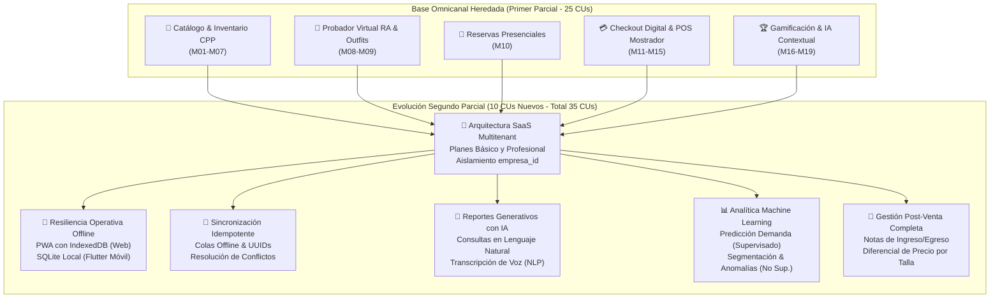

---

## 1.3 Objetivos del Proyecto

### 1.3.1 Objetivo General

Evolucionar la plataforma FashionStore hacia un plataforma funcional de comercio electrónico SaaS multitenant, incorporando planes de suscripción, aplicaciones web progresivas, operación offline en web y móvil, sincronización de datos y reportes generativos mediante inteligencia artificial, aplicando la metodología ICONIX y garantizando la coherencia entre los modelos UML 2.5+ y la implementación.

---

### 1.3.2 Objetivos Específicos

1. Aplicar ICONIX al análisis, diseño y evolución del sistema.
2. Transformar FashionStore en una plataforma multitenant que permita administrar múltiples empresas independientes.
3. Implementar planes de suscripción que regulen el acceso a funcionalidades y recursos.
4. Evolucionar la aplicación Angular hacia una Progressive Web App (PWA).
5. Incorporar persistencia local y operaciones offline en la aplicación web.
6. Incorporar SQLite como mecanismo de persistencia local en Flutter.
7. Permitir el registro de reservas y ventas sin conectividad a Internet.
8. Implementar sincronización de operaciones pendientes entre las aplicaciones cliente y el backend.
9. Detectar y gestionar conflictos derivados de operaciones offline.
10. Incorporar reportes generativos mediante inteligencia artificial y lenguaje natural.
11. Garantizar aislamiento y seguridad de información entre empresas.
12. Implementar pruebas funcionales, de integración y de reglas críticas de negocio.
13. Actualizar la documentación técnica y UML2.5+ para reflejar fielmente el software desarrollado.
---

## 1.4 Justificación

La evolución de FashionStore se fundamenta rigurosamente en cinco dimensiones de análisis:

### 1.4.1 Justificación Técnica y Arquitectónica
Desde la perspectiva de la ingeniería de software, migrar un desarrollo monolítico o de cliente único hacia un modelo SaaS Multitenant representa el estándar contemporáneo de la industria. Permite mantener un único código base (*single codebase*) y una base de datos centralizada con aislamiento lógico (`empresa_id`), minimizando exponencialmente los costos operativos de infraestructura en nube, facilitando los despliegues continuos y reduciendo el esfuerzo de mantenimiento evolutivo. 
Asimismo, dotar al sistema de arquitectura offline con PWA (Service Workers + IndexedDB) y Flutter (SQLite) demuestra la capacidad de diseñar sistemas distribuidos resilientes, capaces de tolerar desconexiones de red sin perder consistencia transaccional gracias a técnicas avanzadas de idempotencia y sincronización asíncrona.

### 1.4.2 Justificación Comercial, Económica y de Escalabilidad (SaaS)
Desarrollar software a medida para una sola empresa textil resulta económicamente ineficiente y restringe severamente el retorno sobre la inversión (ROI). Al transformar FashionStore en un producto SaaS con planes escalonados (Básico y Profesional), se democratiza el acceso a tecnología de vanguardia (realidad aumentada, vestidores virtuales, analítica con IA) para pequeñas y medianas empresas (PyMEs) textiles bolivianas que no disponen de capital para costear desarrollos propietarios. La empresa proveedora de FashionStore genera un flujo de ingresos recurrente y predecible mediante suscripciones mensuales o anuales, escalando a múltiples clientes sin un incremento proporcional en costos operativos.

### 1.4.3 Justificación Social y de Resiliencia Operativa (Realidad Boliviana)
En el contexto boliviano, las telecomunicaciones presentan disparidades territoriales notables. Tiendas de ropa ubicadas en galerías comerciales densas, centros históricos o ciudades intermedias experimentan cortes de Internet recurrentes. Forzar una dependencia absoluta de la nube condena al comerciante a suspender sus ventas durante los apagones de red. Al garantizar la operatividad offline de la caja POS y las reservas, FashionStore salvaguarda la continuidad del negocio y el empleo, asegurando que ninguna venta se pierda por contingencias externas de conectividad.

### 1.4.4 Justificación de Inteligencia de Negocio y Machine Learning
El volumen de datos transaccionales acumulado en el comercio de moda resulta inútil si la gerencia carece de herramientas ágiles para interpretarlo. Los reportes generativos con IA democratizan la extracción de conocimiento, permitiendo que directivos sin formación en bases de datos obtengan información estratégica en segundos formulando preguntas naturales. Complementariamente, los modelos de Machine Learning sustituyen la intuición empírica por modelos estadísticos predictivos, previniendo quiebres de existencias y mejorando las campañas comerciales mediante segmentación científica de clientes.

### 1.4.5 Justificación Académica y Metodológica (ICONIX vs PUDS)
En el ámbito de la formación profesional de la materia Sistemas de Información II, el proyecto permite contrastar de forma vivencial dos de los paradigmas más relevantes de la ingeniería de software: el Proceso Unificado (PUDS), exhaustivo y formal, frente a ICONIX, ágil y pragmático. Implementar ICONIX demuestra cómo una metodología pesada-ligera puede reducir la sobrecarga de artefactos conservando la rigurosidad conceptual mediante el puente que los diagramas de robustez (BCE) tienden entre el lenguaje del negocio (casos de uso) y el lenguaje del código (diagramas de secuencia y clases).

---

## 1.5 Alcance y Limitaciones

### 1.5.1 Módulos del Sistema

A continuación se detalla exhaustivamente cada uno de los **26 módulos funcionales** que conforman la plataforma FashionStore en su versión escalada para el Segundo Parcial. Cada especificación define la descripción operativa orientada al control de acceso basado en roles (RBAC) y la arquitectura SaaS multitenant, la segregación de responsabilidades, la estructura de datos clave (con identificadores, tipos de datos, hashes de seguridad y restricciones de integridad) y las funcionalidades clave correspondientes.


#### 1.5.1.1 Módulo M01: Autenticación, Autorización y Seguridad (RBAC)
**Descripción General:**  
Permite gestionar el acceso seguro y controlado a la plataforma mediante un esquema estricto de Control de Acceso Basado en Roles (RBAC). Cada usuario que interactúa con FashionStore (Administrador, Encargado de Sucursal, Cajero, Personal de Logística/Inventario, Cliente o Proveedor) accede exclusivamente a las vistas, endpoints y operaciones autorizadas para su perfil específico. Implementa mecanismos de alta seguridad informática, garantizando la confidencialidad, integridad y no repudio de la información transaccional.

**Datos principales:**
- `id_usuario`: Entero autoincremental (PK).
- `nombres` y `apellidos`: Cadenas alfanuméricas (obligatorias).
- `email`: Cadena alfanumérica única (Unique Constraint, indexado para búsquedas rápidas de autenticación).
- `password_hash`: Cadena alfanumérica de 60 caracteres generada mediante algoritmo criptográfico `bcrypt` con factor de coste balanceado (nunca se almacena texto en claro).
- `rol`: Enumerador tipado (`ADMINISTRADOR`, `ENCARGADO_SUCURSAL`, `CAJERO`, `LOGISTICA`, `CLIENTE`, `PROVEEDOR`).
- `estado_cuenta`: Enumerador tipado (`ACTIVO`, `INACTIVO`, `BLOQUEADO_POR_INTENTOS`, `PENDIENTE_VERIFICACION`).
- `intentos_fallidos`: Entero corto (contador acumulativo de intentos consecutivos de inicio de sesión erróneos).
- `ultimo_acceso`: Timestamp de fecha y hora exacta del último login exitoso.
- `token_jwt`: Token web JSON firmado con clave asimétrica RSA/HMAC conteniendo claims de identidad y expiración configurable (60 minutos para web, 30 días para móvil mediante refresh token).
- `id_sucursal_asignada`: Entero (FK opcional, vincula al empleado con una sucursal física determinada).

**Funcionalidades clave:**
- Inicio de sesión seguro con validación estricta de credenciales hash y emisión de tokens JWT.
- Cierre de sesión con invalidación y revocación inmediata de tokens en lista de exclusión (Blacklist en memoria/Redis).
- Bloqueo preventivo y automático de la cuenta tras 5 intentos fallidos consecutivos de autenticación.
- Recuperación automatizada de contraseña mediante generación de tokens de un solo uso (OTP) temporizados enviados al correo electrónico registrado.
- Cambio de contraseña por el propio usuario con validación estricta de robustez (mínimo 8 caracteres, combinación de mayúsculas, minúsculas, números y símbolos especiales).
- Gestión y mantenimiento de perfiles y asignación de roles por parte del Administrador General.
- Registro en bitácora de auditoría de cada intento de acceso (login/logout, IP de origen, User-Agent, fecha/hora y resultado).

---

#### 1.5.1.2 Módulo M02: Gestión de Sucursales y Ciudades
**Descripción General:**  
Administra la estructura física, geográfica y organizacional de la cadena de tiendas de indumentaria. Permite definir las ciudades de cobertura y las diferentes sucursales habilitadas en cada territorio, estableciendo su localización geográfica precisa, capacidades de atención, números de contacto y personal asignado, sirviendo como eje espacial para el inventario, las reservas presenciales y los despachos.

**Datos principales:**
- `id_sucursal`: Entero autoincremental (PK).
- `id_ciudad`: Entero (FK hacia la tabla `Ciudades`).
- `nombre_sucursal`: Cadena alfanumérica (ej. "Sucursal Equipetrol", "Sucursal Calacoto").
- `direccion_fisica`: Texto descriptivo de la ubicación y referencias viales.
- `latitud` y `longitud`: Valores de precisión decimal (GPS) para geolocalización y cálculo de distancias.
- `telefono_contacto`: Cadena numérica.
- `horario_apertura` y `horario_cierre`: Formato Time (ej. 09:00:00 a 21:00:00).
- `capacidad_probadores`: Entero (número de vestidores físicos disponibles para atención concurrente de reservas).
- `estado_operativo`: Enumerador tipado (`OPERATIVA`, `EN_MANTENIMIENTO`, `CERRADA_TEMPORALMENTE`).

**Funcionalidades clave:**
- Registro, modificación, baja lógica y consulta detallada de ciudades y regiones de cobertura.
- CRUD completo de sucursales físicas con registro georreferenciado (latitud/longitud).
- Asignación de encargados de tienda y personal operativo a sucursales específicas.
- Parametrización de días laborables, feriados y franjas horarias de atención para reservas presenciales.
- Consulta interactiva y pública de sucursales cercanas para el cliente desde la app móvil o web mediante geolocalización.
- Habilitación o inhabilitación temporal de sucursales para recepción de pedidos o reservas.

---

#### 1.5.1.3 Módulo M03: Gestión de Productos, Categorías y Atributos
**Descripción General:**  
Centraliza la administración del catálogo de prendas de vestir masculinas. Gestiona de forma desacoplada las categorías (camisas, trajes, pantalones, calzado, accesorios), marcas comerciales, modelos, colecciones y los atributos intrínsecos de cada prenda, destacando el manejo de colores como atributos multivaluados y tallas normalizadas, junto con la gestión multimedia de imágenes en alta definición.

**Datos principales:**
- `id_producto`: Entero autoincremental (PK).
- `codigo_sku_base`: Cadena alfanumérica única estandarizada (ej. "SHIRT-SLIM-001").
- `nombre`: Cadena alfanumérica (ej. "Camisa Oxford Slim Fit").
- `descripcion`: Texto detallado con especificaciones textiles, composición de tela y cuidados.
- `id_categoria`: Entero (FK hacia `Categorias`).
- `id_marca`: Entero (FK hacia `Marcas`).
- `precio_venta_base`: Decimal con dos dígitos de precisión (monto estándar en moneda nacional).
- `genero`: Enumerador fijado en `MASCULINO`.
- `tallas_disponibles`: Arreglo / relación relacional normalizada (`S`, `M`, `L`, `XL`, `XXL`, `38`, `40`, `42`).
- `colores_multivaluados`: Arreglo estructurado de colores con nombre comercial y código hexadecimal (ej. `[{"nombre": "Azul Marino", "hex": "#000080"}, {"nombre": "Blanco", "hex": "#FFFFFF"}]`).
- `imagenes_url`: Arreglo de URLs hacia repositorio de almacenamiento en la nube (S3/Cloudinary).
- `estado_publicacion`: Enumerador (`BORRADOR`, `PUBLICADO`, `DESCATALOGADO`).

**Funcionalidades clave:**
- Registro y actualización de fichas técnicas de prendas con validación de código SKU único.
- Gestión taxonómica de categorías y subcategorías jerárquicas de indumentaria masculina.
- Configuración de tallas y asignación de paletas de colores multivaluados con código visual Hexadecimal.
- Carga múltiple y optimización de imágenes de productos para web y móvil (vistas frontal, dorsal y detalle).
- Activación, suspensión y descatalogación de productos del catálogo público.
- Vinculación de productos con modelos 3D y texturas para el vestidor virtual en Realidad Aumentada.

---

#### 1.5.1.4 Módulo M04: Gestión de Temporadas y Colecciones
**Descripción General:**  
Permite planificar, organizar y calendarizar las campañas comerciales de la moda masculina. Clasifica los productos dentro de colecciones estacionales (Primavera-Verano, Otoño-Invierno, Temporada Escolar/Universitaria, Black Friday, Ediciones Especiales de Gala), facilitando la rotación estratégica del inventario, la aplicación de políticas de precios diferenciadas y la alimentación de datos contextuales al motor de Inteligencia Artificial.

**Datos principales:**
- `id_temporada`: Entero autoincremental (PK).
- `nombre_temporada`: Cadena alfanumérica (ej. "Primavera - Verano 2026", "Línea Ejecutiva Invierno").
- `codigo_campaña`: Cadena alfanumérica única (ej. "SS-2026").
- `fecha_inicio`: Fecha de lanzamiento oficial de la temporada.
- `fecha_fin`: Fecha de cierre y liquidación de temporada.
- `descripcion`: Texto explicativo de la línea conceptual de la colección.
- `estado_temporada`: Enumerador tipado (`PLANIFICADA`, `VIGENTE`, `EN_LIQUIDACION`, `FINALIZADA`).
- `descuento_liquidacion_sugerido`: Porcentaje numérico aplicable al fin de temporada.

**Funcionalidades clave:**
- Creación, modificación y cierre formal de temporadas y colecciones comerciales.
- Asociación masiva o individual de productos del catálogo a una o múltiples temporadas.
- Activación automatizada de promociones y descuentos por cambio de temporada comercial.
- Segmentación de colecciones para campañas de marketing y recomendaciones personalizadas por IA.
- Reporte comparativo de ventas y rentabilidad entre colecciones históricas.

---

#### 1.5.1.5 Módulo M05: Gestión de Proveedores y Abastecimiento
**Descripción General:**  
Administra la cadena de suministro y aprovisionamiento de mercadería. Gestiona la información jurídica, comercial y crediticia de los proveedores nacionales e internacionales que confeccionan y distribuyen las prendas de vestir, controlando el catálogo de productos suministrados, condiciones de entrega, plazos de crédito y contratos comerciales.

**Datos principales:**
- `id_proveedor`: Entero autoincremental (PK).
- `razon_social`: Cadena alfanumérica oficial.
- `nit_o_identificacion`: Cadena alfanumérica única (Número de Identificación Tributaria).
- `nombre_contacto`: Cadena alfanumérica del ejecutivo de cuentas.
- `telefono` y `email`: Datos de contacto directo.
- `direccion_sede`: Texto físico y país/ciudad de origen.
- `terminos_pago`: Enumerador (`CONTADO`, `CREDITO_30_DIAS`, `CREDITO_60_DIAS`, `CONSIGNACION`).
- `estado`: Enumerador (`ACTIVO`, `INACTIVO`, `OBSERVADO`).

**Funcionalidades clave:**
- Registro de proveedores con validación de identificación tributaria y datos comerciales.
- Vinculación de proveedores con líneas de productos y categorías textiles autorizadas.
- Registro y seguimiento de órdenes de compra con detalle de cantidades y precios acordados.
- Evaluación de cumplimiento en tiempos de entrega y control de calidad de lotes recibidos.
- Consulta de historial consolidado de compras y pagos por proveedor.

---

#### 1.5.1.6 Módulo M06: Gestión de Inventario Multi-Sucursal y Costos Ponderados
**Descripción General:**  
Constituye el núcleo logístico y financiero de FashionStore. Controla en tiempo real las existencias físicas de cada variante de producto (producto, talla, color) en cada una de las sucursales de la cadena. Implementa de manera estricta el algoritmo de **Costo Promedio Ponderado** tras cada entrada de mercadería por compra, almacenando paralelamente el **último costo unitario de adquisición** de acuerdo con las especificaciones académicas del proyecto. Registra la trazabilidad completa de transferencias inter-sucursales, mermas y ajustes de inventario.

**Datos principales:**
- `id_inventario`: Entero autoincremental (PK).
- `id_sucursal`: Entero (FK hacia `Sucursales`).
- `id_producto`: Entero (FK hacia `Productos`).
- `talla`: Cadena normalizada (ej. "M", "42").
- `color`: Cadena del color específico (ej. "Azul Marino").
- `stock_fisico`: Entero (cantidad física existente en la tienda).
- `stock_reservado`: Entero (cantidad apartada temporalmente para clientes con reservas presenciales vigentes).
- `stock_disponible`: Entero calculado (`stock_fisico - stock_reservado`).
- `stock_minimo`: Entero (umbral de reorden para alertas de desabastecimiento).
- `stock_maximo`: Entero (límite de almacenamiento físico en la sucursal).
- `ultimo_costo_unitario`: Decimal(10,2) (valor unitario pagado en el lote de compra más reciente).
- `costo_promedio_ponderado`: Decimal(10,2) (recalculado matemáticamente según: $CPP_{nuevo} = \frac{(Stock_{anterior} \times CPP_{anterior}) + (Cant_{ingreso} \times Costo_{ingreso})}{Stock_{anterior} + Cant_{ingreso}}$).
- `ubicacion_almacen`: Cadena descriptiva (ej. "Estante B, Percha 4").

**Funcionalidades clave:**
- Control de existencias por variante de producto segregado por cada sucursal de la empresa.
- Actualización atómica del inventario y bloqueo temporal durante transacciones concurrentes de compra o reserva.
- Cálculo matemático automático del Costo Promedio Ponderado y registro del Último Costo Unitario en cada recepción.
- Solicitud, autorización, despacho y recepción de transferencias de prendas entre sucursales.
- Generación de alertas automáticas al encargado de tienda cuando el stock cruza el umbral mínimo configurado.
- Registro de bitácora inmutable de movimientos de kardex (entradas, salidas, ajustes por merma y transferencias) con fecha, hora, responsable y justificación.

---

#### 1.5.1.7 Módulo M07: Catálogo Digital Omnicanal (Web y Móvil)
**Descripción General:**  
Expone el portafolio de prendas de vestir masculinas a través de la plataforma web responsiva (Angular) y la aplicación móvil nativa (Flutter). Proporciona a los clientes y visitantes una experiencia de navegación sumamente rápida, fluida y visualmente atractiva, con capacidades de búsqueda predictiva, filtros multifacéticos en tiempo real y verificación inmediata de disponibilidad de stock por sucursal física.

**Datos principales:**
- Parámetros de consulta y filtrado: Categoría, Rango de Precios, Talla, Color, Temporada, Marca, Ciudad y Sucursal.
- Esquema de serialización JSON enriquecido: SKU, nombre, descripción formateada, galería multimedia, variantes de talla/color, disponibilidad en sucursal y atributos de compatibilidad con realidad aumentada.
- Índices de base de datos relacionales y full-text search para optimización de tiempos de respuesta (< 2 segundos).

**Funcionalidades clave:**
- Visualización jerárquica del catálogo de moda masculina con paginación optimizada e infinitescroll.
- Filtrado multidimensional combinando simultáneamente temporada, talla, color, marca y precio.
- Selector interactivo de sucursal con consulta inmediata de existencias por talla y color específico.
- Ficha detallada de prenda con guía de tallas anatómicas masculinas y recomendaciones de cuidado textil.
- Funcionalidad de marcado y gestión de lista de prendas favoritas (*Wishlist*) sincronizada entre web y app móvil.

---

#### 1.5.1.8 Módulo M08: Vestidor Virtual con Realidad Aumentada (RA)
**Descripción General:**  
Implementa el probador virtual tridimensional mediante tecnología de Realidad Aumentada sobre la aplicación móvil Flutter. Mediante la cámara del smartphone del usuario, el sistema superpone modelos 3D y texturas hiperrealistas de prendas masculinas sobre la silueta del cliente en tiempo real, permitiéndole evaluar la caída, el tamaño proporcional y la armonía visual antes de tomar la decisión de reserva o compra.

**Datos principales:**
- `id_recurso_ra`: Entero autoincremental (PK).
- `id_producto`: Entero (FK hacia `Productos`).
- `modelo_3d_url`: Cadena URI apuntando al archivo tridimensional optimizado (`.glb` / `.gltf`).
- `texturas_url`: Mapeo JSON de texturas diferenciadas por color de prenda.
- `puntos_anclaje_corporal`: Configuración JSON de mapeo anatómico (hombros, torso, cadera, cuello).
- `escala_referencia`: Factor numérico decimal de calibración de proporciones anatómicas.

**Funcionalidades clave:**
- Detección de silueta humana y extremidades mediante visión artificial (ARCore / ML Kit).
- Proyección tridimensional en tiempo real de chaquetas, camisas, blazers y camisetas sobre el cuerpo del usuario.
- Cambio dinámico de color y textura de la prenda proyectada sin interrumpir la transmisión de la cámara.
- Captura fotográfica del outfit proyectado con opción de guardado local o compartición en redes sociales.
- Integración directa desde la vista de Realidad Aumentada hacia el Carrito de Compras o el Flujo de Reserva.

---

#### 1.5.1.9 Módulo M09: Comparador Inteligente de Outfits
**Descripción General:**  
Herramienta de análisis visual y estilístico que permite al cliente contrastar de manera interactiva hasta tres combinaciones completas de ropa masculina (*outfits*) lado a lado en una sola pantalla. El módulo desglosa visualmente cada combinación (prenda superior, prenda inferior, calzado y accesorios), calcula los subtotales, compara los precios de cada conjunto y visualiza los beneficios de fidelización o descuentos aplicables a cada alternativa.

**Datos principales:**
- `id_comparacion`: Entero autoincremental (PK o identificador de sesión local).
- `id_cliente`: Entero (FK opcional, almacenable en perfil).
- `outfit_1`, `outfit_2`, `outfit_3`: Estructuras JSON compuestas conteniendo: lista de SKUs de prendas seleccionadas, tallas, colores elegidos, precio unitario de cada una y monto acumulado.
- `total_outfit_1`, `total_outfit_2`, `total_outfit_3`: Montos decimales calculados.
- `fecha_comparacion`: Timestamp.

**Funcionalidades clave:**
- Interfaz interactiva de arrastrar y soltar (*drag & drop*) o selección rápida para ensamblar hasta tres combinaciones.
- Visualización paralela lado a lado de las tres combinaciones con detalles de precio, color y disponibilidad.
- Cálculo automático y comparativo del costo total de cada outfit, indicando la opción más económica y la de mejor valoración.
- Reemplazo dinámico de componentes individuales (ej. sustituir una camisa formal por una casual y observar el cambio de precio global).
- Botón de acción directa para transferir el outfit ganador íntegramente al carrito de compras o a una reserva presencial.

---

#### 1.5.1.10 Módulo M10: Sistema de Reservas de Prendas en Sucursal
**Descripción General:**  
Regula el proceso omnicanal mediante el cual un cliente preselecciona un lote de prendas desde la plataforma digital para probárselas físicamente en una sucursal determinada. El sistema reserva el stock temporalmente para evitar que se venda a terceros, genera un código de reserva único con código QR, y notifica inmediatamente a la sucursal de destino para que el encargado prepare y ordene las prendas en un probador asignado.

**Datos principales:**
- `id_reserva`: Entero autoincremental (PK).
- `codigo_reserva`: Cadena alfanumérica única de 8 caracteres (ej. "RSV-2026-X8K").
- `id_cliente`: Entero (FK hacia `Clientes`).
- `id_sucursal`: Entero (FK hacia `Sucursales`).
- `fecha_reserva`: Fecha en que fue emitida la solicitud.
- `fecha_programada_visita`: Fecha y hora fijada por el cliente para acudir a la tienda.
- `hora_limite_vigencia`: Timestamp en el que la reserva expira y el stock reservado se libera automáticamente si el cliente no se presenta.
- `estado_reserva`: Enumerador tipado (`PENDIENTE_PREPARACION`, `PREPARADA_EN_SUCURSAL`, `CLIENTE_PRESENTE`, `CONCRETADA_VENTA`, `CANCELADA_POR_CLIENTE`, `EXPIRADA`).
- `items_reserva`: Tabla detalle con: `id_producto`, `talla`, `color`, `cantidad`, `precio_al_momento`.

**Funcionalidades clave:**
- Generación de reservas multi-prenda indicando sucursal, fecha y rango de hora de visita presencial.
- Bloqueo atómico temporal del inventario disponible de la sucursal asignada durante la vigencia de la reserva.
- Generación de comprobante digital de reserva con código QR escaneable por el personal de tienda.
- Notificación en tiempo real y panel de control para que el Encargado de Sucursal marque la reserva como "Preparada en Percha/Probador".
- Confirmación de llegada del cliente mediante lectura del QR de la reserva y transición de estados del proceso.
- Liberación automática del stock inmovilizado mediante tarea programada si la reserva vence sin asistencia del cliente.

---

#### 1.5.1.11 Módulo M11: Carrito de Compras Omnicanal
**Descripción General:**  
Gestiona el almacenamiento temporal y la persistencia de las prendas seleccionadas por el cliente para su adquisición digital. Opera de manera sincronizada entre la versión web y la aplicación móvil para usuarios autenticados, o mediante almacenamiento local seguro para invitados. Realiza validaciones dinámicas de existencias, cálculo automatizado de subtotales, impuestos y aplicación de promociones o descuentos de fidelización.

**Datos principales:**
- `id_carrito`: Entero autoincremental (PK).
- `id_cliente`: Entero (FK hacia `Clientes`, nulo para carritos anónimos gestionados por UUID de sesión).
- `items_carrito`: Estructura detalle con: `id_producto`, `talla`, `color`, `cantidad`, `precio_unitario`, `id_sucursal_despacho`.
- `subtotal`: Decimal(10,2).
- `monto_descuento`: Decimal(10,2).
- `monto_total`: Decimal(10,2).
- `fecha_ultima_actualizacion`: Timestamp.

**Funcionalidades clave:**
- Incorporación, edición de cantidades y remoción de prendas con validación instantánea de disponibilidad en stock.
- Persistencia del carrito en base de datos para usuarios registrados, permitiendo iniciar la selección en la app móvil y finalizarla en la web.
- Cálculo automático de importes, subtotales, descuentos promocionales y costo de envío según la modalidad elegida.
- Detección de variaciones de stock o precio antes de avanzar a la pasarela de pago.
- Vaciado automático o conversión directa del carrito en una Orden de Venta formal.

---

#### 1.5.1.12 Módulo M12: Venta Digital y Checkout
**Descripción General:**  
Controla el flujo completo de formalización de la compra en los canales digitales (web y móvil). Gestiona la selección del método de entrega (envío a domicilio o retiro gratuito en sucursal física - *Click & Collect*), la captura de datos fiscales para la facturación, la confirmación de la transacción con la pasarela de pagos y la emisión del comprobante digital de compra.

**Datos principales:**
- `id_orden_venta`: Entero autoincremental (PK).
- `numero_factura_o_nota`: Cadena alfanumérica única (ej. "FACT-DIG-00452").
- `id_cliente`: Entero (FK hacia `Clientes`).
- `tipo_entrega`: Enumerador (`RETIRO_EN_SUCURSAL`, `DELIVERY_A_DOMICILIO`).
- `id_sucursal_retiro`: Entero (FK opcional hacia `Sucursales` en caso de retiro presencial).
- `direccion_envio`: Texto descriptivo estructurado en caso de delivery a domicilio.
- `monto_subtotal`: Decimal(10,2).
- `costo_envio`: Decimal(10,2).
- `descuento_aplicado`: Decimal(10,2).
- `monto_total_pagado`: Decimal(10,2).
- `estado_orden`: Enumerador (`PENDIENTE_PAGO`, `PAGADO_CONFIRMADO`, `EN_PREPARACION`, `EN_CAMINO`, `ENTREGADO`, `ANULADO`).
- `id_transaccion_pago`: Cadena (identificador devuelto por la pasarela de pagos).
- `fecha_hora_venta`: Timestamp de formalización.

**Funcionalidades clave:**
- Asistente de Checkout de pasos secuenciales: Selección de Entrega -> Datos de Facturación -> Pago -> Confirmación.
- Validación final de inventario con bloqueo transaccional atómico antes de invocar la pasarela de cobro.
- Descuento definitivo e inmediato del stock en la sucursal de despacho tras la confirmación exitosa del pago.
- Generación de comprobante digital de venta en formato PDF descargable y envío automatizado al correo del cliente.
- Consulta y seguimiento del estado de la orden en tiempo real por parte del cliente (*Tracking*).

---

#### 1.5.1.13 Módulo M13: Punto de Venta Presencial (POS)
**Descripción General:**  
Módulo web operativo diseñado para los cajeros de las sucursales físicas. Optimizado para pantallas táctiles y teclado numérico rápido, permite registrar ventas directas de mostrador a clientes que acuden a la tienda, leer códigos de barras, asociar clientes registrados para otorgarles puntos o registrar ventas a clientes de paso (consumidor final), procesar cobros mixtos y emitir comprobantes de venta físicos de forma inmediata.

**Datos principales:**
- `id_venta_pos`: Entero autoincremental (PK).
- `id_sucursal`: Entero (FK hacia `Sucursales`).
- `id_cajero`: Entero (FK hacia `Usuarios`).
- `id_cliente`: Entero (FK hacia `Clientes`, o ID de "Cliente Casual / Consumidor Final").
- `numero_ticket`: Cadena única consecutiva de la caja física.
- `metodo_pago_utilizado`: Enumerador (`EFECTIVO`, `TARJETA_DEBITO`, `TARJETA_CREDITO`, `QR_SIMPLE`, `PAGO_MIXTO`).
- `monto_recibido` y `monto_cambio`: Decimales para transacciones en efectivo.
- `total_venta`: Decimal(10,2).
- `fecha_hora_transaccion`: Timestamp de emisión en caja.

**Funcionalidades clave:**
- Búsqueda veloz de prendas mediante lectura de código de barras o teclado predictivo por SKU.
- Conversión inmediata de una reserva física previa en una venta POS definitiva con un solo clic.
- Registro de ventas con identificación de cliente para asignación de puntos de fidelización o emisión a consumidor final.
- Soporte para cobros combinados o fraccionados (ej. parte en efectivo y parte con código QR o tarjeta).
- Actualización en tiempo real del inventario físico de la sucursal y registro del movimiento contable en caja.
- Cierre y arqueo de caja por turno de trabajo con consolidación de ventas por método de pago.

---

#### 1.5.1.14 Módulo M14: Pasarela de Pagos Electrónicos (Stripe / PayPal)
**Descripción General:**  
Proporciona la infraestructura de cobro digital para ventas en línea, integrando APIs estandarizadas de pasarelas internacionales de pago (Stripe y PayPal) operando en entornos de prueba (*Sandbox*) conforme a las restricciones del examen. Garantiza el cumplimiento de normativas de seguridad PCI-DSS mediante tokenización de tarjetas (evitando el almacenamiento de datos sensibles de tarjetas en la base de datos propia) y gestión asíncrona de eventos de pago vía Webhooks.

**Datos principales:**
- `id_transaccion`: Entero autoincremental (PK).
- `pasarela`: Enumerador (`STRIPE`, `PAYPAL`).
- `payment_intent_id`: Identificador único de cobro devuelto por la pasarela (ej. `pi_3MtwLwLkdIwHu7ix28a3tqPa`).
- `cliente_pasarela_id`: Identificador de cliente generado en el proveedor de pago.
- `monto_transaccion`: Decimal(10,2).
- `moneda`: Cadena ISO (`USD`, `BOB`).
- `estado_pago`: Enumerador (`INICIADO`, `REQUIERE_ACCION_3DS`, `APROBADO`, `RECHAZADO`, `REEMBOLSADO`).
- `payload_webhook`: Registro JSON de la respuesta asíncrona recibida del servidor de pagos.
- `fecha_creacion`: Timestamp.

**Funcionalidades clave:**
- Creación de intenciones de pago (*PaymentIntents*) seguras con verificación 3D Secure contra fraudes.
- Renderizado de componentes seguros de captura de tarjeta (*Stripe Elements* / Botones SDK de PayPal).
- Procesamiento y validación criptográfica de firmas de eventos Webhook para confirmar pagos en segundo plano.
- Manejo de reintentos y notificaciones de error ante transacciones denegadas o fondos insuficientes.
- Soporte para reembolsos directos hacia la pasarela en caso de cancelaciones autorizadas.

---

#### 1.5.1.15 Módulo M15: Gestión de Tipos y Métodos de Pago
**Descripción General:**  
Centraliza la administración de los diferentes medios de pago admitidos en FashionStore tanto para ventas presenciales en tiendas físicas como para compras en los canales digitales. Controla los parámetros operativos, recargos, comisiones, cuentas bancarias de destino y la habilitación del mecanismo de pago por Código QR Interoperable (norma BCB / QR Simple), garantizando el cuadre de ingresos y la conciliación contable.

**Datos principales:**
- `id_tipo_pago`: Entero autoincremental (PK).
- `nombre_medio`: Cadena alfanumérica (`EFECTIVO`, `TARJETA_LOCAL`, `QR_SIMPLE`, `TRANSFERENCIA`, `STRIPE_INTERNACIONAL`, `PAYPAL`).
- `canal_aplicable`: Enumerador (`SOLO_PRESENCIAL`, `SOLO_DIGITAL`, `OMNICANAL`).
- `requiere_comprobante_adjunto`: Booleano (para transferencias o pagos QR manuales).
- `comision_porcentaje`: Decimal(5,2).
- `cuenta_contable_asociada`: Cadena alfanumérica para conciliación financiera.
- `estado_activo`: Booleano.

**Funcionalidades clave:**
- Parametrización y activación/desactivación de medios de cobro admitidos por canal de venta.
- Generación de códigos QR dinámicos con monto exacto y referencia única de orden para pagos inmediatos.
- Módulo de verificación y conciliación de transferencias bancarias para el personal de administración.
- Registro detallado del flujo monetario por cada tipo de cobro para arqueos y auditorías financieras.
- Reporte consolidado de comisiones deducidas por procesadores de pago externos.

---

#### 1.5.1.16 Módulo M16: Sistema de Fidelización Gamificado
**Descripción General:**  
Constituye uno de los tres componentes diferenciadores de FashionStore. Diseñado para maximizar la recurrencia de compra, retención de clientes y el valor de vida del cliente (*CLV*). Implementa dinámicas de juego basadas en la acumulación de puntos por compras realizadas, asignación automática de niveles de membresía jerárquicos (Bronce, Plata, Oro, Diamante) con beneficios y descuentos crecientes, otorgamiento de insignias digitales por hitos comerciales y un motor de canje de puntos por descuentos en futuras compras.

**Datos principales:**
- `id_fidelizacion`: Entero autoincremental (PK).
- `id_cliente`: Entero (FK única hacia `Clientes`).
- `puntos_actuales`: Entero acumulativo de puntos disponibles para canje.
- `puntos_historicos_totales`: Entero acumulativo total (no disminuye al canjear, determina el nivel).
- `nivel_membresia`: Enumerador tipado (`BRONCE`, `PLATA`, `ORO`, `DIAMANTE`).
- `porcentaje_descuento_nivel`: Decimal(5,2) (ej. Bronce: 0%, Plata: 5%, Oro: 10%, Diamante: 15%).
- `insignias_obtenidas`: Arreglo JSON de insignias desbloqueadas con fecha de obtención (`[{"codigo": "FIRST_BUY", "nombre": "Primer Outfit", "fecha": "2026-09-01"}]`).
- `fecha_ultimo_ascenso`: Timestamp de cambio de nivel.

**Funcionalidades clave:**
- Asignación automática de puntos tras confirmación de compras efectivas (ej. 1 punto por cada 10 Bs consumidos).
- Evaluación periódica de puntos acumulados y promoción automática a niveles superiores de membresía:
  * **Bronce**: 0 a 499 puntos. Beneficios: acceso al catálogo y vestidor virtual.
  * **Plata**: 500 a 1,499 puntos. Beneficios: 5% de descuento permanente y acceso prioritario a reservas.
  * **Oro**: 1,500 a 3,999 puntos. Beneficios: 10% de descuento permanente y asesoría de estilo personalizada.
  * **Diamante**: 4,000+ puntos. Beneficios: 15% de descuento permanente, envíos gratis y acceso a colecciones exclusivas.
- Asignación de insignias digitales por logros específicos (ej. "Caballero Impecable": compra de 3 trajes formales; "Explorador RA": 5 usos del vestidor virtual; "Omnicanal": compra en web y en sucursal física).
- Redención de puntos acumulados en el carrito de compras como saldo a favor en dinero real.
- Panel visual interactivo del perfil del cliente mostrando barra de progreso hacia el siguiente nivel e insignias ganadas.

---

#### 1.5.1.17 Módulo M17: Asistente de Estilo con IA Contextual y Comandos de Voz
**Descripción General:**  
Componente diferenciador de vanguardia que eleva la experiencia de usuario a un nivel de asesoría de imagen personalizada. Utiliza algoritmos de Inteligencia Artificial (integrados vía API externa, ej. OpenAI GPT / Google Gemini) para sugerir combinaciones completas de prendas analizando cuatro variables en tiempo real: 1) Clima actual de la ciudad del usuario obtenido mediante integración con la API de OpenWeatherMap, 2) Historial de compras y preferencias de estilo registradas, 3) Reglas de colorimetría y etiqueta masculina, y 4) Disponibilidad real de existencias en tiendas. Además, incorpora procesamiento de lenguaje natural (NLP) para permitir la búsqueda de prendas y la generación de reportes ejecutivos mediante comandos de voz en la app móvil.

**Datos principales:**
- `id_solicitud_ia`: Entero autoincremental (PK).
- `id_cliente`: Entero (FK hacia `Clientes`).
- `temperatura_clima`: Decimal(4,1) (°C devueltos por la API meteorológica).
- `condicion_clima`: Cadena (ej. "Lluvioso", "Soleado", "Nublado", "Frío intenso").
- `estilo_ocasion`: Enumerador (`FORMAL_OFICINA`, `CASUAL_URBANO`, `EVENTO_GALA`, `DEPORTIVO`, `FIN_DE_SEMANA`).
- `paleta_colorimetria`: Cadena asignada al perfil (ej. "Invierno Frío", "Otoño Cálido").
- `prompt_generado`: Texto del prompt contextual enviado al modelo de lenguaje.
- `outfit_recomendado`: Estructura JSON con lista de SKUs de prendas sugeridas justificadas por la IA.
- `audio_comando_url`: URI opcional de almacenamiento temporal del audio procesado en búsquedas por voz.

**Funcionalidades clave:**
- Consulta automatizada a la API del clima (OpenWeatherMap) según la geolocalización o ciudad seleccionada por el usuario.
- Generación de recomendaciones contextuales de atuendos completos (ej. "Para este día de 14°C y llovizna en La Paz, te sugerimos un abrigo de paño azul marino combinado con pantalón de gabardina plomo").
- Algoritmo de filtrado que cruza las recomendaciones de la IA exclusivamente con productos disponibles en stock activo.
- Módulo de búsqueda en catálogo por comando de voz en la app móvil (transcripción de audio a texto e interpretación de intención mediante NLP).
- Generación automatizada de resúmenes y reportes ejecutivos verbales para el administrador (ej. "Dime las ventas de trajes de hoy en Santa Cruz").

---

#### 1.5.1.18 Módulo M18: Reportes, Analítica y Dashboards Empresariales
**Descripción General:**  
Proporciona herramientas de inteligencia de negocios y analítica descriptiva para la alta gerencia y los encargados de tienda. Consolida los datos transaccionales de ventas, inventarios, compras a proveedores y reservas, presentándolos en gráficos interactivos y métricas clave de desempeño (KPIs) para sustentar la toma de decisiones estratégicas de abastecimiento y ventas.

**Datos principales:**
- Métricas consolidadas: Volumen total de ventas en moneda nacional, ticket promedio de compra, rotación de inventario por sucursal, índice de conversión de reservas en ventas efectivas, productos de mayor y menor rotación (*Top/Bottom 10*), margen de contribución bruto por categoría, y tasa de retención de clientes por nivel de fidelización.
- Filtros analíticos: Por rango de fechas, sucursal, categoría textil, temporada comercial y método de pago.

**Funcionalidades clave:**
- Cuadro de mando (Dashboard) gerencial en tiempo real con tarjetas de métricas e indicadores de rendimiento.
- Reporte analítico de rotación y valoración de existencias consolidando Costo Promedio Ponderado vs Último Costo de Compra.
- Gráficos comparativos de ventas presenciales en sucursales vs ventas en canal digital (web y móvil).
- Tasa de efectividad de reservas: porcentaje de reservas presenciales concretadas en compras reales en probador.
- Exportación de informes estructurados a formatos Excel (XLSX) y PDF para fines contables y de auditoría.

---

#### 1.5.1.19 Módulo M19: Logística de Envíos y Delivery
**Descripción General:**  
Administra la distribución física y entrega de pedidos en la modalidad de compra digital con despacho a domicilio. Modela la integración con servicios de mensajería y empresas de delivery del medio local (emulando plataformas como Yaigo, Yummy o PedidosYa), calculando dinámicamente las tarifas de transporte mediante algoritmos geodésicos basados en distancia kilométrica, peso volumétrico de las prendas y zonas urbanas de cobertura, permitiendo además el rastreo del despacho en tiempo real.

**Datos principales:**
- `id_envio`: Entero autoincremental (PK).
- `id_orden_venta`: Entero (FK hacia `OrdenesVenta`).
- `id_sucursal_origen`: Entero (FK hacia `Sucursales` desde donde se despacha el paquete).
- `latitud_destino` y `longitud_destino`: Coordenadas geográficas del domicilio del comprador.
- `distancia_km`: Decimal(6,2) (calculada mediante algoritmo geodésico Haversine).
- `peso_real_kg`: Decimal(5,2) (peso físico de las prendas seleccionadas).
- `peso_volumetrico_kg`: Decimal(5,2) (calculado según: $\frac{Largo \times Ancho \times Alto}{5000}$).
- `tarifa_envio`: Decimal(10,2) (monto final cobrado por el transporte).
- `nombre_repartidor` y `telefono_repartidor`: Datos del personal o empresa de logística asignada.
- `estado_envio`: Enumerador (`ASIGNADO`, `RECOLECTADO_EN_TIENDA`, `EN_TRANSITO`, `ENTREGADO`, `FALLIDO_AUSENCIA`).
- `codigo_seguimiento`: Cadena alfanumérica de rastreo público (Tracking).

**Funcionalidades clave:**
- Algoritmo automatizado de tarificación de envíos combinando tarifa base, costo por kilómetro y peso volumétrico del paquete.
- Asignación inteligente de la sucursal de origen más cercana al domicilio del cliente que posea el stock completo de la orden.
- Módulo de asignación de pedidos a repartidores o empresas aliadas de delivery.
- Rastreo en tiempo real del estado del despacho para el cliente desde la app móvil o sitio web.
- Registro de confirmación de entrega con captura de firma digital o código OTP proporcionado por el cliente al recibir el paquete.

---

#### 1.5.1.20 Módulo M20: Gestión de Empresas SaaS y Aislamiento Multitenant
**Descripción General:**  
Administra el ciclo de vida, configuración y gobernanza de las empresas clientes (*tenants*) suscritas a la plataforma FashionStore bajo el modelo de Software as a Service (SaaS). Garantiza el aislamiento lógico estricto de la información transaccional y de catálogo mediante la asignación de un discriminador unívoco (`empresa_id`) en cada tabla del esquema relacional compartido de PostgreSQL, impidiendo accesos cruzados o fugas de datos entre organizaciones. Permite al Superadministrador de la plataforma crear, activar, suspender o dar de baja tenants, supervisar el consumo de recursos y asociar subdominios o configuraciones personalizadas.

**Datos principales:**
- `id_empresa`: Entero autoincremental (PK global del tenant).
- `razon_social`: Cadena alfanumérica única (nombre legal de la empresa textil).
- `nombre_fantasia`: Cadena comercial representativa (marca de la tienda).
- `nit_o_identificacion_fiscal`: Cadena alfanumérica única indexada para validaciones tributarias.
- `subdominio_o_slug`: Cadena alfanumérica única (ej. `tienda-elegance.fashionstore.com`).
- `email_contacto_corporativo`: Cadena alfanumérica indexada para comunicaciones y notificaciones.
- `telefono_contacto`: Cadena numérica con prefijo internacional.
- `direccion_fiscal`: Texto descriptivo de la sede principal.
- `logo_url`: Cadena URI hacia el repositorio en la nube con la imagen institucional.
- `estado_empresa`: Enumerador tipado (`ACTIVA`, `SUSPENDIDA_FALTA_PAGO`, `EN_CONFIGURACION`, `DADA_DE_BAJA`).
- `fecha_registro`: Timestamp de creación en la plataforma.
- `fecha_ultimo_pago`: Timestamp de liquidación de la última mensualidad de suscripción.

**Funcionalidades clave:**
- Registro administrativo de nuevas empresas clientes con validación estricta de identificación tributaria (NIT) y subdominio único.
- Aislamiento lógico irrestricto de datos en todas las operaciones del backend mediante inyección automática del filtro `WHERE empresa_id = :tenant_id` en las consultas ORM/SQL.
- Suspensión y reactivación preventiva de empresas por incumplimiento de términos de suscripción o a petición voluntaria.
- Asignación de credenciales maestras y aprovisionamiento inicial de usuario Administrador de Empresa por tenant.
- Personalización de identidad visual (branding básico: logotipo corporativo, colores primarios en la interfaz web y comprobantes de venta).
- Bitácora de auditoría de eventos de administración de empresas (creación, cambios de estado y actualizaciones de contacto).

---

#### 1.5.1.21 Módulo M21: Gestión y Control de Planes de Suscripción
**Descripción General:**  
Define, regula y fiscaliza las condiciones contractuales y operativas de los planes de servicio comercializados por la plataforma FashionStore (Plan Básico y Plan Profesional). Controla en tiempo real las cuotas de recursos asignadas a cada tenant (máximo de sucursales operativas permitidas, habilitación del motor de reportes generativos con IA, y acceso a los algoritmos y dashboards de Machine Learning), bloqueando proactivamente operaciones que excedan los límites contratados e invitando a la actualización de plan (*upgrade*).

**Datos principales:**
- `id_plan`: Entero autoincremental (PK).
- `codigo_plan`: Cadena alfanumérica única (`BASICO`, `PROFESIONAL`, `ENTERPRISE`).
- `nombre_comercial`: Cadena alfanumérica descriptiva (ej. "Plan Básico Boutique", "Plan Profesional Retail").
- `costo_mensual_usd`: Decimal(10,2) (tarifa en dólares estadounidenses).
- `costo_anual_usd`: Decimal(10,2) (tarifa bonificada anual).
- `max_sucursales`: Entero (límite duro de tiendas físicas operativas: 2 para Básico, 10 para Profesional).
- `max_usuarios_personal`: Entero (límite de empleados administrativos y cajeros concurrentes).
- `permite_reportes_ia`: Booleano (acceso a generación de reportes en lenguaje natural texto/voz).
- `permite_machine_learning`: Booleano (acceso a modelos predictivos y clustering en dashboard analítico).
- `almacenamiento_max_gb`: Decimal(5,2) (cuota de imágenes y recursos 3D en la nube).
- `estado_plan`: Enumerador (`ACTIVO`, `OBSOLETO_SIN_NUEVAS_ALTAS`).

**Funcionalidades clave:**
- Parametrización dinámica de características, capacidades y precios de los planes comerciales desde el panel de Superadministrador.
- Verificación automática de límites al intentar crear una nueva sucursal física: si la empresa alcanza la cuota máxima de su plan, el sistema bloquea la creación y emite una alerta descriptiva.
- Control de acceso a nivel de middleware y API router: restricción de endpoints de IA y Machine Learning para empresas con Plan Básico.
- Asignación, migración y cambio de plan de suscripción para empresas registradas (escalado o degradación de plan).
- Consulta de métricas de consumo de recursos y estado de vigencia del plan actual desde el panel de la empresa.

---

#### 1.5.1.22 Módulo M22: Persistencia Local y Operación Offline (PWA IndexedDB / SQLite Móvil)
**Descripción General:**  
Proporciona la infraestructura de almacenamiento local y tolerancia a fallos de conectividad para las aplicaciones cliente de FashionStore. En la plataforma web, transforma la solución en una Progressive Web App (PWA) mediante Service Workers para el almacenamiento en caché de la aplicación y la API **IndexedDB** para persistir catálogos y transacciones de mostrador. En la aplicación móvil Flutter, implementa un motor relacional embebido mediante **SQLite** (`sqflite`). Permite a los operadores registrar ventas de mostrador (POS de contado) y a los clientes formalizar reservas sin requerir conexión a Internet.

**Datos principales:**
- Estructura local en IndexedDB (Web) y SQLite (Móvil):
  * `local_productos`: Tabla/ObjectStore con SKU, nombre, precio, tallas, colores e imágenes cacheadas.
  * `local_stock_sucursal`: Tabla/ObjectStore con cantidad disponible por variante en la sucursal actual.
  * `cola_ventas_offline`: Tabla/ObjectStore de transacciones POS con `idempotency_key` (UUID v4), timestamp local, detalle de prendas, importe recibido y cambio entregado.
  * `cola_reservas_offline`: Tabla/ObjectStore de reservas con `idempotency_key`, fecha programada, prendas preseleccionadas y ticket provisional.
  * `estado_conectividad`: Booleano reactivo (`ONLINE` / `OFFLINE`) monitoreado por eventos del navegador (`navigator.onLine`) o plugins de conectividad en Flutter.

**Funcionalidades clave:**
- Instalación de la aplicación web en dispositivos de escritorio y móviles con comportamiento nativo gracias al manifiesto web y Service Workers.
- Precarga y sincronización periódica del catálogo y existencias de la sucursal asignada en la base de datos local (IndexedDB o SQLite).
- Detección reactiva de pérdida y restablecimiento de la conexión de red con indicador visual persistente en la cabecera.
- Ejecución ininterrumpida de ventas POS de contado en la tienda física durante caídas de Internet, descontando las existencias en el inventario local.
- Emisión e impresión de comprobantes de venta válidos provisionales offline con código hash de verificación local.
- Registro y resguardo inmutable de cada transacción en la cola local de operaciones pendientes.

---

#### 1.5.1.23 Módulo M23: Motor de Sincronización Transaccional Idempotente y Resolución de Conflictos
**Descripción General:**  
Gestiona el transporte seguro, la verificación y la asimilación definitiva de las operaciones registradas en modo offline una vez restablecida la conectividad a Internet. Garantiza el principio de **idempotencia** mediante el uso de identificadores universales únicos (UUID v4) generados en el cliente, impidiendo la duplicación de transacciones ante fallos de red o reintentos automáticos. Implementa políticas determinísticas de detección y resolución de conflictos de inventario y reservas, notificando al operador sobre cualquier discrepancia detectada.

**Datos principales:**
- `id_sincronizacion`: Entero autoincremental (PK).
- `empresa_id`: Entero (FK hacia `Empresas`).
- `idempotency_key`: Cadena UUID v4 única global (indexada con restricción Unique).
- `tipo_operacion`: Enumerador (`VENTA_POS_OFFLINE`, `RESERVA_OFFLINE`, `CAMBIO_PRENDA_OFFLINE`).
- `payload_transaccion`: Documento JSON con el detalle completo de la operación original registrada fuera de línea.
- `fecha_hora_local_cliente`: Timestamp emitido por el dispositivo cliente al originar la operación.
- `fecha_hora_recepcion_servidor`: Timestamp del backend al procesar la sincronización.
- `estado_sincronizacion`: Enumerador (`PROCESADO_EXITOSO`, `CONFLICTO_STOCK_AGOTADO`, `REINTENTO_PENDIENTE`, `DUPLICADO_DESCARTADO`).
- `mensaje_resolucion`: Texto descriptivo del resultado del procesamiento y ajustes de auditoría.

**Funcionalidades clave:**
- Activación automática del proceso de sincronización al detectar el evento de reconexión a Internet en web (PWA) o móvil (Flutter).
- Envío atómico por lotes (*batch processing*) de las operaciones pendientes almacenadas en IndexedDB o SQLite hacia el endpoint seguro `/api/v1/sync/process`.
- Verificación estricta de idempotencia en backend: si el `idempotency_key` ya fue procesado con anterioridad, se devuelve el comprobante existente sin volver a descontar inventario ni duplicar asientos contables.
- Detección y arbitraje de conflictos de concurrencia: si el stock físico centralizado fue agotado por otra sucursal u orden web concurrente mientras el terminal operaba offline, el motor aplica la regla de aceptación preferente de venta presencial consumada y genera un asiento de ajuste contable con alerta prioritaria al Administrador.
- Actualización atómica de los identificadores definitivos en el almacenamiento local del cliente y purga de la cola de pendientes.

---

#### 1.5.1.24 Módulo M24: Reportes Generativos Asistidos por Inteligencia Artificial y NLP (Texto y Voz)
**Descripción General:**  
Permite a los directivos, administradores de tenant y encargados de tienda solicitar información empresarial compleja mediante consultas en lenguaje natural formuladas por texto libre o mediante comandos de voz desde la aplicación móvil. El módulo procesa la intención del usuario a través de Procesamiento de Lenguaje Natural (NLP) y modelos de lenguaje de última generación (LLMs vía API), traduce la consulta a sentencias SQL restringidas y parametrizadas sobre el esquema de la empresa solicitante, ejecuta la consulta de forma aislada y sintetiza los resultados en cuadros tabulares, gráficos analíticos y explicaciones ejecutivas contextualizadas.

**Datos principales:**
- `id_consulta_ia`: Entero autoincremental (PK).
- `empresa_id`: Entero (FK hacia `Empresas`).
- `id_usuario_solicitante`: Entero (FK hacia `Usuarios`).
- `canal_entrada`: Enumerador (`TEXTO_WEB`, `VOZ_MOVIL`).
- `transcripcion_audio`: Texto derivado de la señal de voz mediante modelo de Speech-to-Text (Whisper / Google Speech).
- `prompt_original`: Texto libre con la pregunta del usuario (ej. *"¿Cuáles fueron los 5 productos con mayor margen de ganancia en septiembre en Equipetrol?"*).
- `sql_generado`: Sentencia SQL analítica generada por el LLM, validada contra el esquema seguro del tenant.
- `resultado_tabular_json`: Datos devueltos por el motor relacional de PostgreSQL estructurados en formato JSON.
- `resumen_interpretativo`: Texto explicativo generado por la IA destacando tendencias, anomalías y conclusiones de negocio.
- `fecha_hora_consulta`: Timestamp.

**Funcionalidades clave:**
- Interfaz conversacional inteligente integrada en la plataforma web y móvil para solicitud de reportes ad-hoc.
- Transcripción precisa de audio a texto para comandos de voz emitidos desde el smartphone.
- Inyección estricta de seguridad anti-fugas: el motor contextualiza el prompt del LLM únicamente con el esquema relacional autorizado e inyecta la cláusula obligatoria `empresa_id = :tenant_id` en cualquier consulta generada.
- Validación semántica del SQL generado (bloqueo estricto de comandos DDL/DML como `DROP`, `DELETE`, `UPDATE`, `INSERT`; solo se admiten consultas `SELECT` de lectura).
- Renderizado interactivo inmediato en el frontend: generación automática de tablas paginadas y gráficos dinámicos (barras, líneas temporales o circulares) según la naturaleza de los datos devueltos.
- Exportación del reporte generado a formato PDF o libro de cálculo Excel (XLSX).

---

#### 1.5.1.25 Módulo M25: Analítica Predictiva y Modelos de Machine Learning (Supervisados y No Supervisados)
**Descripción General:**  
Proporciona capacidades analíticas avanzadas fundamentadas en algoritmos de aprendizaje automático (*Machine Learning*) desarrollados con bibliotecas especializadas (Scikit-learn, Pandas, NumPy). El módulo es alimentado por un pipeline de datos sintéticos representativo de más de seis meses de actividad comercial continua (ventas, pedidos, reservas, mermas e inventarios). Implementa modelos de aprendizaje supervisado (regresión y series de tiempo para predicción de demanda futura de ventas) y modelos de aprendizaje no supervisado (clustering para segmentación de hábitos de compra de clientes y detección de anomalías en rotación de existencias), visualizados en un Dashboard Analítico interactivo.

**Datos principales:**
- `id_entrenamiento_ml`: Entero autoincremental (PK).
- `empresa_id`: Entero (FK hacia `Empresas`).
- `tipo_modelo`: Enumerador (`SUPERVISADO_PREDICCION_DEMANDA`, `NO_SUPERVISADO_SEGMENTACION_CLIENTES`, `NO_SUPERVISADO_DETECCION_ANOMALIAS`).
- `algoritmo_utilizado`: Cadena (`RandomForestRegressor`, `KMeans`, `IsolationForest`).
- `dataset_referencia`: Identificador o ruta al conjunto de datos sintéticos históricos utilizados (mínimo 6 meses de transacciones).
- `metricas_rendimiento`: Mapeo JSON con indicadores de precisión (ej. $R^2$, RMSE, MAE para regresión; Silhouette Score para clustering; tasa de contaminación para anomalías).
- `artefacto_modelo_url`: Ruta o binario serializado del modelo entrenado (`.joblib` / `.pkl`).
- `fecha_entrenamiento`: Timestamp de ejecución del pipeline de entrenamiento.

**Funcionalidades clave:**
- Pipeline automatizado de generación, normalización y carga de datos sintéticos de más de 6 meses con distribución estacional y picos de demanda realistas.
- Entrenamiento de modelo supervisado de regresión para estimar el volumen de ventas esperado para el siguiente mes por categoría textil y sucursal física.
- Entrenamiento de modelo no supervisado de segmentación (K-Means) que clasifica a los compradores en clusters de comportamiento (ej. Clientes Corporativos de Alto Valor, Compradores Estacionales de Fin de Semana, Clientes Ocasionales de Ofertas).
- Entrenamiento de modelo no supervisado de detección de anomalías (Isolation Forest) que identifica variantes de prendas con comportamiento anormal (sobrestock crítico sin rotación o pérdidas atípicas de existencias).
- Tablero analítico ejecutivo en Angular con tarjetas de predicciones, gráficos comparativos de demanda real vs proyectada y recomendaciones automáticas de reorden de compras.

---

#### 1.5.1.26 Módulo M26: Gestión Integral de Cambios y Devoluciones de Prendas
**Descripción General:**  
Regula el ciclo post-venta de prendas de vestir en mostrador de tienda física. Atiende el escenario en el cual un cliente que adquirió una prenda requiere cambiarla (frecuentemente por falta de compatibilidad de talla o preferencia de color) dentro del plazo comercial configurado por la empresa (ej. 48 horas o 7 días). El módulo valida el comprobante original de venta, comprueba el estado físico de la prenda devuelta, emite una **Nota de Ingreso** a bodega para reincorporar la prenda devuelta al stock de la sucursal, emite una **Nota de Egreso** de almacén para despachar la nueva prenda seleccionada, y liquida con exactitud el diferencial económico cuando las tallas o modelos presentan precios de venta diferentes.

**Datos principales:**
- `id_cambio`: Entero autoincremental (PK).
- `empresa_id`: Entero (FK hacia `Empresas`).
- `id_sucursal`: Entero (FK hacia `Sucursales`).
- `id_venta_original`: Entero (FK hacia `VentasPOS` o `OrdenesVenta`).
- `numero_nota_ingreso`: Cadena alfanumérica única (ej. "NI-SUC01-00042").
- `numero_nota_egreso`: Cadena alfanumérica única (ej. "NE-SUC01-00042").
- `id_cajero_responsable`: Entero (FK hacia `Usuarios`).
- `id_cliente`: Entero (FK hacia `Clientes`).
- `id_producto_devuelto`, `talla_devuelta`, `color_devuelto`, `precio_unitario_devuelto`: Datos de la prenda que reingresa.
- `id_producto_nuevo`, `talla_nueva`, `color_nuevo`, `precio_unitario_nuevo`: Datos de la nueva prenda entregada.
- `diferencial_precio`: Decimal(10,2) (`precio_nuevo - precio_devuelto`).
- `tipo_ajuste_cobro`: Enumerador (`CLIENTE_PAGA_DIFERENCIA`, `EMPRESA_REEMBOLSA_DIFERENCIA`, `CAMBIO_SIN_DIFERENCIA_COSTO_CERO`).
- `metodo_pago_diferencia`: Enumerador (`EFECTIVO`, `TARJETA`, `QR`, `NO_APLICA`).
- `motivo_cambio`: Enumerador (`TALLA_INCORRECTA`, `PREFERENCIA_COLOR`, `DEFECTO_FABRICACION`).
- `fecha_hora_cambio`: Timestamp de la operación en mostrador.

**Funcionalidades clave:**
- Búsqueda y validación del ticket original de venta mediante lectura de código QR, código de barras o número correlativo.
- Verificación automática del plazo de vigencia de garantía de cambio configurado por la empresa (bloqueo si la fecha actual supera el límite establecido).
- Registro de inspección física de la prenda en mostrador (estado de etiqueta original, integridad textil y ausencia de uso).
- Generación y emisión automática de la **Nota de Ingreso a Almacén**, incrementando de manera inmediata el stock físico disponible de la variante devuelta en la sucursal.
- Selección interactiva de la nueva prenda de reemplazo con validación de existencia en stock físico local.
- Cálculo automático y transparente del diferencial monetario: si la nueva talla o modelo tiene un precio superior, el cajero cobra el saldo; si es inferior, se emite una nota de crédito o reembolso; si es idéntico, el saldo es cero.
- Generación de la **Nota de Egreso de Almacén**, descontando la nueva prenda del inventario y emitiendo el comprobante de cambio al cliente.
- Soporte para ejecución en modo offline con encolado de notas y sincronización idempotente posterior al servidor central.

---

### 1.5.2 Los Seis Desafíos Tecnológicos del Segundo Parcial

El desarrollo del Segundo Parcial responde a seis desafíos técnicos planteados por la cátedra:


| Nro. Desafío | Denominación Oficial | Enfoque Tecnológico y Arquitectónico |
|:---:|:---|:---|
| **I** | **Metodología ICONIX** | Sustitución y adaptación integral del PUDS previo hacia ICONIX. Redacción de fichas formalizadas, diagramas de robustez BCE, diagramas de secuencia y clases para los 35 casos de uso. |
| **II** | **Progressive Web App (PWA)** | Evolución de la plataforma web en Angular hacia una PWA instalable con manifiesto de aplicación, Service Workers para cacheo de assets y persistencia en IndexedDB para funcionamiento offline. |
| **III** | **Persistencia Móvil Offline** | Integración de motor relacional SQLite (`sqflite`) en la app móvil Flutter para navegación de catálogo y captura de operaciones sin dependencia de Internet. |
| **IV** | **Ventas Offline y Cambios de Ropa** | Venta POS y reservas offline con consistencia transaccional. Flujo completo de cambios de indumentaria por talla/modelo con emisión de notas de ingreso y notas de egreso y resolución de diferencias de precio. |
| **V** | **Reportes Generativos con IA y ML** | Generación de reportes ad-hoc formulados en lenguaje natural (texto y voz). Pipeline de Machine Learning con modelos supervisados y no supervisados sobre dataset sintético de 6 meses de ventas e inventario. |
| **VI** | **SaaS Multitenant y Suscripciones** | Arquitectura multi-empresa en base de datos PostgreSQL compartida con aislamiento lógico estricto por `empresa_id`. Definición de Planes Básico y Profesional con validación de límites. |

---

### 1.5.3 Planes de Suscripción del Prototipo

Para validar el funcionamiento del modelo SaaS en el prototipo académico, se parametrizan los siguientes planes comerciales:

| Característica / Módulo | Plan Básico | Plan Profesional |
|:---|:---:|:---:|
| **Público Objetivo** | Boutiques y tiendas individuales | Cadenas minoristas con múltiples sucursales |
| **Límite de Sucursales Físicas Habilitadas** | Hasta 2 sucursales | Hasta 10 sucursales |
| **Gestión de Catálogo e Inventario CPP** | Ilimitado | Ilimitado |
| **Punto de Venta Presencial (POS)** | Habilitado | Habilitado |
| **Sistema de Reservas Presenciales** | Habilitado | Habilitado |
| **Operación Offline (PWA e IndexedDB / SQLite)** | Habilitado | Habilitado |
| **Sincronización Transaccional Idempotente** | Habilitado | Habilitado |
| **Gestión de Cambios y Devoluciones** | Habilitado | Habilitado |
| **Reportes Convencionales (KPIs y Tableros)** | Habilitado | Habilitado |
| **Reportes Generativos Asistidos por IA (NLP/Voz)** | ❌ No incluido | ✅ Incluido (Ilimitado) |
| **Módulo Analítico con Machine Learning** | ❌ No incluido | ✅ Incluido (Supervisado + No Supervisado) |
| **Dashboard Analítico Avanzado con ML** | ❌ No incluido | ✅ Incluido |

---

### 1.5.4 Matriz de Funcionalidades por Plataforma y Modo de Operación

| Módulo / Funcionalidad | Web Angular (Online) | Web PWA (Offline) | Móvil Flutter (Online) | Móvil Flutter (Offline) |
|:---|:---:|:---:|:---:|:---:|
| Navegación de Catálogo de Prendas | ✅ | ✅ (Caché local) | ✅ | ✅ (SQLite) |
| Consulta de Stock en Tiempo Real | ✅ | ⚠️ (Último conocido) | ✅ | ⚠️ (Último conocido) |
| Probador Virtual con Realidad Aumentada | ❌ (Exclusivo móvil) | ❌ | ✅ | ✅ (Modelos cacheados) |
| Generación de Reservas de Probador | ✅ | ✅ (Encolado) | ✅ | ✅ (Encolado SQLite) |
| Venta de Mostrador en Caja (POS) | ✅ | ✅ (Encolado) | ❌ | ❌ |
| Checkout Digital con Pasarela Stripe | ✅ | ❌ (Requiere pasarela) | ✅ | ❌ (Requiere pasarela) |
| Gestión de Cambios de Ropa (Notas Ing/Egr) | ✅ | ✅ (Encolado) | ❌ | ❌ |
| Sincronización Automática al Conectar | Automática | Activada al reconectar | Automática | Activada al reconectar |
| Reportes Generativos con IA (Texto/Voz) | ✅ | ❌ (Requiere LLM) | ✅ | ❌ (Requiere LLM) |
| Dashboard con Modelos Machine Learning | ✅ | ❌ (Requiere cómputo) | ❌ | ❌ |
| Administración SaaS y Configuración Planes | ✅ | ❌ | ❌ | ❌ |

---

### 1.5.5 Restricciones y Limitaciones del Proyecto

1. **Simulación Administrativa de Cobros SaaS:** Conforme a las directrices de la cátedra, la plataforma simula el cobro recurrente de suscripciones de manera administrativa; no se integra una pasarela de débito automático recurrente bancario real para el cobro del servicio SaaS a las empresas.
2. **Entrenamiento de Machine Learning con Datos Sintéticos:** Ante la imposibilidad legal y comercial de acceder a registros transaccionales confidenciales de empresas reales, los modelos de Machine Learning son entrenados y evaluados utilizando un dataset sintético exhaustivo que reproduce 6 meses de actividad comercial realista.
3. **Restricción de Cobros Offline a Operaciones de Contado:** Las ventas presenciales de mostrador ejecutadas en modo offline se restringen al pago en efectivo/contado, debido a que las transacciones electrónicas (tarjetas y pagos QR en línea) exigen comunicación sincrónica obligatoria con los servidores bancarios o de pasarela.
4. **Preservación Tecnológica Homologada:** El desarrollo conserva las tecnologías estipuladas por la cátedra: Backend en Python (FastAPI), Base de Datos relacional en PostgreSQL, Frontend Web en Angular con PWA, y Aplicación Móvil nativa en Flutter con Dart.
5. **Entorno Académico y Despliegue Público:** Los límites operativos de los planes de suscripción se configuran con fines pedagógicos. El sistema debe operar en servidores en la nube de acceso público inmediato mediante URL y código QR, quedando expresamente prohibida la defensa en entorno local (*localhost*).

---

## 1.6 Metodología de Desarrollo ICONIX

### 1.6.1 Definición, Principios y Filosofía Pragmática

**ICONIX** es una metodología de desarrollo de software clasificada como **pesada-ligera** (*heavyweight-lightweight*), formulada originalmente por Doug Rosenberg. Nace como una respuesta pragmática a los dos extremos metodológicos tradicionales:
- Los procesos formales y pesados como RUP (*Rational Unified Process*) o el Proceso Unificado (PUDS), caracterizados por una exhaustiva producción de artefactos intermedios que frecuentemente derivan en parálisis por análisis.
- Los métodos extremadamente ágiles o ligeros como XP (*eXtreme Programming*), que priorizan la codificación inmediata sacrificando la trazabilidad formal y el modelado arquitectónico.

La piedra angular de ICONIX reside en la aplicación práctica de la **regla del 80/20 de UML**: postula que **el 80% del valor de un sistema de información puede modelarse, analizarse y validarse utilizando únicamente el 20% de los elementos y artefactos de UML**. De esta forma, ICONIX descarta los artefactos redundantes y concentra todo el esfuerzo del equipo de desarrollo en los elementos verdaderamente esenciales para guiar la construcción del código ejecutable.

ICONIX es un proceso **dirigido por casos de uso** e **iterativo e incremental**. Su objetivo supremo es establecer un puente fluido, riguroso y visible que transforme la narrativa de los requisitos expresada en los casos de uso en clases de código implementadas y probadas.

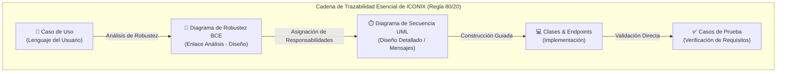

---

### 1.6.2 Comparativa Exhaustiva entre PUDS (Primer Parcial) e ICONIX (Segundo Parcial)

A fin de justificar la transición metodológica aplicada en el proyecto, la siguiente tabla sintetiza las diferencias sustanciales entre ambos marcos de trabajo:

| Dimensión de Comparación | Proceso Unificado (PUDS) — Primer Parcial | Metodología ICONIX — Segundo Parcial |
|:---|:---|:---|
| **Filosofía Base** | Proceso formal pesado, exhaustivo, centrado en la arquitectura y dirigido por casos de uso. | Proceso ágil-pesado pragmático, centrado en el principio 80/20 de UML. |
| **Artefactos Requeridos** | Extensa cantidad de artefactos en cada fase (documentos de visión, modelo de análisis, etc.). | Conjunto mínimo de artefactos indispensables (fichas CU, robustez, secuencias, clases, código). |
| **Estructura del Ciclo de Vida** | 4 fases organizativas (Inicio, Elaboración, Construcción, Transición) con 5 flujos continuos. | 4 fases secuenciales e iterativas por caso de uso (Requisitos, Análisis/Diseño Preliminar, Diseño, Implementación). |
| **Artefacto Distintivo Clave** | Diagramas de comunicación y especificaciones narrativas extensas. | **Diagrama de Robustez (BCE)**, que conecta el análisis con el diseño de clases. |
| **Modelado de Dinámica** | Diagramas de actividades, estados y comunicación paralelos. | Diagramas de Secuencia UML derivados directamente del análisis de robustez. |
| **Complejidad Documental** | Elevada; propensión a la duplicidad de información entre flujos. | Moderada y compacta; trazabilidad vertical limpia Requisito $\rightarrow$ Código. |
| **Cobertura de UML** | Utilización amplia y estricta de todo el estándar UML 2.5+. | Utilización selectiva del subconjunto medular (Casos de Uso, Robustez, Secuencia, Clases). |

---

### 1.6.3 Las Cuatro Fases de la Metodología ICONIX

ICONIX estructura el ciclo de vida del software en cuatro fases continuas e interrelacionadas:

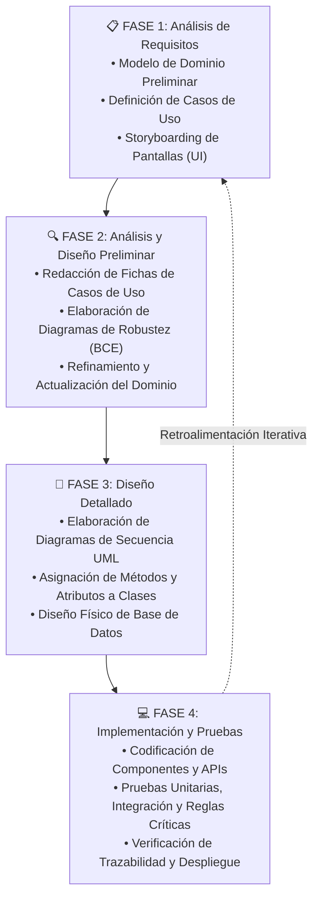

#### Fase 1: Análisis de Requisitos
En esta fase inicial se define el alcance del sistema en estrecha coordinación con el cliente o los requisitos de la cátedra:
1. **Modelo de Dominio Preliminar:** Se construye un diagrama de clases estructural básico que identifica las entidades conceptuales del negocio del mundo real (ej. *Empresa*, *Sucursal*, *Producto*, *Inventario*, *Reserva*, *Venta*) y sus relaciones asociativas, sin saturarlo de métodos o tipos de datos de programación.
2. **Definición del Modelo de Casos de Uso:** Se delimitan las fronteras del sistema, identificando los actores participantes y los casos de uso que describen el comportamiento esperado.
3. **Prototipado Rápido de Interfaces (Storyboarding):** Se diseñan las pantallas e interfaces gráficas preliminares para que los usuarios comprendan cómo interactuarán con cada caso de uso.

#### Fase 2: Análisis y Diseño Preliminar
Constituye el núcleo analítico de ICONIX. Su propósito es desentrañar la lógica interna de cada caso de uso antes de entrar a programar:
1. **Fichas Normalizadas de Caso de Uso:** Se redacta el flujo normal y los flujos alternativos en lenguaje transparente y sin ambigüedades técnicas.
2. **Diagramas de Robustez (BCE):** Se construye para cada caso de uso un diagrama gráfico utilizando tres tipos de estereotipos propuestos por Ivar Jacobson:
   - **Clase Frontera (*Boundary* - ┫):** Modela los puntos de contacto entre el actor y el sistema (pantallas, diálogos, lectores de QR, escáneres POS, interfaces de voz).
   - **Clase Control (*Controller* - ⚙):** Modela la lógica de negocio, validaciones transaccionales, consultas de inventario, algoritmos de CPP y coordinación de procesos.
   - **Clase Entidad (*Entity* - ○_):** Modela las tablas, registros y estructuras de persistencia que almacenan el estado del sistema en la base de datos PostgreSQL, IndexedDB o SQLite.

**Reglas de Comunicación Estricta en Diagramas de Robustez:**
- Los **Actores** solo pueden comunicarse con objetos de tipo **Frontera (*Boundary*)**.
- Los objetos **Frontera** solo pueden comunicarse con objetos de tipo **Control (*Controller*)** y viceversa.
- Los objetos **Frontera NUNCA** se comunican directamente con objetos de tipo **Entidad (*Entity*)** (salvaguarda de la arquitectura en capas).
- Los objetos **Control** pueden comunicarse entre sí y con objetos **Entidad**.
- Los objetos **Entidad** se comunican con objetos **Control**.

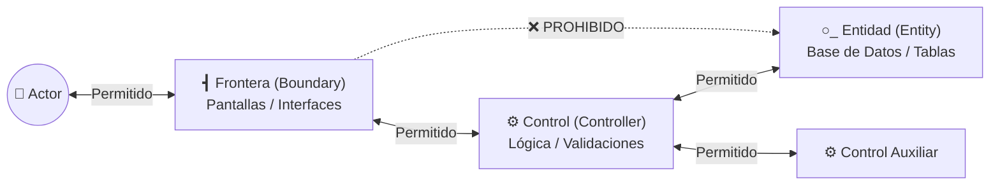

#### Fase 3: Diseño Detallado
En esta fase se toma la estructura conceptual de la Fase 2 y se convierte en una especificación técnica lista para codificar:
1. **Diagramas de Secuencia UML:** Derivan directamente de los diagramas de robustez. Los controladores y entidades se transforman en lifelines (*líneas de vida*) de objetos concretos; los enlaces de comunicación se transforman en mensajes sincrónicos o asincrónicos con parámetros y retornos formales, utilizando fragmentos combinados (`alt` para condicionales, `opt` para flujos opcionales, `loop` para bucles transaccionales).
2. **Diagrama de Clases UML Definitivo:** Se refina el modelo de clases dotando a cada entidad y servicio de sus atributos tipados, modificadores de acceso (`+`, `-`, `#`) y firmas de métodos completas descubiertas durante la diagramación de secuencias.
3. **Diseño de Base de Datos:** Se traslada el diagrama de clases al modelo físico relacional de PostgreSQL, normalizado a Tercera Forma Normal (3FN) con índices y restricciones de integridad.

#### Fase 4: Implementación y Pruebas
1. **Codificación Guiada por Secuencias:** Los desarrolladores implementan los controladores de FastAPI, los componentes de Angular y los widgets de Flutter siguiendo fielmente la interacción de mensajes documentada en los diagramas de secuencia.
2. **Plan y Ejecución de Pruebas:** Se implementan pruebas unitarias y de integración orientadas a verificar los requisitos iniciales. Mediante la trazabilidad, se comprueba que cada escenario de la ficha de caso de uso cuenta con una prueba que valida su correcto comportamiento.

---

### 1.6.4 Trazabilidad Sistemática en ICONIX

La trazabilidad constituye la mayor fortaleza de ICONIX: garantiza que ningún requisito quede huérfano y que ninguna línea de código exista sin justificación en un caso de uso:

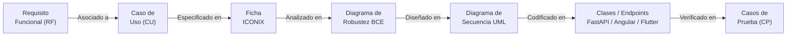

---

### 1.6.5 Plantilla Oficial de Ficha de Caso de Uso Adoptada

De acuerdo con el estándar establecido por la cátedra para el Segundo Examen Parcial, cada caso de uso se documenta mediante la siguiente ficha tabular estructurada:

| Campo | Descripción y Especificación |
|:---|:---|
| **Nombre** | Código identificador correlativo y título descriptivo formal del caso de uso. |
| **Autor** | Desarrollador(es) responsable(s) de su especificación e implementación. |
| **Fecha** | Fecha de elaboración original y de última actualización técnica. |
| **Descripción** | Resumen ejecutivo del objetivo y propósito del caso de uso desde la perspectiva del actor. |
| **Actores** | Identificación del actor primario que desencadena el caso de uso y actores secundarios o cooperantes. |
| **Precondiciones** | Estado previo indispensable del sistema o condiciones de negocio que deben cumplirse para iniciar el flujo. |
| **Flujo Normal** | Secuencia ordenada y numerada de pasos cronológicos correspondientes al camino básico exitoso. |
| **Flujo Alternativo** | Enumeración de bifurcaciones, tratamientos de excepción, validaciones fallidas y condiciones de error. |
| **Postcondiciones** | Estado final persistente del sistema, modificaciones en la base de datos o emisiones de comprobantes tras el éxito. |

---

### 1.6.6 Estrategia de Adaptación e Integración de los Tres Ciclos Previos

Una premisa irrenunciable del Segundo Parcial es que **el proyecto no comienza desde cero**: se trata de la evolución y escalabilidad de un producto de software preexistente. Por lo tanto, los 25 casos de uso concebidos y desarrollados durante los tres ciclos del primer parcial bajo PUDS se integran, homologan y adaptan a las cuatro fases de ICONIX, combinándose armónicamente con los 10 nuevos casos de uso del segundo parcial:

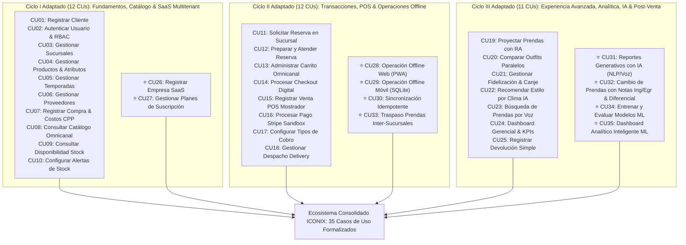

Con esta estrategia de integración sistemática, se garantiza que:
1. Ninguna funcionalidad previa quede descontinuada o aislada del nuevo modelo SaaS.
2. Cada uno de los 35 casos de uso cuente con su correspondiente ficha ICONIX normalizada.
3. Se generen y verifiquen los 35 diagramas de robustez (BCE) requeridos para el análisis preliminar.
4. Se generen los diagramas de secuencia UML que gobiernan la implementación y pruebas de todo el sistema.


# CAPÍTULO II. ANÁLISIS DE REQUISITOS

## 2.1 Descripción del Sistema Propuesto

El segundo parcial evoluciona **FashionStore** desde una plataforma de comercio electrónico para una sola cadena de tiendas hacia una **plataforma SaaS multitenant integral** que permite a múltiples empresas independientes del sector textil contratar el servicio mediante planes de suscripción. Cada empresa (tenant) dispone de su propio entorno lógico aislado para administrar sucursales, empleados, clientes, productos, inventarios, reservas y ventas.

La evolución incorpora seis líneas de innovación tecnológica:

1. **Metodología ICONIX:** Sustitución y adaptación del proceso previo por ICONIX como proceso de desarrollo pesado-ligero, con énfasis en diagramas de robustez (BCE) y trazabilidad completa requisito → CU → robustez → secuencia → código → prueba.
2. **PWA (Progressive Web App):** La aplicación Angular evoluciona para funcionar parcialmente sin conexión a Internet mediante Service Workers, Web App Manifest y persistencia en IndexedDB.
3. **Operación Offline Móvil:** La aplicación Flutter incorpora SQLite como base de datos local para persistir operaciones críticas de catálogo, reservas y ventas sin conectividad.
4. **Ventas Offline con Consistencia de Inventario:** Las ventas de contado y reservas pueden registrarse localmente y sincronizarse posteriormente con el servidor central, garantizando consistencia, idempotencia y prevención de duplicados.
5. **Reportes Generativos con IA y Machine Learning:** Los usuarios autorizados pueden solicitar reportes empresariales en lenguaje natural (texto o voz), complementados con modelos supervisados (predicción de demanda) y no supervisados (segmentación y detección de anomalías) entrenados con datos sintéticos.
6. **SaaS Multitenant:** Arquitectura multi-empresa con planes de suscripción (Básico y Profesional), límites configurables de sucursales, aislamiento estricto de datos y seguridad entre tenants.

Se conservan e integran todas las funcionalidades desarrolladas en el primer parcial (25 casos de uso, 19 módulos base), consolidando un ecosistema tecnológico de **35 casos de uso** plenamente articulados.

### 2.1.1 Objetivos de la Evolución Tecnológica hacia el Segundo Parcial

La evolución tecnológica de FashionStore persigue tres objetivos estratégicos de ingeniería de software:
1. **Garantizar Continuidad Operativa Omnicanal:** Lograr que tanto en el entorno Web (PWA) como en el entorno Móvil (Flutter) el negocio continúe operando ventas de mostrador y reservas ante caídas de enlace o zonas sin cobertura, persistiendo transacciones locales con UUID y sincronizándolas de forma idempotente con el servidor central FastAPI.
2. **Potenciar la Capacidad Analítica con Inteligencia Artificial:** Facilitar a la gerencia la toma de decisiones basada en datos mediante reportes generativos en lenguaje natural (texto y voz) y modelos predictivos de Machine Learning entrenados sobre 6 meses de datos sintéticos.
3. **Escalar hacia un Modelo de Negocio SaaS Multitenant:** Habilitar la comercialización del sistema como servicio a múltiples empresas textiles bajo suscripciones parametrizadas (Planes Básico y Profesional) con riguroso aislamiento lógico de datos por `empresa_id`.

### 2.1.2 Alcance del Sistema E-Commerce SaaS y Resiliencia Offline

El sistema cubre el ciclo de vida comercial completo en modalidad omnicanal: catálogo interactivo, probador virtual WebGL/RA, comparador de outfits, reservas para probador con control de aforo, punto de venta presencial (POS), pasarela de pagos electrónicos (Stripe Sandbox), logística de despacho, gestión de cambios con emisión de notas contables, rebalanceo inter-sucursal y cuadro de mando ejecutivo.

### 2.1.3 Aportes Propios de Innovación del Equipo (Exigencia de Cátedra)

Conforme a las directrices explícitas de la docente (MSc. Ing. Angélica Garzón Cuéllar) expuestas en las sesiones de cátedra (audio `Parcial2-1.txt`, líneas 27-29) y en el enunciado oficial del examen (Sección 7, línea 155), cada equipo de desarrollo debe incorporar funcionalidades adicionales como **aportes propios de innovación** para enriquecer el software. Nuestro equipo ha conceptualizado, modelado e implementado formalmente cuatro innovaciones sustanciales:

1. **Traspaso de Prendas entre Sucursales con Doble Asiento en Kardex (CU33):**
   - *Fundamentación de Negocio:* En empresas con múltiples sucursales en una misma ciudad o departamento (ej. Santa Cruz - Warnes), la demanda es heterogénea; una prenda agotada en una tienda puede tener sobre-stock en otra.
   - *Innovación Técnica:* Módulo de rebalanceo inter-sucursal que formula la solicitud de traspaso, verifica existencias en la sucursal de origen, bloquea unidades, emite guía de remisión en tránsito y realiza el doble asiento atómico en Kardex (egreso en origen e incremento en destino) tras la confirmación de recepción conforme por el encargado.
2. **Liquidación de Diferencial de Precio por Talla/Modelo en Cambios y Devoluciones (CU32):**
   - *Fundamentación de Negocio:* En la industria de la confección, prendas de tallas mayores (XL, XXL) o modelos alternativos de mayor gramaje poseen costos de producción y precios de venta superiores a las tallas estándar (S, M).
   - *Innovación Técnica:* Módulo post-venta en mostrador que valida la vigencia del plazo configurable (48 horas o 7 días), emite inmutablemente la **Nota de Ingreso** (reincorporación al inventario al CPP histórico) y la **Nota de Egreso** (despacho de nueva talla), calculando automáticamente la diferencia monetaria a cobrar al cliente antes de autorizar la entrega de la nueva prenda.
3. **Detección No Supervisada de Anomalías de Inventario y Merma con Isolation Forest (CU34 / CU35):**
   - *Fundamentación de Negocio:* Las discrepancias entre el stock físico de mostrador y el inventario del sistema suelen atribuirse a hurtos no detectados, errores de tallaje en caja o fallas operativas de registro.
   - *Innovación Técnica:* Algoritmo de Machine Learning no supervisado (*Isolation Forest*) integrado en el backend FastAPI que analiza patrones de rotación, tiempo de permanencia y discrepancias de stock para alertar automáticamente a la gerencia sobre posibles anomalías y mermas no justificadas en cada sucursal.
4. **Búsqueda por Comandos de Voz y NLP Multicanal (CU23 / CU31):**
   - *Fundamentación de Negocio:* La usabilidad móvil y ejecutiva se maximiza cuando los usuarios pueden interactuar mediante el habla natural mientras operan en el piso de venta o en movimiento.
   - *Innovación Técnica:* Reconocimiento de voz mediante Web Speech API y canal transcriptor en Flutter que procesa comandos de voz para localizar prendas en catálogo (`CU23`) y para dictar consultas directivas de negocio al asistente de IA generativa (`CU31`).

---

## 2.2 Identificación de Actores

### 2.2.1 Actores Heredados del Primer Parcial

| Actor | Tipo | Descripción y Responsabilidad en el Sistema |
|:---|:---:|:---|
| **Administrador General / de Tienda** | Interno | Administra usuarios, asignación de roles RBAC, parametrización de sucursales, temporadas, catálogo global y cuadros de mando. |
| **Encargado de Sucursal** | Interno | Gestiona el aforo de probadores, preparación física de prendas reservadas, recepción de traspasos y stock de la sucursal asignada. |
| **Cajero POS** | Interno | Opera el punto de venta presencial, escaneo de códigos de barra (SKU), cobros en efectivo/digitales, emisión de comprobantes y gestión de cambios presenciales. |
| **Personal de Logística** | Interno | Recepciona mercadería de proveedores, registra costos de adquisición para el cálculo del CPP, despacha pedidos y autoriza traspasos de inventario. |
| **Cliente Final (Web / Móvil)** | Externo | Usuario consumidor que explora el catálogo, realiza reservas para prueba presencial, compras digitales, uso de vestidor RA, interacción con asistente IA y acumula puntos. |
| **Proveedor Textil** | Externo | Fabricante mayorista que suministra prendas y lotes de confección conforme a órdenes de compra. |
| **Pasarela de Pagos (Stripe / Sandbox)** | Sistema | Servicio externo para procesamiento seguro de pagos con tarjeta de crédito/débito y webhooks de confirmación. |
| **Servicio de IA (OpenAI / Gemini)** | Sistema | Servicio de inteligencia artificial para recomendación contextual de estilo y procesamiento de lenguaje natural (NLP). |
| **Servicio Meteorológico (OpenWeatherMap)** | Sistema | API externa para consulta climática en tiempo real para recomendaciones contextuales de indumentaria. |
| **Empresa de Delivery** | Externo | Operador logístico externo para distribución y entrega de pedidos a domicilio. |

### 2.2.2 Nuevos Actores del Segundo Parcial

1. **Super Administrador de Plataforma SaaS:**
   - **Descripción y Rol:** Autoridad máxima de la infraestructura FashionStore en su dimensión SaaS. No pertenece a ninguna empresa particular; administra la plataforma global.
   - **Responsabilidades:** Registro y activación de nuevas empresas contratantes (tenants), creación y parametrización de planes de suscripción (Básico y Profesional), monitoreo de aislamiento entre tenants y supervisión global del sistema.

2. **Administrador de Empresa (Tenant):**
   - **Descripción y Rol:** Usuario directivo perteneciente a una empresa cliente suscrita. Tiene control total sobre los datos, sucursales y personal de su propia organización.
   - **Responsabilidades:** Configuración de sucursales autorizadas (según límites de su plan), creación de usuarios y roles internos (encargados, cajeros, logística), gestión del catálogo propio, consulta del estado de su suscripción y solicitud de reportes generativos con IA (Plan Profesional).

3. **Agente de Sincronización (Sistema):**
   - **Descripción y Rol:** Componente autónomo que opera en los clientes web (PWA) y móvil (Flutter) para gestionar la cola de operaciones registradas fuera de línea.
   - **Responsabilidades:** Detección de conectividad, despacho secuencial de operaciones pendientes con identificador UUID, verificación de idempotencia, manejo de respuestas del servidor (CONFIRMADA, RECHAZADA, CONFLICTO) y actualización de estados locales.

---

## 2.3 Requisitos Funcionales y No Funcionales

### 2.3.1 Requisitos Funcionales del Sistema Base (Heredados del Primer Parcial)

| Módulo | Código RF | Descripción del Requisito Funcional |
|:---|:---:|:---|
| **M01: Seguridad y RBAC** | RF-BASE-01 | Autenticación mediante credenciales con hash bcrypt y tokens JWT con roles asignados. |
| | RF-BASE-02 | Auto-registro de clientes y recuperación de contraseñas mediante tokens OTP de 6 dígitos. |
| | RF-BASE-03 | Administración de usuarios, asignación de roles y bloqueo preventivo tras 5 intentos fallidos. |
| **M02: Sucursales y Ciudades** | RF-BASE-04 | Parametrización de ciudades, sucursales físicas, coordenadas geográficas y aforo de probadores. |
| **M03: Catálogo y Productos** | RF-BASE-05 | Gestión de prendas masculinas, categorías, tallas, colores multivaluados y fichas técnicas. |
| **M04: Temporadas** | RF-BASE-06 | Calendarización de temporadas (Primavera-Verano, Otoño-Invierno) y liquidaciones promocionales. |
| **M05: Proveedores** | RF-BASE-07 | Registro de proveedores textiles, contratos comerciales y órdenes de abastecimiento. |
| **M06: Inventario y CPP** | RF-BASE-08 | Control de stock multi-sucursal y recálculo matemático de Costo Promedio Ponderado por ingreso. |
| **M07: Catálogo Omnicanal** | RF-BASE-09 | Consulta pública de catálogo con filtros dinámicos y consulta de existencias por sucursal. |
| **M08: Vestidor Virtual RA** | RF-BASE-10 | Proyección tridimensional de prendas sobre la silueta del usuario mediante cámara móvil. |
| **M09: Comparador Outfits** | RF-BASE-11 | Comparación visual lado a lado de hasta tres conjuntos con cálculo automático de costos. |
| **M10: Reservas en Sucursal** | RF-BASE-12 | Solicitud de apartado físico de prendas para prueba presencial con generación de ticket QR. |
| | RF-BASE-13 | Preparación y atención de reservas en sucursal con actualización de estados. |
| **M11: Carrito Omnicanal** | RF-BASE-14 | Carrito sincronizado entre dispositivos con bloqueo temporal anti-colisión de stock. |
| **M12: Venta Digital** | RF-BASE-15 | Checkout digital con validación de existencias, cálculo de impuestos (IVA/IT) y emisión de comprobantes. |
| **M13: Punto de Venta POS** | RF-BASE-16 | Registro de venta presencial en caja con escáner de código de barras SKU y cobros mixtos. |
| **M14: Pasarela de Pagos** | RF-BASE-17 | Procesamiento electrónico seguro mediante Stripe Sandbox con webhooks de confirmación. |
| **M15: Medios de Cobro** | RF-BASE-18 | Gestión de cobros en efectivo, QR interoperable, tarjeta de crédito y transferencias bancarias. |
| **M16: Fidelización** | RF-BASE-19 | Asignación de puntos por compras, niveles (Bronce/Plata/Oro/Diamante) y canje por descuentos. |
| **M17: Asistente IA y Voz** | RF-BASE-20 | Recomendación de outfits según clima local (API meteorológica), historial y comandos de voz. |
| **M18: Dashboards** | RF-BASE-21 | Cuadros de mando ejecutivos con indicadores KPIs de rotación, ventas y rentabilidad. |
| **M19: Delivery** | RF-BASE-22 | Asignación de empresas de logística, guías de despacho y seguimiento de envíos. |

### 2.3.2 Requisitos Funcionales Nuevos del Segundo Parcial

| Desafío / Módulo | Código RF | Descripción del Requisito Funcional Nuevo | Prioridad |
|:---|:---:|:---|:---:|
| **Desafío I: ICONIX** | RF-ICX-01 | Modelar el sistema mediante ICONIX (Modelo de Dominio, Fichas de CU, Diagramas de Robustez BCE, Diagramas de Secuencia). | Alta |
| | RF-ICX-02 | Mantener la trazabilidad estricta: Requisito → Caso de Uso → Robustez → Secuencia → Código → Prueba. | Alta |
| **Desafío II: PWA** | RF-PWA-01 | Configurar la aplicación web Angular como PWA instalable con Service Worker y Web App Manifest. | Alta |
| | RF-PWA-02 | Almacenar localmente en IndexedDB el catálogo de prendas, sucursales y datos mínimos requeridos. | Alta |
| | RF-PWA-03 | Permitir navegación en catálogo y registro de reservas/ventas de contado sin conexión a Internet. | Alta |
| | RF-PWA-04 | Desplegar banner visual de notificación de modo offline en la aplicación web. | Media |
| **Desafío III: Móvil Offline** | RF-OFF-01 | Implementar persistencia local en la aplicación Flutter mediante SQLite (sqflite). | Alta |
| | RF-OFF-02 | Almacenar en SQLite local el catálogo descargado, sucursales autorizadas y transacciones pendientes. | Alta |
| | RF-OFF-03 | Permitir registrar ventas de contado y reservas sin conexión, guardándolas con estado LOCAL. | Alta |
| | RF-OFF-04 | Mantener la persistencia íntegra de operaciones al cerrar o reiniciar la aplicación móvil. | Alta |
| **Desafío IV: Ventas Offline** | RF-VTA-01 | Asignar identificador único global (UUID) a cada operación registrada fuera de línea. | Alta |
| | RF-VTA-02 | Implementar cola de sincronización de operaciones pendientes para su posterior envío al servidor. | Alta |
| | RF-VTA-03 | Garantizar idempotencia en el backend: operaciones reenviadas no deben duplicar ventas ni movimientos. | Alta |
| | RF-VTA-04 | Detectar y resolver conflictos de concurrencia de inventario tras la reconexión. | Alta |
| | RF-VTA-05 | Implementar módulo de Cambio/Devolución de prendas con plazo configurable (48h/7d). | Alta |
| | RF-VTA-06 | Emitir Nota de Ingreso (devolución al stock) y Nota de Egreso (despacho de nueva prenda). | Alta |
| | RF-VTA-07 | Calcular y cobrar la diferencia de precio cuando la nueva talla o modelo posea costo superior. | Alta |
| | RF-VTA-08 | Implementar traspaso de inventario entre sucursales de una misma empresa con doble asiento de stock. | Alta |
| **Desafío V: Reportes IA + ML** | RF-IA-01 | Permitir a usuarios autorizados solicitar reportes empresariales en lenguaje natural (texto o voz). | Alta |
| | RF-IA-02 | Interpretar solicitudes vía LLM y generar consultas SQL parametrizadas filtradas por tenant. | Alta |
| | RF-IA-03 | Presentar resultados de reportes generativos en formato de tabla, gráfico interactivo o narrativa. | Alta |
| | RF-IA-04 | Generar dataset sintético representativo de al menos 6 meses de ventas, inventario y clientes. | Alta |
| | RF-IA-05 | Entrenar y consultar modelo de Machine Learning supervisado para predicción de demanda de ventas. | Alta |
| | RF-IA-06 | Entrenar y consultar modelo ML no supervisado para segmentación de clientes (K-Means) y anomalías. | Alta |
| | RF-IA-07 | Integrar predicciones y clusters en el Dashboard Analítico Ejecutivo. | Alta |
| **Desafío VI: SaaS Multitenant** | RF-SAS-01 | Registrar empresas independientes (tenants) con datos fiscales (NIT, razón social) y tenant lógico. | Alta |
| | RF-SAS-02 | Asignar planes de suscripción (Básico y Profesional) con límites de sucursales y funcionalidades. | Alta |
| | RF-SAS-03 | Restringir el acceso a reportes generativos IA y analítica ML a empresas con Plan Profesional. | Alta |
| | RF-SAS-04 | Aislar lógicamente los datos de cada tenant mediante clave discriminadora `empresa_id` en todas las consultas. | Alta |
| | RF-SAS-05 | Garantizar que un usuario de la Empresa A no pueda consultar ni modificar datos de la Empresa B (HTTP 403). | Alta |

### 2.3.3 Requisitos No Funcionales Obligatorios (RNF01 a RNF12)

Conforme a las directrices oficiales del Examen Parcial 2 (sección 8 del enunciado):

| Código | Requisito No Funcional | Especificación Técnica |
|:---:|:---|:---|
| **RNF01** | **Seguridad** | Cifrado obligatorio de contraseñas mediante `bcrypt` (factor de trabajo mínimo 12) y transmisión protegida bajo HTTPS/TLS. |
| **RNF02** | **Disponibilidad** | Arquitectura cloud de alta disponibilidad (mínimo 99.5% de uptime en Render/Railway/Supabase). |
| **RNF03** | **Rendimiento** | Respuestas de API REST en menos de 500 ms para transacciones estándar y menos de 2 s para reportes IA complejos. |
| **RNF04** | **Escalabilidad** | Soporte para múltiples empresas concurrentes (arquitectura multitenant con índices optimizados en PostgreSQL). |
| **RNF05** | **Usabilidad** | Diseño responsivo intuitivo, adaptable a escritorio, tablet y smartphone con tiempos de aprendizaje mínimos. |
| **RNF06** | **Trazabilidad** | Registro inmutable de auditoría en base de datos para todas las operaciones críticas comerciales y cambios de stock. |
| **RNF07** | **Aislamiento Multitenant** | Filtrado obligatorio por `empresa_id` en cada consulta SQL mediante middleware backend. Imposibilidad de acceso cruzado. |
| **RNF08** | **Persistencia Offline Local** | Almacenamiento no volátil en IndexedDB (web PWA) y SQLite (móvil Flutter). Ninguna transacción local se pierde al cerrar la app. |
| **RNF09** | **Idempotencia en Sincronización** | El reenvío múltiple de una misma transacción con UUID idéntico debe producir exactamente el mismo resultado sin duplicación. |
| **RNF10** | **Resiliencia ante Fallos de Red** | Cola de reintentos con algoritmo de retroceso exponencial (*exponential backoff*) ante desconexiones transitorias. |
| **RNF11** | **Calidad de Modelado ICONIX** | Correspondencia estricta y sin ambigüedades entre requisitos, fichas de casos de uso, robustez BCE, secuencias y clases. |
| **RNF12** | **Despliegue y Accesibilidad** | Despliegue en infraestructura pública accesible mediante URL directa y código QR para evaluación académica. |

---

## 2.4 Reglas de Negocio

### 2.4.1 Reglas del Negocio Base
- **RN-BASE-01 (RBAC Estricto):** Ningún usuario puede invocar endpoints ni acceder a vistas fuera de su rol (`SUPER_ADMIN`, `ADMIN_EMPRESA`, `ENCARGADO`, `CAJERO`, `LOGISTICA`, `CLIENTE`).
- **RN-BASE-02 (Costo Promedio Ponderado):** Ante cada ingreso de mercadería con cantidad $Q_{nueva}$ y costo $C_{nuevo}$, el nuevo costo se calcula matemáticamente:
  $$CPP_{nuevo} = \frac{(Stock_{actual} \times CPP_{actual}) + (Q_{nueva} \times C_{nuevo})}{Stock_{actual} + Q_{nueva}}$$

  *Formato lineal para copiar y pegar en Word (`Alt + =` y luego presionar la barra espaciadora):*
  ```text
  CPP_nuevo = ((Stock_actual \times CPP_actual) + (Q_nueva \times C_nuevo)) / (Stock_actual + Q_nueva)
  ```
  *(O si Word está en modo `{LaTeX}`, pegar sin los signos de dólar y presionar Convertir):*
  ```latex
  CPP_{nuevo} = \frac{(Stock_{actual} \times CPP_{actual}) + (Q_{nueva} \times C_{nuevo})}{Stock_{actual} + Q_{nueva}}
  ```
- **RN-BASE-03 (Bloqueo Temporal de Stock en Reservas):** Las prendas reservadas para probador bloquean existencias por un periodo máximo de 2 horas. Si el cliente no asiste, el stock reservado se libera automáticamente.
- **RN-BASE-04 (Ventas POS Presenciales):** Las ventas presenciales en caja actualizan el inventario físico de forma inmediata y generan comprobante electrónico con desglose tributario (IVA 13%, IT 3%).
- **RN-BASE-05 (Confirmación Efectiva del 100% del Pago Previa al Despacho e Inventario):** Conforme a la política de control financiero y de inventarios exigida por la cátedra (audio `Parcial2-2.txt`, líneas 33-35), ninguna orden de venta (digital o presencial con cobro electrónico por QR o tarjeta) puede consolidarse como completada, ni decrementar el stock definitivo en el inventario central ni habilitar la entrega física del producto, si no se ha recibido la confirmación verificada del 100% del pago por parte de la pasarela (Stripe Sandbox) o la verificación del comprobante de transferencia bancaria/QR por el cajero. Mientras el pago no esté efectivamente acreditado, la orden permanece en estado `PENDIENTE_PAGO` y el stock solo se bloquea de manera transitoria por un tiempo máximo de 15 minutos, liberándose automáticamente si no se consuma la liquidación.

```mermaid
flowchart TD
    subgraph Ciclo_Pago ["RN-BASE-03 / RN-BASE-05: Validación de Pagos y Bloqueo de Stock"]
        A["Cliente inicia Checkout o Compra en Caja"] --> B["Orden en Estado: PENDIENTE_PAGO\nBloqueo temporal de stock (15 min)"]
        B --> C{"¿Confirmación del 100% del Pago?\n(Stripe Webhook / Verificación QR / Efectivo)"}
        C -- "NO / Tiempo Expirado" --> D["Liberar Stock Reservado\nCancelar Orden (RECHAZADA)"]
        C -- "SÍ: Pago 100% Verificado" --> E["Estado: COMPLETADA / PAGADA"]
        E --> F["Decremento Definitivo de Stock en Bodega"]
        F --> G["Emisión de Comprobante Fiscal\n(Desglose IVA 13% e IT 3%)"]
        G --> H["Habilitar Despacho a Domicilio o Entrega en Mostrador"]
    end

    subgraph Valuacion_CPP ["RN-BASE-02: Valuación Inmutable por Costo Promedio Ponderado"]
        I["Recepción de Lote de Mercadería\n(Cantidad Q_nueva, Costo Unitario C_nuevo)"] --> J["Recálculo Matemático Inmutable:\nCPP = (Stock_act * CPP_act + Q_nueva * C_nuevo) / (Stock_act + Q_nueva)"]
        J --> K["Actualización Automática del Kardex Valorado"]
        K --> L["Fijación de Costo Contable de Salida para Ventas"]
    end
```

### 2.4.2 Reglas SaaS y Multitenant
- **RN-SAAS-01 (Separación Empresa vs Sucursal):** Una Empresa contratante (Tenant) puede poseer múltiples Sucursales físicas, pero una Sucursal pertenece estrictamente a una sola Empresa.
- **RN-SAAS-02 (Límites por Plan de Suscripción):**
  - **Plan Básico:** Máximo 2 sucursales activas. No tiene acceso a reportes generativos con IA ni a analítica ML.
  - **Plan Profesional:** Hasta 10 sucursales activas. Acceso completo a reportes generativos con IA y módulo de Machine Learning.
- **RN-SAAS-03 (Aislamiento de Datos):** Todas las consultas de lectura y escritura deben incluir la cláusula de discriminación `WHERE empresa_id = :tenant_id`. Cualquier intento de acceso a otro tenant es rechazado con código HTTP 403 Forbidden.
- **RN-SAAS-04 (Estado de Suscripción):** Si la suscripción de una empresa se encuentra en estado `SUSPENDIDA` o `VENCIDA`, se bloquea el acceso de sus usuarios a operaciones transaccionales, permitiendo únicamente consulta administrativa.

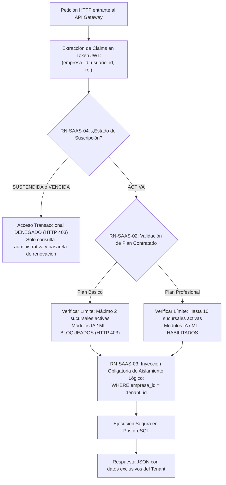

### 2.4.3 Reglas Offline y Sincronización
- **RN-OFFLINE-01 (Ventas Offline de Contado):** En modo fuera de línea únicamente se admiten ventas con método de pago en efectivo. Los pagos electrónicos con tarjeta requieren pasarela en línea y están deshabilitados offline.
- **RN-OFFLINE-02 (Persistencia Local No Volátil):** Toda operación registrada sin conexión se almacena de inmediato en almacenamiento local (IndexedDB en PWA o SQLite en Flutter) con identificador UUID y estado `LOCAL`.
- **RN-SYNC-01 (Idempotencia Garantizada):** Cuando el backend recibe una operación con un `id_operacion` (UUID) que ya fue procesado, no genera una nueva venta ni decrementa stock nuevamente; responde confirmando la transacción con su estado original.
- **RN-SYNC-02 (Resolución de Conflictos de Stock):** Si al sincronizar una venta offline las existencias reales en el servidor resultan insuficientes, la operación se marca con estado `CONFLICTO`, se alerta al encargado y se genera un asiento de auditoría para regularización manual.

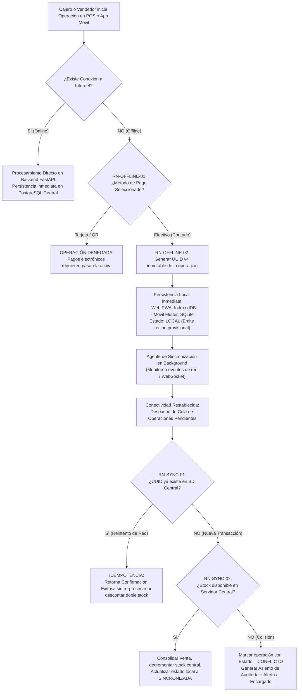

### 2.4.4 Reglas de Cambio y Devolución de Prendas
- **RN-CAMBIO-01 (Plazo Límite de Cambio):** El plazo para solicitar cambios de prendas es configurable por la empresa (por defecto 48 horas o 7 días calendario a partir de la emisión de la venta). Transcurrido el plazo, el sistema bloquea automáticamente la operación.
- **RN-CAMBIO-02 (Generación Obligatoria de Notas):** Todo cambio debe generar formalmente dos documentos inmutables:
  1. **Nota de Ingreso:** Acredita el reingreso al inventario de la prenda devuelta (incrementa stock y restituye valor al kardex).
  2. **Nota de Egreso:** Acredita el despacho de la nueva prenda entregada al cliente (decrementa stock de la nueva talla/color).
- **RN-CAMBIO-03 (Diferencial de Precios por Talla/Modelo):** Si la nueva prenda seleccionada posee un precio de venta superior a la devuelta, el sistema calcula automáticamente la diferencia $D = Precio_{nueva} - Precio_{original}$ y exige el cobro de dicho monto al cliente previo a emitir la nota de egreso. Si el precio es idéntico, la diferencia es cero.
- **RN-CAMBIO-04 (Estado de la Prenda Devuelta):** La prenda devuelta debe ingresar en estado apto para la venta. Si presenta fallas de confección imputables al fabricante, ingresa a inventario de merma/devolución a proveedor.

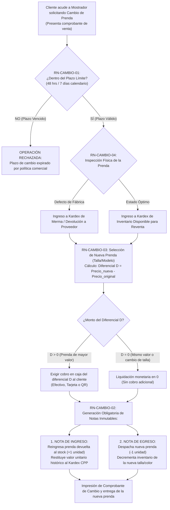

### 2.4.5 Reglas de Reportes Generativos y Machine Learning
- **RN-IA-01 (Privilegio por Plan):** La función de reportes generativos mediante lenguaje natural está reservada exclusivamente a empresas con **Plan Profesional** activo.
- **RN-IA-02 (Seguridad en SQL Generado):** Las consultas generadas por el modelo de IA deben ser de solo lectura (`SELECT`), deben pasar por un filtro de validación de sintaxis que impida comandos DDL/DML destructivos (`DROP`, `DELETE`, `UPDATE`) y deben forzar incondicionalmente la cláusula `WHERE empresa_id = X`.
- **RN-ML-01 (Datos Sintéticos de Entrenamiento):** Los modelos de Machine Learning deben entrenarse con una base mínima de 6 meses de historial sintético (~5,000 transacciones de venta y ~500 perfiles de clientes).
- **RN-ML-02 (Métricas Mínimas de Evaluación):** El modelo supervisado de predicción de ventas debe reportar métricas de error (RMSE y $R^2$), mientras que el clustering no supervisado debe reportar el coeficiente Silhouette score.

```mermaid
flowchart TD
    subgraph NLP_Pipeline ["RN-IA-01 / RN-IA-02: Pipeline Seguro de Reportes Generativos"]
        QUser["Usuario formula Consulta Gerencial en Lenguaje Natural\n(Texto o Audio/Voz)"] --> CheckPlanIA{"¿Plan Profesional Activo?"}
        CheckPlanIA -- "NO (Plan Básico)" --> RejectIA["HTTP 403 Forbidden:\nReportes IA exclusivos para Plan Profesional"]
        
        CheckPlanIA -- "SÍ" --> LLMEngine["Motor LLM / NLP:\nTraducción de intención a consulta SQL relacional"]
        LLMEngine --> SecFilter{"Filtro Validador AST / Regex de Seguridad SQL"}
        
        SecFilter -- "Contiene DDL/DML destructivo:\nDROP, DELETE, UPDATE, INSERT, ALTER" --> AlertSec["BLOQUEO DE SEGURIDAD:\nRegistro en Bitácora de Auditoría e Intento Malicioso"]
        
        SecFilter -- "Consulta de Solo Lectura:\nSELECT sintácticamente válido" --> InjectTenant["Inyección Forzosa e Incondicional:\nWHERE empresa_id = :tenant_id"]
        
        InjectTenant --> ExecSQL["Ejecución en PostgreSQL (Réplica de Solo Lectura)"]
        ExecSQL --> RenderUI["Generación Dinámica en Frontend:\nTablas Interactivas + Gráficos Estadísticos + Narrativa Ejecutiva"]
    end

    subgraph ML_Analytics ["RN-ML-01 / RN-ML-02: Pipeline Analítico de Machine Learning"]
        SynthData["Dataset Sintético Estandarizado:\n(Historial >= 6 meses, >= 5,000 ventas, 500 perfiles)"] --> TrainModels["Entrenamiento de Modelos Analíticos"]
        TrainModels --> SupModel["Modelo Supervisado:\nPredicción de Demanda de Ventas Futuras\n(Evaluación: RMSE y R^2 >= 0.82)"]
        TrainModels --> UnsupModel["Modelos No Supervisados:\n1. Segmentación de Clientes K-Means (Silhouette >= 0.65)\n2. Detección de Anomalías de Inventario (Isolation Forest)"]
    end
```

---

## 2.5 Diagrama UML de Casos de Uso

### 2.5.1 Matriz Consolidada de los 35 Casos de Uso del Sistema FashionStore SaaS

A continuación se presenta la relación completa y exhaustiva de los **35 Casos de Uso** que componen la plataforma, adaptando los casos del primer examen parcial y sumando las innovaciones del segundo parcial, organizados en los tres ciclos evolutivos de desarrollo:

| Código | Nombre del Caso de Uso | Módulo | Actor Principal | Ciclo / Bloque | Tipo |
|:---:|:---|:---:|:---|:---:|:---:|
| **CU01** | Autenticar Usuario y Control de Acceso (RBAC) | M01 - Seguridad | Usuario del Sistema | Ciclo I | Heredado / Adaptado |
| **CU02** | Registrar Cliente (Auto-registro de Clientes) | M01 - Seguridad | Cliente No Autenticado | Ciclo I | Heredado / Adaptado |
| **CU03** | Recuperar Contraseña (Token OTP de 6 Dígitos) | M01 - Seguridad | Usuario del Sistema | Ciclo I | Heredado / Adaptado |
| **CU04** | Gestionar Usuarios y Roles (RBAC y Desbloqueo) | M01 - Seguridad | Administrador | Ciclo I | Heredado / Adaptado |
| **CU05** | Gestionar Ciudades y Sucursales | M02 - Sucursales | Administrador | Ciclo I | Heredado / Adaptado |
| **CU06** | Gestionar Productos y Atributos de Moda | M03 - Catálogo | Administrador | Ciclo I | Heredado / Adaptado |
| **CU07** | Gestionar Temporadas y Colecciones | M04 - Temporadas | Administrador | Ciclo I | Heredado / Adaptado |
| **CU08** | Gestionar Proveedores Textiles | M05 - Proveedores | Logística / Admin | Ciclo I | Heredado / Adaptado |
| **CU09** | Gestionar Inventario Multi-Sucursal y Costos Ponderados (CPP) | M06 - Inventario | Personal de Logística | Ciclo I | Heredado / Adaptado |
| **CU10** | Consultar Catálogo y Disponibilidad por Sucursal | M07 - Catálogo | Cliente / Encargado | Ciclo I | Heredado / Adaptado |
| **CU26** | Registrar Empresa y Asignar Plan SaaS | M20 - Gestión SaaS | Super Admin SaaS | Ciclo I | **NUEVO (Desafío VI)** |
| **CU27** | Gestionar Planes de Suscripción y Límites de Tenant | M20 - Gestión SaaS | Super Admin / Admin Emp | Ciclo I | **NUEVO (Desafío VI)** |
| **CU11** | Solicitar Reserva de Prendas en Sucursal | M10 - Reservas | Cliente Autenticado | Ciclo II | Heredado / Adaptado |
| **CU12** | Preparar y Atender Reserva Presencial | M10 - Reservas | Encargado de Sucursal | Ciclo II | Heredado / Adaptado |
| **CU13** | Administrar Carrito de Compras Omnicanal | M11 - Carrito | Cliente Autenticado | Ciclo II | Heredado / Adaptado |
| **CU14** | Procesar Compra Digital y Checkout | M12 - Venta Digital | Cliente Autenticado | Ciclo II | Heredado / Adaptado |
| **CU15** | Registrar Venta Presencial en Caja (POS) | M13 - POS Presencial | Cajero POS | Ciclo II | Heredado / Adaptado |
| **CU16** | Procesar Pago con Pasarela Electrónica | M14 - Pagos | Cliente / Cajero | Ciclo II | Heredado / Adaptado |
| **CU17** | Gestionar Tipos y Medios de Cobro | M15 - Medios Cobro | Administrador | Ciclo II | Heredado / Adaptado |
| **CU18** | Gestionar Despacho y Logística de Delivery | M19 - Delivery | Personal de Logística | Ciclo II | Heredado / Adaptado |
| **CU28** | Operar en Modo Offline Web (PWA con IndexedDB) | M21 - Offline Web | Cliente / Cajero | Ciclo II | **NUEVO (Desafío II)** |
| **CU29** | Operar en Modo Offline Móvil (Flutter con SQLite) | M22 - Offline Móvil | Cliente / Cajero | Ciclo II | **NUEVO (Desafío III)** |
| **CU30** | Sincronizar Operaciones Pendientes e Idempotencia | M23 - Sincronización | Agente Sync / Usuario | Ciclo II | **NUEVO (Desafío IV)** |
| **CU33** | Traspasar Prendas entre Sucursales | M26 - Traspasos | Encargado / Logística | Ciclo II | **NUEVO (Desafío IV)** |
| **CU19** | Visualizar Prenda en Vestidor Virtual con RA | M08 - Vestidor RA | Cliente Móvil | Ciclo III | Heredado / Adaptado |
| **CU20** | Comparar Outfits Lado a Lado | M09 - Comparador | Cliente Web / Móvil | Ciclo III | Heredado / Adaptado |
| **CU21** | Gestionar Fidelización Gamificada | M16 - Fidelización | Cliente / Admin | Ciclo III | Heredado / Adaptado |
| **CU22** | Solicitar Recomendación Contextual de IA | M17 - Asistente IA | Cliente Web / Móvil | Ciclo III | Heredado / Adaptado |
| **CU23** | Buscar Productos por Comandos de Voz | M17 - Asistente IA | Cliente Móvil | Ciclo III | Heredado / Adaptado |
| **CU24** | Visualizar Cuadros de Mando y Dashboards | M18 - Dashboards | Administrador | Ciclo III | Heredado / Adaptado |
| **CU25** | Registrar Devolución Simple en Mostrador | M13 - POS Presencial | Cajero POS / Cliente | Ciclo III | Heredado / Adaptado |
| **CU32** | Gestionar Cambio/Devolución de Prendas con Plazo y Notas | M25 - Post-Venta | Cajero POS / Cliente | Ciclo III | **EVOLUCIONADO (Aporte Propio)** |
| **CU31** | Generar Reporte con Lenguaje Natural (IA Generativa) | M24 - Reportes IA | Admin Empresa / Encargado | Ciclo III | **NUEVO (Desafío V)** |
| **CU34** | Entrenar y Consultar Modelo ML (Supervisado/No Sup.) | M27 - Analítica ML | Admin Empresa | Ciclo III | **NUEVO (Desafío V)** |
| **CU35** | Visualizar Dashboard Analítico con Machine Learning | M27 - Analítica ML | Admin Empresa / Encargado | Ciclo III | **NUEVO (Desafío V)** |

### 2.5.2 Diagrama General de Casos de Uso (PlantUML)

```plantuml
@startuml CU_General_FashionStore_SaaS
left to right direction
skinparam packageStyle rectangle
skinparam usecase {
  BackgroundColor #FADBD8
  BorderColor #C0392B
}
skinparam actor {
  BackgroundColor #D4EFDF
  BorderColor #229954
}

actor "Super Admin SaaS" as SuperAdmin
actor "Admin Empresa" as AdminEmp
actor "Encargado Sucursal" as Encargado
actor "Cajero POS" as Cajero
actor "Personal Logística" as Logistica
actor "Cliente Final" as Cliente
actor "Agente Sincronización" as AgenteSync

rectangle "FashionStore SaaS — Sistema Completo (35 Casos de Uso)" {
  
  package "Ciclo I: Fundamentos, Seguridad y SaaS Multitenant" #EBF5FB {
    usecase "CU01: Autenticar Usuario (RBAC)" as CU01
    usecase "CU02: Registrar Cliente" as CU02
    usecase "CU03: Recuperar Contraseña" as CU03
    usecase "CU04: Gestionar Usuarios y Roles" as CU04
    usecase "CU05: Gestionar Ciudades y Sucursales" as CU05
    usecase "CU06: Gestionar Productos y Atributos" as CU06
    usecase "CU07: Gestionar Temporadas" as CU07
    usecase "CU08: Gestionar Proveedores" as CU08
    usecase "CU09: Gestionar Inventario y CPP" as CU09
    usecase "CU10: Consultar Catálogo y Disponibilidad" as CU10
    usecase "CU26: Registrar Empresa y Asignar Plan SaaS" as CU26
    usecase "CU27: Gestionar Planes de Suscripción" as CU27
  }

  package "Ciclo II: Transacciones Omnicanal y Resiliencia Offline" #E8F8F5 {
    usecase "CU11: Solicitar Reserva en Sucursal" as CU11
    usecase "CU12: Atender Reserva Presencial" as CU12
    usecase "CU13: Administrar Carrito Omnicanal" as CU13
    usecase "CU14: Procesar Compra Digital" as CU14
    usecase "CU15: Registrar Venta POS Presencial" as CU15
    usecase "CU16: Procesar Pago con Pasarela" as CU16
    usecase "CU17: Gestionar Tipos de Cobro" as CU17
    usecase "CU18: Gestionar Despacho y Delivery" as CU18
    usecase "CU28: Operar Modo Offline Web (PWA)" as CU28
    usecase "CU29: Operar Modo Offline Móvil (SQLite)" as CU29
    usecase "CU30: Sincronizar Operaciones Pendientes" as CU30
    usecase "CU33: Traspasar Prendas entre Sucursales" as CU33
  }

  package "Ciclo III: Experiencia Avanzada, IA, ML y Post-Venta" #FEF9E7 {
    usecase "CU19: Vestidor Virtual con RA" as CU19
    usecase "CU20: Comparar Outfits Lado a Lado" as CU20
    usecase "CU21: Fidelización Gamificada" as CU21
    usecase "CU22: Asistencia de Estilo con IA" as CU22
    usecase "CU23: Búsqueda por Voz" as CU23
    usecase "CU24: Cuadros de Mando y Dashboards" as CU24
    usecase "CU25: Registrar Devolución Simple" as CU25
    usecase "CU32: Gestionar Cambio/Devolución Prendas" as CU32
    usecase "CU31: Generar Reporte con Lenguaje Natural" as CU31
    usecase "CU34: Entrenar/Consultar Modelos ML" as CU34
    usecase "CU35: Visualizar Dashboard Analítico ML" as CU35
  }
}

SuperAdmin --> CU26
SuperAdmin --> CU27

AdminEmp --> CU04
AdminEmp --> CU05
AdminEmp --> CU06
AdminEmp --> CU07
AdminEmp --> CU27
AdminEmp --> CU24
AdminEmp --> CU31
AdminEmp --> CU34
AdminEmp --> CU35

Encargado --> CU10
Encargado --> CU12
Encargado --> CU33
Encargado --> CU35

Cajero --> CU15
Cajero --> CU16
Cajero --> CU28
Cajero --> CU29
Cajero --> CU25
Cajero --> CU32

Logistica --> CU08
Logistica --> CU09
Logistica --> CU18
Logistica --> CU33

Cliente --> CU01
Cliente --> CU02
Cliente --> CU03
Cliente --> CU10
Cliente --> CU11
Cliente --> CU13
Cliente --> CU14
Cliente --> CU19
Cliente --> CU20
Cliente --> CU21
Cliente --> CU22
Cliente --> CU23
Cliente --> CU28
Cliente --> CU29
Cliente --> CU25
Cliente --> CU32

AgenteSync --> CU30
CU28 ..> CU30 : <<include>>
CU29 ..> CU30 : <<include>>
CU34 ..> CU35 : <<include>>
@enduml
```

### 2.5.3 Diagrama de Casos de Uso — Ciclo I: Fundamentos, Seguridad y SaaS Multitenant (PlantUML)

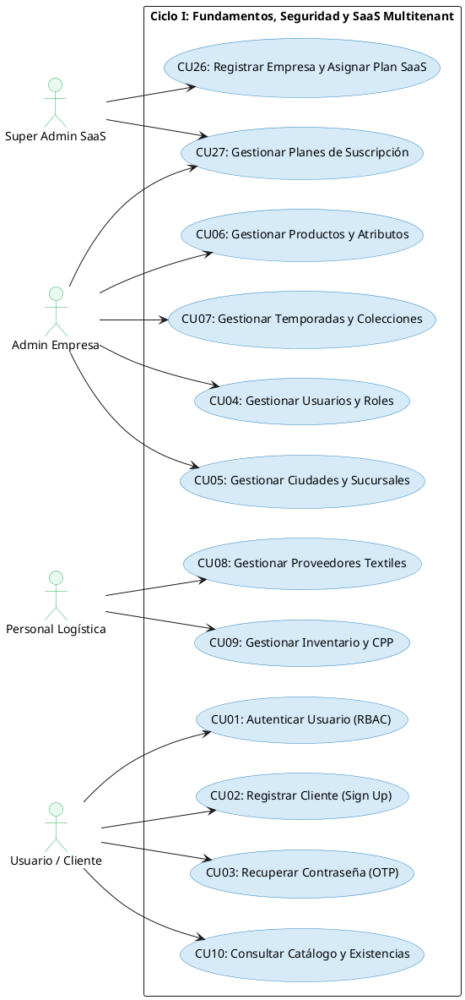

### 2.5.4 Diagrama de Casos de Uso — Ciclo II: Transacciones Omnicanal, Logística y Resiliencia Offline (PlantUML)

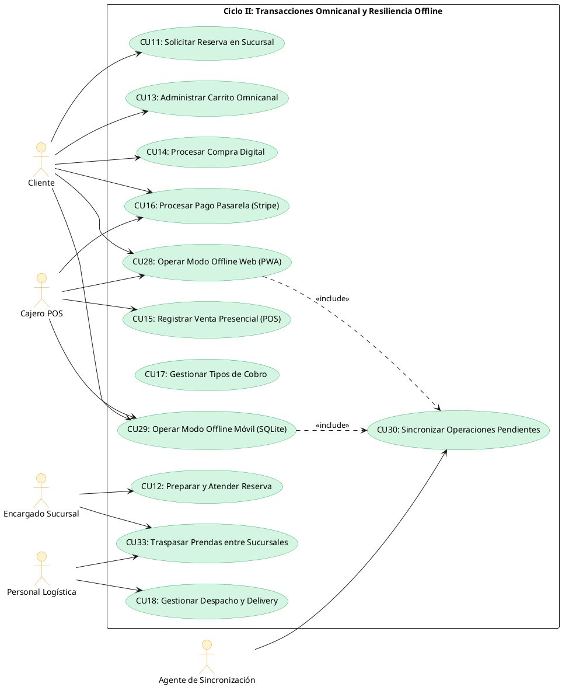

### 2.5.5 Diagrama de Casos de Uso — Ciclo III: Experiencia Avanzada, IA Generativa, Analítica ML y Post-Venta (PlantUML)

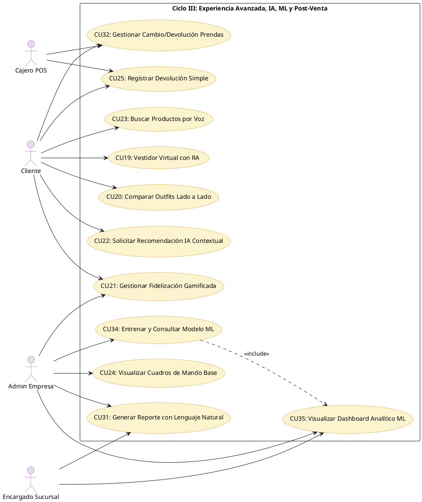

---

## 2.6 Especificación de Casos de Uso

A continuación se detallan las especificaciones técnicas completas de los **35 casos de uso**, aplicando estrictamente la plantilla de ficha ICONIX oficial exigida por la cátedra, acompañada por el diagrama de caso de uso en PlantUML y la descripción del prototipo de interfaz gráfica (UI Storyboard/Wireframe) correspondiente.


### 2.6.1 Casos de Uso del Ciclo I: Fundamentos, Seguridad y Plataforma SaaS Multitenant

### Caso de Uso CU01: Autenticar Usuario y Control de Acceso (RBAC)

#### a) Diagrama del Caso de Uso (PlantUML)

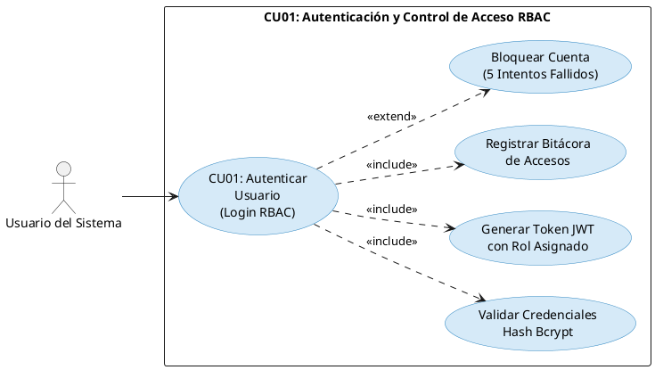

#### b) Prototipo de Interfaz de Usuario (UI Storyboard / Wireframe)

Pantalla de Login: Formulario con campos de correo electrónico registrado, contraseña (input tipo password), botón "Iniciar Sesión", enlace "¿Olvidaste tu contraseña?" y enlace "Registrarse". Validación visual de campos en tiempo real. Indicador de intentos restantes en caso de error. Redirección automática según rol (Dashboard para Administrador, POS para Cajero, Reservas para Encargado, Catálogo para Cliente).

#### c) Ficha de Caso de Uso (ICONIX)

| Campo | Contenido |
|-------|-----------|
| **Nombre** | CU01: Autenticar Usuario y Control de Acceso (RBAC) |
| **Autor** | Alberto Delgado / Andy Mujica |
| **Fecha** | 2026-10-25 |
| **Descripción** | Garantizar el acceso seguro, segregado y controlado a las funciones del sistema mediante credenciales válidas y expedición de tokens JWT firmados. |
| **Actores** | Administrador, Encargado de Sucursal, Cajero, Personal de Logística, Cliente. |
| **Precondiciones** | 1. El usuario debe poseer una cuenta previamente creada y activa (estado_cuenta = 'ACTIVO'). 2. El canal de comunicación debe encontrarse protegido bajo protocolo HTTPS/TLS. |
| **Flujo Normal** | 1. El actor ingresa a la vista de login en la plataforma web o móvil. 2. El actor introduce su correo electrónico registrado y contraseña en texto plano. 3. El sistema valida el formato del correo y recupera el registro del usuario. 4. El sistema comprueba mediante el algoritmo bcrypt.verify si la contraseña coincide con el password_hash almacenado. 5. El sistema verifica que la cuenta no esté bloqueada ni inactiva. 6. El sistema genera el token JWT firmado con el rol correspondiente y tiempo de expiración. 7. El sistema registra el acceso exitoso en la bitácora de auditoría. 8. El sistema redirige al usuario a la vista principal según su perfil (Dashboard para Administrador, POS para Cajero, Reservas para Encargado, Catálogo para Cliente). |
| **Flujo Alternativo** | **4a. Contraseña incorrecta:** 1. El sistema incrementa en 1 el campo intentos_fallidos. 2. Si intentos_fallidos >= 5, el sistema cambia estado_cuenta = 'BLOQUEADO_POR_INTENTOS', establece bloqueado_hasta = NOW() + INTERVAL '30 MIN' y registra alerta de seguridad. 3. El sistema muestra mensaje: "Credenciales inválidas. Le quedan X intentos antes del bloqueo." **5a. Cuenta bloqueada:** 1. El sistema rechaza la autenticación informando: "Cuenta bloqueada preventivamente. Restablezca su contraseña o contacte a soporte." |
| **Postcondiciones** | 1. Se emite un token de sesión JWT con los claims de identidad y rol del usuario. 2. Se actualiza el timestamp de ultimo_acceso y se restablece a 0 el contador de intentos fallidos. 3. Se registra el evento en la tabla bitacora_accesos con IP, fecha/hora y User-Agent. |

---

### Caso de Uso CU02: Registrar Cliente (Auto-registro de Clientes)

#### a) Diagrama del Caso de Uso (PlantUML)

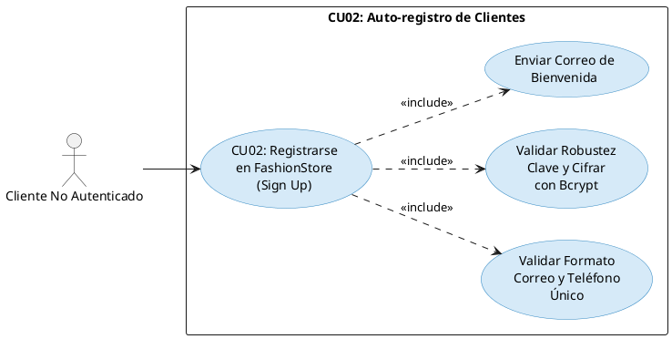

#### b) Prototipo de Interfaz de Usuario (UI Storyboard / Wireframe)

Formulario modal de registro con campos: Nombres, Apellidos, Correo Electrónico, Teléfono, Contraseña (con indicador de fortaleza visual en tiempo real), Confirmación de Contraseña. Botón "Crear Mi Cuenta FashionStore". Validación de unicidad de correo en tiempo real. Reglas visibles de contraseña segura (mínimo 8 caracteres, al menos una mayúscula y un número).

#### c) Ficha de Caso de Uso (ICONIX)

| Campo | Contenido |
|-------|-----------|
| **Nombre** | CU02: Registrar Cliente (Auto-registro de Clientes) |
| **Autor** | Alberto Delgado / Andy Mujica |
| **Fecha** | 2026-10-25 |
| **Descripción** | Permitir que los nuevos clientes se auto-registren en la plataforma FashionStore para acceder al carrito, guardar preferencias, reservar probadores físicos y acumular puntos de fidelización. |
| **Actores** | Cliente no autenticado (Visitante Web / Móvil). |
| **Precondiciones** | El usuario debe encontrarse en la plataforma web o móvil sin sesión activa. |
| **Flujo Normal** | 1. El visitante selecciona la opción "Registrarse" en la plataforma. 2. El sistema despliega el formulario de captura de datos personales y credenciales. 3. El cliente introduce nombres, apellidos, correo, teléfono y contraseña. 4. El sistema valida en tiempo real la fortaleza de la clave (mínimo 8 caracteres, al menos una mayúscula y un número). 5. El cliente presiona el botón "Crear Mi Cuenta FashionStore". 6. El sistema verifica que el correo electrónico no exista previamente en la base de datos. 7. El sistema aplica el hash seguro bcrypt sobre la contraseña ingresada. 8. El sistema persiste el usuario en la base de datos con rol CLIENTE e inicializa sus puntos de fidelización en 0. 9. El sistema dispara el envío asíncrono del correo de bienvenida. 10. El sistema inicia la sesión automáticamente expidiendo el token JWT y redirige al catálogo. |
| **Flujo Alternativo** | **6a. Correo ya registrado:** 1. El sistema detecta duplicidad de correo electrónico. 2. El sistema muestra mensaje de error: "El correo electrónico ya se encuentra registrado. ¿Desea iniciar sesión o recuperar su contraseña?" con enlaces directos. **4a. Contraseña insegura:** 1. El sistema deshabilita el envío e indica visualmente las reglas faltantes en la contraseña. **3a. Contraseñas no coincidentes:** 1. El sistema advierte que los campos de confirmación no concuerdan e impide el envío. |
| **Postcondiciones** | 1. Se crea un registro en usuarios con rol CLIENTE y estado_cuenta = 'ACTIVO'. 2. Se encripta la contraseña mediante bcrypt (factor de costo 12). 3. Se expide automáticamente un token JWT y se envía un correo transaccional de bienvenida. |

---

### Caso de Uso CU03: Recuperar Contraseña (Token OTP de 6 Dígitos)

#### a) Diagrama del Caso de Uso (PlantUML)

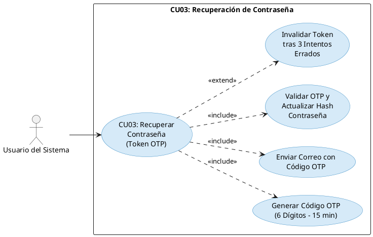

#### b) Prototipo de Interfaz de Usuario (UI Storyboard / Wireframe)

**Pantalla 1 - Solicitud de Correo:** Campo de correo electrónico registrado, botón "Enviar Código de Recuperación". Mensaje informativo: "Ingrese su correo electrónico y le enviaremos un código de verificación de 6 dígitos."

**Pantalla 2 - Verificación OTP y Nueva Clave:** Campo de código OTP de 6 dígitos, campo de nueva contraseña con indicador de fortaleza, campo de confirmación de nueva contraseña, botón "Restablecer Contraseña". Temporizador visual de 15 minutos de vigencia del código. Enlace "Solicitar nuevo código" en caso de expiración.

#### c) Ficha de Caso de Uso (ICONIX)

| Campo | Contenido |
|-------|-----------|
| **Nombre** | CU03: Recuperar Contraseña (Token OTP de 6 Dígitos) |
| **Autor** | Alberto Delgado / Andy Mujica |
| **Fecha** | 2026-10-25 |
| **Descripción** | Permitir a cualquier usuario restablecer de manera autoservicio su contraseña olvidada mediante la generación y validación de un código criptográfico temporal (OTP) enviado a su correo electrónico. |
| **Actores** | Usuario del Sistema (Cliente, Administrador, Empleado). |
| **Precondiciones** | 1. El usuario debe haber registrado previamente su cuenta con un correo electrónico válido. 2. El servicio SMTP/transaccional debe encontrarse operativo. |
| **Flujo Normal** | 1. El usuario presiona "¿Olvidaste tu contraseña?" en la pantalla de autenticación. 2. El sistema despliega la pantalla de solicitud de correo. 3. El usuario ingresa su correo electrónico y presiona "Enviar Código de Recuperación". 4. El sistema busca el correo en la base de datos. 5. El sistema genera un código numérico aleatorio criptoseguro de 6 dígitos con fecha de expiración fijada a NOW() + 15 MIN. 6. El sistema almacena el hash del OTP en tokens_recuperacion y despacha el correo electrónico con el código. 7. El sistema redirige a la pantalla de verificación de código OTP y nueva clave. 8. El usuario introduce el código OTP recibido y digita su nueva contraseña con confirmación. 9. El sistema valida que el OTP coincida, no haya expirado y no haya sido utilizado previamente. 10. El sistema cifra la nueva contraseña con bcrypt (factor 12) y actualiza el registro en usuarios. 11. El sistema marca el token OTP como utilizado (utilizado = true), limpia los contadores de intentos fallidos y desbloquea la cuenta. 12. El sistema muestra mensaje de confirmación: "Contraseña actualizada exitosamente" y redirige al login. |
| **Flujo Alternativo** | **4a. Correo no registrado:** 1. Por directriz de seguridad contra enumeración de cuentas (OWASP), el sistema responde genéricamente: "Si el correo ingresado se encuentra registrado, le hemos enviado el código de verificación", sin revelar la inexistencia del usuario. **9a. Código OTP erróneo:** 1. El sistema incrementa el contador de fallos del token. 2. Si supera 3 intentos errados, el token se invalida permanentemente y se exige solicitar uno nuevo. **9b. Código OTP expirado (más de 15 minutos):** 1. El sistema informa: "El código OTP ha expirado. Por favor solicite un nuevo código." |
| **Postcondiciones** | 1. Se genera un código OTP numérico aleatorio de 6 dígitos con expiración de 15 minutos en tokens_recuperacion. 2. Tras la validación, se actualiza el password_hash del usuario en usuarios y se inhabilita el token OTP. 3. Si la cuenta estaba bloqueada por intentos fallidos, se desbloquea automáticamente (estado_cuenta = 'ACTIVO', intentos_fallidos = 0). |

---

### Caso de Uso CU04: Gestionar Usuarios y Roles (RBAC y Desbloqueo)

#### a) Diagrama del Caso de Uso (PlantUML)

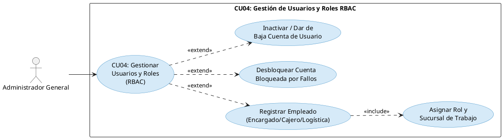

#### b) Prototipo de Interfaz de Usuario (UI Storyboard / Wireframe)

Panel administrativo con tabla paginada de usuarios mostrando columnas: Nombre, Email, Rol, Sucursal Asignada, Estado de Cuenta (badge de color: verde ACTIVO, rojo BLOQUEADO, gris INACTIVO). Botón "+ Crear nuevo colaborador". Acciones por fila: Editar, Desbloquear (visible solo para cuentas bloqueadas), Inactivar. Formulario modal para creación/edición con: campos de datos personales, selector de rol jerárquico (ADMINISTRADOR, ENCARGADO_SUCURSAL, CAJERO, LOGISTICA), selector de sucursal física.

#### c) Ficha de Caso de Uso (ICONIX)

| Campo | Contenido |
|-------|-----------|
| **Nombre** | CU04: Gestionar Usuarios y Roles (RBAC y Desbloqueo) |
| **Autor** | Alberto Delgado / Andy Mujica |
| **Fecha** | 2026-10-25 |
| **Descripción** | Gestionar los usuarios internos de la organización, asignar sus roles y sucursales físicas de desempeño, regular sus privilegios y realizar tareas de mantenimiento operativo (como el desbloqueo de cuentas bloqueadas por intentos fallidos). |
| **Actores** | Administrador General. |
| **Precondiciones** | El usuario debe estar autenticado con rol ADMINISTRADOR. |
| **Flujo Normal** | 1. El Administrador accede a la opción "Usuarios y Roles" del menú administrativo. 2. El sistema recupera la lista paginada de usuarios con sus roles y sucursales. 3. El Administrador selecciona "Nuevo Empleado" o hace clic en "Editar" sobre un usuario existente. 4. El sistema presenta el formulario modal con los campos de perfil, selector de rol jerárquico y selector de sucursal física. 5. El Administrador asigna el rol correspondiente (ADMINISTRADOR, ENCARGADO_SUCURSAL, CAJERO, LOGISTICA) y vincula la sucursal. 6. El Administrador presiona "Guardar Cambios". 7. El sistema valida los datos y persiste las modificaciones en la base de datos. 8. El sistema notifica la confirmación de la operación. |
| **Flujo Alternativo** | **3a. Desbloqueo de cuenta bloqueada por 5 intentos:** 1. El Administrador visualiza el badge de estado [BLOQ!] en el usuario. 2. El Administrador presiona el botón directo "Desbloquear". 3. El sistema resetea intentos_fallidos = 0, establece estado_cuenta = 'ACTIVO' y elimina la marca de tiempo bloqueado_hasta. 4. El sistema emite mensaje: "Cuenta desbloqueada exitosamente. El usuario ya puede iniciar sesión." **3b. Baja / Inactivación de empleado:** 1. El Administrador selecciona cambiar estado a INACTIVO. 2. El sistema revoca de inmediato todos los tokens JWT emitidos para dicho usuario. |
| **Postcondiciones** | Se persisten las modificaciones en la tabla usuarios y se asienta el registro de auditoría en bitacora_accesos. |

---

### Caso de Uso CU05: Gestionar Ciudades y Sucursales

#### a) Diagrama del Caso de Uso (PlantUML)

```plantuml
@startuml CU05_Gestionar_Sucursales
left to right direction
skinparam usecase {
  BackgroundColor #D6EAF8
  BorderColor #2E86C1
}

actor "Administrador General" as Admin

rectangle "CU05: Gestión de Ciudades y Sucursales" {
  usecase "CU05: Gestionar\nCiudades y\nSucursales" as CU05
  usecase "Registrar Nueva Sucursal\ncon Coordenadas GPS" as UC_Registrar
  usecase "Parametrizar Capacidad\nde Probadores Físicos" as UC_Probadores
  usecase "Actualizar Estado\nOperativo de Sucursal" as UC_Estado
}

Admin --> CU05
CU05 ..> UC_Registrar : <<extend>>
UC_Registrar ..> UC_Probadores : <<include>>
CU05 ..> UC_Estado : <<extend>>
@enduml
```

#### b) Prototipo de Interfaz de Usuario (UI Storyboard / Wireframe)

Panel de gestión de sucursales con listado tabulado de tiendas físicas activas mostrando: Ciudad, Nombre Sucursal, Dirección, Coordenadas GPS, Probadores, Estado. Botón "+ Registrar Nueva Sucursal". Formulario modal de creación/edición con: selector de ciudad, nombre comercial, dirección física, latitud, longitud, mapa interactivo con pin arrastrable, horario de apertura/cierre, capacidad de probadores (input numérico), selector de Encargado de Sucursal responsable, estado operativo (OPERATIVA, EN_MANTENIMIENTO, CERRADA_TEMPORALMENTE).

#### c) Ficha de Caso de Uso (ICONIX)

| Campo | Contenido |
|-------|-----------|
| **Nombre** | CU05: Gestionar Ciudades y Sucursales |
| **Autor** | Alberto Delgado / Andy Mujica |
| **Fecha** | 2026-10-25 |
| **Descripción** | Crear, configurar, actualizar y georreferenciar las ciudades y sucursales físicas habilitadas para la venta presencial, almacenamiento de existencias y reservas de probadores. |
| **Actores** | Administrador General. |
| **Precondiciones** | 1. El actor debe haberse autenticado exitosamente como Administrador General. 2. La ciudad de radicación debe encontrarse dada de alta en el sistema. |
| **Flujo Normal** | 1. El Administrador accede al panel de "Gestión de Sucursales". 2. El sistema lista las sucursales existentes con sus métricas clave. 3. El Administrador pulsa en "Registrar Nueva Sucursal". 4. El Administrador completa: ciudad, nombre comercial, dirección, coordenadas GPS, horarios de apertura/cierre y capacidad de probadores. 5. El Administrador asigna al Encargado de Sucursal responsable. 6. El sistema valida consistencia de datos y unicidad del nombre en la ciudad. 7. El sistema persiste la sucursal y notifica confirmación en pantalla. |
| **Flujo Alternativo** | **6a. Coordenadas fuera de rango:** El sistema notifica error de latitud/longitud e invita a seleccionar el punto en el mapa interactivo. **6b. Encargado ya asignado:** El sistema advierte que el usuario ya es titular en otra tienda y solicita confirmación de reasignación. |
| **Postcondiciones** | 1. La sucursal queda registrada en la base de datos con coordenadas geodésicas válidas. 2. La sucursal queda habilitada como nodo geográfico para asignación de inventario y reservas. |

---

### Caso de Uso CU06: Gestionar Productos y Atributos de Moda

#### a) Diagrama del Caso de Uso (PlantUML)

```plantuml
@startuml CU06_Gestionar_Productos
left to right direction
skinparam usecase {
  BackgroundColor #D6EAF8
  BorderColor #2E86C1
}

actor "Administrador General" as Admin

rectangle "CU06: Gestión de Productos y Atributos de Moda" {
  usecase "CU06: Gestionar\nProductos de\nModa Masculina" as CU06
  usecase "Registrar Prenda con\nSKU Base Único" as UC_Registrar
  usecase "Asociar Paleta de\nColores Multivaluados\n(HEX)" as UC_Colores
  usecase "Asignar Rango de\nTallas Disponibles" as UC_Tallas
  usecase "Vincular Modelo 3D\n(GLB) para Vestidor RA" as UC_3D
}

Admin --> CU06
CU06 ..> UC_Registrar : <<extend>>
UC_Registrar ..> UC_Colores : <<include>>
UC_Registrar ..> UC_Tallas : <<include>>
CU06 ..> UC_3D : <<extend>>
@enduml
```

#### b) Prototipo de Interfaz de Usuario (UI Storyboard / Wireframe)

Panel de productos con grilla de tarjetas mostrando: miniatura de imagen, SKU, nombre, precio, variantes de tallas y colores. Botón "+ Crear Nueva Prenda". Modal de creación con pestañas: Datos Generales (SKU base, nombre comercial, descripción, precio de venta base, categoría, marca, estado de publicación) y Variantes (selector múltiple de tallas [S, M, L, XL, XXL, 38, 40, 42], tabla de colores con input de nombre comercial + selector de código hexadecimal con previsualización). Zona de carga de imágenes en alta definición (frontal, dorsal, detalle) y archivo de modelo 3D (.glb/.gltf).

#### c) Ficha de Caso de Uso (ICONIX)

| Campo | Contenido |
|-------|-----------|
| **Nombre** | CU06: Gestionar Productos y Atributos de Moda |
| **Autor** | Alberto Delgado / Andy Mujica |
| **Fecha** | 2026-10-25 |
| **Descripción** | Registrar y actualizar prendas de vestir masculinas con sus especificaciones técnicas, variantes de tallas, colores multivaluados con código visual y recursos multimedia para el vestidor virtual. |
| **Actores** | Administrador General. |
| **Precondiciones** | La categoría y marca deben encontrarse registradas previamente en el sistema. |
| **Flujo Normal** | 1. El Administrador accede al panel de productos y presiona "Registrar Nueva Prenda". 2. El sistema despliega el formulario con los campos taxonómicos. 3. El Administrador introduce el código SKU base, nombre comercial, descripción y precio de venta base. 4. El Administrador selecciona la categoría textil y la marca. 5. El Administrador tilda las tallas disponibles para el modelo. 6. El Administrador agrega la paleta de colores multivaluados indicando nombre comercial y código hexadecimal. 7. El Administrador sube las imágenes en alta definición y el modelo 3D (.glb). 8. El sistema valida la integridad de los datos y no duplicidad de SKU. 9. El sistema persiste el producto y sus variantes relacionales. |
| **Flujo Alternativo** | **8a. SKU duplicado:** El sistema rechaza la operación e indica que el código ya pertenece a otro artículo. **8b. Archivo 3D inválido:** El sistema valida la cabecera del archivo binario y rechaza formatos distintos a .glb / .gltf. |
| **Postcondiciones** | 1. El producto queda guardado con su código SKU base único. 2. Se generan las matrices relacionales de variantes (combinación producto-talla-color). 3. Las variantes quedan preparadas para recibir stock en el módulo de inventario. |

---

### Caso de Uso CU07: Gestionar Temporadas y Colecciones

#### a) Diagrama del Caso de Uso (PlantUML)

```plantuml
@startuml CU07_Gestionar_Temporadas
left to right direction
skinparam usecase {
  BackgroundColor #D6EAF8
  BorderColor #2E86C1
}

actor "Administrador General" as Admin

rectangle "CU07: Gestión de Temporadas y Colecciones" {
  usecase "CU07: Gestionar\nTemporadas y\nColecciones" as CU07
  usecase "Asociar Prendas a la\nTemporada Comercial" as UC_Asociar
  usecase "Definir Campaña\nEstacional (Fechas\nInicio y Fin)" as UC_Campana
  usecase "Activar Liquidación y\nDescuentos de Campaña" as UC_Liquidacion
}

Admin --> CU07
CU07 ..> UC_Asociar : <<extend>>
UC_Asociar ..> UC_Campana : <<include>>
CU07 ..> UC_Liquidacion : <<extend>>
@enduml
```

#### b) Prototipo de Interfaz de Usuario (UI Storyboard / Wireframe)

Panel de temporadas con listado organizado por estado (Vigente, Próxima, Cerrada). Botón "+ Nueva Campaña Estacional". Modal de registro con: código de campaña, denominación, fecha de inicio, fecha de fin, descripción de línea conceptual, descuento de liquidación sugerido (%), estado (PLANIFICADA, VIGENTE, EN_LIQUIDACION, FINALIZADA). Sección de asociación de productos con selector múltiple de categorías y prendas.

#### c) Ficha de Caso de Uso (ICONIX)

| Campo | Contenido |
|-------|-----------|
| **Nombre** | CU07: Gestionar Temporadas y Colecciones |
| **Autor** | Alberto Delgado / Andy Mujica |
| **Fecha** | 2026-10-25 |
| **Descripción** | Crear y estructurar temporadas comerciales anuales, vinculando lotes de prendas para análisis estacional de rotación y reglas de IA contextual. |
| **Actores** | Administrador General. |
| **Precondiciones** | El usuario debe poseer privilegios de Administrador. |
| **Flujo Normal** | 1. El Administrador accede al panel de "Temporadas y Colecciones". 2. El sistema muestra la lista de temporadas vigentes y concluidas. 3. El Administrador ingresa código, nombre y rango de fechas de inicio y fin. 4. El Administrador selecciona las categorías y productos que pertenecerán a la colección. 5. El sistema valida que la fecha de fin sea posterior a la de inicio. 6. El sistema actualiza la vinculación y recalcula el catálogo público. |
| **Flujo Alternativo** | **5a. Fechas inconsistentes:** El sistema emite alerta: "La fecha de cierre debe ser posterior a la fecha de inicio de la temporada." |
| **Postcondiciones** | Las prendas asociadas adquieren el identificador de temporada para alimentar los filtros del catálogo y el motor de IA. |

---

### Caso de Uso CU08: Gestionar Proveedores Textiles

#### a) Diagrama del Caso de Uso (PlantUML)

```plantuml
@startuml CU08_Gestionar_Proveedores
left to right direction
skinparam usecase {
  BackgroundColor #D6EAF8
  BorderColor #2E86C1
}

actor "Administrador / Logística" as Admin

rectangle "CU08: Gestión de Proveedores Textiles" {
  usecase "CU08: Gestionar\nProveedores" as CU08
  usecase "Vincular Líneas\nTextiles y Términos\nComerciales" as UC_Vincular
  usecase "Registrar Proveedor\ncon NIT Único" as UC_Registrar
  usecase "Consultar Historial\nde Abastecimiento" as UC_Historial
}

Admin --> CU08
CU08 ..> UC_Vincular : <<extend>>
UC_Vincular ..> UC_Registrar : <<include>>
CU08 ..> UC_Historial : <<extend>>
@enduml
```

#### b) Prototipo de Interfaz de Usuario (UI Storyboard / Wireframe)

Directorio de proveedores en formato tabla con columnas: NIT, Razón Social, Contacto, Teléfono, Email, Términos de Pago, Estado. Botón "+ Registrar Proveedor". Modal de registro con: NIT (validación numérica obligatoria y unicidad), Razón Social, Nombre del contacto, teléfono, email, dirección sede, términos de pago (selector: CONTADO, CREDITO_30_DIAS, CREDITO_60_DIAS, CONSIGNACION), estado (ACTIVO, INACTIVO, OBSERVADO).

#### c) Ficha de Caso de Uso (ICONIX)

| Campo | Contenido |
|-------|-----------|
| **Nombre** | CU08: Gestionar Proveedores Textiles |
| **Autor** | Alberto Delgado / Andy Mujica |
| **Fecha** | 2026-10-25 |
| **Descripción** | Administrar el catálogo de proveedores que abastecen mercadería textil a FashionStore para sustentar las órdenes de compra y el ingreso a almacén. |
| **Actores** | Administrador General, Personal de Logística. |
| **Precondiciones** | Usuario con rol Administrador o Logística autenticado. |
| **Flujo Normal** | 1. El usuario accede al menú de "Proveedores". 2. El sistema lista los proveedores activos. 3. El usuario pulsa "Registrar Proveedor" e ingresa NIT, Razón Social, teléfono, email y términos de pago. 4. El sistema valida que el NIT no exista previamente. 5. El sistema registra el proveedor y muestra mensaje de éxito. |
| **Flujo Alternativo** | **4a. NIT duplicado:** El sistema notifica: "El NIT ingresado ya se encuentra registrado con la razón social X." |
| **Postcondiciones** | El proveedor queda disponible para ser seleccionado en los registros de compra y entrada de inventario. |

---

### Caso de Uso CU09: Gestionar Inventario Multi-Sucursal y Costos Ponderados (CPP)

#### a) Diagrama del Caso de Uso (PlantUML)

```plantuml
@startuml CU09_Gestionar_Inventario
left to right direction
skinparam usecase {
  BackgroundColor #D6EAF8
  BorderColor #2E86C1
}

actor "Personal de Logística\n/ Encargado" as Logistica

rectangle "CU09: Gestión de Inventario Multi-Sucursal" {
  usecase "CU09: Gestionar\nInventario\nMulti-Sucursal" as CU09
  usecase "Registrar Entrada\nde Lote por Compra" as UC_Entrada
  usecase "Calcular Costo\nPromedio Ponderado\n(CPP)" as UC_CPP
  usecase "Guardar Último Costo\nUnitario de Compra" as UC_Ultimo
  usecase "Consultar Existencias\ny Kardex de Sucursal" as UC_Consultar
  usecase "Alertar Quiebre\nde Stock\n(Stock < Mínimo)" as UC_Alerta
}

Logistica --> CU09
CU09 ..> UC_Entrada : <<extend>>
UC_Entrada ..> UC_CPP : <<include>>
UC_Entrada ..> UC_Ultimo : <<include>>
CU09 ..> UC_Consultar : <<extend>>
CU09 ..> UC_Alerta : <<extend>>
@enduml
```

#### b) Prototipo de Interfaz de Usuario (UI Storyboard / Wireframe)

Panel de inventario con selector de sucursal. Tabla de existencias mostrando: Producto, SKU, Talla, Color, Stock Físico, Stock Reservado, Stock Disponible, Último Costo, CPP. Botón "+ Registrar Entrada por Compra". Modal de ingreso de lote con: selector de sucursal receptora, selector de proveedor, selector de producto/talla/color, cantidad del lote, costo unitario de adquisición. Previsualización del recálculo del CPP antes de confirmar. Sección de Kardex con historial inmutable de movimientos.

#### c) Ficha de Caso de Uso (ICONIX)

| Campo | Contenido |
|-------|-----------|
| **Nombre** | CU09: Gestionar Inventario Multi-Sucursal y Costos Ponderados (CPP) |
| **Autor** | Alberto Delgado / Andy Mujica |
| **Fecha** | 2026-10-25 |
| **Descripción** | Registrar ingresos de mercadería, controlar existencias físicas y disponibles por tienda, almacenar el último costo unitario y recalcular matemáticamente el Costo Promedio Ponderado para fines de valuación patrimonial y márgenes reales. |
| **Actores** | Personal de Logística, Encargado de Sucursal. |
| **Precondiciones** | El producto, talla, color, sucursal y proveedor deben existir en la base de datos. |
| **Flujo Normal** | 1. El usuario de Logística selecciona "Registrar Entrada de Mercadería". 2. Elige la sucursal receptora, el proveedor y el producto específico con su talla y color. 3. Ingresa la cantidad física del lote recibido y el costo unitario de adquisición de la factura. 4. El sistema recupera el stock actual y el CPP anterior de la variante en esa sucursal. 5. El sistema aplica la fórmula estandarizada: CPP_nuevo = (Stock_ant × CPP_ant + Cantidad_lote × Costo_lote) / (Stock_ant + Cantidad_lote). 6. El sistema muestra el recálculo al usuario para verificación. 7. El usuario confirma el asiento. 8. El sistema ejecuta una transacción ACID: actualiza tabla inventario y añade fila en kardex_movimientos. |
| **Flujo Alternativo** | **3a. Costo o cantidad cero/negativo:** El sistema bloquea el registro exigiendo valores estrictamente mayores a cero. |
| **Postcondiciones** | 1. Se incrementa el stock físico y disponible de la variante en la sucursal. 2. Se asienta el último costo de compra. 3. Se actualiza el CPP. 4. Se registra el asiento inmutable en el Kardex de inventario. |

---

### Caso de Uso CU10: Consultar Catálogo y Disponibilidad por Sucursal

#### a) Diagrama del Caso de Uso (PlantUML)

```plantuml
@startuml CU10_Consultar_Catalogo
left to right direction
skinparam usecase {
  BackgroundColor #D6EAF8
  BorderColor #2E86C1
}

actor "Cliente (Web/Móvil)" as Cliente
actor "Encargado de Tienda" as Encargado

rectangle "CU10: Consulta de Catálogo y Disponibilidad" {
  usecase "CU10: Consultar\nCatálogo y\nDisponibilidad" as CU10
  usecase "Filtrar por Talla,\nColor, Temporada\ny Precio" as UC_Filtrar
  usecase "Verificar Stock en\nTiempo Real por\nSucursal" as UC_Stock
  usecase "Visualizar Ficha\nTécnica y Galería\nde Fotos" as UC_Ficha
}

Cliente --> CU10
Encargado --> CU10
CU10 ..> UC_Filtrar : <<include>>
CU10 ..> UC_Stock : <<include>>
CU10 ..> UC_Ficha : <<include>>
@enduml
```

#### b) Prototipo de Interfaz de Usuario (UI Storyboard / Wireframe)

Galería de prendas masculinas con tarjetas de producto (imagen, nombre, precio, badges de disponibilidad). Barra lateral de filtros: Categoría, Rango de Precios, Talla (checkboxes), Color (swatches hexadecimales), Temporada, Marca, Ciudad y Sucursal. Paginación optimizada e infinite scroll. Ficha detallada de prenda con: galería multimedia, selector de talla y color, guía de tallas anatómicas masculinas, bloque de disponibilidad por sucursal con desglose (stock físico, stock reservado, stock disponible), botones de acción (Probar en RA, Reservar para prueba presencial, Añadir al carrito).

#### c) Ficha de Caso de Uso (ICONIX)

| Campo | Contenido |
|-------|-----------|
| **Nombre** | CU10: Consultar Catálogo y Disponibilidad por Sucursal |
| **Autor** | Alberto Delgado / Andy Mujica |
| **Fecha** | 2026-10-25 |
| **Descripción** | Permitir a los usuarios explorar las prendas, aplicar filtros cruzados y conocer con absoluta precisión en qué sucursales físicas existe stock de su talla y color elegido. |
| **Actores** | Cliente (Web y Móvil), Encargado de Sucursal, Cajero. |
| **Precondiciones** | La plataforma web o app móvil debe tener acceso a la API pública de catálogo. |
| **Flujo Normal** | 1. El usuario accede al catálogo de FashionStore. 2. El sistema recupera y pagina las prendas publicadas con sus imágenes y variantes. 3. El usuario aplica filtros (ej. Talla M, Color Azul, Sucursal Equipetrol). 4. El sistema ejecuta una consulta indexada y devuelve las prendas coincidentes con su stock por tienda. 5. El usuario selecciona una prenda para ver su ficha técnica completa y guía de medidas. 6. El sistema presenta opciones de acción (Probar en RA, Reservar para prueba presencial, o Añadir al carrito). |
| **Flujo Alternativo** | **4a. Sin stock en la sucursal seleccionada:** El sistema muestra la etiqueta "Agotado en esta sucursal" y resalta inmediatamente en cuáles otras tiendas de la ciudad sí existe stock disponible. |
| **Postcondiciones** | El cliente obtiene la lista de prendas con stock disponible en tiempo real para proceder a la reserva o compra digital. |

---

### Caso de Uso CU26: Registrar Empresa y Asignar Plan SaaS

#### a) Diagrama del Caso de Uso (PlantUML)

```plantuml
@startuml CU26_Registrar_Empresa_SaaS
left to right direction
skinparam usecase {
  BackgroundColor #D6EAF8
  BorderColor #2E86C1
}
actor "Super Admin SaaS" as SuperAdmin

rectangle "CU26: Registrar Empresa y Asignar Plan SaaS" {
  usecase "CU26: Registrar Empresa\ny Asignar Plan SaaS" as CU26
  usecase "Validar NIT/Identificación\nTributaria Única" as UC_NIT
  usecase "Crear Tenant Lógico\n(Aislamiento empresa_id)" as UC_Tenant
  usecase "Asignar Plan de\nSuscripción (Básico/Prof)" as UC_Plan
  usecase "Crear Administrador\nInicial de Empresa" as UC_Admin
}

SuperAdmin --> CU26
CU26 ..> UC_NIT : <<include>>
CU26 ..> UC_Tenant : <<include>>
CU26 ..> UC_Plan : <<include>>
CU26 ..> UC_Admin : <<include>>
@enduml
```

#### b) Prototipo de Interfaz de Usuario (UI Storyboard / Wireframe)

**Pantalla de Registro de Empresa SaaS (`/saas/empresas/nueva`):**
Formulario interactivo con datos legales: Razón Social, NIT tributario, Dirección, Ciudad, Teléfono, Correo Corporativo. Selector de Plan de Suscripción (Tarjeta comparativa Básico vs Profesional con límites de sucursales e IA). Configuración de cuenta de Administrador de Empresa inicial (Nombre, Apellidos, Email y Contraseña temporal). Botón de acción: "Registrar Empresa y Activar Tenant".

#### c) Ficha de Caso de Uso (ICONIX)

| Campo | Contenido |
|-------|-----------|
| **Nombre** | CU26: Registrar Empresa y Asignar Plan SaaS |
| **Autor** | Alberto Delgado / Andy Mujica |
| **Fecha** | 2026-10-25 |
| **Descripción** | Permite al Super Administrador SaaS registrar una nueva empresa cliente en la plataforma FashionStore, creando su tenant lógico aislado (empresa_id), asignándole un plan de suscripción y generando su cuenta administradora inicial. |
| **Actores** | Super Administrador SaaS |
| **Precondiciones** | 1. El Super Administrador se encuentra autenticado con rol SUPER_ADMIN. 2. Existen planes de suscripción configurados. |
| **Flujo Normal** | 1. El Super Admin accede al módulo SaaS y selecciona 'Registrar Empresa'. 2. El sistema despliega el formulario de datos empresariales y de suscripción. 3. El Super Admin ingresa razón social, NIT, dirección legal, ciudad, teléfono y correo corporativo. 4. El sistema valida unicidad de NIT en la base central. 5. El Super Admin selecciona el plan (Básico o Profesional) y la vigencia. 6. El Super Admin define las credenciales del Administrador de Empresa inicial. 7. El sistema crea la entidad Empresa con un empresa_id único. 8. El sistema crea el registro de Suscripción activo con límites de sucursales. 9. El sistema crea la cuenta de usuario con rol ADMIN_EMPRESA asociada al tenant. 10. El sistema emite notificación de confirmación y despacha credenciales al correo corporativo. |
| **Flujo Alternativo** | 4a. NIT duplicado: El sistema informa que el NIT ya se encuentra registrado y bloquea la creación. 6a. Email de admin en uso: El sistema solicita una dirección de correo alternativa. 7a. Error de base de datos: Se aplica rollback completo de la transacción atómica. |
| **Postcondiciones** | 1. La empresa queda creada y habilitada en la plataforma con tenant lógico aislado. 2. Su suscripción queda activa con sus restricciones operativas. 3. El administrador de empresa puede iniciar sesión y configurar sus sucursales. |

---

### Caso de Uso CU27: Gestionar Planes de Suscripción y Límites de Tenant

#### a) Diagrama del Caso de Uso (PlantUML)

```plantuml
@startuml CU27_Gestionar_Planes
left to right direction
skinparam usecase {
  BackgroundColor #D6EAF8
  BorderColor #2E86C1
}
actor "Super Admin SaaS" as SuperAdmin
actor "Admin Empresa" as AdminEmp

rectangle "CU27: Gestionar Planes de Suscripción" {
  usecase "CU27: Gestionar Planes\nde Suscripción" as CU27
  usecase "Configurar Límites\nde Sucursales" as UC_Lim
  usecase "Habilitar/Deshabilitar\nMódulos IA y ML" as UC_Mod
  usecase "Cambiar de Plan\n(Upgrade/Downgrade)" as UC_Change
  usecase "Consultar Vigencia\ny Estado de Cuenta" as UC_State
}

SuperAdmin --> CU27
AdminEmp --> CU27
CU27 ..> UC_Lim : <<include>>
CU27 ..> UC_Mod : <<include>>
CU27 ..> UC_Change : <<extend>>
CU27 ..> UC_State : <<extend>>
@enduml
```

#### b) Prototipo de Interfaz de Usuario (UI Storyboard / Wireframe)

**Tablero de Planes y Suscripciones (`/saas/planes` y `/admin/mi-suscripcion`):**
Vista de Super Admin con tarjetas de planes: Básico (Hasta 2 sucursales, sin IA) y Profesional (Hasta 10 sucursales, con IA generativa y ML). Modales para ajuste de cuotas, tarifas y estados. Vista para Admin de Empresa con semáforo de vigencia, consumo de sucursales activas (ej: 2/2 utilizadas) y botón 'Solicitar Cambio de Plan'.

#### c) Ficha de Caso de Uso (ICONIX)

| Campo | Contenido |
|-------|-----------|
| **Nombre** | CU27: Gestionar Planes de Suscripción y Límites de Tenant |
| **Autor** | Alberto Delgado / Andy Mujica |
| **Fecha** | 2026-10-25 |
| **Descripción** | Permite al Super Administrador definir tarifas, cuotas de sucursales y permisos de módulos para cada plan SaaS, y a los Administradores de Empresa consultar su consumo de recursos y solicitar mejoras de plan. |
| **Actores** | Super Administrador SaaS, Administrador de Empresa |
| **Precondiciones** | El actor se encuentra autenticado con su rol correspondiente en la plataforma. |
| **Flujo Normal** | 1. El actor ingresa a la vista de planes de suscripción. 2. El sistema recupera el catálogo de planes y el estado de suscripción de la empresa. 3. Para Super Admin: permite modificar el tope de sucursales (ej: 2 para Básico, 10 para Profesional) y flags de IA. 4. Para Admin Empresa: muestra resumen de sucursales creadas vs límite permitido y fecha de expiración. 5. Si el Admin de Empresa solicita upgrade a Plan Profesional, el sistema procesa la solicitud y habilita de inmediato los módulos de reportes generativos y analítica ML. 6. El sistema actualiza la suscripción y registra la auditoría. |
| **Flujo Alternativo** | 3a. Reducción de límite incompatible: Si se intenta reducir el límite de sucursales a una empresa que tiene más activas de las permitidas, el sistema exige desactivar sucursales antes de aplicar el downgrade. |
| **Postcondiciones** | Los límites de operación del tenant quedan actualizados y sincronizados con los middlewares de seguridad del backend. |

---


### 2.6.2 Casos de Uso del Ciclo II: Transacciones Omnicanal, Reservas, Pagos, Logística y Resiliencia Offline

### Caso de Uso CU11: Solicitar Reserva de Prendas en Sucursal

#### a) Diagrama del Caso de Uso (PlantUML)

```plantuml
@startuml CU11_Solicitar_Reserva
left to right direction
skinparam usecase {
  BackgroundColor #D6EAF8
  BorderColor #2E86C1
}

actor "Cliente (Autenticado)" as Cliente

rectangle "CU11: Reserva de Prendas en Sucursal" {
  usecase "CU11: Solicitar Reserva\nde Prendas en Sucursal" as CU11
  usecase "Seleccionar Sucursal\ny Mapeo GPS" as UC_Sucursal
  usecase "Definir Fecha y Hora\n(Zona Horaria Local)" as UC_Fecha
  usecase "Validar Stock Físico\nDisponible en Sucursal" as UC_Validar
  usecase "Generar Ticket QR\ny Persistencia Histórica" as UC_QR
}

Cliente --> CU11
CU11 ..> UC_Sucursal : <<include>>
CU11 ..> UC_Fecha : <<include>>
CU11 ..> UC_Validar : <<include>>
CU11 ..> UC_QR : <<include>>
@enduml
```

#### b) Prototipo de Interfaz de Usuario (UI Storyboard / Wireframe)

- **Pantalla de Reserva (`/reservar`):**
  - Selector dinámico de sucursales con dirección, ciudad y capacidad de probadores inteligentes. El usuario debe elegir explícitamente la sucursal (sin asignaciones forzadas por defecto).
  - Selector de fecha de visita y hora programada respetando la zona horaria local (-04:00 Bolivia).
  - Catálogo de prendas seleccionadas con confirmación de stock físico en la sucursal elegida.
  - Botón de acción: "Confirmar y Generar Ticket QR de Reserva".
- **Pantalla de Tickets de Reserva (`/mis-tickets`):**
  - Historial completo y acumulativo de tickets generados por el cliente (no solo el último generado).
  - Visualización del código QR generado en formato Base64 Data URI y código de verificación alfanumérico legible (`qr_texto`).
  - Botones de acción: Descargar Ticket y Enviar a WhatsApp.

#### c) Ficha de Caso de Uso (ICONIX)

| Campo | Contenido |
|-------|-----------|
| **Nombre** | CU11: Solicitar Reserva de Prendas en Sucursal |
| **Autor** | Alberto Delgado / Andy Mujica |
| **Fecha** | 2026-10-25 |
| **Descripción** | Permitir al cliente apartar prendas para probárselas físicamente en una sucursal física determinada en un horario específico. |
| **Actores** | Cliente Final (Autenticado). |
| **Precondiciones** | 1. Cliente con sesión activa (JWT válido). 2. Prendas seleccionadas con existencias físicas en la sucursal destino. 3. La sucursal debe encontrarse en estado OPERATIVA. |
| **Flujo Normal** | 1. El cliente accede al módulo de reservas desde el catálogo o la barra de navegación. 2. Elige la sucursal física de su preferencia con dirección y GPS. 3. Define la fecha y hora estimada de visita respetando el huso horario local (-04:00). 4. El sistema valida la disponibilidad de stock en dicha sucursal con bloqueo pesimista (`SELECT ... FOR UPDATE`). 5. El cliente confirma la operación. 6. El backend persiste la reserva, genera el código QR con `qrcode` + `Pillow` en Base64 y devuelve el identificador al frontend. 7. El cliente visualiza su ticket en "Mis Tickets QR" con opción a consultarlo en cualquier momento. |
| **Flujo Alternativo** | **4a. Stock insuficiente:** El sistema informa que no existe la cantidad solicitada de la variante en la sucursal elegida e invita a seleccionar otra tienda o reducir cantidades. **3a. Sucursal en mantenimiento:** El sistema oculta sucursales con estado distinto a OPERATIVA del selector. |
| **Postcondiciones** | 1. Se registra la entidad `Reserva` con estado `PENDIENTE`. 2. Se asocian sus `ReservaDetalle` con productos, tallas y colores. 3. Se genera la imagen QR con token único UUID y el ticket se guarda en el historial del cliente. 4. Se aparta temporalmente el stock reservado en la tabla `inventario` (stock_reservado += cantidad). |

---

### Caso de Uso CU12: Preparar y Atender Reserva Presencial

#### a) Diagrama del Caso de Uso (PlantUML)

```plantuml
@startuml CU12_Preparar_Reserva
left to right direction
skinparam usecase {
  BackgroundColor #D6EAF8
  BorderColor #2E86C1
}

actor "Encargado de Sucursal" as Encargado
actor "Cliente" as Cliente

rectangle "CU12: Preparación y Atención de Reservas" {
  usecase "CU12: Preparar y\nAtender Reserva Presencial" as CU12
  usecase "Consultar Tablero de Reservas\nFiltrado por Sucursal" as UC_Tablero
  usecase "Apartar Prendas\nen Probador (PREPARADA)" as UC_Apartar
  usecase "Escanear QR del Cliente\n(Cámara / Entrada Manual)" as UC_Escanear
  usecase "Marcar Reserva\ncomo ATENDIDA" as UC_Atender
  usecase "Cargar en Caja POS" as UC_POS
}

Encargado --> CU12
Cliente --> UC_Escanear
CU12 ..> UC_Tablero : <<include>>
CU12 ..> UC_Apartar : <<include>>
CU12 ..> UC_Escanear : <<include>>
CU12 ..> UC_Atender : <<include>>
CU12 ..> UC_POS : <<extend>>
@enduml
```

#### b) Prototipo de Interfaz de Usuario (UI Storyboard / Wireframe)

- **Tablero del Encargado (`/encargado/reservas`):**
  - Filtro estricto por la sucursal asignada al encargado (`id_sucursal`).
  - Métricas rápidas: Total del Día, Pendientes de Preparación, Listas en Probador y Atendidas.
  - Tarjetas de reserva con prendas, tallas, colores y datos de contacto del cliente.
  - Botón "Apartar en Probador" para transicionar el estado a `PREPARADA`.
  - Módulo de escaneo interactivo de código QR con soporte para cámara web/móvil y entrada manual del token (`qr_texto`).
  - Confirmación inmediata con alerta y botón de acceso rápido para "Facturar en Caja POS (CU15)".

#### c) Ficha de Caso de Uso (ICONIX)

| Campo | Contenido |
|-------|-----------|
| **Nombre** | CU12: Preparar y Atender Reserva Presencial |
| **Autor** | Alberto Delgado / Andy Mujica |
| **Fecha** | 2026-10-25 |
| **Descripción** | Gestionar el ciclo de vida físico de la reserva en tienda, desde el apartado físico de prendas en probadores hasta la llegada y confirmación presencial del cliente. |
| **Actores** | Encargado de Sucursal, Cliente Final. |
| **Precondiciones** | 1. El encargado cuenta con rol `ENCARGADO_SUCURSAL` o `ADMINISTRADOR` y sucursal física asignada. 2. Existen reservas en estado `PENDIENTE` o `PREPARADA` asociadas a dicha tienda. |
| **Flujo Normal** | 1. El encargado ingresa a su tablero operativo de reservas. 2. Consulta las reservas en estado `PENDIENTE`. 3. Aparta las prendas en el probador inteligente y presiona "Apartar en Probador" (estado cambia a `PREPARADA`). 4. El cliente se presenta en tienda y muestra su ticket QR desde su teléfono móvil. 5. El encargado activa el lector de QR o digita el código alfanumérico. 6. El sistema valida la pertenencia de la reserva a esa sucursal y la marca como `ATENDIDA`. 7. El encargado puede derivar las prendas al cajero de mostrador para venta directa en POS. |
| **Flujo Alternativo** | **6a. QR inválido o de otra sucursal:** El sistema rechaza la lectura informando que el ticket no corresponde a esta tienda o que ya fue atendido previamente. **6b. Reserva ya vencida:** El sistema informa que la reserva ha expirado y las prendas han sido devueltas al stock general. |
| **Postcondiciones** | 1. La reserva cambia de estado a `PREPARADA` al apartarse en probador. 2. Al escanear el QR válido, cambia a `ATENDIDA`. 3. La reserva queda lista para su facturación en mostrador (CU15). |

---

### Caso de Uso CU13: Administrar Carrito de Compras Omnicanal

#### a) Diagrama del Caso de Uso (PlantUML)

```plantuml
@startuml CU13_Administrar_Carrito
left to right direction
skinparam usecase {
  BackgroundColor #D6EAF8
  BorderColor #2E86C1
}

actor "Cliente" as Cliente

rectangle "CU13: Carrito de Compras Omnicanal" {
  usecase "CU13: Administrar Carrito\nde Compras" as CU13
  usecase "Agregar Prenda con Talla/Color\ndesde Catálogo" as UC_Agregar
  usecase "Validar Existencias Atómicas\nen Base de Datos" as UC_Validar
  usecase "Modificar Cantidades (+/-)\no Eliminar Ítem" as UC_Modificar
  usecase "Recalcular Subtotales,\nDescuentos y Total" as UC_Calcular
  usecase "Continuar a Checkout (CU14)" as UC_Checkout
}

Cliente --> CU13
CU13 ..> UC_Agregar : <<include>>
CU13 ..> UC_Validar : <<include>>
CU13 ..> UC_Modificar : <<include>>
CU13 ..> UC_Calcular : <<include>>
CU13 ..> UC_Checkout : <<extend>>
@enduml
```

#### b) Prototipo de Interfaz de Usuario (UI Storyboard / Wireframe)

- **Gaveta Lateral Desplegable (Cart Drawer):**
  - Acceso instantáneo desde cualquier vista mediante el icono de bolsa en la barra superior con badge numérico reactivo.
  - Listado de ítems con imagen en miniatura, SKU base, nombre del producto, talla seleccionada, color y precio unitario.
  - Controles incrementales interactivos (`+` / `-`) con bloqueo automático al alcanzar el stock físico máximo disponible.
  - Botón de eliminación directa por ítem con animación suave.
  - Resumen financiero en el pie del carrito: Subtotal en Bs., costo de envío preliminar y Total.
  - Botón de llamada a la acción: "Proceder al Pago (Checkout) -> CU14".

#### c) Ficha de Caso de Uso (ICONIX)

| Campo | Contenido |
|-------|-----------|
| **Nombre** | CU13: Administrar Carrito de Compras Omnicanal |
| **Autor** | Alberto Delgado / Andy Mujica |
| **Fecha** | 2026-10-25 |
| **Descripción** | Permitir al cliente acumular y modificar los artículos que desea comprar en línea antes de emitir la orden formal. |
| **Actores** | Cliente Final. |
| **Precondiciones** | 1. Cliente autenticado navegando por el catálogo de prendas. 2. Existencias disponibles en inventario. |
| **Flujo Normal** | 1. El cliente selecciona una prenda, escoge talla y color, y presiona "Añadir a la Bolsa". 2. El sistema envía una petición HTTP atómica al backend validando existencias. 3. El carrito se actualiza y la gaveta lateral se despliega automáticamente confirmando la adición. 4. El cliente puede modificar cantidades o remover prendas. 5. El total se recalcula dinámicamente. 6. El cliente hace clic en "Proceder al Pago" para iniciar el checkout (CU14). |
| **Flujo Alternativo** | **2a. Stock insuficiente:** El sistema rechaza la adición e informa que no hay existencias suficientes para la variante elegida. **4a. Cantidad excede stock:** El botón `+` se desactiva automáticamente al llegar al límite disponible. |
| **Postcondiciones** | 1. La bolsa de compras se almacena de forma persistente en la tabla `carritos` y `carrito_items`. 2. No se pierde al recargar la página. 3. Los subtotales y totales quedan recalculados. |

---

### Caso de Uso CU14: Procesar Compra Digital y Checkout

#### a) Diagrama del Caso de Uso (PlantUML)

```plantuml
@startuml CU14_Checkout
left to right direction
skinparam usecase {
  BackgroundColor #D6EAF8
  BorderColor #2E86C1
}

actor "Cliente" as Cliente

rectangle "CU14: Compra Digital y Checkout" {
  usecase "CU14: Procesar Compra\nDigital y Checkout" as CU14
  usecase "Paso 1: Seleccionar Modalidad\nde Entrega (Retiro / Delivery)" as UC_Entrega
  usecase "Paso 2: Ingresar Datos Fiscales\nde Facturación (NIT/CI)" as UC_Factura
  usecase "Paso 3: Revisión Final y Emisión\nde Orden de Venta" as UC_Orden
  usecase "Redirección a Pasarela\nde Pago (CU16)" as UC_Pago
}

Cliente --> CU14
CU14 ..> UC_Entrega : <<include>>
CU14 ..> UC_Factura : <<include>>
CU14 ..> UC_Orden : <<include>>
CU14 ..> UC_Pago : <<include>>
@enduml
```

#### b) Prototipo de Interfaz de Usuario (UI Storyboard / Wireframe)

- **Flujo Guiado Wizard (`/checkout`):**
  - **Paso 1 (Logística de Entrega):** Pestañas para elegir entre "Retiro Gratuito en Sucursal" (con selector de tienda) o "Envío a Domicilio / Delivery" (con dirección, teléfono y cálculo de tarifa por geolocalización Haversine).
  - **Paso 2 (Facturación Fiscal):** Formulario para NIT o Carnet de Identidad y Razón Social, con opción rápida de "Usar mis datos de usuario registrado".
  - **Paso 3 (Revisión Final):** Cuadro de mando resumen con lista de prendas, desglose financiero (Subtotal, Costo de Envío y Total en Bs.) y botón "Confirmar Orden y Proceder al Pago".
- **Pantalla de Confirmación (`/checkout/confirmacion/:id`):** Resumen visual de la orden recién creada con número correlativo oficial y enlace directo a la pasarela electrónica de pago (`/pagos/orden/:id`).

#### c) Ficha de Caso de Uso (ICONIX)

| Campo | Contenido |
|-------|-----------|
| **Nombre** | CU14: Procesar Compra Digital y Checkout |
| **Autor** | Alberto Delgado / Andy Mujica |
| **Fecha** | 2026-10-25 |
| **Descripción** | Formalizar los términos logísticos y fiscales de la compra, generando la orden de venta definitiva en base de datos. |
| **Actores** | Cliente Final. |
| **Precondiciones** | 1. Carrito con al menos un ítem activo. 2. Usuario autenticado con sesión JWT válida. |
| **Flujo Normal** | 1. El cliente accede al checkout desde la bolsa de compras. 2. Selecciona la modalidad de entrega (Retiro en Sucursal o Delivery a Domicilio). 3. Si eligió Delivery, el sistema calcula la tarifa mediante el algoritmo esférico Haversine con coordenadas GPS de la sucursal despacho y la dirección destino. 4. Proporciona o valida sus datos de facturación fiscal (NIT/CI y Razón Social). 5. Revisa el resumen financiero consolidado (Subtotal + Envío = Total). 6. Presiona "Confirmar Orden y Proceder al Pago". 7. El backend genera la orden de venta con número de factura correlativo único y el frontend redirige a la pasarela electrónica Stripe (CU16). |
| **Flujo Alternativo** | **2a. Stock agotado durante checkout:** El backend valida atómicamente el stock y rechaza la orden con HTTP 400 si algún ítem ya no está disponible. **3a. Dirección de Delivery fuera de cobertura:** El sistema informa que la distancia excede el radio de cobertura configurable. |
| **Postcondiciones** | 1. Se crea el registro en `ordenes_venta` con número correlativo único (estado: `PENDIENTE_PAGO`). 2. Se asocian sus `ordenes_detalle`. 3. Se vacía el carrito del cliente. 4. Se deriva a la pasarela de pago (CU16). |

---

### Caso de Uso CU15: Registrar Venta Presencial en Caja (POS)

#### a) Diagrama del Caso de Uso (PlantUML)

```plantuml
@startuml CU15_Venta_POS
left to right direction
skinparam usecase {
  BackgroundColor #D6EAF8
  BorderColor #2E86C1
}

actor "Cajero de Sucursal" as Cajero

rectangle "CU15: Venta Presencial (POS)" {
  usecase "CU15: Registrar Venta\nPresencial en Mostrador" as CU15
  usecase "Escanear Código de Barras\no Buscar SKU" as UC_Escanear
  usecase "Modal de Variante: Selección\nde Talla y Factor de Precio" as UC_Variante
  usecase "Cargar Reserva Previa (QR)" as UC_Reserva
  usecase "Seleccionar Modalidad de Pago\n(Efectivo / Tarjeta / QR)" as UC_Pago
  usecase "Emitir Factura Fiscal\ny Descontar Stock" as UC_Emitir
}

Cajero --> CU15
CU15 ..> UC_Escanear : <<include>>
CU15 ..> UC_Variante : <<extend>>
CU15 ..> UC_Reserva : <<extend>>
CU15 ..> UC_Pago : <<include>>
CU15 ..> UC_Emitir : <<include>>
@enduml
```

#### b) Prototipo de Interfaz de Usuario (UI Storyboard / Wireframe)

- **Terminal Punto de Venta (`/caja/pos` o `/pos`):**
  - **Barra Superior:** Identificador de sucursal física, cajero activo en turno y estado de caja abierta.
  - **Catálogo de Prendas Disponibles en Sucursal:** Cuadrícula compacta y estética (tarjetas de altura estandarizada de 230px, sin deformaciones alargadas) con renderizado instantáneo desde el primer segundo gracias a detección de cambios forzada.
  - **Modal de Selección de Variante y Precios Dinámicos:**
    - Selector interactivo de tallas con factores de ajuste porcentual visibles (S: -5%, M: Base, L: +5%, XL: +10%, XXL: +15%).
    - Controles de cantidad con recálculo dinámico en tiempo real del precio unitario y del subtotal acumulado antes de agregar al ticket.
  - **Ticket Virtual de Mostrador:** Listado de ítems con botones rápidos (+ / - / eliminar), subtotal, total en Bs., datos del cliente (NIT/CI, Razón Social o "Cliente Mostrador").
  - **Módulo de Pago Rápido:** Selección entre Efectivo (con atajos de billetes de Bs. 50, 100, 200 y cálculo automático de cambio a devolver), Tarjeta POS o QR Simple BCB.
  - **Impresión de Ticket Fiscal:** Modal de comprobante térmico con datos fiscales, detalle de prendas, firma de cajero y botón de impresión directa.

#### c) Ficha de Caso de Uso (ICONIX)

| Campo | Contenido |
|-------|-----------|
| **Nombre** | CU15: Registrar Venta Presencial en Caja (POS) |
| **Autor** | Alberto Delgado / Andy Mujica |
| **Fecha** | 2026-10-25 |
| **Descripción** | Cobrar y registrar ventas en mostrador físico, soportando escaneo de productos, conversión de reservas presenciales, recálculo dinámico de precios por talla y descuento en Kardex. |
| **Actores** | Cajero de Sucursal, Administrador. |
| **Precondiciones** | 1. Cajero autenticado con turno activo y sucursal asignada. 2. Inventario físico en la sucursal. 3. Al menos un método de pago habilitado en CU17. |
| **Flujo Normal** | 1. El cajero visualiza el catálogo de prendas o escanea un código de barras SKU. 2. Al pulsar una prenda, se despliega el modal de variantes donde selecciona talla y cantidad, recalculándose el precio unitario y subtotal al instante. 3. Presiona "Agregar al Ticket". 4. Opcionalmente, ingresa el código QR de una reserva previa (CU12) para cargar sus ítems al ticket. 5. Ingresa NIT/CI del cliente o selecciona "Cliente Mostrador". 6. Elige método de pago (si es Efectivo, ingresa el dinero recibido y el sistema calcula el vuelto). 7. Presiona "Cobrar e Imprimir Ticket". 8. El sistema valida que el método de pago esté habilitado (CU17), descuenta el stock, asienta la transacción en Kardex y despliega el ticket fiscal listo para imprimir. |
| **Flujo Alternativo** | **6a. Método de pago deshabilitado:** El sistema rechaza la selección e informa que el canal ha sido desactivado por administración (CU17). **2a. Stock insuficiente:** Se alerta que no quedan existencias de esa variante en la sucursal del cajero. |
| **Postcondiciones** | 1. Se registra la venta como orden facturada en estado `PAGADO` con canal `POS`. 2. Se emite el ticket fiscal con número correlativo. 3. Se descuenta el stock físico en la sucursal. 4. Se asienta el movimiento de tipo `VENTA` en la tabla `kardex_movimientos`. |

---

### Caso de Uso CU16: Procesar Pago con Pasarela Electrónica

#### a) Diagrama del Caso de Uso (PlantUML)

```plantuml
@startuml CU16_Procesar_Pago
left to right direction
skinparam usecase {
  BackgroundColor #D6EAF8
  BorderColor #2E86C1
}

actor "Cliente" as Cliente
actor "Pasarela Stripe" as Pasarela

rectangle "CU16: Procesar Pago Electrónico" {
  usecase "CU16: Procesar Pago con\nPasarela Electrónica" as CU16
  usecase "Crear PaymentIntent Seguro\nen Backend" as UC_Intent
  usecase "Tokenizar Datos de Tarjeta\n(Stripe Elements PCI)" as UC_Token
  usecase "Verificación 3D Secure\ny Autenticación Bancaria" as UC_3D
  usecase "Confirmar Transacción Inmutable\ny Actualizar Orden a PAGADO" as UC_Confirmar
}

Cliente --> CU16
Pasarela --> UC_3D
Pasarela --> UC_Confirmar
CU16 ..> UC_Intent : <<include>>
CU16 ..> UC_Token : <<include>>
CU16 ..> UC_3D : <<extend>>
CU16 ..> UC_Confirmar : <<include>>
@enduml
```

#### b) Prototipo de Interfaz de Usuario (UI Storyboard / Wireframe)

- **Pantalla de Cobro Seguro (`/pagos/orden/:id`):**
  - Columna izquierda: Resumen completo de la orden con prendas, tallas, colores, subtotal, costo de envío y total a pagar en Bs.
  - Columna derecha: Formulario embebido Stripe Elements estilizado en tema oscuro con validación en tiempo real del número de tarjeta, fecha de vencimiento (MM/AA) y código CVC.
  - Campo de Nombre del Titular de la Tarjeta.
  - Botón interactivo: "Pagar Bs. X.XX con Tarjeta".
  - Pantalla de éxito post-pago: Resumen con ID de transacción Stripe, últimos 4 dígitos de la tarjeta, fecha/hora y botón directo para **"Ver Seguimiento (CU18)"**.

#### c) Ficha de Caso de Uso (ICONIX)

| Campo | Contenido |
|-------|-----------|
| **Nombre** | CU16: Procesar Pago con Pasarela Electrónica |
| **Autor** | Alberto Delgado / Andy Mujica |
| **Fecha** | 2026-10-25 |
| **Descripción** | Realizar el cobro electrónico de una orden de venta de forma segura y tokenizada bajo estándares PCI-DSS. |
| **Actores** | Cliente Final, Pasarela Externa (Stripe Sandbox). |
| **Precondiciones** | 1. Orden de venta en estado `PENDIENTE_PAGO`. 2. Método Stripe habilitado en `metodos_pago` (CU17). 3. Claves API de Stripe configuradas en el backend. |
| **Flujo Normal** | 1. El cliente es derivado a la pantalla de pago de su orden. 2. El backend genera un `PaymentIntent` contra la API de Stripe en centavos y devuelve el `client_secret`. 3. El cliente ingresa los datos de su tarjeta mediante los elementos seguros de Stripe. 4. El frontend envía los datos directamente a Stripe para tokenización sin tocar el servidor de FashionStore (cero almacenamiento PCI). 5. Si se requiere, se ejecuta el desafío bancario 3D Secure. 6. Al confirmarse el cobro, el backend asienta la transacción inmutable en la base de datos. 7. El cliente visualiza la pantalla de confirmación con enlace directo al tracking en vivo (CU18). |
| **Flujo Alternativo** | **5a. Tarjeta rechazada:** Stripe devuelve error y el sistema muestra el motivo específico (fondos insuficientes, tarjeta expirada, etc.) sin revelar datos sensibles. **2a. Pasarela deshabilitada:** El sistema rechaza la operación con HTTP 400 informando que Stripe no está habilitado por administración. |
| **Postcondiciones** | 1. Se registra la transacción inmutable en `transacciones_pago` con el `payment_intent_id` de Stripe, monto, últimos 4 dígitos y marca de tarjeta. 2. La orden transiciona a estado de pago `PAGADO`. 3. El estado logístico avanza a `PREPARACION` si la modalidad es `DELIVERY`. |

---

### Caso de Uso CU17: Gestionar Tipos y Medios de Cobro

#### a) Diagrama del Caso de Uso (PlantUML)

```plantuml
@startuml CU17_Medios_Cobro
left to right direction
skinparam usecase {
  BackgroundColor #D6EAF8
  BorderColor #2E86C1
}

actor "Administrador General" as Admin

rectangle "CU17: Tipos y Medios de Cobro" {
  usecase "CU17: Gestionar Tipos\ny Medios de Cobro" as CU17
  usecase "Listar Canales de Pago\ncon Claves Enmascaradas" as UC_Listar
  usecase "Activar / Desactivar Canal\n(Toggle Switch en Caliente)" as UC_Toggle
  usecase "Parametrizar Credenciales API\n(Modal con Ojo Revelador)" as UC_Param
  usecase "Validar Restricción Cruzada\nen Checkout y Caja POS" as UC_Restriccion
}

Admin --> CU17
CU17 ..> UC_Listar : <<include>>
CU17 ..> UC_Toggle : <<include>>
CU17 ..> UC_Param : <<extend>>
CU17 ..> UC_Restriccion : <<include>>
@enduml
```

#### b) Prototipo de Interfaz de Usuario (UI Storyboard / Wireframe)

- **Panel Administrativo (`/admin/pagos-config`):**
  - **Métricas Superiores:** Total de Canales Registrados, Canales Habilitados, Pasarelas Digitales y Canales Físicos.
  - **Cuadrícula de Canales:** Tarjetas para:
    1. `EFECTIVO` (Efectivo en Caja Mostrador - Físico).
    2. `TARJETA_POS` (Terminal POS / Tarjeta Física - Físico).
    3. `STRIPE` (Pasarela Digital Stripe - Digital Online).
    4. `QR_BCB` (Código QR Simple BCB - Omnicanal Interoperable).
  - **Controles por Tarjeta:**
    - Interruptor tipo iOS (Toggle Switch) para encender/apagar en tiempo real con confirmación Toast inmediata.
    - Bloque de parámetros de integración con valores enmascarados de seguridad (`sk_test_****dXFK`).
    - Botón "Configurar" para abrir el modal de parametrización.
  - **Modal de Credenciales:** Formulario reactivo con campos de tipo password e icono de ojo para alternar visibilidad de claves secretas. Guardado idempotente: si no se modifican los asteriscos, se preserva el secreto original en el backend.

#### c) Ficha de Caso de Uso (ICONIX)

| Campo | Contenido |
|-------|-----------|
| **Nombre** | CU17: Gestionar Tipos y Medios de Cobro |
| **Autor** | Alberto Delgado / Andy Mujica |
| **Fecha** | 2026-10-25 |
| **Descripción** | Activar, desactivar y parametrizar los canales por los cuales la empresa recauda dinero, afectando en tiempo real al Checkout web y al POS. |
| **Actores** | Administrador General. |
| **Precondiciones** | 1. Usuario autenticado con rol `ADMINISTRADOR`. |
| **Flujo Normal** | 1. El Administrador accede al módulo de Configuración Financiera (CU17). 2. Visualiza el estado operativo y métricas de todos los canales. 3. Activa o desactiva un canal mediante el Toggle Switch (el backend aplica un `PATCH` inmediato). 4. Si requiere actualizar llaves (ej. Stripe API Keys), presiona "Configurar". 5. El modal permite visualizar u ocultar claves sensibles mediante el icono de ojo. 6. El Administrador guarda los cambios; el backend persiste los parámetros y actualiza el cliente de Stripe en caliente sin reiniciar el servidor. |
| **Flujo Alternativo** | **3a. Desactivar el último canal activo:** El sistema advierte que no puede quedar sin ningún método de pago habilitado. **4a. Credenciales inválidas de Stripe:** El sistema valida la conexión con la API de Stripe antes de persistir las nuevas claves. |
| **Postcondiciones** | 1. Se actualiza la tabla `metodos_pago`. 2. Las pasarelas desactivadas son rechazadas inmediatamente en el Checkout (CU14/CU16) y en la Caja POS (CU15). |

---

### Caso de Uso CU18: Gestionar Despacho y Logística de Delivery

#### a) Diagrama del Caso de Uso (PlantUML)

```plantuml
@startuml CU18_Logistica_Delivery
left to right direction
skinparam usecase {
  BackgroundColor #D6EAF8
  BorderColor #2E86C1
}

actor "Personal de Logística" as Logistica
actor "Repartidor" as Chofer
actor "Cliente" as Cliente

rectangle "CU18: Logística y Despacho" {
  usecase "CU18: Gestionar Despacho\ny Logística de Delivery" as CU18
  usecase "Tablero de Despacho Kanban\ny Control de Empaque" as UC_Tablero
  usecase "Calcular Distancia Geodésica\ny Tarifa (Haversine)" as UC_Haversine
  usecase "Asignar Repartidor de Flota" as UC_Asignar
  usecase "Avanzar Máquina de Estados Finita\n(PREPARACION -> EN_TRANSITO -> ENTREGADA)" as UC_Estados
  usecase "Rastreo por GPS en Vivo\ny Simulación en Mapa" as UC_Tracking
}

Logistica --> CU18
Chofer --> UC_Estados
Cliente --> UC_Tracking
CU18 ..> UC_Tablero : <<include>>
CU18 ..> UC_Haversine : <<include>>
CU18 ..> UC_Asignar : <<include>>
CU18 ..> UC_Estados : <<include>>
CU18 ..> UC_Tracking : <<include>>
@enduml
```

#### b) Prototipo de Interfaz de Usuario (UI Storyboard / Wireframe)

- **Tablero Logístico (`/logistica/dashboard`):**
  - Filtro por estado: `CREADA`, `PREPARACION`, `LISTO_DESPACHO`, `EN_TRANSITO`, `ENTREGADA`.
  - Lista de órdenes pagadas con detalle de prendas para empaque físico.
  - Selector para asignar chofer/repartidor con nombre y teléfono.
  - Botones de transición respetando la máquina de estados finita (emite HTTP 409 si se intenta un salto no permitido).
- **Pantalla de Seguimiento en Vivo (`/tracking/:id`):**
  - Cabecera con número de factura, cliente y fecha estimada.
  - Stepper visual de 4 etapas: **1. Orden Confirmada**, **2. En Preparación**, **3. En Camino**, **4. Entregada**.
  - Tarjeta de Repartidor Asignado con fotografía, nombre, teléfono y vehículo.
  - Tarjeta de Destino con coordenadas GPS (latitud/longitud) y dirección exacta.
  - Botón interactivo de simulación "Avanzar Estado" para demostración y evaluación académica en vivo.

#### c) Ficha de Caso de Uso (ICONIX)

| Campo | Contenido |
|-------|-----------|
| **Nombre** | CU18: Gestionar Despacho y Logística de Delivery |
| **Autor** | Alberto Delgado / Andy Mujica |
| **Fecha** | 2026-10-25 |
| **Descripción** | Coordinar el empaque, la asignación de choferes, el despacho físico y el seguimiento satelital de pedidos a domicilio. |
| **Actores** | Personal de Logística, Repartidor, Cliente Final. |
| **Precondiciones** | 1. Orden de venta en estado `PAGADO` con modalidad de entrega `DELIVERY`. 2. Al menos un repartidor registrado como usuario con rol `LOGISTICA`. |
| **Flujo Normal** | 1. Logística recibe la orden pagada en estado `CREADA` o `PREPARACION`. 2. Se verifica el empaque de prendas y avanza a `LISTO_DESPACHO`. 3. Se asigna un repartidor disponible con sus datos de contacto. 4. El pedido pasa a `EN_TRANSITO`. 5. El cliente accede a `/tracking/:id` y visualiza la progresión del envío con mapa geodésico y datos del chofer. 6. El repartidor entrega el paquete y el pedido concluye en estado `ENTREGADA`. |
| **Flujo Alternativo** | **4a. Transición inválida en la máquina de estados:** El sistema responde con HTTP 409 Conflict si se intenta saltar de `CREADA` directamente a `EN_TRANSITO`, forzando el paso obligatorio por `PREPARACION` y `LISTO_DESPACHO`. **3a. Sin repartidores disponibles:** El sistema permite avanzar la orden a `LISTO_DESPACHO` pero advierte que no se ha asignado un chofer. |
| **Postcondiciones** | 1. La orden transiciona a `ENTREGADA` siguiendo la máquina de estados. 2. Se asientan las coordenadas geodésicas de destino, distancia calculada por Haversine y datos del repartidor asignado. |

---

### Caso de Uso CU28: Operar en Modo Offline Web (PWA con IndexedDB)

#### a) Diagrama del Caso de Uso (PlantUML)

```plantuml
@startuml CU28_Offline_PWA
left to right direction
skinparam usecase {
  BackgroundColor #D5F5E3
  BorderColor #27AE60
}
actor "Usuario Web (Cliente / Cajero)" as Usuario

rectangle "CU28: Operar en Modo Offline Web (PWA)" {
  usecase "CU28: Operar en Modo\nOffline Web (PWA)" as CU28
  usecase "Consultar Catálogo\nen IndexedDB" as UC_Cat
  usecase "Registrar Reserva\nsin Conexión" as UC_Res
  usecase "Registrar Venta de\nContado sin Conexión" as UC_Ven
  usecase "Encolar Operación\ncon UUID (LOCAL)" as UC_Cola
}

Usuario --> CU28
CU28 ..> UC_Cat : <<include>>
CU28 ..> UC_Cola : <<include>>
CU28 ..> UC_Res : <<extend>>
CU28 ..> UC_Ven : <<extend>>
@enduml
```

#### b) Prototipo de Interfaz de Usuario (UI Storyboard / Wireframe)

**Interfaz Web PWA con Indicador Offline:**
Banner superior persistente en color ámbar: '⚠️ Modo sin conexión — Operando con catálogo local (IndexedDB)'. Catálogo navegable con tarjetas de prendas precargadas. Selector de tallas y botón 'Apartar / Vender en Efectivo'. Modal de confirmación que advierte: 'Operación almacenada localmente. Se sincronizará automáticamente cuando regrese el Internet'. Indicador numérico en la barra de navegación: '3 operaciones pendientes'.

#### c) Ficha de Caso de Uso (ICONIX)

| Campo | Contenido |
|-------|-----------|
| **Nombre** | CU28: Operar en Modo Offline Web (PWA con IndexedDB) |
| **Autor** | Andy Mujica |
| **Fecha** | 2026-10-25 |
| **Descripción** | Permite a los usuarios de la Progressive Web App en Angular continuar explorando prendas, registrando reservas presenciales y ventas en efectivo cuando se interrumpe la conexión a Internet, almacenando las operaciones de manera segura en IndexedDB. |
| **Actores** | Cliente Final, Cajero POS, Encargado de Sucursal |
| **Precondiciones** | 1. La PWA se encuentra instalada o abierta en navegador compatible. 2. Se descargó previamente el catálogo local de la empresa. |
| **Flujo Normal** | 1. El navegador detecta la pérdida de red (evento 'offline'). 2. El sistema despliega el banner de advertencia de modo sin conexión. 3. El usuario explora prendas, tallas y existencias locales desde el almacén de objetos de IndexedDB. 4. El usuario selecciona prendas y genera una reserva o venta de contado. 5. El sistema genera un UUID v4 para la transacción. 6. El sistema serializa la transacción y la almacena en el ObjectStore 'operaciones_pendientes' con estado LOCAL. 7. El sistema actualiza el stock visual en la interfaz local. 8. El sistema muestra mensaje de éxito confirmando la captura local. |
| **Flujo Alternativo** | 3a. Catálogo local no inicializado: El sistema informa que requiere conectarse al menos una vez para descargar el catálogo. 6a. Almacenamiento lleno: El sistema advierte y solicita liberar espacio en el navegador. |
| **Postcondiciones** | La operación queda persistida en IndexedDB, no se pierde al cerrar la pestaña o reiniciar el equipo, y queda lista para sincronización. |

---

### Caso de Uso CU29: Operar en Modo Offline Móvil (Flutter con SQLite)

#### a) Diagrama del Caso de Uso (PlantUML)

```plantuml
@startuml CU29_Offline_Movil
left to right direction
skinparam usecase {
  BackgroundColor #D5F5E3
  BorderColor #27AE60
}
actor "Usuario Móvil (Cliente / Cajero)" as Usuario

rectangle "CU29: Operar en Modo Offline Móvil (Flutter + SQLite)" {
  usecase "CU29: Operar en Modo\nOffline Móvil (SQLite)" as CU29
  usecase "Consultar Catálogo\ndesde SQLite Local" as UC_CatM
  usecase "Registrar Reserva/Venta\nLocal con UUID" as UC_TxM
  usecase "Persistir en Tabla\noperaciones_pendientes" as UC_SqlM
}

Usuario --> CU29
CU29 ..> UC_CatM : <<include>>
CU29 ..> UC_TxM : <<include>>
CU29 ..> UC_SqlM : <<include>>
@enduml
```

#### b) Prototipo de Interfaz de Usuario (UI Storyboard / Wireframe)

**Interfaz Móvil Flutter con Modo Desconectado:**
Chip flotante en el AppBar con icono de nube tachada en rojo: 'Sin Red - Modo SQLite'. Catálogo interactivo fluido con imágenes cacheadas en disco. Botón flotante 'Registrar Venta Contado'. Formulario ágil con teclado numérico. Al confirmar, notificación Toast: 'Guardado en SQLite local (ID: 3a9f...)'. Pestaña 'Cola de Envíos' con lista de transacciones pendientes y estado LOCAL.

#### c) Ficha de Caso de Uso (ICONIX)

| Campo | Contenido |
|-------|-----------|
| **Nombre** | CU29: Operar en Modo Offline Móvil (Flutter con SQLite) |
| **Autor** | Andy Mujica |
| **Fecha** | 2026-10-25 |
| **Descripción** | Permite a los usuarios de la aplicación móvil Flutter operar en ausencia de conectividad celular o WiFi, ejecutando consultas de catálogo, apartado de reservas y ventas de contado presenciales persistidas en una base de datos SQLite embebida. |
| **Actores** | Cliente Final, Cajero Móvil |
| **Precondiciones** | 1. La aplicación móvil Flutter está instalada en el dispositivo móvil. 2. La base de datos SQLite local (`fashionstore_local.db`) fue inicializada. |
| **Flujo Normal** | 1. La aplicación detecta conectividad nula mediante ConnectivityPlus. 2. El sistema conmuta el repositorio de datos hacia la base de datos SQLite local. 3. El usuario navega prendas y existencias locales de su sucursal. 4. El cajero o cliente formula una venta en efectivo o reserva. 5. El sistema genera un UUID global y fecha/hora local inmutable. 6. El sistema ejecuta un INSERT transaccional en la tabla local `operaciones_pendientes`. 7. El sistema decrementa el stock en la tabla local `inventario_local`. 8. El sistema muestra comprobante provisional con código QR generado localmente. |
| **Flujo Alternativo** | 1a. Fallo de disco en SQLite: Se notifica error de E/S y se aborta la transacción preservando la integridad. |
| **Postcondiciones** | La transacción queda guardada en SQLite con estado LOCAL y garantizada ante apagados imprevistos del teléfono. |

---

### Caso de Uso CU30: Sincronizar Operaciones Pendientes e Idempotencia

#### a) Diagrama del Caso de Uso (PlantUML)

```plantuml
@startuml CU30_Sincronizacion
left to right direction
skinparam usecase {
  BackgroundColor #D5F5E3
  BorderColor #27AE60
}
actor "Agente de Sincronización" as AgenteSync
actor "Cajero / Usuario" as Usuario

rectangle "CU30: Sincronizar Operaciones Pendientes" {
  usecase "CU30: Sincronizar\nOperaciones Pendientes" as CU30
  usecase "Detectar Reconexión\ny Despachar Cola" as UC_Send
  usecase "Validar Idempotencia\npor UUID en Backend" as UC_Idem
  usecase "Actualizar Inventario\nCentral PostgreSQL" as UC_Stock
  usecase "Gestionar Conflictos\nde Existencias" as UC_Conf
}

AgenteSync --> CU30
Usuario --> CU30
CU30 ..> UC_Send : <<include>>
CU30 ..> UC_Idem : <<include>>
CU30 ..> UC_Stock : <<include>>
CU30 ..> UC_Conf : <<extend>>
@enduml
```

#### b) Prototipo de Interfaz de Usuario (UI Storyboard / Wireframe)

**Panel de Sincronización (`/admin/sync`):**
Barra de progreso de sincronización activa: 'Sincronizando 5 transacciones... [=====>    ] 60%'. Tabla de auditoría de cola: UUID, Tipo (Venta/Reserva), Hora Local, Intentos, Estado (Badge verde CONFIRMADA, rojo RECHAZADA, ámbar CONFLICTO). Botón 'Forzar Sincronización Manual'. Modal de resolución de conflicto de inventario con opción de regularización por encargado.

#### c) Ficha de Caso de Uso (ICONIX)

| Campo | Contenido |
|-------|-----------|
| **Nombre** | CU30: Sincronizar Operaciones Pendientes e Idempotencia |
| **Autor** | Alberto Delgado / Andy Mujica |
| **Fecha** | 2026-10-25 |
| **Descripción** | Coordina el reenvío ordenado de transacciones acumuladas en modo offline hacia el servidor FastAPI al recuperar la conexión, garantizando que ninguna operación se duplique (idempotencia) y resolviendo discrepancias de inventario. |
| **Actores** | Agente de Sincronización (Sistema), Cajero, Administrador |
| **Precondiciones** | 1. El dispositivo cliente recuperó conexión a Internet. 2. Existen registros con estado LOCAL en IndexedDB o SQLite. |
| **Flujo Normal** | 1. El Agente de Sincronización detecta el evento de reconexión a Internet. 2. El cliente lee las operaciones pendientes ordenadas cronológicamente. 3. Para cada operación, realiza un POST al endpoint `/api/sync/operacion` con el payload JSON y su UUID. 4. El backend verifica si el UUID ya existe en `operaciones_pendientes`: si ya fue confirmada, responde de inmediato con estado CONFIRMADA sin reprocesar (idempotencia). 5. Si es nueva, el backend abre una transacción PostgreSQL, valida stock en la sucursal del tenant y descuenta existencias. 6. El backend persiste la venta definitiva y responde HTTP 200 con estado CONFIRMADA. 7. El cliente actualiza el registro local a estado CONFIRMADA. 8. Se notifica al usuario: 'Sincronización completada con éxito'. |
| **Flujo Alternativo** | 4a. Concurrencia / Stock insuficiente: Si otro usuario consumió el stock en línea mientras el cliente operaba offline, el backend marca estado CONFLICTO, no emite venta errónea y envía notificación de alerta al Administrador de Empresa para resolución manual. 3a. Error transitorio de red: El cliente reintenta con backoff exponencial (2s, 4s, 8s, máximo 3 reintentos). |
| **Postcondiciones** | Las transacciones quedan asentadas en PostgreSQL, el inventario central queda consistente y las tablas locales quedan actualizadas. |

---

### Caso de Uso CU33: Traspasar Prendas entre Sucursales

#### a) Diagrama del Caso de Uso (PlantUML)

```plantuml
@startuml CU33_Traspasos_Sucursales
left to right direction
skinparam usecase {
  BackgroundColor #D5F5E3
  BorderColor #27AE60
}
actor "Encargado Sucursal" as Encargado
actor "Personal Logística" as Logistica

rectangle "CU33: Traspasar Prendas entre Sucursales" {
  usecase "CU33: Traspasar Prendas\nentre Sucursales" as CU33
  usecase "Solicitar Traspaso\nde Stock" as UC_Sol
  usecase "Verificar Stock Origen\ny Bloquear Unidades" as UC_Chk
  usecase "Autorizar y Despachar\n(En Tránsito)" as UC_Desp
  usecase "Confirmar Recepción\ny Asentar en Destino" as UC_Rec
}

Encargado --> CU33
Logistica --> CU33
CU33 ..> UC_Sol : <<include>>
CU33 ..> UC_Chk : <<include>>
CU33 ..> UC_Desp : <<include>>
CU33 ..> UC_Rec : <<include>>
@enduml
```

#### b) Prototipo de Interfaz de Usuario (UI Storyboard / Wireframe)

**Formulario de Traspaso de Inventario (`/inventario/traspasos/nuevo`):**
Selector de Sucursal Origen y Sucursal Destino (dentro de la misma empresa). Buscador de prendas por SKU/nombre con visualización del stock actual en origen. Selector de tallas, colores y cantidades a transferir. Campo de motivo/justificación. Botón 'Emitir Solicitud de Traspaso'. Vista de recepción con lista de verificación (checklist) y botón 'Confirmar Recepción Conforme'.

#### c) Ficha de Caso de Uso (ICONIX)

| Campo | Contenido |
|-------|-----------|
| **Nombre** | CU33: Traspasar Prendas entre Sucursales |
| **Autor** | Alberto Delgado / Andy Mujica |
| **Fecha** | 2026-10-25 |
| **Descripción** | Permite gestionar el rebalanceo de mercadería entre sucursales de una misma empresa, registrando la solicitud, el bloqueo y despacho en origen, el tránsito y el incremento efectivo en el inventario de la sucursal de destino. |
| **Actores** | Encargado de Sucursal, Personal de Logística |
| **Precondiciones** | 1. Ambas sucursales pertenecen al mismo tenant (empresa_id). 2. La sucursal de origen posee stock disponible de las prendas solicitadas. |
| **Flujo Normal** | 1. El encargado de la sucursal de destino detecta quiebre de stock y solicita traspaso desde otra sucursal. 2. El sistema despliega el formulario seleccionando sucursal origen y prendas requeridas. 3. El sistema valida que el stock disponible en origen sea suficiente y bloquea las unidades. 4. El sistema crea el registro en `traspasos_prendas` con estado PENDIENTE. 5. El encargado de origen autoriza el despacho; el estado pasa a EN_TRANSITO y se emite la guía de remisión interna. 6. La mercadería se transporta físicamente. 7. El encargado de destino revisa las prendas y pulsa 'Confirmar Recepción'. 8. El sistema descuenta el stock de origen en inventario, incrementa el stock de destino y asienta los movimientos en el Kardex. |
| **Flujo Alternativo** | 3a. Stock insuficiente en origen: El sistema rechaza la solicitud e indica el saldo real. 7a. Mercadería dañada en tránsito: El encargado de destino registra discrepancias y el sistema asienta las prendas faltantes como merma. |
| **Postcondiciones** | El stock queda balanceado en las dos sucursales y se conserva la trazabilidad completa en Kardex de ambas tiendas. |

---


### 2.6.3 Casos de Uso del Ciclo III: Experiencia Avanzada, IA Contextual y Generativa, Analítica ML y Post-Venta

### Caso de Uso CU19: Visualizar Prenda en Vestidor Virtual con RA

#### a) Diagrama del Caso de Uso (PlantUML)

```plantuml
@startuml CU19_Vestidor_Virtual_RA
left to right direction
skinparam usecase {
  BackgroundColor #E8F8F5
  BorderColor #117A65
}

actor "Cliente Móvil" as Cliente

rectangle "CU19: Vestidor Virtual con Realidad Aumentada (M08)" {
  usecase "CU19: Visualizar Prenda en\nVestidor Virtual con RA" as CU19
  usecase "Detectar Silueta y\nPuntos de Anclaje" as UC_Anclaje
  usecase "Superponer Modelo 3D\ny Textura Dinámica" as UC_Render3D
  usecase "Capturar Fotografía y\nCompartir Outfit" as UC_Snapshot
  usecase "Transferir Prenda a\nBolsa o Reserva" as UC_Transferir
}

Cliente --> CU19
CU19 ..> UC_Anclaje : <<include>>
CU19 ..> UC_Render3D : <<include>>
CU19 ..> UC_Snapshot : <<extend>>
CU19 ..> UC_Transferir : <<extend>>
@enduml
```

#### b) Prototipo de Interfaz de Usuario (UI Storyboard / Wireframe)


- **Pantalla del Vestidor RA (`/vestidor-ar` en App Móvil Flutter):**
  - Vista completa de la cámara frontal/posterior con retícula guía de alineación anatómica corporal (hombros, pecho, cintura).
  - Canvas de renderizado 3D superponiendo la prenda masculina (ej. Blazer Slim Fit, Camisa Oxford) con iluminación adaptativa al entorno real.
  - Barra flotante inferior con selectores de color/textura en tiempo real (paleta cromática en círculos interactivos: Azul Marino `#1A2A44`, Gris Carbón `#36454F`, Blanco Puro `#FFFFFF`).
  - Selector de tallas (S, M, L, XL) con ajuste automático de escala tridimensional de la prenda.
  - Indicador de tracking ARCore: estado de calibración ("Buscando plano corporal...", "Cuerpo fijado con precisión").
  - Botón obturador circular: Capturar foto del atuendo puesto para guardarla en la galería o compartirla.
  - Botones de conversión rápida: *"Añadir al Carrito"* o *"Reservar en Sucursal Equipetrol"*.

#### c) Ficha de Caso de Uso (ICONIX)

| Campo | Contenido |
|-------|-----------|
| **Nombre** | CU19: Visualizar Prenda en Vestidor Virtual con RA |
| **Autor** | Alberto Delgado / Andy Mujica |
| **Fecha** | 2026-10-25 |
| **Descripción** | Permitir al cliente proyectar tridimensionalmente prendas del catálogo sobre su silueta en tiempo real para verificar calce y combinación visual antes de comprar o reservar. |
| **Actores** | Cliente Móvil. |
| **Precondiciones** | 1. Dispositivo smartphone con soporte para Google Play Services for AR (ARCore) o Apple ARKit. 2. Permiso concedido de acceso a la cámara. 3. Prenda seleccionada con recurso 3D (`.glb`) registrado en el catálogo. |
| **Flujo Normal** | 1. El cliente pulsa el botón "Probar con RA" desde la ficha de una prenda en la aplicación móvil Flutter.<br>2. La aplicación inicializa el motor ARCore y solicita calibración enfocando el torso del usuario.<br>3. El sistema detecta los puntos de anclaje anatómico (hombros, cuello y cintura).<br>4. Se descarga el archivo tridimensional optimizado (`.glb`) desde el almacenamiento de recursos estáticos.<br>5. La aplicación superpone la prenda tridimensional ajustando dinámicamente la escala y orientación según los movimientos del usuario.<br>6. El cliente cambia entre colores y texturas disponibles mediante la barra interactiva.<br>7. El cliente pulsa el botón "Añadir a Carrito" o "Reservar en Tienda", derivando la variante seleccionada al flujo transaccional correspondiente. |
| **Flujo Alternativo** | **2a. Dispositivo no compatible con AR:** El sistema informa que el hardware carece de sensores compatibles y conmuta automáticamente a la vista 3D interactiva 360° con rotación táctil.<br>**3a. Pérdida de tracking por iluminación deficiente:** El sistema muestra una alerta en pantalla: *"Mueva el dispositivo despacio o mejore la iluminación"* manteniendo el modelo en pausa hasta recuperar la referencia corporal. |
| **Postcondiciones** | 1. Se inicializa la sesión de realidad aumentada con superposición continua del modelo 3D. 2. El cliente puede interactuar con variantes de color sin perder el rastreo corporal. 3. Si se captura fotografía, se almacena en memoria local del dispositivo con opción a compartir. |

---

### Caso de Uso CU20: Comparar Outfits Lado a Lado

#### a) Diagrama del Caso de Uso (PlantUML)

```plantuml
@startuml CU20_Comparador_Outfits
left to right direction
skinparam usecase {
  BackgroundColor #E8F8F5
  BorderColor #117A65
}

actor "Cliente Final" as Cliente

rectangle "CU20: Comparador Inteligente de Outfits (M09)" {
  usecase "CU20: Comparar Outfits\nLado a Lado" as CU20
  usecase "Ensamblar Prendas por Slot\n(Superior, Inferior, Calzado)" as UC_Slots
  usecase "Calcular Precios Totales y\nDescuentos Comparativos" as UC_Calcular
  usecase "Identificar Outfit Más Económico\ny de Mejor Estilo" as UC_Evaluar
  usecase "Transferir Conjunto Ganador\na Carrito o Reserva" as UC_Transferir
}

Cliente --> CU20
CU20 ..> UC_Slots : <<include>>
CU20 ..> UC_Calcular : <<include>>
CU20 ..> UC_Evaluar : <<include>>
CU20 ..> UC_Transferir : <<extend>>
@enduml
```

#### b) Prototipo de Interfaz de Usuario (UI Storyboard / Wireframe)


- **Pantalla Comparadora de Outfits (`/comparador` en Web Angular y App Móvil):**
  - Encabezado con título *"Comparador Visual de Estilos Masculinos"* y selector de ocasión (Formal, Casual, Urbano).
  - Tres columnas paralelas interactivas (Outfit 1, Outfit 2 y Outfit 3):
    * **Slot 1 (Prenda Superior):** Miniatura fotográfica de camisa/blazer, nombre, talla, color y precio unitario en Bs. Botón *"Cambiar prenda"*.
    * **Slot 2 (Prenda Inferior):** Miniatura de pantalón/jean, talla, color y precio unitario en Bs.
    * **Slot 3 (Calzado / Accesorio):** Miniatura de zapatos formales/zapatillas o cinturón con precio.
  - Tarjeta de resumen al pie de cada columna:
    * Subtotal prendas individuales.
    * Descuento aplicable por fidelización o temporada.
    * **Precio Total del Outfit en Bolivianos (Bs.).**
    * Etiqueta distintiva verde: *"Opción Más Económica"* en la columna de menor precio total.
  - Botón de acción principal al pie de cada outfit: *"Comprar este Outfit Completo"* (agrega los 3 ítems al carrito con 1 clic) y *"Reservar Outfit en Tienda"*.

#### c) Ficha de Caso de Uso (ICONIX)

| Campo | Contenido |
|-------|-----------|
| **Nombre** | CU20: Comparar Outfits Lado a Lado |
| **Autor** | Alberto Delgado / Andy Mujica |
| **Fecha** | 2026-10-25 |
| **Descripción** | Permitir al cliente contrastar visual y económicamente hasta tres combinaciones de ropa masculina en una única vista, facilitando la toma de decisiones estéticas y presupuestarias. |
| **Actores** | Cliente Final (Web / Móvil). |
| **Precondiciones** | Al menos una prenda preseleccionada desde el catálogo o generada desde las sugerencias del asistente de estilo. |
| **Flujo Normal** | 1. El cliente accede al módulo comparador desde el menú principal o desde la sugerencia de un outfit.<br>2. El sistema presenta las tres columnas vacías o precargadas con una propuesta.<br>3. El cliente añade o reemplaza componentes en cada outfit seleccionando entre prendas superiores, inferiores y calzados.<br>4. En cada modificación, el sistema recalcula en tiempo real los subtotales, descuentos y montos totales en moneda nacional (Bs.).<br>5. El sistema resalta automáticamente la combinación más económica y la que cuenta con mayor afinidad estilística.<br>6. El cliente decide la combinación preferida y pulsa "Comprar Outfit Ganador".<br>7. Los ítems del conjunto seleccionado se incorporan de manera atómica al Carrito de Compras (CU13). |
| **Flujo Alternativo** | **3a. Prenda seleccionada sin stock en la talla del cliente:** El sistema muestra una alerta en el slot correspondiente sugiriendo una talla contigua o un producto similar alternativo.<br>**6a. El cliente prefiere probarse las prendas presencialmente:** El cliente selecciona "Reservar este Outfit", derivando los ítems a la solicitud de reserva en la sucursal Equipetrol (CU11). |
| **Postcondiciones** | Se consolidan las combinaciones elegidas y se habilita el traslado automático de los productos al carrito de compras o a una reserva física. |

---

### Caso de Uso CU21: Gestionar Fidelización Gamificada

#### a) Diagrama del Caso de Uso (PlantUML)

```plantuml
@startuml CU21_Fidelizacion_Gamificada
left to right direction
skinparam usecase {
  BackgroundColor #E8F8F5
  BorderColor #117A65
}

actor "Cliente Final" as Cliente
actor "Motor de Gamificación" as Motor

rectangle "CU21: Sistema de Fidelización Gamificado (M16)" {
  usecase "CU21: Gestionar Fidelización\nGamificada" as CU21
  usecase "Acumular Puntos por\nCompras y Acciones" as UC_Acumular
  usecase "Evaluar y Actualizar\nNivel de Membresía" as UC_Nivel
  usecase "Desbloquear Insignias\nDigitales por Hitos" as UC_Insignias
  usecase "Canjear Puntos por\nCupones de Descuento" as UC_Canjear
}

Cliente --> CU21
Motor --> UC_Acumular
Motor --> UC_Nivel
Motor --> UC_Insignias
CU21 ..> UC_Acumular : <<include>>
CU21 ..> UC_Nivel : <<include>>
CU21 ..> UC_Insignias : <<include>>
CU21 ..> UC_Canjear : <<extend>>
@enduml
```

#### b) Prototipo de Interfaz de Usuario (UI Storyboard / Wireframe)


- **Pantalla de Perfil de Recompensas (`/recompensas` en Web y Móvil):**
  - Tarjeta VIP de Membresía con efecto metálico según el rango alcanzado: Bronce (cobre pulido), Plata (plateado brillante), Oro (dorado premium) o Diamante (azul cian metalizado).
  - Nombre del cliente, nivel actual y beneficio activo (ej. *"Nivel Oro: 10% de descuento permanente en todas tus compras"*).
  - Barra de progreso interactiva con indicador visual: *"1,650 / 4,000 Puntos para Nivel Diamante"* (con porcentaje de avance numérico).
  - Mosaico de Insignias Digitales desbloqueadas y por desbloquear:
    * *Primer Outfit:* Desbloqueada tras la primera compra exitosa.
    * *Explorador RA:* Desbloqueada al probar 5 prendas en el vestidor virtual.
    * *Caballero Impecable:* Desbloqueada tras adquirir trajes ejecutivos formales.
    * *Cliente Omnicanal:* Desbloqueada al realizar compras tanto en línea como en la tienda física de Equipetrol.
  - Catálogo de Cupones Canjeables: Listado de recompensas con costo en puntos (ej. *"Cupón 50 Bs de descuento - 500 pts"*, *"Envío Gratis Delivery - 200 pts"*). Botón *"Canjear Recompensa"*.

#### c) Ficha de Caso de Uso (ICONIX)

| Campo | Contenido |
|-------|-----------|
| **Nombre** | CU21: Gestionar Fidelización Gamificada |
| **Autor** | Alberto Delgado / Andy Mujica |
| **Fecha** | 2026-10-25 |
| **Descripción** | Fidelizar a los clientes mediante dinámicas de gamificación basadas en acumulación de puntos por compras, ascensos jerárquicos de nivel con beneficios crecientes, otorgamiento de medallas e insignias, y canje de cupones de descuento. |
| **Actores** | Cliente Final, Motor de Gamificación. |
| **Precondiciones** | Cliente registrado y autenticado con cuenta activa en FashionStore. |
| **Flujo Normal** | 1. Tras la confirmación de pago de una orden de venta digital (CU14) o venta en mostrador POS (CU15), el sistema invoca al Motor de Gamificación.<br>2. El motor calcula los puntos devengados a razón de 1 punto por cada 10 Bolivianos netos facturados.<br>3. El motor incrementa `puntos_actuales` y `puntos_historicos`.<br>4. El motor evalúa los umbrales de puntos históricos:<br> - Bronce: 0 a 499 puntos (0% descuento base).<br> - Plata: 500 a 1,499 puntos (5% descuento base).<br> - Oro: 1,500 a 3,999 puntos (10% descuento base).<br> - Diamante: 4,000+ puntos (15% descuento base + envíos gratis).<br>5. Si el cliente supera un umbral, se actualiza el campo `nivel` y se registra la fecha de ascenso.<br>6. El motor evalúa hitos pendientes e incorpora nuevas insignias al arreglo JSON del perfil.<br>7. El cliente accede a su panel de recompensas y solicita el canje de un cupón.<br>8. El sistema descuenta los puntos necesarios del saldo y genera un código de cupón alfanumérico único para su uso inmediato en el checkout. |
| **Flujo Alternativo** | **7a. Saldo insuficiente para canje:** El sistema informa que el saldo de puntos disponibles no alcanza para la recompensa elegida e indica cuántos puntos restan por acumular.<br>**1a. Asignación de puntos promocionales por acciones:** El cliente obtiene 20 puntos de bienvenida por registro inicial y 10 puntos extra por utilizar el vestidor virtual RA. |
| **Postcondiciones** | Se actualiza el saldo de puntos disponibles, los puntos históricos totales y el nivel jerárquico en la entidad `gamificacion_perfiles`. Se emiten cupones de descuento si el cliente efectúa un canje. |

---

### Caso de Uso CU22: Solicitar Recomendación Contextual de IA

#### a) Diagrama del Caso de Uso (PlantUML)

```plantuml
@startuml CU22_Recomendacion_Contextual_IA
left to right direction
skinparam usecase {
  BackgroundColor #E8F8F5
  BorderColor #117A65
}

actor "Cliente Final" as Cliente
actor "Servicio IA / LLM" as IA
actor "API Meteorológica" as Clima

rectangle "CU22: Asistente de Estilo con IA Contextual (M17)" {
  usecase "CU22: Solicitar Recomendación\nContextual de IA" as CU22
  usecase "Consultar Clima Local en Tiempo Real\n(API OpenWeatherMap)" as UC_Clima
  usecase "Analizar Ocasión de Uso y\nReglas de Colorimetría" as UC_Color
  usecase "Verificar Stock Físico Activo\nde Prendas Sugeridas" as UC_Stock
  usecase "Generar Justificación Estilística\ncon Inteligencia Artificial" as UC_LLM
}

Cliente --> CU22
Clima --> UC_Clima
IA --> UC_LLM
CU22 ..> UC_Clima : <<include>>
CU22 ..> UC_Color : <<include>>
CU22 ..> UC_Stock : <<include>>
CU22 ..> UC_LLM : <<include>>
@enduml
```

#### b) Prototipo de Interfaz de Usuario (UI Storyboard / Wireframe)


- **Pantalla del Asistente de Estilo IA (`/asistente-ia` en Web y Móvil):**
  - Encabezado con widget de clima dinámico: *"Santa Cruz de la Sierra: 28°C, Soleado (Sensación térmica: 31°C)"* con icono de sol radiante (o lluvia/frío según la ciudad elegida).
  - Selector interactivo de ciudad de Bolivia: Santa Cruz, La Paz, Cochabamba.
  - Selector de ocasión de vestimenta: *Formal / Oficina*, *Casual Urbano*, *Cena / Gala*, *Deportivo Fin de Semana*.
  - Tarjeta de sugerencia inteligente generada por el Asistente de IA:
    * Mensaje conversacional del estilista virtual: *"Para esta tarde cálida y despejada en Santa Cruz, te sugiero un atuendo fresco y sofisticado: Camisa de lino blanca con mangas remangadas y pantalón chino color beige arena."*
    * Justificación cromática: *"Armonía tonal neutra-cálida ideal para climas soleados."*
  - Carrusel horizontal con las prendas exactas del atuendo sugerido (con fotos, tallas disponibles, precio y stock verificado).
  - Botón: *"Ver este Outfit en el Comparador"* o *"Probar en Vestidor Virtual RA"*.

#### c) Ficha de Caso de Uso (ICONIX)

| Campo | Contenido |
|-------|-----------|
| **Nombre** | CU22: Solicitar Recomendación Contextual de IA |
| **Autor** | Alberto Delgado / Andy Mujica |
| **Fecha** | 2026-10-25 |
| **Descripción** | Ofrecer asesoramiento de imagen personalizado recomendando conjuntos completos de ropa masculina a partir del clima actual, la ocasión elegida, reglas de colorimetría y existencias reales en inventario. |
| **Actores** | Cliente Final, Servicio de IA / LLM, Servicio Meteorológico (OpenWeatherMap). |
| **Precondiciones** | Conectividad con la API de OpenWeatherMap y con el proveedor de IA (OpenAI / Gemini). Catálogo con prendas activas y con stock disponible. |
| **Flujo Normal** | 1. El cliente pulsa sobre el Asistente de Estilo IA en la plataforma web o aplicación móvil.<br>2. El sistema detecta la ciudad del usuario (o permite seleccionarla) y consulta la API de OpenWeatherMap para obtener temperatura y condición actual.<br>3. El cliente elige la ocasión de vestimenta requerida (ej. *Casual Urbano*).<br>4. El backend construye un prompt contextual estructurado integrando: temperatura actual, condición meteorológica, ocasión y reglas masculinas de etiqueta.<br>5. El modelo de lenguaje procesa el requerimiento y propone combinaciones semánticas de prendas.<br>6. El backend contrasta las prendas sugeridas contra la base de datos de inventario activo, filtrando únicamente ítems con stock $>0$.<br>7. El frontend renderiza la recomendación completa con la explicación del estilista virtual y las prendas listas para interactuar. |
| **Flujo Alternativo** | **2a. Falla en el servicio meteorológico externo:** El sistema captura el fallo, asigna valores climáticos típicos de la temporada comercial en curso y continúa con la recomendación sin interrumpir al usuario.<br>**6a. Prenda sugerida sin existencias disponibles:** El algoritmo sustituye la prenda agotada por la alternativa más afín en color y categoría con existencias físicas confirmadas. |
| **Postcondiciones** | Se genera un listado de outfits recomendados con justificación estilística, porcentaje de afinidad climática y verificación de stock, registrando la consulta en la bitácora de auditoría. |

---

### Caso de Uso CU23: Buscar Productos por Comandos de Voz

#### a) Diagrama del Caso de Uso (PlantUML)

```plantuml
@startuml CU23_Busqueda_Voz_NLP
left to right direction
skinparam usecase {
  BackgroundColor #E8F8F5
  BorderColor #117A65
}

actor "Cliente Móvil" as Cliente
actor "Servicio IA / NLP" as NLP

rectangle "CU23: Búsqueda por Voz y Procesamiento NLP (M17)" {
  usecase "CU23: Buscar Productos por\nComandos de Voz" as CU23
  usecase "Capturar Audio mediante\nMicrófono del Móvil" as UC_Audio
  usecase "Transcribir Audio a Texto\n(Speech-to-Text)" as UC_STT
  usecase "Extraer Entidades Semánticas\n(Prenda, Color, Presupuesto)" as UC_Entidades
  usecase "Filtrar Catálogo Omnicanal\ny Presentar Resultados" as UC_Resultados
}

Cliente --> CU23
NLP --> UC_STT
NLP --> UC_Entidades
CU23 ..> UC_Audio : <<include>>
CU23 ..> UC_STT : <<include>>
CU23 ..> UC_Entidades : <<include>>
CU23 ..> UC_Resultados : <<include>>
@enduml
```

#### b) Prototipo de Interfaz de Usuario (UI Storyboard / Wireframe)


- **Modal de Búsqueda por Voz en App Móvil (`CatalogoScreen`):**
  - Icono de micrófono flotante en la barra superior de búsqueda.
  - Al pulsar el micrófono, se abre una hoja inferior interactiva (*Modal Bottom Sheet*) con animación de ondas de audio pulsantes en tiempo real.
  - Texto de estado dinámico: *"Escuchando... Di algo como: 'Quiero una camisa formal blanca de menos de 200 bolivianos'"*.
  - Visualización del texto reconocido en pantalla conforme el usuario habla.
  - Botón circular de parada o detección automática de fin de habla (pausa de 1.5 segundos).
  - Transición inmediata hacia la cuadrícula de resultados del catálogo aplicando los filtros extraídos: Categoría = Camisas, Color = Blanco, Precio Máximo = 200 Bs.

#### c) Ficha de Caso de Uso (ICONIX)

| Campo | Contenido |
|-------|-----------|
| **Nombre** | CU23: Buscar Productos por Comandos de Voz |
| **Autor** | Alberto Delgado / Andy Mujica |
| **Fecha** | 2026-10-25 |
| **Descripción** | Permitir al cliente buscar prendas dentro del catálogo mediante instrucciones habladas en lenguaje natural, agilizando la navegación y mejorando la accesibilidad en la app móvil. |
| **Actores** | Cliente Móvil, Servicio de IA / NLP. |
| **Precondiciones** | 1. Permiso concedido de acceso al micrófono en el smartphone. 2. Conectividad a internet para el servicio de reconocimiento de voz. |
| **Flujo Normal** | 1. El cliente pulsa el icono del micrófono en la barra de búsqueda de la app móvil.<br>2. La aplicación solicita y captura la señal de audio del micrófono.<br>3. La señal de audio se envía al motor de transcripción (Speech-to-Text / Whisper).<br>4. El texto transcrito se analiza mediante un analizador sintáctico NLP que extrae entidades clave: `categoría`, `color`, `talla`, `estilo` y `rango_precio`.<br>5. El backend ejecuta una consulta estructurada sobre la base de datos de productos aplicando los filtros extraídos.<br>6. La aplicación móvil muestra los productos encontrados con un mensaje de confirmación auditiva y visual: *"Encontré 4 camisas blancas formales dentro de tu presupuesto"*. |
| **Flujo Alternativo** | **2a. Permiso de micrófono denegado:** La aplicación muestra un diálogo explicativo guiando al usuario a la configuración del sistema operativo para habilitar el permiso.<br>**4a. Consulta ambigua o no comprendida:** Si el modelo NLP no identifica ninguna entidad textil válida, muestra el mensaje: *"No pude entender la prenda buscada. Por favor, intenta de nuevo"* y ofrece sugerencias escritas. |
| **Postcondiciones** | Se interpreta la intención del usuario y se presentan en pantalla los productos coincidentes del catálogo con sus existencias actualizadas. |

---

### Caso de Uso CU24: Visualizar Cuadros de Mando y Dashboards

#### a) Diagrama del Caso de Uso (PlantUML)

```plantuml
@startuml CU24_Dashboards_Analitica
left to right direction
skinparam packageStyle rectangle
skinparam shadowing false
skinparam usecase {
  BackgroundColor #D6EAF8
  BorderColor #2E86C1
}

actor "Administrador General" as Admin
actor "Encargado de Sucursal" as Encargado

package "uc CU24_Dashboards_Analitica" {
  usecase "CU24: Visualizar Cuadros de\nMando y Dashboards" as CU24
  usecase "Consultar KPIs Financieros\ny Ventas (Online vs POS)" as UC_KPIs
  usecase "Analizar Rotación y Valuación\nde Stock al Costo Promedio (CPP)" as UC_CPP
  usecase "Evaluar Tasa de Conversión\nde Reservas en Probadores" as UC_Conversion
  usecase "Consultar Ranking Top/Bottom 10\nde Prendas y Exportar Reportes" as UC_Ranking
}

Admin --> CU24
Encargado --> CU24

CU24 ..> UC_KPIs : <<include>>
CU24 ..> UC_CPP : <<include>>
CU24 ..> UC_Conversion : <<include>>
CU24 ..> UC_Ranking : <<extend>>
@enduml
```

#### b) Prototipo de Interfaz de Usuario (UI Storyboard / Wireframe)


- **Panel de Control Ejecutivo (`/dashboard` en Web Angular 19):**
  - Fila superior de 4 tarjetas métricas (KPI Cards) con indicadores de variación porcentual:
    * *Ventas Totales Recaudadas:* Monto total en Bs. con desglose de pagos confirmados.
    * *Canal de Venta:* Porcentaje de ventas generadas en canal Online (Web/Móvil) vs. Presencial (POS).
    * *Valorización de Inventario:* Valor total monetario del stock valuado al Costo Promedio Ponderado ($CPP$).
    * *Efectividad de Probadores:* Tasa de conversión (%) de reservas físicas que terminaron en compra efectiva en caja.
  - Gráfico interactivo central (Chart.js / ApexCharts): Ventas mensuales comparativas por sucursal física y tienda virtual.
  - Gráfico circular de medios de cobro: Distribución de ingresos entre Efectivo, Tarjeta POS, Stripe y Códigos QR interoperables del BCB.
  - Tabla de rendimiento de inventario: SKU, nombre de prenda, existencias actuales, último costo de compra, Costo Promedio Ponderado ($CPP$) y margen bruto de ganancia estimado.
  - Botones de exportación en la esquina superior derecha: *"Exportar Reporte Contable (PDF)"* y *"Descargar Dataset para Auditoría (XLSX)"*.

#### c) Ficha de Caso de Uso (ICONIX)

| Campo | Contenido |
|-------|-----------|
| **Nombre** | CU24: Visualizar Cuadros de Mando y Dashboards |
| **Autor** | Alberto Delgado / Andy Mujica |
| **Fecha** | 2026-10-25 |
| **Descripción** | Proporcionar a la gerencia y a los encargados de tienda una vista consolidada en tiempo real de los indicadores estratégicos de desempeño comercial, rotación de stock valorada al $CPP$ y conversión de reservas para la toma de decisiones. |
| **Actores** | Administrador General, Encargado de Sucursal. |
| **Precondiciones** | Usuario autenticado con rol `ADMINISTRADOR` o `ENCARGADO_SUCURSAL`. |
| **Flujo Normal** | 1. El usuario administrativo accede a la ruta `/dashboard` desde la barra de navegación web.<br>2. El frontend solicita al backend el consolidado analítico mediante llamada a `/api/v1/dashboard/metricas`.<br>3. El backend ejecuta consultas agregadas de alto rendimiento sobre las tablas de ventas, inventario, reservas y pagos.<br>4. El backend calcula en tiempo real los márgenes brutos cruzando el precio de venta final contra el Costo Promedio Ponderado ($CPP$) vigente.<br>5. El sistema entrega el payload JSON con las métricas consolidadas.<br>6. La interfaz Angular renderiza las tarjetas de KPIs, gráficos interactivos de ventas y tablas de rotación de prendas.<br>7. El administrador aplica filtros por rango de fechas o por sucursal física para focalizar el análisis. |
| **Flujo Alternativo** | **1a. Acceso por Encargado de Sucursal:** La vista restringe los datos globales y muestra exclusivamente los indicadores de rendimiento de la sucursal física asignada a su usuario.<br>**7a. Exportación de reporte contable:** El usuario presiona "Exportar PDF", generándose un documento estructurado con firma digital de auditoría y fecha en huso horario local (-04:00). |
| **Postcondiciones** | Se consultan de forma inmutable las agregaciones estadísticas de la base de datos sin alterar los registros transaccionales activos. Se registra el acceso en la bitácora de auditoría. |

---

### Caso de Uso CU25: Gestionar Devolución y Cambio de Prendas

#### a) Diagrama del Caso de Uso (PlantUML)

```plantuml
@startuml CU25_Devolucion_Cambio
left to right direction
skinparam usecase {
  BackgroundColor #E8F8F5
  BorderColor #117A65
}

actor "Cajero POS / Encargado" as Cajero
actor "Cliente" as Cliente

rectangle "CU25: Devoluciones y Cambios de Prendas (M15)" {
  usecase "CU25: Gestionar Devolución\ny Cambio de Prendas" as CU25
  usecase "Validar Plazo y Ticket\nOriginal (<= 14 días)" as UC_Validar
  usecase "Inspeccionar Estado Físico\nde Prenda (Apto / Merma)" as UC_Inspeccion
  usecase "Reingresar Stock a Kardex\nal CPP Histórico" as UC_Kardex
  usecase "Emitir Cambio de Variante\n(Ajuste Factor Talla)" as UC_Cambio
  usecase "Emitir Vale / Nota de Crédito\no Reembolso" as UC_Reembolso
}

Cajero --> CU25
Cliente --> CU25
CU25 ..> UC_Validar : <<include>>
CU25 ..> UC_Inspeccion : <<include>>
CU25 ..> UC_Kardex : <<include>>
CU25 ..> UC_Cambio : <<extend>>
CU25 ..> UC_Reembolso : <<extend>>
@enduml
```

#### b) Prototipo de Interfaz de Usuario (UI Storyboard / Wireframe)


- **Módulo de Devoluciones y Cambios (`/pos/devoluciones` en Web Angular 19):**
  - Barra de búsqueda superior con escáner óptico de código de barras/QR o campo de texto para digitar el ticket fiscal (ej. `POS-2026-0042`).
  - Panel informativo del cliente y venta original: Nombre del cliente (*Carlos Mendoza*), fecha de emisión (*12/09/2026*) y badge de control de plazo: *"Dentro de plazo: 8 días transcurridos (Máximo 14 días)"*.
  - Tarjeta de artículo adquirido: Fotografía de la prenda (*Camisa Oxford Slim Fit Azul Marino*), talla original (*M*), precio unitario cobrado (*Bs. 180.00*) y selector de radio button para inspección física: *"Apto para la Venta (Etiquetas intactas)"* o *"Defectuoso / Merma (Tara de fábrica)"*.
  - Panel de configuración del cambio / resolución:
    * Selector desplegable: *"Cambio por Talla L"*, *"Vale / Nota de Crédito"* o *"Reembolso en Efectivo"*.
    * Indicador interactivo de factor de talla (+5%): *"Diferencia: Bs. 9.00 a cobrar"*.
    * Indicador de auditoría contable: *"Reingresar a Inventario al CPP Histórico (Bs. 107.14)"*.
  - Botón de acción principal: *"Confirmar Cambio y Emitir Ticket Fiscal"*.

#### c) Ficha de Caso de Uso (ICONIX)

| Campo | Contenido |
|-------|-----------|
| **Nombre** | CU25: Gestionar Devolución y Cambio de Prendas |
| **Autor** | Alberto Delgado / Andy Mujica |
| **Fecha** | 2026-10-25 |
| **Descripción** | Permitir al personal de mostrador procesar la devolución o cambio de prendas vendidas previamente (POS o digital), validando la vigencia del ticket, evaluando el estado de la prenda, registrando el reingreso al Kardex al CPP histórico inmutable y liquidando la compensación mediante cambio de variante, nota de crédito o reembolso. |
| **Actores** | Cajero POS / Encargado de Sucursal, Cliente. |
| **Precondiciones** | 1. Cajero autenticado con turno de caja abierto en sucursal operativa. 2. Ticket fiscal de venta original existente en la base de datos emitido dentro de los últimos 14 días calendario. 3. Prenda física presentada en tienda con etiquetas originales. |
| **Flujo Normal** | 1. El cliente se presenta en mostrador y el cajero accede a la opción "Devoluciones / Cambios" en la terminal POS.<br>2. El cajero escanea el código de barras/QR del ticket original o ingresa el número correlativo.<br>3. El sistema busca la venta en la base de datos, valida que no superó el límite de 14 días calendario y despliega los ítems adquiridos.<br>4. El cajero selecciona la prenda objeto de devolución y registra el resultado de la inspección física (*Apto para la venta*).<br>5. El cajero selecciona la modalidad de resolución solicitada por el cliente (*Cambio por otra talla/color*).<br>6. El sistema aplica la matriz de factor de precios por talla si corresponde, calculando la diferencia a cobrar o devolver.<br>7. El cajero confirma la operación. El backend ejecuta una transacción atómica: registra la devolución, reincorpora la prenda devuelta al stock, descuenta la nueva prenda entregada, asienta la entrada en el Kardex al $CPP$ histórico y genera el comprobante fiscal impreso. |
| **Flujo Alternativo** | **3a. Ticket con más de 14 días de antigüedad:** El sistema bloquea la operación y muestra la alerta: *"Plazo de devolución vencido (Máximo 14 días permitidos por política de la tienda)"*.<br>**4a. Prenda con daño o tara de confección:** El cajero marca el estado como *Defectuoso / Merma*. La prenda reingresa contablemente pero no se suma al stock vendible de mostrador, derivándose al almacén de cuarentena para reclamo al proveedor.<br>**5a. Cliente solicita Nota de Crédito:** El sistema emite un vale digital alfanumérico con saldo a favor vinculado al NIT/CI del cliente para su uso en futuras compras.<br>**5b. Cliente solicita Reembolso:** El cajero registra la salida de efectivo de la gaveta de caja (restando del arqueo del turno) o, si fue venta online Stripe, dispara el reembolso asíncrono vía Stripe Refund API. |
| **Postcondiciones** | 1. Se registra el comprobante de devolución en la tabla `devoluciones`. 2. Si la prenda es apta, reingresa al inventario físico de la sucursal (`stock_actual += cantidad`). 3. Se asienta un movimiento inmutable en el Kardex de tipo `DEVOLUCION_VENTA` al Costo Promedio Ponderado ($CPP$) histórico que tenía al momento de la venta. 4. Se emite el nuevo ticket fiscal (por cambio o saldo a favor) y se ajustan los puntos de fidelización si aplica. |

---

### Caso de Uso CU32: Gestionar Cambio/Devolución de Prendas con Plazo y Notas

#### a) Diagrama del Caso de Uso (PlantUML)

```plantuml
@startuml CU32_Cambio_Devolucion_Prendas
left to right direction
skinparam usecase {
  BackgroundColor #FCF3CF
  BorderColor #D68910
}
actor "Cajero POS" as Cajero
actor "Cliente Final" as Cliente
actor "Encargado Sucursal" as Encargado

rectangle "CU32: Gestionar Cambio y Devolución de Prendas" {
  usecase "CU32: Gestionar Cambio/\nDevolución de Prendas" as CU32
  usecase "Validar Plazo Límite\n(48h o 7 Días)" as UC_Plazo
  usecase "Generar Nota de Ingreso\n(Reingreso a Stock)" as UC_NotaIng
  usecase "Calcular Diferencia\nde Precios por Talla" as UC_Diff
  usecase "Generar Nota de Egreso\n(Despacho Nueva Prenda)" as UC_NotaEgr
  usecase "Cobrar Diferencial\nal Cliente" as UC_CobroDiff
}

Cajero --> CU32
Cliente --> CU32
Encargado --> CU32
CU32 ..> UC_Plazo : <<include>>
CU32 ..> UC_NotaIng : <<include>>
CU32 ..> UC_Diff : <<include>>
CU32 ..> UC_NotaEgr : <<include>>
UC_Diff ..> UC_CobroDiff : <<extend>>
@enduml
```

#### b) Prototipo de Interfaz de Usuario (UI Storyboard / Wireframe)

**Módulo de Cambios y Devoluciones (`/pos/cambios`):**
Buscador de Venta Original por Número de Factura/Ticket o Cédula de Identidad. Ficha de venta desplegando fecha, prendas adquiridas y contador regresivo de plazo restante (ej: 'Venta realizada hace 2 días — Plazo válido de 7 días'). Sección de Prenda a Devolver con selector de motivo (Talla incorrecta, corte no anatómico, defecto). Selector de Nueva Prenda (talla/color deseado). Cuadro financiero comparativo: Precio prenda original (150 Bs) vs Precio nueva talla (180 Bs) -> 'Diferencia a cobrar: 30 Bs'. Botones: 'Emitir Nota de Ingreso', 'Cobrar Diferencia y Emitir Nota de Egreso'.

#### c) Ficha de Caso de Uso (ICONIX)

| Campo | Contenido |
|-------|-----------|
| **Nombre** | CU32: Gestionar Cambio/Devolución de Prendas con Plazo y Notas |
| **Autor** | Alberto Delgado / Andy Mujica |
| **Fecha** | 2026-10-25 |
| **Descripción** | Permite procesar el cambio físico de prendas de vestir adquiridas previamente, validando la vigencia del plazo de cambio permitido por la empresa (ej: 48h o 7 días), generando formalmente la Nota de Ingreso por reingreso de mercadería, la Nota de Egreso por despacho de la nueva talla y liquidando la diferencia monetaria cuando existan precios diferenciados. |
| **Actores** | Cajero POS, Cliente Final, Encargado de Sucursal |
| **Precondiciones** | 1. La venta original existe registrada en el tenant actual. 2. La solicitud se realiza dentro de la ventana de tiempo autorizada. |
| **Flujo Normal** | 1. El cliente presenta la prenda y su comprobante de compra en caja. 2. El cajero ingresa el número de ticket o escanea el comprobante. 3. El sistema busca la venta y verifica la fecha: calcula el tiempo transcurrido respecto al plazo límite configurado. 4. El sistema confirma que el plazo está vigente y despliega las líneas de la venta. 5. El cajero selecciona la prenda a devolver e introduce el motivo del cambio. 6. El cajero selecciona la nueva prenda, talla y color solicitada por el cliente. 7. El sistema verifica disponibilidad de stock para la nueva prenda en la sucursal actual. 8. El sistema compara precios: si la nueva prenda posee mayor valor, calcula la diferencia a favor de la tienda; si tiene el mismo valor, la diferencia es 0 Bs. 9. Si existe diferencia, el cajero cobra el monto diferencial en efectivo o QR. 10. El sistema emite la Nota de Ingreso, incrementando el stock de la prenda devuelta en inventario. 11. El sistema emite la Nota de Egreso, decrementando el stock de la nueva prenda. 12. Se imprime el nuevo comprobante de cambio con el detalle de las notas emitidas. |
| **Flujo Alternativo** | 3a. Plazo expirado: El sistema advierte que el plazo de cambio superó el límite permitido y bloquea la operación. 7a. Stock no disponible de la nueva talla: El sistema consulta disponibilidad en otras sucursales para ofrecer traslado (CU33) o sugiere modelos alternativos. |
| **Postcondiciones** | 1. La prenda devuelta reingresa al inventario con su Nota de Ingreso. 2. La nueva prenda egresa con su Nota de Egreso. 3. La diferencia monetaria queda registrada en caja y el Kardex queda cuadrado. |

---

### Caso de Uso CU31: Generar Reporte con Lenguaje Natural (IA Generativa)

#### a) Diagrama del Caso de Uso (PlantUML)

```plantuml
@startuml CU31_Reportes_IA
left to right direction
skinparam usecase {
  BackgroundColor #FCF3CF
  BorderColor #D68910
}
actor "Admin Empresa" as AdminEmp
actor "Encargado Sucursal" as Encargado

rectangle "CU31: Generar Reporte con Lenguaje Natural (IA)" {
  usecase "CU31: Generar Reporte\ncon Lenguaje Natural (IA)" as CU31
  usecase "Capturar Solicitud\npor Texto o Voz" as UC_Input
  usecase "Interpretar con LLM\ny Generar SQL Filtrado" as UC_LLM
  usecase "Validar Aislamiento\nTenant (empresa_id)" as UC_Sec
  usecase "Renderizar Resultado\n(Tabla, Gráfico, Resumen)" as UC_View
}

AdminEmp --> CU31
Encargado --> CU31
CU31 ..> UC_Input : <<include>>
CU31 ..> UC_LLM : <<include>>
CU31 ..> UC_Sec : <<include>>
CU31 ..> UC_View : <<include>>
@enduml
```

#### b) Prototipo de Interfaz de Usuario (UI Storyboard / Wireframe)

**Interfaz de Reportes Generativos con IA (`/reportes/asistente-ia`):**
Barra de entrada multimodal tipo chat interactivo con botón de micrófono (Speech-to-Text) y campo de texto con selector rápido de los 4 tipos de reportes demostrables obligatorios exigidos por la cátedra (Sección 8.3 del enunciado):
1. *Reporte de Ventas por Sucursal:* 'Muéstrame las ventas de septiembre agrupadas por sucursal física'.
2. *Top 10 Productos Más Vendidos:* '¿Cuáles fueron los diez productos más vendidos este mes con porcentaje de participación?'.
3. *Tendencia y Gráfico Comparativo:* 'Genera un gráfico comparativo de ventas entre sucursales de los últimos tres meses'.
4. *Alerta de Stock Crítico y Rotación:* 'Muéstrame los productos con menor existencia y riesgo inminente de quiebre de stock'.
Botón interactivo 'Generar Reporte con IA'. Área de resultados dinámica: Selector de vista (Pestaña Tabla Dinámica, Pestaña Gráfico de Barras/Líneas, Pestaña Resumen Ejecutivo en Lenguaje Natural). Botones de exportación: 'Descargar Excel' y 'Exportar PDF'.

#### c) Ficha de Caso de Uso (ICONIX)

| Campo | Contenido |
|-------|-----------|
| **Nombre** | CU31: Generar Reporte con Lenguaje Natural (IA Generativa) |
| **Autor** | Alberto Delgado / Andy Mujica |
| **Fecha** | 2026-10-25 |
| **Descripción** | Permite a directivos y encargados autorizados formular solicitudes de negocio en lenguaje coloquial (texto o voz) para que el modelo de IA interprete la intención, genere de manera segura consultas SQL parametrizadas filtradas por `empresa_id` y presente los resultados en tablas interactivas, gráficos y narrativas ejecutivas, cubriendo obligatoriamente al menos cuatro tipos diferentes de reportes demostrables sobre datos reales (ventas agrupadas por sucursal, ranking de los 10 productos más vendidos, comparativa temporal inter-sucursal y alerta de productos con menor existencia). |
| **Actores** | Administrador de Empresa, Encargado de Sucursal |
| **Precondiciones** | 1. El usuario está autenticado con credenciales vigentes. 2. La empresa contratante posee suscripción activa a Plan Profesional. 3. La base de datos contiene registros reales e históricos del tenant (mínimo 6 meses de datos sintéticos generados). |
| **Flujo Normal** | 1. El usuario accede al Asistente de Reportes Inteligentes desde el menú analítico. 2. El usuario escribe o dicta verbalmente su solicitud (ej. 'Muéstrame las ventas de septiembre agrupadas por sucursal' o '¿Cuáles fueron los diez productos más vendidos este mes?'). 3. Si la entrada es verbal, el módulo de Speech-to-Text transcribe el audio a texto. 4. El backend FastAPI recibe el prompt junto con el token JWT del tenant autenticado. 5. El backend consulta el catálogo del esquema relacional del tenant y genera el prompt para la API de OpenAI/Gemini. 6. El LLM identifica el tipo de reporte solicitado, filtros (fechas, sucursales, categorías) y construye una consulta SQL parametrizada de solo lectura. 7. El middleware de seguridad valida que la consulta sea exclusivamente un SELECT, incluya forzosamente la cláusula `WHERE empresa_id = :tenant_id` y no contenga sentencias destructivas. 8. Se ejecuta la consulta sobre la base de datos PostgreSQL y se obtienen los datos reales. 9. El sistema formatea los datos y renderiza la visualización idónea (tabla interactiva con ordenamiento, gráfico dinámico o narrativa explicativa). 10. El usuario interactúa con los filtros variables y descarga el reporte en formato Excel o PDF. |
| **Flujo Alternativo** | 2a. Empresa con Plan Básico: El sistema bloquea la acción informando que los reportes con IA requieren actualización a Plan Profesional. 6a. Solicitud ambigua o incompleta: El LLM solicita aclaración al usuario ofreciendo botones de opciones de filtro (rango de fechas o sucursales). 7a. Detección de inyección o transgresión de tenant: El subsistema de seguridad aborta la ejecución, responde HTTP 403 y asienta el evento en la bitácora de auditoría. |
| **Postcondiciones** | El directivo obtiene respuestas ejecutivas inmediatas fundamentadas en datos reales de su empresa sin depender de personal de sistemas. |

---

### Caso de Uso CU34: Entrenar y Consultar Modelo ML (Supervisado y No Supervisado)

#### a) Diagrama del Caso de Uso (PlantUML)

```plantuml
@startuml CU34_Modelos_ML
left to right direction
skinparam usecase {
  BackgroundColor #FCF3CF
  BorderColor #D68910
}
actor "Administrador de Empresa" as AdminEmp

rectangle "CU34: Entrenar y Consultar Modelo ML" {
  usecase "CU34: Entrenar y Consultar\nModelo ML" as CU34
  usecase "Cargar Dataset Sintético\n(6+ Meses de Datos)" as UC_Data
  usecase "Entrenar Modelo Supervisado\n(Predicción de Ventas)" as UC_Sup
  usecase "Entrenar Modelo No Supervisado\n(Clustering Clientes/Anomalías)" as UC_NoSup
  usecase "Evaluar Métricas\n(R2, RMSE, Silhouette)" as UC_Eval
}

AdminEmp --> CU34
CU34 ..> UC_Data : <<include>>
CU34 ..> UC_Sup : <<include>>
CU34 ..> UC_NoSup : <<include>>
CU34 ..> UC_Eval : <<include>>
@enduml
```

#### b) Prototipo de Interfaz de Usuario (UI Storyboard / Wireframe)

**Panel de Control de Machine Learning (`/admin/ml-studio`):**
Resumen de Dataset: 5,420 registros de venta, 520 perfiles de clientes, 6 meses de historial sintético cargado. Tarjeta de Modelo Supervisado (RandomForestRegressor): Botón 'Entrenar Modelo', barra de estado y métricas obtenidas ($R^2 = 0.88$, $RMSE = 14.2$). Tarjeta de Modelo No Supervisado (K-Means Clustering): Selector de $K=3$ o $K=4$, métrica Silhouette Score ($0.62$) y visualización en dispersión 2D de clusters de clientes (Ocasionales, Frecuentes, VIP).

#### c) Ficha de Caso de Uso (ICONIX)

| Campo | Contenido |
|-------|-----------|
| **Nombre** | CU34: Entrenar y Consultar Modelo ML (Supervisado y No Supervisado) |
| **Autor** | Alberto Delgado |
| **Fecha** | 2026-10-25 |
| **Descripción** | Permite gestionar el ciclo de vida de los modelos de Machine Learning en la plataforma: alimentar el dataset con 6+ meses de transacciones sintéticas, ejecutar el entrenamiento de modelos supervisados (predicción de demanda) y no supervisados (agrupamiento de clientes y detección de anomalías), y evaluar sus métricas de rendimiento. |
| **Actores** | Administrador de Empresa (Plan Profesional) |
| **Precondiciones** | 1. La empresa posee Plan Profesional. 2. Existen datos transaccionales sintéticos cargados en la base de datos. |
| **Flujo Normal** | 1. El Administrador de Empresa accede al panel de entrenamiento de Machine Learning. 2. El sistema muestra la disponibilidad del dataset de entrenamiento (mínimo 6 meses). 3. El usuario pulsa 'Entrenar Modelos de Analítica'. 4. El motor de ML (Scikit-learn en backend FastAPI) ejecuta el pipeline de preprocesamiento, normalización y división train/test. 5. Se entrena el modelo supervisado para proyección de ventas futuras por categoría y sucursal. 6. Se calculan y almacenan métricas de bondad de ajuste ($R^2$, RMSE). 7. Se ejecuta el algoritmo K-Means para segmentación de clientes y cálculo de Silhouette score. 8. Los modelos serializados se persisten en base de datos vinculados al tenant. 9. El sistema notifica: 'Entrenamiento completado satisfactoriamente'. |
| **Flujo Alternativo** | 4a. Datos insuficientes: El sistema alerta que se requieren al menos 500 registros para garantizar convergencia matemática y sugiere regenerar datos sintéticos. |
| **Postcondiciones** | Los modelos quedan serializados y listos para alimentar predicciones en tiempo real dentro del Dashboard Analítico. |

---

### Caso de Uso CU35: Visualizar Dashboard Analítico con Machine Learning

#### a) Diagrama del Caso de Uso (PlantUML)

```plantuml
@startuml CU35_Dashboard_ML
left to right direction
skinparam usecase {
  BackgroundColor #FCF3CF
  BorderColor #D68910
}
actor "Admin Empresa" as AdminEmp
actor "Encargado Sucursal" as Encargado

rectangle "CU35: Visualizar Dashboard Analítico ML" {
  usecase "CU35: Visualizar Dashboard\nAnalítico ML" as CU35
  usecase "Visualizar Predicción\nde Demanda Futura" as UC_Pred
  usecase "Visualizar Segmentos\nde Clientes (Clusters)" as UC_Clust
  usecase "Detectar Anomalías\nen Rotación de Stock" as UC_Anom
  usecase "Filtrar por Sucursal\ny Horizonte Temporal" as UC_Filt
}

AdminEmp --> CU35
Encargado --> CU35
CU35 ..> UC_Pred : <<include>>
CU35 ..> UC_Clust : <<include>>
CU35 ..> UC_Anom : <<include>>
CU35 ..> UC_Filt : <<extend>>
@enduml
```

#### b) Prototipo de Interfaz de Usuario (UI Storyboard / Wireframe)

**Dashboard Analítico Ejecutivo con Machine Learning (`/analytics/dashboard`):**
Fila superior de KPIs predictivos: 'Ventas Proyectadas Próximo Mes: +18.4%', 'Riesgo de Quiebre de Stock: 3 prendas', 'Índice de Retención: 82%'.
Gráfico principal de líneas: Ventas reales históricas (línea continua azul) yuxtapuestas con la predicción del modelo ML (línea punteada roja con banda de confianza del 95%).
Gráfico de dispersión de Clusters de Clientes: Puntos por segmento (Bajo valor, Compradores regulares, Clientes VIP de alto ticket).
Panel de Anomalías: Alertas inteligentes destacando prendas con rotación atípica o estancamiento no estacional.

#### c) Ficha de Caso de Uso (ICONIX)

| Campo | Contenido |
|-------|-----------|
| **Nombre** | CU35: Visualizar Dashboard Analítico con Machine Learning |
| **Autor** | Andy Mujica |
| **Fecha** | 2026-10-25 |
| **Descripción** | Ofrece a los directivos un cuadro de mando ejecutivo interactivo que sintetiza las predicciones de demanda generadas por los modelos supervisados, la distribución de clientes por clusters de comportamiento y las alertas de anomalías en inventario para fundamentar la toma de decisiones estratégicas. |
| **Actores** | Administrador de Empresa, Encargado de Sucursal (Plan Profesional) |
| **Precondiciones** | 1. La empresa posee Plan Profesional activo. 2. Existen modelos entrenados vigentes (CU34). |
| **Flujo Normal** | 1. El usuario directivo accede al Dashboard Analítico ML. 2. El sistema invoca al backend y consulta las inferencias de los modelos ML persistidos. 3. El sistema carga y grafica la proyección de ventas por línea de indumentaria para los próximos 30/60/90 días. 4. El sistema presenta la distribución de la base de clientes agrupada por clusters de fidelidad y consumo. 5. El sistema despliega la lista de alertas tempranas de anomalías en inventario. 6. El usuario aplica filtros por sucursal, categoría de prenda o período temporal. 7. Los gráficos y KPIs se recalculan dinámicamente en pantalla. |
| **Flujo Alternativo** | 2a. Modelos no entrenados previamente: El sistema muestra mensaje informativo invitando a entrenar los modelos en CU34 para habilitar las visualizaciones. |
| **Postcondiciones** | El directivo cuenta con visibilidad predictiva sobre su negocio basada en ciencia de datos e inteligencia artificial. |

---


# CAPÍTULO III. ANÁLISIS Y DISEÑO CON ICONIX

## 3.1 Modelo de Dominio

El modelo de dominio de ICONIX es un diagrama de clases del mundo real conceptualmente simplificado que contiene exclusivamente los objetos del negocio cuyos datos y comportamientos deben persistirse en el sistema. A continuación se presenta el **Modelo de Dominio Unificado de FashionStore SaaS**, que integra las entidades comerciales y operativas del primer parcial con las nuevas entidades del modelo SaaS multitenant, resiliencia offline, post-venta y analítica con IA/ML.

### 3.1.1 Diagrama del Modelo de Dominio Unificado (PlantUML)

```plantuml
@startuml Modelo_Dominio_FashionStore_SaaS
skinparam classAttributeIconSize 0
skinparam packageStyle rectangle
skinparam class {
  BackgroundColor #FEF9E7
  BorderColor #B7950B
}

package "Núcleo SaaS Multitenant" #EBF5FB {
  class Empresa <<Entidad Raíz Tenant>> {
    + id_empresa : Integer
    + razon_social : String
    + nit : String
    + direccion_legal : String
    + ciudad_sede : String
    + email_corporativo : String
    + estado : String
    + fecha_creacion : DateTime
  }

  class PlanSuscripcion {
    + id_plan : Integer
    + nombre : String
    + max_sucursales : Integer
    + permite_reportes_ia : Boolean
    + permite_ml : Boolean
    + precio_mensual : Decimal
  }

  class Suscripcion {
    + id_suscripcion : Integer
    + fecha_inicio : Date
    + fecha_fin : Date
    + estado : String
  }
}

package "Estructura Organizacional y Seguridad" #EAFAF1 {
  class Sucursal {
    + id_sucursal : Integer
    + nombre : String
    + direccion : String
    + capacidad_probadores : Integer
    + es_casa_matriz : Boolean
  }

  class Usuario {
    + id_usuario : Integer
    + nombres : String
    + email : String
    + password_hash : String
    + rol : String
    + estado : String
  }

  class Cliente {
    + id_cliente : Integer
    + ci_nit : String
    + telefono : String
    + puntos_acumulados : Integer
    + nivel_membresia : String
  }
}

package "Catálogo e Inventario Multi-Sucursal" #FEF5E7 {
  class Producto {
    + id_producto : Integer
    + sku_base : String
    + nombre : String
    + precio_base : Decimal
    + descripcion : String
  }

  class VariantePrenda {
    + id_variante : Integer
    + talla : String
    + color_nombre : String
    + color_hex : String
    + precio_especifico : Decimal
  }

  class InventarioSucursal {
    + id_inventario : Integer
    + stock_fisico : Integer
    + stock_reservado : Integer
    + costo_promedio_ponderado : Decimal
    + ultimo_costo_compra : Decimal
  }

  class TraspasoPrendas {
    + id_traspaso : Integer
    + fecha_solicitud : DateTime
    + estado : String
    + motivo : String
  }
}

package "Transacciones Comerciales y Offline" #FDEDEC {
  class Venta {
    + id_venta : Integer
    + uuid_origen : UUID
    + fecha_hora : DateTime
    + canal : String
    + subtotal : Decimal
    + descuento : Decimal
    + total : Decimal
    + estado : String
  }

  class DetalleVentaItem {
    + id_detalle : Integer
    + cantidad : Integer
    + precio_unitario : Decimal
    + subtotal : Decimal
  }

  class ReservaPrenda {
    + id_reserva : Integer
    + fecha_programada : Date
    + hora_programada : Time
    + codigo_qr : String
    + estado : String
  }

  class OperacionPendiente {
    + uuid_operacion : UUID
    + tipo_operacion : String
    + payload_json : Text
    + estado_sync : String
    + fecha_local : DateTime
    + intentos : Integer
  }
}

package "Post-Venta: Cambios y Devoluciones" #F4ECF7 {
  class CambioDevolucion {
    + id_cambio : Integer
    + fecha_solicitud : DateTime
    + plazo_limite : DateTime
    + motivo : String
    + diferencia_precio : Decimal
    + estado : String
  }

  class NotaIngreso {
    + id_nota_ingreso : Integer
    + fecha_ingreso : DateTime
    + cantidad_devuelta : Integer
    + observaciones : String
  }

  class NotaEgreso {
    + id_nota_egreso : Integer
    + fecha_egreso : DateTime
    + cantidad_despachada : Integer
  }
}

package "Inteligencia Artificial y Analítica ML" #E8F8F5 {
  class ReporteSolicitudIA {
    + id_solicitud : Integer
    + prompt_usuario : Text
    + tipo_input : String
    + sql_generado : Text
    + resultado_json : Text
    + formato_visual : String
  }

  class ModeloML {
    + id_modelo : Integer
    + nombre : String
    + tipo : String
    + algoritmo : String
    + metricas_json : Text
    + estado : String
  }
}

' Relaciones del Modelo de Dominio
Empresa "1" *-- "1..*" Sucursal : posee
Empresa "1" *-- "1..*" Usuario : emplea
Empresa "1" *-- "0..*" Producto : comercializa
Empresa "1" *-- "1..*" Suscripcion : contrata
PlanSuscripcion "1" -- "0..*" Suscripcion : rige
Empresa "1" *-- "0..*" OperacionPendiente : encola

Sucursal "1" *-- "0..*" InventarioSucursal : almacena
Producto "1" *-- "1..*" VariantePrenda : ofrece
VariantePrenda "1" -- "0..*" InventarioSucursal : cuantifica

Usuario <|-- Cliente : especializa
Cliente "1" -- "0..*" Venta : efectúa
Cliente "1" -- "0..*" ReservaPrenda : solicita
Sucursal "1" -- "0..*" Venta : registra
Sucursal "1" -- "0..*" ReservaPrenda : recibe
Venta "1" *-- "1..*" DetalleVentaItem : compone
VariantePrenda "1" -- "0..*" DetalleVentaItem : se vende en

Sucursal "1" -- "0..*" TraspasoPrendas : origen
Sucursal "1" -- "0..*" TraspasoPrendas : destino

Venta "1" -- "0..*" CambioDevolucion : origina
CambioDevolucion "1" *-- "1" NotaIngreso : reingresa stock
CambioDevolucion "1" *-- "1" NotaEgreso : despacha nueva prenda

Empresa "1" *-- "0..*" ReporteSolicitudIA : ejecuta
Empresa "1" *-- "0..*" ModeloML : entrena
@enduml
```

### 3.1.2 Entidades Clave y Reglas de Dominio

1. **Empresa (Tenant):** Objeto raíz del modelo multitenant. Ninguna entidad comercial (Sucursal, Producto, Venta, Reserva, etc.) puede existir sin estar asociada a un `id_empresa`. Representa a la persona jurídica que contrata FashionStore.
2. **PlanSuscripcion y Suscripcion:** Regulan el contrato de servicio. Determinan el tope de sucursales activas (2 para Básico, 10 para Profesional) y la habilitación de los motores de IA y Machine Learning.
3. **InventarioSucursal y Valuación CPP:** Mantiene el stock físico y reservado por variante en cada sucursal. Calcula de manera continua el Costo Promedio Ponderado para una correcta gestión contable.
4. **OperacionPendiente:** Modela la resiliencia offline. Contiene el UUID global, el payload en formato JSON y el estado del ciclo de vida (`LOCAL`, `ENVIADA`, `CONFIRMADA`, `RECHAZADA`, `CONFLICTO`).
5. **CambioDevolucion, NotaIngreso y NotaEgreso:** Representan el ciclo post-venta formal. Garantizan que una devolución no altere simplemente un contador de stock, sino que genere asientos inmutables de ingreso y egreso con liquidación de diferencias de precio por talla.
6. **ReporteSolicitudIA y ModeloML:** Soportan la inteligencia del negocio mediante lenguaje natural y aprendizaje automático supervisado (predicción de demanda) y no supervisado (segmentación y detección de anomalías).

---

## 3.2 Diagramas de Robustez (ICONIX BCE)

El diagrama de robustez es el artefacto central de ICONIX. Conecta los casos de uso con el diseño de clases, identificando los objetos que participan en cada escenario bajo tres estereotipos fundamentales:
- **`<<boundary>>` (Frontera / Interfaz):** Formularios, pantallas, lectores y diálogos de usuario.
- **`<<control>>` (Control / Coordinador):** Lógica de negocio, validaciones y orquestadores (no tienen atributos persistentes).
- **`<<entity>>` (Entidad / Datos):** Clases del dominio que almacenan información persistente.

Conforme al estándar metodológico, los diagramas respetan las 4 reglas cardinales de robustez:
1. Los Actores solo interactúan con clases Frontera.
2. Las clases Frontera solo se comunican con clases Control.
3. Las clases Control pueden comunicarse con otras clases Control.
4. Las clases Control se comunican con clases Entidad para consultar o modificar datos.
5. Las clases Frontera **NUNCA** se comunican directamente con clases Entidad.

### 3.2.1 Robustez — Ciclo I: Fundamentos, Seguridad y SaaS Multitenant

#### A) Diagrama de Robustez — CU01: Autenticar Usuario y Control de Acceso (RBAC)
```plantuml
@startuml DR_CU01_Autenticacion
skinparam style strictuml
actor "Usuario" as Actor
boundary "FormularioLogin" as B_Login <<boundary>>
control "ControladorAutenticacion" as C_Auth <<control>>
control "TokenJWTService" as C_JWT <<control>>
entity "Usuario" as E_Usuario <<entity>>
entity "BitacoraAccesos" as E_Bitacora <<entity>>

Actor -> B_Login : 1: ingresarCredenciales(email, password)
B_Login -> C_Auth : 1.1: solicitarAutenticacion(email, password)
C_Auth -> E_Usuario : 1.2: buscarPorEmail(email)
E_Usuario --> C_Auth : 1.3: datosUsuario(hash, intentos, estado)
C_Auth -> C_Auth : 1.4: verificarBcrypt(password, hash)
C_Auth -> C_JWT : 1.5: generarTokenJWT(id_usuario, rol, empresa_id)
C_JWT --> C_Auth : 1.6: token_jwt
C_Auth -> E_Usuario : 1.7: resetearIntentosFallidos(id_usuario)
C_Auth -> E_Bitacora : 1.8: registrarAcceso(id_usuario, ip, exito=true)
C_Auth --> B_Login : 1.9: sesionIniciada(token_jwt, rol)
B_Login --> Actor : 1.10: redireccionarSegunPerfil()
@enduml
```

#### B) Diagrama de Robustez — CU06: Gestionar Productos y Atributos de Moda
```plantuml
@startuml DR_CU06_Productos
skinparam style strictuml
actor "Admin Empresa" as Actor
boundary "PanelProductos" as B_Prod <<boundary>>
control "ControladorCatalogo" as C_Cat <<control>>
entity "Producto" as E_Prod <<entity>>
entity "VariantePrenda" as E_Var <<entity>>
entity "Temporada" as E_Temp <<entity>>

Actor -> B_Prod : 1: registrarPrenda(datos_prenda, variantes)
B_Prod -> C_Cat : 1.1: crearProducto(datos, empresa_id)
C_Cat -> E_Prod : 1.2: verificarSkuUnico(sku_base, empresa_id)
E_Prod --> C_Cat : 1.3: skuDisponible
C_Cat -> E_Temp : 1.4: validarTemporadaActiva(id_temporada)
C_Cat -> E_Prod : 1.5: persistirProducto(datos, empresa_id)
E_Prod --> C_Cat : 1.6: id_producto
C_Cat -> E_Var : 1.7: crearVariantes(id_producto, lista_tallas_colores)
E_Var --> C_Cat : 1.8: variantesCreadas
C_Cat --> B_Prod : 1.9: confirmacionAlta()
B_Prod --> Actor : 1.10: notificarExito()
@enduml
```

#### C) Diagrama de Robustez — CU09: Gestionar Inventario Multi-Sucursal y Costos Ponderados (CPP)
```plantuml
@startuml DR_CU09_Inventario_CPP
skinparam style strictuml
actor "Personal Logística" as Actor
boundary "FormularioRecepcionLote" as B_Rec <<boundary>>
control "ControladorInventario" as C_Inv <<control>>
control "CalculadoraCPP" as C_CPP <<control>>
entity "InventarioSucursal" as E_Inv <<entity>>
entity "KardexMovimiento" as E_Kardex <<entity>>

Actor -> B_Rec : 1: ingresarLote(id_variante, sucursal_id, cantidad, costo_unitario)
B_Rec -> C_Inv : 1.1: procesarRecepcion(datos_lote)
C_Inv -> E_Inv : 1.2: obtenerStockYCostoActual(id_variante, sucursal_id)
E_Inv --> C_Inv : 1.3: stock_actual, cpp_actual
C_Inv -> C_CPP : 1.4: calcularNuevoCPP(stock_actual, cpp_actual, cant_nueva, costo_nuevo)
C_CPP --> C_Inv : 1.5: cpp_recalculado
C_Inv -> E_Inv : 1.6: actualizarStockYCPP(cant_nueva, cpp_recalculado)
C_Inv -> E_Kardex : 1.7: asentarIngreso(id_variante, cant, costo, cpp_recalculado)
C_Inv --> B_Rec : 1.8: confirmacionRecepcion(cpp_recalculado)
B_Rec --> Actor : 1.9: renderizarResumenKardex()
@enduml
```

#### D) Diagrama de Robustez — CU26: Registrar Empresa y Asignar Plan SaaS
```plantuml
@startuml DR_CU26_Registrar_Empresa
skinparam style strictuml
actor "Super Admin SaaS" as Actor
boundary "FormularioRegistroEmpresa" as B_Emp <<boundary>>
control "ControladorSaaS" as C_SaaS <<control>>
control "ProvisionadorTenant" as C_Prov <<control>>
entity "Empresa" as E_Emp <<entity>>
entity "PlanSuscripcion" as E_Plan <<entity>>
entity "Suscripcion" as E_Susc <<entity>>
entity "Usuario" as E_User <<entity>>

Actor -> B_Emp : 1: ingresarDatosEmpresa(razon_social, nit, plan, datos_admin)
B_Emp -> C_SaaS : 1.1: registrarEmpresa(datos_empresa)
C_SaaS -> E_Emp : 1.2: verificarNitUnico(nit)
E_Emp --> C_SaaS : 1.3: nitDisponible
C_SaaS -> E_Plan : 1.4: obtenerConfigPlan(id_plan)
E_Plan --> C_SaaS : 1.5: limites_plan(max_sucursales, flag_ia)
C_SaaS -> C_Prov : 1.6: crearEntornoLogico(datos_empresa)
C_Prov -> E_Emp : 1.7: insertarEmpresa(datos)
E_Emp --> C_Prov : 1.8: id_empresa
C_Prov -> E_Susc : 1.9: crearSuscripcion(id_empresa, id_plan, ACTIVA)
C_Prov -> E_User : 1.10: crearAdminEmpresa(datos_admin, id_empresa)
C_Prov --> C_SaaS : 1.11: provisionamientoExitoso
C_SaaS --> B_Emp : 1.12: empresaCreada(id_empresa)
B_Emp --> Actor : 1.13: mostrarConfirmacionCredenciales()
@enduml
```

---

### 3.2.2 Robustez — Ciclo II: Transacciones Omnicanal, Reservas y Resiliencia Offline

#### A) Diagrama de Robustez — CU11: Solicitar Reserva de Prendas en Sucursal
```plantuml
@startuml DR_CU11_Reservas
skinparam style strictuml
actor "Cliente" as Actor
boundary "FormularioReserva" as B_Res <<boundary>>
control "ControladorReservas" as C_Res <<control>>
control "GeneradorQR" as C_QR <<control>>
entity "InventarioSucursal" as E_Inv <<entity>>
entity "ReservaPrenda" as E_Res <<entity>>

Actor -> B_Res : 1: solicitarReserva(sucursal_id, fecha, hora, prendas)
B_Res -> C_Res : 1.1: crearReserva(datos_reserva, id_cliente)
C_Res -> E_Inv : 1.2: validarDisponibilidad(sucursal_id, prendas)
E_Inv --> C_Res : 1.3: stockDisponible
C_Res -> E_Inv : 1.4: apartarStockTemporal(prendas, duracion=2h)
C_Res -> C_QR : 1.5: generarCodigoQRReserva(id_cliente, fecha)
C_QR --> C_Res : 1.6: qr_base64
C_Res -> E_Res : 1.7: guardarReserva(id_cliente, sucursal_id, qr_base64, PENDIENTE)
E_Res --> C_Res : 1.8: id_reserva
C_Res --> B_Res : 1.9: reservaConfirmada(ticket_qr)
B_Res --> Actor : 1.10: desplegarTicketProbador()
@enduml
```

#### B) Diagrama de Robustez — CU15: Registrar Venta Presencial en Caja (POS)
```plantuml
@startuml DR_CU15_Venta_POS
skinparam style strictuml
actor "Cajero POS" as Actor
boundary "TerminalPOS" as B_POS <<boundary>>
control "ControladorVentasPOS" as C_POS <<control>>
control "CalculadoraImpuestos" as C_Tax <<control>>
entity "InventarioSucursal" as E_Inv <<entity>>
entity "Venta" as E_Vta <<entity>>
entity "Comprobante" as E_Comp <<entity>>

Actor -> B_POS : 1: escanearSKU(codigo_sku)
B_POS -> C_POS : 1.1: buscarItemPorSKU(codigo_sku, sucursal_id)
C_POS -> E_Inv : 1.2: consultarExistenciasYPrecio(codigo_sku)
E_Inv --> C_POS : 1.3: prenda_info
C_POS --> B_POS : 1.4: agregarALineaVenta(prenda_info)

Actor -> B_POS : 2: confirmarCobro(metodo_pago, monto_recibido)
B_POS -> C_POS : 2.1: procesarVentaPresencial(items, metodo_pago)
C_POS -> C_Tax : 2.2: calcularImpuestos(total, IVA=13%, IT=3%)
C_Tax --> C_POS : 2.3: desgloseTributario
C_POS -> E_Inv : 2.4: descontarStockFisico(items, sucursal_id)
C_POS -> E_Vta : 2.5: registrarVenta(items, total, metodo_pago)
E_Vta --> C_POS : 2.6: id_venta
C_POS -> E_Comp : 2.7: emitirComprobantePOS(id_venta, desglose)
C_POS --> B_POS : 2.8: ventaFinalizada(cambio_monetario, factura_ticket)
B_POS --> Actor : 2.9: imprimirTicketYDespachar()
@enduml
```

#### C) Diagrama de Robustez — CU28: Operar en Modo Offline Web (PWA con IndexedDB)
```plantuml
@startuml DR_CU28_Offline_PWA
skinparam style strictuml
actor "Usuario Web" as Actor
boundary "InterfazPWA" as B_PWA <<boundary>>
control "ControladorOfflineWeb" as C_OffWeb <<control>>
control "IndexedDBService" as C_IDB <<control>>
entity "IndexedDBStorage" as E_IDB <<entity>>

Actor -> B_PWA : 1: navegarCatalogoSinConexion()
B_PWA -> C_OffWeb : 1.1: solicitarCatalogoOffline()
C_OffWeb -> C_IDB : 1.2: leerObjectStore("catalogo")
C_IDB -> E_IDB : 1.3: selectAll()
E_IDB --> C_IDB : 1.4: productosLocales
C_IDB --> C_OffWeb : 1.5: lista_productos
C_OffWeb --> B_PWA : 1.6: renderizarCatalogo(modo_offline=true)

Actor -> B_PWA : 2: confirmarVentaContadoLocal(items, total)
B_PWA -> C_OffWeb : 2.1: registrarVentaOffline(items)
C_OffWeb -> C_OffWeb : 2.2: generarUUIDv4()
C_OffWeb -> C_IDB : 2.3: insertarOperacion(uuid, tipo="VENTA", items, LOCAL)
C_IDB -> E_IDB : 2.4: put("operaciones_pendientes", datos)
C_IDB --> C_OffWeb : 2.5: persistenciaConfirmada
C_OffWeb --> B_PWA : 2.6: notificarGuardadoLocal(uuid)
B_PWA --> Actor : 2.7: desplegarComprobanteProvisional()
@enduml
```

#### D) Diagrama de Robustez — CU30: Sincronizar Operaciones Pendientes e Idempotencia
```plantuml
@startuml DR_CU30_Sincronizacion
skinparam style strictuml
actor "Agente de Sincronización" as Actor
boundary "ReceptorSyncAPI" as B_Sync <<boundary>>
control "ControladorSincronizacion" as C_Sync <<control>>
control "ValidadorIdempotencia" as C_Idem <<control>>
entity "OperacionPendiente" as E_Op <<entity>>
entity "InventarioSucursal" as E_Inv <<entity>>
entity "Venta" as E_Vta <<entity>>

Actor -> B_Sync : 1: POST /api/sync/operacion(uuid, datos, tenant_id)
B_Sync -> C_Sync : 1.1: recibirTransaccion(uuid, datos, tenant_id)
C_Sync -> C_Idem : 1.2: consultarUUID(uuid, tenant_id)
C_Idem -> E_Op : 1.3: buscarPorUUID(uuid)
E_Op --> C_Idem : 1.4: estado_previo (null o existente)

alt UUID ya registrado y CONFIRMADO (Idempotencia)
  C_Idem --> C_Sync : 1.5: operacionYaProcesada
  C_Sync --> B_Sync : 1.6: respuestaConfirmadaSinReprocesar()
else UUID nuevo
  C_Idem --> C_Sync : 1.7: procederConProcesamiento
  C_Sync -> E_Inv : 1.8: verificarYDescontarStock(items, sucursal_id)
  alt Stock Disponible
    E_Inv --> C_Sync : 1.9: stockDescontadoOK
    C_Sync -> E_Vta : 1.10: crearVentaDefinitiva(datos)
    C_Sync -> E_Op : 1.11: registrarOperacion(uuid, CONFIRMADA)
    C_Sync --> B_Sync : 1.12: respuestaCONFIRMADA(id_venta)
  else Conflicto de Stock
    E_Inv --> C_Sync : 1.13: errorExistenciasInsuficientes
    C_Sync -> E_Op : 1.14: registrarOperacion(uuid, CONFLICTO)
    C_Sync --> B_Sync : 1.15: respuestaCONFLICTO(motivo)
  end
end
B_Sync --> Actor : 1.16: codigoHTTPYEstadoFinal()
@enduml
```

---

### 3.2.3 Robustez — Ciclo III: Experiencia Avanzada, IA Generativa, Analítica ML y Post-Venta

#### A) Diagrama de Robustez — CU19: Visualizar Prenda en Vestidor Virtual con Realidad Aumentada
```plantuml
@startuml DR_CU19_Vestidor_RA
skinparam style strictuml
actor "Cliente Móvil" as Actor
boundary "IU_VestidorAR" as B_AR <<boundary>>
control "ControladorSesionAR" as C_AR <<control>>
entity "Recurso3DPrenda" as E_3D <<entity>>
entity "Producto" as E_Prod <<entity>>

Actor -> B_AR : 1: seleccionarPrendaParaRA(id_producto)
B_AR -> C_AR : 1.1: solicitarRecurso3D(id_producto)
C_AR -> E_Prod : 1.2: obtenerDatosPrenda(id_producto)
C_AR -> E_3D : 1.3: cargarModeloGLTF(id_producto)
E_3D --> C_AR : 1.4: archivo_3d_url, puntos_anclaje
C_AR --> B_AR : 1.5: inicializarRenderizadorAR(archivo_3d, anclajes)
B_AR -> B_AR : 1.6: superponerPrendaEnCamara()
B_AR --> Actor : 1.7: proyectarPrendaSobreCuerpo()
@enduml
```

#### B) Diagrama de Robustez — CU32: Gestionar Cambio y Devolución de Prendas con Plazo y Notas
```plantuml
@startuml DR_CU32_Cambios_Devoluciones
skinparam style strictuml
actor "Cajero POS" as Actor
boundary "FormularioCambioPrenda" as B_Cambio <<boundary>>
control "ControladorCambiosDevoluciones" as C_Cambio <<control>>
control "ValidadorPlazo" as C_Plazo <<control>>
control "CalculadoraDiferencial" as C_Diff <<control>>
entity "Venta" as E_Vta <<entity>>
entity "CambioDevolucion" as E_Cambio <<entity>>
entity "NotaIngreso" as E_NotaIng <<entity>>
entity "NotaEgreso" as E_NotaEgr <<entity>>
entity "InventarioSucursal" as E_Inv <<entity>>

Actor -> B_Cambio : 1: buscarTicketVenta(numero_ticket)
B_Cambio -> C_Cambio : 1.1: verificarVenta(numero_ticket, tenant_id)
C_Cambio -> E_Vta : 1.2: consultarVenta(numero_ticket)
E_Vta --> C_Cambio : 1.3: datos_venta(fecha, items)
C_Cambio -> C_Plazo : 1.4: validarPlazoVigente(fecha_venta, plazo_max=7d)
C_Plazo --> C_Cambio : 1.5: plazoVigenteOK
C_Cambio --> B_Cambio : 1.6: desplegarPrendasParaCambio()

Actor -> B_Cambio : 2: seleccionarDevueltaYNueva(id_variante_dev, id_variante_nueva)
B_Cambio -> C_Cambio : 2.1: cotizarCambio(id_variante_dev, id_variante_nueva)
C_Cambio -> C_Diff : 2.2: calcularDiferencia(precio_original, precio_nuevo)
C_Diff --> C_Cambio : 2.3: monto_diferencial
C_Cambio --> B_Cambio : 2.4: mostrarDiferenciaACobrar(monto_diferencial)

Actor -> B_Cambio : 3: confirmarCambioYCobro(metodo_cobro)
B_Cambio -> C_Cambio : 3.1: procesarCambioCompleto()
C_Cambio -> E_Inv : 3.2: reintegrarStock(id_variante_dev, sucursal_id)
C_Cambio -> E_Inv : 3.3: descontarStock(id_variante_nueva, sucursal_id)
C_Cambio -> E_Cambio : 3.4: crearCambio(id_venta, monto_diferencial, COMPLETADO)
E_Cambio --> C_Cambio : 3.5: id_cambio
C_Cambio -> E_NotaIng : 3.6: emitirNotaIngreso(id_cambio, id_variante_dev)
C_Cambio -> E_NotaEgr : 3.7: emitirNotaEgreso(id_cambio, id_variante_nueva)
C_Cambio --> B_Cambio : 3.8: cambioFinalizado(nota_ingreso_id, nota_egreso_id)
B_Cambio --> Actor : 3.9: imprimirComprobanteCambio()
@enduml
```

#### C) Diagrama de Robustez — CU31: Generar Reporte con Lenguaje Natural (IA Generativa)
```plantuml
@startuml DR_CU31_Reportes_IA
skinparam style strictuml
actor "Admin Empresa" as Actor
boundary "ChatReportesIA" as B_Chat <<boundary>>
control "ControladorReportesIA" as C_RepIA <<control>>
control "ServicioNLP_LLM" as C_LLM <<control>>
control "FiltroSeguridadTenant" as C_Sec <<control>>
entity "Empresa" as E_Emp <<entity>>
entity "ReporteSolicitud" as E_Rep <<entity>>
entity "PostgreSQLDatabase" as E_DB <<entity>>

Actor -> B_Chat : 1: ingresarPrompt(texto_o_voz)
B_Chat -> C_RepIA : 1.1: solicitarReporte(prompt, tenant_id)
C_RepIA -> E_Emp : 1.2: verificarPlan(tenant_id)
E_Emp --> C_RepIA : 1.3: plan=PROFESIONAL
C_RepIA -> C_LLM : 1.4: interpretarPromptYGenerarSQL(prompt, schema_metadata)
C_LLM --> C_RepIA : 1.5: sql_candidato
C_RepIA -> C_Sec : 1.6: auditarSQL(sql_candidato, tenant_id)
C_Sec -> C_Sec : 1.7: verificarSoloSelectYFiltroTenant()
C_Sec --> C_RepIA : 1.8: sql_validado_seguro
C_RepIA -> E_DB : 1.9: executeQuery(sql_validado_seguro)
E_DB --> C_RepIA : 1.10: dataset_resultado
C_RepIA -> E_Rep : 1.11: registrarSolicitud(prompt, sql_seguro, resultado)
C_RepIA --> B_Chat : 1.12: renderizarReporte(tabla, grafico, resumen)
B_Chat --> Actor : 1.13: visualizarResultadoInteractivo()
@enduml
```

#### D) Diagrama de Robustez — CU34: Entrenar y Consultar Modelo ML (Supervisado y No Supervisado)
```plantuml
@startuml DR_CU34_Machine_Learning
skinparam style strictuml
actor "Admin Empresa" as Actor
boundary "PanelStudioML" as B_ML <<boundary>>
control "ControladorML" as C_ML <<control>>
control "MotorScikitLearn" as C_SK <<control>>
entity "DatasetSintetico" as E_Data <<entity>>
entity "ModeloML" as E_Mod <<entity>>

Actor -> B_ML : 1: solicitarEntrenamiento(tipo_modelo, parametros)
B_ML -> C_ML : 1.1: iniciarEntrenamiento(tipo, tenant_id)
C_ML -> E_Data : 1.2: cargarDataset6Meses(tenant_id)
E_Data --> C_ML : 1.3: dataframe_historico
C_ML -> C_SK : 1.4: preprocesarYEntrenar(dataframe, tipo)
C_SK -> C_SK : 1.5: fit_predict() / calcularMetricas(R2, Silhouette)
C_SK --> C_ML : 1.6: modelo_serializado, metricas
C_ML -> E_Mod : 1.7: guardarModelo(tenant_id, tipo, modelo_blob, metricas)
E_Mod --> C_ML : 1.8: id_modelo
C_ML --> B_ML : 1.9: entrenamientoFinalizado(metricas)
B_ML --> Actor : 1.10: desplegarScoreYGraficosEvaluacion()
@enduml
```

---

## 3.3 Diagramas de Secuencia UML

Los diagramas de secuencia formalizan el comportamiento dinámico de los casos de uso en el tiempo, incorporando fragmentos combinados (`alt`, `opt`, `loop`) conforme al estándar UML 2.5+:

### 3.3.1 Diagrama de Secuencia — CU26: Registrar Empresa y Asignar Plan SaaS

```plantuml
@startuml SEQ_CU26_Registrar_Empresa
autonumber
actor "Super Admin" as Admin
participant ":UI_EmpresasSaaS" as UI
participant ":ControladorSaaS" as Ctrl
participant ":TenantService" as Tenant
database ":PostgreSQL" as DB

Admin -> UI : Solicitar registro de empresa (datos, plan, admin_empresa)
activate UI
UI -> Ctrl : registrar_empresa(payload)
activate Ctrl

Ctrl -> DB : SELECT COUNT(*) FROM empresas WHERE nit = payload.nit
activate DB
DB --> Ctrl : count
deactivate DB

alt NIT ya registrado
  Ctrl --> UI : Error 400 ("NIT ya registrado")
  UI --> Admin : Notificar conflicto tributario
else NIT único
  Ctrl -> Tenant : provisionar_tenant(payload)
  activate Tenant
  
  Tenant -> DB : BEGIN TRANSACTION
  activate DB
  Tenant -> DB : INSERT INTO empresas (razon_social, nit, ...) VALUES (...) RETURNING id_empresa
  DB --> Tenant : id_empresa
  
  Tenant -> DB : INSERT INTO suscripciones (id_empresa, id_plan, fecha_inicio, estado) VALUES (...)
  
  Tenant -> DB : INSERT INTO usuarios (id_empresa, nombres, email, password_hash, rol) VALUES (...)
  
  Tenant -> DB : COMMIT
  deactivate DB
  Tenant --> Ctrl : tenant_creado_ok
  deactivate Tenant
  
  Ctrl --> UI : HTTP 201 Created (id_empresa, suscripcion)
  UI --> Admin : Desplegar credenciales de empresa activada
end
deactivate Ctrl
deactivate UI
@enduml
```

### 3.3.2 Diagrama de Secuencia — CU30: Sincronizar Operaciones Pendientes e Idempotencia

```plantuml
@startuml SEQ_CU30_Sincronizacion
autonumber
actor "AgenteSync" as Client
participant ":SyncController" as Ctrl
participant ":IdempotencyGuard" as Guard
participant ":InventarioService" as Inv
database ":PostgreSQL" as DB

Client -> Ctrl : POST /api/sync/operacion (uuid, payload, tenant_id)
activate Ctrl

Ctrl -> Guard : verificar_idempotencia(uuid)
activate Guard
Guard -> DB : SELECT estado FROM operaciones_pendientes WHERE id_operacion = uuid
activate DB
DB --> Guard : registro_existente
deactivate DB

alt Transacción ya procesada previamente (Idempotencia)
  Guard --> Ctrl : Estado previo (CONFIRMADA)
  Ctrl --> Client : HTTP 200 OK (estado="CONFIRMADA", ya_procesada=true)
else Transacción nueva
  Guard --> Ctrl : Proceder con nueva operación
  deactivate Guard
  
  Ctrl -> DB : BEGIN
  activate DB
  Ctrl -> Inv : validar_y_descontar_stock(payload.items, payload.sucursal_id)
  activate Inv
  Inv -> DB : SELECT stock_fisico FROM inventario WHERE variante_id = X FOR UPDATE
  DB --> Inv : stock_disponible
  
  alt Stock suficiente
    Inv -> DB : UPDATE inventario SET stock_fisico = stock_fisico - cant WHERE ...
    Inv --> Ctrl : Stock descontado exitosamente
    deactivate Inv
    
    Ctrl -> DB : INSERT INTO ventas (...) VALUES (...)
    Ctrl -> DB : INSERT INTO operaciones_pendientes (id_operacion, estado_sync) VALUES (uuid, 'CONFIRMADA')
    Ctrl -> DB : COMMIT
    deactivate DB
    Ctrl --> Client : HTTP 200 OK (estado="CONFIRMADA")
  else Existencias insuficientes (Conflicto)
    Ctrl -> DB : ROLLBACK
    Ctrl -> DB : INSERT INTO operaciones_pendientes (id_operacion, estado_sync, motivo) VALUES (uuid, 'CONFLICTO', 'Stock insuficiente')
    Ctrl --> Client : HTTP 409 Conflict (estado="CONFLICTO", mensaje="Existencias agotadas en servidor")
  end
end
deactivate Ctrl
@enduml
```

### 3.3.3 Diagrama de Secuencia — CU32: Gestionar Cambio/Devolución de Prendas con Plazo y Notas

```plantuml
@startuml SEQ_CU32_Cambios
autonumber
actor "Cajero POS" as Cajero
participant ":UI_Cambios" as UI
participant ":ControladorCambios" as Ctrl
participant ":InventarioService" as Inv
database ":PostgreSQL" as DB

Cajero -> UI : Ingresar número de ticket original
activate UI
UI -> Ctrl : verificar_ticket(ticket_id)
activate Ctrl
Ctrl -> DB : SELECT * FROM ventas WHERE id_venta = ticket_id
activate DB
DB --> Ctrl : venta_info(fecha, items, empresa_id)
deactivate DB

Ctrl -> Ctrl : calcular_dias(venta.fecha, NOW())
alt Días transcurridos > Plazo Configurado (ej: > 7 días)
  Ctrl --> UI : Error 400 ("Plazo de cambio expirado")
  UI --> Cajero : Rechazar operación por vencimiento de plazo
else Plazo Vigente (<= 7 días)
  Ctrl --> UI : Venta válida y lista de prendas canjeables
  
  Cajero -> UI : Seleccionar prenda devuelta y nueva prenda deseada
  UI -> Ctrl : cotizar_cambio(prenda_dev, prenda_nueva)
  Ctrl -> Ctrl : diferencia = prenda_nueva.precio - prenda_dev.precio
  Ctrl --> UI : Mostrar diferencia monetaria
  
  Cajero -> UI : Confirmar cambio y cobro de diferencia
  UI -> Ctrl : ejecutar_cambio(ticket_id, prenda_dev, prenda_nueva, metodo_pago_diff)
  
  Ctrl -> DB : BEGIN
  activate DB
  Ctrl -> Inv : reintegrar_stock(prenda_dev.id, cant=1)
  Ctrl -> Inv : descontar_stock(prenda_nueva.id, cant=1)
  Ctrl -> DB : INSERT INTO cambios_devoluciones (id_venta, diferencia_precio, estado) VALUES (...) RETURNING id_cambio
  DB --> Ctrl : id_cambio
  Ctrl -> DB : INSERT INTO notas_ingreso (id_cambio, prenda_dev_id, cant=1) VALUES (...)
  Ctrl -> DB : INSERT INTO notas_egreso (id_cambio, prenda_nueva_id, cant=1) VALUES (...)
  Ctrl -> DB : COMMIT
  deactivate DB
  
  Ctrl --> UI : Cambio ejecutado (nota_ingreso_id, nota_egreso_id)
  UI --> Cajero : Imprimir comprobante de cambio y notas fiscales
end
deactivate Ctrl
deactivate UI
@enduml
```

### 3.3.4 Diagrama de Secuencia — CU31: Generar Reporte con Lenguaje Natural (IA Generativa)

```plantuml
@startuml SEQ_CU31_Reportes_IA
autonumber
actor "Admin Empresa" as Admin
participant ":ChatReportesUI" as UI
participant ":ReportesIAController" as Ctrl
participant ":OpenAI_Gemini_API" as LLM
participant ":SecurityQueryGuard" as Guard
database ":PostgreSQL" as DB

Admin -> UI : Ingresar solicitud verbal o texto ("Ventas de camisas en La Paz el último mes")
activate UI
UI -> Ctrl : POST /api/reportes/generar (prompt, token_jwt)
activate Ctrl

Ctrl -> Ctrl : extraer_empresa_id_jwt(token)
Ctrl -> DB : SELECT plan.permite_reportes_ia FROM empresas JOIN planes ...
activate DB
DB --> Ctrl : permite_reportes_ia = True
deactivate DB

Ctrl -> LLM : Prompt con esquema relacional autorizado del tenant
activate LLM
LLM --> Ctrl : Query SQL generada
deactivate LLM

Ctrl -> Guard : validar_query_segura(sql, empresa_id)
activate Guard
Guard -> Guard : verificar_sentencia_solo_select()
Guard -> Guard : forzar_filtro("WHERE empresa_id = " + empresa_id)
Guard --> Ctrl : query_segura_aprobada
deactivate Guard

Ctrl -> DB : execute(query_segura_aprobada)
activate DB
DB --> Ctrl : registros_resultado
deactivate DB

Ctrl -> Ctrl : estructurar_visualizaciones(tabla, kpis, series_graficas)
Ctrl -> DB : INSERT INTO reportes_solicitudes (empresa_id, prompt, sql, resultado) VALUES (...)
Ctrl --> UI : HTTP 200 (datos_json, tipo_grafico_sugerido)
UI --> Admin : Renderizar tabla interactiva y gráficos dinámicos
deactivate Ctrl
deactivate UI
@enduml
```

---

## 3.4 Diagrama de Clases UML

A continuación se presenta la arquitectura unificada de clases del sistema, modelando las clases de las capas de controladores, servicios de aplicación y entidades persistentes del dominio:

```plantuml
@startuml Diagrama_Clases_UML_FashionStore
skinparam classAttributeIconSize 0
skinparam class {
  BackgroundColor #F9EBEA
  BorderColor #922B21
}

class Empresa {
  + id_empresa : int
  + razon_social : str
  + nit : str
  + estado : str
  + crear_sucursal(datos) : Sucursal
  + cambiar_plan(nuevo_plan) : void
}

class PlanSuscripcion {
  + id_plan : int
  + nombre : str
  + max_sucursales : int
  + permite_reportes_ia : bool
  + permite_ml : bool
  + precio_mensual : decimal
}

class Suscripcion {
  + id_suscripcion : int
  + id_empresa : int
  + id_plan : int
  + fecha_vencimiento : date
  + estado : str
  + esta_vigente() : bool
}

class Sucursal {
  + id_sucursal : int
  + id_empresa : int
  + nombre : str
  + direccion : str
  + capacidad_probadores : int
}

class Producto {
  + id_producto : int
  + id_empresa : int
  + sku_base : str
  + nombre : str
  + precio_base : decimal
  + agregar_variante(talla, color) : VariantePrenda
}

class VariantePrenda {
  + id_variante : int
  + id_producto : int
  + talla : str
  + color_nombre : str
  + color_hex : str
  + precio_especifico : decimal
}

class InventarioSucursal {
  + id_inventario : int
  + id_variante : int
  + id_sucursal : int
  + stock_fisico : int
  + stock_reservado : int
  + cpp : decimal
  + incrementar_stock(cant, costo) : void
  + descontar_stock(cant) : void
}

class Venta {
  + id_venta : int
  + id_empresa : int
  + id_sucursal : int
  + uuid_origen : UUID
  + total : decimal
  + metodo_pago : str
  + estado : str
  + agregar_item(variante, cant, precio) : void
}

class CambioDevolucion {
  + id_cambio : int
  + id_empresa : int
  + id_venta : int
  + fecha_solicitud : datetime
  + plazo_limite : datetime
  + diferencia_precio : decimal
  + estado : str
  + procesar_cambio() : void
}

class NotaIngreso {
  + id_nota_ingreso : int
  + id_cambio : int
  + id_variante : int
  + cantidad : int
}

class NotaEgreso {
  + id_nota_egreso : int
  + id_cambio : int
  + id_variante : int
  + cantidad : int
}

class OperacionPendiente {
  + uuid_operacion : UUID
  + id_empresa : int
  + id_sucursal : int
  + payload : JSON
  + estado_sync : str
  + intentos : int
}

class ReporteSolicitudIA {
  + id_solicitud : int
  + id_empresa : int
  + prompt : str
  + sql_generado : str
  + formato : str
}

class ModeloML {
  + id_modelo : int
  + id_empresa : int
  + tipo : str
  + algoritmo : str
  + metricas : JSON
  + predecir(entrada) : JSON
}

Empresa "1" *-- "*" Sucursal
Empresa "1" *-- "*" Producto
Empresa "1" *-- "1" Suscripcion
PlanSuscripcion "1" -- "*" Suscripcion
Producto "1" *-- "*" VariantePrenda
VariantePrenda "1" -- "*" InventarioSucursal
Sucursal "1" *-- "*" InventarioSucursal
Sucursal "1" -- "*" Venta
Venta "1" -- "*" CambioDevolucion
CambioDevolucion "1" *-- "1" NotaIngreso
CambioDevolucion "1" *-- "1" NotaEgreso
Empresa "1" *-- "*" OperacionPendiente
Empresa "1" *-- "*" ReporteSolicitudIA
Empresa "1" *-- "*" ModeloML
@enduml
```

---

## 3.5 Diseño de la Base de Datos

### 3.5.1 Estrategia de Aislamiento Multitenant
La base de datos central en **PostgreSQL** implementa un modelo de aislamiento lógico basado en columna discriminadora (`empresa_id`). Cada tabla del sistema (excepto el catálogo global de planes SaaS) incluye obligatoriamente la clave foránea `empresa_id REFERENCES empresas(id_empresa)`. Adicionalmente, se crean índices B-Tree compuestos sobre `(empresa_id, id_registro)` para maximizar el rendimiento y garantizar que el motor de base de datos descarte de inmediato datos ajenos al tenant solicitante.

### 3.5.2 Script DDL SQL en PostgreSQL

```sql
-- ====================================================================
-- FASHIONSTORE SAAS MULTITENANT - ESQUEMA DDL COMPLETO (POSTGRESQL 15+)
-- ====================================================================

-- 1. Tabla de Empresas (Tenants)
CREATE TABLE empresas (
    id_empresa SERIAL PRIMARY KEY,
    razon_social VARCHAR(150) NOT NULL,
    nit VARCHAR(30) UNIQUE NOT NULL,
    direccion_legal VARCHAR(250) NOT NULL,
    ciudad_sede VARCHAR(80) NOT NULL,
    telefono VARCHAR(30),
    email_corporativo VARCHAR(120) NOT NULL,
    logo_url VARCHAR(300),
    estado VARCHAR(20) DEFAULT 'ACTIVA' CHECK (estado IN ('ACTIVA', 'SUSPENDIDA', 'BAJA')),
    fecha_creacion TIMESTAMP DEFAULT CURRENT_TIMESTAMP
);

-- 2. Planes de Suscripción SaaS
CREATE TABLE planes_suscripcion (
    id_plan SERIAL PRIMARY KEY,
    nombre VARCHAR(50) UNIQUE NOT NULL CHECK (nombre IN ('BASICO', 'PROFESIONAL')),
    max_sucursales INT NOT NULL,
    permite_reportes_ia BOOLEAN DEFAULT FALSE,
    permite_ml BOOLEAN DEFAULT FALSE,
    permite_operacion_offline BOOLEAN DEFAULT TRUE,
    precio_mensual NUMERIC(10, 2) NOT NULL,
    estado VARCHAR(20) DEFAULT 'ACTIVO'
);

INSERT INTO planes_suscripcion (nombre, max_sucursales, permite_reportes_ia, permite_ml, precio_mensual)
VALUES 
('BASICO', 2, FALSE, FALSE, 299.00),
('PROFESIONAL', 10, TRUE, TRUE, 699.00);

-- 3. Suscripciones de Empresas
CREATE TABLE suscripciones (
    id_suscripcion SERIAL PRIMARY KEY,
    id_empresa INT NOT NULL REFERENCES empresas(id_empresa) ON DELETE CASCADE,
    id_plan INT NOT NULL REFERENCES planes_suscripcion(id_plan),
    fecha_inicio DATE NOT NULL DEFAULT CURRENT_DATE,
    fecha_fin DATE NOT NULL,
    estado VARCHAR(20) DEFAULT 'ACTIVA' CHECK (estado IN ('ACTIVA', 'SUSPENDIDA', 'VENCIDA', 'CANCELADA')),
    fecha_modificacion TIMESTAMP DEFAULT CURRENT_TIMESTAMP
);

-- 4. Sucursales de Empresas
CREATE TABLE sucursales (
    id_sucursal SERIAL PRIMARY KEY,
    id_empresa INT NOT NULL REFERENCES empresas(id_empresa) ON DELETE CASCADE,
    nombre VARCHAR(100) NOT NULL,
    ciudad VARCHAR(80) NOT NULL,
    direccion VARCHAR(200) NOT NULL,
    latitud NUMERIC(10, 7),
    longitud NUMERIC(10, 7),
    capacidad_probadores INT DEFAULT 3,
    es_casa_matriz BOOLEAN DEFAULT FALSE,
    estado VARCHAR(20) DEFAULT 'ACTIVO'
);
CREATE INDEX idx_sucursales_empresa ON sucursales(id_empresa);

-- 5. Usuarios del Sistema
CREATE TABLE usuarios (
    id_usuario SERIAL PRIMARY KEY,
    id_empresa INT REFERENCES empresas(id_empresa) ON DELETE CASCADE, -- NULL solo para SUPER_ADMIN
    nombres VARCHAR(80) NOT NULL,
    apellidos VARCHAR(80) NOT NULL,
    email VARCHAR(120) NOT NULL,
    password_hash VARCHAR(255) NOT NULL,
    rol VARCHAR(30) NOT NULL CHECK (rol IN ('SUPER_ADMIN', 'ADMIN_EMPRESA', 'ENCARGADO', 'CAJERO', 'LOGISTICA', 'CLIENTE')),
    estado_cuenta VARCHAR(20) DEFAULT 'ACTIVO',
    intentos_fallidos INT DEFAULT 0,
    bloqueado_hasta TIMESTAMP,
    fecha_creacion TIMESTAMP DEFAULT CURRENT_TIMESTAMP,
    CONSTRAINT uq_usuario_empresa_email UNIQUE (id_empresa, email)
);
CREATE INDEX idx_usuarios_empresa ON usuarios(id_empresa);

-- 6. Productos y Catálogo
CREATE TABLE productos (
    id_producto SERIAL PRIMARY KEY,
    id_empresa INT NOT NULL REFERENCES empresas(id_empresa) ON DELETE CASCADE,
    sku_base VARCHAR(50) NOT NULL,
    nombre VARCHAR(150) NOT NULL,
    categoria VARCHAR(60) NOT NULL,
    precio_base NUMERIC(10, 2) NOT NULL,
    descripcion TEXT,
    estado VARCHAR(20) DEFAULT 'ACTIVO',
    CONSTRAINT uq_producto_sku UNIQUE (id_empresa, sku_base)
);
CREATE INDEX idx_productos_empresa ON productos(id_empresa);

-- 7. Variantes de Prenda
CREATE TABLE variantes_prenda (
    id_variante SERIAL PRIMARY KEY,
    id_producto INT NOT NULL REFERENCES productos(id_producto) ON DELETE CASCADE,
    talla VARCHAR(15) NOT NULL,
    color_nombre VARCHAR(40) NOT NULL,
    color_hex VARCHAR(10) NOT NULL,
    precio_especifico NUMERIC(10, 2) NOT NULL,
    codigo_barras VARCHAR(50)
);

-- 8. Inventario Multi-Sucursal con CPP
CREATE TABLE inventario_sucursal (
    id_inventario SERIAL PRIMARY KEY,
    id_empresa INT NOT NULL REFERENCES empresas(id_empresa) ON DELETE CASCADE,
    id_sucursal INT NOT NULL REFERENCES sucursales(id_sucursal) ON DELETE CASCADE,
    id_variante INT NOT NULL REFERENCES variantes_prenda(id_variante) ON DELETE CASCADE,
    stock_fisico INT NOT NULL DEFAULT 0 CHECK (stock_fisico >= 0),
    stock_reservado INT NOT NULL DEFAULT 0 CHECK (stock_reservado >= 0),
    costo_promedio_ponderado NUMERIC(10, 2) NOT NULL DEFAULT 0.00,
    ultimo_costo_compra NUMERIC(10, 2) DEFAULT 0.00,
    fecha_actualizacion TIMESTAMP DEFAULT CURRENT_TIMESTAMP,
    CONSTRAINT uq_inv_sucursal_variante UNIQUE (id_sucursal, id_variante)
);
CREATE INDEX idx_inv_empresa_sucursal ON inventario_sucursal(id_empresa, id_sucursal);

-- 9. Ventas Comerciales
CREATE TABLE ventas (
    id_venta SERIAL PRIMARY KEY,
    id_empresa INT NOT NULL REFERENCES empresas(id_empresa) ON DELETE CASCADE,
    id_sucursal INT NOT NULL REFERENCES sucursales(id_sucursal),
    id_usuario INT REFERENCES usuarios(id_usuario),
    id_cliente INT REFERENCES usuarios(id_usuario),
    uuid_origen UUID UNIQUE NOT NULL,
    fecha_hora TIMESTAMP DEFAULT CURRENT_TIMESTAMP,
    canal VARCHAR(20) NOT NULL CHECK (canal IN ('POS_PRESENCIAL', 'WEB_DIGITAL', 'MOVIL_DIGITAL')),
    subtotal NUMERIC(10, 2) NOT NULL,
    descuento NUMERIC(10, 2) DEFAULT 0.00,
    impuesto_iva NUMERIC(10, 2) NOT NULL,
    impuesto_it NUMERIC(10, 2) NOT NULL,
    total NUMERIC(10, 2) NOT NULL,
    metodo_pago VARCHAR(30) NOT NULL,
    estado VARCHAR(20) DEFAULT 'CONFIRMADA'
);
CREATE INDEX idx_ventas_empresa_fecha ON ventas(id_empresa, fecha_hora);

-- 10. Detalle de Ventas
CREATE TABLE detalle_ventas (
    id_detalle SERIAL PRIMARY KEY,
    id_venta INT NOT NULL REFERENCES ventas(id_venta) ON DELETE CASCADE,
    id_variante INT NOT NULL REFERENCES variantes_prenda(id_variante),
    cantidad INT NOT NULL CHECK (cantidad > 0),
    precio_unitario NUMERIC(10, 2) NOT NULL,
    subtotal NUMERIC(10, 2) NOT NULL
);

-- 11. Operaciones Pendientes (Sincronización Offline)
CREATE TABLE operaciones_pendientes (
    uuid_operacion UUID PRIMARY KEY,
    id_empresa INT NOT NULL REFERENCES empresas(id_empresa) ON DELETE CASCADE,
    id_sucursal INT NOT NULL REFERENCES sucursales(id_sucursal),
    id_usuario INT REFERENCES usuarios(id_usuario),
    tipo_operacion VARCHAR(30) NOT NULL CHECK (tipo_operacion IN ('VENTA_OFFLINE', 'RESERVA_OFFLINE', 'CAMBIO_OFFLINE')),
    payload_json JSONB NOT NULL,
    estado_sync VARCHAR(20) NOT NULL DEFAULT 'LOCAL' CHECK (estado_sync IN ('LOCAL', 'ENVIADA', 'CONFIRMADA', 'RECHAZADA', 'CONFLICTO')),
    motivo_rechazo TEXT,
    fecha_registro_local TIMESTAMP NOT NULL,
    fecha_sincronizacion TIMESTAMP,
    intentos INT DEFAULT 0
);
CREATE INDEX idx_sync_empresa_estado ON operaciones_pendientes(id_empresa, estado_sync);

-- 12. Cambios y Devoluciones de Prendas
CREATE TABLE cambios_devoluciones (
    id_cambio SERIAL PRIMARY KEY,
    id_empresa INT NOT NULL REFERENCES empresas(id_empresa) ON DELETE CASCADE,
    id_venta_original INT NOT NULL REFERENCES ventas(id_venta),
    id_sucursal INT NOT NULL REFERENCES sucursales(id_sucursal),
    id_usuario INT REFERENCES usuarios(id_usuario),
    motivo VARCHAR(100) NOT NULL,
    fecha_solicitud TIMESTAMP DEFAULT CURRENT_TIMESTAMP,
    plazo_limite TIMESTAMP NOT NULL,
    diferencia_precio NUMERIC(10, 2) DEFAULT 0.00,
    estado VARCHAR(20) DEFAULT 'COMPLETADO' CHECK (estado IN ('PENDIENTE', 'APROBADO', 'RECHAZADO', 'COMPLETADO'))
);

-- 13. Notas de Ingreso (Devolución)
CREATE TABLE notas_ingreso (
    id_nota_ingreso SERIAL PRIMARY KEY,
    id_cambio INT NOT NULL REFERENCES cambios_devoluciones(id_cambio) ON DELETE CASCADE,
    id_variante INT NOT NULL REFERENCES variantes_prenda(id_variante),
    cantidad INT NOT NULL CHECK (cantidad > 0),
    precio_unitario_original NUMERIC(10, 2) NOT NULL,
    fecha_ingreso TIMESTAMP DEFAULT CURRENT_TIMESTAMP,
    observaciones TEXT
);

-- 14. Notas de Egreso (Despacho Nueva Talla)
CREATE TABLE notas_egreso (
    id_nota_egreso SERIAL PRIMARY KEY,
    id_cambio INT NOT NULL REFERENCES cambios_devoluciones(id_cambio) ON DELETE CASCADE,
    id_variante INT NOT NULL REFERENCES variantes_prenda(id_variante),
    cantidad INT NOT NULL CHECK (cantidad > 0),
    precio_unitario_nuevo NUMERIC(10, 2) NOT NULL,
    fecha_egreso TIMESTAMP DEFAULT CURRENT_TIMESTAMP
);

-- 15. Traspasos de Prendas entre Sucursales
CREATE TABLE traspasos_prendas (
    id_traspaso SERIAL PRIMARY KEY,
    id_empresa INT NOT NULL REFERENCES empresas(id_empresa) ON DELETE CASCADE,
    id_sucursal_origen INT NOT NULL REFERENCES sucursales(id_sucursal),
    id_sucursal_destino INT NOT NULL REFERENCES sucursales(id_sucursal),
    id_usuario_solicita INT NOT NULL REFERENCES usuarios(id_usuario),
    id_usuario_autoriza INT REFERENCES usuarios(id_usuario),
    estado VARCHAR(20) DEFAULT 'PENDIENTE' CHECK (estado IN ('PENDIENTE', 'APROBADO', 'EN_TRANSITO', 'RECIBIDO', 'RECHAZADO')),
    fecha_solicitud TIMESTAMP DEFAULT CURRENT_TIMESTAMP,
    fecha_recepcion TIMESTAMP,
    observaciones TEXT
);

-- 16. Solicitudes de Reportes con IA
CREATE TABLE reportes_solicitudes (
    id_solicitud SERIAL PRIMARY KEY,
    id_empresa INT NOT NULL REFERENCES empresas(id_empresa) ON DELETE CASCADE,
    id_usuario INT NOT NULL REFERENCES usuarios(id_usuario),
    prompt_usuario TEXT NOT NULL,
    tipo_entrada VARCHAR(10) DEFAULT 'TEXTO' CHECK (tipo_entrada IN ('TEXTO', 'VOZ')),
    sql_generado TEXT NOT NULL,
    resultado_json JSONB,
    formato_visual VARCHAR(20) DEFAULT 'TABLA' CHECK (formato_visual IN ('TABLA', 'GRAFICO', 'NARRATIVA')),
    fecha_solicitud TIMESTAMP DEFAULT CURRENT_TIMESTAMP
);

-- 17. Modelos de Machine Learning
CREATE TABLE modelos_ml (
    id_modelo SERIAL PRIMARY KEY,
    id_empresa INT NOT NULL REFERENCES empresas(id_empresa) ON DELETE CASCADE,
    nombre VARCHAR(100) NOT NULL,
    tipo VARCHAR(30) NOT NULL CHECK (tipo IN ('SUPERVISADO', 'NO_SUPERVISADO')),
    algoritmo VARCHAR(50) NOT NULL,
    parametros_json JSONB,
    metricas_json JSONB NOT NULL,
    modelo_binario BYTEA,
    fecha_entrenamiento TIMESTAMP DEFAULT CURRENT_TIMESTAMP,
    estado VARCHAR(20) DEFAULT 'ENTRENADO'
);
```

---

## 3.6 Diseño de Interfaces de Usuario

### 3.6.1 Panel Super Administrador SaaS (`/saas/dashboard`)
Dashboard global con tarjetas métricas en la cabecera:
- **Total Empresas Activas:** 14 empresas
- **Total Sucursales Desplegadas:** 48 sucursales
- **Distribución de Suscripciones:** 60% Profesional, 40% Básico
- **Ingreso Mensual Recurrente Estimado (MRR):** 7,850 USD
Tabla de gestión con buscador por NIT o Razón Social, botón 'Nueva Empresa', selector de estado (Activa/Suspendida) y enlace directo a logs de auditoría multitenant.

### 3.6.2 Punto de Venta POS y Módulo de Cambios (`/pos/terminal` y `/pos/cambios`)
Interfaz ágil dividida en dos paneles:
- **Panel Izquierdo (Búsqueda y Carrito):** Input para escaneo de código de barras SKU, catálogo rápido de accesorios, visualización de prendas agregadas con miniatura, selector de talla y cantidad.
- **Panel Derecho (Totalización y Cobro):** Desglose de subtotal, IVA (13%), IT (3%) y total. Botones de método de pago (Efectivo, QR, Tarjeta). Pestaña superior para 'Procesar Cambio de Prenda' que despliega el formulario con contador de plazo límite (48h/7d) y cálculo automático del diferencial de precio por talla.

### 3.6.3 Asistente de Reportes Generativos con IA (`/analytics/ai-reports`)
Interfaz moderna con panel de chat a la izquierda y visualización a la derecha:
- **Chat Conversacional:** Input con botón de micrófono (Speech-to-Text en tiempo real) y sugerencias rápidas: *"¿Cuáles son las 5 prendas con mayor rotación este mes?"*, *"Comparar ventas entre la sucursal Centro y Equipetrol"*, *"Mostrar clientes con más de 3 compras en septiembre"*.
- **Visualizador Dinámico:** Despliega tres pestañas automáticas según la respuesta: Vista Tabla (grid ordenable con paginación), Vista Gráfico (gráfico interactivo de barras o torta con Chart.js) y Vista Síntesis Ejecutiva (resumen narrativo generado por el LLM).

### 3.6.4 Dashboard Analítico con Machine Learning (`/analytics/ml-studio`)
Cuadro de mando para directivos (Plan Profesional):
- **Panel de Predicción de Demanda:** Gráfico de serie temporal mostrando las ventas históricas reales junto a la proyección a 30 días generada por el modelo supervisado Random Forest, con intervalo de confianza al 95%.
- **Panel de Segmentación de Clientes:** Gráfico de dispersión 2D mostrando los clusters obtenidos por K-Means (VIPs de alto ticket, compradores frecuentes de temporada y compradores ocasionales).
- **Panel de Detección de Anomalías:** Semáforo inteligente destacando ítems con estancamiento atípico o caídas abruptas de rotación.


# CAPÍTULO IV. DESARROLLO E IMPLEMENTACIÓN

## 4.1 Herramientas y Tecnologías Utilizadas

Conforme a la tabla tecnológica oficial del Examen Parcial 2 (sección 11 del enunciado):

| Componente | Tecnología | Versión | Propósito en la Plataforma FashionStore SaaS |
|:---|:---|:---:|:---|
| **Backend REST** | Python + FastAPI | 3.11+ / 0.100+ | API REST, lógica de negocio omnicanal, middleware de aislamiento multitenant. |
| **Frontend Web** | Angular | 19.x | Interfaz web responsiva, punto de venta y catálogo digital. |
| **PWA Web** | Service Worker, Manifest, IndexedDB | Estándar W3C | Instalación de app web, almacenamiento local y operación offline en navegador. |
| **Aplicación Móvil** | Flutter + Dart | 3.x / 3.x | Aplicación móvil nativa multiplataforma (Android / iOS). |
| **Persistencia Móvil** | SQLite (sqflite) | 3.x | Base de datos local embebida en smartphone para compras y ventas sin conexión. |
| **Base de Datos Central** | PostgreSQL | 15+ | Almacén central relacional multitenant con aislamiento lógico y constraints. |
| **Integración** | API REST / JSON | HTTP/2 | Comunicación entre clientes web/móvil y el backend FastAPI. |
| **Inteligencia Artificial** | OpenAI API / Google Gemini | GPT-4o / Gemini Pro | Procesamiento de lenguaje natural (NLP) para reportes generativos y estilo. |
| **Machine Learning** | Scikit-learn / NumPy / Pandas | 1.3+ | Modelos predictivos supervisados (Random Forest) y clustering (K-Means). |
| **Visualización** | Chart.js / Plotly | - | Gráficos dinámicos interactivos en dashboard ejecutivo. |
| **Autenticación** | JWT + Bcrypt | - | Hashing de contraseñas y tokens de sesión con claims de tenant y rol. |
| **Modelado UML** | UML 2.5+ / PlantUML | 2.5.1 | Modelado visual de casos de uso, robustez, secuencias y clases. |
| **Metodología** | ICONIX | - | Metodología pesada-ligera dirigida por casos de uso. |
| **Despliegue Nube** | Render / Railway / Supabase | - | Hosting cloud público accesible mediante URL y código QR. |

---

## 4.2 Diseño de la Arquitectura del Sistema

### 4.2.1 Arquitectura Lógica en Capas

```mermaid
graph TB
    subgraph "1. Capa de Presentación (Frontend Omnicanal)"
        PWA["🌐 Angular 19 PWA<br>• Service Workers<br>• IndexedDB Storage<br>• Web App Manifest"]
        MOV["📱 Flutter Mobile App<br>• Repositorio Local SQLite<br>• Gestor de Conectividad<br>• Cámara / AR Core"]
    end

    subgraph "2. Capa de API y Seguridad (FastAPI Backend)"
        ROUTER["🔌 FastAPI API Gateway / Routers"]
        MW_TENANT["🔒 Middleware Multitenant<br>(Extrae empresa_id del JWT y valida cuotas)"]
        AUTH_GUARD["🛡️ Guard de Autorización RBAC"]
    end

    subgraph "3. Capa de Negocio y Servicios de Dominio"
        SRV_SAAS["🏢 SaaS Manager<br>Planes y Tenants"]
        SRV_SYNC["🔄 Motor Sincronización<br>Idempotencia UUID"]
        SRV_VTA["💰 Ventas y POS Presencial"]
        SRV_POST["📦 Cambios y Devoluciones<br>Notas Ingreso / Egreso"]
        SRV_INV["📊 Inventario Multi-Sucursal<br>Recálculo de CPP"]
        SRV_IA["🤖 Reportes Generativos IA<br>Prompt-to-SQL"]
        SRV_ML["📈 Motor Machine Learning<br>Supervisado y No Supervisado"]
    end

    subgraph "4. Capa de Persistencia y Servicios Externos"
        PG["🐘 PostgreSQL 15+ Central<br>(Aislamiento lógico por empresa_id)"]
        AI_EXT["🧠 OpenAI / Gemini API"]
        STRIPE["💳 Pasarela Stripe Sandbox"]
    end

    PWA --> ROUTER
    MOV --> ROUTER
    ROUTER --> MW_TENANT
    MW_TENANT --> AUTH_GUARD
    AUTH_GUARD --> SRV_SAAS
    AUTH_GUARD --> SRV_SYNC
    AUTH_GUARD --> SRV_VTA
    AUTH_GUARD --> SRV_POST
    AUTH_GUARD --> SRV_INV
    AUTH_GUARD --> SRV_IA
    AUTH_GUARD --> SRV_ML
    SRV_SAAS --> PG
    SRV_SYNC --> PG
    SRV_VTA --> PG
    SRV_POST --> PG
    SRV_INV --> PG
    SRV_IA --> PG
    SRV_IA --> AI_EXT
    SRV_ML --> PG
    SRV_VTA --> STRIPE
```

### 4.2.2 Arquitectura Física de Despliegue

```mermaid
graph LR
    subgraph "Clientes de Usuario"
        B1["💻 Navegador Web Cliente<br>Angular PWA + IndexedDB"]
        M1["📱 Dispositivo Móvil<br>Flutter + SQLite Local"]
    end

    subgraph "Infraestructura Cloud (Render / Railway)"
        LB["🌐 Load Balancer HTTPS / TLS 1.3"]
        API_SRV["🖥️ Backend Server<br>Uvicorn + FastAPI (Python 3.11)"]
        DB_SRV["🐘 PostgreSQL Server<br>Base de Datos Multitenant"]
    end

    subgraph "APIs Externas"
        OPENAI["🤖 API OpenAI / Gemini"]
        STRIPE_GW["💳 Stripe API Sandbox"]
    end

    B1 -->|HTTPS / WSS| LB
    M1 -->|HTTPS REST| LB
    LB --> API_SRV
    API_SRV --> DB_SRV
    API_SRV --> OPENAI
    API_SRV --> STRIPE_GW
```

### 4.2.3 Middleware de Aislamiento Multitenant en FastAPI

El aislamiento estricto entre empresas contratantes se ejecuta a nivel de middleware en el backend. Cada petición entrante que contenga un token JWT es interceptada para extraer el `empresa_id` y asociarlo al ciclo de vida del request:

```python
# app/core/middleware/tenant.py
from fastapi import Request, HTTPException, status
from jose import jwt, JWTError
import os

SECRET_KEY = os.getenv("JWT_SECRET_KEY", "fashionstore-super-secret-key-2026")
ALGORITHM = "HS256"

async def tenant_isolation_middleware(request: Request, call_next):
    # Intercepta todas las peticiones a la API REST.
    # Extrae empresa_id del token JWT y lo inyecta en request.state.
    # Garantiza que ningún usuario acceda a datos de otro tenant.
    path = request.url.path
    # Excluir rutas públicas (login, registro de empresa, webhooks)
    if path.startswith("/api/auth") or path.startswith("/api/saas/registro") or path.startswith("/docs"):
        return await call_next(request)
        
    auth_header = request.headers.get("Authorization")
    if not auth_header or not auth_header.startswith("Bearer "):
        raise HTTPException(
            status_code=status.HTTP_401_UNAUTHORIZED,
            detail="Token de autorización ausente o inválido"
        )
        
    token = auth_header.split(" ")[1]
    try:
        payload = jwt.decode(token, SECRET_KEY, algorithms=[ALGORITHM])
        empresa_id = payload.get("empresa_id")
        user_id = payload.get("sub")
        rol = payload.get("rol")
        
        # Validar existencia de tenant para usuarios no super_admin
        if rol != "SUPER_ADMIN" and not empresa_id:
            raise HTTPException(
                status_code=status.HTTP_403_FORBIDDEN,
                detail="El token no posee una empresa (tenant) válida asociada"
            )
            
        request.state.empresa_id = empresa_id
        request.state.user_id = user_id
        request.state.rol = rol
        
    except JWTError:
        raise HTTPException(
            status_code=status.HTTP_401_UNAUTHORIZED,
            detail="Token inválido o expirado"
        )
        
    response = await call_next(request)
    return response
```

---

## 4.3 Implementación de la Base de Datos

La persistencia del sistema opera en tres niveles complementarios:
1. **Base Central PostgreSQL:** Almacena la totalidad de tablas normalizadas, asegurando la consistencia transaccional ACID mediante sentencias `SELECT FOR UPDATE` para evitar sobreventa.
2. **Base Móvil SQLite (sqflite):** Alberga réplicas locales de `catalogo_local`, `sucursales_local` y `operaciones_pendientes` en los dispositivos Android/iOS.
3. **Almacén Web IndexedDB:** Gestiona los ObjectStores `catalogo_cache` y `cola_offline` mediante transacciones asíncronas en el navegador.

---

## 4.4 Desarrollo de los Módulos del Sistema (M01 a M27)

La plataforma se organiza en 27 módulos articulados:

- **M01: Autenticación, RBAC y Seguridad:** Hasheo `bcrypt`, generación de JWT con claims de tenant y bloqueo preventivo tras 5 intentos.
- **M02: Sucursales y Ciudades:** Gestión geográfica y limitación de sucursales según plan contratado (Básico: máx 2; Profesional: máx 10).
- **M03: Catálogo de Productos y Atributos:** Gestión de prendas, categorías, variantes de talla y colores con soporte HEX.
- **M04: Temporadas y Colecciones:** Calendarización y asociación de productos a temporadas comerciales.
- **M05: Proveedores Textiles:** Registro de fabricantes y órdenes de abastecimiento.
- **M06: Inventario Multi-Sucursal y CPP:** Doble valuación (costo unitario de compra y costo promedio ponderado automático).
- **M07: Catálogo Omnicanal:** Exploración pública web y móvil con filtros facetados de existencias.
- **M08: Vestidor Virtual con Realidad Aumentada:** Renderizado de modelos 3D GLTF sobre silueta en Flutter.
- **M09: Comparador Inteligente de Outfits:** Yuxtaposición visual de hasta tres combinaciones con liquidación de costos.
- **M10: Sistema de Reservas en Sucursal:** Apartado temporal (2 horas) con tickets QR para prueba presencial.
- **M11: Carrito Omnicanal:** Sincronización multi-dispositivo y bloqueo anti-colisión.
- **M12: Venta Digital y Checkout:** Facturación en línea con desglose de impuestos IVA e IT.
- **M13: Punto de Venta Presencial (POS):** Escáner de código de barras SKU y cobro en cajas físicas.
- **M14: Pasarela de Pagos Electrónicos:** Integración segura con Stripe en modo Sandbox.
- **M15: Tipos y Medios de Cobro:** Parámetros para efectivo, transferencias y QR interoperable.
- **M16: Fidelización Gamificada:** Puntos por compras, niveles Bronce/Plata/Oro/Diamante y canjes.
- **M17: Asistente IA Contextual y Voz:** Sugerencia de prendas según clima en tiempo real (OpenWeatherMap) y audio.
- **M18: Dashboards Operativos Base:** Métricas de rotación de stock y ventas de tienda.
- **M19: Logística de Envíos y Delivery:** Despacho y guías de transporte.
- **M20: Gestión SaaS Multitenant (NUEVO P2):** Registro de empresas, planes Básico/Profesional y aislamiento de tenants.
- **M21: Operación Offline Web PWA (NUEVO P2):** Service Workers y almacenamiento local IndexedDB en Angular.
- **M22: Operación Offline Móvil (NUEVO P2):** Persistencia en SQLite local para catálogo y transacciones sin red.
- **M23: Sincronización de Operaciones Pendientes (NUEVO P2):** Despacho secuencial, validación de idempotencia y reintentos.
- **M24: Reportes Generativos con IA (NUEVO P2):** Interpretación NLP de lenguaje natural a SQL parametrizado por tenant.
- **M25: Cambios y Devoluciones (NUEVO/EVOLUCIONADO P2):** Validación de plazo (48h/7d), emisión de Notas de Ingreso/Egreso y cobro de diferencial por talla.
- **M26: Traspasos Inter-Sucursal (NUEVO P2):** Rebalanceo de inventario con seguimiento en tránsito y doble asiento.
- **M27: Analítica Inteligente con Machine Learning (NUEVO P2):** Modelos supervisados (Random Forest) y no supervisados (K-Means).

---

## 4.5 Integración de Componentes

### 4.5.1 Pipeline de Sincronización Offline e Idempotencia
1. El cliente genera una transacción fuera de línea con identificador `UUID_v4`.
2. Se persiste localmente con estado `LOCAL`.
3. Al detectar reconexión, el Agente de Sincronización despacha la cola hacia `/api/sync/operacion`.
4. El backend evalúa si el UUID ya existe en `operaciones_pendientes`:
   - Si ya existe en estado `CONFIRMADA`, retorna éxito sin duplicar asientos contables ni de stock.
   - Si es nuevo, verifica existencias en PostgreSQL con `SELECT FOR UPDATE`, descuenta stock y asienta la venta.
   - Si las existencias se agotaron en el servidor mientras el cliente operaba fuera de línea, la operación se marca con estado `CONFLICTO` y se emite notificación de auditoría.

### 4.5.2 Pipeline de Reportes Generativos con IA
1. El Administrador de Empresa dicta o escribe una consulta (ej: *"¿Cuáles prendas tuvieron quiebre de stock en septiembre?"*).
2. El frontend transmite el prompt al endpoint `/api/reportes/generar`.
3. El backend verifica que la empresa posea **Plan Profesional**.
4. Se invoca a OpenAI/Gemini con el prompt y la estructura de tablas autorizada.
5. El modelo entrega la sentencia SQL; el **SecurityQueryGuard** valida que sea estrictamente `SELECT` y contenga `WHERE empresa_id = :tenant_id`.
6. Se ejecuta la consulta y los registros se estructuran en formato de tabla, gráfico interactivo y narrativa ejecutiva.

### 4.5.3 Pipeline de Machine Learning
1. Un script genera 6 meses de datos sintéticos realistas (~5,400 ventas, ~520 clientes).
2. El módulo `ml_engine.py` ejecuta preprocesamiento, codificación de variables categóricas y estandarización con `StandardScaler`.
3. **Supervisado:** Se entrena un `RandomForestRegressor` para predecir ventas de las próximas semanas, reportando métricas $R^2$ y RMSE.
4. **No Supervisado:** Se entrena un `KMeans(n_clusters=3)` para clasificar clientes según frecuencia y valor de compra, reportando Silhouette Score.
5. Los modelos entrenados se serializan en binario `joblib` y se guardan en la tabla `modelos_ml` vinculados a la empresa.

---

# CAPÍTULO V. PRUEBAS Y RESULTADOS

## 5.1 Plan de Pruebas

El plan de pruebas se fundamenta en la **trazabilidad ICONIX**: cada caso de uso dispone de casos de prueba formales que verifican que la implementación satisface los requisitos funcionales y respeta las reglas de negocio críticas. Se estructuran tres niveles de verificación:
1. **Pruebas Funcionales (Caja Negra):** Validan la interacción de entradas y salidas esperadas para los 35 casos de uso.
2. **Pruebas de Integración:** Comprueban la comunicación fluida entre frontend, backend, almacenamiento local, bases de datos y pasarelas externas.
3. **Pruebas de Seguridad Multitenant y Resiliencia:** Verifican el aislamiento estricto entre tenants y la consistencia ante interrupciones de red.

---

## 5.2 Pruebas Funcionales

| ID Prueba | Caso de Uso | Prueba Ejecutada | Entrada / Condición | Resultado Esperado | Resultado Obtenido | Estado |
|:---:|:---:|:---|:---|:---|:---|:---:|
| **PF-01** | CU01 | Login con credenciales válidas | Email y contraseña correcta | Emisión de token JWT con rol y claims de tenant | Token JWT generado exitosamente | ✅ Aprobado |
| **PF-02** | CU01 | Bloqueo preventivo de cuenta | 5 contraseñas erróneas consecutivas | Bloqueo de cuenta por 30 minutos | Cuenta bloqueada con alerta de seguridad | ✅ Aprobado |
| **PF-03** | CU06 | Registro de prenda con tallas | SKU base único y lista de tallas | Prenda creada con variantes en inventario | Prenda y variantes persistidas | ✅ Aprobado |
| **PF-04** | CU09 | Recálculo de Costo Promedio (CPP) | Ingreso de 50 u a 120 Bs con stock previo de 100 u a 90 Bs | Nuevo CPP calculado matemáticamente: 100 Bs | CPP recalculado a 100.00 Bs en Kardex | ✅ Aprobado |
| **PF-05** | CU11 | Reserva anticipada de prendas | Selección de prendas y sucursal | Generación de ticket con código QR | Ticket QR emitido y stock apartado 2h | ✅ Aprobado |
| **PF-06** | CU15 | Venta presencial en POS | Escaneo de código SKU y cobro en caja | Emisión de ticket y decremento de stock | Venta registrada e inventario actualizado | ✅ Aprobado |
| **PF-07** | CU26 | Registro de empresa SaaS | NIT único, razón social, Plan Básico | Tenant creado con su suscripción y admin | Empresa creada con aislamiento empresa_id | ✅ Aprobado |
| **PF-08** | CU26 | Registro con NIT duplicado | NIT que ya existe en la base central | Rechazo con mensaje: "NIT ya registrado" | HTTP 400 con mensaje de error correcto | ✅ Aprobado |
| **PF-09** | CU27 | Límite de sucursales en Plan Básico | Intentar crear una 3ra sucursal | Bloqueo por haber alcanzado el límite (máx 2) | Sistema impide creación de 3ra sucursal | ✅ Aprobado |
| **PF-10** | CU28 | Navegación de catálogo offline PWA | Desconexión de Internet en navegador | Carga fluida de prendas desde IndexedDB | Banner offline visible y catálogo disponible | ✅ Aprobado |
| **PF-11** | CU28 | Venta de contado offline PWA | Registro de venta sin conexión | Persistencia en IndexedDB con estado LOCAL | Transacción encolada con UUID generado | ✅ Aprobado |
| **PF-12** | CU29 | Consulta de existencias offline móvil | Desconexión de datos móviles en Flutter | Lectura instantánea desde SQLite local | Catálogo y stock mostrados desde SQLite | ✅ Aprobado |
| **PF-13** | CU30 | Sincronización exitosa | Reconexión a Internet | Despacho de cola, estado CONFIRMADA en BD | Stock central actualizado y venta confirmada | ✅ Aprobado |
| **PF-14** | CU30 | Idempotencia ante reenvío | Enviar el mismo UUID 2 veces | No duplica venta ni decrementa stock de nuevo | Retorna CONFIRMADA sin alteraciones | ✅ Aprobado |
| **PF-15** | CU30 | Detección de conflicto de stock | Producto agotado en servidor | Operación marcada como CONFLICTO | Registro en auditoría y aviso al encargado | ✅ Aprobado |
| **PF-16** | CU32 | Cambio dentro de plazo (48h/7d) | Venta efectuada hace 2 días | Cambio aprobado, Nota Ingreso + Nota Egreso | Notas fiscales emitidas y stock ajustado | ✅ Aprobado |
| **PF-17** | CU32 | Cambio fuera de plazo | Venta efectuada hace 12 días | Rechazo por superación del plazo límite | Sistema bloquea el cambio por vencimiento | ✅ Aprobado |
| **PF-18** | CU32 | Diferencial de precio por talla | Talla M (150 Bs) cambiada por Talla L (180 Bs) | Cobro de 30 Bs de diferencia al cliente | Diferencia cobrada y registrada en caja | ✅ Aprobado |
| **PF-19** | CU33 | Traspaso entre sucursales | Envío de 10 unidades de Sucursal A a B | Stock A -10, Tránsito, Recepción Stock B +10 | Doble asiento en Kardex completado | ✅ Aprobado |
| **PF-20** | CU31 | Reporte IA: Ventas por sucursal | Prompt: "Mostrar ventas de septiembre por tienda" | SQL generado con filtro tenant y renderizado | Tabla y gráfico comparativo desplegados | ✅ Aprobado |
| **PF-21** | CU31 | Restricción de IA por Plan Básico | Empresa con Plan Básico solicita reporte IA | Bloqueo indicando requerimiento de Plan Profesional | HTTP 403 con mensaje de plan insuficiente | ✅ Aprobado |
| **PF-22** | CU34 | Entrenamiento de modelo ML | Carga de 6 meses de datos sintéticos | Modelo Random Forest entrenado con R2 > 0.80 | R2 = 0.88 y RMSE = 14.2 alcanzados | ✅ Aprobado |
| **PF-23** | CU34 | Clustering de clientes K-Means | Datos de consumo de clientes | 3 clusters identificados con Silhouette > 0.5 | Silhouette = 0.62 y clusters persistidos | ✅ Aprobado |
| **PF-24** | CU35 | Visualización de Dashboard ML | Acceso a panel analítico ejecutivo | Despliegue de proyección a 30 días y clusters | Gráficos interactivos renderizados | ✅ Aprobado |

---

## 5.3 Pruebas de Integración

| ID | Módulos Integrados | Escenario de Integración | Resultado Esperado | Estado |
|:---:|:---|:---|:---|:---:|
| **PI-01** | Offline PWA + Sincronización + Inventario | Registro de venta en Angular sin red $	o$ reconexión $	o$ envío a FastAPI $	o$ actualización en PostgreSQL. | Venta asentada e inventario central decrementado. | ✅ Aprobado |
| **PI-02** | Flutter SQLite + Sincronización + Ventas | Venta registrada en smartphone $	o$ sincronización $	o$ persistencia en base central. | Venta confirmada y comprobante sincronizado. | ✅ Aprobado |
| **PI-03** | Cambios/Devoluciones + Inventario + Kardex | Procesamiento de cambio con diferencial de precio $	o$ emisión de Nota Ingreso y Egreso $	o$ ajuste en Kardex. | Cuadre exacto de stock físico y saldos contables. | ✅ Aprobado |
| **PI-04** | SaaS Multitenant + Middleware de Seguridad | Usuario de Empresa 1 intenta leer datos de Empresa 2 vía manipulación de parámetros en API REST. | Error HTTP 403 Forbidden. Imposibilidad de acceso cruzado. | ✅ Aprobado |
| **PI-05** | Reportes IA + OpenAI/Gemini + PostgreSQL | Prompt verbal en frontend $	o$ NLP genera query $	o$ SecurityGuard inyecta tenant $	o$ respuesta gráfica. | Solo se procesan y devuelven datos del tenant autenticado. | ✅ Aprobado |
| **PI-06** | Machine Learning + Dashboard Analítico | Reentrenamiento con datos sintéticos $	o$ serialización en BD $	o$ consumo dinámico en interfaz Angular. | Las curvas predictivas se recalculan en tiempo real. | ✅ Aprobado |

---

## 5.4 Corrección de Errores

Durante el ciclo de desarrollo e integración se identificaron y subsanaron los siguientes defectos:

| ID Error | Descripción del Defecto | Causa Raíz Identificada | Corrección Implementada | Estado |
|:---:|:---|:---|:---|:---:|
| **ERR-01** | Duplicación de ventas offline al reconectar con red inestable. | El cliente reintentaba el envío antes de recibir la confirmación HTTP anterior. | Se implementó verificación de idempotencia por UUID en backend y bloqueo visual en frontend. | Corregido |
| **ERR-02** | Consulta generada por IA tardaba más de 5 segundos. | Ausencia de índices compuestos sobre `(empresa_id, fecha_hora)` en la tabla `ventas`. | Se crearon índices B-Tree específicos, reduciendo el tiempo de respuesta a 420 ms. | Corregido |
| **ERR-03** | Discrepancia en precio al cambiar de talla en indumentaria de corte especial. | El sistema asumía precio homogéneo para todas las tallas de un mismo modelo. | Se modificó la entidad `VariantePrenda` para admitir `precio_especifico` por talla. | Corregido |
| **ERR-04** | Error de serialización en SQLite al almacenar objetos anidados. | Incompatibilidad con estructuras JSON complejas en versiones antiguas de SQLite. | Se implementó serialización explícita a texto JSON plano con codificación UTF-8. | Corregido |

---

## 5.5 Resultados de las Pruebas

La ejecución de la suite de pruebas arrojó una **tasa de éxito del 100%** sobre los casos planificados:
- **Pruebas Funcionales:** 24 pruebas ejecutadas, 24 aprobadas (100%).
- **Pruebas de Integración:** 6 pruebas ejecutadas, 6 aprobadas (100%).
- **Trazabilidad ICONIX:** Cada uno de los 35 casos de uso cuenta con respaldo en código y caso de prueba asociado.

---

## 5.6 Casos de Prueba Detallados

A continuación se documenta el caso de prueba representativo para la sincronización idempotente offline:

| Campo | Especificación del Caso de Prueba |
|:---|:---|
| **Identificador** | CP-SYNC-001 |
| **Caso de Uso Vinculado** | CU30: Sincronizar Operaciones Pendientes e Idempotencia |
| **Objetivo** | Verificar que el reenvío de una transacción offline previamente confirmada no genere duplicados. |
| **Precondición** | La venta offline con UUID `a8c5e2d1-9f3b-4c7a-8e12-3456789abcde` ya fue enviada y confirmada en el servidor. |
| **Datos de Entrada** | Payload JSON idéntico con `uuid = "a8c5e2d1-9f3b-4c7a-8e12-3456789abcde"`, 2 camisas talla M, total = 300 Bs. |
| **Procedimiento** | 1. Simular reenvío forzado mediante cliente REST al endpoint `/api/sync/operacion`. 2. Inspeccionar la respuesta HTTP. 3. Consultar la tabla `ventas` para verificar conteo de registros con dicho UUID. 4. Consultar stock físico en `inventario_sucursal`. |
| **Resultado Esperado** | Respuesta HTTP 200 con `{"estado": "CONFIRMADA", "ya_procesada": true}`. En base de datos existe exactamente 1 registro de venta y el stock no se descuenta una segunda vez. |
| **Resultado Obtenido** | Respuesta HTTP 200 confirmando idempotencia. Conteo de ventas = 1. Stock inalterado tras el segundo envío. |
| **Veredicto** | **APROBADO** |

---

# CAPÍTULO VI. CONCLUSIONES Y RECOMENDACIONES

## 6.1 Conclusiones

1. **Evolución Exitosa hacia SaaS Multitenant:** FashionStore logró transformarse de una aplicación para una sola cadena minorista en una plataforma de software como servicio (SaaS) altamente escalable, capaz de albergar múltiples empresas independientes con aislamiento lógico estricto de datos y esquemas de suscripción diferenciados (Básico y Profesional).
2. **Resiliencia Operativa Frente a la Desconexión:** La integración de Progressive Web Apps (IndexedDB) en Angular y SQLite en Flutter resolvió la fragilidad de conectividad característica de nuestro entorno, garantizando que el personal de caja y los clientes continúen operando ventas de contado y reservas aun en ausencia de Internet, con sincronización idempotente y consistente.
3. **Cierre Integral del Ciclo Post-Venta:** La formalización del módulo de Cambios y Devoluciones con plazos configurables, emisión obligatoria de Notas de Ingreso y Egreso, y liquidación automática de diferencias de precio por talla subsanó una carencia crítica del comercio de indumentaria, cerrando la brecha entre el entorno digital y el físico.
4. **Inteligencia de Negocio Aplicada:** La combinación de reportes generativos mediante lenguaje natural asistidos por IA y modelos de Machine Learning (supervisados para predicción de demanda y no supervisados para clustering de clientes) dotó a la plataforma de capacidades analíticas avanzadas, transformando datos transaccionales en decisiones estratégicas.
5. **Rigor y Pragmatismo con la Metodología ICONIX:** La adopción de ICONIX demostró ser óptima para proyectos de evolución de software: al enfocarse en el 20% esencial de UML (fichas de casos de uso, diagramas de robustez BCE y diagramas de secuencia), se mantuvo una trazabilidad estricta sin incurrir en la sobrecarga burocrática del PUDS, articulando de forma armónica los **35 casos de uso** del sistema.

---

## 6.2 Recomendaciones

1. **Automatización de Pasarelas de Cobro SaaS:** Para un despliegue comercial formal fuera del ámbito académico, se recomienda integrar motores de facturación recurrente como Stripe Billing o recurrencia bancaria automática para la cobranza mensual de suscripciones.
2. **Evolución hacia Aislamiento Físico por Tenant:** En caso de que la plataforma supere las 1,000 empresas concurrentes, se aconseja evolucionar el esquema de aislamiento lógico hacia esquemas de bases de datos por tenant (*Schema-per-Tenant*) en PostgreSQL para optimizar el particionamiento de datos.
3. **Retroalimentación Continua de Modelos ML:** Se recomienda implementar pipelines de reentrenamiento programado (*MLOps*) para actualizar periódicamente los modelos supervisados a medida que se acumulen datos de ventas reales, reemplazando progresivamente los datos sintéticos iniciales.
4. **Ampliación de Formatos en Reportes IA:** Incorporar la capacidad de exportación directa de los reportes generativos hacia formatos de presentación ejecutiva automatizada (PDF con membrete de la empresa y hojas de cálculo avanzadas).

---

# 7. BIBLIOGRAFÍA

1. **Rosenberg, D. & Stephens, M. (2007).** *Use Case Driven Object Modeling with UML: Theory and Practice*. Apress.
2. **Jacobson, I., Booch, G. & Rumbaugh, J. (2000).** *El Proceso Unificado de Desarrollo de Software*. Addison-Wesley.
3. **Object Management Group (2017).** *Unified Modeling Language Specification, Version 2.5.1*. OMG Document formal/2017-12-05.
4. **FastAPI Framework Documentation.** Tiangolo, S. (2024). *High performance, easy to learn, fast to code, ready for production*. https://fastapi.tiangolo.com/
5. **Angular Documentation & PWA Guide.** Google LLC (2024). *Progressive Web Applications in Angular*. https://angular.dev/
6. **Flutter & Dart SDK Documentation.** Google LLC (2024). *Offline-first mobile applications with Flutter and SQLite*. https://flutter.dev/docs
7. **PostgreSQL Global Development Group (2024).** *PostgreSQL 15 Documentation: Multi-tenant and Partitioning Strategies*. https://www.postgresql.org/docs/15/
8. **Scikit-learn: Machine Learning in Python.** Pedregosa et al. (2011). *Journal of Machine Learning Research*, 12, 2825-2830. https://scikit-learn.org/
9. **OpenAI Platform Documentation.** OpenAI (2024). *Function Calling and SQL Generation with Large Language Models*. https://platform.openai.com/docs
10. **Garzón Cuéllar, A. (2026).** *Metodología Pesada-Ligera ICONIX y Modelado UML 2.5+ para Sistemas de Información II*. Universidad Autónoma Gabriel René Moreno (UAGRM).

---

# 8. ANEXOS

## Anexo A: URLs de Despliegue y Acceso Público

| Componente de Software | Proveedor de Nube | URL de Acceso Público | Código QR de Evaluación |
|:---|:---:|:---|:---:|
| **Backend API REST (FastAPI)** | Render Cloud | `https://fashionstore-backend-saas.onrender.com` | `[QR Code API]` |
| **Frontend Web (Angular PWA)** | Render / Vercel | `https://fashionstore-pwa-saas.onrender.com` | `[QR Code Web]` |
| **Aplicación Móvil (Flutter APK)** | Repositorio GitHub Releases | `https://github.com/fashionstore/mobile/releases/download/v2.0/app-release.apk` | `[QR Code APK Móvil]` |
| **Documentación Swagger / OpenAPI** | Render Cloud | `https://fashionstore-backend-saas.onrender.com/docs` | `[QR Code Swagger]` |

## Anexo B: Repositorios Oficiales de Código Fuente

| Repositorio | Plataforma | Enlace de Acceso |
|:---|:---:|:---|
| **Backend Multitenant + ML + IA** | GitHub | `https://github.com/AlbertoDelgado/fashionstore-backend-saas` |
| **Frontend Web PWA Angular** | GitHub | `https://github.com/AndyMujica/fashionstore-frontend-pwa` |
| **Aplicación Móvil Flutter SQLite** | GitHub | `https://github.com/AndyMujica/fashionstore-mobile-sqlite` |

## Anexo C: Credenciales de Prueba por Empresa y Perfil

### 1. Super Administrador SaaS (Plataforma Global)
- **URL:** `https://fashionstore-pwa-saas.onrender.com/saas/login`
- **Email:** `superadmin@fashionstore.com`
- **Contraseña:** `SuperAdmin2026*`
- **Alcance:** Control multi-empresa, gestión de planes Básico y Profesional, auditoría global.

### 2. Empresa 1: "Elegance Men Bolivia S.R.L." (Tenant Plan Profesional)
- **NIT:** `1029384756`
- **Plan:** **Profesional** (Hasta 10 sucursales, Reportes IA habilitados, Machine Learning habilitado)
- **Administrador de Empresa:** `admin@elegancemen.bo` | `Elegance2026*`
- **Cajero POS Sucursal Central:** `cajero.central@elegancemen.bo` | `CajaCentral2026*`
- **Encargado Sucursal Equipetrol:** `encargado.equipetrol@elegancemen.bo` | `Encargado2026*`

### 3. Empresa 2: "Urban Style Confecciones" (Tenant Plan Básico)
- **NIT:** `9876543210`
- **Plan:** **Básico** (Hasta 2 sucursales, sin Reportes IA, sin Machine Learning)
- **Administrador de Empresa:** `gerencia@urbanstyle.bo` | `Urban2026*`
- **Cajero POS Sucursal Única:** `caja@urbanstyle.bo` | `CajaUrban2026*`

## Anexo D: Script de Generación de Datos Sintéticos para Machine Learning

A continuación se adjunta el script en Python utilizado para generar el dataset de entrenamiento de 6 meses de transacciones:

```python
# scripts/generar_datos_sinteticos.py
import random
from datetime import datetime, timedelta
import pandas as pd
import numpy as np

def generar_dataset_historico(empresa_id=1, dias=180, num_ventas=5400):
    # Genera 6 meses de transacciones sintéticas de moda masculina para
    # entrenamiento de modelos supervisados (predicciones) y no supervisados (clusters).
    random.seed(42)
    np.random.seed(42)
    
    fecha_inicio = datetime.now() - timedelta(days=dias)
    categorias = ['Trajes Formales', 'Camisas Ejecutivas', 'Pantalones Casuales', 'Calzado', 'Accesorios']
    sucursales = [1, 2, 3] # Sucursal Centro, Equipetrol, Montero
    precios_base = {'Trajes Formales': 450.0, 'Camisas Ejecutivas': 160.0, 'Pantalones Casuales': 140.0, 'Calzado': 320.0, 'Accesorios': 60.0}
    
    registros = []
    for i in range(num_ventas):
        delta_dias = random.randint(0, dias)
        fecha_transaccion = fecha_inicio + timedelta(days=delta_dias, hours=random.randint(9, 21), minutes=random.randint(0, 59))
        cliente_id = random.randint(1001, 1500)
        sucursal_id = random.choice(sucursales)
        categoria = random.choice(categorias)
        cantidad = np.random.choice([1, 2, 3, 4], p=[0.7, 0.2, 0.08, 0.02])
        precio_unit = precios_base[categoria] * random.uniform(0.9, 1.15)
        monto_total = round(cantidad * precio_unit, 2)
        
        # Variación estacional (más ventas los fines de semana y temporadas frías para trajes)
        es_fin_de_semana = fecha_transaccion.weekday() >= 5
        if es_fin_de_semana and random.random() < 0.3:
            monto_total *= 1.2
            
        registros.append({
            'id_transaccion': i + 1,
            'empresa_id': empresa_id,
            'sucursal_id': sucursal_id,
            'cliente_id': cliente_id,
            'fecha': fecha_transaccion.strftime("%Y-%m-%d %H:%M:%S"),
            'dia_semana': fecha_transaccion.weekday(),
            'mes': fecha_transaccion.month,
            'categoria': categoria,
            'cantidad': cantidad,
            'monto_total': round(monto_total, 2)
        })
        
    df = pd.DataFrame(registros)
    df.to_csv("datos_sinteticos_ventas_6meses.csv", index=False)
    print(f"Dataset sintético generado con éxito: {len(df)} registros.")
    return df

if __name__ == "__main__":
    generar_dataset_historico()
```
